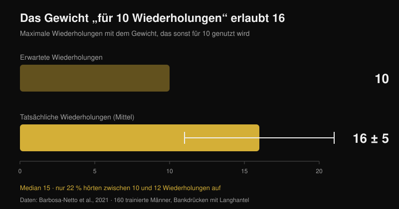

# Funktioniert Online-Coaching? Was Studien zeigen

Von [Giammaria Loi](/autore/giammaria-loi) · aktualisiert am 26. Oktober 2026

„Du bezahlst jemanden, der dich nie trainieren sieht." Das ist der erste Einwand gegen Online-Coaching, und er hat eine reale Grundlage: Es gibt Studien, in denen zwei Gruppen denselben Plan befolgen und jene mit einem Trainer daneben stärker herauskommt. Ich habe sieben indexierte Arbeiten zu Betreuung, Intensität und ferngesteuertem Training gelesen. Der Unterschied existiert — aber er entsteht nicht dort, wo fast alle ihn vermuten, und das ändert völlig, was du von einem Online-Coach verlangen solltest.

## Kurz gefasst

- **Gleicher Plan, andere Ergebnisse.** Zwölf Wochen identisches periodisiertes Programm: Wer mit einem Personal Trainer daneben trainierte, steigerte die Lasten schneller und schloss mit höheren Maximalwerten in Kniebeuge und Bankdrücken ab als die unbetreute Gruppe (Mazzetti et al., 2000).
- **Wie eng betreut wird, zählt.** Bei einem Trainer auf 5 Personen stieg das Bankdrücken-1RM um **15,9 %**, bei einem Trainer auf 25 nur um **10,2 %**; die Kraft der Kniestrecker verbesserte sich (**+11,8 %**) ausschließlich in der eng betreuten Gruppe (Gentil und Bottaro, 2010).
- **Es ist nicht Motivation, es ist Intensität.** In derselben Studie waren Anwesenheit und Trainingsvolumen in beiden Gruppen gleich. Unterschiedlich war der Anteil der Personen, die tatsächlich mit maximaler Intensität trainierten.
- **Allein drückst du weniger, als du denkst.** 160 trainierte Männer legten beim Bankdrücken das Gewicht auf, das sie sonst „für 10 Wiederholungen" nutzen: Es wurden **16 ± 5** (Median 15), und nur 22 % hörten zwischen 10 und 12 auf (Barbosa-Netto et al., 2021).
- **Aus der Ferne trägt es — aber nicht überall.** Sechzehn Wochen desselben Programms per Videokonferenz waren dem Präsenztraining bei Körpergewicht, Fettmasse, aerober Leistung und Kniestreckerkraft nicht unterlegen; bei Griffkraft, Rumpfstreckung und Kniebeugung hielt der Vergleich nicht (Langeard et al., 2022).

## Ein Coach gibt dir keinen besseren Plan — er sorgt dafür, dass du deinen ausführst

Die Studie, die diese Forschungslinie begründet hat, stammt von 2000 und hat ein fast grobes Design. Zwanzig mäßig trainierte Männer wurden auf zwei Gruppen verteilt: eine trainierte unter direkter Aufsicht eines Personal Trainers, die andere allein. Das Programm war identisch: zwölf Wochen lineare Periodisierung mit Vorbereitungsphase (10-12 Wiederholungsmaximum), Hypertrophie (8-10), Kraft (5-8) und Peaking (3-6), mit freien Gewichten und Maschinen (Mazzetti et al., 2000).

Das Interessante ist nicht, dass die betreute Gruppe besser abschnitt, sondern *wo* sie besser abschnitt. Die mittlere Last pro Satz war in der betreuten Gruppe ab der siebten Woche in der Kniebeuge und bereits ab der dritten im Bankdrücken signifikant höher. Auch das Tempo, mit dem die Last Woche für Woche stieg, war größer. Nach zwölf Wochen waren Kniebeuge und Bankdrücken im Maximum mit Betreuung signifikant höher. Beide Gruppen verbesserten sich — aber eine hatte den Plan wirklich durchgezogen, den die andere nur halb absolviert hatte.

Anders gesagt: Der Wert des Coaches lag in dieser Studie nicht in der Programmierung, die für alle gleich war, sondern darin, dass jemand auf die Hantel schaute und sagte: „Leg fünf Kilo drauf."

## Was sich ändert, ist die Intensität, nicht die körperliche Anwesenheit

Die Folgestudie erklärt den Mechanismus und ist für jeden, der ein Online-Coaching beurteilt, die wichtigste der sieben. Einhundertvierundzwanzig untrainierte junge Männer absolvierten elf Wochen dasselbe Programm, aufgeteilt in zwei Gruppen, die sich nur in einem unterschieden: dem Verhältnis von Betreuern zu Trainierenden auf der Fläche, 1 zu 5 oder 1 zu 25 (Gentil und Bottaro, 2010).

Beim hohen Betreuungsverhältnis stieg das Bankdrücken-Maximum um **15,9 %** gegenüber **10,2 %** beim niedrigen, und die Kraft der Kniestrecker verbesserte sich signifikant (**+11,8 %**) nur in der eng betreuten Gruppe. Die Gruppenunterschiede waren bei beiden Messgrößen statistisch signifikant.

Dann kommt die Zahl, die die übliche Erklärung zerlegt. Zwischen beiden Gruppen gab es **keinen** Unterschied in der Anwesenheit und keinen im Arbeitsvolumen bei Bankdrücken und Beinpresse. Verschieden war allein der Anteil der Personen, die mit maximaler Intensität trainierten — höher in der eng betreuten Gruppe. Der Coach wirkte nicht, weil er die Leute konstant hielt (das waren sie schon), sondern weil er sie in jedem Satz näher an die Grenze brachte.

Eine dritte Arbeit führt dieselbe Logik weiter: Ältere Frauen, die sechzehn Wochen mit einem Verhältnis von 1:2 trainierten, zeigten größere Effektstärken bei den Maximalwerten als bei 1:5, und nur in der enger betreuten Gruppe sank die Fettmasse (Vieira et al., 2020). Kleine Stichprobe, keine ausgewiesenen Gruppenunterschiede — also ein Hinweis, kein Beweis, der aber in dieselbe Richtung zeigt.

## Der blinde Fleck: wie hart du wirklich drückst

Wenn der Mechanismus die Intensität ist, lautet die nächste Frage: Wie stark irrt sich jemand, der allein trainiert? Eine Studie hat das denkbar schonungslos gemessen.

160 trainierten Männern wurde eine einzige Frage gestellt: „Welches Gewicht nimmst du normalerweise für 10 Wiederholungen im Bankdrücken mit der Langhantel?" Nach kurzem Aufwärmen sollten sie damit so viele Wiederholungen wie möglich machen. Im Mittel waren es **16 ± 5 Wiederholungen**, Median 15 — ein riesiger und statistisch sehr robuster Abstand zu den angegebenen 10 (p < 0,001). Der häufigste Bereich lag bei 13-15 Wiederholungen (31 % der Stichprobe), und nur 22 % hörten zwischen 10 und 12 auf (Barbosa-Netto et al., 2021).

Die Autoren schreiben es ohne Umschweife: Diese Trainingsroutinen waren mit maximaler Anstrengung nicht vereinbar. Es ging nicht um Anfänger, sondern um trainierte Männer, die überzeugt waren, ihr 10er-Gewicht zu benutzen. Genau deshalb zählt die Wiederholungszahl weniger als der Abstand zum Muskelversagen — ein Punkt, den ich in [wie viele Wiederholungen wirklich Muskeln aufbauen](/de/blog/wie-viele-wiederholungen-muskelaufbau) ausgeführt habe.

Der Coach auf der Fläche korrigiert diesen Fehler in Echtzeit. Die eigentliche Frage beim Online-Coaching ist, ob es einen anderen Weg gibt, ihn zu korrigieren.

## Funktioniert Betreuung aus der Ferne also? Es kommt darauf an, was sie kontrollieren soll

Der sauberste direkte Vergleich stammt aus einer Nichtunterlegenheitsstudie mit gesunden älteren Erwachsenen. Drei Gruppen: kein Training, Heimtraining mit Anleitung vor Ort, Heimtraining mit Anleitung per Videokonferenz. Identisches Programm für beide aktiven Gruppen, kombiniertes Training, sechzehn Wochen, eine Stunde zweimal pro Woche (Langeard et al., 2022).

Die Videokonferenz war dem Präsenztraining **nicht unterlegen** bei Körpergewicht, Fettmasse, maximaler aerober Leistung, maximaler Herzfrequenz, maximaler Sauerstoffaufnahme, Kraft in der Kniestreckung und Leistung der unteren Extremität. **Nicht** nachgewiesen wurde die Nichtunterlegenheit bei Muskelmasse, Griffkraft, Rumpfstreckung und Kniebeugung. Die Autoren sagen es deutlich: Bei diesen isometrischen Kraftwerten bleibt die Präsenz überlegen.

Eine zweite randomisierte Studie zeigt, dass aus der Ferne auch mit Schmerzpatienten gearbeitet werden kann: 130 Pflegekräfte ergänzten zwölf Wochen lang Kraftübungen unter Live-Videoanleitung, und die Experimentalgruppe reduzierte die durchschnittliche Intensität der Rückenschmerzen gegenüber der Kontrolle (p = 0,034), mit Verbesserungen auch an Hand und Handgelenk sowie bei der Muskelleistung der oberen Extremität. In der Per-Protocol-Analyse erzielten Teilnehmende mit mindestens 50 % absolvierten Einheiten zusätzliche Effekte auf Stimmung, Lebensqualität und Medikamentenkonsum (Espin et al., 2024).

Eine ehrliche Einschränkung, weil sie die Lesart dieser Zahlen verändert: Die Teilnehmenden beider Studien waren gesunde ältere Menschen und Beschäftigte, keine Kraftsportler. Sie zeigen, dass Anleitung aus der Ferne echte Anpassungen erzeugt. Sie sagen nicht, wie nah ein fortgeschrittener Powerlifter an seinen Präsenz-Coach herankommt. Diesen Vergleich gibt es in der Literatur bislang nicht.

## Was ein Coach aus der Ferne messen muss, um so viel wert zu sein wie einer im Studio

Von hier schreibt sich die praktische Konsequenz fast von selbst. Der Präsenz-Coach hat einen einzigen belegten Vorteil: Er sieht, wie weit du vom Muskelversagen entfernt bist, und lässt dich das Gewicht erhöhen. Ein Online-Coach ist gleichauf, wenn er einen verlässlichen Weg hat, dasselbe zu wissen.

Dieses Werkzeug existiert und ist untersucht. Eine Übersicht über 31 Studien zu RIR-Skalen — den Wiederholungen, die am Satzende noch in Reserve wären — kommt zu dem Schluss, dass sie sowohl zur Vorgabe der Intensität als auch zur Anpassung der Last brauchbar und nützlich sind, mit einer Einschränkung: Die Schätzung ist genauer, wenn sie nahe am Versagen erfolgt, nicht zehn Wiederholungen davor (Bastos et al., 2024).

Übersetzt: Ein Coach, der nur „gemacht, lief gut" bekommt, ist genauso blind wie der 1:25-Betreuer in Gentils Studie. Ein Coach, der Last, Wiederholungen und RIR Satz für Satz bekommt, dazu das Video des letzten Satzes der Grundübungen, hat die beiden Daten, die er braucht, um das Einzige zu tun, was zählt: dir zu sagen, wann du erhöhst.

## Was die Forschung wirklich sagt

| Behauptung | Urteil | Die Daten |
| --- | --- | --- |
| Ein Coach, der zusieht, lässt dich mehr Fortschritt machen | **Bestätigt** | Gleicher Plan über 12 Wochen: höhere Lasten pro Satz und höhere Maxima mit direkter Betreuung (Mazzetti et al., 2000) |
| Er dient vor allem der Motivation und der Anwesenheit | **Widerlegt** | Zwischen 1:5 und 1:25 waren Anwesenheit und Volumen gleich; verschieden war der Anteil mit maximaler Intensität (Gentil und Bottaro, 2010) |
| „Ich weiß allein, wann ich drücken muss" | **Widerlegt** | Das Gewicht „für 10" erlaubte 16 ± 5; nur 22 % hörten zwischen 10 und 12 auf (Barbosa-Netto et al., 2021) |
| Online-Coaching bringt dieselben Ergebnisse wie Präsenz | **Mit Einschränkung** | Nicht unterlegen bei Gewicht, Fettmasse, VO2max, Kniestreckerkraft und Beinleistung; nicht bei Griffkraft, Rumpf und Kniebeugung (Langeard et al., 2022) |
| Mit Schmerzen kann man aus der Ferne nicht trainieren | **Widerlegt** | 12 Wochen videogeführtes Training senkten die Rückenschmerzen bei 130 Pflegekräften (Espin et al., 2024) |
| Ohne den Satz zu sehen, lässt sich die Intensität nicht steuern | **Mit Einschränkung** | RIR-Skalen taugen zur Vorgabe und Anpassung der Last, die Schätzung ist aber nur nahe am Versagen genau (Bastos et al., 2024) |
| Je enger das Betreuungsverhältnis, desto besser | **Nicht belegt** | Ein Vergleich 1:2 gegen 1:5 bei älteren Frauen zeigt größere Effekte, aber bei kleiner Stichprobe (Vieira et al., 2020) |

## So setzt du es um

1. **Beurteile einen Online-Coach danach, was er misst, nicht danach, wie oft er schreibt.** Eine Frage vor der Zahlung: Woran erkennst du, wie weit ich in jedem Satz vom Versagen entfernt bin?
2. **Notiere Last, Wiederholungen und RIR in jedem Arbeitssatz.** Ohne diese drei Zahlen zusammen kann niemand aus der Ferne entscheiden, ob nächste Woche mehr Gewicht draufkommt.
3. **Eiche deinen RIR einmal mit einem Test.** Nimm an einer sicheren Übung (Maschine oder Langhantel mit Ablagen) die Last, die du „für 10" nutzen würdest, und geh bis zum Versagen. Kommen 15 heraus, war dein „10" in Wahrheit RIR 5 und deine ganze Skala ist verschoben.
4. **Schick das Video des letzten Satzes, nicht des Aufwärmens.** Nur dort sieht man die Technik unter Ermüdung und den tatsächlich verbliebenen Spielraum.
5. **Verlange eine schriftliche Progressionsregel.** Zum Beispiel: Satz mit RIR 2 oder mehr beendet, nächstes Training mehr Gewicht. Eine solche Regel funktioniert auch in Wochen, in denen der Coach spät antwortet.
6. **Deck die blinden Flecken mit Zahlen ab.** Am schlechtesten hielten aus der Ferne Griffkraft und Rumpfstabilität: Wenn sie dir wichtig sind, plane sie als Übungen mit Last und Zeit zum Notieren, nicht als Zusatzarbeit „nach Gefühl".

**Mit Nurvan.** Betreuung aus der Ferne bricht immer an derselben Stelle: Der Coach sieht die Zahlen hinter deinen Sätzen nicht. In Nurvan arbeiten Coach und Athlet am selben Plan, und jeder Satz erfasst Last, Wiederholungen und RIR — der Verlauf zeigt dem Coach, ob du Fortschritte machst oder seit drei Wochen beim gleichen Gewicht stehst. Aufwärmsätze werden automatisch vorgeschlagen, und ein Plan, der bereits als PDF, Excel oder sogar als Foto vorliegt, lässt sich ohne Abtippen importieren. [Nurvan testen](https://nurvan.app)

## Häufige Fragen

**Funktioniert Online-Coaching wirklich?**
Ja: In den verfügbaren Studien erzeugt es echte Anpassungen bei Kraft, Körperzusammensetzung, Ausdauerleistung und Rückenschmerzen. Der direkte Vergleich mit der Präsenz hält bei vielen Parametern, aber nicht bei allen, und alle Daten stammen von gesunden Erwachsenen oder Beschäftigten, nicht von fortgeschrittenen Kraftsportlern.

**Online-Coach oder Trainer im Studio?**
Das hängt davon ab, woran es fehlt. Ist die Technik bei komplexen Übungen das Problem oder die Scheu, wirklich hart zu arbeiten, hat die körperliche Anwesenheit einen Vorteil, den kein Chat ersetzt. Sitzt die Technik und hakt es an der Laststeigerung, arbeitet ein Online-Coach, der Last, Wiederholungen und RIR bekommt, an genau dem Mechanismus, der in den Studien den Unterschied gemacht hat.

**Woran erkennt ein Coach aus der Ferne, ob ich hart genug trainiert habe?**
An den Daten, die du schickst. RIR-Skalen sind das dafür untersuchte Werkzeug, mit einer bekannten Grenze: Die Schätzung ist nahe am Versagen verlässlich, sechs oder sieben Wiederholungen davor deutlich weniger. Deshalb sagt ein Video des letzten Satzes mehr als zehn Nachrichten.

**Taugt Online-Coaching für Anfänger?**
Gerade bei Untrainierten zeigte die Betreuung die größten Effekte — ein schlecht betreuter Anfänger verliert also viel. Wer bei null startet, sollte in den ersten Wochen Live-Videocalls verlangen und wenige Übungen, die sich per Video gut kontrollieren lassen.

## Lies auch

- [Wie viele Wiederholungen für Muskelaufbau? Der 8-12-Mythos](/de/blog/wie-viele-wiederholungen-muskelaufbau) — warum der Abstand zum Versagen mehr zählt als die Wiederholungszahl
- [Trainingssplit: Anfänger oder Fortgeschrittene?](/de/blog/trainingssplit-anfaenger-fortgeschrittene) — wie viel Struktur du auf deinem Niveau wirklich brauchst

## Quellen

1. Mazzetti SA, Kraemer WJ, Volek JS, Duncan ND, Ratamess NA, Gómez AL, Newton RU, Häkkinen K, Fleck SJ, 2000. The influence of direct supervision of resistance training on strength performance. *Med Sci Sports Exerc*. PMID [10862549](https://pubmed.ncbi.nlm.nih.gov/10862549/) · [DOI](https://doi.org/10.1097/00005768-200006000-00023)
2. Gentil P, Bottaro M, 2010. Influence of supervision ratio on muscle adaptations to resistance training in nontrained subjects. *J Strength Cond Res*. PMID [19661830](https://pubmed.ncbi.nlm.nih.gov/19661830/) · [DOI](https://doi.org/10.1519/JSC.0b013e3181ad3373)
3. Barbosa-Netto S, d'Acelino-e-Porto OS, Almeida MB, 2021. Self-Selected Resistance Exercise Load: Implications for Research and Prescription. *J Strength Cond Res*. PMID [29112055](https://pubmed.ncbi.nlm.nih.gov/29112055/) · [DOI](https://doi.org/10.1519/JSC.0000000000002287)
4. Langeard A, Bigot L, Maffiuletti NA, Moussay S, Sesboüé B, Quarck G, Gauthier A, 2022. Non-inferiority of a home-based videoconference physical training program in comparison with the same program administered face-to-face in healthy older adults: the MOTION randomised controlled trial. *Age Ageing*. PMID [35290431](https://pubmed.ncbi.nlm.nih.gov/35290431/) · [DOI](https://doi.org/10.1093/ageing/afac059)
5. Espin A, Irazusta J, Aiestaran M, Latorre Erezuma U, García-García J, Arrinda I, Acedo K, Rodriguez-Larrad A, 2024. Videoconference-Supervised Group Exercise Reduces Low Back Pain in Eldercare Workers: Results from the ReViEEW Randomised Controlled Trial. *J Occup Rehabil*. PMID [38632115](https://pubmed.ncbi.nlm.nih.gov/38632115/) · [DOI](https://doi.org/10.1007/s10926-024-10182-2)
6. Bastos V, Machado S, Teixeira DS, 2024. Feasibility and Usefulness of Repetitions-In-Reserve Scales for Selecting Exercise Intensity: A Scoping Review. *Percept Mot Skills*. PMID [38563729](https://pubmed.ncbi.nlm.nih.gov/38563729/) · [DOI](https://doi.org/10.1177/00315125241241785)
7. Vieira DCL, Nascimento DC, Tajra V, Teixeira TG, Farias DL, Tibana RA, Silva AO, Rosa TS, De Moraes MR, Voltarelli FA, Navalta JW, Prestes J, 2020. High Supervised Resistance Training in Elderly Women: The Role of Supervision Ratio. *Int J Exerc Sci*. PMID [32509119](https://pubmed.ncbi.nlm.nih.gov/32509119/) · [DOI](https://doi.org/10.70252/WNVF6463)

Trendsignal: ACSM, *Worldwide Fitness Trends 2026* (veröffentlicht am 22. Oktober 2025), mit Trainings-Apps auf Platz 4 und datenbasierter Technologie auf Platz 8. Text, Struktur und Prüfungen dieses Artikels sind original.

---

**Giammaria Loi** ist der Gründer von Nurvan. Er trainiert seit 2012 mit Gewichten, arbeitet seit 2013 als FIPE-zertifizierter Personal Trainer und Coach und startet seit 2018 national im Powerlifting.

> Hinweis: informativer Inhalt, kein Ersatz für die Einschätzung einer Ärztin, eines Arztes oder einer Fachperson. Bei Schmerzen oder einer bestehenden Erkrankung sprich mit einer Ärztin oder einem Arzt, bevor du ein Trainingsprogramm beginnst oder änderst — vor Ort wie aus der Ferne.
