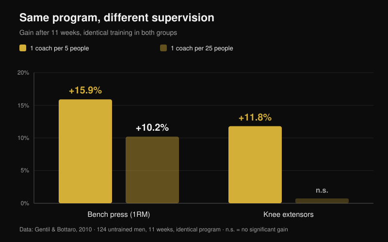
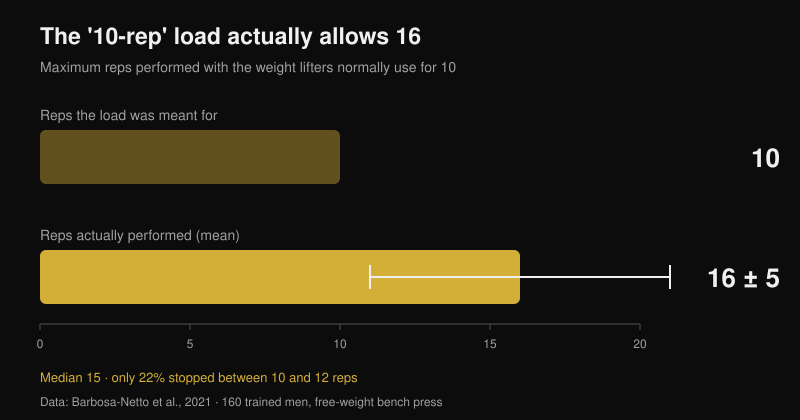

# Does online coaching work? What the studies say

By [Giammaria Loi](/autore/giammaria-loi) · updated 26 October 2026

"You are paying someone who never actually watches you lift." It is the first objection to online coaching, and it has real support: there are studies where two groups run the exact same program and the one with a trainer standing next to them ends up stronger. I read seven indexed papers on supervision, training intensity and remotely guided exercise. The gap is real — but it does not come from where most people assume, and that changes what you should demand from an online coach.

## The short version

- **Same program, different results.** Twelve weeks on an identical periodized plan: the group training under a personal trainer raised their loads faster and finished with higher maximal squat and bench press than the unsupervised group (Mazzetti et al., 2000).
- **How closely you are watched matters.** With one trainer per 5 people, bench press 1RM rose **15.9%**, against **10.2%** with one trainer per 25; knee extensor strength improved (**+11.8%**) only in the closely supervised group (Gentil & Bottaro, 2010).
- **It is not motivation. It is intensity.** In that same study, attendance and training volume were identical between groups. What differed was the share of people actually training at maximal intensity.
- **On your own you push less than you think.** 160 trained men loaded the bench with the weight they normally use "for 10 reps": they performed **16 ± 5** reps (median 15), and only 22% stopped between 10 and 12 (Barbosa-Netto et al., 2021).
- **Remote holds up — but not on everything.** Sixteen weeks of the same program delivered by videoconference was not inferior to face-to-face for body weight, fat mass, aerobic power and knee extension strength; for grip, trunk extension and knee flexion the comparison failed (Langeard et al., 2022).

## A coach does not give you a better program. He makes you run the one you have

The study that started this line of research is from 2000 and its design is almost crude. Twenty moderately trained men were split into two groups: one trained under the direct supervision of a personal trainer, the other trained alone. The program was identical — twelve weeks, linear periodization through preparatory (10-12RM), hypertrophy (8-10RM), strength (5-8RM) and peaking (3-6RM) phases, free weights and machines (Mazzetti et al., 2000).

The interesting result is not "the supervised group did better". It is *where* it did better. Mean training load per set became significantly higher in the supervised group from week seven onward in the squat, and as early as week three in the bench press. The rate at which load climbed week after week was higher too. At twelve weeks, maximal squat and bench press were significantly greater with supervision. Both groups improved — but one of them had actually run the program the other had half-run.

Put differently: in that trial the value of the coach was not in the programming, which was the same for everyone. It was in someone looking at the bar and saying "add five kilos".

## What changes is intensity, not physical presence

The follow-up study explains the mechanism, and for anyone judging an online coaching service it is the most important of the seven. One hundred and twenty-four untrained young men trained for eleven weeks on the same program, split into two groups that differed in one thing only: the coach-to-trainee ratio on the gym floor, 1 to 5 or 1 to 25 (Gentil & Bottaro, 2010).

With the high ratio, bench press 1RM rose **15.9%** against **10.2%** with the low ratio, and knee extensor strength improved significantly (**+11.8%**) only in the closely supervised group. Between-group differences were statistically significant for both measures.

Then comes the number that kills the usual explanation. There was **no** difference between groups in training attendance, nor in work volume on bench press and leg press. The only thing that differed was the proportion of subjects training at maximal intensity, which was higher in the closely supervised group. The coach did not work by keeping people consistent — they already were. He worked by pushing them closer to their limit on every set.

A third paper pushes the same logic further: older women trained for sixteen weeks at a 1:2 ratio showed larger effect sizes on 1RM tests than at 1:5, and only the more closely supervised group reduced body fat (Vieira et al., 2020). Small sample, no declared between-group differences, so treat it as a hint rather than proof — but it points the same way.

## The blind spot: how hard you are actually pushing

If intensity is the mechanism, the next question is how far off a person left alone really is. One study measured it in the bluntest way possible.

160 trained men were asked a single question: "what weight do you usually lift for 10 reps on the free-weight bench press?" After a short warm-up they were told to perform as many reps as possible with it. The average was **16 ± 5 reps**, median 15 — a huge and statistically robust gap from the 10 they had just declared (p < 0.001). The most common range was 13-15 reps (31% of the sample) and only 22% stopped between 10 and 12 (Barbosa-Netto et al., 2021).

The authors state it plainly: those training routines were not compatible with maximal effort. These were not beginners. They were trained men, convinced they were using their 10-rep load. It is also why the rep number matters less than how close you get to failure, a point I worked through in [how many reps actually build muscle](/en/blog/how-many-reps-build-muscle).

A coach on the gym floor fixes this in real time. The real question about online coaching is whether anything else can.

## So does remote coaching work? It depends on what it has to control

The cleanest head-to-head comes from a non-inferiority trial in healthy older adults. Three groups: no training, home training guided face-to-face, home training guided by videoconference. Identical program for the two active groups, combined training, sixteen weeks, one hour twice a week (Langeard et al., 2022).

Videoconference was **non-inferior** to face-to-face for body weight, fat mass, maximal aerobic power, maximal heart rate, maximal oxygen uptake, knee extension strength and lower-limb power. It was **not** non-inferior for muscle mass, handgrip strength, trunk extension and knee flexion. The authors are explicit: for those isometric strength measures, face-to-face still wins.

A second randomized trial shows that remote work is possible even with people in pain: 130 eldercare workers added twelve weeks of resistance exercise supervised by real-time videoconference, and the experimental group reduced average low back pain intensity compared with controls (p = 0.034), with improvements in hand and wrist pain and in upper-limb muscle performance. In the per-protocol analysis, those who completed at least 50% of the sessions gained further benefits in mood, quality of life and medication use (Espin et al., 2024).

One honest caveat, because it changes how these numbers should be read: participants in both trials were healthy older adults and care workers, not strength athletes. They show that remote guidance produces real adaptations. They do not tell you how close an advanced powerlifter gets to his in-person coach. That comparison does not exist in the literature yet.

## What a remote coach has to measure to be worth as much as one in the gym

From here the practical conclusion writes itself. The in-person coach has one demonstrated advantage: he can see how far you are from failure and make you add weight. An online coach is on equal footing if he has a reliable way of knowing the same thing.

That tool exists and has been studied. A review of 31 studies on RIR scales — reps in reserve, how many reps you could still have done at the end of a set — concludes that they are feasible and useful both for prescribing intensity and for adjusting load, with one caveat: the estimate is more accurate when made close to failure, not ten reps out (Bastos et al., 2024).

Translated: a coach who only receives "done, felt good" is exactly as blind as the 1:25 trainer in Gentil's study. A coach who receives load, reps and RIR set by set, plus video of the last set on the main lifts, has the two data points he needs to do the only thing that matters — tell you when to go up.

## What the research actually says

| Claim | Verdict | The data |
| --- | --- | --- |
| A coach watching you makes you progress more | **Confirmed** | Same program for 12 weeks: higher loads per set and higher maxes with direct supervision (Mazzetti et al., 2000) |
| He is mostly there to motivate you and get you to show up | **Busted** | Between 1:5 and 1:25, attendance and volume were equal; what changed was the share training at maximal intensity (Gentil & Bottaro, 2010) |
| "I know when to push on my own" | **Busted** | The load used "for 10" allowed 16 ± 5; only 22% stopped between 10 and 12 (Barbosa-Netto et al., 2021) |
| Online coaching gives the same results as in person | **Needs nuance** | Non-inferior for body weight, fat mass, VO2max, knee extension strength and lower-limb power; not for grip, trunk and knee flexion (Langeard et al., 2022) |
| You cannot coach someone in pain remotely | **Busted** | 12 weeks of videoconference-supervised exercise reduced low back pain in 130 eldercare workers (Espin et al., 2024) |
| Without seeing the set you cannot control intensity | **Needs nuance** | RIR scales work for prescribing and adjusting load, but the estimate is only accurate close to failure (Bastos et al., 2024) |
| The tighter the coach-to-athlete ratio, the better | **Unverified** | A 1:2 vs 1:5 comparison in older women shows larger effects with more supervision, but on a small sample (Vieira et al., 2020) |

## How to use this

1. **Judge an online coach by what he measures, not by how often he messages you.** One question before you pay: how will you know how close to failure I am on each set?
2. **Log load, reps and RIR on every working set.** Without all three together, nobody at a distance can decide whether you add weight next week.
3. **Calibrate your RIR once, with a test.** On a safe exercise (machine, or barbell with safety pins) take the load you would use "for 10" and go to failure. If 15 come out, your "10" was really RIR 5 and your whole scale is shifted.
4. **Send video of the last set, not the warm-up.** It is the only one that shows technique under fatigue and how much margin was really left.
5. **Insist on a written progression rule.** For example: finish a set at RIR 2 or more and you go up next session. A rule like that keeps working in the weeks your coach is slow to reply.
6. **Cover the blind spots with numbers.** The measures that held up worst remotely were grip and trunk stability: if they matter to you, program them as exercises with a load and a time to record, not as accessory work "by feel".

**With Nurvan.** Remote coaching always breaks at the same point: the coach cannot see the numbers behind your sets. In Nurvan the coach and the athlete work on the same plan, and every set records load, reps and RIR, so the history shows the coach whether you are progressing or stuck on the same weight for three weeks. Warm-up sets are proposed automatically, and a plan already written in PDF, Excel or even a photo can be imported without retyping it. [Try Nurvan](https://nurvan.app)

## FAQ

**Does online coaching actually work?**
Yes — in the available studies it produces real adaptations: strength, body composition, aerobic capacity and reduced low back pain. The head-to-head with in-person training holds on many outcomes but not all, and every dataset comes from healthy adults or workers, not advanced strength athletes.

**Online coach or a coach at the gym?**
It depends on what you are missing. If your problem is technique on complex lifts or the fear of pushing hard, physical presence has an advantage no chat replicates. If technique is there and the problem is load progression, an online coach who receives load, reps and RIR is working on exactly the mechanism that made the difference in the studies.

**How can a remote coach know whether I trained hard enough?**
From the data you send. RIR scales are the studied tool for this, with a known limit: the estimate is reliable close to failure, much less so six or seven reps out. That is why one video of your last set beats ten messages.

**Is online coaching suitable for a beginner?**
Supervision showed its largest effects precisely in untrained people, so a badly coached beginner loses a lot. If you are starting from zero, ask for live video calls in the first weeks and a short list of exercises that are easy to check on video.

## Read next

- [How many reps build muscle? The 8-12 myth](/en/blog/how-many-reps-build-muscle) — why distance from failure matters more than the rep number
- [Training split: beginner vs advanced lifter](/en/blog/training-split-beginner-vs-advanced) — how much structure you actually need at your level

## References

1. Mazzetti SA, Kraemer WJ, Volek JS, Duncan ND, Ratamess NA, Gómez AL, Newton RU, Häkkinen K, Fleck SJ, 2000. The influence of direct supervision of resistance training on strength performance. *Med Sci Sports Exerc*. PMID [10862549](https://pubmed.ncbi.nlm.nih.gov/10862549/) · [DOI](https://doi.org/10.1097/00005768-200006000-00023)
2. Gentil P, Bottaro M, 2010. Influence of supervision ratio on muscle adaptations to resistance training in nontrained subjects. *J Strength Cond Res*. PMID [19661830](https://pubmed.ncbi.nlm.nih.gov/19661830/) · [DOI](https://doi.org/10.1519/JSC.0b013e3181ad3373)
3. Barbosa-Netto S, d'Acelino-e-Porto OS, Almeida MB, 2021. Self-Selected Resistance Exercise Load: Implications for Research and Prescription. *J Strength Cond Res*. PMID [29112055](https://pubmed.ncbi.nlm.nih.gov/29112055/) · [DOI](https://doi.org/10.1519/JSC.0000000000002287)
4. Langeard A, Bigot L, Maffiuletti NA, Moussay S, Sesboüé B, Quarck G, Gauthier A, 2022. Non-inferiority of a home-based videoconference physical training program in comparison with the same program administered face-to-face in healthy older adults: the MOTION randomised controlled trial. *Age Ageing*. PMID [35290431](https://pubmed.ncbi.nlm.nih.gov/35290431/) · [DOI](https://doi.org/10.1093/ageing/afac059)
5. Espin A, Irazusta J, Aiestaran M, Latorre Erezuma U, García-García J, Arrinda I, Acedo K, Rodriguez-Larrad A, 2024. Videoconference-Supervised Group Exercise Reduces Low Back Pain in Eldercare Workers: Results from the ReViEEW Randomised Controlled Trial. *J Occup Rehabil*. PMID [38632115](https://pubmed.ncbi.nlm.nih.gov/38632115/) · [DOI](https://doi.org/10.1007/s10926-024-10182-2)
6. Bastos V, Machado S, Teixeira DS, 2024. Feasibility and Usefulness of Repetitions-In-Reserve Scales for Selecting Exercise Intensity: A Scoping Review. *Percept Mot Skills*. PMID [38563729](https://pubmed.ncbi.nlm.nih.gov/38563729/) · [DOI](https://doi.org/10.1177/00315125241241785)
7. Vieira DCL, Nascimento DC, Tajra V, Teixeira TG, Farias DL, Tibana RA, Silva AO, Rosa TS, De Moraes MR, Voltarelli FA, Navalta JW, Prestes J, 2020. High Supervised Resistance Training in Elderly Women: The Role of Supervision Ratio. *Int J Exerc Sci*. PMID [32509119](https://pubmed.ncbi.nlm.nih.gov/32509119/) · [DOI](https://doi.org/10.70252/WNVF6463)

Trend signal: ACSM, *Worldwide Fitness Trends 2026* (published 22 October 2025), with mobile exercise apps ranked 4th and data-driven technology 8th. The text, structure and fact-checking in this article are original.

---

**Giammaria Loi** is the founder of Nurvan. He has been lifting since 2012, has worked as a FIPE-certified personal trainer and coach since 2013, and has competed in powerlifting at national level since 2018.

> Note: this is educational content and does not replace the advice of a doctor or qualified professional. If you have pain or an ongoing health condition, speak to a doctor before starting or changing a training program, in person or online.
