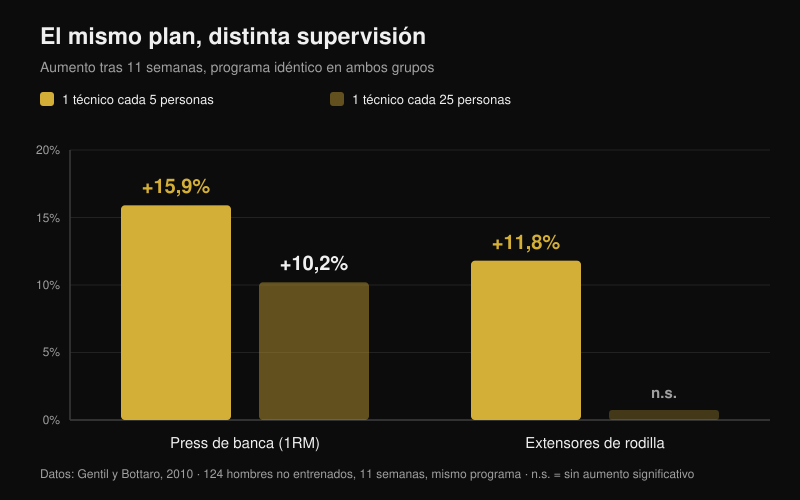
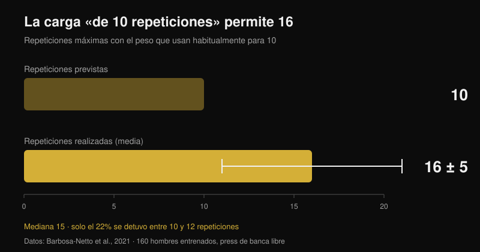

# ¿Funciona el coaching online? Esto dicen los estudios

Por [Giammaria Loi](/autore/giammaria-loi) · actualizado el 26 de octubre de 2026

"Pagas a alguien que nunca te ve entrenar." Es la primera objeción al coaching online y tiene base real: hay estudios en los que dos grupos siguen exactamente el mismo plan y el que tiene un técnico al lado termina más fuerte. He leído siete trabajos indexados sobre supervisión, intensidad y entrenamiento guiado a distancia. La diferencia existe, pero no nace donde casi todos creen, y eso cambia por completo lo que debes exigirle a un coach online.

## En resumen

- **El mismo plan, resultados distintos.** Doce semanas con un programa periodizado idéntico: el grupo que entrenó con un entrenador al lado subió las cargas más rápido y acabó con sentadilla y press de banca máximos más altos que el grupo sin supervisión (Mazzetti et al., 2000).
- **Cuánto te vigilan importa.** Con un técnico cada 5 personas el press de banca subió un **15,9%**, frente al **10,2%** con un técnico cada 25; la fuerza de los extensores de rodilla mejoró (**+11,8%**) solo en el grupo supervisado de cerca (Gentil y Bottaro, 2010).
- **No es motivación: es intensidad.** En ese mismo estudio la asistencia y el volumen de trabajo fueron iguales en ambos grupos. Lo que cambió fue la proporción de personas que de verdad entrenaba a intensidad máxima.
- **Solo aprietas menos de lo que crees.** 160 hombres entrenados cargaron en banca el peso que usan habitualmente "para 10 repeticiones": hicieron **16 ± 5** (mediana 15) y solo el 22% se detuvo entre 10 y 12 (Barbosa-Netto et al., 2021).
- **A distancia aguanta, pero no en todo.** Dieciséis semanas del mismo programa por videollamada no fueron inferiores al presencial en peso, masa grasa, potencia aeróbica y fuerza de extensores de rodilla; en prensión, extensión de tronco y flexión de rodilla la comparación no se sostuvo (Langeard et al., 2022).

## Un coach no te da un plan mejor: hace que uses bien el que tienes

El estudio que abrió esta línea es del año 2000 y tiene un diseño casi tosco. Veinte hombres moderadamente entrenados se repartieron en dos grupos: uno entrenaba bajo la supervisión directa de un entrenador personal y el otro solo. El programa era idéntico: doce semanas de periodización lineal con fase preparatoria (10-12 repeticiones máximas), hipertrofia (8-10), fuerza (5-8) y pico (3-6), con barras y máquinas (Mazzetti et al., 2000).

Lo interesante no es que el grupo supervisado fuera mejor, sino *dónde* fue mejor. La carga media por serie se volvió significativamente más alta en el grupo supervisado a partir de la séptima semana en sentadilla y ya desde la tercera en press de banca. También subía más rápido semana a semana. A las doce semanas, sentadilla y banca máximas eran significativamente mayores con supervisión. Los dos grupos mejoraron: pero uno hizo de verdad el plan que el otro hizo a medias.

Dicho de otro modo: en ese estudio el valor del coach no estaba en la programación, que era la misma, sino en que alguien mirara la barra y dijera "pon cinco kilos más".

## Lo que cambia es la intensidad, no la presencia física

El estudio siguiente explica el mecanismo y, para quien valora un coaching online, es el más importante de los siete. Ciento veinticuatro chicos no entrenados siguieron durante once semanas el mismo programa, divididos en dos grupos que se diferenciaban en una sola cosa: la proporción entre técnicos y alumnos en sala, 1 cada 5 o 1 cada 25 (Gentil y Bottaro, 2010).

Con la proporción alta, el press de banca máximo subió un **15,9%** frente al **10,2%** de la proporción baja, y la fuerza de los extensores de rodilla mejoró de forma significativa (**+11,8%**) solo en el grupo supervisado de cerca. Las diferencias entre grupos fueron estadísticamente significativas en ambas medidas.

Después llega el dato que desmonta la explicación habitual. Entre los dos grupos **no** hubo diferencias ni en asistencia ni en volumen de trabajo en banca y prensa. Lo único distinto fue la proporción de personas que entrenaba a intensidad máxima, mayor en el grupo supervisado de cerca. El coach no funcionó porque mantuviera a la gente constante —ya lo era— sino porque la llevaba más cerca del límite en cada serie.

Un tercer trabajo lleva la misma lógica un paso más allá: mujeres mayores entrenadas durante dieciséis semanas con una proporción 1:2 mostraron efectos mayores sobre los máximos que con 1:5, y solo en el grupo más supervisado bajó la masa grasa (Vieira et al., 2020). Muestra pequeña y sin diferencias declaradas entre grupos, así que vale como indicio, no como prueba, pero apunta en la misma dirección.

## El punto ciego: cuánto estás apretando de verdad

Si el mecanismo es la intensidad, la pregunta es cuánto se equivoca una persona que entrena sola. Hay un estudio que lo midió del modo más brutal posible.

A 160 hombres entrenados se les hizo una sola pregunta: "¿qué peso usas normalmente para 10 repeticiones en press de banca con barra?". Después de un calentamiento breve se les pidió hacer el máximo de repeticiones posible con él. La media fue de **16 ± 5 repeticiones**, con mediana 15: una diferencia enorme y muy sólida frente a las 10 declaradas (p < 0,001). El intervalo más frecuente fue 13-15 repeticiones (31% de la muestra) y solo el 22% se detuvo entre 10 y 12 (Barbosa-Netto et al., 2021).

Los autores lo escriben sin rodeos: esas rutinas de entrenamiento no eran compatibles con un esfuerzo máximo. No hablamos de principiantes: eran hombres entrenados convencidos de estar usando su carga de 10. Es también la razón por la que el número de repeticiones importa menos que la distancia al fallo, algo que desarrollé en [cuántas repeticiones hacen falta de verdad para la masa](/es/blog/cuantas-repeticiones-masa-muscular).

El coach en sala corrige ese error en tiempo real. La pregunta verdadera sobre el coaching online es si existe otra forma de corregirlo.

## ¿Entonces el entrenamiento a distancia funciona? Depende de qué deba controlar

La comparación directa más limpia viene de un estudio de no inferioridad en adultos mayores sanos. Tres grupos: sin entrenamiento, entrenamiento en casa guiado en persona y entrenamiento en casa guiado por videollamada. Programa idéntico para los dos grupos activos, combinado, dieciséis semanas, una hora dos veces por semana (Langeard et al., 2022).

La videollamada resultó **no inferior** al presencial en peso corporal, masa grasa, potencia aeróbica máxima, frecuencia cardiaca máxima, consumo máximo de oxígeno, fuerza en extensión de rodilla y potencia de miembros inferiores. **No** resultó no inferior en masa muscular, fuerza de prensión, extensión de tronco y flexión de rodilla. Los autores son explícitos: en esas medidas de fuerza isométrica el presencial sigue ganando.

Un segundo ensayo aleatorizado muestra que a distancia también se puede trabajar con quien tiene dolor: 130 trabajadores sociosanitarios añadieron durante doce semanas ejercicios de fuerza guiados por videoconferencia en directo, y el grupo experimental redujo la intensidad media del dolor lumbar frente al control (p = 0,034), con mejoras además en muñeca y mano y en el rendimiento muscular del tren superior. En el análisis por protocolo, quienes hicieron al menos el 50% de las sesiones obtuvieron beneficios añadidos en ánimo, calidad de vida y consumo de fármacos (Espin et al., 2024).

Una precisión honesta, porque cambia cómo leer estos números: los participantes de ambos estudios eran mayores sanos y trabajadores, no atletas de fuerza. Dicen que la guía a distancia produce adaptaciones reales; no dicen cuánto puede acercarse un powerlifter avanzado a su coach presencial. Esa comparación hoy no existe en la literatura.

## Qué debe medir un coach a distancia para valer lo mismo que uno en sala

Desde aquí la conclusión práctica se escribe sola. El coach presencial tiene una única ventaja demostrada: ve cuánto te falta para el fallo y te hace subir la carga. Un coach online está a la par si tiene una forma fiable de saber lo mismo.

La herramienta existe y está estudiada. Una revisión de 31 estudios sobre las escalas RIR —las repeticiones que aún te quedarían en la recámara al acabar la serie— concluye que son utilizables y útiles tanto para prescribir intensidad como para ajustar la carga, con una advertencia: la estimación es más precisa cuando se hace cerca del fallo, no a diez repeticiones del final (Bastos et al., 2024).

Traducido: un coach que solo recibe "hecho, todo bien" está tan ciego como el técnico 1:25 del estudio de Gentil. Un coach que recibe carga, repeticiones y RIR serie a serie, más el vídeo de la última serie de los básicos, tiene los dos datos que necesita para hacer lo único que cuenta: decirte cuándo subir.

## Qué dice realmente la investigación

| Afirmación | Veredicto | El dato |
| --- | --- | --- |
| Un coach que te mira te hace progresar más | **Confirmado** | El mismo plan durante 12 semanas: cargas por serie más altas y máximos mayores con supervisión directa (Mazzetti et al., 2000) |
| Sirve sobre todo para motivarte y para que vayas al gimnasio | **Desmentido** | Entre 1:5 y 1:25 la asistencia y el volumen fueron iguales; cambió la proporción de quienes entrenaban a intensidad máxima (Gentil y Bottaro, 2010) |
| "Yo solo ya sé cuándo apretar" | **Desmentido** | La carga usada "para 10" permitía 16 ± 5; solo el 22% paraba entre 10 y 12 (Barbosa-Netto et al., 2021) |
| El coaching online da los mismos resultados que el presencial | **Matizado** | No inferior en peso, masa grasa, VO2máx, fuerza de extensores de rodilla y potencia de piernas; no en prensión, tronco y flexión de rodilla (Langeard et al., 2022) |
| A distancia no se puede seguir a quien tiene dolor | **Desmentido** | 12 semanas de ejercicio guiado por videollamada redujeron el dolor lumbar en 130 trabajadores sociosanitarios (Espin et al., 2024) |
| Sin ver la serie es imposible controlar la intensidad | **Matizado** | Las escalas RIR sirven para prescribir y ajustar la carga, pero la estimación solo es precisa cerca del fallo (Bastos et al., 2024) |
| Cuanto más estrecha la relación coach-atleta, mejor | **No verificado** | Una comparación 1:2 frente a 1:5 en mujeres mayores muestra efectos mayores con más supervisión, pero con muestra pequeña (Vieira et al., 2020) |

## Cómo aplicarlo

1. **Valora a un coach online por lo que mide, no por cuánto te escribe.** La pregunta antes de pagar es una sola: ¿cómo vas a saber a qué distancia del fallo estoy en cada serie?
2. **Registra carga, repeticiones y RIR de cada serie efectiva.** Sin los tres números juntos, nadie a distancia puede decidir si la semana que viene tienes que añadir peso.
3. **Calibra tu RIR una vez, con un test.** En un ejercicio seguro (máquina o barra con topes de seguridad) coge la carga que usarías "para 10" y ve al fallo. Si salen 15, tu 10 era en realidad un RIR 5 y toda tu escala está desplazada.
4. **Manda el vídeo de la última serie, no del calentamiento.** Es la única en la que se ve la técnica con fatiga y cuánto margen quedaba de verdad.
5. **Exige una regla de progresión por escrito.** Por ejemplo: si cierras la serie con RIR 2 o más, el próximo entrenamiento subes carga. Una regla así funciona incluso las semanas en que el coach tarda en responder.
6. **Cubre los puntos ciegos con números.** Las medidas que peor aguantaron a distancia fueron prensión y estabilidad del tronco: si te importan, prográmalas como ejercicios con carga y tiempo que registrar, no como accesorios "a sensación".

**Con Nurvan.** El coaching a distancia se rompe siempre en el mismo punto: el coach no ve los números de tus series. En Nurvan coach y atleta trabajan sobre el mismo plan, y cada serie registra carga, repeticiones y RIR, así que el histórico le muestra al coach si progresas o llevas tres semanas parado en el mismo peso. Las series de calentamiento se proponen automáticamente, y una rutina ya escrita en PDF, Excel o incluso en foto se importa sin reescribirla a mano. [Prueba Nurvan](https://nurvan.app)

## Preguntas frecuentes

**¿El coaching online funciona de verdad?**
Sí: en los estudios disponibles produce adaptaciones reales en fuerza, composición corporal, capacidad aeróbica y reducción del dolor lumbar. La comparación directa con el presencial aguanta en muchos parámetros pero no en todos, y todos los datos vienen de adultos sanos o trabajadores, no de atletas de fuerza avanzados.

**¿Mejor un coach online o uno en el gimnasio?**
Depende de qué te falte. Si tu problema es la técnica en gestos complejos o el miedo a apretar, la presencia física tiene una ventaja que ningún chat replica. Si la técnica está y el problema es la progresión de cargas, un coach online que recibe carga, repeticiones y RIR trabaja sobre el mismo mecanismo que marcó la diferencia en los estudios.

**¿Cómo sabe un coach a distancia si he entrenado lo suficiente?**
Por los datos que le mandas. Las escalas RIR son la herramienta estudiada para esto, con un límite conocido: la estimación es fiable cerca del fallo y mucho menos a seis o siete repeticiones del final. Por eso un vídeo de la última serie vale más que diez mensajes.

**¿El coaching online sirve para un principiante?**
Es justo en los no entrenados donde la supervisión mostró los efectos más grandes, así que un principiante mal seguido a distancia pierde mucho. Si empiezas de cero, pide videollamadas en directo las primeras semanas y pocos ejercicios, fáciles de controlar en vídeo.

## Lee también

- [Cuántas repeticiones para masa muscular: el mito del 8-12](/es/blog/cuantas-repeticiones-masa-muscular) — por qué la distancia al fallo pesa más que el número de repeticiones
- [Rutina de entrenamiento: principiante o avanzado](/es/blog/rutina-entrenamiento-principiante-avanzado) — cuánta estructura necesitas según tu nivel

## Fuentes

1. Mazzetti SA, Kraemer WJ, Volek JS, Duncan ND, Ratamess NA, Gómez AL, Newton RU, Häkkinen K, Fleck SJ, 2000. The influence of direct supervision of resistance training on strength performance. *Med Sci Sports Exerc*. PMID [10862549](https://pubmed.ncbi.nlm.nih.gov/10862549/) · [DOI](https://doi.org/10.1097/00005768-200006000-00023)
2. Gentil P, Bottaro M, 2010. Influence of supervision ratio on muscle adaptations to resistance training in nontrained subjects. *J Strength Cond Res*. PMID [19661830](https://pubmed.ncbi.nlm.nih.gov/19661830/) · [DOI](https://doi.org/10.1519/JSC.0b013e3181ad3373)
3. Barbosa-Netto S, d'Acelino-e-Porto OS, Almeida MB, 2021. Self-Selected Resistance Exercise Load: Implications for Research and Prescription. *J Strength Cond Res*. PMID [29112055](https://pubmed.ncbi.nlm.nih.gov/29112055/) · [DOI](https://doi.org/10.1519/JSC.0000000000002287)
4. Langeard A, Bigot L, Maffiuletti NA, Moussay S, Sesboüé B, Quarck G, Gauthier A, 2022. Non-inferiority of a home-based videoconference physical training program in comparison with the same program administered face-to-face in healthy older adults: the MOTION randomised controlled trial. *Age Ageing*. PMID [35290431](https://pubmed.ncbi.nlm.nih.gov/35290431/) · [DOI](https://doi.org/10.1093/ageing/afac059)
5. Espin A, Irazusta J, Aiestaran M, Latorre Erezuma U, García-García J, Arrinda I, Acedo K, Rodriguez-Larrad A, 2024. Videoconference-Supervised Group Exercise Reduces Low Back Pain in Eldercare Workers: Results from the ReViEEW Randomised Controlled Trial. *J Occup Rehabil*. PMID [38632115](https://pubmed.ncbi.nlm.nih.gov/38632115/) · [DOI](https://doi.org/10.1007/s10926-024-10182-2)
6. Bastos V, Machado S, Teixeira DS, 2024. Feasibility and Usefulness of Repetitions-In-Reserve Scales for Selecting Exercise Intensity: A Scoping Review. *Percept Mot Skills*. PMID [38563729](https://pubmed.ncbi.nlm.nih.gov/38563729/) · [DOI](https://doi.org/10.1177/00315125241241785)
7. Vieira DCL, Nascimento DC, Tajra V, Teixeira TG, Farias DL, Tibana RA, Silva AO, Rosa TS, De Moraes MR, Voltarelli FA, Navalta JW, Prestes J, 2020. High Supervised Resistance Training in Elderly Women: The Role of Supervision Ratio. *Int J Exerc Sci*. PMID [32509119](https://pubmed.ncbi.nlm.nih.gov/32509119/) · [DOI](https://doi.org/10.70252/WNVF6463)

Señal de tendencia: ACSM, *Worldwide Fitness Trends 2026* (publicadas el 22 de octubre de 2025), con las apps de entrenamiento en 4.º puesto y la tecnología basada en datos en 8.º. El texto, la estructura y las verificaciones de este artículo son originales.

---

**Giammaria Loi** es el fundador de Nurvan. Entrena con pesas desde 2012, trabaja como entrenador personal y coach certificado FIPE desde 2013 y compite en powerlifting a nivel nacional desde 2018.

> Nota: contenido informativo, no sustituye la opinión de un médico o profesional. Si tienes dolor o una condición de salud en curso, háblalo con un médico antes de empezar o cambiar un programa de entrenamiento, presencial o a distancia.
