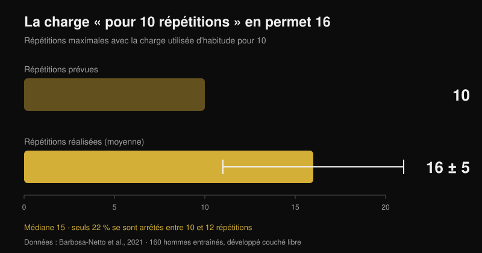

# Le coaching en ligne fonctionne-t-il ? Les études

Par [Giammaria Loi](/autore/giammaria-loi) · mis à jour le 26 octobre 2026

« Vous payez quelqu'un qui ne vous voit jamais soulever. » C'est la première objection au coaching en ligne, et elle repose sur du solide : il existe des études où deux groupes suivent exactement le même programme et où celui qui a un coach à côté finit plus fort. J'ai lu sept travaux indexés sur l'encadrement, l'intensité et l'entraînement guidé à distance. L'écart existe, mais il ne vient pas de là où presque tout le monde l'imagine — et cela change complètement ce qu'il faut exiger d'un coach en ligne.

## L'essentiel

- **Même programme, résultats différents.** Douze semaines de plan périodisé identique : le groupe encadré par un coach a augmenté ses charges plus vite et a terminé avec des maximums au squat et au développé couché supérieurs au groupe non encadré (Mazzetti et al., 2000).
- **Le degré d'encadrement compte.** Avec un coach pour 5 personnes, le développé couché a progressé de **15,9 %** contre **10,2 %** avec un coach pour 25 ; la force des extenseurs du genou n'a progressé (**+11,8 %**) que dans le groupe suivi de près (Gentil et Bottaro, 2010).
- **Ce n'est pas la motivation, c'est l'intensité.** Dans cette même étude, l'assiduité et le volume de travail étaient identiques entre les groupes. Ce qui changeait, c'était la part de pratiquants atteignant réellement l'intensité maximale.
- **Seul, on pousse moins qu'on ne le croit.** 160 hommes entraînés ont chargé au développé le poids qu'ils utilisent « pour 10 répétitions » : ils en ont fait **16 ± 5** (médiane 15), et seuls 22 % se sont arrêtés entre 10 et 12 (Barbosa-Netto et al., 2021).
- **À distance, ça tient — mais pas sur tout.** Seize semaines du même programme en visioconférence n'ont pas été inférieures au présentiel pour le poids, la masse grasse, la puissance aérobie et la force des extenseurs du genou ; pour la préhension, l'extension du tronc et la flexion du genou, la comparaison n'a pas tenu (Langeard et al., 2022).

## Un coach ne vous donne pas un meilleur programme : il vous fait exécuter le vôtre

L'étude fondatrice date de 2000 et son protocole est presque rudimentaire. Vingt hommes moyennement entraînés ont été répartis en deux groupes : l'un s'entraînait sous la supervision directe d'un coach, l'autre seul. Le programme était identique : douze semaines de périodisation linéaire avec phase préparatoire (10-12 répétitions maximales), hypertrophie (8-10), force (5-8) et pic (3-6), barres libres et machines (Mazzetti et al., 2000).

Le résultat intéressant n'est pas « le groupe encadré a fait mieux ». C'est *où* il a fait mieux. La charge moyenne par série est devenue significativement plus élevée dans le groupe encadré à partir de la septième semaine au squat, et dès la troisième au développé. La vitesse à laquelle la charge montait semaine après semaine était elle aussi supérieure. À douze semaines, squat et développé maximaux étaient significativement plus hauts avec encadrement. Les deux groupes ont progressé : mais l'un avait réellement fait le programme que l'autre n'avait fait qu'à moitié.

Autrement dit : dans cette étude, la valeur du coach n'était pas dans la programmation, identique pour tous, mais dans le fait que quelqu'un regarde la barre et dise « ajoute cinq kilos ».

## Ce qui change, c'est l'intensité, pas la présence physique

L'étude suivante éclaire le mécanisme, et pour qui évalue un coaching en ligne c'est la plus importante des sept. Cent vingt-quatre jeunes hommes non entraînés ont suivi pendant onze semaines le même programme, répartis en deux groupes qui ne différaient que sur un point : le ratio encadrants/pratiquants en salle, 1 pour 5 ou 1 pour 25 (Gentil et Bottaro, 2010).

Avec le ratio élevé, le développé couché maximal a progressé de **15,9 %** contre **10,2 %** pour le ratio faible, et la force des extenseurs du genou n'a progressé significativement (**+11,8 %**) que dans le groupe suivi de près. Les différences entre groupes étaient statistiquement significatives sur les deux mesures.

Vient ensuite la donnée qui démonte l'explication habituelle. Entre les deux groupes, **aucune** différence d'assiduité ni de volume de travail au développé et à la presse. La seule chose différente était la proportion de pratiquants s'entraînant à intensité maximale, plus élevée dans le groupe suivi de près. Le coach n'a pas fonctionné parce qu'il rendait les gens réguliers — ils l'étaient déjà — mais parce qu'il les amenait plus près de la limite à chaque série.

Un troisième travail pousse la même logique : des femmes âgées entraînées seize semaines avec un ratio 1:2 ont montré des effets plus marqués sur les maximums qu'avec un ratio 1:5, et seul le groupe le plus encadré a réduit sa masse grasse (Vieira et al., 2020). Échantillon réduit et pas de différence déclarée entre groupes : c'est un indice, pas une preuve, mais il va dans le même sens.

## L'angle mort : à quel point vous poussez vraiment

Si le mécanisme est l'intensité, reste à savoir de combien se trompe une personne laissée seule. Une étude l'a mesuré de la façon la plus brutale qui soit.

À 160 hommes entraînés, on a posé une seule question : « quelle charge utilisez-vous d'habitude pour 10 répétitions au développé couché avec barre ? » Après un échauffement court, on leur a demandé d'en faire le maximum avec cette charge. La moyenne a été de **16 ± 5 répétitions**, médiane 15 : un écart énorme et statistiquement très solide par rapport aux 10 annoncées (p < 0,001). L'intervalle le plus fréquent était 13-15 répétitions (31 % de l'échantillon) et seuls 22 % se sont arrêtés entre 10 et 12 (Barbosa-Netto et al., 2021).

Les auteurs l'écrivent sans détour : ces routines n'étaient pas compatibles avec un effort maximal. Il ne s'agit pas de débutants : c'étaient des hommes entraînés, convaincus d'utiliser leur charge de 10. C'est aussi pour cela que le nombre de répétitions compte moins que la distance à l'échec, un point que j'ai développé dans [combien de répétitions il faut vraiment pour la masse](/fr/blog/combien-de-repetitions-masse-musculaire).

Le coach en salle corrige cette erreur en temps réel. La vraie question sur le coaching en ligne est de savoir s'il existe un autre moyen de la corriger.

## Alors, le coaching à distance fonctionne ? Cela dépend de ce qu'il doit contrôler

La comparaison directe la plus propre vient d'un essai de non-infériorité chez des seniors en bonne santé. Trois groupes : aucun entraînement, entraînement à domicile guidé en présentiel, entraînement à domicile guidé en visioconférence. Programme identique pour les deux groupes actifs, combiné, seize semaines, une heure deux fois par semaine (Langeard et al., 2022).

La visioconférence s'est révélée **non inférieure** au présentiel pour le poids corporel, la masse grasse, la puissance aérobie maximale, la fréquence cardiaque maximale, la consommation maximale d'oxygène, la force en extension de genou et la puissance des membres inférieurs. Elle n'a **pas** été non inférieure pour la masse musculaire, la force de préhension, l'extension du tronc et la flexion du genou. Les auteurs sont explicites : sur ces mesures de force isométrique, le présentiel conserve l'avantage.

Un second essai randomisé montre qu'on peut aussi encadrer à distance des personnes douloureuses : 130 soignants ont ajouté pendant douze semaines des exercices de force guidés en visioconférence en direct, et le groupe expérimental a réduit l'intensité moyenne de la lombalgie par rapport au contrôle (p = 0,034), avec des améliorations au poignet et à la main et sur la performance musculaire du haut du corps. En analyse per protocole, ceux qui ont fait au moins 50 % des séances ont obtenu des bénéfices supplémentaires sur l'humeur, la qualité de vie et la consommation de médicaments (Espin et al., 2024).

Une précision honnête, parce qu'elle change la lecture de ces chiffres : les participants des deux essais étaient des seniors en bonne santé et des travailleurs, pas des athlètes de force. Ils montrent que l'encadrement à distance produit de vraies adaptations. Ils ne disent pas à quel point un powerlifter avancé peut s'approcher de son coach en présentiel. Cette comparaison n'existe pas encore dans la littérature.

## Ce qu'un coach à distance doit mesurer pour valoir un coach en salle

À partir de là, la conclusion pratique s'écrit presque seule. Le coach en présentiel a un seul avantage démontré : il voit ce qu'il vous reste avant l'échec et vous fait monter la charge. Un coach en ligne est à égalité s'il dispose d'un moyen fiable de savoir la même chose.

L'outil existe et il est étudié. Une revue de 31 études sur les échelles RIR — les répétitions qu'il vous resterait en réserve à la fin de la série — conclut qu'elles sont utilisables et utiles pour prescrire l'intensité comme pour ajuster la charge, avec une réserve : l'estimation est plus précise près de l'échec, pas à dix répétitions de la fin (Bastos et al., 2024).

Traduction : un coach qui ne reçoit que « fait, tout va bien » est exactement aussi aveugle que l'encadrant 1:25 de l'étude de Gentil. Un coach qui reçoit charge, répétitions et RIR série par série, plus la vidéo de la dernière série des mouvements principaux, a les deux données nécessaires pour faire la seule chose qui compte : vous dire quand monter.

## Ce que dit vraiment la recherche

| Affirmation | Verdict | La donnée |
| --- | --- | --- |
| Un coach qui vous regarde vous fait progresser davantage | **Confirmé** | Même programme pendant 12 semaines : charges par série plus élevées et maximums supérieurs avec supervision directe (Mazzetti et al., 2000) |
| Il sert surtout à motiver et à faire venir en salle | **Démenti** | Entre 1:5 et 1:25, assiduité et volume identiques ; ce qui changeait, c'était la part de pratiquants à intensité maximale (Gentil et Bottaro, 2010) |
| « Je sais tout seul quand pousser » | **Démenti** | La charge utilisée « pour 10 » en permettait 16 ± 5 ; seuls 22 % s'arrêtaient entre 10 et 12 (Barbosa-Netto et al., 2021) |
| Le coaching en ligne donne les mêmes résultats que le présentiel | **À nuancer** | Non inférieur pour le poids, la masse grasse, la VO2max, la force des extenseurs du genou et la puissance des jambes ; pas pour la préhension, le tronc et la flexion du genou (Langeard et al., 2022) |
| On ne peut pas encadrer à distance quelqu'un qui a mal | **Démenti** | 12 semaines d'exercices guidés en visioconférence ont réduit la lombalgie chez 130 soignants (Espin et al., 2024) |
| Sans voir la série, impossible de contrôler l'intensité | **À nuancer** | Les échelles RIR servent à prescrire et ajuster la charge, mais l'estimation n'est précise que près de l'échec (Bastos et al., 2024) |
| Plus le ratio coach-athlète est serré, mieux c'est | **Non vérifié** | Une comparaison 1:2 contre 1:5 chez des femmes âgées montre des effets plus marqués, mais sur un petit échantillon (Vieira et al., 2020) |

## Comment l'appliquer

1. **Jugez un coach en ligne à ce qu'il mesure, pas à la fréquence de ses messages.** Une seule question avant de payer : comment saurez-vous à quelle distance de l'échec je suis sur chaque série ?
2. **Notez charge, répétitions et RIR sur chaque série de travail.** Sans ces trois chiffres ensemble, personne à distance ne peut décider s'il faut ajouter du poids la semaine suivante.
3. **Calibrez votre RIR une fois, avec un test.** Sur un exercice sûr (machine, ou barre avec sécurités) prenez la charge que vous utiliseriez « pour 10 » et allez à l'échec. Si 15 sortent, votre 10 était en réalité un RIR 5 et toute votre échelle est décalée.
4. **Envoyez la vidéo de la dernière série, pas de l'échauffement.** C'est la seule où l'on voit la technique sous fatigue et la marge réellement restante.
5. **Exigez une règle de progression écrite.** Par exemple : série terminée à RIR 2 ou plus, vous montez la charge la séance suivante. Une règle de ce type fonctionne même les semaines où le coach répond tard.
6. **Couvrez les angles morts par des chiffres.** Les mesures qui ont le moins bien tenu à distance sont la préhension et le gainage du tronc : si elles comptent pour vous, programmez-les comme des exercices avec une charge et un temps à noter, pas comme de l'accessoire « au feeling ».

**Avec Nurvan.** Le coaching à distance casse toujours au même endroit : le coach ne voit pas les chiffres de vos séries. Dans Nurvan, coach et athlète travaillent sur le même programme, et chaque série enregistre charge, répétitions et RIR : l'historique montre au coach si vous progressez ou si vous stagnez depuis trois semaines sur le même poids. Les séries d'échauffement sont proposées automatiquement, et un programme déjà écrit en PDF, Excel ou même en photo s'importe sans le retaper. [Essayer Nurvan](https://nurvan.app)

## Questions fréquentes

**Le coaching en ligne fonctionne-t-il vraiment ?**
Oui : dans les études disponibles, il produit de vraies adaptations — force, composition corporelle, capacité aérobie et réduction de la lombalgie. La comparaison directe avec le présentiel tient sur de nombreux paramètres mais pas sur tous, et toutes les données viennent d'adultes sains ou de travailleurs, pas d'athlètes de force avancés.

**Coach en ligne ou coach en salle ?**
Cela dépend de ce qui vous manque. Si le problème est la technique sur des mouvements complexes ou la peur de pousser, la présence physique a un avantage qu'aucune messagerie ne reproduit. Si la technique est là et que le problème est la progression des charges, un coach en ligne qui reçoit charge, répétitions et RIR travaille sur le mécanisme même qui a fait la différence dans les études.

**Comment un coach à distance sait-il si je me suis assez entraîné ?**
Par les données que vous envoyez. Les échelles RIR sont l'outil étudié pour cela, avec une limite connue : l'estimation est fiable près de l'échec, beaucoup moins à six ou sept répétitions de la fin. D'où l'intérêt d'une vidéo de la dernière série plutôt que de dix messages.

**Le coaching en ligne convient-il à un débutant ?**
C'est précisément chez les non-entraînés que l'encadrement a montré les effets les plus forts : un débutant mal suivi à distance perd beaucoup. Si vous partez de zéro, demandez des visios en direct les premières semaines et un nombre limité d'exercices faciles à contrôler en vidéo.

## À lire aussi

- [Combien de répétitions pour la masse : le mythe du 8-12](/fr/blog/combien-de-repetitions-masse-musculaire) — pourquoi la distance à l'échec compte plus que le nombre de répétitions
- [Split d'entraînement : débutant ou avancé ?](/fr/blog/split-entrainement-debutant-avance) — quelle structure vous faut-il vraiment selon votre niveau

## Sources

1. Mazzetti SA, Kraemer WJ, Volek JS, Duncan ND, Ratamess NA, Gómez AL, Newton RU, Häkkinen K, Fleck SJ, 2000. The influence of direct supervision of resistance training on strength performance. *Med Sci Sports Exerc*. PMID [10862549](https://pubmed.ncbi.nlm.nih.gov/10862549/) · [DOI](https://doi.org/10.1097/00005768-200006000-00023)
2. Gentil P, Bottaro M, 2010. Influence of supervision ratio on muscle adaptations to resistance training in nontrained subjects. *J Strength Cond Res*. PMID [19661830](https://pubmed.ncbi.nlm.nih.gov/19661830/) · [DOI](https://doi.org/10.1519/JSC.0b013e3181ad3373)
3. Barbosa-Netto S, d'Acelino-e-Porto OS, Almeida MB, 2021. Self-Selected Resistance Exercise Load: Implications for Research and Prescription. *J Strength Cond Res*. PMID [29112055](https://pubmed.ncbi.nlm.nih.gov/29112055/) · [DOI](https://doi.org/10.1519/JSC.0000000000002287)
4. Langeard A, Bigot L, Maffiuletti NA, Moussay S, Sesboüé B, Quarck G, Gauthier A, 2022. Non-inferiority of a home-based videoconference physical training program in comparison with the same program administered face-to-face in healthy older adults: the MOTION randomised controlled trial. *Age Ageing*. PMID [35290431](https://pubmed.ncbi.nlm.nih.gov/35290431/) · [DOI](https://doi.org/10.1093/ageing/afac059)
5. Espin A, Irazusta J, Aiestaran M, Latorre Erezuma U, García-García J, Arrinda I, Acedo K, Rodriguez-Larrad A, 2024. Videoconference-Supervised Group Exercise Reduces Low Back Pain in Eldercare Workers: Results from the ReViEEW Randomised Controlled Trial. *J Occup Rehabil*. PMID [38632115](https://pubmed.ncbi.nlm.nih.gov/38632115/) · [DOI](https://doi.org/10.1007/s10926-024-10182-2)
6. Bastos V, Machado S, Teixeira DS, 2024. Feasibility and Usefulness of Repetitions-In-Reserve Scales for Selecting Exercise Intensity: A Scoping Review. *Percept Mot Skills*. PMID [38563729](https://pubmed.ncbi.nlm.nih.gov/38563729/) · [DOI](https://doi.org/10.1177/00315125241241785)
7. Vieira DCL, Nascimento DC, Tajra V, Teixeira TG, Farias DL, Tibana RA, Silva AO, Rosa TS, De Moraes MR, Voltarelli FA, Navalta JW, Prestes J, 2020. High Supervised Resistance Training in Elderly Women: The Role of Supervision Ratio. *Int J Exerc Sci*. PMID [32509119](https://pubmed.ncbi.nlm.nih.gov/32509119/) · [DOI](https://doi.org/10.70252/WNVF6463)

Signal de tendance : ACSM, *Worldwide Fitness Trends 2026* (publiées le 22 octobre 2025), avec les applis d'entraînement en 4e position et la technologie fondée sur les données en 8e. Le texte, la structure et les vérifications de cet article sont originaux.

---

**Giammaria Loi** est le fondateur de Nurvan. Il s'entraîne avec des poids depuis 2012, travaille comme coach et entraîneur personnel certifié FIPE depuis 2013 et compète en powerlifting au niveau national depuis 2018.

> Note : contenu informatif, qui ne remplace pas l'avis d'un médecin ou d'un professionnel. En cas de douleur ou de problème de santé en cours, parlez-en à un médecin avant de commencer ou de modifier un programme d'entraînement, en présentiel comme à distance.
