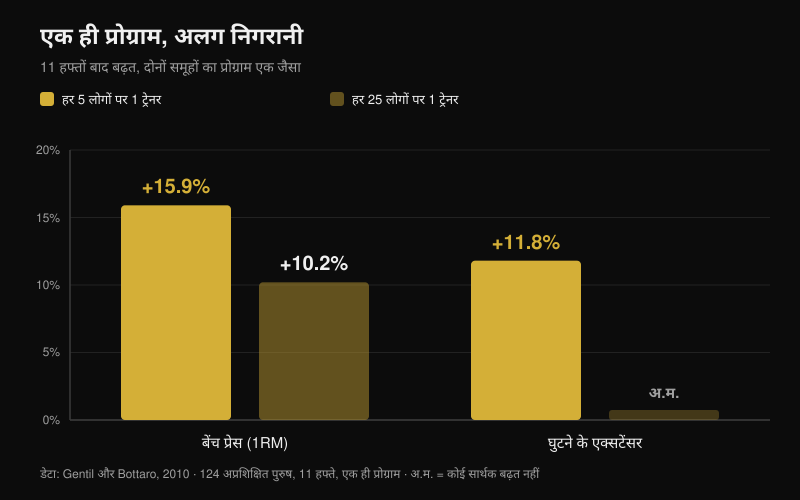
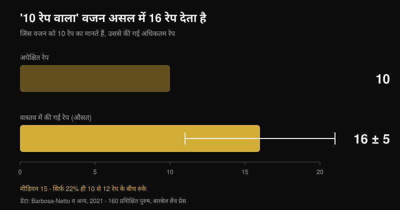

# ऑनलाइन कोचिंग काम करती है? रिसर्च क्या कहती है

लेखक [Giammaria Loi](/autore/giammaria-loi) · अपडेट 26 अक्टूबर 2026

"आप ऐसे इंसान को पैसे दे रहे हैं जो आपको कभी ट्रेनिंग करते देखता ही नहीं।" ऑनलाइन कोचिंग पर यही पहला सवाल उठता है, और इसका आधार असली है: ऐसी स्टडी मौजूद हैं जहाँ दो ग्रुप बिल्कुल एक ही प्रोग्राम करते हैं और जिसके पास ट्रेनर खड़ा होता है वह ज़्यादा मज़बूत होकर निकलता है। मैंने सुपरविजन, इंटेंसिटी और रिमोट गाइडेड ट्रेनिंग पर सात इंडेक्स्ड पेपर पढ़े। फ़र्क़ सचमुच है — लेकिन वह वहाँ से नहीं आता जहाँ ज़्यादातर लोग मानते हैं, और यही बात बदल देती है कि आपको ऑनलाइन कोच से क्या माँगना चाहिए।

## सार

- **एक ही प्रोग्राम, अलग नतीजे।** बारह हफ़्ते, बिल्कुल एक जैसा पीरियडाइज़्ड प्लान: जिनके पास पर्सनल ट्रेनर था उन्होंने वज़न ज़्यादा तेज़ी से बढ़ाया और स्क्वाट व बेंच प्रेस के मैक्स बिना निगरानी वाले ग्रुप से ऊँचे रहे (Mazzetti et al., 2000)।
- **कितनी पास से निगरानी है, यह मायने रखता है।** हर 5 लोगों पर 1 ट्रेनर होने पर बेंच प्रेस **15.9%** बढ़ी, जबकि हर 25 लोगों पर 1 ट्रेनर होने पर सिर्फ़ **10.2%**; घुटने के एक्सटेंसर की ताकत (**+11.8%**) केवल पास से देखे गए ग्रुप में बढ़ी (Gentil और Bottaro, 2010)।
- **बात मोटिवेशन की नहीं, इंटेंसिटी की है।** उसी स्टडी में दोनों ग्रुप की उपस्थिति और ट्रेनिंग वॉल्यूम एक जैसी थी। फ़र्क़ सिर्फ़ इसमें था कि कितने लोग सचमुच अधिकतम इंटेंसिटी तक पहुँचे।
- **अकेले आप उतना नहीं लगाते जितना सोचते हैं।** 160 ट्रेंड पुरुषों ने बेंच पर वही वज़न लगाया जिसे वे "10 रेप का" मानते हैं: उन्होंने **16 ± 5** रेप किए (मीडियन 15), और सिर्फ़ 22% ही 10 से 12 के बीच रुके (Barbosa-Netto et al., 2021)।
- **रिमोट टिकता है, पर हर चीज़ में नहीं।** सोलह हफ़्ते का वही प्रोग्राम वीडियो कॉल पर वज़न, फैट मास, एरोबिक पावर और घुटने के एक्सटेंसर की ताकत में आमने-सामने से कमतर नहीं निकला; लेकिन ग्रिप, ट्रंक एक्सटेंशन और घुटना मोड़ने की ताकत में तुलना टिकी नहीं (Langeard et al., 2022)।

## कोच बेहतर प्लान नहीं देता, आपके प्लान को सचमुच करवाता है

इस पूरी लाइन की नींव रखने वाली स्टडी 2000 की है और इसका डिज़ाइन लगभग कच्चा है। बीस मध्यम-ट्रेंड पुरुषों को दो ग्रुप में बाँटा गया: एक पर्सनल ट्रेनर की सीधी निगरानी में ट्रेनिंग करता था, दूसरा अकेले। प्रोग्राम दोनों के लिए एक जैसा था: बारह हफ़्ते की लीनियर पीरियडाइज़ेशन — तैयारी (10-12RM), हाइपरट्रॉफी (8-10RM), स्ट्रेंथ (5-8RM) और पीकिंग (3-6RM), फ्री वेट और मशीनों के साथ (Mazzetti et al., 2000)।

दिलचस्प नतीजा यह नहीं कि "निगरानी वाला ग्रुप बेहतर रहा"। दिलचस्प यह है कि वह *कहाँ* बेहतर रहा। प्रति सेट औसत वज़न निगरानी वाले ग्रुप में स्क्वाट में सातवें हफ़्ते से और बेंच प्रेस में तीसरे हफ़्ते से ही सार्थक रूप से ज़्यादा हो गया। हफ़्ते-दर-हफ़्ते वज़न बढ़ने की रफ़्तार भी ज़्यादा थी। बारहवें हफ़्ते पर स्क्वाट और बेंच के मैक्स निगरानी के साथ सार्थक रूप से ऊँचे थे। दोनों ग्रुप बेहतर हुए — पर एक ने वही प्लान पूरा किया जिसे दूसरे ने आधा किया।

दूसरे शब्दों में: उस स्टडी में कोच की कीमत प्रोग्रामिंग में नहीं थी, वह तो एक जैसी थी। कीमत इसमें थी कि कोई बारबेल की तरफ़ देखकर कहे, "पाँच किलो और लगाओ।"

## बदलती इंटेंसिटी है, शारीरिक मौजूदगी नहीं

अगली स्टडी इस तंत्र को साफ़ करती है, और ऑनलाइन कोचिंग परखने वालों के लिए सातों में सबसे अहम है। एक सौ चौबीस अप्रशिक्षित युवकों ने ग्यारह हफ़्ते एक ही प्रोग्राम किया, दो ग्रुप में बँटकर, जिनमें सिर्फ़ एक चीज़ अलग थी: फ्लोर पर ट्रेनर और ट्रेनी का अनुपात — 1 पर 5 या 1 पर 25 (Gentil और Bottaro, 2010)।

ऊँचे अनुपात में बेंच प्रेस मैक्स **15.9%** बढ़ा, जबकि कम अनुपात में **10.2%**; और घुटने के एक्सटेंसर की ताकत सार्थक रूप से (**+11.8%**) सिर्फ़ पास से देखे गए ग्रुप में बढ़ी। दोनों मापों पर ग्रुप-बीच अंतर सांख्यिकीय रूप से सार्थक था।

अब वह आँकड़ा जो आम व्याख्या गिरा देता है। दोनों ग्रुप में उपस्थिति में **कोई** अंतर नहीं था, और बेंच प्रेस व लेग प्रेस के काम की मात्रा में भी नहीं। अलग सिर्फ़ यह था कि कितने प्रतिशत लोग अधिकतम इंटेंसिटी पर ट्रेनिंग कर रहे थे — पास से देखे गए ग्रुप में ज़्यादा। कोच इसलिए कारगर नहीं हुआ कि उसने लोगों को नियमित रखा, वे पहले से थे; वह इसलिए कारगर हुआ कि हर सेट में उन्हें सीमा के और क़रीब ले गया।

एक तीसरा पेपर इसी तर्क को आगे बढ़ाता है: सोलह हफ़्ते 1:2 अनुपात पर ट्रेनिंग करने वाली बुज़ुर्ग महिलाओं में मैक्स पर प्रभाव 1:5 से बड़े दिखे, और फैट मास सिर्फ़ ज़्यादा निगरानी वाले ग्रुप में घटी (Vieira et al., 2020)। सैंपल छोटा है और ग्रुप-बीच अंतर घोषित नहीं, इसलिए यह संकेत है, सबूत नहीं — पर दिशा वही है।

## ब्लाइंड स्पॉट: आप सचमुच कितना लगाते हैं

अगर तंत्र इंटेंसिटी है, तो अगला सवाल यह है कि अकेले छोड़ा गया इंसान कितना चूकता है। एक स्टडी ने इसे सबसे कठोर तरीके से मापा।

160 ट्रेंड पुरुषों से एक ही सवाल पूछा गया: "बारबेल बेंच प्रेस में 10 रेप के लिए आप आम तौर पर कितना वज़न लगाते हैं?" छोटे वॉर्म-अप के बाद उन्हें उसी वज़न से अधिकतम रेप करने को कहा गया। औसत निकला **16 ± 5 रेप**, मीडियन 15 — बताए गए 10 से बहुत बड़ा और सांख्यिकीय रूप से बेहद मज़बूत अंतर (p < 0.001)। सबसे आम रेंज 13-15 रेप थी (सैंपल का 31%) और सिर्फ़ 22% ही 10 से 12 के बीच रुके (Barbosa-Netto et al., 2021)।

लेखक बिना लाग-लपेट लिखते हैं: उन लोगों की ट्रेनिंग रूटीन अधिकतम प्रयास के अनुकूल थी ही नहीं। ये शुरुआती नहीं थे, ट्रेंड पुरुष थे जो मानते थे कि वे अपना "10 रेप वाला" वज़न इस्तेमाल कर रहे हैं। यही वजह है कि रेप की संख्या से ज़्यादा मायने रखता है कि आप फेल्योर से कितनी दूर हैं — इसे मैंने [मसल्स के लिए सचमुच कितने रेप चाहिए](/hi/blog/kitne-reps-muscle-ke-liye) में खोला है।

जिम में मौजूद कोच यह ग़लती उसी वक़्त ठीक कर देता है। ऑनलाइन कोचिंग पर असली सवाल यही है कि इसे ठीक करने का कोई दूसरा रास्ता है या नहीं।

## तो रिमोट गाइडेंस काम करती है? निर्भर करता है कि उसे क्या नियंत्रित करना है

सबसे साफ़ सीधी तुलना स्वस्थ बुज़ुर्गों पर हुए एक नॉन-इन्फीरियोरिटी ट्रायल से आती है। तीन ग्रुप: कोई ट्रेनिंग नहीं, घर पर आमने-सामने गाइडेड ट्रेनिंग, और घर पर वीडियो कॉल से गाइडेड ट्रेनिंग। दोनों सक्रिय ग्रुप का प्रोग्राम एक जैसा, कंबाइंड, सोलह हफ़्ते, हफ़्ते में दो बार एक-एक घंटा (Langeard et al., 2022)।

वीडियो कॉल शरीर के वज़न, फैट मास, अधिकतम एरोबिक पावर, अधिकतम हृदय गति, अधिकतम ऑक्सीजन खपत, घुटना सीधा करने की ताकत और निचले अंगों की पावर में आमने-सामने से **कमतर नहीं** रही। मसल मास, ग्रिप स्ट्रेंथ, ट्रंक एक्सटेंशन और घुटना मोड़ने की ताकत में यह **साबित नहीं** हुई। लेखक साफ़ कहते हैं: इन आइसोमेट्रिक माप पर आमने-सामने अब भी बेहतर है।

दूसरा रैंडमाइज़्ड ट्रायल दिखाता है कि दर्द वाले लोगों के साथ भी रिमोट काम हो सकता है: 130 बुज़ुर्ग-देखभाल कर्मियों ने बारह हफ़्ते तक लाइव वीडियो पर गाइडेड स्ट्रेंथ एक्सरसाइज़ जोड़ीं, और प्रयोग समूह में कमर दर्द की औसत तीव्रता कंट्रोल के मुक़ाबले घटी (p = 0.034), साथ ही कलाई-हाथ के दर्द और ऊपरी अंगों की मांसपेशीय क्षमता में भी सुधार हुआ। पर-प्रोटोकॉल विश्लेषण में, जिन्होंने कम से कम 50% सेशन किए उन्हें मूड, जीवन की गुणवत्ता और दवा की खपत में अतिरिक्त लाभ मिला (Espin et al., 2024)।

एक ईमानदार स्पष्टीकरण, क्योंकि इससे इन आँकड़ों का पाठ बदल जाता है: दोनों ट्रायल के प्रतिभागी स्वस्थ बुज़ुर्ग और कामगार थे, स्ट्रेंथ एथलीट नहीं। ये बताते हैं कि रिमोट गाइडेंस से असली अनुकूलन होते हैं; यह नहीं बताते कि एक एडवांस्ड पावरलिफ्टर अपने आमने-सामने वाले कोच के कितना क़रीब पहुँच सकता है। वह तुलना अभी साहित्य में मौजूद नहीं है।

## रिमोट कोच को क्या मापना चाहिए कि वह जिम वाले कोच के बराबर हो

यहाँ से व्यावहारिक निष्कर्ष लगभग ख़ुद लिख जाता है। आमने-सामने वाले कोच का एक ही सिद्ध फ़ायदा है: वह देख लेता है कि फेल्योर कितना दूर है और वज़न बढ़वा देता है। ऑनलाइन कोच बराबरी पर है, बशर्ते उसके पास यही बात जानने का भरोसेमंद तरीका हो।

यह औज़ार मौजूद है और इस पर शोध हुआ है। RIR स्केल — यानी सेट के अंत में आपके पास कितने रेप बचे होते — पर 31 स्टडी की समीक्षा कहती है कि ये इंटेंसिटी तय करने और वज़न समायोजित करने दोनों के लिए व्यावहारिक और उपयोगी हैं, एक चेतावनी के साथ: अनुमान तब ज़्यादा सटीक होता है जब वह फेल्योर के पास लगाया जाए, दस रेप पहले नहीं (Bastos et al., 2024)।

मतलब: जिस कोच को सिर्फ़ "हो गया, अच्छा लगा" मिलता है, वह ठीक उतना ही अंधा है जितना Gentil की स्टडी का 1:25 वाला ट्रेनर। और जिस कोच को हर सेट का वज़न, रेप और RIR मिलता है, साथ में मुख्य लिफ्ट के आख़िरी सेट का वीडियो, उसके पास वे दो आँकड़े हैं जिनसे वह एकमात्र ज़रूरी काम कर सकता है: बताना कि कब वज़न बढ़ाना है।

## रिसर्च असल में क्या कहती है

| दावा | नतीजा | आँकड़ा |
| --- | --- | --- |
| कोच सामने हो तो प्रगति ज़्यादा होती है | **पुष्ट** | 12 हफ़्ते एक ही प्लान: सीधी निगरानी में प्रति सेट वज़न और मैक्स दोनों ऊँचे (Mazzetti et al., 2000) |
| कोच मुख्य रूप से मोटिवेट करने और जिम लाने के लिए है | **ग़लत** | 1:5 और 1:25 में उपस्थिति और वॉल्यूम बराबर; फ़र्क़ अधिकतम इंटेंसिटी पर ट्रेनिंग करने वालों के अनुपात में था (Gentil और Bottaro, 2010) |
| "मुझे ख़ुद पता है कब ज़ोर लगाना है" | **ग़लत** | "10 के लिए" इस्तेमाल किया गया वज़न 16 ± 5 रेप देता था; सिर्फ़ 22% 10-12 के बीच रुके (Barbosa-Netto et al., 2021) |
| ऑनलाइन कोचिंग आमने-सामने जैसे ही नतीजे देती है | **स्पष्टीकरण चाहिए** | वज़न, फैट मास, VO2max, घुटने के एक्सटेंसर और पैरों की पावर में कमतर नहीं; ग्रिप, ट्रंक और घुटना मोड़ने में नहीं (Langeard et al., 2022) |
| दर्द वाले व्यक्ति को रिमोट नहीं संभाला जा सकता | **ग़लत** | 12 हफ़्ते की वीडियो-गाइडेड एक्सरसाइज़ ने 130 देखभाल कर्मियों का कमर दर्द घटाया (Espin et al., 2024) |
| सेट देखे बिना इंटेंसिटी नियंत्रित नहीं हो सकती | **स्पष्टीकरण चाहिए** | RIR स्केल वज़न तय करने और बदलने में काम आते हैं, पर अनुमान सिर्फ़ फेल्योर के पास सटीक है (Bastos et al., 2024) |
| कोच-एथलीट अनुपात जितना सख़्त, उतना अच्छा | **असत्यापित** | बुज़ुर्ग महिलाओं में 1:2 बनाम 1:5 में बड़ा प्रभाव दिखा, पर सैंपल छोटा (Vieira et al., 2020) |

## इसे कैसे लागू करें

1. **ऑनलाइन कोच को इस आधार पर परखें कि वह क्या मापता है, यह नहीं कि कितने मैसेज करता है।** पैसे देने से पहले एक ही सवाल: आप कैसे जानेंगे कि हर सेट में मैं फेल्योर से कितनी दूर हूँ?
2. **हर वर्किंग सेट का वज़न, रेप और RIR दर्ज करें।** ये तीनों आँकड़े साथ न हों तो दूर बैठा कोई तय नहीं कर सकता कि अगले हफ़्ते वज़न बढ़ाना है या नहीं।
3. **अपना RIR एक बार टेस्ट से कैलिब्रेट करें।** किसी सुरक्षित एक्सरसाइज़ (मशीन, या सेफ्टी पिन वाला बारबेल) में वह वज़न लें जिसे आप "10 के लिए" इस्तेमाल करते हैं और फेल्योर तक जाएँ। अगर 15 निकलें, तो आपका "10" असल में RIR 5 था और आपकी पूरी स्केल खिसकी हुई है।
4. **आख़िरी सेट का वीडियो भेजें, वॉर्म-अप का नहीं।** थकान में तकनीक और बची हुई असली गुंजाइश सिर्फ़ उसी में दिखती है।
5. **लिखित प्रोग्रेशन नियम माँगें।** जैसे: सेट RIR 2 या उससे ज़्यादा पर ख़त्म हुआ तो अगली ट्रेनिंग में वज़न बढ़ाएँ। ऐसा नियम उन हफ़्तों में भी चलता है जब कोच देर से जवाब दे।
6. **ब्लाइंड स्पॉट को आँकड़ों से ढकें।** रिमोट में सबसे कमज़ोर ग्रिप और ट्रंक की स्थिरता रही: अगर ये आपके लिए अहम हैं तो इन्हें वज़न और समय के साथ दर्ज होने वाली एक्सरसाइज़ बनाएँ, "फ़ील से" एक्सेसरी काम नहीं।

**Nurvan के साथ।** रिमोट कोचिंग हमेशा एक ही जगह टूटती है: कोच को आपके सेट के पीछे के आँकड़े दिखते ही नहीं। Nurvan में कोच और एथलीट एक ही प्लान पर काम करते हैं, और हर सेट वज़न, रेप और RIR दर्ज करता है, इसलिए हिस्ट्री कोच को दिखा देती है कि आप आगे बढ़ रहे हैं या तीन हफ़्ते से उसी वज़न पर अटके हैं। वॉर्म-अप सेट अपने आप सुझाए जाते हैं, और PDF, Excel या फ़ोटो में पहले से लिखा प्लान बिना दोबारा टाइप किए इम्पोर्ट हो जाता है। [Nurvan आज़माएँ](https://nurvan.app)

## अक्सर पूछे जाने वाले सवाल

**क्या ऑनलाइन कोचिंग सचमुच काम करती है?**
हाँ: उपलब्ध स्टडी में यह असली अनुकूलन देती है — ताक़त, बॉडी कंपोज़िशन, एरोबिक क्षमता और कमर दर्द में कमी। आमने-सामने से सीधी तुलना कई मापों पर टिकती है, सब पर नहीं, और सारे आँकड़े स्वस्थ वयस्कों या कामगारों से आते हैं, एडवांस्ड स्ट्रेंथ एथलीट से नहीं।

**ऑनलाइन कोच बेहतर है या जिम वाला?**
यह इस पर निर्भर है कि आपके पास क्या नहीं है। अगर दिक़्क़त जटिल लिफ्ट की तकनीक या ज़ोर लगाने के डर की है, तो शारीरिक मौजूदगी का फ़ायदा कोई चैट नहीं दे सकती। अगर तकनीक ठीक है और समस्या वज़न बढ़ाने की है, तो वज़न, रेप और RIR पाने वाला ऑनलाइन कोच ठीक उसी तंत्र पर काम करता है जिसने स्टडी में फ़र्क़ बनाया।

**रिमोट कोच को कैसे पता चलेगा कि मैंने पर्याप्त ट्रेनिंग की?**
आपके भेजे आँकड़ों से। RIR स्केल इसी के लिए शोधित औज़ार है, एक ज्ञात सीमा के साथ: अनुमान फेल्योर के पास भरोसेमंद है और छह-सात रेप पहले काफ़ी कमज़ोर। इसीलिए आख़िरी सेट का एक वीडियो दस मैसेज से बेहतर है।

**क्या शुरुआती के लिए ऑनलाइन कोचिंग ठीक है?**
सुपरविजन का सबसे बड़ा असर अप्रशिक्षित लोगों पर ही दिखा, इसलिए ख़राब तरीक़े से रिमोट संभाला गया शुरुआती बहुत कुछ खोता है। अगर आप शून्य से शुरू कर रहे हैं तो पहले हफ़्तों में लाइव वीडियो कॉल माँगें और एक्सरसाइज़ कम रखें, ऐसी जो वीडियो में आसानी से जाँची जा सकें।

## यह भी पढ़ें

- [मसल्स के लिए कितने रेप्स? 8-12 का मिथक](/hi/blog/kitne-reps-muscle-ke-liye) — फेल्योर से दूरी रेप की संख्या से ज़्यादा क्यों मायने रखती है
- [ट्रेनिंग स्प्लिट: बिगिनर बनाम एडवांस्ड](/hi/blog/training-split-beginner-advanced) — आपके स्तर पर सचमुच कितनी संरचना चाहिए

## स्रोत

1. Mazzetti SA, Kraemer WJ, Volek JS, Duncan ND, Ratamess NA, Gómez AL, Newton RU, Häkkinen K, Fleck SJ, 2000. The influence of direct supervision of resistance training on strength performance. *Med Sci Sports Exerc*. PMID [10862549](https://pubmed.ncbi.nlm.nih.gov/10862549/) · [DOI](https://doi.org/10.1097/00005768-200006000-00023)
2. Gentil P, Bottaro M, 2010. Influence of supervision ratio on muscle adaptations to resistance training in nontrained subjects. *J Strength Cond Res*. PMID [19661830](https://pubmed.ncbi.nlm.nih.gov/19661830/) · [DOI](https://doi.org/10.1519/JSC.0b013e3181ad3373)
3. Barbosa-Netto S, d'Acelino-e-Porto OS, Almeida MB, 2021. Self-Selected Resistance Exercise Load: Implications for Research and Prescription. *J Strength Cond Res*. PMID [29112055](https://pubmed.ncbi.nlm.nih.gov/29112055/) · [DOI](https://doi.org/10.1519/JSC.0000000000002287)
4. Langeard A, Bigot L, Maffiuletti NA, Moussay S, Sesboüé B, Quarck G, Gauthier A, 2022. Non-inferiority of a home-based videoconference physical training program in comparison with the same program administered face-to-face in healthy older adults: the MOTION randomised controlled trial. *Age Ageing*. PMID [35290431](https://pubmed.ncbi.nlm.nih.gov/35290431/) · [DOI](https://doi.org/10.1093/ageing/afac059)
5. Espin A, Irazusta J, Aiestaran M, Latorre Erezuma U, García-García J, Arrinda I, Acedo K, Rodriguez-Larrad A, 2024. Videoconference-Supervised Group Exercise Reduces Low Back Pain in Eldercare Workers: Results from the ReViEEW Randomised Controlled Trial. *J Occup Rehabil*. PMID [38632115](https://pubmed.ncbi.nlm.nih.gov/38632115/) · [DOI](https://doi.org/10.1007/s10926-024-10182-2)
6. Bastos V, Machado S, Teixeira DS, 2024. Feasibility and Usefulness of Repetitions-In-Reserve Scales for Selecting Exercise Intensity: A Scoping Review. *Percept Mot Skills*. PMID [38563729](https://pubmed.ncbi.nlm.nih.gov/38563729/) · [DOI](https://doi.org/10.1177/00315125241241785)
7. Vieira DCL, Nascimento DC, Tajra V, Teixeira TG, Farias DL, Tibana RA, Silva AO, Rosa TS, De Moraes MR, Voltarelli FA, Navalta JW, Prestes J, 2020. High Supervised Resistance Training in Elderly Women: The Role of Supervision Ratio. *Int J Exerc Sci*. PMID [32509119](https://pubmed.ncbi.nlm.nih.gov/32509119/) · [DOI](https://doi.org/10.70252/WNVF6463)

ट्रेंड संकेत: ACSM, *Worldwide Fitness Trends 2026* (22 अक्टूबर 2025 को प्रकाशित), जिसमें ट्रेनिंग ऐप्स चौथे और डेटा-आधारित तकनीक आठवें स्थान पर हैं। इस लेख का टेक्स्ट, ढाँचा और तथ्य-जाँच मौलिक हैं।

---

**Giammaria Loi** Nurvan के संस्थापक हैं। वे 2012 से वेट ट्रेनिंग कर रहे हैं, 2013 से FIPE प्रमाणित पर्सनल ट्रेनर और कोच के रूप में काम करते हैं और 2018 से राष्ट्रीय स्तर पर पावरलिफ्टिंग में प्रतिस्पर्धा करते हैं।

> नोट: यह जानकारीपरक सामग्री है, डॉक्टर या पेशेवर की राय का विकल्प नहीं। अगर दर्द है या कोई स्वास्थ्य स्थिति चल रही है, तो ट्रेनिंग प्रोग्राम शुरू करने या बदलने से पहले डॉक्टर से बात करें — चाहे वह ऑनलाइन हो या आमने-सामने।
