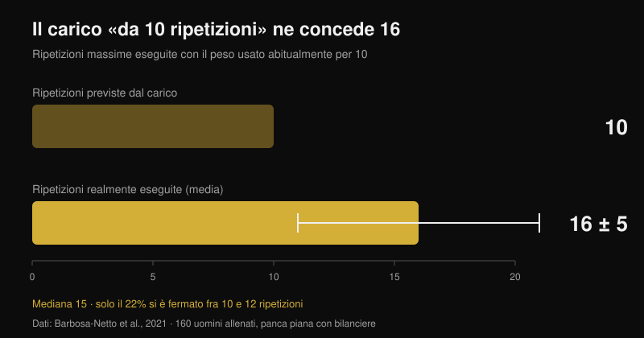

# Coaching online funziona? Cosa dicono gli studi

Di [Giammaria Loi](/autore/giammaria-loi) · aggiornato il 26 ottobre 2026

"Paghi qualcuno che non ti vede mai allenarti." È la prima obiezione al coaching online, e ha un fondamento serio: esistono studi in cui due gruppi seguono la stessa identica scheda e chi ha un tecnico accanto arriva più in alto. Ho letto sette lavori indicizzati su supervisione, intensità e allenamento guidato a distanza. La differenza esiste davvero, ma non nasce dove quasi tutti pensano — e capire dove nasce cambia completamente cosa devi chiedere a un coach online.

## In breve

- **Stessa scheda, risultati diversi.** Dodici settimane di programma periodizzato identico: chi si allenava con un personal trainer accanto ha alzato i carichi più in fretta e ha chiuso con squat e panca massimali più alti del gruppo non supervisionato (Mazzetti et al., 2000).
- **Quanto il coach ti segue da vicino conta.** Con un tecnico ogni 5 persone la panca massimale è salita del **15,9%**, contro il **10,2%** di un tecnico ogni 25; la forza degli estensori del ginocchio è aumentata (**+11,8%**) solo nel gruppo seguito da vicino (Gentil e Bottaro, 2010).
- **Non è la motivazione: è l'intensità.** Nello stesso studio presenze e volume di lavoro erano identici fra i due gruppi. A cambiare era la quota di persone che arrivava davvero a intensità massima.
- **Da soli si spinge meno di quanto si crede.** 160 uomini allenati hanno caricato in panca il peso che usano abitualmente "per 10 ripetizioni": ne hanno fatte **16 ± 5** (mediana 15), e solo il 22% si è fermato fra 10 e 12 (Barbosa-Netto et al., 2021).
- **A distanza regge, ma non su tutto.** Sedici settimane dello stesso programma via videochiamata non sono risultate inferiori al faccia a faccia su peso, massa grassa, potenza aerobica e forza degli estensori del ginocchio; su presa, estensione del tronco e flessione del ginocchio il confronto non ha retto (Langeard et al., 2022).

## Il coach non ti dà una scheda migliore: ti fa usare meglio quella che hai

Lo studio che ha fondato tutto il filone è del 2000 e ha una struttura semplicissima. Venti uomini moderatamente allenati sono stati assegnati a due gruppi: uno si allenava sotto la supervisione diretta di un personal trainer, l'altro da solo. Il programma era lo stesso per entrambi, periodizzato su dodici settimane con fase preparatoria (10-12 ripetizioni massimali), ipertrofia (8-10), forza (5-8) e picco (3-6), con bilancieri e macchine (Mazzetti et al., 2000).

Il risultato interessante non è "il gruppo supervisionato è andato meglio". È *dove* è andato meglio. Il carico medio per serie è diventato significativamente più alto nel gruppo supervisionato dalla settima settimana in poi nello squat, e già dalla terza nella panca. Anche la velocità con cui il carico saliva settimana dopo settimana era maggiore. A dodici settimane, squat e panca massimali erano significativamente più alti nel gruppo seguito. Entrambi i gruppi erano migliorati: ma uno aveva fatto sul serio una scheda che l'altro aveva fatto a metà.

In altre parole: il valore del coach, in quello studio, non stava nella programmazione — era identica — ma nel fatto che qualcuno guardasse il bilanciere e dicesse "metti altri cinque chili".

## Quello che cambia è l'intensità, non la presenza fisica

Lo studio successivo è quello che ha chiarito il meccanismo, e per chi valuta un coaching online è il più importante dei sette. Centoventiquattro ragazzi non allenati hanno seguito per undici settimane lo stesso programma, divisi in due gruppi che cambiavano per una cosa sola: il rapporto fra tecnici e allievi in sala, 1 ogni 5 oppure 1 ogni 25 (Gentil e Bottaro, 2010).

Con il rapporto alto, la panca massimale è salita del **15,9%** contro il **10,2%** del rapporto basso, e la forza degli estensori del ginocchio è cresciuta in modo significativo (**+11,8%**) solo nel gruppo seguito da vicino. Le differenze fra gruppi erano statisticamente significative per entrambe le misure.

Poi arriva il dato che smonta la spiegazione più comune. Fra i due gruppi **non** c'era differenza né nelle presenze agli allenamenti né nel volume di lavoro svolto in panca e leg press. L'unica cosa diversa era la proporzione di persone che si allenava a intensità massima, più alta nel gruppo seguito da vicino. Il coach, in quello studio, non ha funzionato perché teneva le persone costanti — lo erano già — ma perché le portava più vicine al limite in ogni serie.

Un terzo lavoro spinge la stessa logica un passo oltre: donne anziane allenate per sedici settimane con un rapporto 1:2 hanno mostrato effetti maggiori sui massimali rispetto a un rapporto 1:5, e solo nel gruppo più seguito è calata la massa grassa (Vieira et al., 2020). È un campione piccolo e senza differenze dichiarate fra gruppi, quindi vale come indizio, non come prova: ma punta nella stessa direzione.

## Il punto cieco: quanto stai davvero spingendo

Se il meccanismo è l'intensità, la domanda diventa: di quanto sbaglia una persona lasciata a sé stessa? C'è uno studio che l'ha misurato nel modo più brutale possibile.

A 160 uomini allenati è stata fatta una sola domanda: "che peso usi di solito per 10 ripetizioni in panca piana con bilanciere?". Poi, dopo un breve riscaldamento, gli è stato chiesto di farci più ripetizioni possibili. La media è stata di **16 ± 5 ripetizioni**, con mediana 15: una differenza enorme e statisticamente molto solida rispetto alle 10 dichiarate (p < 0,001). L'intervallo più frequente era 13-15 ripetizioni (31% del campione) e solo il 22% si è fermato fra 10 e 12 (Barbosa-Netto et al., 2021).

Gli autori lo scrivono senza giri di parole: le routine di allenamento di quelle persone non erano compatibili con uno sforzo massimale. Non parliamo di principianti: erano uomini allenati, convinti di stare usando il loro carico da 10. Questo è anche il motivo per cui il numero di ripetizioni conta meno della distanza dal cedimento, un punto che ho sviluppato in [quante ripetizioni servono davvero per la massa](/blog/ripetizioni-serie-recupero-ipertrofia).

Il coach in sala corregge questo errore in tempo reale. La domanda vera sul coaching online è se esista un altro modo per correggerlo.

## Allora il coaching a distanza funziona? Dipende da cosa deve controllare

Il confronto diretto più pulito arriva da uno studio di non inferiorità su adulti anziani sani. Tre gruppi: nessun allenamento, allenamento a casa guidato di persona, allenamento a casa guidato in videochiamata. Programma identico per i due gruppi attivi, combinato, sedici settimane, un'ora due volte a settimana (Langeard et al., 2022).

La videochiamata è risultata **non inferiore** al faccia a faccia su peso corporeo, massa grassa, potenza aerobica massima, frequenza cardiaca massima, consumo massimo di ossigeno, forza in estensione del ginocchio e potenza degli arti inferiori. **Non** è risultata non inferiore su massa muscolare, forza di presa, estensione del tronco e flessione del ginocchio. Gli autori sono espliciti: per quelle misure di forza isometrica il faccia a faccia resta superiore.

Un secondo studio randomizzato mostra che a distanza si può lavorare anche con chi ha dolore: 130 operatori socio-sanitari hanno aggiunto per dodici settimane esercizi di forza guidati in videoconferenza in tempo reale, e il gruppo sperimentale ha ridotto l'intensità media del mal di schiena rispetto al controllo (p = 0,034), con miglioramenti anche su polso e mano e sulla performance muscolare degli arti superiori. Nell'analisi per protocollo, chi ha fatto almeno il 50% delle sedute ha ottenuto benefici ulteriori su umore, qualità della vita e consumo di farmaci (Espin et al., 2024).

Una precisazione onesta, perché cambia come vanno letti questi numeri: i partecipanti di entrambi gli studi erano anziani sani e lavoratori, non atleti di forza. Dicono che la guida a distanza produce adattamenti reali; non dicono di quanto un powerlifter avanzato possa avvicinarsi al suo coach in presenza. Quel confronto, a oggi, non esiste in letteratura.

## Cosa deve misurare un coach a distanza per valere quanto uno in sala

Da qui la conclusione pratica si scrive quasi da sola. Il coach in presenza ha un unico vantaggio dimostrato: vede quanto manca al cedimento e fa alzare il carico. Un coach online è alla pari se ha un modo affidabile per sapere la stessa cosa.

Lo strumento esiste ed è studiato. Una revisione di 31 studi sulle scale RIR — le ripetizioni che avresti ancora in serbatoio alla fine della serie — conclude che sono utilizzabili e utili sia per prescrivere l'intensità sia per aggiustare il carico, con l'avvertenza che la stima è più accurata quando viene fatta vicino al cedimento, non a dieci ripetizioni dalla fine (Bastos et al., 2024).

Tradotto: un coach che riceve solo "fatto, tutto bene" è cieco esattamente come il tecnico 1:25 dello studio di Gentil. Un coach che riceve carico, ripetizioni e RIR serie per serie, più il video dell'ultima serie dei fondamentali, ha i due dati che gli servono per fare l'unica cosa che conta: dirti quando aumentare.

## Cosa dice davvero la ricerca

| Affermazione | Verdetto | Il dato |
| --- | --- | --- |
| Un coach che ti guarda ti fa progredire di più | **Confermato** | Stessa scheda per 12 settimane: carichi per serie più alti e massimali maggiori con supervisione diretta (Mazzetti et al., 2000) |
| Serve soprattutto a motivarti e a farti presentare in palestra | **Smentito** | Fra 1:5 e 1:25 presenze e volume erano uguali; cambiava la quota di chi arrivava a intensità massima (Gentil e Bottaro, 2010) |
| "So da solo quando spingere" | **Smentito** | Il carico usato "per 10" ne concedeva 16 ± 5; solo il 22% si fermava fra 10 e 12 (Barbosa-Netto et al., 2021) |
| Il coaching online dà gli stessi risultati di quello in presenza | **Da precisare** | Non inferiore su peso, massa grassa, VO2max, forza estensori del ginocchio e potenza degli arti inferiori; non su presa, tronco e flessione del ginocchio (Langeard et al., 2022) |
| A distanza non si può seguire chi ha dolore | **Smentito** | 12 settimane di esercizi guidati in videochiamata hanno ridotto il mal di schiena in 130 operatori socio-sanitari (Espin et al., 2024) |
| Senza vedere la serie è impossibile controllare l'intensità | **Da precisare** | Le scale RIR servono a prescrivere e aggiustare il carico, ma la stima è accurata solo vicino al cedimento (Bastos et al., 2024) |
| Più il rapporto coach-atleta è stretto, meglio è | **Non verificato** | Un confronto 1:2 contro 1:5 in donne anziane mostra effetti maggiori con più supervisione, ma su campione piccolo (Vieira et al., 2020) |

## Come applicarlo

1. **Valuta un coach online da cosa misura, non da quanto ti scrive.** La domanda da fargli prima di pagare è una sola: come fai a sapere quanto sono vicino al cedimento in ogni serie?
2. **Registra carico, ripetizioni e RIR di ogni serie allenante.** Senza i tre numeri insieme, nessuno a distanza può decidere se la settimana prossima devi aggiungere peso o no.
3. **Calibra il tuo RIR una volta sola, con un test.** Su un esercizio sicuro (macchina, o bilanciere con fermi di sicurezza) prendi il carico che useresti "per 10" e vai a cedimento. Se ne escono 15, il tuo 10 era in realtà un RIR 5 e tutta la tua scala è spostata.
4. **Manda il video dell'ultima serie, non del riscaldamento.** È l'unica in cui si vede la tecnica sotto fatica e quanto margine è rimasto davvero.
5. **Pretendi una regola di progressione scritta.** Per esempio: se chiudi la serie con RIR 2 o più, il prossimo allenamento sali di carico. Una regola del genere funziona anche nelle settimane in cui il coach non risponde subito.
6. **Copri i punti ciechi con numeri.** Le misure che hanno retto peggio a distanza sono presa e tenuta del tronco: se ti interessano, inseriscile come esercizi con un carico e un tempo da registrare, non come "lavoro accessorio a sensazione".

**Con Nurvan.** Il coaching a distanza si rompe sempre nello stesso punto: il coach non vede i numeri delle tue serie. In Nurvan coach e atleta lavorano sulla stessa scheda, e ogni serie registra carico, ripetizioni e RIR, così lo storico mostra al coach se stai progredendo o se sei fermo da tre settimane sullo stesso peso. Le serie di riscaldamento vengono proposte automaticamente, e una scheda già scritta in PDF, Excel o anche in foto si importa senza riscriverla a mano. [Prova Nurvan](https://nurvan.app)

## Domande frequenti

**Il coaching online funziona davvero?**
Sì, negli studi disponibili produce adattamenti reali: forza, composizione corporea, capacità aerobica e riduzione del dolore lombare. Il confronto diretto con la presenza fisica regge su molti parametri ma non su tutti, e tutti i dati arrivano da adulti sani o lavoratori, non da atleti di forza avanzati.

**Meglio un coach online o uno in palestra?**
Dipende da cosa ti manca. Se il tuo problema è la tecnica su gesti complessi o la paura di spingere, la presenza fisica ha un vantaggio che nessuna chat replica. Se la tecnica c'è e il problema è la progressione dei carichi, un coach online che riceve carico, ripetizioni e RIR lavora sullo stesso meccanismo che negli studi ha fatto la differenza.

**Come fa un coach a distanza a sapere se mi sono allenato abbastanza?**
Dai dati che gli mandi. Le scale RIR sono lo strumento studiato per questo, con un limite noto: la stima è affidabile vicino al cedimento, molto meno a sei o sette ripetizioni dalla fine. Per questo un video dell'ultima serie vale più di dieci messaggi.

**Il coaching online va bene per un principiante?**
È proprio sui non allenati che la supervisione ha mostrato gli effetti più grandi, quindi un principiante seguito male a distanza perde molto. Se inizi da zero, chiedi al coach videochiamate in diretta nelle prime settimane e un numero limitato di esercizi facili da controllare in video.

## Leggi anche

- [Migliori software e app per personal trainer in Italia](/blog/migliori-software-app-personal-trainer-italia) — come cambia il lavoro del coach a seconda dello strumento che usa
- [Quante ripetizioni per la massa: il mito dell'8-12](/blog/ripetizioni-serie-recupero-ipertrofia) — perché la distanza dal cedimento conta più del numero di ripetizioni
- [Split di allenamento: principiante vs avanzato](/blog/split-allenamento-principiante-avanzato) — quanta struttura serve davvero in base al tuo livello

## Fonti

1. Mazzetti SA, Kraemer WJ, Volek JS, Duncan ND, Ratamess NA, Gómez AL, Newton RU, Häkkinen K, Fleck SJ, 2000. The influence of direct supervision of resistance training on strength performance. *Med Sci Sports Exerc*. PMID [10862549](https://pubmed.ncbi.nlm.nih.gov/10862549/) · [DOI](https://doi.org/10.1097/00005768-200006000-00023)
2. Gentil P, Bottaro M, 2010. Influence of supervision ratio on muscle adaptations to resistance training in nontrained subjects. *J Strength Cond Res*. PMID [19661830](https://pubmed.ncbi.nlm.nih.gov/19661830/) · [DOI](https://doi.org/10.1519/JSC.0b013e3181ad3373)
3. Barbosa-Netto S, d'Acelino-e-Porto OS, Almeida MB, 2021. Self-Selected Resistance Exercise Load: Implications for Research and Prescription. *J Strength Cond Res*. PMID [29112055](https://pubmed.ncbi.nlm.nih.gov/29112055/) · [DOI](https://doi.org/10.1519/JSC.0000000000002287)
4. Langeard A, Bigot L, Maffiuletti NA, Moussay S, Sesboüé B, Quarck G, Gauthier A, 2022. Non-inferiority of a home-based videoconference physical training program in comparison with the same program administered face-to-face in healthy older adults: the MOTION randomised controlled trial. *Age Ageing*. PMID [35290431](https://pubmed.ncbi.nlm.nih.gov/35290431/) · [DOI](https://doi.org/10.1093/ageing/afac059)
5. Espin A, Irazusta J, Aiestaran M, Latorre Erezuma U, García-García J, Arrinda I, Acedo K, Rodriguez-Larrad A, 2024. Videoconference-Supervised Group Exercise Reduces Low Back Pain in Eldercare Workers: Results from the ReViEEW Randomised Controlled Trial. *J Occup Rehabil*. PMID [38632115](https://pubmed.ncbi.nlm.nih.gov/38632115/) · [DOI](https://doi.org/10.1007/s10926-024-10182-2)
6. Bastos V, Machado S, Teixeira DS, 2024. Feasibility and Usefulness of Repetitions-In-Reserve Scales for Selecting Exercise Intensity: A Scoping Review. *Percept Mot Skills*. PMID [38563729](https://pubmed.ncbi.nlm.nih.gov/38563729/) · [DOI](https://doi.org/10.1177/00315125241241785)
7. Vieira DCL, Nascimento DC, Tajra V, Teixeira TG, Farias DL, Tibana RA, Silva AO, Rosa TS, De Moraes MR, Voltarelli FA, Navalta JW, Prestes J, 2020. High Supervised Resistance Training in Elderly Women: The Role of Supervision Ratio. *Int J Exerc Sci*. PMID [32509119](https://pubmed.ncbi.nlm.nih.gov/32509119/) · [DOI](https://doi.org/10.70252/WNVF6463)

Dati di tendenza: ACSM, *Worldwide Fitness Trends 2026* (pubblicati il 22 ottobre 2025), con le app di allenamento al 4° posto e la tecnologia basata sui dati all'8°. Testo, struttura e verifiche di questo articolo sono originali.

---

**Giammaria Loi** è il fondatore di Nurvan. Si allena con i pesi dal 2012, lavora come personal trainer e coach certificato FIPE dal 2013 e gareggia nel powerlifting a livello nazionale dal 2018.

> Nota: contenuto informativo, non sostituisce il parere di un medico o professionista. Se hai dolore o una condizione di salute in corso, parlane con un medico prima di iniziare o cambiare un programma di allenamento, in presenza o a distanza.
