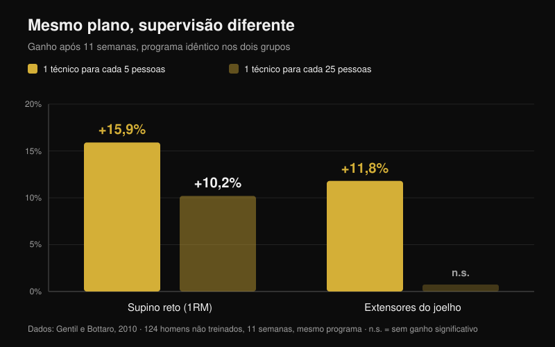
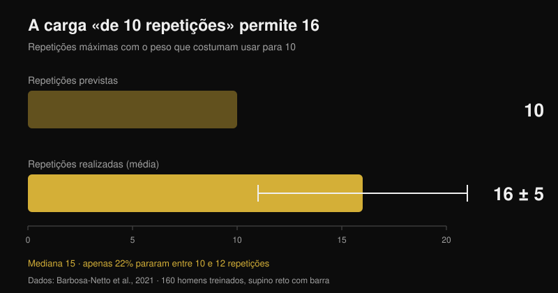

# O coaching online funciona? O que dizem os estudos

Por [Giammaria Loi](/autore/giammaria-loi) · atualizado a 26 de outubro de 2026

"Estás a pagar a alguém que nunca te vê treinar." É a primeira objeção ao coaching online e tem uma base séria: há estudos em que dois grupos seguem exatamente o mesmo plano e o que tem um técnico ao lado acaba mais forte. Li sete trabalhos indexados sobre supervisão, intensidade e treino guiado à distância. A diferença existe, mas não nasce onde quase toda a gente pensa — e perceber onde nasce muda por completo o que deves exigir a um coach online.

## Em resumo

- **O mesmo plano, resultados diferentes.** Doze semanas de programa periodizado idêntico: quem treinou com um personal trainer ao lado subiu as cargas mais depressa e acabou com agachamento e supino máximos mais altos do que o grupo sem supervisão (Mazzetti et al., 2000).
- **O grau de acompanhamento conta.** Com um técnico por cada 5 pessoas o supino máximo subiu **15,9%**, contra **10,2%** com um técnico por cada 25; a força dos extensores do joelho melhorou (**+11,8%**) apenas no grupo acompanhado de perto (Gentil e Bottaro, 2010).
- **Não é motivação: é intensidade.** No mesmo estudo, a assiduidade e o volume de trabalho foram iguais nos dois grupos. O que mudou foi a proporção de pessoas que chegava mesmo à intensidade máxima.
- **Sozinho aperta-se menos do que se pensa.** 160 homens treinados carregaram no supino o peso que usam habitualmente "para 10 repetições": fizeram **16 ± 5** (mediana 15) e só 22% pararam entre 10 e 12 (Barbosa-Netto et al., 2021).
- **À distância aguenta, mas não em tudo.** Dezasseis semanas do mesmo programa por videochamada não foram inferiores ao presencial em peso, massa gorda, potência aeróbia e força dos extensores do joelho; em preensão, extensão do tronco e flexão do joelho a comparação não se sustentou (Langeard et al., 2022).

## Um coach não te dá um plano melhor: faz-te usar bem o que já tens

O estudo que fundou esta linha é do ano 2000 e tem um desenho quase cru. Vinte homens moderadamente treinados foram divididos em dois grupos: um treinava sob supervisão direta de um personal trainer, o outro sozinho. O programa era idêntico: doze semanas de periodização linear com fase preparatória (10-12 repetições máximas), hipertrofia (8-10), força (5-8) e pico (3-6), com barras livres e máquinas (Mazzetti et al., 2000).

O resultado interessante não é "o grupo supervisionado foi melhor". É *onde* foi melhor. A carga média por série tornou-se significativamente mais alta no grupo supervisionado a partir da sétima semana no agachamento e logo na terceira no supino. A velocidade a que a carga subia semana após semana também era maior. Às doze semanas, agachamento e supino máximos eram significativamente superiores com supervisão. Ambos os grupos melhoraram: mas um fez a sério o plano que o outro fez a meio.

Por outras palavras: naquele estudo o valor do coach não estava na programação, que era a mesma, mas no facto de alguém olhar para a barra e dizer "põe mais cinco quilos".

## O que muda é a intensidade, não a presença física

O estudo seguinte esclarece o mecanismo e, para quem avalia um coaching online, é o mais importante dos sete. Cento e vinte e quatro jovens não treinados seguiram durante onze semanas o mesmo programa, divididos em dois grupos que diferiam numa coisa só: o rácio entre técnicos e praticantes na sala, 1 para 5 ou 1 para 25 (Gentil e Bottaro, 2010).

Com o rácio alto, o supino máximo subiu **15,9%** contra **10,2%** do rácio baixo, e a força dos extensores do joelho melhorou de forma significativa (**+11,8%**) apenas no grupo acompanhado de perto. As diferenças entre grupos foram estatisticamente significativas nas duas medidas.

Depois chega o dado que desmonta a explicação habitual. Entre os dois grupos **não** houve diferença nem na assiduidade nem no volume de trabalho no supino e na prensa. A única coisa diferente foi a proporção de pessoas a treinar com intensidade máxima, mais alta no grupo acompanhado de perto. O coach não funcionou por manter as pessoas constantes — já eram — mas por as levar mais perto do limite em cada série.

Um terceiro trabalho leva a mesma lógica mais longe: mulheres idosas treinadas durante dezasseis semanas com um rácio 1:2 mostraram efeitos maiores nos máximos do que com 1:5, e só no grupo mais acompanhado baixou a massa gorda (Vieira et al., 2020). Amostra pequena e sem diferenças declaradas entre grupos, por isso vale como indício, não como prova — mas aponta na mesma direção.

## O ponto cego: o quanto estás mesmo a apertar

Se o mecanismo é a intensidade, a pergunta passa a ser quanto erra uma pessoa deixada sozinha. Há um estudo que o mediu da forma mais brutal possível.

A 160 homens treinados foi feita uma única pergunta: "que peso usas normalmente para 10 repetições no supino com barra?". Depois de um aquecimento curto, pediu-se que fizessem o máximo de repetições possível com ele. A média foi de **16 ± 5 repetições**, mediana 15: uma diferença enorme e estatisticamente muito sólida face às 10 declaradas (p < 0,001). O intervalo mais frequente foi 13-15 repetições (31% da amostra) e só 22% pararam entre 10 e 12 (Barbosa-Netto et al., 2021).

Os autores escrevem-no sem rodeios: aquelas rotinas de treino não eram compatíveis com esforço máximo. Não falamos de principiantes: eram homens treinados, convencidos de estar a usar a sua carga de 10. É também por isso que o número de repetições conta menos do que a distância à falha, um ponto que desenvolvi em [quantas repetições são precisas de facto para massa](/pt/blog/quantas-repeticoes-massa-muscular).

O coach na sala corrige este erro em tempo real. A verdadeira pergunta sobre o coaching online é se existe outra forma de o corrigir.

## Então o treino à distância funciona? Depende do que tem de controlar

A comparação direta mais limpa vem de um estudo de não inferioridade em adultos mais velhos saudáveis. Três grupos: sem treino, treino em casa guiado presencialmente e treino em casa guiado por videochamada. Programa idêntico para os dois grupos ativos, combinado, dezasseis semanas, uma hora duas vezes por semana (Langeard et al., 2022).

A videochamada revelou-se **não inferior** ao presencial em peso corporal, massa gorda, potência aeróbia máxima, frequência cardíaca máxima, consumo máximo de oxigénio, força em extensão do joelho e potência dos membros inferiores. **Não** se revelou não inferior em massa muscular, força de preensão, extensão do tronco e flexão do joelho. Os autores são explícitos: nessas medidas de força isométrica o presencial continua à frente.

Um segundo ensaio aleatorizado mostra que à distância também se pode trabalhar com quem tem dor: 130 profissionais de cuidados a idosos acrescentaram durante doze semanas exercícios de força guiados por videoconferência em direto, e o grupo experimental reduziu a intensidade média da dor lombar face ao controlo (p = 0,034), com melhorias também no punho e na mão e no desempenho muscular dos membros superiores. Na análise por protocolo, quem cumpriu pelo menos 50% das sessões obteve benefícios adicionais no humor, na qualidade de vida e no consumo de medicamentos (Espin et al., 2024).

Uma precisão honesta, porque muda a leitura destes números: os participantes de ambos os estudos eram idosos saudáveis e trabalhadores, não atletas de força. Mostram que a orientação à distância produz adaptações reais; não dizem o quanto um powerlifter avançado se aproxima do seu coach presencial. Essa comparação, hoje, não existe na literatura.

## O que um coach à distância tem de medir para valer tanto como um na sala

Daqui a conclusão prática escreve-se quase sozinha. O coach presencial tem uma única vantagem demonstrada: vê quanto falta até à falha e faz-te subir a carga. Um coach online está ao mesmo nível se tiver uma forma fiável de saber o mesmo.

A ferramenta existe e está estudada. Uma revisão de 31 estudos sobre escalas RIR — as repetições que ainda terias em reserva no fim da série — conclui que são utilizáveis e úteis tanto para prescrever intensidade como para ajustar a carga, com uma ressalva: a estimativa é mais precisa quando feita perto da falha, não a dez repetições do fim (Bastos et al., 2024).

Traduzindo: um coach que só recebe "feito, correu bem" está tão cego como o técnico 1:25 do estudo de Gentil. Um coach que recebe carga, repetições e RIR série a série, mais o vídeo da última série dos exercícios principais, tem os dois dados de que precisa para fazer a única coisa que conta: dizer-te quando aumentar.

## O que a investigação diz mesmo

| Afirmação | Veredicto | O dado |
| --- | --- | --- |
| Um coach que te observa faz-te progredir mais | **Confirmado** | Mesmo plano durante 12 semanas: cargas por série mais altas e máximos maiores com supervisão direta (Mazzetti et al., 2000) |
| Serve sobretudo para motivar e garantir que apareces | **Desmentido** | Entre 1:5 e 1:25 a assiduidade e o volume eram iguais; mudava a proporção de quem treinava com intensidade máxima (Gentil e Bottaro, 2010) |
| "Eu sozinho sei quando apertar" | **Desmentido** | A carga usada "para 10" permitia 16 ± 5; só 22% paravam entre 10 e 12 (Barbosa-Netto et al., 2021) |
| O coaching online dá os mesmos resultados que o presencial | **A precisar** | Não inferior em peso, massa gorda, VO2máx, força dos extensores do joelho e potência das pernas; não em preensão, tronco e flexão do joelho (Langeard et al., 2022) |
| À distância não se acompanha quem tem dor | **Desmentido** | 12 semanas de exercício guiado por videochamada reduziram a dor lombar em 130 profissionais de cuidados (Espin et al., 2024) |
| Sem ver a série é impossível controlar a intensidade | **A precisar** | As escalas RIR servem para prescrever e ajustar a carga, mas a estimativa só é precisa perto da falha (Bastos et al., 2024) |
| Quanto mais apertado o rácio coach-atleta, melhor | **Não verificado** | Uma comparação 1:2 contra 1:5 em mulheres idosas mostra efeitos maiores, mas em amostra pequena (Vieira et al., 2020) |

## Como aplicar

1. **Avalia um coach online pelo que mede, não por quanto te escreve.** A pergunta antes de pagar é uma só: como vais saber a que distância da falha estou em cada série?
2. **Regista carga, repetições e RIR em cada série de trabalho.** Sem os três números juntos, ninguém à distância pode decidir se na próxima semana deves acrescentar peso.
3. **Calibra o teu RIR uma vez, com um teste.** Num exercício seguro (máquina ou barra com apoios de segurança) pega na carga que usarias "para 10" e vai à falha. Se saírem 15, o teu 10 era na verdade um RIR 5 e toda a tua escala está deslocada.
4. **Envia o vídeo da última série, não do aquecimento.** É a única em que se vê a técnica sob fadiga e a margem que realmente sobrava.
5. **Exige uma regra de progressão escrita.** Por exemplo: se acabares a série com RIR 2 ou mais, no treino seguinte sobes a carga. Uma regra destas funciona mesmo nas semanas em que o coach demora a responder.
6. **Cobre os pontos cegos com números.** As medidas que pior aguentaram à distância foram a preensão e a estabilidade do tronco: se te interessam, programa-as como exercícios com carga e tempo para registar, não como acessório "a sentir".

**Com a Nurvan.** O treino à distância parte-se sempre no mesmo ponto: o coach não vê os números das tuas séries. Na Nurvan, coach e atleta trabalham sobre o mesmo plano, e cada série regista carga, repetições e RIR, por isso o histórico mostra ao coach se estás a progredir ou se estás há três semanas parado no mesmo peso. As séries de aquecimento são propostas automaticamente, e um plano já escrito em PDF, Excel ou até em fotografia importa-se sem reescrever à mão. [Experimenta a Nurvan](https://nurvan.app)

## Perguntas frequentes

**O coaching online funciona mesmo?**
Sim: nos estudos disponíveis produz adaptações reais em força, composição corporal, capacidade aeróbia e redução da dor lombar. A comparação direta com o presencial aguenta em muitos parâmetros mas não em todos, e todos os dados vêm de adultos saudáveis ou trabalhadores, não de atletas de força avançados.

**Melhor um coach online ou um no ginásio?**
Depende do que te falta. Se o problema é a técnica em exercícios complexos ou o receio de apertar, a presença física tem uma vantagem que nenhum chat replica. Se a técnica já está e o problema é a progressão de cargas, um coach online que recebe carga, repetições e RIR trabalha exatamente sobre o mecanismo que fez a diferença nos estudos.

**Como sabe um coach à distância se treinei o suficiente?**
Pelos dados que lhe envias. As escalas RIR são a ferramenta estudada para isso, com um limite conhecido: a estimativa é fiável perto da falha e muito menos a seis ou sete repetições do fim. Por isso um vídeo da última série vale mais do que dez mensagens.

**O coaching online serve para um principiante?**
É precisamente nos não treinados que a supervisão mostrou os maiores efeitos, por isso um principiante mal acompanhado à distância perde muito. Se começas do zero, pede videochamadas em direto nas primeiras semanas e poucos exercícios, fáceis de controlar em vídeo.

## Lê também

- [Quantas repetições para massa muscular? O mito do 8-12](/pt/blog/quantas-repeticoes-massa-muscular) — porque a distância à falha pesa mais do que o número de repetições
- [Divisão de treino: iniciante ou avançado?](/pt/blog/divisao-treino-iniciante-avancado) — quanta estrutura precisas mesmo no teu nível

## Fontes

1. Mazzetti SA, Kraemer WJ, Volek JS, Duncan ND, Ratamess NA, Gómez AL, Newton RU, Häkkinen K, Fleck SJ, 2000. The influence of direct supervision of resistance training on strength performance. *Med Sci Sports Exerc*. PMID [10862549](https://pubmed.ncbi.nlm.nih.gov/10862549/) · [DOI](https://doi.org/10.1097/00005768-200006000-00023)
2. Gentil P, Bottaro M, 2010. Influence of supervision ratio on muscle adaptations to resistance training in nontrained subjects. *J Strength Cond Res*. PMID [19661830](https://pubmed.ncbi.nlm.nih.gov/19661830/) · [DOI](https://doi.org/10.1519/JSC.0b013e3181ad3373)
3. Barbosa-Netto S, d'Acelino-e-Porto OS, Almeida MB, 2021. Self-Selected Resistance Exercise Load: Implications for Research and Prescription. *J Strength Cond Res*. PMID [29112055](https://pubmed.ncbi.nlm.nih.gov/29112055/) · [DOI](https://doi.org/10.1519/JSC.0000000000002287)
4. Langeard A, Bigot L, Maffiuletti NA, Moussay S, Sesboüé B, Quarck G, Gauthier A, 2022. Non-inferiority of a home-based videoconference physical training program in comparison with the same program administered face-to-face in healthy older adults: the MOTION randomised controlled trial. *Age Ageing*. PMID [35290431](https://pubmed.ncbi.nlm.nih.gov/35290431/) · [DOI](https://doi.org/10.1093/ageing/afac059)
5. Espin A, Irazusta J, Aiestaran M, Latorre Erezuma U, García-García J, Arrinda I, Acedo K, Rodriguez-Larrad A, 2024. Videoconference-Supervised Group Exercise Reduces Low Back Pain in Eldercare Workers: Results from the ReViEEW Randomised Controlled Trial. *J Occup Rehabil*. PMID [38632115](https://pubmed.ncbi.nlm.nih.gov/38632115/) · [DOI](https://doi.org/10.1007/s10926-024-10182-2)
6. Bastos V, Machado S, Teixeira DS, 2024. Feasibility and Usefulness of Repetitions-In-Reserve Scales for Selecting Exercise Intensity: A Scoping Review. *Percept Mot Skills*. PMID [38563729](https://pubmed.ncbi.nlm.nih.gov/38563729/) · [DOI](https://doi.org/10.1177/00315125241241785)
7. Vieira DCL, Nascimento DC, Tajra V, Teixeira TG, Farias DL, Tibana RA, Silva AO, Rosa TS, De Moraes MR, Voltarelli FA, Navalta JW, Prestes J, 2020. High Supervised Resistance Training in Elderly Women: The Role of Supervision Ratio. *Int J Exerc Sci*. PMID [32509119](https://pubmed.ncbi.nlm.nih.gov/32509119/) · [DOI](https://doi.org/10.70252/WNVF6463)

Sinal de tendência: ACSM, *Worldwide Fitness Trends 2026* (publicadas a 22 de outubro de 2025), com as apps de treino em 4.º lugar e a tecnologia baseada em dados em 8.º. O texto, a estrutura e as verificações deste artigo são originais.

---

**Giammaria Loi** é o fundador da Nurvan. Treina com pesos desde 2012, trabalha como personal trainer e coach certificado FIPE desde 2013 e compete em powerlifting a nível nacional desde 2018.

> Nota: conteúdo informativo, não substitui a opinião de um médico ou profissional. Se tens dor ou uma condição de saúde em curso, fala com um médico antes de começar ou mudar um programa de treino, presencial ou à distância.
