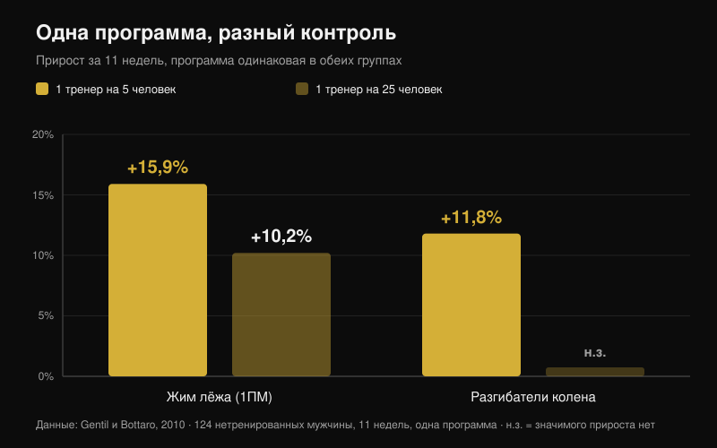
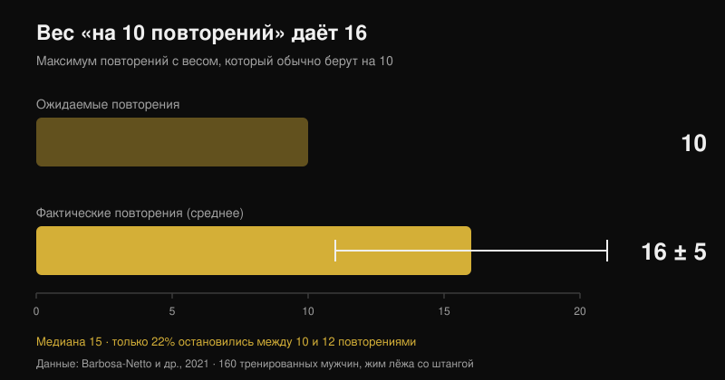

# Работает ли онлайн-коучинг? Что говорят исследования

[Giammaria Loi](/autore/giammaria-loi) · обновлено 26 октября 2026

«Ты платишь человеку, который ни разу не видел, как ты тренируешься». Это первое возражение против онлайн-коучинга, и у него есть реальная основа: существуют исследования, где две группы выполняют одну и ту же программу, а та, рядом с которой стоит тренер, заканчивает сильнее. Я прочитал семь индексированных работ о контроле, интенсивности и тренировках под дистанционным руководством. Разрыв действительно есть — но возникает он не там, где думает большинство, и это полностью меняет то, чего стоит требовать от онлайн-тренера.

## Коротко

- **Одна программа, разные результаты.** Двенадцать недель одинакового периодизированного плана: группа, тренировавшаяся с персональным тренером рядом, поднимала веса быстрее и закончила с более высокими максимумами в приседе и жиме, чем группа без контроля (Mazzetti et al., 2000).
- **Плотность контроля имеет значение.** При одном тренере на 5 человек жим лёжа вырос на **15,9%** против **10,2%** при одном тренере на 25; сила разгибателей колена выросла (**+11,8%**) только в группе с плотным контролем (Gentil и Bottaro, 2010).
- **Дело не в мотивации, а в интенсивности.** В том же исследовании посещаемость и объём работы в группах были одинаковыми. Различалась доля людей, реально доходивших до максимальной интенсивности.
- **В одиночку жмут слабее, чем думают.** 160 тренированных мужчин взяли в жиме вес, который обычно используют «на 10 повторений»: получилось **16 ± 5** (медиана 15), и лишь 22% остановились между 10 и 12 (Barbosa-Netto et al., 2021).
- **Дистанционно работает, но не во всём.** Шестнадцать недель одной и той же программы по видеосвязи оказались не хуже очных занятий по весу, жировой массе, аэробной мощности и силе разгибателей колена; по кистевому хвату, разгибанию корпуса и сгибанию колена сравнение не прошло (Langeard et al., 2022).

## Тренер даёт не лучшую программу, а исполнение той, что у тебя есть

Исследование, с которого началось это направление, вышло в 2000 году, и устроено оно почти грубо. Двадцать умеренно тренированных мужчин разделили на две группы: одна занималась под прямым контролем персонального тренера, другая — сама. Программа была идентичной: двенадцать недель линейной периодизации с подготовительной фазой (10-12 повторений до отказа), гипертрофией (8-10), силой (5-8) и пиком (3-6), со свободными весами и тренажёрами (Mazzetti et al., 2000).

Интересен не вывод «группа под контролем показала больше», а то, *где* она показала больше. Средний вес за подход стал значимо выше в группе под контролем начиная с седьмой недели в приседе и уже с третьей — в жиме. Скорость, с которой вес рос от недели к неделе, тоже была выше. К двенадцатой неделе максимумы в приседе и жиме были значимо больше при контроле. Прогрессировали обе группы — но одна действительно выполнила программу, которую вторая выполнила наполовину.

Иначе говоря: ценность тренера в том исследовании была не в программировании — оно было одинаковым, — а в том, что кто-то смотрел на штангу и говорил: «добавь пять килограммов».

## Меняется интенсивность, а не физическое присутствие

Следующее исследование объясняет механизм и для оценки онлайн-коучинга оно важнее всех остальных. Сто двадцать четыре нетренированных молодых человека одиннадцать недель выполняли одну и ту же программу, разделённые на две группы, которые отличались одним: соотношением тренеров и занимающихся в зале — 1 на 5 или 1 на 25 (Gentil и Bottaro, 2010).

При высоком соотношении максимум в жиме вырос на **15,9%** против **10,2%** при низком, а сила разгибателей колена значимо выросла (**+11,8%**) только в группе с плотным контролем. Межгрупповые различия были статистически значимы по обоим показателям.

Дальше идёт цифра, которая разрушает привычное объяснение. Между группами **не было** разницы ни в посещаемости, ни в объёме работы в жиме и жиме ногами. Отличалась только доля людей, тренировавшихся с максимальной интенсивностью, — выше в группе с плотным контролем. Тренер сработал не потому, что удерживал людей в регулярности (она и так была), а потому, что подводил их ближе к пределу в каждом подходе.

Третья работа двигает ту же логику дальше: пожилые женщины, тренировавшиеся шестнадцать недель при соотношении 1:2, показали более крупные эффекты по максимумам, чем при 1:5, и только в группе с более плотным контролем снизилась жировая масса (Vieira et al., 2020). Выборка маленькая, межгрупповые различия не заявлены, так что это подсказка, а не доказательство — но она указывает в ту же сторону.

## Слепая зона: насколько ты на самом деле выкладываешься

Если механизм — интенсивность, следующий вопрос: насколько ошибается человек, оставленный наедине с собой. Это измерили максимально безжалостным способом.

160 тренированным мужчинам задали один вопрос: «какой вес ты обычно берёшь на 10 повторений в жиме лёжа со штангой?» После короткой разминки им предложили сделать с ним максимум повторений. В среднем вышло **16 ± 5 повторений**, медиана 15 — огромный и статистически очень устойчивый разрыв с заявленными 10 (p < 0,001). Самый частый диапазон — 13-15 повторений (31% выборки), и только 22% остановились между 10 и 12 (Barbosa-Netto et al., 2021).

Авторы пишут прямо: эти тренировочные схемы были несовместимы с максимальным усилием. Речь не о новичках: это тренированные мужчины, уверенные, что используют свой вес «на десять». Именно поэтому число повторений значит меньше, чем близость к отказу — об этом я подробно писал в материале [сколько повторений действительно нужно для массы](/ru/blog/skolko-povtoreniy-dlya-massy).

Тренер в зале исправляет эту ошибку в реальном времени. Настоящий вопрос про онлайн-коучинг — существует ли другой способ её исправить.

## Так работает ли дистанционное ведение? Зависит от того, что нужно контролировать

Самое чистое прямое сравнение — исследование не меньшей эффективности на здоровых пожилых людях. Три группы: без тренировок, домашние тренировки под очным руководством и домашние тренировки под руководством по видеосвязи. Для обеих активных групп программа была одинаковой, комбинированной, шестнадцать недель, по часу дважды в неделю (Langeard et al., 2022).

Видеосвязь оказалась **не хуже** очного формата по массе тела, жировой массе, максимальной аэробной мощности, максимальной ЧСС, максимальному потреблению кислорода, силе разгибания колена и мощности нижних конечностей. И **не подтвердилась** как не худшая по мышечной массе, силе кистевого хвата, разгибанию корпуса и сгибанию колена. Авторы говорят об этом прямо: по этим изометрическим показателям силы очный формат остаётся лучше.

Второе рандомизированное исследование показывает, что дистанционно можно работать и с теми, у кого есть боль: 130 сотрудников ухода за пожилыми двенадцать недель добавляли силовые упражнения под руководством по видеосвязи в реальном времени, и экспериментальная группа снизила среднюю интенсивность боли в пояснице по сравнению с контролем (p = 0,034), с улучшениями также по запястью и кисти и по мышечной работоспособности верхних конечностей. В анализе по протоколу те, кто выполнил не менее 50% занятий, получили дополнительную пользу по настроению, качеству жизни и приёму лекарств (Espin et al., 2024).

Честное уточнение, потому что оно меняет чтение этих цифр: участниками обоих исследований были здоровые пожилые люди и работники, а не силовые атлеты. Они показывают, что дистанционное руководство даёт реальные адаптации. Они не говорят, насколько продвинутый пауэрлифтер приблизится к своему очному тренеру. Такого сравнения в литературе сегодня нет.

## Что дистанционный тренер обязан измерять, чтобы стоить столько же, сколько очный

Отсюда практический вывод пишется почти сам. У очного тренера есть одно доказанное преимущество: он видит, сколько осталось до отказа, и заставляет добавить вес. Онлайн-тренер на равных, если у него есть надёжный способ знать то же самое.

Инструмент существует и изучен. Обзор 31 исследования по шкалам RIR — повторениям, которые остались бы в запасе в конце подхода, — заключает, что они применимы и полезны и для назначения интенсивности, и для корректировки веса, с оговоркой: оценка точнее, когда делается близко к отказу, а не за десять повторений до конца (Bastos et al., 2024).

В переводе: тренер, который получает только «сделал, всё нормально», слеп ровно так же, как тренер 1:25 из работы Gentil. Тренер, который получает вес, повторения и RIR по каждому подходу плюс видео последнего подхода в базовых упражнениях, имеет те два показателя, что нужны для единственного важного действия — сказать, когда прибавлять.

## Что на самом деле говорит наука

| Утверждение | Вердикт | Данные |
| --- | --- | --- |
| Тренер, который на тебя смотрит, даёт больший прогресс | **Подтверждено** | Одна программа 12 недель: выше веса за подход и выше максимумы при прямом контроле (Mazzetti et al., 2000) |
| Он нужен в основном для мотивации и регулярности | **Опровергнуто** | Между 1:5 и 1:25 посещаемость и объём были равны; менялась доля тренирующихся с максимальной интенсивностью (Gentil и Bottaro, 2010) |
| «Я и сам знаю, когда поднажать» | **Опровергнуто** | Вес «на 10» позволял 16 ± 5; лишь 22% останавливались между 10 и 12 (Barbosa-Netto et al., 2021) |
| Онлайн-коучинг даёт те же результаты, что и очный | **С оговорками** | Не хуже по весу, жировой массе, МПК, силе разгибателей колена и мощности ног; хуже по хвату, корпусу и сгибанию колена (Langeard et al., 2022) |
| Дистанционно нельзя вести человека с болью | **Опровергнуто** | 12 недель занятий по видеосвязи снизили боль в пояснице у 130 сотрудников ухода (Espin et al., 2024) |
| Не видя подход, невозможно контролировать интенсивность | **С оговорками** | Шкалы RIR годятся для назначения и коррекции веса, но оценка точна только близко к отказу (Bastos et al., 2024) |
| Чем плотнее соотношение тренер-атлет, тем лучше | **Не доказано** | Сравнение 1:2 против 1:5 у пожилых женщин показывает большие эффекты, но на малой выборке (Vieira et al., 2020) |

## Как это применить

1. **Оценивай онлайн-тренера по тому, что он измеряет, а не по частоте сообщений.** Один вопрос до оплаты: как ты поймёшь, насколько я далёк от отказа в каждом подходе?
2. **Записывай вес, повторения и RIR в каждом рабочем подходе.** Без всех трёх чисел вместе никто на расстоянии не решит, добавлять ли вес на следующей неделе.
3. **Откалибруй свой RIR один раз, тестом.** В безопасном упражнении (тренажёр или штанга со страховочными упорами) возьми вес, который взял бы «на 10», и иди до отказа. Если выйдет 15, твоя «десятка» на деле была RIR 5, и вся шкала смещена.
4. **Отправляй видео последнего подхода, а не разминки.** Только там видно технику на фоне усталости и реальный остаток запаса.
5. **Требуй письменное правило прогрессии.** Например: закончил подход с RIR 2 или больше — на следующей тренировке прибавляешь вес. Такое правило работает и в те недели, когда тренер отвечает с задержкой.
6. **Закрывай слепые зоны цифрами.** Хуже всего дистанционно держались хват и стабильность корпуса: если они важны, ставь их как упражнения с весом и временем для записи, а не как подсобку «по ощущениям».

**С Nurvan.** Дистанционное ведение ломается всегда в одной точке: тренер не видит цифр за твоими подходами. В Nurvan тренер и атлет работают над одной программой, и каждый подход записывает вес, повторения и RIR, так что история показывает тренеру, прогрессируешь ты или третью неделю стоишь на том же весе. Разминочные подходы предлагаются автоматически, а программу, уже написанную в PDF, Excel или даже на фото, можно импортировать, не переписывая вручную. [Попробовать Nurvan](https://nurvan.app)

## Частые вопросы

**Онлайн-коучинг действительно работает?**
Да: в доступных исследованиях он даёт реальные адаптации — силу, состав тела, аэробные возможности и снижение боли в пояснице. Прямое сравнение с очным форматом выдерживается по многим параметрам, но не по всем, и все данные получены на здоровых взрослых и работниках, а не на продвинутых силовых атлетах.

**Что лучше: тренер онлайн или в зале?**
Зависит от того, чего не хватает. Если проблема в технике сложных движений или в страхе выложиться, физическое присутствие даёт преимущество, которое не заменит ни один чат. Если техника есть, а дело в прогрессии весов, онлайн-тренер, получающий вес, повторения и RIR, работает ровно с тем механизмом, который дал разницу в исследованиях.

**Как дистанционный тренер поймёт, что я тренировался достаточно?**
По данным, которые ты отправляешь. Шкалы RIR — изученный для этого инструмент с известным ограничением: оценка надёжна близко к отказу и заметно хуже за шесть-семь повторений до конца. Поэтому одно видео последнего подхода стоит десяти сообщений.

**Подходит ли онлайн-коучинг новичку?**
Именно у нетренированных контроль дал самые большие эффекты, так что плохо ведомый новичок теряет много. Если начинаешь с нуля, проси живые видеосозвоны в первые недели и короткий список упражнений, которые легко проверить по видео.

## Читайте также

- [Сколько повторений нужно для роста мышц: миф 8-12](/ru/blog/skolko-povtoreniy-dlya-massy) — почему близость к отказу важнее числа повторений
- [Сплит: новичок и продвинутый — в чём разница](/ru/blog/split-trenirovok-novichok-prodvinutyy) — сколько структуры действительно нужно на твоём уровне

## Источники

1. Mazzetti SA, Kraemer WJ, Volek JS, Duncan ND, Ratamess NA, Gómez AL, Newton RU, Häkkinen K, Fleck SJ, 2000. The influence of direct supervision of resistance training on strength performance. *Med Sci Sports Exerc*. PMID [10862549](https://pubmed.ncbi.nlm.nih.gov/10862549/) · [DOI](https://doi.org/10.1097/00005768-200006000-00023)
2. Gentil P, Bottaro M, 2010. Influence of supervision ratio on muscle adaptations to resistance training in nontrained subjects. *J Strength Cond Res*. PMID [19661830](https://pubmed.ncbi.nlm.nih.gov/19661830/) · [DOI](https://doi.org/10.1519/JSC.0b013e3181ad3373)
3. Barbosa-Netto S, d'Acelino-e-Porto OS, Almeida MB, 2021. Self-Selected Resistance Exercise Load: Implications for Research and Prescription. *J Strength Cond Res*. PMID [29112055](https://pubmed.ncbi.nlm.nih.gov/29112055/) · [DOI](https://doi.org/10.1519/JSC.0000000000002287)
4. Langeard A, Bigot L, Maffiuletti NA, Moussay S, Sesboüé B, Quarck G, Gauthier A, 2022. Non-inferiority of a home-based videoconference physical training program in comparison with the same program administered face-to-face in healthy older adults: the MOTION randomised controlled trial. *Age Ageing*. PMID [35290431](https://pubmed.ncbi.nlm.nih.gov/35290431/) · [DOI](https://doi.org/10.1093/ageing/afac059)
5. Espin A, Irazusta J, Aiestaran M, Latorre Erezuma U, García-García J, Arrinda I, Acedo K, Rodriguez-Larrad A, 2024. Videoconference-Supervised Group Exercise Reduces Low Back Pain in Eldercare Workers: Results from the ReViEEW Randomised Controlled Trial. *J Occup Rehabil*. PMID [38632115](https://pubmed.ncbi.nlm.nih.gov/38632115/) · [DOI](https://doi.org/10.1007/s10926-024-10182-2)
6. Bastos V, Machado S, Teixeira DS, 2024. Feasibility and Usefulness of Repetitions-In-Reserve Scales for Selecting Exercise Intensity: A Scoping Review. *Percept Mot Skills*. PMID [38563729](https://pubmed.ncbi.nlm.nih.gov/38563729/) · [DOI](https://doi.org/10.1177/00315125241241785)
7. Vieira DCL, Nascimento DC, Tajra V, Teixeira TG, Farias DL, Tibana RA, Silva AO, Rosa TS, De Moraes MR, Voltarelli FA, Navalta JW, Prestes J, 2020. High Supervised Resistance Training in Elderly Women: The Role of Supervision Ratio. *Int J Exerc Sci*. PMID [32509119](https://pubmed.ncbi.nlm.nih.gov/32509119/) · [DOI](https://doi.org/10.70252/WNVF6463)

Трендовый сигнал: ACSM, *Worldwide Fitness Trends 2026* (опубликованы 22 октября 2025 года): тренировочные приложения на 4-м месте, технологии на основе данных — на 8-м. Текст, структура и проверки этой статьи оригинальны.

---

**Giammaria Loi** — основатель Nurvan. Тренируется с отягощениями с 2012 года, с 2013 года работает персональным тренером и коучем с сертификацией FIPE, с 2018 года выступает в пауэрлифтинге на национальном уровне.

> Примечание: информационный материал, не заменяет консультацию врача или профильного специалиста. При боли или имеющемся заболевании обсудите с врачом начало или изменение тренировочной программы — очной или дистанционной.
