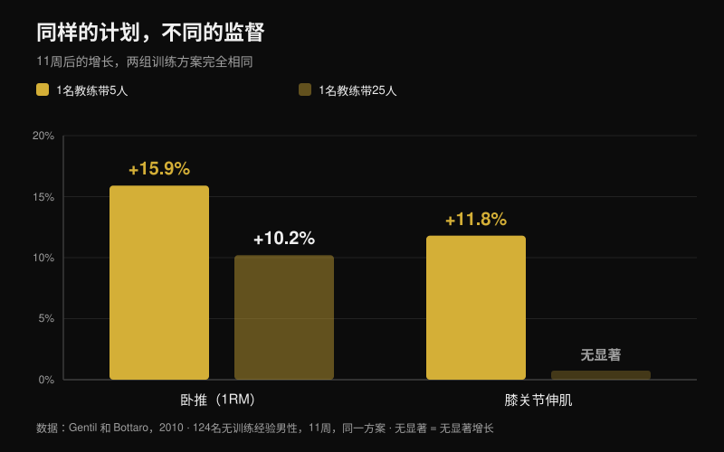
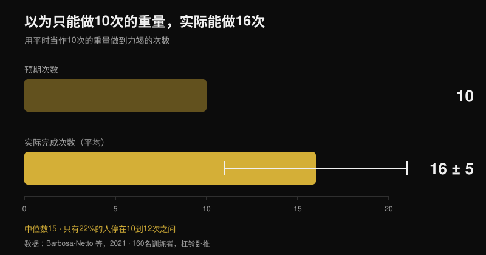

# 线上教练真的有用吗？研究怎么说

作者 [Giammaria Loi](/autore/giammaria-loi) · 更新于 2026年10月26日

「你花钱请了一个从来没看过你训练的人。」这是对线上教练最常见的质疑，而且它有依据：确实有研究让两组人执行完全一样的计划，身边站着教练的那一组最后更强。我读了七篇被收录的研究，内容是训练监督、强度和远程指导。差距真实存在，但它出现的位置和大多数人以为的不一样——想明白这一点，你对线上教练该提的要求就完全变了。

## 要点速览

- **同样的计划，不同的结果。** 十二周完全相同的周期化方案：身边有私教的那组加重更快，最后深蹲和卧推的最大重量都高于无人监督的那组（Mazzetti et al., 2000）。
- **被盯得多紧，有影响。** 1名教练带5人时，卧推最大重量涨了 **15.9%**，1名教练带25人时只涨 **10.2%**；膝关节伸肌力量只有在紧密监督组才出现提升（**+11.8%**）（Gentil 和 Bottaro, 2010）。
- **关键不是动力，而是强度。** 同一项研究里，两组的出勤率和训练量完全一样。不同的是真正练到最大强度的人所占的比例。
- **一个人练，比你以为的要轻。** 160名有训练经验的男性用他们平时「做10次」的重量做卧推，结果平均做了 **16 ± 5** 次（中位数15），只有22%停在10到12次之间（Barbosa-Netto et al., 2021）。
- **远程撑得住，但不是全部项目。** 同一套方案做十六周，视频指导在体重、脂肪量、有氧功率和膝关节伸肌力量上不劣于面对面；但在握力、躯干伸展和屈膝力量上没能通过检验（Langeard et al., 2022）。

## 教练给你的不是更好的计划，而是让你真正执行手上的计划

开创这条研究线的论文发表于2000年，设计几乎简陋。二十名中等训练水平的男性被分成两组：一组在私教的直接监督下训练，另一组自己练。方案完全相同——十二周线性周期化，依次是准备期（10-12RM）、增肌期（8-10RM）、力量期（5-8RM）和峰值期（3-6RM），自由重量加器械（Mazzetti et al., 2000）。

有意思的不是「监督组更好」，而是它**好在哪里**。从第七周起，监督组深蹲的每组平均负荷显著更高，卧推从第三周就开始拉开差距。负荷逐周上升的速度也更快。到第十二周，监督组的深蹲和卧推最大重量都显著更高。两组都进步了，但其中一组真的把计划做完了，另一组只做了一半。

换句话说：在那项研究里，教练的价值不在编排——编排是一样的——而在于有人盯着杠铃说「再加五公斤」。

## 改变的是强度，不是人站在旁边

后续研究揭示了机制，对于评估线上教练服务的人来说，它是七篇里最重要的一篇。124名没有训练经验的年轻男性用同一套方案练了十一周，两组只差一件事：场上教练与学员的比例，1比5或者1比25（Gentil 和 Bottaro, 2010）。

高比例组的卧推最大重量提高 **15.9%**，低比例组是 **10.2%**；膝关节伸肌力量只有在紧密监督组出现显著提升（**+11.8%**）。两项指标的组间差异都达到统计显著。

接下来是推翻常见解释的那个数据。两组之间，出勤率**没有**差别，卧推和腿举的训练量也**没有**差别。唯一不同的是以最大强度训练的人所占比例，紧密监督组更高。教练起作用，不是因为让人更规律——他们本来就规律——而是因为每一组都把人带得更靠近极限。

第三篇把同样的逻辑再推一步：老年女性训练十六周，1比2的比例在最大力量上的效应量大于1比5，而且只有监督更紧的那组脂肪量下降（Vieira et al., 2020）。样本小、组间差异未声明，所以只能当线索，不能当证据，但方向一致。

## 盲区：你到底练得有多狠

如果机制是强度，下一个问题就是：一个人独自训练时，偏差有多大。有一项研究用最直白的方式量了出来。

研究者只问了160名有训练经验的男性一个问题：「你平时杠铃卧推做10次用多重？」短暂热身后，让他们用这个重量做到力竭。结果平均 **16 ± 5 次**，中位数15——与他们自己说的10次相比差距巨大，统计上非常稳健（p < 0.001）。最常见的区间是13到15次（占31%），只有22%停在10到12次之间（Barbosa-Netto et al., 2021）。

作者写得毫不客气：这些人的训练安排与最大努力并不相符。他们不是新手，而是自认为在用「10次重量」的训练者。这也是为什么次数本身没有「离力竭还差多少」重要，这一点我在[增肌到底要做多少次](/zh/blog/duoshao-cishu-zengji)里展开过。

健身房里的教练能实时纠正这件事。关于线上教练，真正的问题是：有没有别的办法纠正它。

## 那远程指导有用吗？取决于它要控制什么

最干净的正面比较来自一项在健康老年人中进行的非劣效性试验。三组：不训练、居家面对面指导训练、居家视频指导训练。两个训练组方案完全相同，混合训练，十六周，每周两次、每次一小时（Langeard et al., 2022）。

视频指导在体重、脂肪量、最大有氧功率、最大心率、最大摄氧量、膝关节伸展力量和下肢功率上，**不劣于**面对面。但在肌肉量、握力、躯干伸展和屈膝力量上，**没有**通过非劣效检验。作者说得很直接：在这些等长力量指标上，面对面仍然更好。

另一项随机对照试验说明，远程也能带有疼痛的人：130名养老护理人员在十二周内增加了实时视频指导的力量训练，实验组的腰痛平均强度低于对照组（p = 0.034），手腕和手部疼痛以及上肢肌肉表现也有改善。按方案分析中，完成至少50%课次的人在情绪、生活质量和用药上还有额外获益（Espin et al., 2024）。

需要诚实说明一点，因为它决定这些数字怎么读：两项试验的受试者是健康老年人和劳动者，不是力量项目运动员。它们说明远程指导能带来真实的适应，但没有告诉我们一个高水平力量举运动员能多接近他线下的教练。这个比较目前文献里还没有。

## 远程教练必须测量什么，才值线下教练的价

到这里，实际结论几乎自己写出来了。线下教练只有一个被证实的优势：他能看出你离力竭还有多远，并让你加重。线上教练只要有可靠的办法知道同一件事，就站在同一条线上。

这个工具存在，而且被研究过。一篇覆盖31项研究的综述指出，RIR 量表——也就是一组结束时你还剩几次没做——在安排强度和调整负荷上都可行、好用，但有一个前提：估计越接近力竭越准，离结束还有十次时并不可靠（Bastos et al., 2024）。

翻译过来：只收到「练完了，感觉不错」的教练，和 Gentil 研究里那个1比25的教练一样瞎。而收到每一组的重量、次数和 RIR，外加主项最后一组视频的教练，手上就有了做那件唯一重要的事所需要的两项数据——告诉你什么时候该加重。

## 研究到底怎么说

| 说法 | 结论 | 数据 |
| --- | --- | --- |
| 有教练盯着，你进步更多 | **已确认** | 同样的计划练12周，直接监督组每组负荷更高、最大重量更大（Mazzetti et al., 2000） |
| 教练主要作用是鼓励你、让你按时来 | **不成立** | 1比5和1比25之间出勤和训练量相同，差别在以最大强度训练的人数占比（Gentil 和 Bottaro, 2010） |
| 「我自己知道什么时候该拼」 | **不成立** | 被当作「10次」的重量实际能做16 ± 5次，只有22%停在10到12次（Barbosa-Netto et al., 2021） |
| 线上教练效果和线下一样 | **需要细分** | 在体重、脂肪量、最大摄氧量、膝伸力量和下肢功率上不劣；在握力、躯干和屈膝上没通过（Langeard et al., 2022） |
| 有疼痛就不能远程指导 | **不成立** | 12周视频指导训练降低了130名护理人员的腰痛（Espin et al., 2024） |
| 看不到这一组，就控制不了强度 | **需要细分** | RIR 量表可用于安排和调整负荷，但只有接近力竭时估计才准（Bastos et al., 2024） |
| 教练与学员的比例越紧越好 | **未证实** | 老年女性1比2对比1比5显示效应更大，但样本很小（Vieira et al., 2020） |

## 怎么落地

1. **判断一个线上教练，看他测什么，而不是看他发多少消息。** 付钱前只问一句：你靠什么知道我每一组离力竭还有多远？
2. **每一组正式组都记录重量、次数和 RIR。** 这三个数字缺一个，远端的人就无法判断下周该不该加重。
3. **用一次测试校准你的 RIR。** 在安全的动作上（器械，或带安全销的杠铃），用你心目中的「10次重量」做到力竭。如果做出15次，你的「10」其实是 RIR 5，整条标尺都偏了。
4. **发最后一组的视频，不是热身的。** 只有那一组能看出疲劳下的技术，以及真正还剩多少余量。
5. **要一条写下来的进阶规则。** 例如：一组结束时 RIR 还有2或更多，下次训练就加重。这样的规则在教练回复慢的那几周照样管用。
6. **用数字补上盲区。** 远程表现最差的是握力和躯干稳定：如果这两项对你重要，就把它们编成有重量、有时间可记录的动作，而不是「凭感觉」的辅助训练。

**用 Nurvan。** 远程指导总是断在同一个地方：教练看不到你每组背后的数字。在 Nurvan 里，教练和学员使用同一份计划，每一组都会记录重量、次数和 RIR，历史记录会让教练看出你是在进步，还是已经在同一个重量上停了三周。热身组会自动给出，已经写在 PDF、Excel 甚至照片里的计划也能直接导入，不用手动重打。[试用 Nurvan](https://nurvan.app)

## 常见问题

**线上教练真的有效吗？**
有效：现有研究显示它能带来真实的适应——力量、身体成分、有氧能力和腰痛改善。与线下的正面比较在很多指标上站得住，但不是全部；而且所有数据都来自健康成年人或劳动者，不是高水平力量运动员。

**线上教练和健身房教练选哪个？**
看你缺什么。如果问题出在复杂动作的技术，或者不敢把力气使出来，线下的人在现场有聊天框替代不了的优势。如果技术没问题，卡在负荷进阶上，那么一个能收到重量、次数和 RIR 的线上教练，正好作用在研究里拉开差距的那个机制上。

**远程教练怎么知道我练得够不够？**
靠你发回去的数据。RIR 量表是针对这件事被研究过的工具，但有已知的边界：接近力竭时估计可靠，离结束还有六七次时就差很多。所以最后一组的一段视频，胜过十条消息。

**新手适合找线上教练吗？**
恰恰是没有训练经验的人身上，监督的效果最大，所以新手如果远程被带得不好，损失很大。如果你从零开始，前几周要求真人视频连线，并把动作数量控制住，选容易在视频里看清的。

## 延伸阅读

- [增肌每组做多少次？8-12 次的迷思](/zh/blog/duoshao-cishu-zengji) —— 为什么「离力竭多远」比次数本身更重要
- [训练分化：新手和高手该一样吗](/zh/blog/xunlian-fenhua-xinshou-gaoji) —— 你现在的水平到底需要多少结构

## 参考文献

1. Mazzetti SA, Kraemer WJ, Volek JS, Duncan ND, Ratamess NA, Gómez AL, Newton RU, Häkkinen K, Fleck SJ, 2000. The influence of direct supervision of resistance training on strength performance. *Med Sci Sports Exerc*. PMID [10862549](https://pubmed.ncbi.nlm.nih.gov/10862549/) · [DOI](https://doi.org/10.1097/00005768-200006000-00023)
2. Gentil P, Bottaro M, 2010. Influence of supervision ratio on muscle adaptations to resistance training in nontrained subjects. *J Strength Cond Res*. PMID [19661830](https://pubmed.ncbi.nlm.nih.gov/19661830/) · [DOI](https://doi.org/10.1519/JSC.0b013e3181ad3373)
3. Barbosa-Netto S, d'Acelino-e-Porto OS, Almeida MB, 2021. Self-Selected Resistance Exercise Load: Implications for Research and Prescription. *J Strength Cond Res*. PMID [29112055](https://pubmed.ncbi.nlm.nih.gov/29112055/) · [DOI](https://doi.org/10.1519/JSC.0000000000002287)
4. Langeard A, Bigot L, Maffiuletti NA, Moussay S, Sesboüé B, Quarck G, Gauthier A, 2022. Non-inferiority of a home-based videoconference physical training program in comparison with the same program administered face-to-face in healthy older adults: the MOTION randomised controlled trial. *Age Ageing*. PMID [35290431](https://pubmed.ncbi.nlm.nih.gov/35290431/) · [DOI](https://doi.org/10.1093/ageing/afac059)
5. Espin A, Irazusta J, Aiestaran M, Latorre Erezuma U, García-García J, Arrinda I, Acedo K, Rodriguez-Larrad A, 2024. Videoconference-Supervised Group Exercise Reduces Low Back Pain in Eldercare Workers: Results from the ReViEEW Randomised Controlled Trial. *J Occup Rehabil*. PMID [38632115](https://pubmed.ncbi.nlm.nih.gov/38632115/) · [DOI](https://doi.org/10.1007/s10926-024-10182-2)
6. Bastos V, Machado S, Teixeira DS, 2024. Feasibility and Usefulness of Repetitions-In-Reserve Scales for Selecting Exercise Intensity: A Scoping Review. *Percept Mot Skills*. PMID [38563729](https://pubmed.ncbi.nlm.nih.gov/38563729/) · [DOI](https://doi.org/10.1177/00315125241241785)
7. Vieira DCL, Nascimento DC, Tajra V, Teixeira TG, Farias DL, Tibana RA, Silva AO, Rosa TS, De Moraes MR, Voltarelli FA, Navalta JW, Prestes J, 2020. High Supervised Resistance Training in Elderly Women: The Role of Supervision Ratio. *Int J Exerc Sci*. PMID [32509119](https://pubmed.ncbi.nlm.nih.gov/32509119/) · [DOI](https://doi.org/10.70252/WNVF6463)

趋势信号：ACSM《Worldwide Fitness Trends 2026》（2025年10月22日发布），训练类 App 排第4，数据驱动技术排第8。本文的文字、结构和事实核查均为原创。

---

**Giammaria Loi** 是 Nurvan 的创始人。他从2012年开始力量训练，2013年起担任 FIPE 认证私人教练，2018年起在国内级别的力量举比赛中参赛。

> 注：本文为信息性内容，不能替代医生或专业人士的意见。如有疼痛或正在治疗中的健康问题，请先与医生沟通，再开始或调整训练计划，无论线上还是线下。
