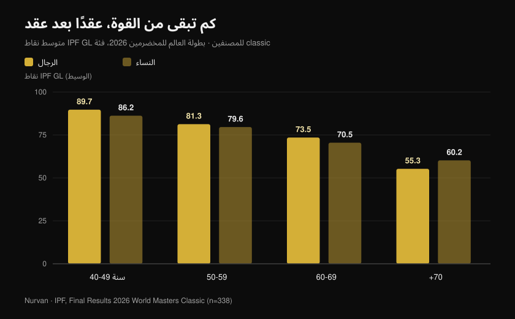
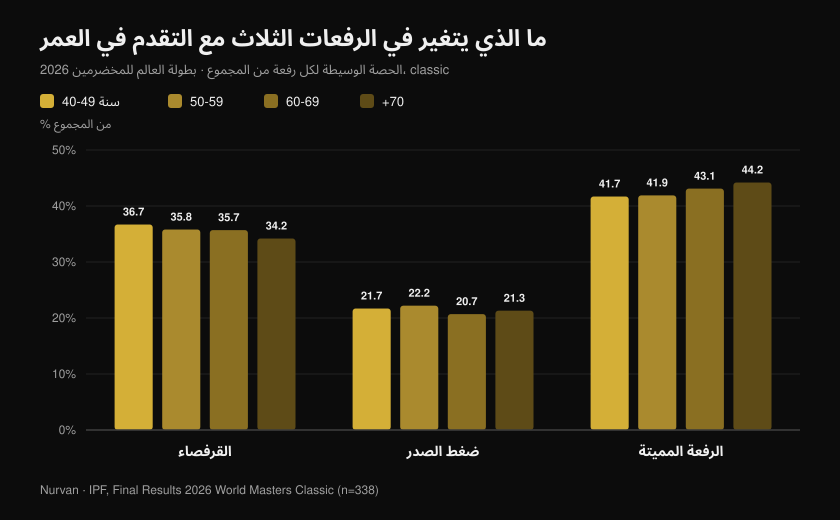

# بطولة المخضرمين 2026: كم تكلّفك السنوات من القوة

بقلم [Giammaria Loi](/autore/giammaria-loi) · حُدّث في 27 أكتوبر 2026

اختُتمت للتو في رينو بولاية نيفادا بطولة العالم IPF لرفع الأثقال القوة للمخضرمين: عشرة أيام من المنافسة، 443 لاعبًا ولاعبة في قوائم الترتيب من 41 دولة، أصغرهم في الأربعين وأكبرهن في الثانية والثمانين. نشر الاتحاد النتائج الرسمية، وفي تلك الملفات ما هو أكثر بكثير من جدول ميداليات: فيها أكبر عيّنة نظيفة متاحة عن مقدار القوة التي تبقى فعلًا، عقدًا بعد عقد، لدى أشخاص يتمرنون بجدية. راجعت كل مركز على حدة، والرقم الناتج يناقض مقولة "بعد الأربعين انتهى الأمر" ومقولة "من يتمرن لا يفقد شيئًا" في آن واحد.

## باختصار

- **لاعبة إيطالية في الثالثة والستين حطّمت أرقام من يصغرنها بعشرين عامًا.** مارتسيا جيراردي، 63 عامًا، وزنها 46.30 كغ، رفعت في الرفعة المميتة **162.5 كغ** — أي 3.5 أضعاف وزنها. هذه المحاولة وحدها سجّلت الرقم القياسي العالمي في وزن 47 كغ في فئات المخضرمين 1 (40-49) و2 (50-59) و3 (60-69) في الوقت نفسه.
- **الانخفاض المتوسط أبطأ مما يُعتقد، حتى نقطة معينة.** وسيط نقاط IPF GL لدى الرجال ينزل من **89.7 إلى 81.3 ثم 73.5** بين الفئات 40-49 و50-59 و60-69: نحو **9% كل عقد**. بعد السبعين تصبح الدرجة أعلى بكثير.
- **التمرين لا يوقف التراجع، بل ينقل خط الانطلاق.** لدى رافعي الأثقال المخضرمين من النخبة انخفضت القوة بالوتيرة نفسها كما لدى غير المتمرنين (0.6% مقابل 0.5% سنويًا)، لكن لاعبًا في الخامسة والثمانين كان ينتج قدرة شخص غير رياضي في الخامسة والستين: نحو **عشرين عامًا من الأفضلية** (Pearson et al., 2002).
- **الحفاظ على العضلات لا يكفي.** لدى 1880 مسنًا جرت متابعتهم ثلاث سنوات انخفضت القوة بوتيرة **ثلاثة أضعاف** انخفاض الكتلة الخالية من الدهون، ولم يمنع اكتساب الكتلة فقدان القوة (Goodpaster et al., 2006).
- **تتغير أيضًا نسبة الرفعات الثلاث.** مع التقدم في العمر ترتفع حصة الرفعة المميتة من المجموع (من **41.7% إلى 44.2%**) وتنخفض حصة القرفصاء (من **36.7% إلى 34.2%**): القوة لا تذهب بالتساوي.

## ماذا حدث في رينو

أقيمت بطولة المخضرمين بفئتي classic وequipped في رينو بولاية نيفادا من **15 إلى 24 أكتوبر 2026**. تضم وثائق النتائج الرسمية الأربع (رجال ونساء، classic وequipped) **465 مركزًا** — 338 في classic و127 في equipped — تخص **443 لاعبًا مختلفًا** من **41 دولة**. وسيط أعمار المصنفين **54 عامًا**.

ثمة رقم يلفت النظر: تسجّل القوائم الرسمية **68 رقمًا قياسيًا عالميًا** تحققت خلال البطولة. وفازت الولايات المتحدة بجميع ألقاب الفرق الثمانية في منافسة classic، في الفئات العمرية الأربع للرجال والأربع للنساء.

من بين أفضل نتائج classic اسمان: **نيثن كولاس** (الولايات المتحدة، 43 عامًا، 91.40 كغ) بمجموع 817 كغ و107.79 نقطة IPF GL، و**دينا ماكنيل** (الولايات المتحدة، 42 عامًا، 75.40 كغ) بمجموع 540 كغ و106.87 نقطة. أما **مايكل غاروتسو**، 44 عامًا، فسجّل ثلاثة أرقام قياسية في فئة المخضرمين 1 وزن 105 كغ: قرفصاء 328 كغ، رفعة مميتة 351 كغ، ومجموع 861.5 كغ.

### إيطاليا في رينو: ثمانية لاعبين وسبعة منصات تتويج

كان الوفد الإيطالي صغيرًا وشبه مثالي: **ثمانية لاعبين مصنفين، سبعة على منصة التتويج، وخمسة ألقاب عالمية**.

| اللاعب | الفئة العمرية | الوزن | المجموع | النتيجة |
| --- | --- | --- | --- | --- |
| Martina Pisano | المخضرمون 1 | 47 كغ | 350.5 كغ | ذهبية (رقم قياسي في القرفصاء 130.5 كغ) |
| Luisa Arienta | المخضرمون 2 | 52 كغ | 365.0 كغ | ذهبية |
| Marzia Girardi | المخضرمون 3 | 47 كغ | 307.5 كغ | ذهبية (4 أرقام قياسية) |
| Barbara Canella | المخضرمون 3 | 52 كغ | 305.0 كغ | ذهبية |
| Alessandro Cuoghi | المخضرمون 2 | 93 كغ | 727.5 كغ | ذهبية |
| Elisa Guidi | المخضرمون 1 | 52 كغ | 387.5 كغ | فضية |
| Allegra Romussi | المخضرمون 1 | 69 كغ | 462.5 كغ | فضية |

أنهى كووغي، 51 عامًا، البطولة بـ96.22 نقطة IPF GL: ثاني أفضل لاعب في فئة المخضرمين 2 عالميًا، خلف الجنوب أفريقي شون ماندرز (96.54) بفارق ضئيل.

لكن الأداء الذي يروي هذا المقال خير رواية هو أداء **مارتسيا جيراردي**. ثلاثة وستون عامًا، وزن 46.30 كغ، ورفعة مميتة بـ**162.5 كغ**. هذه المحاولة، يوم 16 أكتوبر، أعادت كتابة الرقم القياسي العالمي لوزن 47 كغ ليس في فئتها فحسب، بل في فئتي المخضرمين 2 و1 أيضًا: نساء يصغرنها بعشر سنوات وبعشرين سنة.

## كم من القوة نفقد فعلًا، عقدًا بعد عقد

هنا تتحول النتائج الرسمية إلى مجموعة بيانات. لمقارنة لاعبين بأوزان وأجناس مختلفة يستخدم الاتحاد **نقاط GL**، وهي معامل يعدّل المجموع حسب وزن الجسم والجنس: 100 نقطة تعادل تقريبًا مستوى نهائي بطولة عالم مفتوحة.

حسبت **وسيط نقاط GL لجميع المصنفين في منافسة classic**، فئة بفئة. هذه ليست متابعة للشخص نفسه عبر الزمن — إنها لقطة لأربعة أجيال تنافست في الأسبوع ذاته — لكنها أوسع لقطة وأكثرها انضباطًا من بين المتاح.

لدى الرجال: **89.7** نقطة بين 40 و49 عامًا، و**81.3** بين 50 و59، و**73.5** بين 60 و69، و**55.3** من السبعين فصاعدًا. ولدى النساء: **86.2** و**79.6** و**70.5** و**60.2**.

الانتقال الأول يكلّف نحو **9%**. والثاني يكاد يطابقه. ثم يأتي الجدار: بين 60-69 و70 فأكثر يفقد الرجال نحو 25% إضافية مما تبقّى. المنحنى ليس هبوطًا منتظمًا، بل منحدر لطيف يتحول عند نقطة ما إلى درجة.

وهنا توضيح لازم لأنه يغيّر طريقة قراءة الأرقام: الفئات الأكبر سنًا أقل عددًا بكثير (18 رجلًا و17 امرأة في فئة 70 فأكثر، مقابل 54 و62 في فئة 40-49)، ومن يتنافس في الخامسة والسبعين يكون قد مرّ بانتقاء مزدوج: الصحة والرغبة. لذا تُؤخذ القيم المطلقة بحذر، أما الاتجاه فمتين ومتسق لدى الجنسين.

## مفارقة الأرقام القياسية: يحققها الأكبر سنًا

من بين 68 رقمًا قياسيًا عالميًا في رينو، تحقق **48 في الفئتين الأكبر سنًا** (33 في المخضرمين 3 و15 في المخضرمين 4)، مقابل 9 في المخضرمين 1 و11 في المخضرمين 2.

هذا لا يعني أن المرء يصبح أقوى بعد الستين، بل يعني أن سجلات الأرقام القياسية في الفئات الأكبر أحدث عهدًا وأقل امتلاءً: مرّ بها عدد أقل بكثير من الناس. والنساء، اللواتي بدأن المنافسة بأعداد كبيرة متأخرات عن الرجال، سجّلن 40 من الأرقام الـ68.

تفصيل إحصائي، لكنه يقول شيئًا ملموسًا لمن يتمرن: **عدد من يبلغون الستين وما زالوا قادرين على إظهار القوة صغير جدًا**. ليس بسبب حدود بيولوجية، بل بسبب الانسحاب.

## ما الذي يتغير في الرفعات الثلاث

في البيانات إشارة ثانية، وهذه عملية. حسبت وزن كل رفعة ضمن المجموع، فئة بفئة.

تنخفض **القرفصاء** من 36.7% من المجموع في فئة 40-49 إلى 34.2% في فئة 70 فأكثر. ويبقى **ضغط الصدر** شبه ثابت بين 20.7% و22.2%. وترتفع **الرفعة المميتة** من 41.7% إلى 44.2%.

الإزاحة بضع نقاط مئوية فقط، لكنها مطّردة وتتجه حيث يشير علم وظائف الأعضاء: الرفعة التي تتطلب أوسع مدى حركي وأكبر مرونة في الكاحل والورك وأكثر تحكم في طور إطالة عميق هي أول ما يتراجع. ليست القوة هي التي تختفي، بل **القرفصاء** هي التي تصبح أصعب في الإظهار.

وبلغة التدريب: إذا تراجعت قرفصاؤك بعد الخمسين أكثر من بقية الرفعات، فتحقق من المرونة والعمق قبل أن تخفّض الحِمل. والصيغة المستخدمة مهمة أيضًا — وهو موضوع فصّلته في مقال [الركبتان إلى الخارج في القرفصاء: قاعدة أم إشارة؟](/ar/blog/alrukbatan-ila-alkharij-fi-alqurfusa).

## ماذا يقول البحث العلمي فعلًا

| الادعاء | الحكم | المعطى |
| --- | --- | --- |
| بعد الأربعين تنهار القوة | **يحتاج توضيحًا** | بين 40-49 و60-69 ينخفض وسيط نقاط GL نحو 9% كل عقد؛ والقفزة الكبرى تأتي بعد السبعين (بيانات IPF الرسمية، رينو 2026) |
| من يتمرن لا يفقد القوة مع العمر | **مُفنَّد** | لدى رافعي الأثقال المخضرمين من النخبة انخفضت القوة الثابتة 0.6% سنويًا مقابل 0.5% لدى غير المتمرنين: الميل نفسه (Pearson et al., 2002) |
| التمرين في الكبر بلا جدوى، التراجع محتوم | **مُفنَّد** | أنتج اللاعبون أنفسهم قدرة أعلى بنسبة 32% وقوة ثابتة أعلى بنسبة 32% من أقرانهم غير الرياضيين: لاعب في الخامسة والثمانين يعادل غير رياضي في الخامسة والستين (Pearson et al., 2002) |
| يكفي الحفاظ على الكتلة العضلية | **مُفنَّد** | لدى 1880 مسنًا انخفضت القوة بوتيرة أسرع بنحو ثلاثة أضعاف من الكتلة الخالية من الدهون، ولم يحمِ اكتساب الكتلة القوة (Goodpaster et al., 2006) |
| في الثمانين أو التسعين لا معنى للبدء | **مُفنَّد** | تسعة أشخاص بعمر 90 ± 1 سنة، ثمانية أسابيع من تدريب المقاومة عالي الشدة: القوة +174 ± 31%، ومساحة عضلة الفخذ +9.0 ± 4.5% (Fiatarone et al., 1990) |
| بعد سن معينة يجب التمرن بأحمال خفيفة | **يحتاج توضيحًا** | في التحليل البعدي لكبار السن الأصحاء جاء أكبر أثر على القوة من شدة **70-79% من الحد الأقصى**، لا من الأحمال الخفيفة (Borde et al., 2015) |
| التراجع متساوٍ في الرفعات الثلاث | **يحتاج توضيحًا** | في رينو ارتفعت حصة الرفعة المميتة مع العمر وانخفضت حصة القرفصاء، لكن ببضع نقاط فقط وبمقارنة أشخاص مختلفين |

الدراسة التي تربط كل ذلك هي دراسة بيرسون. أربعة وخمسون رافع أثقال مخضرمًا من النخبة بين 40 و87 عامًا، قورنوا بعدد مماثل من أقرانهم الأصحاء غير المتمرنين. جاء ميل التراجع **متطابقًا** في المجموعتين: التمرين لم يبطئ الشيخوخة. لكن المستوى المطلق كان أعلى إلى حد جعل الباحثين يقدّرون الأفضلية بنحو **عشرين عامًا من العمر الظاهري**.

وتضيف الدراسة نفسها تفصيلًا يهم كل من تجاوز الخمسين: انخفضت **القدرة** بوتيرة تقارب ضعف انخفاض القوة الثابتة (1.2% مقابل 0.6% سنويًا). ما يُفقد أولًا ليس مقدار ما تستطيع دفعه، بل سرعة دفعه.

## كيف تطبّق ذلك

1. **لا تخفّض الشدة قبل الأوان.** في التحليل البعدي لكبار السن الأصحاء جاء أكبر مكسب للقوة من مجموعات عند 70-79% من الحد الأقصى، لا من أحمال خفيفة بتكرارات عالية (Borde et al., 2015). حصتان أسبوعيًا، و2-3 مجموعات لكل تمرين، و7-9 تكرارات: هذا هو النمط الأعلى مردودًا.
2. **أدرج شيئًا سريعًا في كل حصة.** إذا كانت القدرة تختفي بضعف سرعة القوة، فعليك تدريبها على حدة: رفعات انفجارية، قفزات منخفضة، دفعات سريعة بحمل معتدل، أو حتى النهوض عن الكرسي بأقصى سرعة ممكنة.
3. **كفّ عن الحكم من المرآة.** الحفاظ على الكتلة لا يضمن القوة: المؤشر الذي تتبعه هو الوزن المرفوع، لا المحيط.
4. **سجّل كل مجموعة.** انخفاض 9% كل عقد يعادل نحو 0.9% سنويًا: غير مرئي من شهر لآخر، وواضح على مدى ثلاث سنوات من السجل. من دون أرقام مكتوبة لن تنتبه إلا بعد فوات الأوان.
5. **امنح القرفصاء وقتًا أطول، لا حملًا أقل.** إذا كانت أول ما يتراجع، فأضف إحماءً وعملًا على المرونة قبل أن تنزع الأثقال من البار.
6. **اهتم بالبروتين.** توصي ورقة موقف PROT-AGE بما لا يقل عن **1.0-1.2 غرام لكل كغ من وزن الجسم يوميًا** بعد سن 65، و**1.2 غرام/كغ على الأقل** لمن يتمرن (Bauer et al., 2013). أما المصابون بمرض كلوي شديد فهم استثناء وعليهم مناقشة الأمر مع طبيبهم.

**مع Nurvan.** فقدان القوة مع العمر بطيء: نحو 1% سنويًا، أي شيء لا تراه بالعين. في Nurvan تسجّل كل مجموعة الحِمل والتكرارات وRIR، ويُظهر السجل المنحنى الحقيقي لكل تمرين عبر أشهر وسنوات — فتميّز التراجع الفعلي من مجرد أسبوع سيئ. تُقترح مجموعات الإحماء تلقائيًا، وهو أمر مفيد خصوصًا في القرفصاء، ويمكن استيراد برنامج لديك بصيغة PDF أو Excel أو حتى صورة من دون إعادة كتابته. [جرّب Nurvan](https://nurvan.app)

## أسئلة شائعة

**في أي عمر نبدأ بفقدان القوة؟**
في بيانات رينو يمكن قياس الانخفاض بالفعل بين فئتي 40-49 و50-59، بنحو 9%. لكنه انخفاض بطيء — أقل من 1% سنويًا — ولا يصبح حادًا إلا بعد السبعين. وأول ما يُفقد هو القدرة، أي سرعة إظهار القوة، لا الرقم الأقصى (Pearson et al., 2002).

**هل يبطئ رفع الأثقال فقدان القوة؟**
لدى لاعبي النخبة المخضرمين كان ميل التراجع مطابقًا لأقرانهم غير المتمرنين. ما يتغير هو نقطة الانطلاق: أنتج اللاعبون قوة وقدرة أعلى بنحو 32%، وهي أفضلية قدّرها الباحثون بعشرين عامًا من العمر (Pearson et al., 2002). التراجع لا يُتفادى، لكنك تصل إليه من مستوى أعلى بكثير.

**هل فات الأوان للبدء في السبعين؟**
لا. أظهرت الدراسة الكلاسيكية على تسعة أشخاص بمتوسط عمر 90 عامًا زيادة في القوة بنسبة 174% بعد ثمانية أسابيع من التدريب عالي الشدة (Fiatarone et al., 1990). وإذا كانت لديك أمراض مزمنة أو انقطعت عن التمرين سنوات، فالخطوة الأولى فحص طبي ومدرّب يضبط الأحمال، لا الاستسلام.

**ما ثقل الأحمال المناسب بعد الستين؟**
في التحليل البعدي لكبار السن الأصحاء ظهر أكبر أثر على القوة عند 70-79% من الحد الأقصى (Borde et al., 2015). لا وجود لفئة اسمها "حمل كبار السن": هناك الحمل المناسب لمستواك الحالي، ويُدرَّج كما في الثلاثين، مع عناية أكبر بالتعافي والتقنية.

## اقرأ أيضًا

- [بطولة العالم للمخضرمين في رينو: ما الذي كان على المحك](/ar/blog/butulat-alalam-lilmasters-raf-althqal-2026) — المقال التمهيدي مع اللوائح والفئات
- [كم تكرارًا للكتلة العضلية: خرافة 8-12](/ar/blog/kam-takrar-lilkutla-aladalia) — كيف تُضبط الشدة والحجم فعلًا
- [هل ينجح التدريب عن بُعد؟ ما تقوله الدراسات](/ar/blog/hal-yanjah-altadrib-an-bud) — لماذا يغيّر الإشراف النتائج مع البرنامج نفسه

## المصادر

1. Pearson SJ, Young A, Macaluso A, Devito G, Nimmo MA, Cobbold M, Harridge SDR, 2002. Muscle function in elite master weightlifters. *Med Sci Sports Exerc*. PMID [12131263](https://pubmed.ncbi.nlm.nih.gov/12131263/) · [DOI](https://doi.org/10.1097/00005768-200207000-00023)
2. Goodpaster BH, Park SW, Harris TB, Kritchevsky SB, Nevitt M, Schwartz AV, Simonsick EM, Tylavsky FA, Visser M, Newman AB, 2006. The loss of skeletal muscle strength, mass, and quality in older adults: the Health, Aging and Body Composition Study. *J Gerontol A Biol Sci Med Sci*. PMID [17077199](https://pubmed.ncbi.nlm.nih.gov/17077199/) · [DOI](https://doi.org/10.1093/gerona/61.10.1059)
3. Fiatarone MA, Marks EC, Ryan ND, Meredith CN, Lipsitz LA, Evans WJ, 1990. High-intensity strength training in nonagenarians. Effects on skeletal muscle. *JAMA*. PMID [2342214](https://pubmed.ncbi.nlm.nih.gov/2342214/)
4. Borde R, Hortobágyi T, Granacher U, 2015. Dose-Response Relationships of Resistance Training in Healthy Old Adults: A Systematic Review and Meta-Analysis. *Sports Med*. PMID [26420238](https://pubmed.ncbi.nlm.nih.gov/26420238/) · [DOI](https://doi.org/10.1007/s40279-015-0385-9)
5. Bauer J, Biolo G, Cederholm T, Cesari M, Cruz-Jentoft AJ, Morley JE, Phillips S, Sieber C, Stehle P, Teta D, Visvanathan R, Volpi E, Boirie Y, 2013. Evidence-based recommendations for optimal dietary protein intake in older people: a position paper from the PROT-AGE Study Group. *J Am Med Dir Assoc*. PMID [23867520](https://pubmed.ncbi.nlm.nih.gov/23867520/) · [DOI](https://doi.org/10.1016/j.jamda.2013.05.021)

النتائج والأرقام القياسية وأوزان الأجسام ونقاط IPF GL: International Powerlifting Federation، *Final Results — 2026 IPF World Masters Classic Powerlifting Championships* و*2026 IPF World Masters Equipped Powerlifting Championships*، رينو (نيفادا)، 15-24 أكتوبر 2026، [الوثائق الرسمية للاتحاد](https://www.powerlifting.sport/championships/results/2026/world-masters-classic-equipped-powerlifting-championships-2026). الوسطاء وحصص الرفعات والإحصاءات حسابات أصلية من Nurvan على الوثائق الرسمية الأربع.

---

**Giammaria Loi** هو مؤسس Nurvan. يتمرن بالأثقال منذ 2012، ويعمل مدربًا شخصيًا ومدربًا معتمدًا من FIPE منذ 2013، ويتنافس في رفع الأثقال القوة على المستوى الوطني منذ 2018.

> ملاحظة: محتوى تثقيفي لا يغني عن رأي الطبيب أو المختص. إذا تجاوزت الستين أو كانت لديك حالة صحية قائمة أو انقطعت عن التمرين مدة طويلة، فاستشر طبيبك قبل بدء برنامج تدريب بالأثقال.
