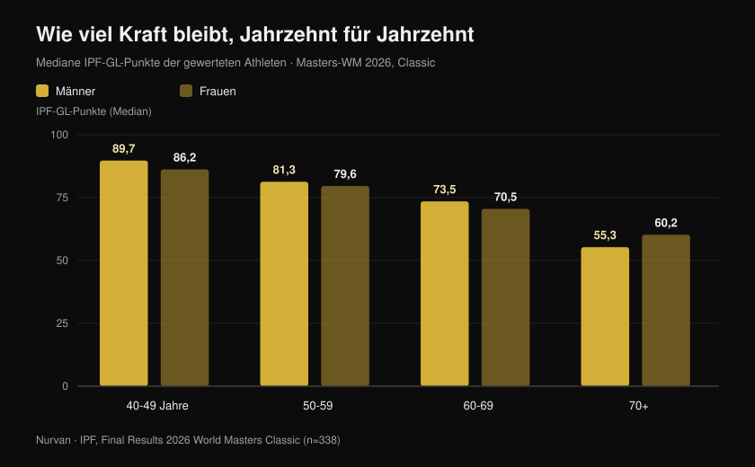
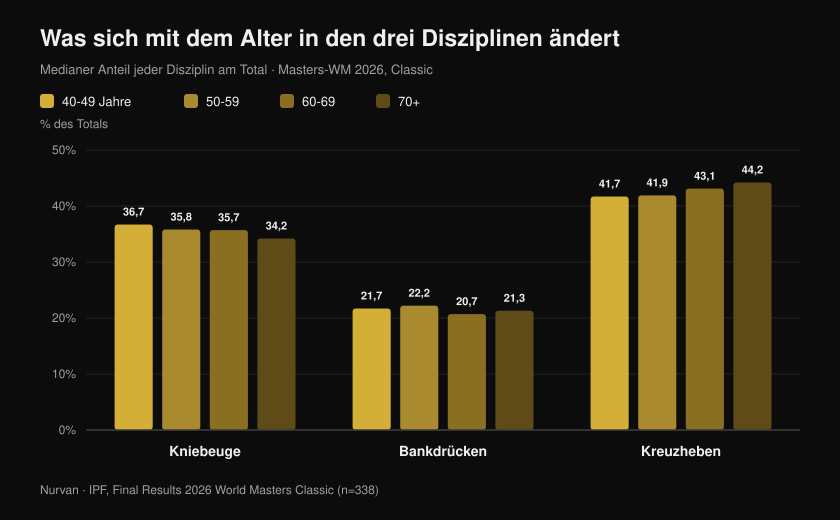

# Masters-WM 2026: Wie viel Kraft das Alter kostet

Von [Giammaria Loi](/autore/giammaria-loi) · aktualisiert am 27. Oktober 2026

In Reno, Nevada, ist gerade die IPF-Masters-WM im Kraftdreikampf zu Ende gegangen: zehn Wettkampftage, 443 gewertete Athletinnen und Athleten aus 41 Nationen, der jüngste 40, die älteste 82 Jahre alt. Die IPF hat die offiziellen Ergebnisse veröffentlicht, und in diesen PDFs steckt weit mehr als ein Medaillenspiegel. Dort steckt die größte saubere Stichprobe, die es gibt, dafür, wie viel Kraft bei Menschen, die ernsthaft trainieren, Jahrzehnt für Jahrzehnt tatsächlich übrig bleibt. Ich habe jede Platzierung einzeln ausgewertet, und die Zahl, die dabei herauskommt, widerspricht sowohl dem „nach 40 ist Schluss" als auch dem „wer trainiert, verliert nichts".

## Kurz gefasst

- **Eine 63-jährige Italienerin hat die Rekorde zwanzig Jahre jüngerer Frauen gebrochen.** Marzia Girardi, 63 Jahre, 46,30 kg Körpergewicht, hob **162,5 kg** im Kreuzheben — das 3,5-Fache ihres Gewichts. Dieser eine Versuch setzte den Weltrekord der Klasse 47 kg gleichzeitig in Masters 1 (40-49), Masters 2 (50-59) und Masters 3 (60-69).
- **Der durchschnittliche Rückgang ist langsamer als gedacht — bis zu einem Punkt.** Die medianen IPF-GL-Punkte fallen bei Männern von **89,7 auf 81,3 auf 73,5** über die Gruppen 40-49, 50-59 und 60-69: rund **9 % pro Jahrzehnt**. Nach 70 wird die Stufe deutlich höher.
- **Training stoppt den Rückgang nicht, es verschiebt die Startlinie.** Bei Elite-Masters-Gewichthebern sank die Kraft genauso schnell wie bei Untrainierten (0,6 % gegenüber 0,5 % pro Jahr), aber ein 85-jähriger Athlet erzeugte die Leistung eines 65-jährigen Nichtsportlers: rund **zwanzig Jahre Vorsprung** (Pearson et al., 2002).
- **Muskelmasse halten reicht nicht.** Bei 1.880 älteren Menschen über drei Jahre sank die Kraft etwa **dreimal schneller** als die Magermasse, und wer Masse zulegte, blieb vom Kraftverlust nicht verschont (Goodpaster et al., 2006).
- **Auch die Gewichtung der Disziplinen verschiebt sich.** Mit dem Alter trägt das Kreuzheben mehr zum Total bei (von **41,7 % auf 44,2 %**) und die Kniebeuge weniger (von **36,7 % auf 34,2 %**): Kraft verschwindet nicht gleichmäßig.

## Was in Reno passiert ist

Die Masters-WM in Classic und Equipped fand vom **15. bis 24. Oktober 2026** in Reno, Nevada, statt. In den vier offiziellen Ergebnisdokumenten (Männer und Frauen, Classic und Equipped) stehen **465 Platzierungen** — 338 im Classic-Wettbewerb und 127 im Equipped — von **443 verschiedenen Athleten** aus **41 Nationen**. Das mediane Alter der Gewerteten liegt bei **54 Jahren**.

Eine Zahl sticht heraus: Die offiziellen Listen verzeichnen **68 Weltrekorde**, die während der Veranstaltung aufgestellt wurden. Die USA gewannen alle acht Mannschaftswertungen des Classic-Wettbewerbs, in den vier Männer- und den vier Frauenklassen.

Unter den Besten des Classic-Wettbewerbs stechen zwei Namen hervor: **Nathan Kulas** (USA, 43 Jahre, 91,40 kg) mit 817 kg Total und 107,79 IPF-GL-Punkten und **Dayna McNeal** (USA, 42 Jahre, 75,40 kg) mit 540 kg und 106,87 Punkten. **Michael Garozzo**, 44, stellte drei Masters-1-Rekorde in der Klasse bis 105 kg auf: Kniebeuge 328 kg, Kreuzheben 351 kg, Total 861,5 kg.

### Italien in Reno: acht Starter, sieben Podestplätze

Die italienische Delegation war klein und fast makellos: **acht gewertete Athleten, sieben Podestplätze, fünf Weltmeistertitel**.

| Athlet | Altersklasse | Gewichtsklasse | Total | Ergebnis |
| --- | --- | --- | --- | --- |
| Martina Pisano | Masters 1 | 47 kg | 350,5 kg | Gold (Kniebeugenrekord 130,5 kg) |
| Luisa Arienta | Masters 2 | 52 kg | 365,0 kg | Gold |
| Marzia Girardi | Masters 3 | 47 kg | 307,5 kg | Gold (4 Rekorde) |
| Barbara Canella | Masters 3 | 52 kg | 305,0 kg | Gold |
| Alessandro Cuoghi | Masters 2 | 93 kg | 727,5 kg | Gold |
| Elisa Guidi | Masters 1 | 52 kg | 387,5 kg | Silber |
| Allegra Romussi | Masters 1 | 69 kg | 462,5 kg | Silber |

Cuoghi, 51, beendete den Wettkampf mit 96,22 IPF-GL-Punkten: zweitbester Athlet der Masters-2-Klasse weltweit, hauchdünn hinter dem Südafrikaner Sean Manders (96,54).

Die Leistung, die diesen Artikel am besten erzählt, ist allerdings die von **Marzia Girardi**. Dreiundsechzig Jahre, 46,30 kg Körpergewicht, **162,5 kg** im Kreuzheben. Dieser Versuch am 16. Oktober schrieb den Weltrekord der Klasse 47 kg nicht nur in ihrer eigenen Altersklasse neu, sondern auch in Masters 2 und Masters 1 — bei Frauen, die zehn und zwanzig Jahre jünger sind.

## Wie viel Kraft wirklich verloren geht, Jahrzehnt für Jahrzehnt

Hier werden die offiziellen Ergebnisse zum Datensatz. Um Athleten unterschiedlichen Gewichts und Geschlechts zu vergleichen, nutzt die IPF **GL-Punkte**, einen Koeffizienten, der das Total nach Körpergewicht und Geschlecht normiert: 100 Punkte entsprechen ungefähr dem Niveau eines Finalisten einer offenen WM.

Ich habe den **Median der GL-Punkte aller gewerteten Starter des Classic-Wettbewerbs** berechnet, Altersklasse für Altersklasse. Das ist kein Längsschnitt derselben Person — es ist eine Momentaufnahme von vier Generationen, die in derselben Woche angetreten sind — aber es ist die breiteste und am besten kontrollierte Momentaufnahme, die existiert.

Männer: **89,7** Punkte bei 40-49, **81,3** bei 50-59, **73,5** bei 60-69, **55,3** ab 70. Frauen: **86,2**, **79,6**, **70,5**, **60,2**.

Der erste Schritt kostet rund **9 %**. Der zweite fast genauso viel. Dann die Wand: zwischen 60-69 und 70 plus verlieren Männer noch einmal etwa 25 % des Verbliebenen. Die Kurve ist kein gleichmäßiges Abfallen, sondern eine sanfte Rampe, die irgendwann zur Stufe wird.

Eine ehrliche Einschränkung, weil sie die Lesart verändert: Die älteren Klassen haben weit weniger Teilnehmer (18 Männer und 17 Frauen bei 70 plus gegenüber 54 und 62 bei 40-49), und wer mit 75 noch antritt, ist doppelt selektiert — durch Gesundheit und durch Motivation. Die absoluten Werte sind mit Vorsicht zu genießen; der Trend dagegen ist robust und in beiden Geschlechtern konsistent.

## Das Rekord-Paradox: Die Ältesten stellen die meisten auf

Von den 68 Weltrekorden in Reno entstanden **48 in den beiden ältesten Klassen** (33 in Masters 3, 15 in Masters 4), gegenüber 9 in Masters 1 und 11 in Masters 2.

Das heißt nicht, dass man nach 60 stärker wird. Es heißt, dass die Rekordbücher der älteren Kategorien jünger und leerer sind: Es sind weit weniger Menschen hindurchgegangen. Frauen, die viel später als Männer in großer Zahl mit Wettkämpfen begonnen haben, stellten 40 der 68 Rekorde auf.

Das ist ein statistisches Detail, sagt aber Trainierenden etwas Konkretes: **Der Kreis der Menschen, die mit sechzig noch Kraft entwickeln können, ist winzig.** Nicht wegen biologischer Grenzen, sondern wegen Abbruch.

## Was sich in den drei Disziplinen ändert

Es gibt ein zweites Signal in den Daten, und dieses ist praktisch. Ich habe berechnet, wie viel jede Disziplin zum Total beiträgt, Klasse für Klasse.

Die **Kniebeuge** fällt von 36,7 % des Totals bei 40-49 Jahren auf 34,2 % bei 70 plus. Das **Bankdrücken** bleibt im Wesentlichen konstant zwischen 20,7 % und 22,2 %. Das **Kreuzheben** steigt von 41,7 % auf 44,2 %.

Die Verschiebung beträgt nur wenige Prozentpunkte, ist aber monoton und zeigt in die Richtung, die die Physiologie nahelegt: Die Übung mit dem größten Bewegungsumfang, der höchsten Anforderung an Sprunggelenk- und Hüftbeweglichkeit und der meisten Kontrolle in der tiefen exzentrischen Phase gibt zuerst nach. Nicht die Kraft verschwindet — die *Kniebeuge* wird schwerer auszudrücken.

Für das Training heißt das: Wenn die Kniebeuge nach fünfzig stärker zurückfällt als der Rest, lohnt es sich, Beweglichkeit und Tiefe zu prüfen, bevor man Gewicht abnimmt. Und die Variante zählt — ein Thema, das ich bei den [Knien nach außen in der Kniebeuge](/de/blog/ginocchia-in-fuori-squat) ausgeführt habe.

## Was die Forschung wirklich sagt

| Behauptung | Urteil | Die Daten |
| --- | --- | --- |
| Nach 40 bricht die Kraft ein | **Zu präzisieren** | Zwischen 40-49 und 60-69 sinken die medianen GL-Punkte um rund 9 % pro Jahrzehnt; der große Sprung kommt nach 70 (offizielle IPF-Daten, Reno 2026) |
| Wer trainiert, verliert im Alter keine Kraft | **Widerlegt** | Bei Elite-Masters-Gewichthebern sank die isometrische Kraft um 0,6 % pro Jahr gegenüber 0,5 % bei Untrainierten: gleiche Steigung (Pearson et al., 2002) |
| Im Alter zu trainieren bringt nichts, der Abbau steht fest | **Widerlegt** | Dieselben Athleten erzeugten +32 % Leistung und +32 % isometrische Kraft gegenüber Gleichaltrigen ohne Training: ein 85-jähriger Athlet entsprach einem 65-jährigen Nichtsportler (Pearson et al., 2002) |
| Es reicht, die Muskelmasse zu halten | **Widerlegt** | Bei 1.880 älteren Menschen sank die Kraft rund dreimal schneller als die Magermasse, und Massezuwachs schützte die Kraft nicht (Goodpaster et al., 2006) |
| Mit 80 oder 90 lohnt sich der Einstieg nicht mehr | **Widerlegt** | Neun Personen mit 90 ± 1 Jahren, acht Wochen hochintensives Krafttraining: Kraft +174 ± 31 %, Muskelquerschnitt des Oberschenkels +9,0 ± 4,5 % (Fiatarone et al., 1990) |
| Ab einem gewissen Alter muss man leicht trainieren | **Zu präzisieren** | In der Metaanalyse zu gesunden Älteren kam der größte Krafteffekt von Intensitäten von **70-79 % des Maximums**, nicht von leichten Lasten (Borde et al., 2015) |
| Der Rückgang ist in allen drei Disziplinen gleich | **Zu präzisieren** | In Reno stieg der Anteil des Kreuzhebens mit dem Alter und der der Kniebeuge sank — aber nur um wenige Punkte und im Vergleich verschiedener Personen |

Die Studie, die alles zusammenhält, stammt von Pearson. Vierundfünfzig Elite-Masters-Gewichtheber von 40 bis 87 Jahren, verglichen mit ebenso vielen gesunden, untrainierten Gleichaltrigen. Die Steigung des Rückgangs war in beiden Gruppen **gleich** — Training hat das Altern nicht verlangsamt. Aber das absolute Niveau lag so viel höher, dass die Autoren den Vorsprung mit **etwa zwanzig Jahren scheinbarem Alter** bezifferten.

Dieselbe Studie liefert ein Detail, das für alle über fünfzig zählt: Die **Leistung** sank etwa doppelt so schnell wie die isometrische Kraft (1,2 % gegenüber 0,6 % pro Jahr). Zuerst geht nicht verloren, wie viel man drücken kann, sondern wie schnell.

## So setzt du es um

1. **Senke die Intensität nicht zu früh.** In der Metaanalyse zu gesunden Älteren kam der größte Kraftzuwachs von Sätzen bei 70-79 % des Maximums, nicht von leichten Lasten mit vielen Wiederholungen (Borde et al., 2015). Zwei Einheiten pro Woche, 2-3 Sätze pro Übung, 7-9 Wiederholungen ist das Schema, das am besten abschnitt.
2. **Bau in jede Einheit etwas Schnelles ein.** Wenn die Leistung doppelt so schnell verschwindet wie die Kraft, muss sie eigens trainiert werden: explosive Hebungen, flache Sprünge, schnelle Drücke mit moderater Last, notfalls auch nur möglichst schnell vom Stuhl aufstehen.
3. **Hör auf, nur in den Spiegel zu schauen.** Masse zu halten garantiert keine Kraft: Die Kennzahl, der man folgt, ist die bewegte Last, nicht der Umfang.
4. **Protokolliere jeden Satz.** Ein Rückgang von 9 % pro Jahrzehnt sind rund 0,9 % pro Jahr: von Monat zu Monat unsichtbar, über drei Jahre Historie offensichtlich. Ohne aufgeschriebene Zahlen merkt man es erst, wenn es groß ist.
5. **Gib der Kniebeuge mehr Zeit, nicht weniger Last.** Wenn sie zuerst nachgibt, ergänze Aufwärmen und Mobilitätsarbeit, bevor du Scheiben abnimmst.
6. **Achte auf Protein.** Das PROT-AGE-Positionspapier empfiehlt ab 65 Jahren mindestens **1,0-1,2 g pro kg Körpergewicht und Tag** und **mindestens 1,2 g/kg** für Trainierende (Bauer et al., 2013). Menschen mit schwerer Nierenerkrankung sind eine Ausnahme und sollten das mit ihrer Ärztin oder ihrem Arzt besprechen.

**Mit Nurvan.** Der Kraftverlust mit dem Alter ist langsam: etwa 1 % pro Jahr, nichts, was man mit bloßem Auge sieht. In Nurvan protokolliert jeder Satz Last, Wiederholungen und RIR, und die Historie zeigt die echte Kurve jeder Übung über Monate und Jahre — so unterscheidest du einen echten Rückgang von einer schlechten Woche. Aufwärmsätze werden automatisch vorgeschlagen, was vor allem bei der Kniebeuge hilft, und ein Plan, den du schon als PDF, Tabelle oder Foto hast, lässt sich importieren, ohne ihn abzutippen. [Nurvan testen](https://nurvan.app)

## Häufige Fragen

**Ab welchem Alter verliert man Kraft?**
In den Daten aus Reno ist der Rückgang schon zwischen der Gruppe 40-49 und 50-59 messbar, rund 9 %. Es ist aber ein langsamer Rückgang — unter 1 % pro Jahr — der erst nach 70 steil wird. Zuerst geht die Leistung verloren, also die Geschwindigkeit der Kraftentfaltung, nicht das Maximum (Pearson et al., 2002).

**Bremst Krafttraining den Kraftverlust?**
Bei Elite-Masters-Athleten entsprach die Steigung des Rückgangs der von untrainierten Gleichaltrigen. Was sich ändert, ist der Ausgangspunkt: Die Athleten erzeugten rund 32 % mehr Kraft und Leistung — ein Vorsprung, den die Autoren mit zwanzig Lebensjahren bezifferten (Pearson et al., 2002). Man entgeht dem Rückgang nicht, man trifft ihn von viel weiter oben.

**Ist es mit 70 zu spät anzufangen?**
Nein. Die klassische Studie an neun Personen mit durchschnittlich 90 Jahren zeigte +174 % Kraft nach acht Wochen hochintensiven Trainings (Fiatarone et al., 1990). Wer Vorerkrankungen hat oder jahrelang nicht trainiert hat, beginnt mit einer ärztlichen Abklärung und einer Betreuung, die die Lasten festlegt — nicht mit dem Verzicht.

**Wie schwer sollte man nach 60 trainieren?**
In der Metaanalyse zu gesunden Älteren zeigte sich der größte Krafteffekt bei 70-79 % des Maximums (Borde et al., 2015). Eine „Last für Ältere" gibt es als Kategorie nicht: Es gibt die Last, die zum aktuellen Niveau passt, und sie wird gesteigert wie mit dreißig — nur mit mehr Aufmerksamkeit für Erholung und Technik.

## Lies auch

- [Masters-WM im Kraftdreikampf in Reno: worum es ging](/de/blog/mondiali-powerlifting-master-reno-2026) — die Vorschau mit Reglement und Klassen
- [Wie viele Wiederholungen für Muskelmasse: der 8-12-Mythos](/de/blog/ripetizioni-serie-recupero-ipertrofia) — wie man Intensität und Volumen wirklich festlegt
- [Funktioniert Online-Coaching? Was die Studien sagen](/de/blog/coaching-online-funziona-studi) — warum Betreuung bei identischem Plan die Ergebnisse verändert

## Quellen

1. Pearson SJ, Young A, Macaluso A, Devito G, Nimmo MA, Cobbold M, Harridge SDR, 2002. Muscle function in elite master weightlifters. *Med Sci Sports Exerc*. PMID [12131263](https://pubmed.ncbi.nlm.nih.gov/12131263/) · [DOI](https://doi.org/10.1097/00005768-200207000-00023)
2. Goodpaster BH, Park SW, Harris TB, Kritchevsky SB, Nevitt M, Schwartz AV, Simonsick EM, Tylavsky FA, Visser M, Newman AB, 2006. The loss of skeletal muscle strength, mass, and quality in older adults: the Health, Aging and Body Composition Study. *J Gerontol A Biol Sci Med Sci*. PMID [17077199](https://pubmed.ncbi.nlm.nih.gov/17077199/) · [DOI](https://doi.org/10.1093/gerona/61.10.1059)
3. Fiatarone MA, Marks EC, Ryan ND, Meredith CN, Lipsitz LA, Evans WJ, 1990. High-intensity strength training in nonagenarians. Effects on skeletal muscle. *JAMA*. PMID [2342214](https://pubmed.ncbi.nlm.nih.gov/2342214/)
4. Borde R, Hortobágyi T, Granacher U, 2015. Dose-Response Relationships of Resistance Training in Healthy Old Adults: A Systematic Review and Meta-Analysis. *Sports Med*. PMID [26420238](https://pubmed.ncbi.nlm.nih.gov/26420238/) · [DOI](https://doi.org/10.1007/s40279-015-0385-9)
5. Bauer J, Biolo G, Cederholm T, Cesari M, Cruz-Jentoft AJ, Morley JE, Phillips S, Sieber C, Stehle P, Teta D, Visvanathan R, Volpi E, Boirie Y, 2013. Evidence-based recommendations for optimal dietary protein intake in older people: a position paper from the PROT-AGE Study Group. *J Am Med Dir Assoc*. PMID [23867520](https://pubmed.ncbi.nlm.nih.gov/23867520/) · [DOI](https://doi.org/10.1016/j.jamda.2013.05.021)

Ergebnisse, Rekorde, Körpergewichte und IPF-GL-Punkte: International Powerlifting Federation, *Final Results — 2026 IPF World Masters Classic Powerlifting Championships* und *2026 IPF World Masters Equipped Powerlifting Championships*, Reno (Nevada), 15.-24. Oktober 2026, [offizielle IPF-Dokumente](https://www.powerlifting.sport/championships/results/2026/world-masters-classic-equipped-powerlifting-championships-2026). Mediane, Disziplinanteile und Auszählungen sind eigene Auswertungen von Nurvan auf Basis der vier offiziellen Dokumente.

---

**Giammaria Loi** ist der Gründer von Nurvan. Er trainiert seit 2012 mit Gewichten, arbeitet seit 2013 als FIPE-zertifizierter Personal Trainer und Coach und startet seit 2018 auf nationalem Niveau im Kraftdreikampf.

> Hinweis: informativer Inhalt, kein Ersatz für ärztlichen oder fachlichen Rat. Wer über 60 ist, eine bestehende Erkrankung hat oder lange nicht trainiert hat, sollte vor dem Beginn eines Krafttrainingsprogramms ärztlichen Rat einholen.
