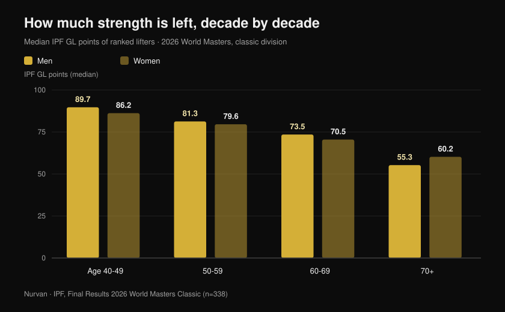
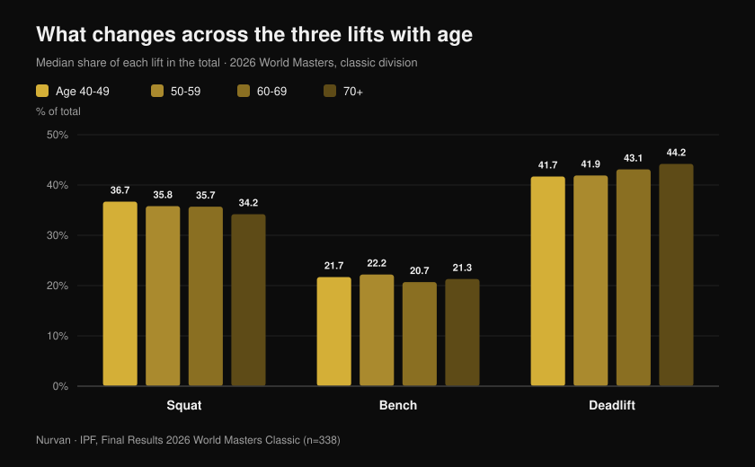

# World Masters 2026: how much strength age costs

By [Giammaria Loi](/autore/giammaria-loi) · updated 27 October 2026

The IPF World Masters Powerlifting Championships have just wrapped up in Reno, Nevada: ten days of competition, 443 ranked lifters from 41 nations, the youngest 40 and the oldest 82. The IPF has published the official results, and those PDFs hold far more than a medal table. They hold the largest clean sample anywhere of how much strength actually remains, decade after decade, in people who train seriously. I went through every placing, and the number that comes out contradicts both "it's over after 40" and "train hard and you won't lose anything".

## In short

- **A 63-year-old Italian beat the records of women twenty years younger.** Marzia Girardi, 63, weighing 46.30 kg, pulled **162.5 kg** — 3.5 times her bodyweight. That single lift set the 47 kg world record in the masters 1 (40-49), masters 2 (50-59) and masters 3 (60-69) categories at once.
- **The average decline is slower than people assume — up to a point.** Median IPF GL points go from **89.7 to 81.3 to 73.5** across the 40-49, 50-59 and 60-69 brackets in men: roughly **9% per decade**. After 70 the step gets much bigger.
- **Training doesn't stop the decline — it moves the starting line.** In elite masters weightlifters strength fell at the same rate as in untrained peers (0.6% vs 0.5% per year), but an 85-year-old athlete produced the power of a 65-year-old non-athlete: about **a 20-year advantage** (Pearson et al., 2002).
- **Keeping the muscle is not enough.** In 1,880 older adults followed for three years, strength declined about **three times faster** than lean mass, and gaining mass did not prevent the loss of strength (Goodpaster et al., 2006).
- **The mix of lifts shifts too.** With age the deadlift takes a bigger share of the total (**41.7% to 44.2%**) and the squat a smaller one (**36.7% to 34.2%**): strength does not leave evenly.

## What happened in Reno

The masters classic and equipped world championships ran in Reno, Nevada, from **15 to 24 October 2026**. Across the four official results documents (men and women, classic and equipped) there are **465 placings** — 338 in the classic competition and 127 in the equipped — covering **443 different athletes** from **41 nations**. The median age of ranked lifters was **54**.

One number stands out: the official lists record **68 world records** set during the meet. The United States won all eight team titles in the classic competition, across the four men's and four women's age brackets.

Among the best of the classic division, two names lead: **Nathan Kulas** (USA, 43, 91.40 kg) with an 817 kg total and 107.79 IPF GL points, and **Dayna McNeal** (USA, 42, 75.40 kg) with 540 kg and 106.87 points. **Michael Garozzo**, 44, set three masters 1 records at 105 kg: a 328 kg squat, a 351 kg deadlift and an 861.5 kg total.

### Italy in Reno: eight lifters, seven podiums

The Italian squad was small and nearly perfect: **eight ranked lifters, seven podiums, five world titles**.

| Athlete | Bracket | Class | Total | Result |
| --- | --- | --- | --- | --- |
| Martina Pisano | Masters 1 | 47 kg | 350.5 kg | Gold (130.5 kg squat record) |
| Luisa Arienta | Masters 2 | 52 kg | 365.0 kg | Gold |
| Marzia Girardi | Masters 3 | 47 kg | 307.5 kg | Gold (4 records) |
| Barbara Canella | Masters 3 | 52 kg | 305.0 kg | Gold |
| Alessandro Cuoghi | Masters 2 | 93 kg | 727.5 kg | Gold |
| Elisa Guidi | Masters 1 | 52 kg | 387.5 kg | Silver |
| Allegra Romussi | Masters 1 | 69 kg | 462.5 kg | Silver |

Cuoghi, 51, finished on 96.22 IPF GL points: second best lifter in the masters 2 bracket worldwide, a hair behind South Africa's Sean Manders (96.54).

But the performance that tells this story best is **Marzia Girardi**'s. Sixty-three years old, 46.30 kg bodyweight, a **162.5 kg** deadlift. That single attempt, on 16 October, rewrote the 47 kg world record not only in her own bracket but also in masters 2 and masters 1 — women ten and twenty years younger.

## How much strength you really lose, decade by decade

This is where official results become a dataset. To compare lifters of different bodyweight and sex, the IPF uses **GL points**, a coefficient that normalises the total for bodyweight and sex: 100 points is roughly open world-final level.

I calculated the **median GL points of every ranked lifter in the classic competition**, bracket by bracket. It is not a within-person comparison over time — it is a snapshot of four generations competing in the same week — but it is the broadest, most controlled snapshot that exists.

Men: **89.7** points at 40-49, **81.3** at 50-59, **73.5** at 60-69, **55.3** at 70 and over. Women: **86.2**, **79.6**, **70.5**, **60.2**.

The first step costs about **9%**. The second, almost exactly the same. Then the wall: between 60-69 and 70-plus, men lose roughly another 25% of what was left. The curve is not a steady slide — it is a gentle ramp that turns into a step.

One honest caveat, because it changes how to read the numbers: the older brackets have far fewer entrants (18 men and 17 women at 70-plus, against 54 and 62 at 40-49), and anyone still competing at 75 has been selected twice over, by health and by motivation. Treat the absolute values with care; the trend, though, is robust and consistent across both sexes.

## The record paradox: the oldest lifters set the most

Of the 68 world records in Reno, **48 were set in the two oldest brackets** (33 in masters 3, 15 in masters 4), against 9 in masters 1 and 11 in masters 2.

It does not mean people get stronger after 60. It means the record books of the older categories are younger and emptier: far fewer people have passed through them. Women, who began competing in numbers much later than men, accounted for 40 of the 68 records.

That is a statistical detail, but it says something concrete to anyone who trains: **the pool of people who reach sixty still able to express strength is tiny**. Not because of biology — because of attrition.

## What changes across the three lifts

There is a second signal in the data, and this one is practical. I calculated how much each lift contributes to the total, bracket by bracket.

The **squat** falls from 36.7% of the total at 40-49 to 34.2% at 70-plus. The **bench** stays essentially flat, between 20.7% and 22.2%. The **deadlift** climbs from 41.7% to 44.2%.

The shift is only a few percentage points, but it is monotonic and it points where physiology suggests it should: the lift that demands the most range of motion, the most ankle and hip mobility and the most control in a deep eccentric is the one that gives way first. Strength isn't vanishing — the *squat* is getting harder to express.

In training terms: if your squat falls behind the rest after fifty, check mobility and depth before you cut the load. And variations matter — something I covered in [knees out in the squat: rule or cue?](/en/blog/ginocchia-in-fuori-squat).

## What the research actually says

| Claim | Verdict | The data |
| --- | --- | --- |
| Strength collapses after 40 | **Needs nuance** | Between 40-49 and 60-69 median GL points fall about 9% per decade; the big step comes after 70 (official IPF data, Reno 2026) |
| Train hard and you won't lose strength with age | **Busted** | In elite masters weightlifters isometric strength fell 0.6% per year against 0.5% in untrained peers: the same slope (Pearson et al., 2002) |
| Training when you're old is pointless, the decline is fixed | **Busted** | Those same athletes produced +32% power and +32% isometric strength versus sedentary peers: an 85-year-old athlete matched a 65-year-old non-athlete (Pearson et al., 2002) |
| Just keep your muscle mass | **Busted** | In 1,880 older adults strength fell ~3 times faster than lean mass, and gaining mass did not protect strength (Goodpaster et al., 2006) |
| At 80 or 90 there's no point starting | **Busted** | Nine people aged 90 ± 1, eight weeks of high-intensity lifting: strength +174 ± 31%, mid-thigh muscle area +9.0 ± 4.5% (Fiatarone et al., 1990) |
| Past a certain age you should train light | **Needs nuance** | In the meta-analysis on healthy old adults the largest strength effect came from **70-79% of 1RM**, not from light loads (Borde et al., 2015) |
| The decline is the same in all three lifts | **Needs nuance** | In Reno the deadlift's share of the total rose with age and the squat's fell, but only by a few points and across different people |

The study that ties it together is Pearson's. Fifty-four elite masters weightlifters aged 40 to 87, compared with the same number of healthy, untrained age-matched controls. The slope of the decline was **the same** in both groups — training did not slow ageing down. But the absolute level was so much higher that the authors put the advantage at **roughly twenty years of apparent age**.

The same study adds a detail that matters to anyone over fifty: **power** declined about twice as fast as isometric strength (1.2% vs 0.6% per year). What goes first is not how much you can push, but how fast.

## How to apply it

1. **Don't drop the intensity early.** In the meta-analysis on healthy older adults the biggest strength gains came from sets at 70-79% of 1RM, not from light loads and high reps (Borde et al., 2015). Two sessions a week, 2-3 sets per exercise, 7-9 reps is the pattern that performed best.
2. **Put something fast in every session.** If power leaves at twice the speed of strength, it has to be trained on purpose: explosive lifts, low jumps, fast pushes with moderate load, even standing up from a chair as quickly as you can.
3. **Stop judging by the mirror.** Holding on to mass does not guarantee strength: the number to chase is the load on the bar, not the tape measure.
4. **Log every set.** A 9% drop per decade is about 0.9% a year: invisible month to month, obvious across three years of history. Without written numbers you won't notice until it's large.
5. **Give the squat more time, not less load.** If it's the lift that slips first, add warm-up and mobility work before you take weight off the bar.
6. **Mind your protein.** The PROT-AGE position paper recommends at least **1.0-1.2 g per kg of bodyweight per day** over 65, and **at least 1.2 g/kg** for those who train (Bauer et al., 2013). People with severe kidney disease are an exception and should talk to their doctor.

**With Nurvan.** Strength loss with age is slow: around 1% a year, nothing you can see by eye. In Nurvan every set logs load, reps and RIR, and the history shows the real curve for each exercise across months and years — so you can tell a genuine decline from one bad week. Warm-up sets are suggested automatically, which matters most on the squat, and a program you already have as a PDF, a spreadsheet or a photo imports without retyping. [Try Nurvan](https://nurvan.app)

## FAQ

**At what age do you start losing strength?**
In the Reno data the drop is already measurable between the 40-49 and 50-59 brackets, around 9%. But it is a slow decline — under 1% a year — that only turns steep after 70. The first thing to go is power, the speed at which force is produced, not the one-rep max (Pearson et al., 2002).

**Does lifting slow down strength loss?**
In elite masters athletes the slope of the decline matched that of untrained peers. What changes is the starting point: the athletes produced about 32% more strength and power, an advantage the authors valued at twenty years of age (Pearson et al., 2002). You don't dodge the decline — you simply arrive at it from much higher up.

**Is 70 too late to start?**
No. The classic study on nine people averaging 90 years old showed +174% strength after eight weeks of high-intensity training (Fiatarone et al., 1990). If you have a medical condition or haven't trained in years, the first step is a check-up and a coach who sets the loads, not giving up.

**How heavy should loads be after 60?**
In the meta-analysis on healthy older adults the largest strength effect came at 70-79% of 1RM (Borde et al., 2015). There is no such thing as an "older person's load": there is the load that fits your current level, progressed the way it would be at thirty, with more attention to recovery and technique.

## Read next

- [World masters powerlifting in Reno: what was at stake](/en/blog/mondiali-powerlifting-master-reno-2026) — the preview, with rules and categories
- [How many reps for muscle: the 8-12 myth](/en/blog/ripetizioni-serie-recupero-ipertrofia) — how to actually set intensity and volume
- [Does online coaching work? What the studies say](/en/blog/coaching-online-funziona-studi) — why supervision changes results on an identical program

## Sources

1. Pearson SJ, Young A, Macaluso A, Devito G, Nimmo MA, Cobbold M, Harridge SDR, 2002. Muscle function in elite master weightlifters. *Med Sci Sports Exerc*. PMID [12131263](https://pubmed.ncbi.nlm.nih.gov/12131263/) · [DOI](https://doi.org/10.1097/00005768-200207000-00023)
2. Goodpaster BH, Park SW, Harris TB, Kritchevsky SB, Nevitt M, Schwartz AV, Simonsick EM, Tylavsky FA, Visser M, Newman AB, 2006. The loss of skeletal muscle strength, mass, and quality in older adults: the Health, Aging and Body Composition Study. *J Gerontol A Biol Sci Med Sci*. PMID [17077199](https://pubmed.ncbi.nlm.nih.gov/17077199/) · [DOI](https://doi.org/10.1093/gerona/61.10.1059)
3. Fiatarone MA, Marks EC, Ryan ND, Meredith CN, Lipsitz LA, Evans WJ, 1990. High-intensity strength training in nonagenarians. Effects on skeletal muscle. *JAMA*. PMID [2342214](https://pubmed.ncbi.nlm.nih.gov/2342214/)
4. Borde R, Hortobágyi T, Granacher U, 2015. Dose-Response Relationships of Resistance Training in Healthy Old Adults: A Systematic Review and Meta-Analysis. *Sports Med*. PMID [26420238](https://pubmed.ncbi.nlm.nih.gov/26420238/) · [DOI](https://doi.org/10.1007/s40279-015-0385-9)
5. Bauer J, Biolo G, Cederholm T, Cesari M, Cruz-Jentoft AJ, Morley JE, Phillips S, Sieber C, Stehle P, Teta D, Visvanathan R, Volpi E, Boirie Y, 2013. Evidence-based recommendations for optimal dietary protein intake in older people: a position paper from the PROT-AGE Study Group. *J Am Med Dir Assoc*. PMID [23867520](https://pubmed.ncbi.nlm.nih.gov/23867520/) · [DOI](https://doi.org/10.1016/j.jamda.2013.05.021)

Results, records, bodyweights and IPF GL points: International Powerlifting Federation, *Final Results — 2026 IPF World Masters Classic Powerlifting Championships* and *2026 IPF World Masters Equipped Powerlifting Championships*, Reno (Nevada), 15-24 October 2026, [official IPF documents](https://www.powerlifting.sport/championships/results/2026/world-masters-classic-equipped-powerlifting-championships-2026). Medians, lift shares and counts are original Nurvan calculations on the four official documents.

---

**Giammaria Loi** is the founder of Nurvan. He has been lifting since 2012, has worked as a FIPE-certified personal trainer and coach since 2013, and has competed in powerlifting at national level since 2018.

> Note: educational content, not a substitute for medical advice. If you are over 60, have a health condition or have not trained in a long time, talk to a doctor before starting a resistance training program.
