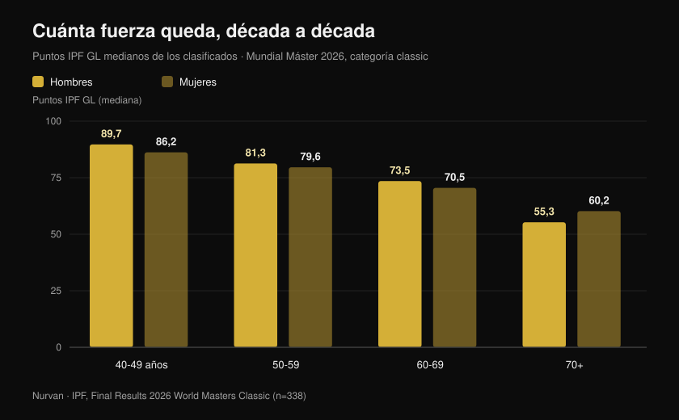
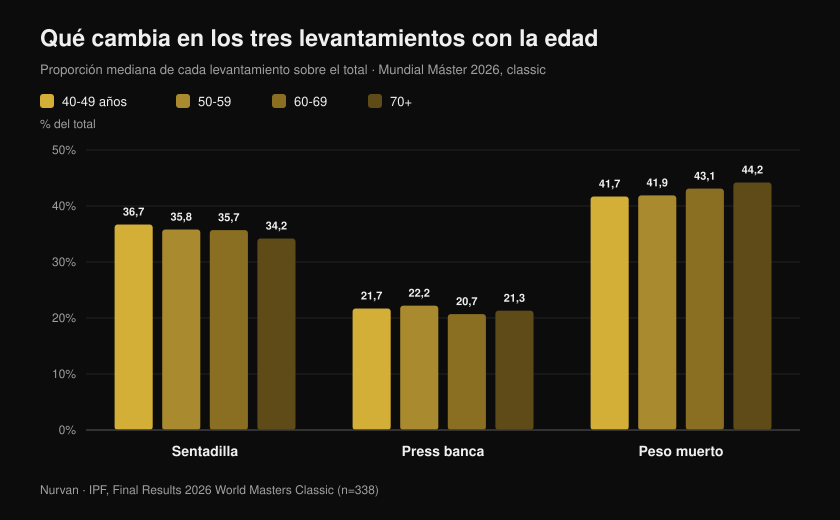

# Mundial Máster 2026: cuánta fuerza cuesta la edad

Por [Giammaria Loi](/autore/giammaria-loi) · actualizado el 27 de octubre de 2026

En Reno, Nevada, acaba de cerrarse el Mundial IPF de powerlifting máster: diez días de competición, 443 atletas clasificados de 41 países, el más joven con 40 años y la mayor con 82. La IPF ha publicado los resultados oficiales, y esos PDF contienen mucho más que un medallero: contienen la muestra más amplia y limpia que existe de cuánta fuerza queda realmente, década tras década, en personas que entrenan en serio. He analizado uno a uno todos los puestos, y el número que sale contradice tanto al "después de los 40 se acabó" como al "si entrenas no pierdes nada".

## En resumen

- **Una italiana de 63 años batió los récords de mujeres veinte años más jóvenes.** Marzia Girardi, 63 años, 46,30 kg de peso corporal, levantó **162,5 kg** en peso muerto: 3,5 veces su peso. Ese único intento fijó el récord del mundo de 47 kg a la vez en máster 1 (40-49), máster 2 (50-59) y máster 3 (60-69).
- **La caída media es más lenta de lo que se cree, hasta cierto punto.** Los puntos IPF GL medianos pasan de **89,7 a 81,3 y a 73,5** entre los 40-49, 50-59 y 60-69 años en hombres: alrededor de un **9% por década**. Después de los 70 el escalón es mucho mayor.
- **Entrenar no frena el declive: mueve la línea de salida.** En halterófilos máster de élite la fuerza cayó al mismo ritmo que en no entrenados (0,6% frente a 0,5% al año), pero un atleta de 85 años producía la potencia de un sedentario de 65: unos **veinte años de ventaja** (Pearson et al., 2002).
- **No basta con conservar el músculo.** En 1.880 mayores seguidos tres años la fuerza cayó unas **tres veces más rápido** que la masa magra, y ganar masa no evitó la pérdida de fuerza (Goodpaster et al., 2006).
- **También cambia la mezcla de levantamientos.** Con la edad el peso muerto pesa más en el total (del **41,7% al 44,2%**) y la sentadilla menos (del **36,7% al 34,2%**): la fuerza no se va de forma uniforme.

## Qué pasó en Reno

El Mundial máster classic y equipped se celebró en Reno, Nevada, del **15 al 24 de octubre de 2026**. En los cuatro documentos oficiales de resultados (hombres y mujeres, classic y equipped) aparecen **465 clasificaciones** — 338 en classic y 127 en equipped — correspondientes a **443 atletas distintos** de **41 países**. La edad mediana de los clasificados fue de **54 años**.

Hay un dato que destaca: las listas oficiales registran **68 récords del mundo** establecidos durante el campeonato. Estados Unidos ganó las ocho clasificaciones por equipos de la prueba classic, en las cuatro franjas masculinas y las cuatro femeninas.

Entre los mejores absolutos de la classic destacan dos nombres: **Nathan Kulas** (EE. UU., 43 años, 91,40 kg) con 817 kg de total y 107,79 puntos IPF GL, y **Dayna McNeal** (EE. UU., 42 años, 75,40 kg) con 540 kg y 106,87 puntos. **Michael Garozzo**, 44 años, firmó tres récords máster 1 en 105 kg: sentadilla 328 kg, peso muerto 351 kg y total 861,5 kg.

### Italia en Reno: ocho atletas, siete podios

La expedición italiana fue pequeña y casi perfecta: **ocho clasificados, siete podios, cinco títulos mundiales**.

| Atleta | Franja | Categoría | Total | Resultado |
| --- | --- | --- | --- | --- |
| Martina Pisano | Máster 1 | 47 kg | 350,5 kg | Oro (récord de sentadilla, 130,5 kg) |
| Luisa Arienta | Máster 2 | 52 kg | 365,0 kg | Oro |
| Marzia Girardi | Máster 3 | 47 kg | 307,5 kg | Oro (4 récords) |
| Barbara Canella | Máster 3 | 52 kg | 305,0 kg | Oro |
| Alessandro Cuoghi | Máster 2 | 93 kg | 727,5 kg | Oro |
| Elisa Guidi | Máster 1 | 52 kg | 387,5 kg | Plata |
| Allegra Romussi | Máster 1 | 69 kg | 462,5 kg | Plata |

Cuoghi, 51 años, terminó con 96,22 puntos IPF GL: segundo mejor atleta absoluto de la franja máster 2 en el mundo, a un suspiro del sudafricano Sean Manders (96,54).

Pero la actuación que mejor cuenta este artículo es la de **Marzia Girardi**. Sesenta y tres años, 46,30 kg de peso corporal, un peso muerto de **162,5 kg**. Ese intento, el 16 de octubre, reescribió el récord del mundo de 47 kg no solo en su franja, sino también en máster 2 y máster 1: mujeres con diez y veinte años menos.

## Cuánta fuerza se pierde de verdad, década a década

Aquí los resultados oficiales se convierten en un conjunto de datos. Para comparar atletas de distinto peso y sexo, la IPF usa los **puntos GL**, un coeficiente que normaliza el total según peso corporal y sexo: 100 puntos equivale aproximadamente al nivel de una final mundial absoluta.

He calculado la **mediana de los puntos GL de todos los clasificados de la prueba classic**, franja por franja. No es una comparación de la misma persona a lo largo del tiempo — es una foto de cuatro generaciones que compitieron en la misma semana — pero es la foto más amplia y controlada que existe.

En hombres: **89,7** puntos entre 40 y 49 años, **81,3** entre 50 y 59, **73,5** entre 60 y 69, **55,3** a partir de los 70. En mujeres: **86,2**, **79,6**, **70,5**, **60,2**.

El primer paso cuesta alrededor de un **9%**. El segundo, casi idéntico. Después llega el muro: entre 60-69 y 70+ los hombres pierden otro 25% aproximado de lo que quedaba. La curva no es un descenso constante: es una rampa suave que en algún punto se convierte en escalón.

Una precisión honesta, porque cambia cómo leer estos números: las franjas mayores tienen muchos menos participantes (18 hombres y 17 mujeres en 70+, frente a 54 y 62 en 40-49), y quien compite a los 75 años ha sido seleccionado dos veces, por la salud y por las ganas. Los valores absolutos hay que tomarlos con pinzas; la tendencia, en cambio, es sólida y coherente en ambos sexos.

## La paradoja de los récords: los hacen los mayores

De los 68 récords del mundo de Reno, **48 se establecieron en las dos franjas de más edad** (33 en máster 3 y 15 en máster 4), frente a 9 en máster 1 y 11 en máster 2.

No significa que después de los 60 uno se vuelva más fuerte. Significa que los libros de récords de las categorías mayores son más jóvenes y están más vacíos: ha pasado por ellos mucha menos gente. Las mujeres, que empezaron a competir en masa mucho más tarde que los hombres, firmaron 40 de los 68 récords.

Es un detalle estadístico, pero dice algo concreto a quien entrena: **el grupo de personas que llega a los sesenta todavía capaz de expresar fuerza es minúsculo**. No por límites biológicos, sino por abandono.

## Qué cambia en los tres levantamientos

Hay una segunda señal en los datos, y esta es práctica. He calculado cuánto pesa cada levantamiento sobre el total, franja por franja.

La **sentadilla** baja del 36,7% del total en 40-49 años al 34,2% en 70+. El **press banca** se mantiene prácticamente estable, entre el 20,7% y el 22,2%. El **peso muerto** sube del 41,7% al 44,2%.

El desplazamiento es de pocos puntos porcentuales, pero es monótono y apunta donde la fisiología sugiere: el levantamiento que exige más recorrido articular, más movilidad de tobillo y cadera y más control en una fase excéntrica profunda es el primero que cede. No desaparece la fuerza: se vuelve más difícil expresar la *sentadilla*.

Traducido al entrenamiento: si después de los cincuenta tu sentadilla retrocede más que el resto, antes de bajar la carga conviene revisar movilidad y profundidad. Y las variantes cuentan, un tema que desarrollé al hablar de [rodillas hacia fuera en la sentadilla](/es/blog/ginocchia-in-fuori-squat).

## Qué dice realmente la investigación

| Afirmación | Veredicto | El dato |
| --- | --- | --- |
| Después de los 40 la fuerza se desploma | **Matizable** | Entre 40-49 y 60-69 los puntos GL medianos bajan un 9% por década; el salto grande llega después de los 70 (datos oficiales IPF, Reno 2026) |
| Si entrenas, no pierdes fuerza con la edad | **Desmentido** | En halterófilos máster de élite la fuerza isométrica cayó un 0,6% anual frente al 0,5% de los no entrenados: la misma pendiente (Pearson et al., 2002) |
| Entrenar de mayor no sirve, el declive está escrito | **Desmentido** | Esos mismos atletas producían un 32% más de potencia y de fuerza isométrica que sus coetáneos sedentarios: un atleta de 85 años igualaba a un sedentario de 65 (Pearson et al., 2002) |
| Basta con mantener la masa muscular | **Desmentido** | En 1.880 mayores la fuerza cayó unas 3 veces más rápido que la masa magra, y ganar masa no protegió la fuerza (Goodpaster et al., 2006) |
| A los 80 o 90 años ya no tiene sentido empezar | **Desmentido** | Nueve personas de 90 ± 1 años, ocho semanas de pesas de alta intensidad: fuerza +174 ± 31%, área muscular del muslo +9,0 ± 4,5% (Fiatarone et al., 1990) |
| A partir de cierta edad hay que entrenar ligero | **Matizable** | En el metaanálisis sobre mayores sanos el mayor efecto sobre la fuerza vino de intensidades del **70-79% del máximo**, no de cargas ligeras (Borde et al., 2015) |
| La caída es igual en los tres levantamientos | **Matizable** | En Reno la proporción del peso muerto subió con la edad y la de la sentadilla bajó, pero pocos puntos y comparando personas distintas |

El estudio que lo une todo es el de Pearson. Cincuenta y cuatro halterófilos máster de élite de 40 a 87 años, comparados con el mismo número de coetáneos sanos no entrenados. La pendiente del declive resultó **la misma** en ambos grupos: entrenar no frenó el envejecimiento. Pero el nivel absoluto era tan superior que los autores cifraron la ventaja en **unos veinte años de edad aparente**.

El mismo estudio añade un detalle que importa a cualquiera que pase de los cincuenta: la **potencia** cayó a una velocidad aproximadamente doble que la fuerza isométrica (1,2% frente a 0,6% anual). Lo primero que se pierde no es cuánto puedes empujar, sino con qué rapidez.

## Cómo aplicarlo

1. **No bajes la intensidad antes de tiempo.** En el metaanálisis sobre mayores sanos la mayor ganancia de fuerza vino de series al 70-79% del máximo, no de cargas ligeras con muchas repeticiones (Borde et al., 2015). Dos sesiones por semana, 2-3 series por ejercicio y 7-9 repeticiones es el esquema que mejor rindió.
2. **Mete algo rápido en cada sesión.** Si la potencia se va al doble de velocidad que la fuerza, hay que entrenarla aparte: levantamientos explosivos, saltos bajos, empujes rápidos con carga moderada, incluso levantarse de la silla lo más rápido posible.
3. **Deja de mirar solo el espejo.** Mantener la masa no garantiza la fuerza: el parámetro a perseguir es la carga levantada, no el perímetro.
4. **Registra serie a serie.** Una caída del 9% por década equivale a un 0,9% anual: invisible mes a mes, evidente con tres años de histórico. Sin números escritos no te das cuenta hasta que es grande.
5. **Dale más tiempo a la sentadilla, no menos carga.** Si es el levantamiento que retrocede primero, añade calentamiento y trabajo de movilidad antes de quitar peso a la barra.
6. **Cuida la proteína.** El documento de posición PROT-AGE indica al menos **1,0-1,2 g por kg de peso corporal al día** a partir de los 65 años, y **al menos 1,2 g/kg** para quien entrena (Bauer et al., 2013). Las personas con enfermedad renal grave son una excepción y deben hablarlo con su médico.

**Con Nurvan.** La pérdida de fuerza con la edad es lenta: alrededor del 1% anual, nada que se vea a ojo. En Nurvan cada serie registra carga, repeticiones y RIR, y el histórico muestra la curva real de cada ejercicio a lo largo de meses y años, para distinguir un retroceso real de una mala semana. Las series de calentamiento se proponen automáticamente, algo especialmente útil en la sentadilla, y una rutina que ya tengas en PDF, Excel o en foto se importa sin reescribirla. [Prueba Nurvan](https://nurvan.app)

## Preguntas frecuentes

**¿A qué edad se empieza a perder fuerza?**
En los datos de Reno la caída ya se mide entre la franja 40-49 y la 50-59, en torno al 9%. Pero es una caída lenta — menos del 1% anual — que solo se vuelve pronunciada después de los 70. Lo primero que se va es la potencia, la velocidad con la que se expresa la fuerza, no el máximo (Pearson et al., 2002).

**¿Entrenar con pesas frena la pérdida de fuerza?**
En atletas máster de élite la pendiente del declive fue igual que la de sus coetáneos no entrenados. Lo que cambia es el punto de partida: los atletas producían un 32% más de fuerza y potencia, una ventaja que los autores estimaron en veinte años de edad (Pearson et al., 2002). No se evita el declive: se llega a él desde mucho más arriba.

**¿Es tarde para empezar a los 70?**
No. El estudio clásico sobre nueve personas de 90 años de media mostró un +174% de fuerza en ocho semanas de entrenamiento de alta intensidad (Fiatarone et al., 1990). Si tienes patologías o llevas años sin entrenar, el primer paso es una revisión médica y un técnico que fije las cargas, no la renuncia.

**¿Cuánto peso hay que usar después de los 60?**
En el metaanálisis sobre mayores sanos el mayor efecto sobre la fuerza apareció con intensidades del 70-79% del máximo (Borde et al., 2015). No existe una "carga de mayores": existe la carga adecuada a tu nivel actual, que se progresa igual que a los treinta, con más atención a la recuperación y a la técnica.

## Lee también

- [Mundial máster de powerlifting en Reno: qué estaba en juego](/es/blog/mondiali-powerlifting-master-reno-2026) — la previa, con reglamento y categorías
- [Cuántas repeticiones para la masa: el mito del 8-12](/es/blog/ripetizioni-serie-recupero-ipertrofia) — cómo se fijan de verdad intensidad y volumen
- [¿Funciona el coaching online? Qué dicen los estudios](/es/blog/coaching-online-funziona-studi) — por qué la supervisión cambia los resultados con la misma rutina

## Fuentes

1. Pearson SJ, Young A, Macaluso A, Devito G, Nimmo MA, Cobbold M, Harridge SDR, 2002. Muscle function in elite master weightlifters. *Med Sci Sports Exerc*. PMID [12131263](https://pubmed.ncbi.nlm.nih.gov/12131263/) · [DOI](https://doi.org/10.1097/00005768-200207000-00023)
2. Goodpaster BH, Park SW, Harris TB, Kritchevsky SB, Nevitt M, Schwartz AV, Simonsick EM, Tylavsky FA, Visser M, Newman AB, 2006. The loss of skeletal muscle strength, mass, and quality in older adults: the Health, Aging and Body Composition Study. *J Gerontol A Biol Sci Med Sci*. PMID [17077199](https://pubmed.ncbi.nlm.nih.gov/17077199/) · [DOI](https://doi.org/10.1093/gerona/61.10.1059)
3. Fiatarone MA, Marks EC, Ryan ND, Meredith CN, Lipsitz LA, Evans WJ, 1990. High-intensity strength training in nonagenarians. Effects on skeletal muscle. *JAMA*. PMID [2342214](https://pubmed.ncbi.nlm.nih.gov/2342214/)
4. Borde R, Hortobágyi T, Granacher U, 2015. Dose-Response Relationships of Resistance Training in Healthy Old Adults: A Systematic Review and Meta-Analysis. *Sports Med*. PMID [26420238](https://pubmed.ncbi.nlm.nih.gov/26420238/) · [DOI](https://doi.org/10.1007/s40279-015-0385-9)
5. Bauer J, Biolo G, Cederholm T, Cesari M, Cruz-Jentoft AJ, Morley JE, Phillips S, Sieber C, Stehle P, Teta D, Visvanathan R, Volpi E, Boirie Y, 2013. Evidence-based recommendations for optimal dietary protein intake in older people: a position paper from the PROT-AGE Study Group. *J Am Med Dir Assoc*. PMID [23867520](https://pubmed.ncbi.nlm.nih.gov/23867520/) · [DOI](https://doi.org/10.1016/j.jamda.2013.05.021)

Resultados, récords, pesos corporales y puntos IPF GL: International Powerlifting Federation, *Final Results — 2026 IPF World Masters Classic Powerlifting Championships* y *2026 IPF World Masters Equipped Powerlifting Championships*, Reno (Nevada), 15-24 de octubre de 2026, [documentos oficiales de la IPF](https://www.powerlifting.sport/championships/results/2026/world-masters-classic-equipped-powerlifting-championships-2026). Las medianas, las proporciones de los levantamientos y los recuentos son elaboraciones originales de Nurvan sobre los cuatro documentos oficiales.

---

**Giammaria Loi** es el fundador de Nurvan. Entrena con pesas desde 2012, trabaja como entrenador personal y coach certificado FIPE desde 2013 y compite en powerlifting a nivel nacional desde 2018.

> Nota: contenido informativo, no sustituye la opinión de un médico o profesional. Si tienes más de 60 años, una patología en curso o llevas mucho tiempo sin entrenar, consúltalo con un médico antes de empezar un programa con pesas.
