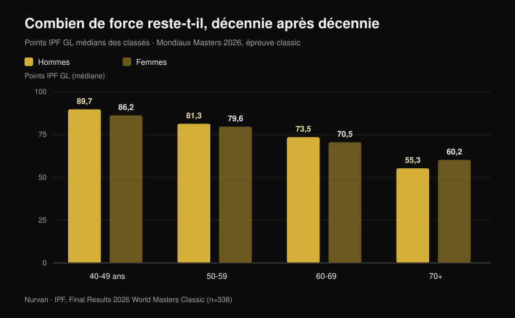
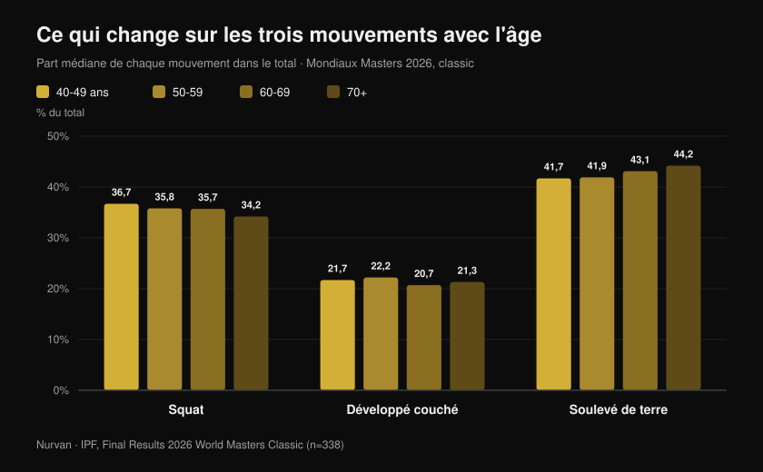

# Mondiaux Masters 2026 : la force que coûte l'âge

Par [Giammaria Loi](/autore/giammaria-loi) · mis à jour le 27 octobre 2026

À Reno, dans le Nevada, les Mondiaux IPF de force athlétique masters viennent de se refermer : dix jours de compétition, 443 athlètes classés venus de 41 nations, le plus jeune âgé de 40 ans et la plus âgée de 82. L'IPF a publié les résultats officiels, et ces PDF contiennent bien plus qu'un tableau des médailles : ils contiennent le plus grand échantillon propre qui existe de la force qui reste réellement, décennie après décennie, chez des gens qui s'entraînent sérieusement. J'ai repris chaque classement un par un, et le chiffre qui en sort contredit autant le « après 40 ans c'est fini » que le « si tu t'entraînes tu ne perds rien ».

## En bref

- **Une Italienne de 63 ans a battu les records de femmes de vingt ans plus jeunes.** Marzia Girardi, 63 ans, 46,30 kg de poids de corps, a soulevé **162,5 kg** au soulevé de terre, soit 3,5 fois son poids. Cet unique essai a établi le record du monde des 47 kg simultanément en masters 1 (40-49 ans), masters 2 (50-59) et masters 3 (60-69).
- **La baisse moyenne est plus lente qu'on ne le croit, jusqu'à un certain point.** Les points IPF GL médians passent de **89,7 à 81,3 puis 73,5** entre 40-49, 50-59 et 60-69 ans chez les hommes : environ **9 % par décennie**. Après 70 ans, la marche devient bien plus haute.
- **S'entraîner n'arrête pas le déclin : cela déplace la ligne de départ.** Chez des haltérophiles masters d'élite, la force baissait au même rythme que chez les non-entraînés (0,6 % contre 0,5 % par an), mais un athlète de 85 ans produisait la puissance d'un sédentaire de 65 ans : environ **vingt ans d'avance** (Pearson et al., 2002).
- **Conserver le muscle ne suffit pas.** Chez 1 880 personnes âgées suivies trois ans, la force a chuté environ **trois fois plus vite** que la masse maigre, et gagner de la masse n'a pas empêché la perte de force (Goodpaster et al., 2006).
- **Le dosage entre les mouvements change aussi.** Avec l'âge, le soulevé de terre pèse de plus en plus dans le total (de **41,7 % à 44,2 %**) et le squat de moins en moins (de **36,7 % à 34,2 %**) : la force ne s'en va pas uniformément.

## Ce qui s'est passé à Reno

Les Mondiaux masters classic et equipped se sont tenus à Reno, Nevada, du **15 au 24 octobre 2026**. Dans les quatre documents officiels de résultats (hommes et femmes, classic et equipped) figurent **465 classements** — 338 en classic et 127 en equipped — pour **443 athlètes différents** venus de **41 nations**. L'âge médian des classés est de **54 ans**.

Un chiffre ressort : les listes officielles enregistrent **68 records du monde** établis pendant la compétition. Les États-Unis ont remporté les huit classements par équipes de l'épreuve classic, dans les quatre catégories masculines et les quatre féminines.

Parmi les meilleurs de l'épreuve classic, deux noms dominent : **Nathan Kulas** (USA, 43 ans, 91,40 kg) avec 817 kg de total et 107,79 points IPF GL, et **Dayna McNeal** (USA, 42 ans, 75,40 kg) avec 540 kg et 106,87 points. **Michael Garozzo**, 44 ans, a signé trois records masters 1 en 105 kg : squat 328 kg, soulevé de terre 351 kg, total 861,5 kg.

### L'Italie à Reno : huit athlètes, sept podiums

La délégation italienne était réduite et presque parfaite : **huit athlètes classés, sept podiums, cinq titres mondiaux**.

| Athlète | Catégorie d'âge | Catégorie | Total | Résultat |
| --- | --- | --- | --- | --- |
| Martina Pisano | Masters 1 | 47 kg | 350,5 kg | Or (record de squat, 130,5 kg) |
| Luisa Arienta | Masters 2 | 52 kg | 365,0 kg | Or |
| Marzia Girardi | Masters 3 | 47 kg | 307,5 kg | Or (4 records) |
| Barbara Canella | Masters 3 | 52 kg | 305,0 kg | Or |
| Alessandro Cuoghi | Masters 2 | 93 kg | 727,5 kg | Or |
| Elisa Guidi | Masters 1 | 52 kg | 387,5 kg | Argent |
| Allegra Romussi | Masters 1 | 69 kg | 462,5 kg | Argent |

Cuoghi, 51 ans, a terminé à 96,22 points IPF GL : deuxième meilleur athlète de la catégorie masters 2 au niveau mondial, à un souffle du Sud-Africain Sean Manders (96,54).

Mais la performance qui raconte le mieux cet article est celle de **Marzia Girardi**. Soixante-trois ans, 46,30 kg de poids de corps, un soulevé de terre à **162,5 kg**. Cet essai, le 16 octobre, a réécrit le record du monde des 47 kg non seulement dans sa catégorie d'âge, mais aussi en masters 2 et masters 1 : des femmes de dix et vingt ans plus jeunes.

## Combien de force perd-on vraiment, décennie par décennie

C'est ici que les résultats officiels deviennent un jeu de données. Pour comparer des athlètes de poids et de sexe différents, l'IPF utilise les **points GL**, un coefficient qui normalise le total selon le poids de corps et le sexe : 100 points correspond grosso modo au niveau d'une finale mondiale open.

J'ai calculé la **médiane des points GL de tous les athlètes classés de l'épreuve classic**, catégorie d'âge par catégorie d'âge. Ce n'est pas un suivi de la même personne dans le temps — c'est une photo de quatre générations ayant concouru la même semaine — mais c'est la photo la plus large et la plus contrôlée qui existe.

Chez les hommes : **89,7** points entre 40 et 49 ans, **81,3** entre 50 et 59, **73,5** entre 60 et 69, **55,3** à partir de 70. Chez les femmes : **86,2**, **79,6**, **70,5**, **60,2**.

Le premier passage coûte environ **9 %**. Le deuxième, presque autant. Puis le mur : entre 60-69 ans et 70 ans et plus, les hommes perdent encore près de 25 % de ce qui restait. La courbe n'est pas une descente régulière : c'est une pente douce qui devient une marche.

Une précision honnête, car elle change la lecture de ces chiffres : les catégories les plus âgées comptent beaucoup moins de participants (18 hommes et 17 femmes chez les 70 ans et plus, contre 54 et 62 chez les 40-49 ans), et quelqu'un qui concourt encore à 75 ans a été sélectionné deux fois, par la santé et par l'envie. Les valeurs absolues sont à prendre avec prudence ; la tendance, elle, est solide et cohérente dans les deux sexes.

## Le paradoxe des records : ce sont les plus âgés qui les signent

Sur les 68 records du monde de Reno, **48 ont été établis dans les deux catégories les plus âgées** (33 en masters 3, 15 en masters 4), contre 9 en masters 1 et 11 en masters 2.

Cela ne veut pas dire qu'on devient plus fort après 60 ans. Cela veut dire que les livres de records des catégories âgées sont plus jeunes et plus vides : beaucoup moins de monde y est passé. Les femmes, qui ont commencé à concourir en nombre bien plus tard que les hommes, ont signé 40 des 68 records.

C'est un détail statistique, mais il dit quelque chose de concret à qui s'entraîne : **le vivier de gens qui arrivent à soixante ans encore capables d'exprimer de la force est minuscule**. Non par limite biologique, mais par abandon.

## Ce qui change sur les trois mouvements

Il y a un second signal dans les données, et celui-là est pratique. J'ai calculé le poids de chaque mouvement dans le total, catégorie par catégorie.

Le **squat** passe de 36,7 % du total chez les 40-49 ans à 34,2 % chez les 70 ans et plus. Le **développé couché** reste pratiquement stable, entre 20,7 % et 22,2 %. Le **soulevé de terre** monte de 41,7 % à 44,2 %.

Le glissement ne fait que quelques points, mais il est monotone et va dans le sens que suggère la physiologie : le mouvement qui exige le plus d'amplitude articulaire, le plus de mobilité de cheville et de hanche et le plus de contrôle en excentrique profond est le premier à céder. Ce n'est pas la force qui disparaît : c'est le *squat* qui devient plus difficile à exprimer.

En clair, côté entraînement : si après cinquante ans votre squat recule plus que le reste, avant de baisser la charge, vérifiez mobilité et profondeur. Et les variantes comptent — un sujet que j'ai développé à propos des [genoux vers l'extérieur au squat](/fr/blog/ginocchia-in-fuori-squat).

## Ce que dit vraiment la recherche

| Affirmation | Verdict | La donnée |
| --- | --- | --- |
| Après 40 ans la force s'effondre | **À nuancer** | Entre 40-49 et 60-69 ans les points GL médians baissent d'environ 9 % par décennie ; le grand saut arrive après 70 ans (données officielles IPF, Reno 2026) |
| Si tu t'entraînes, tu ne perds pas de force avec l'âge | **Démenti** | Chez des haltérophiles masters d'élite la force isométrique baissait de 0,6 % par an contre 0,5 % chez les non-entraînés : même pente (Pearson et al., 2002) |
| S'entraîner âgé ne sert à rien, le déclin est écrit | **Démenti** | Ces mêmes athlètes produisaient +32 % de puissance et +32 % de force isométrique par rapport aux sédentaires du même âge : un athlète de 85 ans égalait un sédentaire de 65 ans (Pearson et al., 2002) |
| Il suffit de maintenir la masse musculaire | **Démenti** | Chez 1 880 personnes âgées la force a baissé environ 3 fois plus vite que la masse maigre, et gagner de la masse n'a pas protégé la force (Goodpaster et al., 2006) |
| À 80 ou 90 ans, ça ne sert plus à rien de commencer | **Démenti** | Neuf personnes de 90 ± 1 an, huit semaines de musculation à haute intensité : force +174 ± 31 %, surface musculaire de la cuisse +9,0 ± 4,5 % (Fiatarone et al., 1990) |
| Passé un certain âge, il faut s'entraîner léger | **À nuancer** | Dans la méta-analyse sur des personnes âgées en bonne santé, le plus grand effet sur la force venait d'intensités de **70-79 % du maximum**, pas de charges légères (Borde et al., 2015) |
| La baisse est la même sur les trois mouvements | **À nuancer** | À Reno la part du soulevé de terre a augmenté avec l'âge et celle du squat a baissé, mais de quelques points et entre personnes différentes |

L'étude qui relie tout est celle de Pearson. Cinquante-quatre haltérophiles masters d'élite de 40 à 87 ans, comparés au même nombre de personnes du même âge, en bonne santé et non entraînées. La pente du déclin s'est révélée **identique** dans les deux groupes : s'entraîner n'a pas ralenti le vieillissement. Mais le niveau absolu était tellement plus élevé que les auteurs ont chiffré l'avantage à **environ vingt ans d'âge apparent**.

La même étude ajoute un détail qui compte pour tous ceux qui ont plus de cinquante ans : la **puissance** a baissé environ deux fois plus vite que la force isométrique (1,2 % contre 0,6 % par an). Ce qui part en premier, ce n'est pas la charge que vous pouvez pousser, c'est la vitesse.

## Comment l'appliquer

1. **Ne baissez pas l'intensité trop tôt.** Dans la méta-analyse sur les personnes âgées en bonne santé, le plus grand gain de force venait de séries à 70-79 % du maximum, pas de charges légères en séries longues (Borde et al., 2015). Deux séances par semaine, 2 à 3 séries par exercice, 7 à 9 répétitions : c'est le schéma le plus rentable.
2. **Mettez quelque chose de rapide à chaque séance.** Si la puissance part deux fois plus vite que la force, elle se travaille à part : mouvements explosifs, sauts bas, poussées rapides à charge modérée, ou simplement se lever d'une chaise le plus vite possible.
3. **Arrêtez de juger au miroir.** Maintenir la masse ne garantit pas la force : le paramètre à suivre est la charge soulevée, pas le tour de cuisse.
4. **Notez chaque série.** Une baisse de 9 % par décennie, c'est environ 0,9 % par an : invisible d'un mois sur l'autre, évidente sur trois ans d'historique. Sans chiffres écrits, on ne s'en aperçoit que trop tard.
5. **Donnez plus de temps au squat, pas moins de charge.** Si c'est le mouvement qui recule le premier, ajoutez de l'échauffement et du travail de mobilité avant d'enlever des disques.
6. **Soignez les protéines.** La prise de position PROT-AGE recommande au moins **1,0 à 1,2 g par kg de poids de corps et par jour** après 65 ans, et **au moins 1,2 g/kg** pour les personnes qui s'entraînent (Bauer et al., 2013). Les personnes atteintes d'une insuffisance rénale sévère font exception et doivent en parler à leur médecin.

**Avec Nurvan.** La perte de force avec l'âge est lente : environ 1 % par an, rien qui se voie à l'œil nu. Dans Nurvan, chaque série enregistre la charge, les répétitions et le RIR, et l'historique montre la vraie courbe de chaque exercice sur des mois et des années — de quoi distinguer un vrai recul d'une mauvaise semaine. Les séries d'échauffement sont proposées automatiquement, ce qui sert surtout au squat, et un programme déjà en PDF, en tableur ou en photo s'importe sans le réécrire. [Essayez Nurvan](https://nurvan.app)

## Questions fréquentes

**À quel âge commence-t-on à perdre de la force ?**
Dans les données de Reno, la baisse est déjà mesurable entre la catégorie 40-49 ans et la catégorie 50-59 ans, autour de 9 %. Mais c'est une baisse lente — moins de 1 % par an — qui ne devient raide qu'après 70 ans. Ce qui part en premier, c'est la puissance, c'est-à-dire la vitesse d'expression de la force, pas le maximum (Pearson et al., 2002).

**La musculation ralentit-elle la perte de force ?**
Chez les athlètes masters d'élite, la pente du déclin était la même que chez les non-entraînés du même âge. Ce qui change, c'est le point de départ : les athlètes produisaient environ 32 % de force et de puissance en plus, un avantage que les auteurs ont estimé à vingt ans d'âge (Pearson et al., 2002). On n'évite pas le déclin : on l'aborde de bien plus haut.

**Est-il trop tard pour commencer à 70 ans ?**
Non. L'étude classique sur neuf personnes de 90 ans en moyenne a montré +174 % de force après huit semaines d'entraînement à haute intensité (Fiatarone et al., 1990). Si vous avez une pathologie ou que vous n'avez pas pratiqué depuis des années, la première étape est une visite médicale et un encadrement qui fixe les charges, pas le renoncement.

**Quelles charges après 60 ans ?**
Dans la méta-analyse sur les personnes âgées en bonne santé, le plus grand effet sur la force apparaissait à 70-79 % du maximum (Borde et al., 2015). La « charge pour senior » n'existe pas comme catégorie : il existe la charge adaptée à votre niveau actuel, à faire progresser comme à trente ans, avec plus d'attention à la récupération et à la technique.

## À lire aussi

- [Mondiaux masters de force athlétique à Reno : ce qui était en jeu](/fr/blog/mondiali-powerlifting-master-reno-2026) — l'avant-match, règlement et catégories
- [Combien de répétitions pour la masse : le mythe du 8-12](/fr/blog/ripetizioni-serie-recupero-ipertrofia) — comment régler vraiment intensité et volume
- [Le coaching en ligne fonctionne-t-il ? Ce que disent les études](/fr/blog/coaching-online-funziona-studi) — pourquoi la supervision change les résultats à programme identique

## Sources

1. Pearson SJ, Young A, Macaluso A, Devito G, Nimmo MA, Cobbold M, Harridge SDR, 2002. Muscle function in elite master weightlifters. *Med Sci Sports Exerc*. PMID [12131263](https://pubmed.ncbi.nlm.nih.gov/12131263/) · [DOI](https://doi.org/10.1097/00005768-200207000-00023)
2. Goodpaster BH, Park SW, Harris TB, Kritchevsky SB, Nevitt M, Schwartz AV, Simonsick EM, Tylavsky FA, Visser M, Newman AB, 2006. The loss of skeletal muscle strength, mass, and quality in older adults: the Health, Aging and Body Composition Study. *J Gerontol A Biol Sci Med Sci*. PMID [17077199](https://pubmed.ncbi.nlm.nih.gov/17077199/) · [DOI](https://doi.org/10.1093/gerona/61.10.1059)
3. Fiatarone MA, Marks EC, Ryan ND, Meredith CN, Lipsitz LA, Evans WJ, 1990. High-intensity strength training in nonagenarians. Effects on skeletal muscle. *JAMA*. PMID [2342214](https://pubmed.ncbi.nlm.nih.gov/2342214/)
4. Borde R, Hortobágyi T, Granacher U, 2015. Dose-Response Relationships of Resistance Training in Healthy Old Adults: A Systematic Review and Meta-Analysis. *Sports Med*. PMID [26420238](https://pubmed.ncbi.nlm.nih.gov/26420238/) · [DOI](https://doi.org/10.1007/s40279-015-0385-9)
5. Bauer J, Biolo G, Cederholm T, Cesari M, Cruz-Jentoft AJ, Morley JE, Phillips S, Sieber C, Stehle P, Teta D, Visvanathan R, Volpi E, Boirie Y, 2013. Evidence-based recommendations for optimal dietary protein intake in older people: a position paper from the PROT-AGE Study Group. *J Am Med Dir Assoc*. PMID [23867520](https://pubmed.ncbi.nlm.nih.gov/23867520/) · [DOI](https://doi.org/10.1016/j.jamda.2013.05.021)

Résultats, records, poids de corps et points IPF GL : International Powerlifting Federation, *Final Results — 2026 IPF World Masters Classic Powerlifting Championships* et *2026 IPF World Masters Equipped Powerlifting Championships*, Reno (Nevada), 15-24 octobre 2026, [documents officiels de l'IPF](https://www.powerlifting.sport/championships/results/2026/world-masters-classic-equipped-powerlifting-championships-2026). Les médianes, les parts des mouvements et les décomptes sont des calculs originaux Nurvan sur les quatre documents officiels.

---

**Giammaria Loi** est le fondateur de Nurvan. Il pratique la musculation depuis 2012, travaille comme entraîneur personnel et coach certifié FIPE depuis 2013 et dispute des compétitions de force athlétique au niveau national depuis 2018.

> Note : contenu informatif, qui ne remplace pas l'avis d'un médecin ou d'un professionnel. Si vous avez plus de 60 ans, une pathologie en cours ou que vous n'avez pas pratiqué depuis longtemps, parlez-en à un médecin avant de commencer un programme avec charges.
