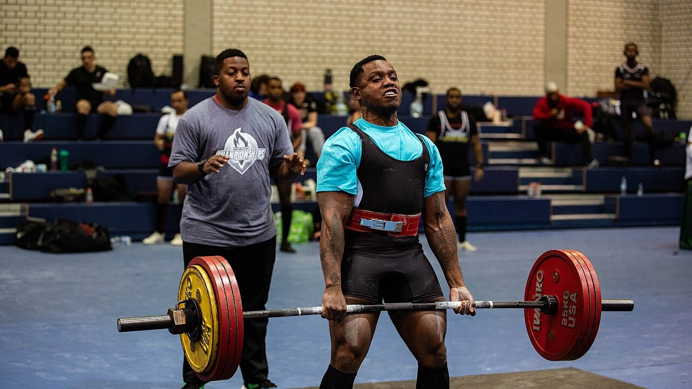
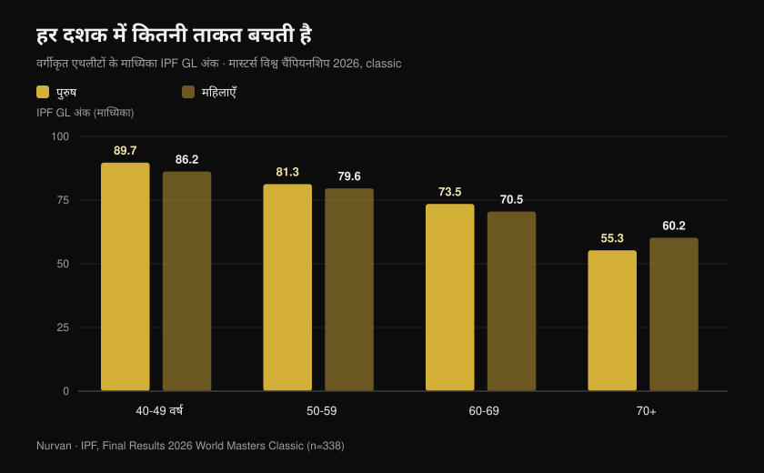
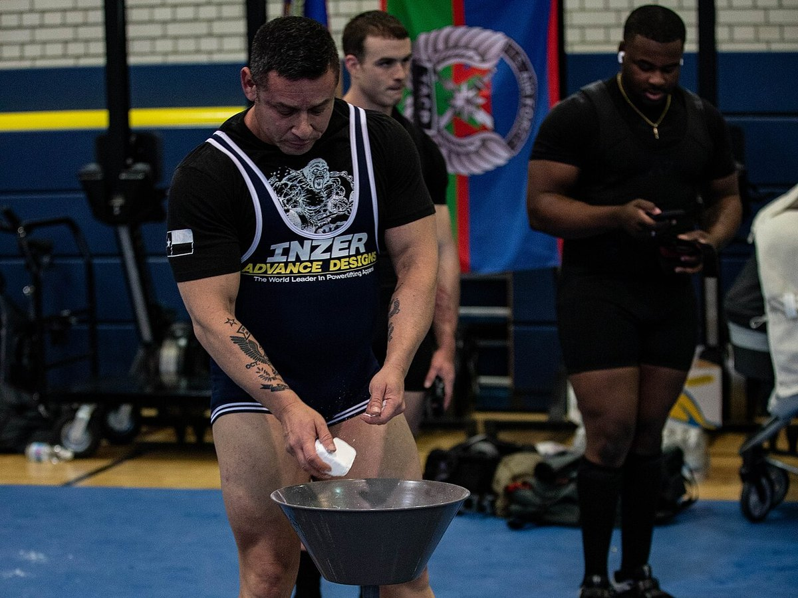
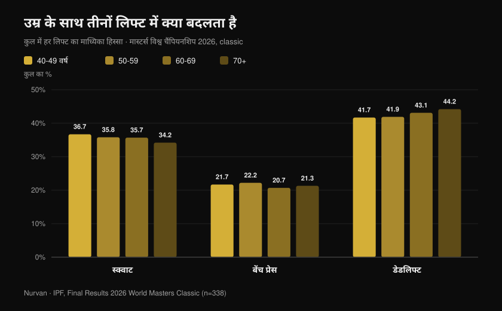

# मास्टर्स विश्व चैंपियनशिप 2026: उम्र कितनी ताकत लेती है

लेखक: [Giammaria Loi](/autore/giammaria-loi) · अपडेट 27 अक्टूबर 2026

नेवादा के रीनो में IPF मास्टर्स पावरलिफ्टिंग विश्व चैंपियनशिप अभी-अभी खत्म हुई है: दस दिन का मुकाबला, 41 देशों के 443 वर्गीकृत एथलीट, सबसे युवा 40 साल का और सबसे उम्रदराज 82 साल की। IPF ने आधिकारिक नतीजे प्रकाशित कर दिए हैं, और उन PDF में पदक तालिका से कहीं ज़्यादा कुछ है: उनमें वह सबसे बड़ा और सबसे साफ़ नमूना है जो बताता है कि गंभीरता से ट्रेनिंग करने वालों में दशक दर दशक असल में कितनी ताकत बची रहती है। मैंने हर स्थान का अलग-अलग विश्लेषण किया, और जो आंकड़ा निकलता है वह "40 के बाद सब खत्म" और "ट्रेनिंग करो तो कुछ नहीं घटता" — दोनों को गलत साबित करता है।

## संक्षेप में

- **63 साल की एक इतालवी एथलीट ने बीस साल छोटी महिलाओं के रिकॉर्ड तोड़े।** मार्त्सिया जिरारडी, 63 वर्ष, शरीर का वज़न 46.30 किलो, ने **162.5 किलो** डेडलिफ्ट किया — अपने वज़न का 3.5 गुना। इस एक ही प्रयास ने 47 किलो वर्ग का विश्व रिकॉर्ड एक साथ मास्टर्स 1 (40-49), मास्टर्स 2 (50-59) और मास्टर्स 3 (60-69) में दर्ज किया।
- **औसत गिरावट सोच से धीमी है — एक सीमा तक।** पुरुषों में माध्यिका IPF GL अंक 40-49, 50-59 और 60-69 वर्ग में **89.7 से 81.3 और 73.5** तक गिरते हैं: लगभग **हर दशक 9%**। 70 के बाद यह सीढ़ी कहीं ऊँची हो जाती है।
- **ट्रेनिंग गिरावट रोकती नहीं, शुरुआती रेखा ऊपर कर देती है।** विशिष्ट मास्टर्स वेटलिफ्टरों में ताकत उसी रफ़्तार से घटी जिस रफ़्तार से बिना ट्रेनिंग वालों में (0.6% बनाम 0.5% प्रति वर्ष), लेकिन 85 साल का एथलीट 65 साल के गैर-खिलाड़ी जितनी पावर पैदा कर रहा था: करीब **बीस साल की बढ़त** (Pearson et al., 2002)।
- **सिर्फ़ मांसपेशी बचाए रखना काफ़ी नहीं।** तीन साल तक देखे गए 1,880 बुज़ुर्गों में ताकत दुबले द्रव्यमान से करीब **तीन गुना तेज़ी** से घटी, और मास बढ़ाने से भी ताकत का नुकसान नहीं रुका (Goodpaster et al., 2006)।
- **तीनों लिफ्ट का अनुपात भी बदलता है।** उम्र के साथ कुल में डेडलिफ्ट का हिस्सा बढ़ता है (**41.7% से 44.2%**) और स्क्वाट का घटता है (**36.7% से 34.2%**): ताकत समान रूप से नहीं जाती।

## रीनो में क्या हुआ

मास्टर्स क्लासिक और इक्विप्ड विश्व चैंपियनशिप नेवादा के रीनो में **15 से 24 अक्टूबर 2026** तक हुई। चार आधिकारिक नतीजा दस्तावेज़ों (पुरुष और महिला, क्लासिक और इक्विप्ड) में कुल **465 स्थान** दर्ज हैं — क्लासिक में 338 और इक्विप्ड में 127 — जो **41 देशों** के **443 अलग-अलग एथलीटों** के हैं। वर्गीकृत एथलीटों की माध्यिका आयु **54 वर्ष** है।

एक आंकड़ा अलग से उभरता है: आधिकारिक सूचियाँ प्रतियोगिता के दौरान बने **68 विश्व रिकॉर्ड** दर्ज करती हैं। अमेरिका ने क्लासिक स्पर्धा के आठों टीम खिताब जीते — चारों पुरुष और चारों महिला आयु वर्गों में।

क्लासिक के सर्वश्रेष्ठ प्रदर्शनों में दो नाम सबसे आगे हैं: **नाथन कुलास** (अमेरिका, 43 वर्ष, 91.40 किलो) 817 किलो कुल और 107.79 IPF GL अंक के साथ, और **डेना मैकनील** (अमेरिका, 42 वर्ष, 75.40 किलो) 540 किलो और 106.87 अंक के साथ। 44 वर्ष के **माइकल गारोत्सो** ने 105 किलो वर्ग में तीन मास्टर्स 1 रिकॉर्ड बनाए: स्क्वाट 328 किलो, डेडलिफ्ट 351 किलो, कुल 861.5 किलो।

### रीनो में इटली: आठ एथलीट, सात पोडियम

इतालवी दल छोटा था और लगभग निर्दोष: **आठ वर्गीकृत एथलीट, सात पोडियम, पाँच विश्व खिताब**।

| एथलीट | वर्ग | भार वर्ग | कुल | नतीजा |
| --- | --- | --- | --- | --- |
| Martina Pisano | मास्टर्स 1 | 47 किलो | 350.5 किलो | स्वर्ण (स्क्वाट रिकॉर्ड 130.5 किलो) |
| Luisa Arienta | मास्टर्स 2 | 52 किलो | 365.0 किलो | स्वर्ण |
| Marzia Girardi | मास्टर्स 3 | 47 किलो | 307.5 किलो | स्वर्ण (4 रिकॉर्ड) |
| Barbara Canella | मास्टर्स 3 | 52 किलो | 305.0 किलो | स्वर्ण |
| Alessandro Cuoghi | मास्टर्स 2 | 93 किलो | 727.5 किलो | स्वर्ण |
| Elisa Guidi | मास्टर्स 1 | 52 किलो | 387.5 किलो | रजत |
| Allegra Romussi | मास्टर्स 1 | 69 किलो | 462.5 किलो | रजत |

51 वर्ष के कूओगी ने 96.22 IPF GL अंक के साथ समापन किया: मास्टर्स 2 वर्ग में दुनिया के दूसरे सर्वश्रेष्ठ एथलीट, दक्षिण अफ्रीका के शॉन मैंडर्स (96.54) से बाल भर पीछे।

लेकिन इस लेख की कहानी सबसे अच्छी तरह **मार्त्सिया जिरारडी** का प्रदर्शन कहता है। तिरेसठ साल, शरीर का वज़न 46.30 किलो, और **162.5 किलो** की डेडलिफ्ट। 16 अक्टूबर का वह प्रयास 47 किलो वर्ग का विश्व रिकॉर्ड सिर्फ़ उनके अपने आयु वर्ग में नहीं, मास्टर्स 2 और मास्टर्स 1 में भी फिर से लिख गया — यानी दस और बीस साल छोटी महिलाओं के वर्ग में।

## दशक दर दशक असल में कितनी ताकत घटती है

यहीं आधिकारिक नतीजे एक डेटासेट बन जाते हैं। अलग-अलग वज़न और लिंग के एथलीटों की तुलना के लिए IPF **GL अंक** इस्तेमाल करता है — एक गुणांक जो कुल को शरीर के वज़न और लिंग के हिसाब से सामान्यीकृत करता है: 100 अंक मोटे तौर पर ओपन विश्व फ़ाइनल के स्तर के बराबर है।

मैंने **क्लासिक स्पर्धा के सभी वर्गीकृत एथलीटों के GL अंकों की माध्यिका** हर आयु वर्ग के लिए निकाली। यह एक ही व्यक्ति का समय के साथ पीछा नहीं है — यह एक ही सप्ताह में प्रतिस्पर्धा करती चार पीढ़ियों की तस्वीर है — पर यह उपलब्ध सबसे व्यापक और सबसे नियंत्रित तस्वीर है।

पुरुषों में: 40-49 वर्ष में **89.7** अंक, 50-59 में **81.3**, 60-69 में **73.5**, और 70 से ऊपर **55.3**। महिलाओं में: **86.2**, **79.6**, **70.5**, **60.2**।

पहला पड़ाव करीब **9%** का पड़ता है। दूसरा लगभग उतना ही। फिर दीवार: 60-69 और 70+ के बीच पुरुष बचे हुए का और करीब 25% गँवा देते हैं। यह वक्र एक समान ढलान नहीं है — यह एक हल्की चढ़ाई है जो किसी बिंदु पर सीढ़ी बन जाती है।

एक ईमानदार स्पष्टीकरण, क्योंकि इससे इन आंकड़ों का अर्थ बदलता है: बड़े आयु वर्गों में प्रतिभागी बहुत कम हैं (70+ में 18 पुरुष और 17 महिलाएँ, जबकि 40-49 में 54 और 62), और 75 की उम्र में मुकाबला करने वाला व्यक्ति दो बार छँटनी से गुज़रा है — सेहत से और इच्छा से। निरपेक्ष मानों को सावधानी से लें; प्रवृत्ति, हालाँकि, मज़बूत है और दोनों लिंगों में एक जैसी है।

## रिकॉर्ड का विरोधाभास: सबसे ज़्यादा रिकॉर्ड सबसे उम्रदराज बनाते हैं

रीनो के 68 विश्व रिकॉर्ड में से **48 दो सबसे उम्रदराज वर्गों में बने** (मास्टर्स 3 में 33 और मास्टर्स 4 में 15), जबकि मास्टर्स 1 में 9 और मास्टर्स 2 में 11।

इसका मतलब यह नहीं कि 60 के बाद लोग ज़्यादा मज़बूत हो जाते हैं। इसका मतलब है कि बड़े वर्गों की रिकॉर्ड-पुस्तिकाएँ नई और ज़्यादा खाली हैं: उनसे होकर बहुत कम लोग गुज़रे हैं। महिलाओं ने, जिन्होंने पुरुषों से काफ़ी बाद बड़ी संख्या में प्रतिस्पर्धा शुरू की, 68 में से 40 रिकॉर्ड बनाए।

यह आँकड़ों का ब्यौरा है, पर ट्रेनिंग करने वालों से यह एक ठोस बात कहता है: **साठ की उम्र तक पहुँचकर भी ताकत दिखा पाने वाले लोगों का समूह बेहद छोटा है।** जैविक सीमाओं के कारण नहीं — छोड़ देने के कारण।

## तीनों लिफ्ट में क्या बदलता है

डेटा में एक दूसरा संकेत भी है, और यह व्यावहारिक है। मैंने हर आयु वर्ग के लिए निकाला कि कुल में हर लिफ्ट का कितना हिस्सा है।

**स्क्वाट** 40-49 वर्ष में कुल के 36.7% से घटकर 70+ में 34.2% रह जाता है। **बेंच प्रेस** लगभग स्थिर रहता है, 20.7% और 22.2% के बीच। **डेडलिफ्ट** 41.7% से बढ़कर 44.2% हो जाता है।

यह बदलाव कुछ ही प्रतिशत अंकों का है, पर एकदिशीय है और उसी ओर इशारा करता है जिधर शरीरक्रिया विज्ञान कहता है: जिस लिफ्ट में सबसे ज़्यादा जोड़ों की गति, सबसे ज़्यादा टखने और कूल्हे की लचक और गहरे एक्सेंट्रिक चरण में सबसे ज़्यादा नियंत्रण चाहिए, वही पहले कमज़ोर पड़ती है। ताकत गायब नहीं हो रही — *स्क्वाट* को व्यक्त करना कठिन हो रहा है।

ट्रेनिंग की भाषा में: अगर पचास के बाद आपका स्क्वाट बाकी से ज़्यादा पीछे जा रहा है, वज़न घटाने से पहले लचक और गहराई जाँचें। और वैरिएशन मायने रखते हैं — यह बात मैंने [स्क्वाट में घुटने बाहर: नियम या क्यू?](/hi/blog/squat-mein-knees-out-cue) में विस्तार से लिखी है।

## शोध असल में क्या कहता है

| दावा | निष्कर्ष | आँकड़ा |
| --- | --- | --- |
| 40 के बाद ताकत ढह जाती है | **स्पष्टीकरण ज़रूरी** | 40-49 और 60-69 के बीच माध्यिका GL अंक हर दशक करीब 9% गिरते हैं; बड़ी छलांग 70 के बाद आती है (IPF आधिकारिक डेटा, रीनो 2026) |
| ट्रेनिंग करो तो उम्र के साथ ताकत नहीं घटती | **गलत** | विशिष्ट मास्टर्स वेटलिफ्टरों में आइसोमेट्रिक ताकत प्रति वर्ष 0.6% घटी, बिना ट्रेनिंग वालों में 0.5%: ढलान एक जैसी (Pearson et al., 2002) |
| बुढ़ापे में ट्रेनिंग बेकार है, गिरावट तय है | **गलत** | वही एथलीट हमउम्र निष्क्रिय लोगों से 32% ज़्यादा पावर और 32% ज़्यादा आइसोमेट्रिक ताकत पैदा कर रहे थे: 85 साल का एथलीट 65 साल के गैर-खिलाड़ी के बराबर (Pearson et al., 2002) |
| बस मांसपेशी बनाए रखना काफ़ी है | **गलत** | 1,880 बुज़ुर्गों में ताकत दुबले द्रव्यमान से करीब 3 गुना तेज़ी से घटी, और मास बढ़ने से ताकत नहीं बची (Goodpaster et al., 2006) |
| 80 या 90 की उम्र में शुरू करने का कोई मतलब नहीं | **गलत** | 90 ± 1 वर्ष के नौ लोग, आठ सप्ताह की उच्च-तीव्रता वेट ट्रेनिंग: ताकत +174 ± 31%, जांघ की मांसपेशी का क्षेत्रफल +9.0 ± 4.5% (Fiatarone et al., 1990) |
| एक उम्र के बाद हल्का ही ट्रेनिंग करना चाहिए | **स्पष्टीकरण ज़रूरी** | स्वस्थ बुज़ुर्गों पर हुए मेटा-विश्लेषण में ताकत पर सबसे बड़ा असर **अधिकतम भार के 70-79%** से मिला, हल्के भार से नहीं (Borde et al., 2015) |
| गिरावट तीनों लिफ्ट में एक जैसी है | **स्पष्टीकरण ज़रूरी** | रीनो में उम्र के साथ डेडलिफ्ट का हिस्सा बढ़ा और स्क्वाट का घटा, पर कुछ ही अंक और अलग-अलग व्यक्तियों की तुलना में |

सबको जोड़ने वाला अध्ययन Pearson का है। 40 से 87 वर्ष के चौवन विशिष्ट मास्टर्स वेटलिफ्टरों की तुलना उतने ही स्वस्थ, बिना ट्रेनिंग वाले हमउम्र लोगों से की गई। गिरावट की ढलान दोनों समूहों में **एक जैसी** निकली — ट्रेनिंग ने बुढ़ापा धीमा नहीं किया। लेकिन निरपेक्ष स्तर इतना ऊँचा था कि लेखकों ने इस बढ़त को **लगभग बीस साल की आभासी उम्र** के बराबर बताया।

वही अध्ययन एक और बात जोड़ता है जो पचास के ऊपर हर किसी के लिए मायने रखती है: **पावर** आइसोमेट्रिक ताकत से लगभग दोगुनी रफ़्तार से घटी (प्रति वर्ष 1.2% बनाम 0.6%)। पहले यह नहीं जाता कि आप कितना धकेल सकते हैं, बल्कि यह कि कितनी तेज़ी से।

## इसे कैसे लागू करें

1. **तीव्रता वक्त से पहले मत घटाइए।** स्वस्थ बुज़ुर्गों के मेटा-विश्लेषण में ताकत का सबसे बड़ा लाभ अधिकतम भार के 70-79% पर किए गए सेट से मिला, हल्के भार और ज़्यादा रेप्स से नहीं (Borde et al., 2015)। हफ़्ते में दो सत्र, प्रति व्यायाम 2-3 सेट, 7-9 रेप्स — यही सबसे असरदार ढाँचा रहा।
2. **हर सत्र में कुछ तेज़ रखिए।** अगर पावर ताकत से दोगुनी रफ़्तार से जाती है, तो उसे अलग से ट्रेन करना होगा: विस्फोटक लिफ्ट, नीची जंप, मध्यम भार के साथ तेज़ पुश, या कुर्सी से जितनी तेज़ी से हो सके उठना।
3. **सिर्फ़ आईने से मत आँकिए।** मास बनाए रखना ताकत की गारंटी नहीं है: पीछा करने लायक आँकड़ा उठाया गया वज़न है, घेरा नहीं।
4. **हर सेट दर्ज कीजिए।** हर दशक 9% की गिरावट यानी करीब 0.9% प्रति वर्ष: महीने-दर-महीने अदृश्य, तीन साल के इतिहास में साफ़। लिखे हुए आँकड़ों के बिना पता तब चलेगा जब फ़र्क बड़ा हो चुका होगा।
5. **स्क्वाट को ज़्यादा समय दीजिए, कम वज़न नहीं।** अगर यही लिफ्ट पहले पीछे जाती है, तो बार से प्लेट हटाने से पहले वार्म-अप और मोबिलिटी का काम बढ़ाइए।
6. **प्रोटीन का ध्यान रखिए।** PROT-AGE स्थिति-पत्र 65 वर्ष से ऊपर रोज़ाना कम से कम **1.0-1.2 ग्राम प्रति किलो शरीर भार** और ट्रेनिंग करने वालों के लिए **कम से कम 1.2 ग्राम/किलो** की सलाह देता है (Bauer et al., 2013)। गंभीर गुर्दा रोग वाले लोग अपवाद हैं और उन्हें अपने डॉक्टर से बात करनी चाहिए।

**Nurvan के साथ।** उम्र के साथ ताकत का नुकसान धीमा होता है: करीब 1% प्रति वर्ष, जो आँख से दिखता ही नहीं। Nurvan में हर सेट भार, रेप्स और RIR दर्ज करता है, और इतिहास हर व्यायाम का असली वक्र महीनों और वर्षों में दिखाता है — ताकि आप असली गिरावट और एक खराब हफ़्ते में फ़र्क कर सकें। वार्म-अप सेट अपने आप सुझाए जाते हैं, जो स्क्वाट में सबसे ज़्यादा काम आता है, और PDF, एक्सेल या फोटो में पहले से मौजूद प्रोग्राम बिना दोबारा टाइप किए इम्पोर्ट हो जाता है। [Nurvan आज़माएँ](https://nurvan.app)

## अक्सर पूछे जाने वाले सवाल

**किस उम्र में ताकत घटनी शुरू होती है?**
रीनो के डेटा में गिरावट 40-49 और 50-59 वर्गों के बीच ही मापी जा सकती है, करीब 9%। पर यह धीमी गिरावट है — प्रति वर्ष 1% से कम — जो 70 के बाद ही तीखी होती है। सबसे पहले पावर जाती है, यानी ताकत लगाने की रफ़्तार, अधिकतम वज़न नहीं (Pearson et al., 2002)।

**क्या वेट ट्रेनिंग ताकत का नुकसान धीमा करती है?**
विशिष्ट मास्टर्स एथलीटों में गिरावट की ढलान बिना ट्रेनिंग वाले हमउम्र लोगों जैसी ही थी। जो बदलता है वह शुरुआती बिंदु है: एथलीट करीब 32% ज़्यादा ताकत और पावर पैदा कर रहे थे, जिसे लेखकों ने बीस साल की उम्र के बराबर आँका (Pearson et al., 2002)। गिरावट से बचा नहीं जा सकता: उस तक आप कहीं ऊँचाई से पहुँचते हैं।

**क्या 70 की उम्र में शुरू करना देर है?**
नहीं। औसतन 90 वर्ष के नौ लोगों पर हुए उस क्लासिक अध्ययन में आठ सप्ताह की उच्च-तीव्रता ट्रेनिंग के बाद ताकत में 174% की बढ़ोतरी दिखी (Fiatarone et al., 1990)। अगर कोई बीमारी है या सालों से ट्रेनिंग नहीं की, तो पहला कदम डॉक्टरी जाँच और भार तय करने वाला प्रशिक्षक है, हार मानना नहीं।

**60 के बाद भार कितना होना चाहिए?**
स्वस्थ बुज़ुर्गों के मेटा-विश्लेषण में ताकत पर सबसे बड़ा असर अधिकतम भार के 70-79% पर दिखा (Borde et al., 2015)। "बुज़ुर्गों का भार" जैसी कोई श्रेणी नहीं होती: आपके मौजूदा स्तर के लायक भार होता है, जिसे तीस की उम्र की तरह ही बढ़ाया जाता है, बस रिकवरी और तकनीक पर ज़्यादा ध्यान देकर।

## यह भी पढ़ें

- [रीनो में मास्टर्स पावरलिफ्टिंग विश्व चैंपियनशिप: दाँव पर क्या था](/hi/blog/ipf-world-masters-powerlifting-2026-reno-hindi) — नियम और वर्गों के साथ पूर्वावलोकन
- [मसल के लिए कितने रेप्स: 8-12 का मिथक](/hi/blog/kitne-reps-muscle-ke-liye) — तीव्रता और वॉल्यूम असल में कैसे तय होते हैं
- [क्या ऑनलाइन कोचिंग काम करती है? अध्ययन क्या कहते हैं](/hi/blog/online-coaching-kaam-karta-hai) — एक ही प्रोग्राम पर निगरानी नतीजे क्यों बदल देती है

## स्रोत

1. Pearson SJ, Young A, Macaluso A, Devito G, Nimmo MA, Cobbold M, Harridge SDR, 2002. Muscle function in elite master weightlifters. *Med Sci Sports Exerc*. PMID [12131263](https://pubmed.ncbi.nlm.nih.gov/12131263/) · [DOI](https://doi.org/10.1097/00005768-200207000-00023)
2. Goodpaster BH, Park SW, Harris TB, Kritchevsky SB, Nevitt M, Schwartz AV, Simonsick EM, Tylavsky FA, Visser M, Newman AB, 2006. The loss of skeletal muscle strength, mass, and quality in older adults: the Health, Aging and Body Composition Study. *J Gerontol A Biol Sci Med Sci*. PMID [17077199](https://pubmed.ncbi.nlm.nih.gov/17077199/) · [DOI](https://doi.org/10.1093/gerona/61.10.1059)
3. Fiatarone MA, Marks EC, Ryan ND, Meredith CN, Lipsitz LA, Evans WJ, 1990. High-intensity strength training in nonagenarians. Effects on skeletal muscle. *JAMA*. PMID [2342214](https://pubmed.ncbi.nlm.nih.gov/2342214/)
4. Borde R, Hortobágyi T, Granacher U, 2015. Dose-Response Relationships of Resistance Training in Healthy Old Adults: A Systematic Review and Meta-Analysis. *Sports Med*. PMID [26420238](https://pubmed.ncbi.nlm.nih.gov/26420238/) · [DOI](https://doi.org/10.1007/s40279-015-0385-9)
5. Bauer J, Biolo G, Cederholm T, Cesari M, Cruz-Jentoft AJ, Morley JE, Phillips S, Sieber C, Stehle P, Teta D, Visvanathan R, Volpi E, Boirie Y, 2013. Evidence-based recommendations for optimal dietary protein intake in older people: a position paper from the PROT-AGE Study Group. *J Am Med Dir Assoc*. PMID [23867520](https://pubmed.ncbi.nlm.nih.gov/23867520/) · [DOI](https://doi.org/10.1016/j.jamda.2013.05.021)

नतीजे, रिकॉर्ड, शरीर भार और IPF GL अंक: International Powerlifting Federation, *Final Results — 2026 IPF World Masters Classic Powerlifting Championships* और *2026 IPF World Masters Equipped Powerlifting Championships*, रीनो (नेवादा), 15-24 अक्टूबर 2026, [IPF के आधिकारिक दस्तावेज़](https://www.powerlifting.sport/championships/results/2026/world-masters-classic-equipped-powerlifting-championships-2026)। माध्यिकाएँ, लिफ्ट के हिस्से और गणनाएँ चार आधिकारिक दस्तावेज़ों पर Nurvan की मौलिक गणना हैं।

---

**Giammaria Loi** Nurvan के संस्थापक हैं। वे 2012 से वेट ट्रेनिंग करते हैं, 2013 से FIPE-प्रमाणित पर्सनल ट्रेनर और कोच के रूप में काम करते हैं, और 2018 से राष्ट्रीय स्तर पर पावरलिफ्टिंग में प्रतिस्पर्धा करते हैं।

> नोट: यह जानकारीपरक सामग्री है, डॉक्टर या पेशेवर की राय का विकल्प नहीं। अगर आपकी उम्र 60 से ऊपर है, कोई बीमारी चल रही है या आपने लंबे समय से ट्रेनिंग नहीं की है, तो वेट ट्रेनिंग शुरू करने से पहले डॉक्टर से बात करें।
