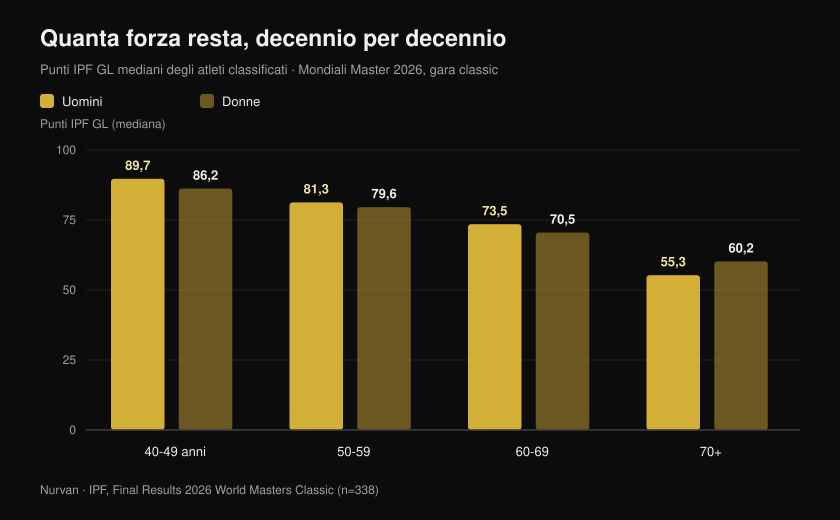
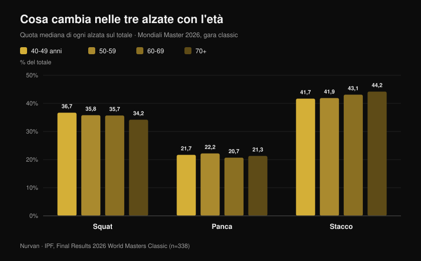

# Mondiali Master 2026: quanta forza si perde con l'età

Di [Giammaria Loi](/autore/giammaria-loi) · aggiornato il 27 ottobre 2026

A Reno, in Nevada, si sono appena chiusi i Mondiali IPF di powerlifting riservati ai master: dieci giorni di gara, 443 atleti classificati da 41 nazioni, il più giovane di 40 anni e la più anziana di 82. L'IPF ha pubblicato i risultati ufficiali, e dentro quei PDF c'è molto più di un medagliere: c'è il campione più grande e più pulito che esista di quanta forza resta davvero, decennio dopo decennio, in persone che si allenano sul serio. Ho analizzato i piazzamenti uno per uno, e il numero che ne esce contraddice sia chi dice "dopo i 40 è finita" sia chi dice "se ti alleni non perdi niente".

## In breve

- **Una sessantatreenne italiana ha battuto i record di chi ha vent'anni di meno.** Marzia Girardi, 63 anni, 46,30 kg di peso corporeo, ha staccato **162,5 kg** — 3,5 volte il suo peso: è record del mondo nella categoria 47 kg contemporaneamente per i master 1 (40-49), i master 2 (50-59) e i master 3 (60-69).
- **Il calo medio è più lento di quanto si creda, fino a un certo punto.** I punti IPF GL mediani passano da **89,7 a 81,3 a 73,5** fra i 40-49, i 50-59 e i 60-69 anni negli uomini: circa **9% a decennio**. Dopo i 70 il gradino diventa molto più alto.
- **Allenarsi non ferma il declino: sposta la linea di partenza.** Nei master weightlifter d'élite la forza cala alla stessa velocità dei non allenati (0,6% contro 0,5% l'anno), ma un atleta di 85 anni esprimeva la potenza di un sedentario di 65: circa **vent'anni di vantaggio** (Pearson et al., 2002).
- **Non basta tenere i muscoli.** In 1.880 anziani seguiti per tre anni la forza è calata circa **tre volte più in fretta** della massa magra, e chi ha guadagnato massa non ha evitato il calo di forza (Goodpaster et al., 2006).
- **Cambia anche il mix delle alzate.** Con l'età lo stacco pesa sempre di più sul totale (dal **41,7% al 44,2%**) e lo squat sempre di meno (dal **36,7% al 34,2%**): la forza non se ne va in modo uniforme.

## Cosa è successo a Reno

I Mondiali master classic ed equipped si sono svolti a Reno, in Nevada, dal **15 al 24 ottobre 2026**. Nei quattro documenti ufficiali di risultati (uomini e donne, classic ed equipped) compaiono **465 piazzamenti** — 338 nella gara classic e 127 nella equipped — per **443 atleti diversi** di **41 nazioni**. L'età mediana dei classificati è **54 anni**.

Il dato più impressionante è un altro: le liste ufficiali registrano **68 record del mondo** stabiliti durante la manifestazione. Gli Stati Uniti hanno vinto tutte e otto le classifiche a squadre della gara classic, nelle quattro fasce maschili e nelle quattro femminili.

Fra i migliori assoluti della classic, due nomi su tutti: **Nathan Kulas** (USA, 43 anni, 91,40 kg) con 817 kg di totale e 107,79 punti IPF GL, e **Dayna McNeal** (USA, 42 anni, 75,40 kg) con 540 kg e 106,87 punti. **Michael Garozzo**, 44 anni, ha firmato tre record master 1 nei 105 kg: squat 328 kg, stacco 351 kg, totale 861,5 kg.

### L'Italia a Reno: otto atleti, sette podi

La spedizione italiana è stata piccola e quasi perfetta: **otto atleti classificati, sette sul podio, cinque titoli mondiali**.

| Atleta | Fascia | Categoria | Totale | Piazzamento |
| --- | --- | --- | --- | --- |
| Martina Pisano | Master 1 | 47 kg | 350,5 kg | Oro (record squat 130,5 kg) |
| Luisa Arienta | Master 2 | 52 kg | 365,0 kg | Oro |
| Marzia Girardi | Master 3 | 47 kg | 307,5 kg | Oro (4 record) |
| Barbara Canella | Master 3 | 52 kg | 305,0 kg | Oro |
| Alessandro Cuoghi | Master 2 | 93 kg | 727,5 kg | Oro |
| Elisa Guidi | Master 1 | 52 kg | 387,5 kg | Argento |
| Allegra Romussi | Master 1 | 69 kg | 462,5 kg | Argento |

Cuoghi, 51 anni, ha chiuso con 96,22 punti IPF GL: secondo miglior atleta assoluto della fascia master 2 a livello mondiale, a un soffio dal sudafricano Sean Manders (96,54).

Ma la prestazione che racconta meglio questo articolo è quella di **Marzia Girardi**. Sessantatré anni, 46,30 kg di peso corporeo, uno stacco da **162,5 kg**. Quel singolo tentativo, eseguito il 16 ottobre, ha riscritto il record del mondo dei 47 kg non solo nella sua fascia d'età, ma anche in quelle dei master 2 e dei master 1: donne con dieci e vent'anni meno di lei.

## Quanta forza si perde davvero, decennio per decennio

Qui i risultati ufficiali diventano un dataset. Per confrontare atleti di peso e sesso diversi l'IPF usa i **punti GL**, un coefficiente che normalizza il totale in base al peso corporeo e al sesso: 100 punti è grosso modo il livello di un finalista mondiale assoluto.

Ho calcolato la **mediana dei punti GL di tutti gli atleti classificati nella gara classic**, fascia per fascia. Non è un confronto sulla stessa persona nel tempo — è una fotografia di quattro generazioni che hanno gareggiato nella stessa settimana — ma è la fotografia più ampia e più controllata che esista.

Negli uomini: **89,7** punti fra i 40 e i 49 anni, **81,3** fra i 50 e i 59, **73,5** fra i 60 e i 69, **55,3** dai 70 in su. Nelle donne: **86,2**, **79,6**, **70,5**, **60,2**.

Il primo passaggio costa circa il **9%**. Il secondo, quasi identico. Poi il muro: fra i 60-69 e i 70+ gli uomini perdono un altro 25% circa rispetto al valore precedente. In pratica, la curva non è una discesa costante — è un piano inclinato dolce che a un certo punto diventa uno scalino.

Una precisazione onesta, perché cambia come vanno letti questi numeri: le fasce più anziane hanno meno partecipanti (18 uomini e 17 donne nei 70+, contro 54 e 62 nei 40-49), e chi arriva a gareggiare a 75 anni è un sopravvissuto selezionato due volte — dalla salute e dalla voglia. I valori assoluti vanno presi con le pinze; l'andamento, invece, è robusto e coerente nei due sessi.

## Il paradosso dei record: li fanno i più vecchi

Dei 68 record del mondo di Reno, **48 sono stati stabiliti nelle due fasce più anziane** (33 nei master 3, 15 nei master 4), contro 9 nei master 1 e 11 nei master 2.

Non significa che dopo i 60 anni si diventi più forti. Significa che i libri dei record delle categorie più anziane sono più giovani e più vuoti: ci sono passate molte meno persone. Le donne, che hanno iniziato a gareggiare in massa molto più tardi degli uomini, hanno firmato 40 dei 68 record.

È un dettaglio statistico, ma dice una cosa concreta a chi si allena: **il bacino di persone che arrivano a sessant'anni ancora capaci di esprimere forza è piccolissimo**. Non per limiti biologici — per abbandono.

## Cosa cambia nelle tre alzate

C'è un secondo segnale dentro i dati, e questo è pratico. Ho calcolato quanto pesa ciascuna alzata sul totale, fascia per fascia.

Lo **squat** scende dal 36,7% del totale nei 40-49 anni al 34,2% nei 70+. La **panca** resta sostanzialmente ferma fra il 20,7% e il 22,2%. Lo **stacco** sale dal 41,7% al 44,2%.

Lo spostamento è di pochi punti percentuali, ma è monotono e va nella direzione che la fisiologia suggerisce: l'alzata che richiede più escursione articolare, più mobilità di caviglia e anca e più controllo in fase eccentrica profonda è quella che cede per prima. Non è la forza a sparire: è lo *squat* a diventare più difficile da esprimere.

Tradotto in allenamento: se dopo i cinquanta il tuo squat arretra più del resto, prima di tagliare il carico vale la pena controllare mobilità e profondità. E le varianti contano — un tema che ho sviluppato parlando di [ginocchia in fuori e assetto nello squat](/blog/ginocchia-in-fuori-squat).

## Cosa dice davvero la ricerca

| Affermazione | Verdetto | Il dato |
| --- | --- | --- |
| Dopo i 40 anni la forza crolla | **Da precisare** | Fra i 40-49 e i 60-69 i punti GL mediani calano di circa il 9% a decennio; il salto grande arriva dopo i 70 (dati ufficiali IPF, Reno 2026) |
| Se ti alleni, non perdi forza con l'età | **Smentito** | Nei master weightlifter d'élite la forza isometrica cala allo 0,6% l'anno contro lo 0,5% dei non allenati: stessa pendenza (Pearson et al., 2002) |
| Allenarsi da anziani non serve, il declino è segnato | **Smentito** | Gli stessi atleti esprimevano +32% di potenza e +32% di forza isometrica rispetto ai coetanei sedentari: un 85enne allenato come un 65enne sedentario (Pearson et al., 2002) |
| Basta mantenere la massa muscolare | **Smentito** | In 1.880 anziani la forza è calata ~3 volte più in fretta della massa magra, e guadagnare massa non ha protetto la forza (Goodpaster et al., 2006) |
| A 80 o 90 anni non ha più senso iniziare | **Smentito** | Nove persone di 90 ± 1 anni, otto settimane di pesi ad alta intensità: forza +174 ± 31%, area muscolare della coscia +9,0 ± 4,5% (Fiatarone et al., 1990) |
| Dopo una certa età bisogna allenarsi leggeri | **Da precisare** | Nella meta-analisi su anziani sani l'effetto maggiore sulla forza arriva da intensità del **70-79% del massimale**, non da carichi leggeri (Borde et al., 2015) |
| Il calo è uguale in tutte le alzate | **Da precisare** | A Reno la quota dello stacco sul totale sale con l'età e quella dello squat scende, ma di pochi punti e su un confronto fra persone diverse |

Il punto che lega tutto è lo studio di Pearson. Cinquantaquattro master weightlifter d'élite dai 40 agli 87 anni, confrontati con altrettanti coetanei sani e non allenati. La pendenza del declino è risultata **la stessa** nei due gruppi — allenarsi non ha rallentato l'invecchiamento. Ma il livello assoluto era talmente più alto che gli autori hanno quantificato il vantaggio in **circa vent'anni di età apparente**.

Lo stesso studio aggiunge un dettaglio che vale per chiunque abbia più di cinquant'anni: la **potenza** è calata a una velocità circa doppia rispetto alla forza isometrica (1,2% contro 0,6% l'anno). Quello che si perde per primo non è quanto riesci a spingere, ma quanto in fretta.

## Come applicarlo

1. **Non abbassare l'intensità prima del tempo.** Nella meta-analisi sugli anziani sani il guadagno di forza più grande arriva da serie al 70-79% del massimale, non da carichi leggeri ad alte ripetizioni (Borde et al., 2015). Due sedute a settimana, 2-3 serie per esercizio, 7-9 ripetizioni: è lo schema che negli studi rende di più.
2. **Metti qualcosa di veloce in ogni seduta.** Se la potenza se ne va al doppio della velocità della forza, va allenata a parte: alzate esplosive, salti bassi, spinte veloci a carico moderato, anche solo alzarsi da seduto il più rapidamente possibile.
3. **Smetti di guardare solo lo specchio.** Mantenere la massa non garantisce la forza: il parametro da inseguire è il carico sollevato, non la circonferenza.
4. **Tieni traccia, serie per serie.** Un calo del 9% a decennio significa circa lo 0,9% l'anno: invisibile mese per mese, evidente su tre anni di storico. Senza numeri scritti non te ne accorgi finché non è grande.
5. **Dai allo squat più tempo, non meno carico.** Se è l'alzata che arretra per prima, aggiungi riscaldamento e lavoro di mobilità prima di togliere peso dal bilanciere.
6. **Cura le proteine.** La posizione del gruppo PROT-AGE indica almeno **1,0-1,2 g per kg di peso corporeo al giorno** oltre i 65 anni, e **almeno 1,2 g/kg** per chi si allena (Bauer et al., 2013). Chi ha una malattia renale grave fa eccezione e deve parlarne con il medico.

**Con Nurvan.** Il calo di forza con l'età è lento: circa l'1% l'anno, cioè niente che tu possa vedere a occhio. In Nurvan ogni serie registra carico, ripetizioni e RIR, e lo storico mostra la curva vera di ogni esercizio su mesi e anni — così capisci se stai davvero arretrando o se è stata solo una brutta settimana. Le serie di riscaldamento vengono proposte in automatico, utile soprattutto sullo squat, e una scheda che hai già in PDF, Excel o in foto si importa senza riscriverla. [Prova Nurvan](https://nurvan.app)

## Domande frequenti

**A che età si inizia a perdere forza?**
Nei dati di Reno il calo è già misurabile fra la fascia 40-49 e la 50-59, intorno al 9%. Ma è un calo lento — meno dell'1% l'anno — che diventa ripido solo dopo i 70. La parte che se ne va per prima è la potenza, cioè la velocità di espressione della forza, non il massimale (Pearson et al., 2002).

**Allenarsi con i pesi rallenta la perdita di forza?**
Negli atleti master d'élite la pendenza del declino è risultata uguale a quella dei coetanei non allenati. Quello che cambia è il punto di partenza: gli atleti esprimevano circa il 32% in più di forza e potenza, un vantaggio che gli autori hanno stimato pari a vent'anni di età (Pearson et al., 2002). Non si evita il declino: si arriva molto più in alto all'appuntamento.

**È tardi per iniziare a 70 anni?**
No. Lo studio classico su nove persone di 90 anni in media ha mostrato +174% di forza in otto settimane di allenamento ad alta intensità (Fiatarone et al., 1990). Se hai patologie in corso o non ti alleni da anni, la prima tappa è una visita medica e un tecnico che imposti i carichi, non la rinuncia.

**Quanto devono essere pesanti i carichi dopo i 60 anni?**
Nella meta-analisi sugli anziani sani l'effetto maggiore sulla forza si è visto con intensità del 70-79% del massimale (Borde et al., 2015). Il carico "da anziani" non esiste come categoria: esiste il carico adatto al tuo livello attuale, che va progredito come a trent'anni, solo con più attenzione a recupero e tecnica.

## Leggi anche

- [Mondiali master di powerlifting a Reno: cosa c'era in palio](/blog/mondiali-powerlifting-master-reno-2026) — l'anteprima della gara, con regolamento e categorie
- [Quante ripetizioni per la massa: il mito dell'8-12](/blog/ripetizioni-serie-recupero-ipertrofia) — come si imposta davvero intensità e volume
- [Coaching online funziona? Cosa dicono gli studi](/blog/coaching-online-funziona-studi) — perché la supervisione cambia i risultati a parità di scheda

## Fonti

1. Pearson SJ, Young A, Macaluso A, Devito G, Nimmo MA, Cobbold M, Harridge SDR, 2002. Muscle function in elite master weightlifters. *Med Sci Sports Exerc*. PMID [12131263](https://pubmed.ncbi.nlm.nih.gov/12131263/) · [DOI](https://doi.org/10.1097/00005768-200207000-00023)
2. Goodpaster BH, Park SW, Harris TB, Kritchevsky SB, Nevitt M, Schwartz AV, Simonsick EM, Tylavsky FA, Visser M, Newman AB, 2006. The loss of skeletal muscle strength, mass, and quality in older adults: the Health, Aging and Body Composition Study. *J Gerontol A Biol Sci Med Sci*. PMID [17077199](https://pubmed.ncbi.nlm.nih.gov/17077199/) · [DOI](https://doi.org/10.1093/gerona/61.10.1059)
3. Fiatarone MA, Marks EC, Ryan ND, Meredith CN, Lipsitz LA, Evans WJ, 1990. High-intensity strength training in nonagenarians. Effects on skeletal muscle. *JAMA*. PMID [2342214](https://pubmed.ncbi.nlm.nih.gov/2342214/)
4. Borde R, Hortobágyi T, Granacher U, 2015. Dose-Response Relationships of Resistance Training in Healthy Old Adults: A Systematic Review and Meta-Analysis. *Sports Med*. PMID [26420238](https://pubmed.ncbi.nlm.nih.gov/26420238/) · [DOI](https://doi.org/10.1007/s40279-015-0385-9)
5. Bauer J, Biolo G, Cederholm T, Cesari M, Cruz-Jentoft AJ, Morley JE, Phillips S, Sieber C, Stehle P, Teta D, Visvanathan R, Volpi E, Boirie Y, 2013. Evidence-based recommendations for optimal dietary protein intake in older people: a position paper from the PROT-AGE Study Group. *J Am Med Dir Assoc*. PMID [23867520](https://pubmed.ncbi.nlm.nih.gov/23867520/) · [DOI](https://doi.org/10.1016/j.jamda.2013.05.021)

Risultati, record, pesi corporei e punti IPF GL: International Powerlifting Federation, *Final Results — 2026 IPF World Masters Classic Powerlifting Championships* e *2026 IPF World Masters Equipped Powerlifting Championships*, Reno (Nevada), 15-24 ottobre 2026, [documenti ufficiali IPF](https://www.powerlifting.sport/championships/results/2026/world-masters-classic-equipped-powerlifting-championships-2026). Mediane, quote delle alzate e conteggi sono elaborazioni originali Nurvan sui quattro documenti ufficiali.

---

**Giammaria Loi** è il fondatore di Nurvan. Si allena con i pesi dal 2012, lavora come personal trainer e coach certificato FIPE dal 2013 e gareggia nel powerlifting a livello nazionale dal 2018.

> Nota: contenuto informativo, non sostituisce il parere di un medico o professionista. Se hai più di 60 anni, una patologia in corso o non ti alleni da molto tempo, parlane con un medico prima di iniziare un programma con i pesi.
