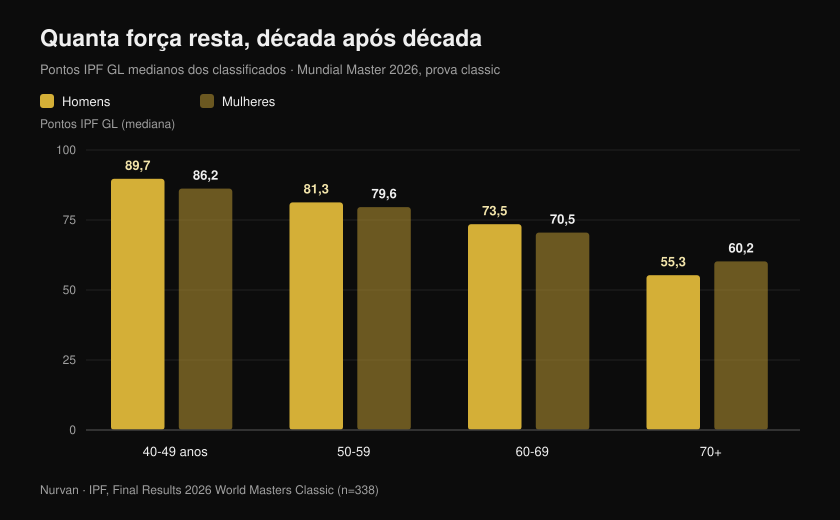
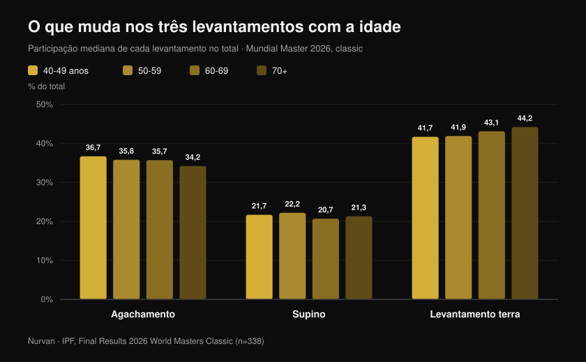

# Mundial Master 2026: quanta força custa a idade

Por [Giammaria Loi](/autore/giammaria-loi) · atualizado em 27 de outubro de 2026

Em Reno, no Nevada, acabou de se encerrar o Mundial IPF de powerlifting master: dez dias de competição, 443 atletas classificados de 41 países, o mais novo com 40 anos e a mais velha com 82. A IPF publicou os resultados oficiais, e esses PDFs contêm muito mais do que um quadro de medalhas: contêm a maior amostra limpa que existe de quanta força realmente resta, década após década, em pessoas que treinam a sério. Analisei todas as colocações uma a uma, e o número que sai contradiz tanto o "depois dos 40 acabou" quanto o "se treinas não perdes nada".

## Em resumo

- **Uma italiana de 63 anos bateu os recordes de mulheres vinte anos mais novas.** Marzia Girardi, 63 anos, 46,30 kg de peso corporal, levantou **162,5 kg** no levantamento terra — 3,5 vezes o seu peso. Essa única tentativa estabeleceu o recorde mundial dos 47 kg ao mesmo tempo em master 1 (40-49), master 2 (50-59) e master 3 (60-69).
- **A queda média é mais lenta do que se pensa, até certo ponto.** Os pontos IPF GL medianos vão de **89,7 para 81,3 e 73,5** entre os 40-49, 50-59 e 60-69 anos nos homens: cerca de **9% por década**. Depois dos 70 o degrau fica bem maior.
- **Treinar não trava o declínio: muda a linha de partida.** Em halterofilistas master de elite a força caiu ao mesmo ritmo que nos não treinados (0,6% contra 0,5% ao ano), mas um atleta de 85 anos produzia a potência de um sedentário de 65: cerca de **vinte anos de vantagem** (Pearson et al., 2002).
- **Manter o músculo não basta.** Em 1.880 idosos acompanhados três anos a força caiu cerca de **três vezes mais depressa** do que a massa magra, e ganhar massa não evitou a perda de força (Goodpaster et al., 2006).
- **A mistura entre os levantamentos também muda.** Com a idade o levantamento terra pesa mais no total (de **41,7% para 44,2%**) e o agachamento menos (de **36,7% para 34,2%**): a força não vai embora de forma uniforme.

## O que aconteceu em Reno

O Mundial master classic e equipped decorreu em Reno, Nevada, de **15 a 24 de outubro de 2026**. Nos quatro documentos oficiais de resultados (homens e mulheres, classic e equipped) constam **465 classificações** — 338 no classic e 127 no equipped — de **443 atletas diferentes** de **41 países**. A idade mediana dos classificados é de **54 anos**.

Há um dado que se destaca: as listas oficiais registam **68 recordes mundiais** estabelecidos durante a prova. Os Estados Unidos venceram as oito classificações por equipas do classic, nas quatro faixas masculinas e nas quatro femininas.

Entre os melhores absolutos do classic, dois nomes: **Nathan Kulas** (EUA, 43 anos, 91,40 kg) com 817 kg de total e 107,79 pontos IPF GL, e **Dayna McNeal** (EUA, 42 anos, 75,40 kg) com 540 kg e 106,87 pontos. **Michael Garozzo**, 44 anos, assinou três recordes master 1 nos 105 kg: agachamento 328 kg, terra 351 kg, total 861,5 kg.

### A Itália em Reno: oito atletas, sete pódios

A delegação italiana foi pequena e quase perfeita: **oito atletas classificados, sete pódios, cinco títulos mundiais**.

| Atleta | Faixa | Categoria | Total | Resultado |
| --- | --- | --- | --- | --- |
| Martina Pisano | Master 1 | 47 kg | 350,5 kg | Ouro (recorde de agachamento, 130,5 kg) |
| Luisa Arienta | Master 2 | 52 kg | 365,0 kg | Ouro |
| Marzia Girardi | Master 3 | 47 kg | 307,5 kg | Ouro (4 recordes) |
| Barbara Canella | Master 3 | 52 kg | 305,0 kg | Ouro |
| Alessandro Cuoghi | Master 2 | 93 kg | 727,5 kg | Ouro |
| Elisa Guidi | Master 1 | 52 kg | 387,5 kg | Prata |
| Allegra Romussi | Master 1 | 69 kg | 462,5 kg | Prata |

Cuoghi, 51 anos, terminou com 96,22 pontos IPF GL: segundo melhor atleta da faixa master 2 a nível mundial, a um sopro do sul-africano Sean Manders (96,54).

Mas a prestação que melhor conta este artigo é a de **Marzia Girardi**. Sessenta e três anos, 46,30 kg de peso corporal, um terra de **162,5 kg**. Essa tentativa, a 16 de outubro, reescreveu o recorde mundial dos 47 kg não só na sua faixa, mas também em master 2 e master 1: mulheres com dez e vinte anos menos.

## Quanta força se perde realmente, década a década

Aqui os resultados oficiais tornam-se um conjunto de dados. Para comparar atletas de peso e sexo diferentes, a IPF usa os **pontos GL**, um coeficiente que normaliza o total pelo peso corporal e pelo sexo: 100 pontos corresponde grosso modo ao nível de uma final mundial absoluta.

Calculei a **mediana dos pontos GL de todos os classificados da prova classic**, faixa a faixa. Não é uma comparação da mesma pessoa ao longo do tempo — é uma fotografia de quatro gerações que competiram na mesma semana — mas é a fotografia mais ampla e mais controlada que existe.

Nos homens: **89,7** pontos entre os 40 e os 49 anos, **81,3** entre os 50 e os 59, **73,5** entre os 60 e os 69, **55,3** a partir dos 70. Nas mulheres: **86,2**, **79,6**, **70,5**, **60,2**.

A primeira passagem custa cerca de **9%**. A segunda, quase o mesmo. Depois vem o muro: entre 60-69 e 70+ os homens perdem mais uns 25% do que restava. A curva não é uma descida constante — é uma rampa suave que a certa altura vira degrau.

Uma precisão honesta, porque muda a leitura destes números: as faixas mais velhas têm muito menos participantes (18 homens e 17 mulheres nos 70+, contra 54 e 62 nos 40-49), e quem compete aos 75 anos foi selecionado duas vezes, pela saúde e pela vontade. Os valores absolutos exigem cautela; a tendência, essa, é sólida e coerente nos dois sexos.

## O paradoxo dos recordes: são os mais velhos que os fazem

Dos 68 recordes mundiais de Reno, **48 foram estabelecidos nas duas faixas mais velhas** (33 em master 3 e 15 em master 4), contra 9 em master 1 e 11 em master 2.

Não significa que depois dos 60 se fique mais forte. Significa que os livros de recordes das categorias mais velhas são mais jovens e mais vazios: passou por eles muito menos gente. As mulheres, que começaram a competir em massa bem mais tarde do que os homens, assinaram 40 dos 68 recordes.

É um detalhe estatístico, mas diz algo concreto a quem treina: **o grupo de pessoas que chega aos sessenta ainda capaz de expressar força é minúsculo**. Não por limites biológicos — por desistência.

## O que muda nos três levantamentos

Há um segundo sinal nos dados, e este é prático. Calculei quanto cada levantamento pesa no total, faixa a faixa.

O **agachamento** cai de 36,7% do total nos 40-49 anos para 34,2% nos 70+. O **supino** fica praticamente estável, entre 20,7% e 22,2%. O **levantamento terra** sobe de 41,7% para 44,2%.

O deslocamento é de poucos pontos percentuais, mas é monótono e aponta na direção que a fisiologia sugere: o levantamento que exige mais amplitude articular, mais mobilidade de tornozelo e anca e mais controlo numa fase excêntrica profunda é o primeiro a ceder. Não é a força que desaparece: é o *agachamento* que fica mais difícil de expressar.

Traduzindo para o treino: se depois dos cinquenta o teu agachamento recua mais do que o resto, antes de baixar a carga vale a pena rever mobilidade e profundidade. E as variantes contam — um tema que desenvolvi ao falar de [joelhos para fora no agachamento](/pt/blog/joelhos-para-fora-agachamento).

## O que a investigação diz mesmo

| Afirmação | Veredito | O dado |
| --- | --- | --- |
| Depois dos 40 a força desaba | **A precisar** | Entre 40-49 e 60-69 os pontos GL medianos caem cerca de 9% por década; o salto grande chega depois dos 70 (dados oficiais IPF, Reno 2026) |
| Se treinas, não perdes força com a idade | **Desmentido** | Em halterofilistas master de elite a força isométrica caiu 0,6% ao ano contra 0,5% dos não treinados: a mesma inclinação (Pearson et al., 2002) |
| Treinar mais velho não serve, o declínio está escrito | **Desmentido** | Esses mesmos atletas produziam +32% de potência e +32% de força isométrica face aos sedentários da mesma idade: um atleta de 85 anos igualava um sedentário de 65 (Pearson et al., 2002) |
| Basta manter a massa muscular | **Desmentido** | Em 1.880 idosos a força caiu cerca de 3 vezes mais depressa do que a massa magra, e ganhar massa não protegeu a força (Goodpaster et al., 2006) |
| Aos 80 ou 90 anos já não vale a pena começar | **Desmentido** | Nove pessoas de 90 ± 1 anos, oito semanas de pesos de alta intensidade: força +174 ± 31%, área muscular da coxa +9,0 ± 4,5% (Fiatarone et al., 1990) |
| A partir de certa idade é preciso treinar leve | **A precisar** | Na meta-análise sobre idosos saudáveis o maior efeito na força veio de intensidades de **70-79% do máximo**, não de cargas leves (Borde et al., 2015) |
| A queda é igual nos três levantamentos | **A precisar** | Em Reno a parcela do terra subiu com a idade e a do agachamento desceu, mas poucos pontos e comparando pessoas diferentes |

O estudo que liga tudo é o de Pearson. Cinquenta e quatro halterofilistas master de elite dos 40 aos 87 anos, comparados com igual número de pessoas da mesma idade, saudáveis e não treinadas. A inclinação do declínio foi **a mesma** nos dois grupos — treinar não travou o envelhecimento. Mas o nível absoluto era tão mais alto que os autores quantificaram a vantagem em **cerca de vinte anos de idade aparente**.

O mesmo estudo acrescenta um detalhe que interessa a quem passa dos cinquenta: a **potência** caiu a uma velocidade cerca de dupla da força isométrica (1,2% contra 0,6% ao ano). O que se perde primeiro não é quanto consegues empurrar, mas com que rapidez.

## Como aplicar

1. **Não baixes a intensidade antes do tempo.** Na meta-análise sobre idosos saudáveis o maior ganho de força veio de séries a 70-79% do máximo, não de cargas leves com muitas repetições (Borde et al., 2015). Duas sessões por semana, 2-3 séries por exercício, 7-9 repetições: é o esquema que mais rendeu.
2. **Põe algo rápido em cada sessão.** Se a potência vai embora ao dobro da velocidade da força, treina-se à parte: levantamentos explosivos, saltos baixos, empurrões rápidos com carga moderada, até levantar-se de uma cadeira o mais depressa possível.
3. **Deixa de avaliar pelo espelho.** Manter a massa não garante a força: o parâmetro a perseguir é a carga levantada, não o perímetro.
4. **Regista série a série.** Uma queda de 9% por década é cerca de 0,9% ao ano: invisível de mês para mês, evidente em três anos de histórico. Sem números escritos só dás por isso quando já é grande.
5. **Dá mais tempo ao agachamento, não menos carga.** Se é o levantamento que recua primeiro, acrescenta aquecimento e trabalho de mobilidade antes de tirar peso da barra.
6. **Cuida da proteína.** O documento de posição PROT-AGE indica pelo menos **1,0-1,2 g por kg de peso corporal por dia** acima dos 65 anos e **pelo menos 1,2 g/kg** para quem treina (Bauer et al., 2013). Pessoas com doença renal grave são exceção e devem falar com o médico.

**Com a Nurvan.** A perda de força com a idade é lenta: cerca de 1% ao ano, nada que se veja a olho nu. Na Nurvan cada série regista carga, repetições e RIR, e o histórico mostra a curva real de cada exercício ao longo de meses e anos — assim distingues um recuo verdadeiro de uma semana má. As séries de aquecimento são propostas automaticamente, útil sobretudo no agachamento, e um plano que já tenhas em PDF, Excel ou em foto importa-se sem reescrever. [Experimenta a Nurvan](https://nurvan.app)

## Perguntas frequentes

**Com que idade se começa a perder força?**
Nos dados de Reno a queda já é mensurável entre a faixa 40-49 e a 50-59, à volta dos 9%. Mas é uma queda lenta — menos de 1% ao ano — que só fica íngreme depois dos 70. O que se vai primeiro é a potência, a velocidade de expressão da força, não o máximo (Pearson et al., 2002).

**Treinar com pesos trava a perda de força?**
Em atletas master de elite a inclinação do declínio foi igual à dos não treinados da mesma idade. O que muda é o ponto de partida: os atletas produziam cerca de 32% mais força e potência, uma vantagem que os autores estimaram em vinte anos de idade (Pearson et al., 2002). Não se evita o declínio: chega-se a ele de muito mais alto.

**É tarde para começar aos 70?**
Não. O estudo clássico com nove pessoas de 90 anos em média mostrou +174% de força em oito semanas de treino de alta intensidade (Fiatarone et al., 1990). Se tens patologias ou estás há anos sem treinar, o primeiro passo é uma consulta médica e um técnico que defina as cargas, não a desistência.

**Que cargas usar depois dos 60?**
Na meta-análise sobre idosos saudáveis o maior efeito na força apareceu a 70-79% do máximo (Borde et al., 2015). Não existe uma "carga de idosos" como categoria: existe a carga adequada ao teu nível atual, progredida como aos trinta, com mais atenção à recuperação e à técnica.

## Lê também

- [Mundial master de powerlifting em Reno: o que estava em jogo](/pt/blog/mundial-master-de-powerlifting-2026-reno) — a antevisão, com regulamento e categorias
- [Quantas repetições para massa: o mito do 8-12](/pt/blog/quantas-repeticoes-massa-muscular) — como se definem mesmo intensidade e volume
- [O coaching online funciona? O que dizem os estudos](/pt/blog/o-coaching-online-funciona) — porque a supervisão muda os resultados com o mesmo plano

## Fontes

1. Pearson SJ, Young A, Macaluso A, Devito G, Nimmo MA, Cobbold M, Harridge SDR, 2002. Muscle function in elite master weightlifters. *Med Sci Sports Exerc*. PMID [12131263](https://pubmed.ncbi.nlm.nih.gov/12131263/) · [DOI](https://doi.org/10.1097/00005768-200207000-00023)
2. Goodpaster BH, Park SW, Harris TB, Kritchevsky SB, Nevitt M, Schwartz AV, Simonsick EM, Tylavsky FA, Visser M, Newman AB, 2006. The loss of skeletal muscle strength, mass, and quality in older adults: the Health, Aging and Body Composition Study. *J Gerontol A Biol Sci Med Sci*. PMID [17077199](https://pubmed.ncbi.nlm.nih.gov/17077199/) · [DOI](https://doi.org/10.1093/gerona/61.10.1059)
3. Fiatarone MA, Marks EC, Ryan ND, Meredith CN, Lipsitz LA, Evans WJ, 1990. High-intensity strength training in nonagenarians. Effects on skeletal muscle. *JAMA*. PMID [2342214](https://pubmed.ncbi.nlm.nih.gov/2342214/)
4. Borde R, Hortobágyi T, Granacher U, 2015. Dose-Response Relationships of Resistance Training in Healthy Old Adults: A Systematic Review and Meta-Analysis. *Sports Med*. PMID [26420238](https://pubmed.ncbi.nlm.nih.gov/26420238/) · [DOI](https://doi.org/10.1007/s40279-015-0385-9)
5. Bauer J, Biolo G, Cederholm T, Cesari M, Cruz-Jentoft AJ, Morley JE, Phillips S, Sieber C, Stehle P, Teta D, Visvanathan R, Volpi E, Boirie Y, 2013. Evidence-based recommendations for optimal dietary protein intake in older people: a position paper from the PROT-AGE Study Group. *J Am Med Dir Assoc*. PMID [23867520](https://pubmed.ncbi.nlm.nih.gov/23867520/) · [DOI](https://doi.org/10.1016/j.jamda.2013.05.021)

Resultados, recordes, pesos corporais e pontos IPF GL: International Powerlifting Federation, *Final Results — 2026 IPF World Masters Classic Powerlifting Championships* e *2026 IPF World Masters Equipped Powerlifting Championships*, Reno (Nevada), 15-24 de outubro de 2026, [documentos oficiais da IPF](https://www.powerlifting.sport/championships/results/2026/world-masters-classic-equipped-powerlifting-championships-2026). Medianas, parcelas dos levantamentos e contagens são elaborações originais da Nurvan sobre os quatro documentos oficiais.

---

**Giammaria Loi** é o fundador da Nurvan. Treina com pesos desde 2012, trabalha como personal trainer e coach certificado FIPE desde 2013 e compete em powerlifting a nível nacional desde 2018.

> Nota: conteúdo informativo, não substitui a opinião de um médico ou profissional. Se tens mais de 60 anos, uma patologia em curso ou estás há muito tempo sem treinar, fala com um médico antes de começar um programa com pesos.
