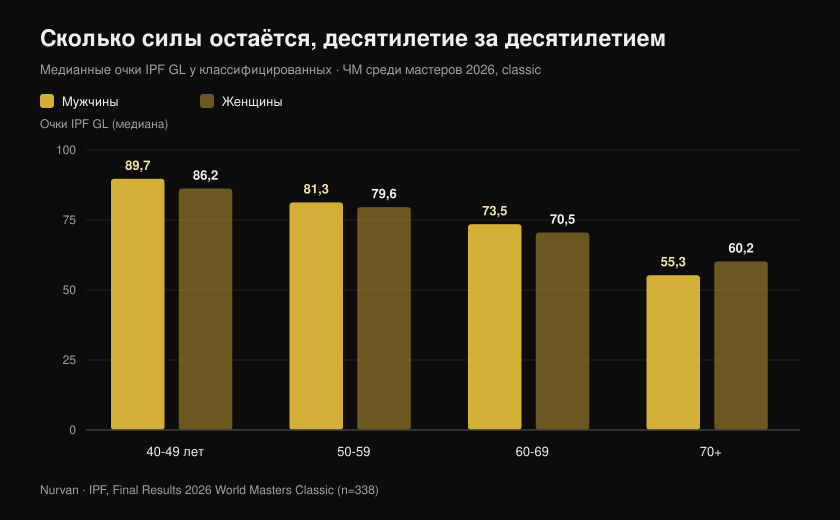
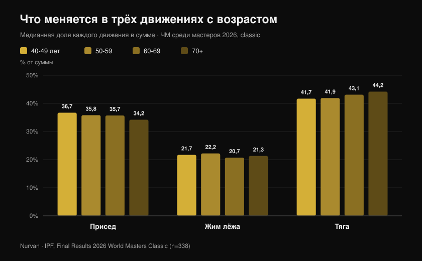

# ЧМ мастеров 2026: сколько силы отнимает возраст

Автор: [Giammaria Loi](/autore/giammaria-loi) · обновлено 27 октября 2026

В Рино, штат Невада, только что завершился чемпионат мира IPF по пауэрлифтингу среди мастеров: десять дней соревнований, 443 классифицированных спортсмена из 41 страны, самому младшему 40 лет, самой старшей — 82. IPF опубликовала официальные протоколы, и в этих PDF гораздо больше, чем медальный зачёт: там самая большая чистая выборка того, сколько силы реально остаётся — десятилетие за десятилетием — у людей, которые тренируются всерьёз. Я разобрал каждое место по отдельности, и получившаяся цифра опровергает и «после 40 всё кончено», и «если тренируешься — ничего не теряешь».

## Коротко

- **Шестидесятитрёхлетняя итальянка побила рекорды женщин на двадцать лет моложе.** Марция Джирарди, 63 года, собственный вес 46,30 кг, подняла в тяге **162,5 кг** — в 3,5 раза больше своего веса. Одна эта попытка установила мировой рекорд в категории 47 кг одновременно в группах мастера 1 (40-49), мастера 2 (50-59) и мастера 3 (60-69).
- **Средний спад медленнее, чем принято думать, — до определённого момента.** Медианные очки IPF GL у мужчин падают с **89,7 до 81,3 и 73,5** в группах 40-49, 50-59 и 60-69 лет: примерно **9% за десятилетие**. После 70 ступенька становится гораздо выше.
- **Тренировки не останавливают спад — они сдвигают стартовую линию.** У элитных тяжелоатлетов-мастеров сила снижалась с той же скоростью, что и у нетренированных (0,6% против 0,5% в год), но 85-летний спортсмен выдавал мощность 65-летнего человека без тренировок: около **двадцати лет форы** (Pearson et al., 2002).
- **Сохранить мышцы — недостаточно.** У 1 880 пожилых людей за три года наблюдения сила падала примерно **втрое быстрее**, чем сухая масса, а прирост массы не защитил от потери силы (Goodpaster et al., 2006).
- **Меняется и соотношение движений.** С возрастом тяга занимает всё большую долю суммы (с **41,7% до 44,2%**), а присед — всё меньшую (с **36,7% до 34,2%**): сила уходит неравномерно.

## Что произошло в Рино

Чемпионат мира среди мастеров в дисциплинах classic и equipped прошёл в Рино, штат Невада, с **15 по 24 октября 2026 года**. В четырёх официальных протоколах (мужчины и женщины, classic и equipped) значатся **465 результатов** — 338 в classic и 127 в equipped — у **443 разных спортсменов** из **41 страны**. Медианный возраст классифицированных — **54 года**.

Одна цифра выделяется: официальные списки фиксируют **68 мировых рекордов**, установленных на этом турнире. США выиграли все восемь командных зачётов в classic — в четырёх мужских и четырёх женских возрастных группах.

Среди лучших в classic — два имени: **Нейтан Кулас** (США, 43 года, 91,40 кг) с суммой 817 кг и 107,79 очка IPF GL и **Дейна Макнил** (США, 42 года, 75,40 кг) с 540 кг и 106,87 очка. **Майкл Гароццо**, 44 года, установил три рекорда группы мастера 1 в категории до 105 кг: присед 328 кг, тяга 351 кг, сумма 861,5 кг.

### Италия в Рино: восемь спортсменов, семь подиумов

Итальянская делегация была маленькой и почти безупречной: **восемь классифицированных спортсменов, семь подиумов, пять титулов чемпионов мира**.

| Спортсмен | Группа | Категория | Сумма | Результат |
| --- | --- | --- | --- | --- |
| Мартина Пизано | Мастера 1 | 47 кг | 350,5 кг | Золото (рекорд в приседе, 130,5 кг) |
| Луиза Ариента | Мастера 2 | 52 кг | 365,0 кг | Золото |
| Марция Джирарди | Мастера 3 | 47 кг | 307,5 кг | Золото (4 рекорда) |
| Барбара Канелла | Мастера 3 | 52 кг | 305,0 кг | Золото |
| Алессандро Куоги | Мастера 2 | 93 кг | 727,5 кг | Золото |
| Элиза Гуиди | Мастера 1 | 52 кг | 387,5 кг | Серебро |
| Аллегра Ромусси | Мастера 1 | 69 кг | 462,5 кг | Серебро |

Куоги, 51 год, закончил с 96,22 очка IPF GL: второй результат в абсолютном зачёте группы мастера 2 в мире, в шаге от южноафриканца Шона Мандерса (96,54).

Но лучше всего эту статью рассказывает выступление **Марции Джирарди**. Шестьдесят три года, собственный вес 46,30 кг, тяга **162,5 кг**. Эта попытка 16 октября переписала мировой рекорд категории 47 кг не только в её возрастной группе, но и в группах мастера 2 и мастера 1 — у женщин на десять и на двадцать лет моложе.

## Сколько силы теряется на самом деле, десятилетие за десятилетием

Здесь официальные протоколы превращаются в набор данных. Чтобы сравнивать спортсменов разного веса и пола, IPF использует **очки GL** — коэффициент, нормирующий сумму по собственному весу и полу: 100 очков примерно соответствуют уровню финалиста взрослого чемпионата мира.

Я посчитал **медиану очков GL по всем классифицированным участникам соревнований classic**, группа за группой. Это не наблюдение за одним человеком во времени — это снимок четырёх поколений, выступавших на одной неделе, — но это самый широкий и самый контролируемый снимок из существующих.

У мужчин: **89,7** очка в 40-49 лет, **81,3** в 50-59, **73,5** в 60-69, **55,3** с 70 лет. У женщин: **86,2**, **79,6**, **70,5**, **60,2**.

Первый переход стоит около **9%**. Второй — почти столько же. Потом стена: между 60-69 и 70+ мужчины теряют ещё примерно 25% от оставшегося. Кривая — не ровный спуск, а пологий склон, который в какой-то момент становится ступенькой.

Честная оговорка, потому что она меняет прочтение цифр: в старших группах участников гораздо меньше (18 мужчин и 17 женщин в группе 70+ против 54 и 62 в группе 40-49), а тот, кто выступает в 75 лет, прошёл двойной отбор — по здоровью и по желанию. Абсолютные значения стоит брать с осторожностью; тенденция же устойчива и одинакова у обоих полов.

## Парадокс рекордов: их ставят самые возрастные

Из 68 мировых рекордов Рино **48 установлены в двух самых старших группах** (33 в мастерах 3 и 15 в мастерах 4) против 9 в мастерах 1 и 11 в мастерах 2.

Это не значит, что после 60 становятся сильнее. Это значит, что книги рекордов старших категорий моложе и пустее: через них прошло гораздо меньше людей. Женщины, которые начали массово выступать намного позже мужчин, установили 40 из 68 рекордов.

Это статистическая деталь, но она говорит кое-что конкретное тем, кто тренируется: **круг людей, доходящих до шестидесяти с сохранённой способностью проявлять силу, крайне узок**. Не из-за биологических пределов, а из-за того, что почти все бросают.

## Что меняется в трёх движениях

В данных есть второй сигнал, и он практический. Я посчитал, какую долю суммы занимает каждое движение, группа за группой.

**Присед** снижается с 36,7% суммы в 40-49 лет до 34,2% в группе 70+. **Жим лёжа** остаётся практически на месте, между 20,7% и 22,2%. **Тяга** растёт с 41,7% до 44,2%.

Сдвиг составляет всего несколько процентных пунктов, но он монотонен и направлен туда, куда указывает физиология: первым сдаёт движение с наибольшей амплитудой, с наибольшими требованиями к подвижности голеностопа и таза и с наибольшим контролем в глубокой эксцентрической фазе. Исчезает не сила — труднее становится выразить именно *присед*.

На языке тренировки: если после пятидесяти присед отстаёт сильнее остального, прежде чем снижать вес, стоит проверить подвижность и глубину. И вариант исполнения имеет значение — об этом я писал в тексте о [коленях наружу в приседе](/ru/blog/koleni-naruzhu-prised).

## Что на самом деле говорит наука

| Утверждение | Вердикт | Данные |
| --- | --- | --- |
| После 40 сила обваливается | **Требует уточнения** | Между группами 40-49 и 60-69 медианные очки GL падают примерно на 9% за десятилетие; большой скачок наступает после 70 (официальные данные IPF, Рино 2026) |
| Если тренируешься, с возрастом силу не теряешь | **Опровергнуто** | У элитных тяжелоатлетов-мастеров изометрическая сила падала на 0,6% в год против 0,5% у нетренированных: тот же наклон (Pearson et al., 2002) |
| Тренироваться в возрасте бесполезно, спад предопределён | **Опровергнуто** | Те же спортсмены выдавали +32% мощности и +32% изометрической силы по сравнению с ровесниками без тренировок: 85-летний спортсмен был на уровне 65-летнего нетренированного (Pearson et al., 2002) |
| Достаточно сохранять мышечную массу | **Опровергнуто** | У 1 880 пожилых сила падала примерно втрое быстрее сухой массы, а прирост массы силу не защитил (Goodpaster et al., 2006) |
| В 80 или 90 лет начинать уже бессмысленно | **Опровергнуто** | Девять человек в возрасте 90 ± 1 год, восемь недель высокоинтенсивных силовых тренировок: сила +174 ± 31%, площадь мышц бедра +9,0 ± 4,5% (Fiatarone et al., 1990) |
| После определённого возраста нужно тренироваться легко | **Требует уточнения** | В метаанализе по здоровым пожилым наибольший эффект на силу давала интенсивность **70-79% от максимума**, а не лёгкие веса (Borde et al., 2015) |
| Спад одинаков во всех трёх движениях | **Требует уточнения** | В Рино доля тяги с возрастом росла, а доля приседа снижалась, но лишь на несколько пунктов и при сравнении разных людей |

Исследование, которое связывает всё воедино, — работа Пирсона. Пятьдесят четыре элитных тяжелоатлета-мастера от 40 до 87 лет в сравнении с таким же числом здоровых нетренированных ровесников. Наклон кривой спада оказался **одинаковым** в обеих группах — тренировки не замедлили старение. Но абсолютный уровень был настолько выше, что авторы оценили преимущество примерно в **двадцать лет кажущегося возраста**.

То же исследование добавляет деталь, важную для всех, кому за пятьдесят: **мощность** падала примерно вдвое быстрее изометрической силы (1,2% против 0,6% в год). Первым уходит не то, сколько ты можешь толкнуть, а то, насколько быстро.

## Как это применить

1. **Не снижайте интенсивность раньше времени.** В метаанализе по здоровым пожилым наибольший прирост силы давали подходы на 70-79% от максимума, а не лёгкие веса на много повторений (Borde et al., 2015). Две тренировки в неделю, 2-3 подхода на упражнение, 7-9 повторений — схема с лучшей отдачей.
2. **Добавляйте что-то быстрое в каждую тренировку.** Если мощность уходит вдвое быстрее силы, её нужно тренировать отдельно: взрывные подъёмы, невысокие прыжки, быстрые жимы с умеренным весом, хотя бы максимально быстрый подъём со стула.
3. **Перестаньте судить по зеркалу.** Сохранение массы не гарантирует силу: ориентир — поднятый вес, а не сантиметры.
4. **Записывайте каждый подход.** Падение на 9% за десятилетие — это около 0,9% в год: незаметно от месяца к месяцу и очевидно на трёхлетней истории. Без записанных цифр вы заметите это слишком поздно.
5. **Дайте приседу больше времени, а не меньше веса.** Если именно он сдаёт первым, добавьте разминку и работу над подвижностью, прежде чем снимать блины.
6. **Следите за белком.** Позиционный документ PROT-AGE рекомендует после 65 лет минимум **1,0-1,2 г на кг массы тела в сутки**, а тем, кто тренируется, — **не менее 1,2 г/кг** (Bauer et al., 2013). Люди с тяжёлым заболеванием почек — исключение, им нужно обсудить это с врачом.

**С Nurvan.** Потеря силы с возрастом идёт медленно: около 1% в год, на глаз этого не увидеть. В Nurvan каждый подход записывает вес, повторения и RIR, а история показывает реальную кривую каждого упражнения за месяцы и годы — так отличишь настоящий спад от неудачной недели. Разминочные подходы предлагаются автоматически, что особенно полезно в приседе, а программу, которая уже есть в PDF, таблице или на фото, можно импортировать без ручного переписывания. [Попробовать Nurvan](https://nurvan.app)

## Частые вопросы

**В каком возрасте начинает теряться сила?**
По данным Рино спад уже измерим между группами 40-49 и 50-59 — около 9%. Но это медленное снижение, менее 1% в год, которое становится крутым только после 70. Первой уходит мощность, то есть скорость проявления силы, а не максимум (Pearson et al., 2002).

**Замедляют ли силовые тренировки потерю силы?**
У элитных мастеров наклон кривой спада совпал с нетренированными ровесниками. Меняется стартовая точка: спортсмены выдавали примерно на 32% больше силы и мощности — преимущество, которое авторы оценили в двадцать лет возраста (Pearson et al., 2002). Спада не избежать: к нему приходят с гораздо более высокого уровня.

**В 70 лет поздно начинать?**
Нет. Классическое исследование на девяти людях в среднем 90 лет показало +174% силы за восемь недель высокоинтенсивных тренировок (Fiatarone et al., 1990). Если есть заболевания или вы не тренировались годами, первый шаг — медицинское обследование и тренер, который подберёт веса, а не отказ.

**Насколько тяжёлыми должны быть веса после 60?**
В метаанализе по здоровым пожилым наибольший эффект на силу проявился при 70-79% от максимума (Borde et al., 2015). «Веса для пожилых» как категории не существует: есть вес, соответствующий вашему текущему уровню, и прогрессировать его нужно так же, как в тридцать, только внимательнее к восстановлению и технике.

## Читайте также

- [Чемпионат мира мастеров по пауэрлифтингу в Рино: что было на кону](/ru/blog/chempionat-mira-mastera-pauerlifting-2026-reno) — превью с регламентом и категориями
- [Сколько повторений нужно для массы: миф о 8-12](/ru/blog/skolko-povtoreniy-dlya-massy) — как на самом деле задавать интенсивность и объём
- [Работает ли онлайн-коучинг? Что говорят исследования](/ru/blog/rabotaet-li-onlayn-kouching) — почему контроль меняет результат при одинаковой программе

## Источники

1. Pearson SJ, Young A, Macaluso A, Devito G, Nimmo MA, Cobbold M, Harridge SDR, 2002. Muscle function in elite master weightlifters. *Med Sci Sports Exerc*. PMID [12131263](https://pubmed.ncbi.nlm.nih.gov/12131263/) · [DOI](https://doi.org/10.1097/00005768-200207000-00023)
2. Goodpaster BH, Park SW, Harris TB, Kritchevsky SB, Nevitt M, Schwartz AV, Simonsick EM, Tylavsky FA, Visser M, Newman AB, 2006. The loss of skeletal muscle strength, mass, and quality in older adults: the Health, Aging and Body Composition Study. *J Gerontol A Biol Sci Med Sci*. PMID [17077199](https://pubmed.ncbi.nlm.nih.gov/17077199/) · [DOI](https://doi.org/10.1093/gerona/61.10.1059)
3. Fiatarone MA, Marks EC, Ryan ND, Meredith CN, Lipsitz LA, Evans WJ, 1990. High-intensity strength training in nonagenarians. Effects on skeletal muscle. *JAMA*. PMID [2342214](https://pubmed.ncbi.nlm.nih.gov/2342214/)
4. Borde R, Hortobágyi T, Granacher U, 2015. Dose-Response Relationships of Resistance Training in Healthy Old Adults: A Systematic Review and Meta-Analysis. *Sports Med*. PMID [26420238](https://pubmed.ncbi.nlm.nih.gov/26420238/) · [DOI](https://doi.org/10.1007/s40279-015-0385-9)
5. Bauer J, Biolo G, Cederholm T, Cesari M, Cruz-Jentoft AJ, Morley JE, Phillips S, Sieber C, Stehle P, Teta D, Visvanathan R, Volpi E, Boirie Y, 2013. Evidence-based recommendations for optimal dietary protein intake in older people: a position paper from the PROT-AGE Study Group. *J Am Med Dir Assoc*. PMID [23867520](https://pubmed.ncbi.nlm.nih.gov/23867520/) · [DOI](https://doi.org/10.1016/j.jamda.2013.05.021)

Результаты, рекорды, собственный вес и очки IPF GL: International Powerlifting Federation, *Final Results — 2026 IPF World Masters Classic Powerlifting Championships* и *2026 IPF World Masters Equipped Powerlifting Championships*, Рино (Невада), 15-24 октября 2026, [официальные документы IPF](https://www.powerlifting.sport/championships/results/2026/world-masters-classic-equipped-powerlifting-championships-2026). Медианы, доли движений и подсчёты — оригинальные расчёты Nurvan по четырём официальным документам.

---

**Giammaria Loi** — основатель Nurvan. Тренируется с отягощениями с 2012 года, работает персональным тренером и коучем с сертификатом FIPE с 2013 года и выступает в пауэрлифтинге на национальном уровне с 2018 года.

> Примечание: информационный материал, он не заменяет консультацию врача или специалиста. Если вам больше 60 лет, есть текущее заболевание или вы давно не тренировались, обсудите начало силовой программы с врачом.
