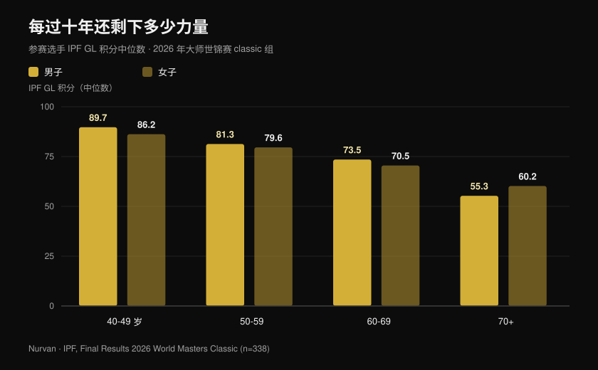
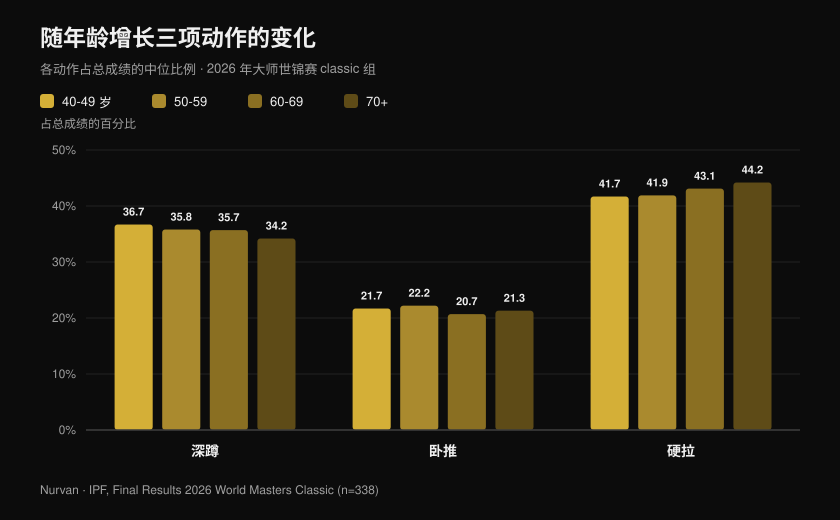

# 2026 大师世锦赛：年龄到底夺走多少力量

作者：[Giammaria Loi](/autore/giammaria-loi) · 更新于 2026 年 10 月 27 日

IPF 大师级力量举世界锦标赛刚刚在美国内华达州里诺落幕：十天比赛，来自 41 个国家的 443 名选手进入成绩榜，最年轻的 40 岁，最年长的 82 岁。IPF 已经公布官方成绩单，而那几份 PDF 里远不只是一张奖牌榜——它们是目前最大、最干净的一份样本，记录了认真训练的人在一个又一个十年之后究竟还剩下多少力量。我逐条分析了全部名次，得出的数字既反驳了"过了 40 就完了"，也反驳了"只要练就不会退步"。

## 要点速览

- **一位 63 岁的意大利选手打破了比她年轻二十岁组别的纪录。** Marzia Girardi，63 岁，体重 46.30 公斤，硬拉 **162.5 公斤**，相当于体重的 3.5 倍。这一次试举同时刷新了 47 公斤级大师 1 组（40-49 岁）、大师 2 组（50-59 岁）和大师 3 组（60-69 岁）的世界纪录。
- **平均下降比想象中慢——但只到某个点为止。** 男子 IPF GL 积分中位数在 40-49 岁、50-59 岁和 60-69 岁三组之间从 **89.7 降到 81.3 再到 73.5**：大约**每十年下降 9%**。70 岁之后这个台阶陡得多。
- **训练不会停止衰退，它只是抬高了起点。** 在精英大师级举重运动员中，力量下降速度与未训练者相同（每年 0.6% 对 0.5%），但一名 85 岁运动员的功率相当于 65 岁的不运动者：大约**领先二十年**（Pearson et al., 2002）。
- **只保住肌肉量并不够。** 在随访三年的 1,880 名老年人中，力量下降速度约为瘦体重的**三倍**，而且增加肌肉量并没有阻止力量流失（Goodpaster et al., 2006）。
- **三项的比重也在变。** 随着年龄增长，硬拉在总成绩中的占比上升（从 **41.7% 到 44.2%**），深蹲下降（从 **36.7% 到 34.2%**）：力量并不是平均地流失。

## 里诺发生了什么

大师级 classic 与 equipped 世锦赛于 **2026 年 10 月 15 日至 24 日**在内华达州里诺举行。四份官方成绩文件（男女、classic 与 equipped）共列出 **465 个名次**——classic 338 个、equipped 127 个——涉及来自 **41 个国家**的 **443 名不同选手**。上榜选手的年龄中位数为 **54 岁**。

有一个数字格外醒目：官方纪录表记载本届赛事共创造 **68 项世界纪录**。美国队包揽了 classic 项目全部八个团体冠军，男子四个年龄组和女子四个年龄组全部拿下。

classic 项目成绩最好的两个名字是：**Nathan Kulas**（美国，43 岁，91.40 公斤），总成绩 817 公斤、107.79 IPF GL 分；**Dayna McNeal**（美国，42 岁，75.40 公斤），540 公斤、106.87 分。44 岁的 **Michael Garozzo** 在 105 公斤级创造三项大师 1 组纪录：深蹲 328 公斤、硬拉 351 公斤、总成绩 861.5 公斤。

### 意大利队：八人参赛，七人登台

意大利代表团人数很少，表现近乎完美：**八名选手上榜，七人登上领奖台，五个世界冠军**。

| 选手 | 年龄组 | 级别 | 总成绩 | 名次 |
| --- | --- | --- | --- | --- |
| Martina Pisano | 大师 1 | 47 公斤 | 350.5 公斤 | 金牌（深蹲纪录 130.5 公斤） |
| Luisa Arienta | 大师 2 | 52 公斤 | 365.0 公斤 | 金牌 |
| Marzia Girardi | 大师 3 | 47 公斤 | 307.5 公斤 | 金牌（4 项纪录） |
| Barbara Canella | 大师 3 | 52 公斤 | 305.0 公斤 | 金牌 |
| Alessandro Cuoghi | 大师 2 | 93 公斤 | 727.5 公斤 | 金牌 |
| Elisa Guidi | 大师 1 | 52 公斤 | 387.5 公斤 | 银牌 |
| Allegra Romussi | 大师 1 | 69 公斤 | 462.5 公斤 | 银牌 |

51 岁的 Cuoghi 以 96.22 IPF GL 分收官：大师 2 组全球第二，仅以微弱差距落后于南非选手 Sean Manders（96.54）。

但最能说明本文主题的，是 **Marzia Girardi** 的表现。六十三岁，体重 46.30 公斤，硬拉 **162.5 公斤**。10 月 16 日的这次试举，不仅改写了 47 公斤级她本人年龄组的世界纪录，也改写了大师 2 组和大师 1 组的纪录——那是比她小十岁和二十岁的女子。

## 每过十年，力量究竟损失多少

到这里，官方成绩单就成了一份数据集。为了比较不同体重和性别的选手，IPF 使用 **GL 积分**，一个按体重和性别对总成绩做标准化的系数：100 分大致相当于公开组世界决赛的水平。

我按年龄组计算了 **classic 项目全部上榜选手 GL 积分的中位数**。这不是对同一个人的纵向追踪，而是同一周内四代人同场竞技的一张快照——但它是现存范围最广、条件最一致的一张快照。

男子：40-49 岁 **89.7** 分，50-59 岁 **81.3**，60-69 岁 **73.5**，70 岁以上 **55.3**。女子：**86.2**、**79.6**、**70.5**、**60.2**。

第一次跨越大约损失 **9%**，第二次几乎相同。然后是那堵墙：从 60-69 岁到 70 岁以上，男子又损失了剩余部分的约 25%。这条曲线不是匀速下滑，而是一段平缓的斜坡，到某一点突然变成台阶。

必须诚实地加一句说明，因为它会改变对数字的解读：高龄组的参赛人数少得多（70 岁以上男子 18 人、女子 17 人，而 40-49 岁组分别是 54 人和 62 人），而能在 75 岁还上场的人，经过了健康和意愿的双重筛选。绝对数值要谨慎看待；但趋势本身很稳健，在男女两性中一致。

## 纪录悖论：破纪录的恰恰是最年长的人

里诺的 68 项世界纪录中，**48 项诞生在两个最年长的组别**（大师 3 组 33 项、大师 4 组 15 项），而大师 1 组只有 9 项、大师 2 组 11 项。

这并不意味着过了 60 岁人会变强。这意味着年长组别的纪录册更年轻、更空：经过那里的人少得多。女子项目的参赛规模普及远晚于男子，她们贡献了 68 项纪录中的 40 项。

这是一个统计学细节，但它对训练者说了一件很具体的事：**能活到六十岁、依然有能力表现力量的人群极其稀少**。不是因为生理极限，而是因为大多数人中途放弃了。

## 三项动作各自发生了什么变化

数据里还有第二个信号，而且很实用。我按年龄组计算了每个动作在总成绩中所占的比重。

**深蹲**从 40-49 岁组的 36.7% 降到 70 岁以上组的 34.2%。**卧推**基本不变，维持在 20.7% 到 22.2% 之间。**硬拉**则从 41.7% 升到 44.2%。

位移只有几个百分点，但方向单一，而且与生理学的预期一致：对关节活动范围要求最大、对踝关节和髋关节灵活性要求最高、在深度离心阶段需要最多控制的那个动作，最先退让。消失的不是力量，而是**深蹲**变得更难表现出来。

落到训练上：如果五十岁之后你的深蹲退步得比其他动作更明显，在减重量之前先检查灵活性和深度。动作变式也有影响——这一点我在[深蹲时膝盖外展：规则还是口令？](/zh/blog/shenzun-xigai-waizhan)里展开过。

## 研究到底怎么说

| 说法 | 结论 | 依据 |
| --- | --- | --- |
| 过了 40 岁力量断崖式下跌 | **需要修正** | 从 40-49 岁到 60-69 岁，GL 积分中位数每十年下降约 9%；真正的大跳出现在 70 岁之后（IPF 官方数据，里诺 2026） |
| 只要坚持训练，年龄不会带走力量 | **被推翻** | 精英大师级举重运动员的等长力量每年下降 0.6%，未训练者 0.5%：斜率相同（Pearson et al., 2002） |
| 上了年纪再练没用，衰退是注定的 | **被推翻** | 同一批运动员的功率和等长力量都比同龄久坐者高 32%：85 岁的运动员相当于 65 岁的不运动者（Pearson et al., 2002） |
| 保住肌肉量就够了 | **被推翻** | 在 1,880 名老年人中，力量下降速度约为瘦体重的 3 倍，增加肌肉量也没有保护住力量（Goodpaster et al., 2006） |
| 80 岁或 90 岁再开始毫无意义 | **被推翻** | 九名平均年龄 90 ± 1 岁的受试者，八周高强度抗阻训练：力量 +174 ± 31%，大腿肌肉横截面积 +9.0 ± 4.5%（Fiatarone et al., 1990） |
| 过了一定年纪就该练轻一点 | **需要修正** | 在健康老年人的荟萃分析中，对力量效果最大的是**最大负荷的 70-79%**，而不是轻负荷（Borde et al., 2015） |
| 三项动作的下降幅度一样 | **需要修正** | 在里诺，硬拉占比随年龄上升、深蹲占比下降，但幅度只有几个百分点，且是不同个体之间的比较 |

把一切串起来的是 Pearson 的研究。54 名 40 至 87 岁的精英大师级举重运动员，与同等数量健康、未训练的同龄人对照。两组衰退的**斜率相同**——训练并没有让衰老变慢。但绝对水平高出太多，以致作者把这个优势量化为**大约二十年的表观年龄**。

同一项研究还提供了一个对所有五十岁以上的人都重要的细节：**功率**的下降速度约为等长力量的两倍（每年 1.2% 对 0.6%）。先失去的不是你能推起多少，而是你推得有多快。

## 怎么落到训练里

1. **不要过早降低强度。** 在健康老年人的荟萃分析中，力量收益最大的是最大负荷 70-79% 的组数，而不是轻重量高次数（Borde et al., 2015）。每周两次、每个动作 2-3 组、每组 7-9 次，是效果最好的方案。
2. **每次训练都安排一点"快"的内容。** 如果功率消失的速度是力量的两倍，就必须单独训练它：爆发性动作、低跳、中等负荷的快速推举，哪怕只是尽可能快地从椅子上站起来。
3. **别只盯着镜子。** 保住肌肉量并不保证力量：要追的指标是举起的重量，不是围度。
4. **每一组都记录下来。** 每十年 9% 相当于每年约 0.9%：逐月看不出来，三年的历史记录一目了然。不写下数字，等你察觉时差距已经很大。
5. **给深蹲更多时间，而不是更少重量。** 如果它是最先退步的动作，先加热身和灵活性训练，再考虑从杠铃上卸片。
6. **注意蛋白质。** PROT-AGE 立场文件建议 65 岁以上每天至少摄入**每公斤体重 1.0-1.2 克**，有训练习惯者**至少 1.2 克/公斤**（Bauer et al., 2013）。严重肾病患者属于例外，应与医生商量。

**用 Nurvan。** 随年龄的力量流失很慢：每年约 1%，肉眼根本看不出来。在 Nurvan 里，每一组都会记录重量、次数和 RIR，历史记录会呈现每个动作跨越数月乃至数年的真实曲线——让你分清真正的退步和只是状态糟糕的一周。热身组会自动给出建议，这在深蹲上尤其有用；已有的 PDF、Excel 甚至照片形式的训练计划可以直接导入，不必手动重打。[试用 Nurvan](https://nurvan.app)

## 常见问题

**多大年纪开始流失力量？**
在里诺的数据中，40-49 岁组与 50-59 岁组之间已经能测到约 9% 的差距。但这是缓慢的下降——每年不到 1%——要到 70 岁以后才变陡。最先流失的是功率，也就是发力的速度，而不是最大重量（Pearson et al., 2002）。

**举铁能减缓力量流失吗？**
在精英大师级运动员中，衰退的斜率与未训练的同龄人一致。改变的是起点：运动员的力量和功率高出约 32%，作者把这个优势折算为二十年的年龄（Pearson et al., 2002）。衰退躲不掉，但你可以从高得多的位置迎接它。

**70 岁开始是不是太晚了？**
不晚。那项针对九名平均 90 岁受试者的经典研究显示，八周高强度训练后力量提升 174%（Fiatarone et al., 1990）。如果你有基础疾病或多年没训练，第一步是体检和一位能替你设定负荷的教练，而不是放弃。

**60 岁以后负荷该多重？**
在健康老年人的荟萃分析中，对力量效果最大的强度是最大负荷的 70-79%（Borde et al., 2015）。并不存在所谓"老年人的重量"：只有适合你当前水平的重量，并且要像三十岁时那样推进，只是更注意恢复和技术。

## 延伸阅读

- [里诺大师级力量举世锦赛：这次比什么](/zh/blog/2026-ipf-master-liliangju-shijie-jinbiaosai) — 赛前前瞻，含规则与级别
- [增肌该做几次：8-12 次的迷思](/zh/blog/duoshao-cishu-zengji) — 强度和训练量到底怎么定
- [线上教练有用吗？研究怎么说](/zh/blog/xianshang-jiaolian-youxiao-ma) — 同一份计划下，为什么监督会改变结果

## 参考文献

1. Pearson SJ, Young A, Macaluso A, Devito G, Nimmo MA, Cobbold M, Harridge SDR, 2002. Muscle function in elite master weightlifters. *Med Sci Sports Exerc*. PMID [12131263](https://pubmed.ncbi.nlm.nih.gov/12131263/) · [DOI](https://doi.org/10.1097/00005768-200207000-00023)
2. Goodpaster BH, Park SW, Harris TB, Kritchevsky SB, Nevitt M, Schwartz AV, Simonsick EM, Tylavsky FA, Visser M, Newman AB, 2006. The loss of skeletal muscle strength, mass, and quality in older adults: the Health, Aging and Body Composition Study. *J Gerontol A Biol Sci Med Sci*. PMID [17077199](https://pubmed.ncbi.nlm.nih.gov/17077199/) · [DOI](https://doi.org/10.1093/gerona/61.10.1059)
3. Fiatarone MA, Marks EC, Ryan ND, Meredith CN, Lipsitz LA, Evans WJ, 1990. High-intensity strength training in nonagenarians. Effects on skeletal muscle. *JAMA*. PMID [2342214](https://pubmed.ncbi.nlm.nih.gov/2342214/)
4. Borde R, Hortobágyi T, Granacher U, 2015. Dose-Response Relationships of Resistance Training in Healthy Old Adults: A Systematic Review and Meta-Analysis. *Sports Med*. PMID [26420238](https://pubmed.ncbi.nlm.nih.gov/26420238/) · [DOI](https://doi.org/10.1007/s40279-015-0385-9)
5. Bauer J, Biolo G, Cederholm T, Cesari M, Cruz-Jentoft AJ, Morley JE, Phillips S, Sieber C, Stehle P, Teta D, Visvanathan R, Volpi E, Boirie Y, 2013. Evidence-based recommendations for optimal dietary protein intake in older people: a position paper from the PROT-AGE Study Group. *J Am Med Dir Assoc*. PMID [23867520](https://pubmed.ncbi.nlm.nih.gov/23867520/) · [DOI](https://doi.org/10.1016/j.jamda.2013.05.021)

成绩、纪录、体重与 IPF GL 积分来源：International Powerlifting Federation，*Final Results — 2026 IPF World Masters Classic Powerlifting Championships* 与 *2026 IPF World Masters Equipped Powerlifting Championships*，里诺（内华达州），2026 年 10 月 15-24 日，[IPF 官方文件](https://www.powerlifting.sport/championships/results/2026/world-masters-classic-equipped-powerlifting-championships-2026)。中位数、各动作占比和计数均为 Nurvan 基于四份官方文件的原创计算。

---

**Giammaria Loi** 是 Nurvan 的创始人。他自 2012 年开始力量训练，2013 年起担任 FIPE 认证私人教练，2018 年起在国家级力量举比赛中参赛。

> 说明：本文为科普内容，不能替代医生或专业人士的意见。如果你超过 60 岁、有正在进行中的疾病，或者很久没有训练，开始力量训练计划前请先咨询医生。
