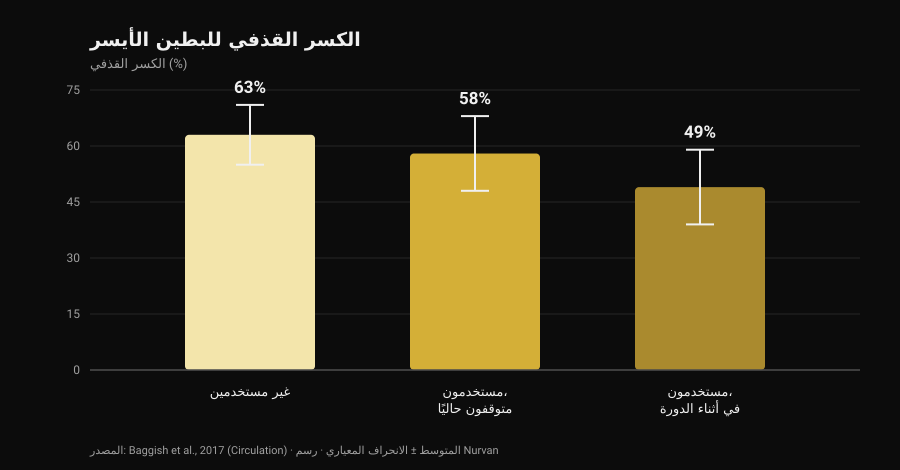
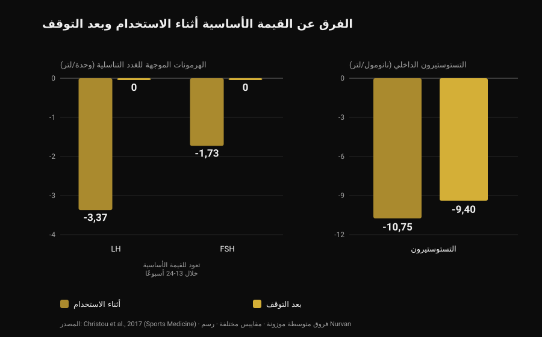

# الستيرويدات المنشطة: الآثار الجانبية والمخاطر

بقلم [Giammaria Loi](/autore/giammaria-loi) · حُدِّث في 28 أكتوبر 2026

مرّ في خلاصتي منشور يقول شيئًا صحيحًا وغير محبوب: الستيرويدات المنشطة تعمل، لكنك لا تستطيع أن تختار الآثار التي تريدها فقط. هذا صحيح، والأدبيات العلمية تقيس ذلك بدقة أكبر بكثير مما تفعله أي شريحة عرض. قرأت ثماني دراسات مفهرسة لأفهم كم تكلّف هذه "الحزمة الكاملة" — والرقم الذي فاجأني أكثر من غيره لا يتعلق بالقلب، بل بالوقت اللازم للعودة إلى الوضع الطبيعي.

## باختصار

- **فعاليتها ليست محل نقاش.** عشرة أسابيع من التستوستيرون بجرعات فوق فسيولوجية مع التدريب: **+6,1 كجم من الكتلة الخالية من الدهون**، **+22 كجم في ضغط البنش**، **+38 كجم في السكوات**. حتى من لم يتدرّبوا زادت عضلاتهم (Bhasin et al., 1996).
- **مستقبل الأندروجين ليس في العضلة وحدها.** في السجلات الدنماركية، يصيب حبّ الشباب والتثدي وضعف الانتصاب كلٌّ منها **أكثر من 10%** من المستخدمين (Horwitz et al., 2019).
- **القلب هو العضو صاحب أقوى البيانات.** الكسر القذفي للبطين الأيسر **52%** لدى المستخدمين مقابل **63%** لدى غير المستخدمين، و**49%** لدى من كانوا في أثناء الدورة وقت الفحص (Baggish et al., 2017).
- **العودة إلى الوراء أبطأ مما يُروى.** بعد التوقف يعود هرمونا LH وFSH إلى القيمة الأساسية خلال **13-24 أسبوعًا**، لكن التستوستيرون الذي ينتجه الجسم بقي **أقل بـ 9,4 نانومول/لتر من القيمة الأساسية** بعد 16 أسبوعًا (تحليل تلوي لـ 33 دراسة، Christou et al., 2017).
- **عند أقلية لا يعود بالكامل.** من بين 19 مستخدمًا سابقًا دون علاج، كان لدى **5 منهم تستوستيرون أقل من 200 نانوغرام/ديسيلتر** بعد امتناع من 3 إلى 26 شهرًا؛ و7 من أصل 24 مرّوا بنوبة اكتئاب جسيم أثناء التوقف (Kanayama et al., 2015).

## "هل تعمل؟" ليس السؤال المهم

هذا الجزء حُسم منذ ثلاثين عامًا. في 1996 وُزِّع ثلاثة وأربعون رجلًا عشوائيًا على أربع مجموعات: دواء وهمي أو تستوستيرون، مع التدريب أو بدونه. من تلقّوا جرعات فوق فسيولوجية من التستوستيرون وتدرّبوا اكتسبوا **6,1 كجم من الكتلة الخالية من الدهون** في عشرة أسابيع، مع زيادة مساحة العضلة ثلاثية الرؤوس بمقدار 501 مم² ومساحة العضلة رباعية الرؤوس بمقدار 1174 مم²؛ ضغط البنش +22 كجم، والسكوات +38 كجم.

التفصيل الأكثر دلالة في مكان آخر: **من لم يتدرّبوا زادت عضلاتهم أيضًا**. في مجموعة التستوستيرون دون تمرين ارتفعت مساحة العضلة ثلاثية الرؤوس بمقدار 424 مم²، بينما *انخفضت* في مجموعة الدواء الوهمي دون تمرين بمقدار 81 مم². الدواء يعمل بمعزل عن المحفّز، وهذا يفسّر اتساع الانتشار: تُقدَّر نسبة الاستخدام على مدى الحياة بنحو **6,4% بين الرجال و1,6% بين النساء** (Nieschlag وVorona، 2015).

وللأمانة: في تلك التجربة لم يتغيّر المزاج ولا السلوك في أي مجموعة. لكن عشرة أسابيع تحت إشراف طبي ليست عشر سنوات من دورات يديرها الشخص بنفسه — وعن هذا الفارق تحديدًا يدور بقية المقال.

## لماذا لا يمكنك اختيار الآثار التي تريدها فقط

مستقبل الأندروجين واحد، وهو ليس مستقبلًا للعضلة. يُعبَّر عنه في عضلة القلب والكبد والجلد وبصيلة الشعر والبروستاتا والعظم والحنجرة والدماغ. وعندما ترتفع الأندروجينات في الدم كثيرًا فوق المعتاد، فإنها ترتفع لهذه الأنسجة كلها في الوقت نفسه.

أما "النسبة بين الأثر البنائي والأثر الذكوري" في الجداول المنتشرة على الإنترنت فمصدرها اختبارات على القوارض، ولا تُترجَم عند الإنسان إلى انتقائية نظيفة في الأنسجة. التحقق العملي موجود في السجلات: في الحشد الدنماركي لدى Horwitz، أصاب حبّ الشباب و**التثدي** (نمو النسيج الثديي عند الرجل) وضعف الانتصاب كلٌّ منها أكثر من 10% من المستخدمين. ولا واحد من الثلاثة أثر يسعى إليه أحد.

وعند النساء هناك بنود لا تُمحى: حبّ الشباب والشعرانية شائعان، و**خشونة الصوت غير قابلة للعكس** (Nieschlag وVorona، 2015). وأحدث مراجعة تكتبها بوضوح: معظم الآثار غير المرغوبة خفيفة وقابلة للعكس، لكن بعضها قد يسبّب ضررًا دائمًا أو يهدّد الحياة (Linhares et al., 2022).

لذلك فالسؤال المفيد ليس "أي الآثار أريد"، بل **أي الآثار أقبل ألّا يكون لي خيار فيها**. وعن الأندروجينات والشعر تناولنا آلية الـ DHT بشكل منفصل في [هل يسبب الكرياتين تساقط الشعر](/ar/blog/creatine-hair-loss).

## القلب: حيث البيانات أقوى

الدراسة الأكثر إفادة مقطعية: 140 من رافعي الأثقال بين 34 و54 عامًا — 86 منهم باستخدام تراكمي لا يقل عن سنتين، و54 من غير المستخدمين — خضعوا لتخطيط صدى القلب وتصوير الشرايين التاجية بالأشعة المقطعية.

*رسم من Nurvan اعتمادًا على بيانات Baggish et al., 2017 (Circulation). المتوسطات كما وردت في ملخص الدراسة؛ وأشرطة الخطأ تمثّل الانحراف المعياري.*

الكسر القذفي — نسبة الدم التي يدفعها البطين الأيسر مع كل نبضة — بلغ في المتوسط **52% لدى المستخدمين مقابل 63% لدى غير المستخدمين**. كما كانت الوظيفة الانبساطية، أي قدرة البطين على الارتخاء والامتلاء، منخفضة أيضًا (سرعة الارتخاء المبكر 9,3 مقابل 11,1 سم/ثانية). ويسمّيها الباحثون باسمها: خلل في وظيفة عضلة القلب.

وداخل مجموعة المستخدمين يوجد الرقم الجدير بالتذكّر: من كان في أثناء الدورة وقت الفحص سجّل **49%**، ومن كان متوقفًا سجّل **58%**. أي أن وظيفة الضخ تتعافى جزئيًا على الأقل عند التوقف.

أما الشرايين التاجية فلا. حجم اللويحة الوسيط كان 3 مل لدى المستخدمين مقابل 0 مل لدى غير المستخدمين، وكان **يزداد مع المدة التراكمية للاستخدام**: كل عشر سنوات من الاستخدام الإجمالي تعادل 0,60 انحراف معياري إضافي من العبء التصلّبي. وهذا هو التمييز الذي تهمله الملخصات على وسائل التواصل غالبًا: الانقباضية تأتي وتذهب، أما اللويحة فهي ترسّب، والترسّبات لا تُفرَّغ في نهاية الدورة.

وعلى صعيد الأحداث السريرية، يذكر سجل دنماركي ضمّ 1189 مستخدمًا تابعهم نحو أحد عشر عامًا مقابل 59450 شخصًا من المقارنين احتشاءَ عضلة القلب بنسبة خطر معدّلة **3,00** و**اعتلال عضلة القلب 8,90** (Windfeld-Mathiasen et al., 2025). وقد تناولنا ذلك بالتفصيل، مع ما يحدث للدهون، في [التستوستيرون والكوليسترول](/ar/blog/altastustirun-walkulistrul).

## كم يستغرق التعافي فعلًا

هنا تُخطئ ثقافة الصالات أكثر ما تُخطئ، وهنا البيانات أقوى ما تكون: تحليل تلوي لـ 33 دراسة و3879 مشاركًا، منهم 1766 مستخدمًا.

*رسم من Nurvan اعتمادًا على بيانات Christou et al., 2017 (Sports Medicine). فروق متوسطة موزونة عن القيمة الأساسية كما وردت في الملخص. LH وFSH بوحدة/لتر، والتستوستيرون بالنانومول/لتر: مقاييس مختلفة وُضعت جنبًا إلى جنب لقراءة الاتجاه.*

أثناء الاستخدام ينطفئ المحور الذي يتحكم في الإنتاج الطبيعي للتستوستيرون: **LH −3,37 وحدة/لتر**، **FSH −1,73 وحدة/لتر**، والتستوستيرون الذي ينتجه الجسم **−10,75 نانومول/لتر** عن القيمة الأساسية. وهذا متوقع: الدماغ يرى وفرة من الأندروجينات فيتوقف عن طلبها.

المهم ما يحدث بعد ذلك. الهرمونات الموجهة للغدد التناسلية — التي تصدر بها الغدة النخامية أوامرها إلى الخصيتين — تعود إلى قيمها الأساسية خلال **13-24 أسبوعًا**. أما التستوستيرون فلا: بعد 16 أسبوعًا من التوقف كان لا يزال **أقل بـ 9,4 نانومول/لتر من نقطة البداية**. الأمر يُرسَل قبل أن يستأنف المصنع إنتاجه.

وعند من توقّفوا منذ زمن تكون البيانات أكثر صراحة. تسعة عشر مستخدمًا سابقًا طويل الأمد دون علاج، بالمقارنة مع 36 من رافعي الأثقال الذين لم يستخدموا شيئًا قط، كان لديهم تستوستيرون أقل بـ 131 نانوغرام/ديسيلتر، وحجم خصية أقل بـ 2,3 مل، ودرجة رغبة جنسية أدنى بـ 2,4 من 10؛ وخمسة منهم كانوا **دون 200 نانوغرام/ديسيلتر** بعد امتناع تراوح بين 3 و26 شهرًا. وهنا الجزء الذي نادرًا ما يصل إلى الشرائح: من بين 24 مستخدمًا سابقًا في الدراسة، مرّ **7 (29%) بنوبة اكتئاب جسيم أثناء التوقف**، أربعة منهم لم تحدث لهم نوبة مماثلة في أي وقت آخر من حياتهم، واثنان لم يستعيدا الرغبة ولا وظيفة الانتصاب حتى مع علاج تعويضي مناسب (Kanayama et al., 2015).

وفي الخصوبة الصورة متسقة: تغيّرات في عدد الحيوانات المنوية وشكلها وحركتها، وانخفاض حجم الخصية، وعند النساء تضخّم البظر واضطرابات الدورة وضعف الخصوبة (Christou et al., 2017). ويوصف تثبيط إنتاج الحيوانات المنوية بأنه قابل للعكس، مع ملاحظة مهمة: إذا لم يتعافَ، فقد يكون اضطراب خصوبة سابق قد ظهر إلى السطح (Nieschlag وVorona، 2015).

## الوفيات والدخول إلى المستشفى: ماذا تقول السجلات

على المدى الطويل لا توجد إلا بيانات سكانية، لأن تجربة محكومة بهذه الجرعات لن تمرّ على أي لجنة أخلاقيات.

في الحشد الدنماركي، قُورن 545 رجلًا ثبتت إيجابيتهم في فحص المنشطات داخل الصالات بـ 5450 من المقارنين المطابقين: **وفيات أعلى بثلاثة أضعاف** (نسبة خطر 3,0؛ فاصل ثقة 95%: 1,3-7,0)، ووسيط 0,81 زيارة مستشفى سنويًا مقابل 0,36. وتكرّرت النتيجة في حشد ثانٍ ضمّ 644 رجلًا رفضوا الخضوع للفحص (Horwitz et al., 2019).

تنبيه واحد، وإلا تحوّل الرقم إلى شعار: هذه دراسات رصدية، ومن يستخدمون الستيرويدات يختلفون عن المقارنين أيضًا في مواد أخرى وعادات أخرى وفي علاقتهم بالمخاطرة. فـ"ثلاثة أضعاف" ليست المساهمة المعزولة للدواء — لكنها أقرب ما لدينا إلى ميزانية واقعية.

## ماذا يقول البحث العلمي فعلًا

- **"الستيرويدات المنشطة تعمل" — مؤكَّد.** تجربة عشوائية: +6,1 كجم من الكتلة الخالية من الدهون في عشرة أسابيع مع التدريب، ونمو عضلي حتى دون تدريب.
- **"لا يمكن تعريض العضلة وحدها: الأثر البنائي والأثر الذكوري لا ينفصلان" — مؤكَّد.** مستقبل واحد في أنسجة كثيرة، وفي السجلات حبّ الشباب والتثدي وضعف الانتصاب فوق 10% لكل منها. وعند النساء خشونة الصوت غير قابلة للعكس.
- **"الخطر ليس ثنائيًا: يعتمد على الجرعة والمدة والمادة والاستجابة الفردية" — يحتاج إلى تدقيق.** الجرعة والمدة مهمتان، وهذا موثّق. لكن الاستجابة الفردية هي تحديدًا المتغيّر الذي لا يمكن معرفته مسبقًا: إنها خطر، لا إعداد يُضبط.
- **"كلما زادت الأدوية زادت المتغيرات التي تُدار" — يحتاج إلى تدقيق.** كلمة "تُدار" تفترض أن كل ما يهم قابل للقياس والتصحيح. أقوى إشارة في السجلات هي اعتلال عضلة القلب، والنتيجة التي تتصاعد مع التعرّض هي ترسّب في الشرايين التاجية: ولا واحدة منهما يصحّحها تحليل دم.
- **"بانتهاء الدورة تعود كما كنت" — مُفنَّد.** التستوستيرون لا يزال أقل بـ 9,4 نانومول/لتر بعد 16 أسبوعًا؛ وخمسة من 19 مستخدمًا سابقًا دون 200 نانوغرام/ديسيلتر بعد أشهر؛ واثنان من 24 دون استعادة الوظيفة الجنسية حتى مع العلاج.
- **"إن كنت شابًا سليمًا وتجري تحاليل فلا خطر عليك" — مُفنَّد.** الحشود الدنماركية مكوّنة أصلًا من مرتادي الصالات: وفيات ثلاثية، ودخول إلى المستشفى بأكثر من الضعف، واعتلال عضلة قلب بخطر يقارب تسعة أضعاف.
- **"الاستخدام المضبوط يلغي الخطر" — غير قابل للتحقق.** لا توجد تجارب عشوائية بهذه الجرعات ولن توجد. ومن يدّعي العكس يستخدم غياب البيانات كدليل على الأمان.

## كيف تطبّق ذلك

1. **إن كنت تفكّر في الأمر، غيّر السؤال.** ليس "كم أحتاج لأكبر"، بل "أي الآثار أقبل ألّا يكون لي خيار فيها": التثدي وحبّ الشباب وضعف الانتصاب ولويحة الشريان التاجي ليست خيارات يمكن إطفاؤها.
2. **إن كنت تستخدم أو استخدمت، أخبر طبيبك.** هذه هي المعلومة التي تغيّر قراءة أي تحليل، وكثير من الأطباء لا يسألون عنها: عليك أنت أن تذكرها.
3. **اعرف أعراض التوقف.** تراجع الرغبة وصعوبة الانتصاب والمزاج المظلم بعد التوقف ليست ضعفًا في الشخصية: في دراسة Kanayama مرّ 29% بنوبة اكتئاب جسيم في تلك المرحلة. إنها حالة طبية وتُعالَج.
4. **إن كان الإنجاب في الحسبان، تحدّث عن ذلك مسبقًا.** إنتاج الحيوانات المنوية يُثبَّط أثناء الاستخدام ويتعافى في مدد طويلة ومتباينة: تقييم من مختص في أمراض الذكورة قبل البدء أثمن من أي بروتوكول في منتدى.
5. **لا تخلط بين علاج موصوف واستخدام في الصالة**، وانظر إلى السلاسل الزمنية لا إلى تحليل منفرد. الضغط وصورة الدم والدهون وتركيب الجسم تقول شيئًا على مدى سنوات، لا على مدى أسبوع. والمقارنة موجودة في [التستوستيرون والكوليسترول](/ar/blog/altastustirun-walkulistrul).

### جرّب Nurvan — التحاليل والقياسات والأحمال على خط زمني واحد

حين تتابع صحتك عبر السنوات، تكون المشكلة العملية أن التقارير تتوزّع بين البريد والمجلدات وملفات PDF. في Nurvan ترفع تحاليل الدم وترى مسار كل قيمة على خط زمني، وبجانبها في الأشهر نفسها الأحمال وRIR وقياسات الجسم: حين تذهب إلى الطبيب تحمل السلسلة كاملة، لا آخر ورقة. **[جرّب Nurvan](https://nurvan.app)**

## أسئلة شائعة

**ما أكثر الآثار الجانبية شيوعًا للستيرويدات المنشطة؟**
في السجلات السكانية، الأكثر شيوعًا هي حبّ الشباب والتثدي وضعف الانتصاب، كلٌّ منها لدى أكثر من 10% من المستخدمين. ويُضاف إليها ضمور الخصيتين وتثبيط الإنتاج الطبيعي للتستوستيرون، وعلى الصعيد القلبي انخفاض وظيفة الضخ وتراكم اللويحات في الشرايين التاجية.

**كم يستغرق التعافي بعد التوقف؟**
في التحليل التلوي لـ 33 دراسة، تعود الهرمونات الموجهة للغدد التناسلية إلى قيمتها الأساسية خلال 13-24 أسبوعًا، لكن التستوستيرون الذي ينتجه الجسم بقي أقل بـ 9,4 نانومول/لتر بعد 16 أسبوعًا. وعند جزء من المستخدمين السابقين تبقى القيم منخفضة شهورًا: خمسة من تسعة عشر كانوا دون 200 نانوغرام/ديسيلتر بعد 3 إلى 26 شهرًا من الامتناع.

**هل تضرّ الستيرويدات القلب بشكل دائم؟**
ينبغي الفصل بين أمرين. يبدو أن الوظيفة الانقباضية تتعافى جزئيًا على الأقل: بين المستخدمين، سجّل المتوقفون كسرًا قذفيًا بنسبة 58% مقابل 49% لمن كانوا في أثناء الدورة. أما لويحة الشريان التاجي فتتزايد مع سنوات الاستخدام التراكمية، وليست قيمة تعود إلى الصفر عند التوقف.

**هل يوجد ستيرويد منشّط آمن؟**
لا، ولا يمكن لأي تجربة عشوائية بهذه الجرعات أن تُثبت ذلك: القيود الأخلاقية تمنع تعريض متطوعين لأنظمة قد تكون سامّة. والفروق بين المواد حقيقية — فالطريق الفموي مثلًا يثقل الدهون أكثر بكثير من الحقن — لكنها فروق في حجم الضرر، لا في وجوده من عدمه.

## اقرأ أيضًا

- [التستوستيرون والكوليسترول: ماذا تقول الدراسات](/ar/blog/altastustirun-walkulistrul) — أرقام HDL وLDL وapoB، والفرق بين العلاج والدورة.
- [هل يسبب الكرياتين تساقط الشعر؟](/ar/blog/creatine-hair-loss) — آلية الـ DHT بالتفصيل، مع التحقق من الدراسات.
- [تصنيف مكملات القوة](/ar/blog/tasnif-mukammilat-alquwa) — ما الذي تسنده أدلة متينة، مرتبًا بقوة الدليل ودون أي أدوية.

## المصادر

1. Bhasin S, Storer TW, Berman N, Callegari C, Clevenger B, Phillips J, Bunnell TJ, Tricker R, Shirazi A, Casaburi R, 1996. *The effects of supraphysiologic doses of testosterone on muscle size and strength in normal men.* New England Journal of Medicine 335(1):1-7. [PMID 8637535](https://pubmed.ncbi.nlm.nih.gov/8637535/) · [DOI 10.1056/NEJM199607043350101](https://doi.org/10.1056/NEJM199607043350101)
2. Baggish AL, Weiner RB, Kanayama G, Hudson JI, Lu MT, Hoffmann U, Pope HG, 2017. *Cardiovascular Toxicity of Illicit Anabolic-Androgenic Steroid Use.* Circulation 135(21):1991-2002. [PMID 28533317](https://pubmed.ncbi.nlm.nih.gov/28533317/) · [DOI 10.1161/CIRCULATIONAHA.116.026945](https://doi.org/10.1161/CIRCULATIONAHA.116.026945)
3. Christou MA, Christou PA, Markozannes G, Tsatsoulis A, Mastorakos G, Tigas S, 2017. *Effects of Anabolic Androgenic Steroids on the Reproductive System of Athletes and Recreational Users: A Systematic Review and Meta-Analysis.* Sports Medicine 47(9):1869-1883. [PMID 28258581](https://pubmed.ncbi.nlm.nih.gov/28258581/) · [DOI 10.1007/s40279-017-0709-z](https://doi.org/10.1007/s40279-017-0709-z)
4. Kanayama G, Hudson JI, DeLuca J, Isaacs S, Baggish A, Weiner R, Bhasin S, Pope HG, 2015. *Prolonged hypogonadism in males following withdrawal from anabolic-androgenic steroids: an under-recognized problem.* Addiction 110(5):823-31. [PMID 25598171](https://pubmed.ncbi.nlm.nih.gov/25598171/) · [DOI 10.1111/add.12850](https://doi.org/10.1111/add.12850)
5. Horwitz H, Andersen JT, Dalhoff KP, 2019. *Health consequences of androgenic anabolic steroid use.* Journal of Internal Medicine 285(3):333-340. [PMID 30460728](https://pubmed.ncbi.nlm.nih.gov/30460728/) · [DOI 10.1111/joim.12850](https://doi.org/10.1111/joim.12850)
6. Nieschlag E, Vorona E, 2015. *MECHANISMS IN ENDOCRINOLOGY: Medical consequences of doping with anabolic androgenic steroids: effects on reproductive functions.* European Journal of Endocrinology 173(2):R47-58. [PMID 25805894](https://pubmed.ncbi.nlm.nih.gov/25805894/) · [DOI 10.1530/EJE-15-0080](https://doi.org/10.1530/EJE-15-0080)
7. Linhares BL, Miranda EP, Cintra AR, Reges R, Torres LO, 2022. *Use, Misuse and Abuse of Testosterone and Other Androgens.* Sexual Medicine Reviews 10(4):583-595. [PMID 34887237](https://pubmed.ncbi.nlm.nih.gov/34887237/) · [DOI 10.1016/j.sxmr.2021.10.002](https://doi.org/10.1016/j.sxmr.2021.10.002)
8. Windfeld-Mathiasen J, Heerfordt IM, Dalhoff KP, Andersen JT, Andersen MA, Johansson KS, Biering-Sørensen T, Olsen FJ, Horwitz H, 2025. *Cardiovascular Disease in Anabolic Androgenic Steroid Users.* Circulation 151(12):828-834. [PMID 39945117](https://pubmed.ncbi.nlm.nih.gov/39945117/) · [DOI 10.1161/CIRCULATIONAHA.124.071117](https://doi.org/10.1161/CIRCULATIONAHA.124.071117)

المراجع مستخرجة عبر PubMed. نقطة الانطلاق: منشور **built4mayhem** ([Project Mayhem](https://www.instagram.com/built4mayhem/)) بتاريخ 25 سبتمبر 2026، [المنشور الأصلي](https://www.instagram.com/p/DduTeKEjcwx/). لم يُقرأ منه سوى اسم صاحبه وتاريخه ونصّ الوصف: لم يُستنسخ أي نص أو صورة، ولم تُنزَّل شرائح العرض ولم يُطَّلع عليها. أُعيدت كتابة الموضوع من الصفر بالعودة إلى الدراسات الأولية والتحقق منها واحدة واحدة.

---

**Giammaria Loi** هو مؤسس Nurvan. يتدرّب بالأثقال منذ 2012، ويعمل مدربًا شخصيًا ومدرّبًا معتمدًا من FIPE منذ 2013، ويشارك في منافسات رفع القوة على المستوى الوطني منذ 2018. كل مقال يوقّعه ينطلق من الدراسات العلمية وينتهي إلى ما ينفع فعلًا في الصالة.

> ملاحظة: محتوى تثقيفي لا يغني عن رأي الطبيب. يصف هذا المقال المخاطر الموثّقة في الأدبيات العلمية و**لا يتضمّن أي جرعات أو أسماء مواد أو بروتوكولات**، ولا يشجّع بأي حال على استخدام هذه المواد. الاستخدام غير الطبي للستيرويدات المنشطة محظور في الرياضة وغير قانوني في كثير من الدول. إن كنت تستخدم هذه المواد أو استخدمتها، أو كنت تفكّر في علاج هرموني، فتحدّث مع طبيب.
