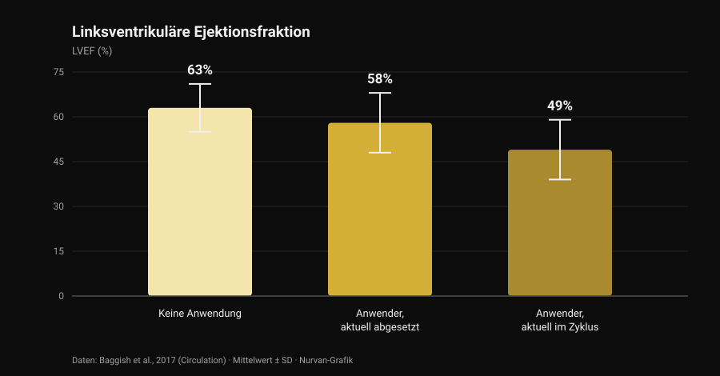
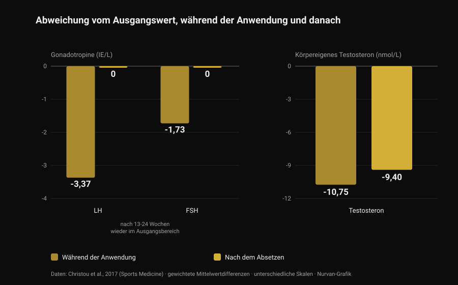

# Anabolika: Nebenwirkungen und reale Risiken

Von [Giammaria Loi](/autore/giammaria-loi) · aktualisiert am 28. Oktober 2026

In meinem Feed stand neulich ein Satz, der richtig und unbeliebt zugleich ist: Anabolika wirken, aber man kann sich nicht nur die Effekte aussuchen, die man will. Das stimmt, und die Fachliteratur beziffert es sehr viel genauer, als eine Folie es könnte. Ich habe acht indexierte Arbeiten gelesen, um zu verstehen, was dieses Gesamtpaket kostet — und die Zahl, die mich am meisten überrascht hat, betrifft nicht das Herz, sondern die Zeit bis zur Rückkehr zur Normalität.

## Kurz gefasst

- **Dass sie wirken, steht nicht zur Debatte.** Zehn Wochen Testosteron in supraphysiologischer Dosierung plus Training: **+6,1 kg fettfreie Masse**, **+22 kg im Bankdrücken**, **+38 kg in der Kniebeuge**. Auch wer nicht trainierte, baute Muskeln auf (Bhasin et al., 1996).
- **Der Androgenrezeptor sitzt nicht nur im Muskel.** In dänischen Registerdaten betreffen Akne, Gynäkomastie und erektile Dysfunktion jeweils **mehr als 10 %** der Anwender (Horwitz et al., 2019).
- **Am Herzen ist die Datenlage am besten.** Linksventrikuläre Ejektionsfraktion **52 %** bei Anwendern gegenüber **63 %** bei Nichtanwendern; **49 %** bei denen, die zum Zeitpunkt der Untersuchung im Zyklus waren (Baggish et al., 2017).
- **Der Rückweg dauert länger, als er erzählt wird.** Nach dem Absetzen erreichen LH und FSH ihren Ausgangswert in **13-24 Wochen**, das körpereigene Testosteron lag nach 16 Wochen aber noch **9,4 nmol/L unter dem Ausgangswert** (Metaanalyse von 33 Studien, Christou et al., 2017).
- **Bei einer Minderheit kommt es nicht vollständig zurück.** Von 19 unbehandelten ehemaligen Anwendern hatten **5 Testosteronwerte unter 200 ng/dl** nach 3 bis 26 Monaten Abstinenz; 7 von 24 erlebten während des Entzugs eine schwere depressive Episode (Kanayama et al., 2015).

## "Wirken sie?" ist nicht die interessante Frage

Dieser Teil ist seit dreißig Jahren geklärt. 1996 wurden 43 Männer zufällig vier Gruppen zugeteilt: Placebo oder Testosteron, mit oder ohne Training. Wer supraphysiologische Dosen Testosteron bekam und trainierte, legte in zehn Wochen **6,1 kg fettfreie Masse** zu, bei einer Zunahme der Trizepsquerschnittsfläche um 501 mm² und des Quadrizeps um 1.174 mm²; Bankdrücken +22 kg, Kniebeuge +38 kg.

Lehrreicher ist ein anderes Detail: **Auch wer nicht trainierte, wuchs.** In der Testosterongruppe ohne Training stieg die Trizepsfläche um 424 mm², in der Placebogruppe ohne Training *sank* sie um 81 mm². Das Mittel wirkt unabhängig vom Reiz, und das erklärt die Verbreitung: Die geschätzte Lebenszeitprävalenz liegt bei etwa **6,4 % bei Männern und 1,6 % bei Frauen** (Nieschlag und Vorona, 2015).

Der Fairness halber: In dieser Studie veränderten sich Stimmung und Verhalten in keiner Gruppe. Aber zehn Wochen unter ärztlicher Aufsicht sind nicht zehn Jahre selbst gesteuerter Zyklen — und genau um diesen Unterschied geht es im Rest des Artikels.

## Warum man sich die Effekte nicht aussuchen kann

Es gibt nur einen Androgenrezeptor, und er ist kein Muskelrezeptor. Er wird im Herzmuskel, in der Leber, der Haut, dem Haarfollikel, der Prostata, im Knochen, im Kehlkopf und im Gehirn exprimiert. Wenn der Androgenspiegel weit über das Normale steigt, steigt er für all diese Gewebe gleichzeitig.

Das "anabol-androgene Verhältnis" aus den kursierenden Tabellen stammt aus Nagerversuchen und übersetzt sich beim Menschen nicht in saubere Gewebeselektivität. Die empirische Probe liefern die Register: In der dänischen Kohorte von Horwitz betrafen Akne, **Gynäkomastie** (Wachstum des Brustdrüsengewebes beim Mann) und erektile Dysfunktion jeweils mehr als 10 % der Anwender. Keiner dieser drei Effekte ist einer, den jemand sucht.

Bei Frauen lassen sich manche Posten nicht löschen: Akne und Hirsutismus sind häufig, und **die Vertiefung der Stimme ist irreversibel** (Nieschlag und Vorona, 2015). Die jüngste Übersichtsarbeit formuliert es unmissverständlich: Die meisten unerwünschten Wirkungen sind leicht und reversibel, einige können aber dauerhaften Schaden anrichten oder lebensbedrohlich sein (Linhares et al., 2022).

Die nützliche Frage lautet also nicht "welche Effekte will ich", sondern **welche Effekte bin ich bereit, nicht auswählen zu können**. Zu Androgenen und Haaren haben wir den DHT-Mechanismus separat erklärt, in [verursacht Kreatin Haarausfall](/de/blog/kreatin-haarausfall).

## Das Herz: die beste Datenlage

Die aufschlussreichste Studie ist eine Querschnittsstudie: 140 Kraftsportler zwischen 34 und 54 Jahren — 86 mit mindestens zwei kumulierten Anwendungsjahren, 54 ohne Anwendung — untersucht mit Echokardiografie und koronarer CT-Angiografie.

*Nurvan-Grafik nach Daten von Baggish et al., 2017 (Circulation). Mittelwerte wie im Abstract berichtet; die Fehlerbalken zeigen die Standardabweichung.*

Die Ejektionsfraktion — der Blutanteil, den die linke Herzkammer pro Schlag auswirft — lag im Mittel bei **52 % bei Anwendern gegenüber 63 % bei Nichtanwendern**. Auch die diastolische Funktion, also die Fähigkeit der Kammer, sich zu entspannen und zu füllen, war reduziert (frühe Relaxationsgeschwindigkeit 9,3 gegenüber 11,1 cm/s). Die Autoren nennen es beim Namen: myokardiale Dysfunktion.

Innerhalb der Anwendergruppe steht die Zahl, die man behalten sollte: Wer zum Untersuchungszeitpunkt im Zyklus war, lag bei **49 %**, wer abgesetzt hatte, bei **58 %**. Die Pumpfunktion erholt sich nach dem Absetzen also zumindest teilweise.

Die Herzkranzgefäße nicht. Das mediane Plaquevolumen betrug 3 ml bei Anwendern gegenüber 0 ml bei Nichtanwendern — und es **wuchs mit der kumulierten Anwendungsdauer**: Alle zehn Jahre Gesamtanwendung entsprachen 0,60 Standardabweichungen mehr atherosklerotischer Last. Das ist die Unterscheidung, die Social-Media-Zusammenfassungen fast nie treffen: Kontraktilität kommt und geht, Plaque ist eine Ablagerung, und Ablagerungen räumen sich am Zyklusende nicht ab.

Zu den klinischen Ereignissen: Ein dänisches Register mit 1.189 Anwendern über etwa elf Jahre gegenüber 59.450 Kontrollen berichtet Herzinfarkt mit einem adjustierten Hazard Ratio von **3,00** und **Kardiomyopathie mit 8,90** (Windfeld-Mathiasen et al., 2025). Darüber und über die Blutfette haben wir ausführlich in [Testosteron und Cholesterin](/de/blog/testosteron-cholesterin-hdl-ldl) geschrieben.

## Wie lange der Rückweg wirklich dauert

Hier irrt die Studiolehre am häufigsten, und hier ist die Datenlage am solidesten: eine Metaanalyse von 33 Studien mit 3.879 Teilnehmern, davon 1.766 Anwender.

*Nurvan-Grafik nach Daten von Christou et al., 2017 (Sports Medicine). Gewichtete Mittelwertdifferenzen zum Ausgangswert wie im Abstract berichtet. LH und FSH in IE/L, Testosteron in nmol/L: unterschiedliche Skalen, nebeneinandergestellt, um den Verlauf zu lesen.*

Während der Anwendung schaltet sich die Achse ab, die die natürliche Testosteronproduktion steuert: **LH −3,37 IE/L**, **FSH −1,73 IE/L**, körpereigenes Testosteron **−10,75 nmol/L** gegenüber dem Ausgangswert. Erwartbar: Das Gehirn sieht Androgene im Überfluss und hört auf, welche anzufordern.

Entscheidend ist, was danach passiert. Die Gonadotropine — die Hormone, mit denen die Hypophyse den Hoden den Auftrag gibt — erreichen ihren Ausgangswert in **13-24 Wochen**. Das Testosteron nicht: 16 Wochen nach dem Absetzen lag es noch **9,4 nmol/L unter dem Ausgangswert**. Der Auftrag geht wieder raus, bevor die Fabrik wieder produziert.

Bei Männern, die vor längerer Zeit aufgehört haben, sind die Daten noch deutlicher. 19 unbehandelte ehemalige Langzeitanwender hatten im Vergleich zu 36 Kraftsportlern ohne jede Anwendung ein um 131 ng/dl niedrigeres Testosteron, ein um 2,3 ml geringeres Hodenvolumen und eine um 2,4 von 10 Punkten niedrigere sexuelle Lust; fünf lagen nach 3 bis 26 Monaten Abstinenz **unter 200 ng/dl**. Und hier der Teil, der kaum je auf Folien landet: Von den 24 ehemaligen Anwendern der Studie erlebten **7 (29 %) während des Entzugs eine schwere depressive Episode**, vier davon zu keinem anderen Zeitpunkt ihres Lebens, und zwei erlangten Libido und erektile Funktion auch unter adäquater Substitutionstherapie nicht zurück (Kanayama et al., 2015).

Bei der Fruchtbarkeit passt das Bild: Veränderungen von Zahl, Form und Beweglichkeit der Spermien, geringeres Hodenvolumen und bei Frauen Klitorishypertrophie, Zyklusstörungen und eingeschränkte Fruchtbarkeit (Christou et al., 2017). Die Unterdrückung der Spermienbildung gilt als reversibel — mit einer wichtigen Einschränkung: Erholt sie sich nicht, kann eine bereits zuvor bestehende Fertilitätsstörung zutage getreten sein (Nieschlag und Vorona, 2015).

## Sterblichkeit und Krankenhauskontakte: was die Register zeigen

Langfristig gibt es nur Bevölkerungsdaten, denn ein kontrolliertes Experiment mit diesen Dosierungen würde keine Ethikkommission passieren.

In der dänischen Kohorte wurden 545 Männer mit positivem Dopingtest im Fitnessstudio mit 5.450 gematchten Kontrollen verglichen: **dreifach erhöhte Sterblichkeit** (Hazard Ratio 3,0; 95 %-KI 1,3-7,0) und im Median 0,81 Krankenhauskontakte pro Jahr gegenüber 0,36. Das Ergebnis wurde in einer zweiten Kohorte von 644 Männern repliziert, die den Test verweigert hatten (Horwitz et al., 2019).

Ein Hinweis, sonst wird die Zahl zur Parole: Das sind Beobachtungsstudien, und wer Anabolika nimmt, unterscheidet sich von den Kontrollen auch in anderen Substanzen, anderen Gewohnheiten und einer anderen Risikobereitschaft. Das "dreifach" ist nicht der isolierte Beitrag des Wirkstoffs — es ist aber das, was einer realen Bilanz am nächsten kommt.

## Was die Forschung wirklich sagt

- **"Anabolika wirken" — Bestätigt.** Randomisierte Studie: +6,1 kg fettfreie Masse in zehn Wochen mit Training, und Muskelzuwachs selbst ohne Training.
- **"Man kann den Muskel nicht selektiv ansprechen: anabol und androgen lassen sich nicht trennen" — Bestätigt.** Ein Rezeptor in vielen Geweben, und in den Registern Akne, Gynäkomastie und erektile Dysfunktion jeweils über 10 %. Bei Frauen ist die Stimmvertiefung irreversibel.
- **"Das Risiko ist nicht binär: es hängt von Dosis, Dauer, Substanz und individueller Reaktion ab" — Zu präzisieren.** Dosis und Dauer zählen, das ist belegt. Die individuelle Reaktion ist aber genau die Variable, die sich vorher nicht kennen lässt: ein Risiko, keine Einstellung.
- **"Mehr Pharmakologie, mehr Variablen zu steuern" — Zu präzisieren.** "Steuern" setzt voraus, dass alles Relevante messbar und korrigierbar ist. Das stärkste Registersignal ist die Kardiomyopathie, und der Befund, der mit der Exposition wächst, ist eine Ablagerung in den Herzkranzgefäßen: Beides korrigiert keine Blutabnahme.
- **"Nach dem Zyklus bist du wieder wie vorher" — Widerlegt.** Testosteron nach 16 Wochen noch 9,4 nmol/L unter dem Ausgangswert; fünf von 19 ehemaligen Anwendern nach Monaten unter 200 ng/dl; zwei von 24 ohne Rückkehr der Sexualfunktion, selbst unter Therapie.
- **"Wenn du jung und gesund bist und Blut kontrollierst, riskierst du nichts" — Widerlegt.** Die dänischen Kohorten bestehen genau aus Fitnessstudio-Besuchern: dreifache Sterblichkeit, mehr als doppelt so viele Krankenhauskontakte, fast neunfaches Kardiomyopathierisiko.
- **"Kontrollierte Anwendung beseitigt das Risiko" — Nicht überprüfbar.** Randomisierte Studien zu diesen Dosierungen gibt es nicht und wird es nicht geben. Wer das Gegenteil behauptet, nimmt fehlende Daten als Sicherheitsnachweis.

## So wendest du es an

1. **Wenn du darüber nachdenkst, ändere die Frage.** Nicht "wie viel brauche ich zum Wachsen", sondern "welche Effekte bin ich bereit, nicht auswählen zu können": Gynäkomastie, Akne, erektile Dysfunktion und koronare Plaque sind keine abschaltbaren Optionen.
2. **Wenn du anwendest oder angewendet hast, sag es der Ärztin oder dem Arzt.** Es verändert die Deutung jedes Befunds, und viele fragen nicht von selbst danach: Du musst es einbringen.
3. **Erkenne die Entzugssymptome.** Libidoverlust, Erektionsprobleme und gedrückte Stimmung nach dem Absetzen sind keine Charakterschwäche: In Kanayamas Studie hatten 29 % in dieser Phase eine schwere depressive Episode. Das ist eine behandelbare medizinische Situation.
4. **Wenn Kinderwunsch im Raum steht, sprich vorher darüber.** Die Spermienbildung wird während der Anwendung unterdrückt und erholt sich über lange, variable Zeiträume: eine andrologische Abklärung vorab ist mehr wert als jedes Forumsprotokoll.
5. **Verwechsle verordnete Therapie nicht mit Studiogebrauch** und lies Verläufe statt Einzelwerte. Blutdruck, Blutbild, Blutfette und Körperzusammensetzung sagen über Jahre etwas aus, nicht über eine Woche. Der Vergleich steht in [Testosteron und Cholesterin](/de/blog/testosteron-cholesterin-hdl-ldl).

### Nurvan testen — Laborwerte, Maße und Lasten auf einer Zeitachse

Wer die eigene Gesundheit über Jahre verfolgt, kennt das praktische Problem: Die Befunde liegen verstreut in E-Mails, Ordnern und PDFs. In Nurvan lädst du deine Blutwerte hoch und siehst den Verlauf jedes Parameters auf einer Zeitachse, mit Trainingslasten, RIR und Körpermaßen derselben Monate daneben: Beim Arzttermin bringst du die ganze Reihe mit, nicht das letzte Blatt. **[Nurvan testen](https://nurvan.app)**

## Häufige Fragen

**Was sind die häufigsten Nebenwirkungen von Anabolika?**
In Bevölkerungsregistern sind es Akne, Gynäkomastie und erektile Dysfunktion, jeweils bei mehr als 10 % der Anwender. Dazu kommen Hodenatrophie, die Unterdrückung der natürlichen Testosteronproduktion und am Herzen eine verringerte Pumpfunktion sowie die Ansammlung koronarer Plaque.

**Wie lange dauert die Erholung nach dem Absetzen?**
In der Metaanalyse von 33 Studien erreichen die Gonadotropine ihren Ausgangswert in 13-24 Wochen, das körpereigene Testosteron lag nach 16 Wochen aber noch 9,4 nmol/L darunter. Bei einem Teil der ehemaligen Anwender bleiben die Werte monatelang niedrig: Fünf von neunzehn lagen nach 3 bis 26 Monaten Abstinenz unter 200 ng/dl.

**Schädigen Anabolika das Herz dauerhaft?**
Zwei Dinge sind zu trennen. Die Kontraktionsfunktion scheint sich zumindest teilweise zu erholen: Unter den Anwendern hatten die abgesetzten eine Ejektionsfraktion von 58 % gegenüber 49 % bei denen im Zyklus. Die koronare Plaque wächst dagegen mit den kumulierten Anwendungsjahren und ist kein Wert, der sich beim Aufhören zurücksetzt.

**Gibt es ein sicheres Anabolikum?**
Nein, und keine randomisierte Studie zu diesen Dosierungen könnte es zeigen: Ethische Vorgaben verbieten es, Freiwillige potenziell toxischen Regimen auszusetzen. Unterschiede zwischen Substanzen sind real — die orale Gabe belastet die Blutfette zum Beispiel deutlich stärker als die injizierbare — aber es sind Unterschiede im Ausmaß des Schadens, nicht in seinem Vorhandensein.

## Auch lesenswert

- [Testosteron und Cholesterin: was die Studien sagen](/de/blog/testosteron-cholesterin-hdl-ldl) — die Zahlen zu HDL, LDL und ApoB und der Unterschied zwischen Therapie und Zyklus.
- [Verursacht Kreatin Haarausfall?](/de/blog/kreatin-haarausfall) — der DHT-Mechanismus ausführlich erklärt und an Studien geprüft.
- [Supplement-Tier-List für Kraft](/de/blog/kraftsport-supplemente-tier-list) — was solide Belege hat, nach Evidenz sortiert, ganz ohne Pharmakologie.

## Quellen

1. Bhasin S, Storer TW, Berman N, Callegari C, Clevenger B, Phillips J, Bunnell TJ, Tricker R, Shirazi A, Casaburi R, 1996. *The effects of supraphysiologic doses of testosterone on muscle size and strength in normal men.* New England Journal of Medicine 335(1):1-7. [PMID 8637535](https://pubmed.ncbi.nlm.nih.gov/8637535/) · [DOI 10.1056/NEJM199607043350101](https://doi.org/10.1056/NEJM199607043350101)
2. Baggish AL, Weiner RB, Kanayama G, Hudson JI, Lu MT, Hoffmann U, Pope HG, 2017. *Cardiovascular Toxicity of Illicit Anabolic-Androgenic Steroid Use.* Circulation 135(21):1991-2002. [PMID 28533317](https://pubmed.ncbi.nlm.nih.gov/28533317/) · [DOI 10.1161/CIRCULATIONAHA.116.026945](https://doi.org/10.1161/CIRCULATIONAHA.116.026945)
3. Christou MA, Christou PA, Markozannes G, Tsatsoulis A, Mastorakos G, Tigas S, 2017. *Effects of Anabolic Androgenic Steroids on the Reproductive System of Athletes and Recreational Users: A Systematic Review and Meta-Analysis.* Sports Medicine 47(9):1869-1883. [PMID 28258581](https://pubmed.ncbi.nlm.nih.gov/28258581/) · [DOI 10.1007/s40279-017-0709-z](https://doi.org/10.1007/s40279-017-0709-z)
4. Kanayama G, Hudson JI, DeLuca J, Isaacs S, Baggish A, Weiner R, Bhasin S, Pope HG, 2015. *Prolonged hypogonadism in males following withdrawal from anabolic-androgenic steroids: an under-recognized problem.* Addiction 110(5):823-31. [PMID 25598171](https://pubmed.ncbi.nlm.nih.gov/25598171/) · [DOI 10.1111/add.12850](https://doi.org/10.1111/add.12850)
5. Horwitz H, Andersen JT, Dalhoff KP, 2019. *Health consequences of androgenic anabolic steroid use.* Journal of Internal Medicine 285(3):333-340. [PMID 30460728](https://pubmed.ncbi.nlm.nih.gov/30460728/) · [DOI 10.1111/joim.12850](https://doi.org/10.1111/joim.12850)
6. Nieschlag E, Vorona E, 2015. *MECHANISMS IN ENDOCRINOLOGY: Medical consequences of doping with anabolic androgenic steroids: effects on reproductive functions.* European Journal of Endocrinology 173(2):R47-58. [PMID 25805894](https://pubmed.ncbi.nlm.nih.gov/25805894/) · [DOI 10.1530/EJE-15-0080](https://doi.org/10.1530/EJE-15-0080)
7. Linhares BL, Miranda EP, Cintra AR, Reges R, Torres LO, 2022. *Use, Misuse and Abuse of Testosterone and Other Androgens.* Sexual Medicine Reviews 10(4):583-595. [PMID 34887237](https://pubmed.ncbi.nlm.nih.gov/34887237/) · [DOI 10.1016/j.sxmr.2021.10.002](https://doi.org/10.1016/j.sxmr.2021.10.002)
8. Windfeld-Mathiasen J, Heerfordt IM, Dalhoff KP, Andersen JT, Andersen MA, Johansson KS, Biering-Sørensen T, Olsen FJ, Horwitz H, 2025. *Cardiovascular Disease in Anabolic Androgenic Steroid Users.* Circulation 151(12):828-834. [PMID 39945117](https://pubmed.ncbi.nlm.nih.gov/39945117/) · [DOI 10.1161/CIRCULATIONAHA.124.071117](https://doi.org/10.1161/CIRCULATIONAHA.124.071117)

Literatur über PubMed recherchiert. Ausgangspunkt: der Beitrag von **built4mayhem** ([Project Mayhem](https://www.instagram.com/built4mayhem/)) vom 25. September 2026, [Originalbeitrag](https://www.instagram.com/p/DduTeKEjcwx/). Gelesen wurden nur Autor, Datum und Bildunterschrift: Es wurden weder Texte noch Bilder übernommen, und die Folien des Karussells wurden weder heruntergeladen noch angesehen. Das Thema wurde von Grund auf neu geschrieben, ausgehend von den Primärstudien, die einzeln überprüft wurden.

---

**Giammaria Loi** ist der Gründer von Nurvan. Er trainiert seit 2012 mit Gewichten, arbeitet seit 2013 als FIPE-zertifizierter Personal Trainer und Coach und startet seit 2018 bei nationalen Powerlifting-Wettkämpfen. Jeder Artikel, den er zeichnet, beginnt bei den Studien und endet bei dem, was im Studio wirklich funktioniert.

> Hinweis: informativer Inhalt, der keine ärztliche Beratung ersetzt. Dieser Artikel beschreibt die in der Literatur dokumentierten Risiken und **enthält keine Dosierungen, Substanznamen oder Protokolle**: Er ermutigt in keiner Weise zur Anwendung. Der nichtmedizinische Gebrauch von Anabolika ist im Sport verboten und in vielen Ländern illegal. Wenn du diese Substanzen anwendest oder angewendet hast oder eine Hormontherapie erwägst, sprich mit einer Ärztin oder einem Arzt.
