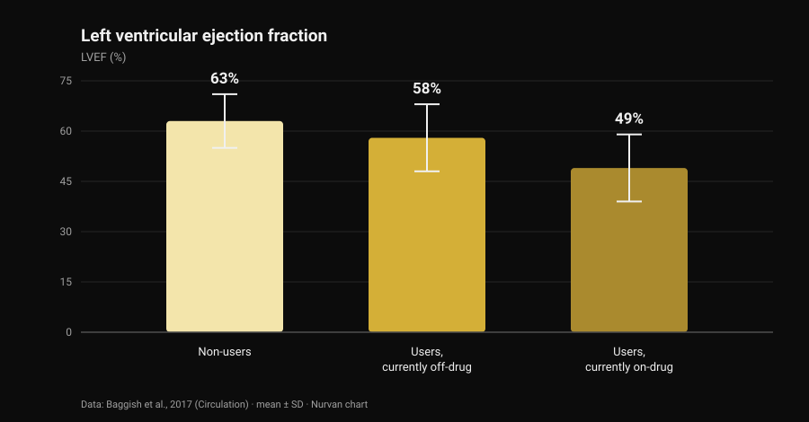
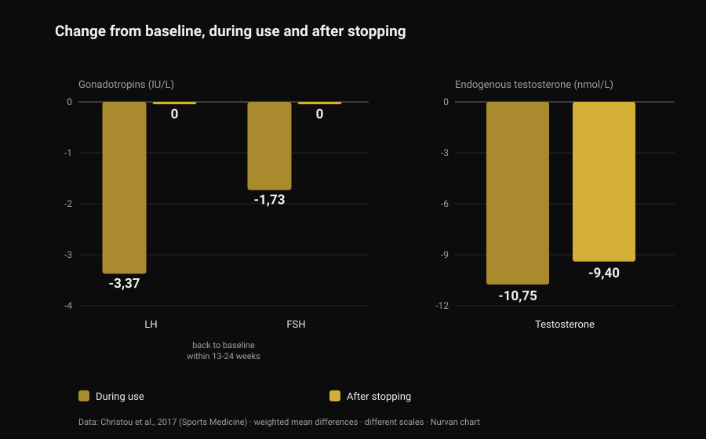

# Anabolic steroids: side effects and real risks

By [Giammaria Loi](/autore/giammaria-loi) · updated 28 October 2026

A post that came through my feed said something correct and unpopular: anabolic steroids work, but you don't get to pick only the effects you want. That is true, and the literature quantifies it far better than any slide can. I read eight indexed papers to work out what that full package costs — and the number that surprised me most isn't about the heart. It's about how long it takes to get back to normal.

## The short version

- **That they work isn't in question.** Ten weeks of supraphysiological testosterone plus training: **+6.1 kg of fat-free mass**, **+22 kg on the bench press**, **+38 kg on the squat**. Even the men who didn't train gained muscle (Bhasin et al., 1996).
- **The androgen receptor isn't only in muscle.** In Danish registry data, acne, gynaecomastia and erectile dysfunction each affect **more than 10%** of users (Horwitz et al., 2019).
- **The heart has the best data.** Left ventricular ejection fraction **52%** in users versus **63%** in non-users — and **49%** in men who were on-drug at the time of the scan (Baggish et al., 2017).
- **Coming back is slower than the gym version of the story.** After stopping, LH and FSH return to baseline within **13-24 weeks**, but the body's own testosterone was still **9.4 nmol/L below baseline** at 16 weeks (meta-analysis of 33 studies, Christou et al., 2017).
- **For a minority it doesn't fully come back.** Of 19 untreated former users, **5 had testosterone under 200 ng/dL** after 3-26 months off; 7 of 24 had a major depressive episode during withdrawal (Kanayama et al., 2015).

## "Do they work" is not the interesting question

That part has been settled for thirty years. In 1996, forty-three men were randomly assigned to four groups: placebo or testosterone, with or without training. The men on supraphysiological testosterone who also trained gained **6.1 kg of fat-free mass** in ten weeks, with triceps cross-sectional area up by 501 mm² and quadriceps by 1,174 mm²; bench press +22 kg, squat +38 kg.

The more instructive detail is this: **the men who didn't train grew too**. In the testosterone-without-exercise group triceps area rose by 424 mm², while in the placebo-without-exercise group it *fell* by 81 mm². The drug works independently of the stimulus, which explains how widespread use is: estimated lifetime prevalence is around **6.4% in men and 1.6% in women** (Nieschlag and Vorona, 2015).

In fairness, mood and behaviour weren't altered in any group in that trial. But ten weeks under medical supervision is not ten years of self-managed cycles — and that gap is what the rest of this article is about.

## Why you can't pick only the effects you want

There is one androgen receptor, and it is not a muscle receptor. It is expressed in heart muscle, liver, skin, hair follicles, prostate, bone, larynx and brain. When circulating androgens go far above normal, they go above normal for all of those tissues at once.

The "anabolic-to-androgenic ratio" in the tables that circulate online comes from rodent assays, and it does not translate into clean tissue selectivity in humans. The empirical check is in the registries: in Horwitz's Danish cohort, acne, **gynaecomastia** (male breast tissue growth) and erectile dysfunction each affected more than 10% of users. None of the three is an effect anyone is after.

In women some of the entries don't erase: acne and hirsutism are common, and **voice deepening is irreversible** (Nieschlag and Vorona, 2015). The most recent review states it plainly: most adverse effects are mild and reversible, but some can cause permanent damage or be potentially life-threatening (Linhares et al., 2022).

So the useful question isn't "which effects do I want". It's **which effects am I willing not to be able to choose**. On androgens and hair specifically, we covered the DHT mechanism separately in [does creatine cause hair loss](/en/blog/creatine-hair-loss).

## The heart: where the data are strongest

The most informative study is cross-sectional: 140 weightlifters aged 34 to 54 — 86 with at least two cumulative years of use, 54 non-users — assessed with echocardiography and coronary CT angiography.

*Nurvan chart built on data from Baggish et al., 2017 (Circulation). Means as reported in the abstract; error bars show the standard deviation.*

Ejection fraction — the share of blood the left ventricle pushes out with each beat — averaged **52% in users versus 63% in non-users**. Diastolic function, the ventricle's ability to relax and fill, was reduced too (early relaxation velocity 9.3 versus 11.1 cm/s). The authors call it by its name: myocardial dysfunction.

Inside the user group sits the number worth keeping: men on-drug at the time of testing were at **49%**, men currently off-drug at **58%**. Pump function, in other words, recovers at least partly when you stop.

The coronary arteries don't. Median plaque volume was 3 mL in users versus 0 mL in non-users, and it **grew with cumulative duration of use**: every ten years of lifetime use was worth 0.60 standard deviations more atherosclerotic burden. That's the distinction social summaries almost never make. Contractility comes and goes; plaque is a deposit, and deposits don't clear at the end of a cycle.

On hard clinical events, a Danish registry of 1,189 users followed for about eleven years against 59,450 controls reports myocardial infarction with an adjusted hazard ratio of **3.00** and **cardiomyopathy at 8.90** (Windfeld-Mathiasen et al., 2025). We covered that cohort, and what happens to lipids, in [testosterone and cholesterol](/en/blog/testosterone-cholesterol-hdl-ldl).

## How long it really takes to come back

This is where gym-floor advice is most wrong, and where the data are strongest: a meta-analysis of 33 studies and 3,879 participants, 1,766 of them users.

*Nurvan chart built on data from Christou et al., 2017 (Sports Medicine). Weighted mean differences from baseline as reported in the abstract. LH and FSH in IU/L, testosterone in nmol/L: different scales, placed side by side to read the pattern.*

During use, the axis that drives natural testosterone production shuts down: **LH −3.37 IU/L**, **FSH −1.73 IU/L**, endogenous testosterone **−10.75 nmol/L** from baseline. Predictable: the brain sees androgens everywhere and stops asking for more.

What matters is what happens next. The gonadotropins — the hormones the pituitary uses to signal the testes — return to baseline within **13-24 weeks**. Testosterone does not: at 16 weeks after stopping it was still **9.4 nmol/L below baseline**. The order goes back out before the factory starts producing again.

For men who quit long ago the data are blunter still. Nineteen untreated long-term former users, compared with 36 weightlifters who had never used anything, had testosterone 131 ng/dL lower, testicular volume 2.3 mL smaller and sexual desire scores 2.4 points lower on a 10-point scale; five were **below 200 ng/dL** after 3 to 26 months of abstinence. And here is the part that rarely makes the slides: of the 24 former users in that study, **7 (29%) had a major depressive episode during withdrawal**, four of whom had never had one at any other point in their lives, and two never regained libido or erectile function even on adequate replacement testosterone (Kanayama et al., 2015).

Fertility follows the same pattern: changes in sperm count, shape and motility, reduced testicular volume and, in women, clitoromegaly, menstrual irregularity and subfertility (Christou et al., 2017). Suppression of sperm production is described as reversible, with one important caveat: if it doesn't recover, a pre-existing fertility problem may simply have resurfaced (Nieschlag and Vorona, 2015).

## Mortality and hospital contacts: what the registries show

Over the long run only population data exist, because a controlled experiment at these doses would never clear an ethics committee.

In the Danish cohort, 545 men who tested positive in gym anti-doping testing were matched against 5,450 controls: **mortality three times higher** (hazard ratio 3.0; 95% CI 1.3-7.0) and median annual hospital contacts 0.81 versus 0.36. The finding was replicated in a second cohort of 644 men who had refused the test (Horwitz et al., 2019).

One warning, or the number becomes a slogan: these are observational studies, and people who use steroids differ from controls in other substances, other habits and a different appetite for risk. The "three times" is not the isolated contribution of the molecule — it is, however, the closest thing to a real-world balance sheet we have.

## What the research actually says

- **"Anabolic steroids work" — Confirmed.** Randomised trial: +6.1 kg of fat-free mass in ten weeks with training, and muscle growth even without training.
- **"You can't expose muscle selectively: anabolic and androgenic effects don't separate" — Confirmed.** One receptor across many tissues, and in the registries acne, gynaecomastia and erectile dysfunction each above 10%. In women, voice deepening is irreversible.
- **"Risk isn't binary: it depends on dose, duration, compound and individual response" — Needs qualifying.** Dose and duration do matter, and that's documented. But individual response is precisely the variable you can't know in advance: it's a risk, not a setting.
- **"More pharmacology, more variables to manage" — Needs qualifying.** "Manage" assumes everything that counts is measurable and correctable. The strongest registry signal is cardiomyopathy, and the finding that scales with exposure is a deposit in the coronary arteries. Neither is fixed by a blood draw.
- **"Once the cycle ends you go back to normal" — Disproved.** Testosterone still 9.4 nmol/L below baseline at 16 weeks; five of 19 former users below 200 ng/dL after months off; two of 24 with no recovery of sexual function even on replacement therapy.
- **"If you're young and healthy and you run blood work, you're fine" — Disproved.** The Danish cohorts are made of exactly that population: triple mortality, more than double the hospital contacts, cardiomyopathy risk almost nine times higher.
- **"Controlled use removes the risk" — Unverifiable.** Randomised trials at these doses don't exist and never will. Anyone claiming otherwise is using the absence of data as proof of safety.

## How to apply it

1. **If you're considering use, change the question.** Not "how much do I need to grow", but "which effects am I willing not to be able to choose": gynaecomastia, acne, erectile dysfunction and coronary plaque are not options you can switch off.
2. **If you use or have used, tell your doctor.** It changes how every test result is read, and many doctors won't ask: it's on you to volunteer it.
3. **Know the withdrawal symptoms.** Low desire, erectile difficulty and a black mood after stopping aren't a character flaw: in Kanayama's study 29% had a major depressive episode in that phase. It's a medical condition, and it's treatable.
4. **If children are in the plan, talk about it first.** Sperm production is suppressed during use and recovers on a long, variable timeline: an andrology consultation beforehand is worth more than any forum protocol.
5. **Don't confuse prescribed therapy with gym use,** and read trends rather than single results. Blood pressure, full blood count, lipids and body composition say something over years, not over a week. The therapy-versus-cycle comparison is in [testosterone and cholesterol](/en/blog/testosterone-cholesterol-hdl-ldl).

### Try Nurvan — blood work, measurements and training loads on one timeline

If you follow your own health over time, the practical problem is that results live scattered across emails, folders and PDFs. In Nurvan you upload your blood work and see each marker trend on a timeline, with your loads, RIR and body measurements sitting in the same months: when you see your doctor you bring the whole series, not the latest sheet. **[Try Nurvan](https://nurvan.app)**

## Frequently asked questions

**What are the most common side effects of anabolic steroids?**
In population registries the most frequent are acne, gynaecomastia and erectile dysfunction, each in more than 10% of users. On top of those: testicular atrophy, suppression of natural testosterone production and, on the cardiac side, reduced pump function and coronary plaque accumulation.

**How long does recovery take after stopping?**
In the meta-analysis of 33 studies, gonadotropins return to baseline within 13-24 weeks, but the body's own testosterone was still 9.4 nmol/L below baseline at 16 weeks. In some former users levels stay low for months: five of nineteen were below 200 ng/dL after 3 to 26 months off.

**Do steroids damage the heart permanently?**
Two separate things. Contractile function appears to recover at least partly: among users, men currently off-drug had an ejection fraction of 58% versus 49% for those on-drug. Coronary plaque, by contrast, grows with cumulative years of use and isn't a number that resets when you stop.

**Is there a safe anabolic steroid?**
No, and no randomised trial at these doses could show it: ethical constraints prevent exposing volunteers to potentially toxic regimens. Differences between compounds are real — the oral route, for example, hits lipids much harder than the injectable one — but they are differences in how much harm, not whether.

## Read next

- [Testosterone and cholesterol: what the studies say](/en/blog/testosterone-cholesterol-hdl-ldl) — the numbers on HDL, LDL and apoB, and the gap between therapy and a cycle.
- [Does creatine cause hair loss?](/en/blog/creatine-hair-loss) — the DHT mechanism explained in full, checked against the studies.
- [Strength supplement tier list](/en/blog/strength-supplements-tier-list-evidence) — what has solid evidence, ranked, with no pharmacology involved.

## Sources

1. Bhasin S, Storer TW, Berman N, Callegari C, Clevenger B, Phillips J, Bunnell TJ, Tricker R, Shirazi A, Casaburi R, 1996. *The effects of supraphysiologic doses of testosterone on muscle size and strength in normal men.* New England Journal of Medicine 335(1):1-7. [PMID 8637535](https://pubmed.ncbi.nlm.nih.gov/8637535/) · [DOI 10.1056/NEJM199607043350101](https://doi.org/10.1056/NEJM199607043350101)
2. Baggish AL, Weiner RB, Kanayama G, Hudson JI, Lu MT, Hoffmann U, Pope HG, 2017. *Cardiovascular Toxicity of Illicit Anabolic-Androgenic Steroid Use.* Circulation 135(21):1991-2002. [PMID 28533317](https://pubmed.ncbi.nlm.nih.gov/28533317/) · [DOI 10.1161/CIRCULATIONAHA.116.026945](https://doi.org/10.1161/CIRCULATIONAHA.116.026945)
3. Christou MA, Christou PA, Markozannes G, Tsatsoulis A, Mastorakos G, Tigas S, 2017. *Effects of Anabolic Androgenic Steroids on the Reproductive System of Athletes and Recreational Users: A Systematic Review and Meta-Analysis.* Sports Medicine 47(9):1869-1883. [PMID 28258581](https://pubmed.ncbi.nlm.nih.gov/28258581/) · [DOI 10.1007/s40279-017-0709-z](https://doi.org/10.1007/s40279-017-0709-z)
4. Kanayama G, Hudson JI, DeLuca J, Isaacs S, Baggish A, Weiner R, Bhasin S, Pope HG, 2015. *Prolonged hypogonadism in males following withdrawal from anabolic-androgenic steroids: an under-recognized problem.* Addiction 110(5):823-31. [PMID 25598171](https://pubmed.ncbi.nlm.nih.gov/25598171/) · [DOI 10.1111/add.12850](https://doi.org/10.1111/add.12850)
5. Horwitz H, Andersen JT, Dalhoff KP, 2019. *Health consequences of androgenic anabolic steroid use.* Journal of Internal Medicine 285(3):333-340. [PMID 30460728](https://pubmed.ncbi.nlm.nih.gov/30460728/) · [DOI 10.1111/joim.12850](https://doi.org/10.1111/joim.12850)
6. Nieschlag E, Vorona E, 2015. *MECHANISMS IN ENDOCRINOLOGY: Medical consequences of doping with anabolic androgenic steroids: effects on reproductive functions.* European Journal of Endocrinology 173(2):R47-58. [PMID 25805894](https://pubmed.ncbi.nlm.nih.gov/25805894/) · [DOI 10.1530/EJE-15-0080](https://doi.org/10.1530/EJE-15-0080)
7. Linhares BL, Miranda EP, Cintra AR, Reges R, Torres LO, 2022. *Use, Misuse and Abuse of Testosterone and Other Androgens.* Sexual Medicine Reviews 10(4):583-595. [PMID 34887237](https://pubmed.ncbi.nlm.nih.gov/34887237/) · [DOI 10.1016/j.sxmr.2021.10.002](https://doi.org/10.1016/j.sxmr.2021.10.002)
8. Windfeld-Mathiasen J, Heerfordt IM, Dalhoff KP, Andersen JT, Andersen MA, Johansson KS, Biering-Sørensen T, Olsen FJ, Horwitz H, 2025. *Cardiovascular Disease in Anabolic Androgenic Steroid Users.* Circulation 151(12):828-834. [PMID 39945117](https://pubmed.ncbi.nlm.nih.gov/39945117/) · [DOI 10.1161/CIRCULATIONAHA.124.071117](https://doi.org/10.1161/CIRCULATIONAHA.124.071117)

References retrieved through PubMed. Starting point: the post by **built4mayhem** ([Project Mayhem](https://www.instagram.com/built4mayhem/)) of 25 September 2026, [original post](https://www.instagram.com/p/DduTeKEjcwx/). Only the author, date and caption were read: no text and no image were reproduced, and the carousel slides were neither downloaded nor viewed. The topic was rewritten from scratch by going back to the primary studies and checking each one.

---

**Giammaria Loi** is the founder of Nurvan. He has been lifting since 2012, has worked as a FIPE-certified personal trainer and coach since 2013, and has competed in powerlifting at national level since 2018. Every article he writes starts from the research and ends with what actually works in the gym.

> Note: this is educational content and does not replace medical advice. The article describes risks documented in the literature and **contains no dosages, compounds or protocols**: it does not encourage use in any way. Non-medical use of anabolic steroids is banned in sport and illegal in many countries. If you use or have used these substances, or you are considering hormone therapy, speak to a doctor.
