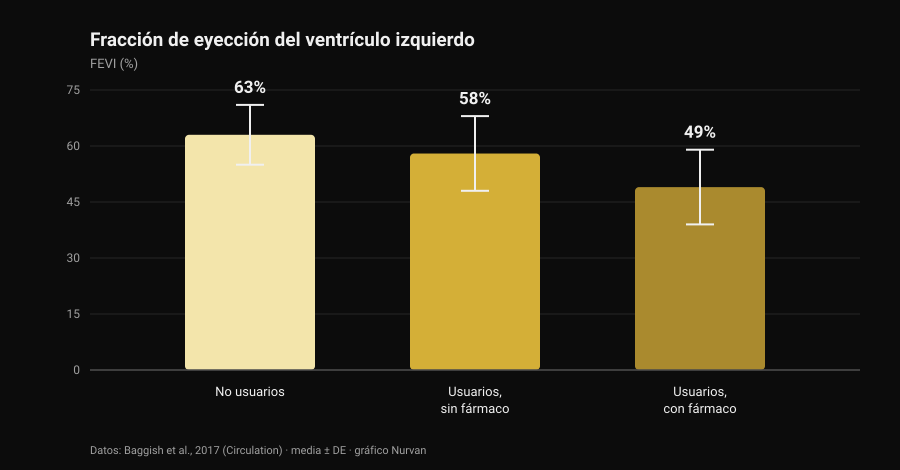
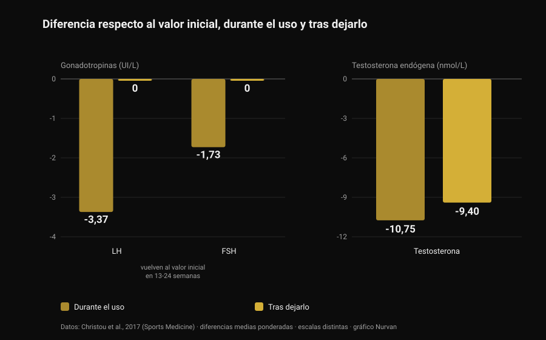

# Esteroides anabólicos: efectos secundarios y riesgos

Por [Giammaria Loi](/autore/giammaria-loi) · actualizado el 28 de octubre de 2026

Un post que pasó por mi feed decía algo correcto y poco popular: los esteroides anabólicos funcionan, pero no puedes elegir solo los efectos que quieres. Es cierto, y la literatura lo cuantifica mucho mejor de lo que puede hacerlo una diapositiva. He leído ocho trabajos indexados para entender cuánto cuesta ese paquete completo, y el dato que más me ha sorprendido no tiene que ver con el corazón, sino con el tiempo que hace falta para volver a la normalidad.

## En resumen

- **Que funcionan no está en discusión.** Diez semanas de testosterona a dosis suprafisiológicas más entrenamiento: **+6,1 kg de masa magra**, **+22 kg en press de banca** y **+38 kg en sentadilla**. Incluso quienes no entrenaban ganaban músculo (Bhasin et al., 1996).
- **El receptor de andrógenos no está solo en el músculo.** En los registros daneses, el acné, la ginecomastia y la disfunción eréctil afectan cada uno a **más del 10%** de los usuarios (Horwitz et al., 2019).
- **El corazón es donde hay mejores datos.** Fracción de eyección del ventrículo izquierdo del **52%** en usuarios frente al **63%** en no usuarios; **49%** en quienes tenían el fármaco en curso durante la prueba (Baggish et al., 2017).
- **Volver atrás es más lento de lo que se cuenta.** Tras dejarlo, LH y FSH regresan al valor inicial en **13-24 semanas**, pero la testosterona propia seguía **9,4 nmol/L por debajo del inicio** a las 16 semanas (metaanálisis de 33 estudios, Christou et al., 2017).
- **En una minoría no vuelve del todo.** De 19 exusuarios sin tratamiento, **5 tenían testosterona por debajo de 200 ng/dL** tras 3-26 meses sin consumir; 7 de 24 sufrieron un episodio depresivo mayor durante la retirada (Kanayama et al., 2015).

## "¿Funcionan?" no es la pregunta interesante

Esa parte está cerrada desde hace treinta años. En 1996, cuarenta y tres hombres fueron asignados al azar a cuatro grupos: placebo o testosterona, con o sin entrenamiento. Quienes recibían dosis suprafisiológicas de testosterona y entrenaban ganaron **6,1 kg de masa magra** en diez semanas, con un aumento del área del tríceps de 501 mm² y del cuádriceps de 1.174 mm²; press de banca +22 kg, sentadilla +38 kg.

El detalle más instructivo es otro: **quienes no entrenaban también crecían**. En el grupo de testosterona sin ejercicio el área del tríceps aumentó 424 mm², mientras que en el de placebo sin ejercicio *disminuyó* 81 mm². El fármaco actúa con independencia del estímulo, y eso explica lo extendido del consumo: la prevalencia estimada a lo largo de la vida ronda el **6,4% en hombres y el 1,6% en mujeres** (Nieschlag y Vorona, 2015).

Por honestidad hay que decirlo: en ese ensayo el estado de ánimo y la conducta no se alteraron en ningún grupo. Pero diez semanas con supervisión médica no son diez años de ciclos autogestionados, y de esa diferencia trata el resto del artículo.

## Por qué no puedes elegir solo los efectos que quieres

El receptor de andrógenos es uno solo, y no es un receptor del músculo. Se expresa en el miocardio, el hígado, la piel, el folículo piloso, la próstata, el hueso, la laringe y el cerebro. Cuando los andrógenos circulantes suben muy por encima de lo normal, suben a la vez para todos esos tejidos.

La "relación anabólico/androgénico" de las tablas que circulan por internet procede de ensayos en roedores y no se traduce en una selectividad limpia en humanos. La comprobación empírica está en los registros: en la cohorte danesa de Horwitz, el acné, la **ginecomastia** (crecimiento del tejido mamario en el hombre) y la disfunción eréctil afectaban cada uno a más del 10% de los usuarios. Ninguno de los tres es un efecto que alguien busque.

En las mujeres hay apartados que no se borran: el acné y el hirsutismo son frecuentes, y **el agravamiento de la voz es irreversible** (Nieschlag y Vorona, 2015). La revisión más reciente lo escribe con claridad: la mayoría de los efectos adversos son leves y reversibles, pero algunos pueden causar daño permanente o ser potencialmente mortales (Linhares et al., 2022).

Así que la pregunta útil no es "qué efectos quiero", sino **qué efectos estoy dispuesto a no poder elegir**. Sobre andrógenos y cabello escribimos aparte, al hablar de [la creatina y la caída del cabello](/es/blog/creatina-caida-cabello).

## El corazón: donde los datos son más sólidos

El estudio más informativo es transversal: 140 levantadores de entre 34 y 54 años —86 con al menos dos años acumulados de consumo y 54 no usuarios— evaluados con ecocardiografía y angio-TC coronaria.

*Gráfico de Nurvan con datos de Baggish et al., 2017 (Circulation). Medias recogidas en el resumen; las barras de error indican la desviación estándar.*

La fracción de eyección —la proporción de sangre que el ventrículo izquierdo expulsa en cada latido— fue de media del **52% en usuarios frente al 63% en no usuarios**. También estaba reducida la función diastólica, es decir, la capacidad del ventrículo de relajarse y llenarse (velocidad de relajación precoz de 9,3 frente a 11,1 cm/s). Los autores lo llaman por su nombre: disfunción miocárdica.

Dentro del grupo de usuarios está el dato que conviene retener: quienes tenían el fármaco en curso estaban en el **49%**, y quienes lo habían dejado en el **58%**. La función de bomba, por tanto, se recupera al menos en parte cuando se para.

Las coronarias no. El volumen mediano de placa era de 3 mL en usuarios frente a 0 mL en no usuarios, y **crecía con la duración acumulada del consumo**: cada diez años de uso total equivalían a 0,60 desviaciones estándar más de carga aterosclerótica. Esa es la distinción que los resúmenes de redes casi nunca hacen: la contractilidad va y viene, la placa es un depósito, y los depósitos no se vacían al terminar un ciclo.

En cuanto a eventos clínicos, un registro danés de 1.189 usuarios seguidos unos once años frente a 59.450 controles describe infarto con razón de riesgo ajustada de **3,00** y **miocardiopatía de 8,90** (Windfeld-Mathiasen et al., 2025). Lo tratamos en detalle, junto con lo que pasa con los lípidos, en [testosterona y colesterol](/es/blog/testosterona-colesterol-hdl-ldl).

## Cuánto se tarda de verdad en volver atrás

Aquí es donde más se equivoca la divulgación de gimnasio, y donde los datos son más sólidos: un metaanálisis de 33 estudios y 3.879 participantes, de los cuales 1.766 usuarios.

*Gráfico de Nurvan con datos de Christou et al., 2017 (Sports Medicine). Diferencias medias ponderadas respecto al valor inicial recogidas en el resumen. LH y FSH en UI/L, testosterona en nmol/L: escalas distintas, puestas una al lado de otra para leer la tendencia.*

Durante el consumo, el eje que gobierna la producción natural de testosterona se apaga: **LH −3,37 UI/L**, **FSH −1,73 UI/L**, testosterona propia **−10,75 nmol/L** respecto al inicio. Era previsible: el cerebro ve andrógenos de sobra y deja de pedirlos.

Lo importante es lo que viene después. Las gonadotropinas —las hormonas con las que la hipófisis da la orden a los testículos— vuelven a sus valores iniciales en **13-24 semanas**. La testosterona no: a las 16 semanas de dejarlo seguía **9,4 nmol/L por debajo del valor de partida**. La orden se reanuda antes de que la fábrica vuelva a producir.

En quienes lo dejaron hace tiempo los datos son aún más directos. Diecinueve exusuarios de larga duración sin tratamiento, comparados con 36 levantadores que nunca habían consumido nada, tenían la testosterona 131 ng/dL más baja, un volumen testicular 2,3 mL menor y 2,4 puntos menos de deseo sexual sobre 10; cinco estaban **por debajo de 200 ng/dL** tras una abstinencia de entre 3 y 26 meses. Y está la parte que casi nunca llega a las diapositivas: de los 24 exusuarios del estudio, **7 (29%) tuvieron un episodio depresivo mayor durante la retirada**, cuatro de ellos sin ningún antecedente en el resto de su vida, y dos no recuperaron la libido ni la función eréctil ni siquiera con terapia sustitutiva adecuada (Kanayama et al., 2015).

En fertilidad el cuadro es coherente: alteraciones del número, la forma y la movilidad de los espermatozoides, reducción del volumen testicular y, en mujeres, clitoromegalia, irregularidades menstruales y subfertilidad (Christou et al., 2017). La supresión de la espermatogénesis se describe como reversible, con un matiz importante: si no se recupera, puede haber reaparecido un problema de fertilidad que ya existía (Nieschlag y Vorona, 2015).

## Mortalidad e ingresos: qué dicen los registros

A largo plazo solo existen datos poblacionales, porque un experimento controlado con estas dosis no pasaría ningún comité de ética.

En la cohorte danesa, 545 hombres que dieron positivo en un control antidopaje en gimnasios se compararon con 5.450 controles emparejados: **mortalidad tres veces mayor** (razón de riesgo 3,0; IC 95% 1,3-7,0) y una mediana de 0,81 contactos hospitalarios al año frente a 0,36. El resultado se replicó en una segunda cohorte de 644 hombres que se habían negado a hacerse la prueba (Horwitz et al., 2019).

Una advertencia, o la cifra se convierte en eslogan: son estudios observacionales, y quien usa esteroides se diferencia de los controles también en otras sustancias, otros hábitos y una propensión distinta al riesgo. Ese "tres veces" no es la aportación aislada de la molécula, pero sí lo más parecido a un balance real que tenemos.

## Qué dice realmente la investigación

- **"Los esteroides anabólicos funcionan" — Confirmado.** Ensayo aleatorizado: +6,1 kg de masa magra en diez semanas con entrenamiento, y crecimiento muscular incluso sin entrenar.
- **"No se puede exponer el músculo de forma selectiva: lo anabólico y lo androgénico no se separan" — Confirmado.** Un solo receptor en muchos tejidos y, en los registros, acné, ginecomastia y disfunción eréctil por encima del 10% cada uno. En mujeres, el agravamiento de la voz es irreversible.
- **"El riesgo no es binario: depende de dosis, duración, molécula y respuesta individual" — Matizable.** La dosis y la duración cuentan, y está documentado. Pero la respuesta individual es justo la variable que no se puede conocer de antemano: es un riesgo, no un parámetro que se ajuste.
- **"Más farmacología, más variables que gestionar" — Matizable.** "Gestionar" da por hecho que todo lo que importa es medible y corregible. La señal más fuerte de los registros es la miocardiopatía, y el hallazgo que escala con la exposición es un depósito en las coronarias: ninguno se corrige con una analítica.
- **"Al terminar el ciclo vuelves a estar como antes" — Desmentido.** Testosterona todavía 9,4 nmol/L por debajo del inicio a las 16 semanas; cinco de 19 exusuarios por debajo de 200 ng/dL tras meses; dos de 24 sin recuperar la función sexual ni con terapia.
- **"Si eres joven y sano y te haces análisis, no corres riesgo" — Desmentido.** Las cohortes danesas están formadas precisamente por gente de gimnasio: mortalidad triple, más del doble de ingresos, miocardiopatía con un riesgo casi nueve veces mayor.
- **"Un uso controlado elimina el riesgo" — No verificable.** No existen ensayos aleatorizados con estas dosis y no van a existir. Quien afirme lo contrario está usando la ausencia de datos como prueba de seguridad.

## Cómo aplicarlo

1. **Si te lo estás planteando, cambia la pregunta.** No "cuánto necesito para crecer", sino "qué efectos estoy dispuesto a no poder elegir": la ginecomastia, el acné, la disfunción eréctil y la placa coronaria no son opciones que se desactiven.
2. **Si consumes o has consumido, díselo a tu médico.** Es la información que cambia la lectura de cualquier análisis, y muchos médicos no la preguntan: te toca a ti aportarla.
3. **Reconoce los síntomas de la retirada.** La caída del deseo, la dificultad eréctil y el ánimo bajo tras dejarlo no son falta de carácter: en el estudio de Kanayama, el 29% tuvo un episodio depresivo mayor en esa fase. Es una condición médica y se trata.
4. **Si piensas en tener hijos, háblalo antes.** La espermatogénesis se suprime durante el consumo y se recupera en plazos largos y variables: una valoración andrológica previa vale más que cualquier protocolo de foro.
5. **No confundas la terapia prescrita con el uso de gimnasio** y mira las series, no el análisis suelto. Tensión, hemograma, lípidos y composición corporal dicen algo a lo largo de años, no de una semana. La comparación está en [testosterona y colesterol](/es/blog/testosterona-colesterol-hdl-ldl).

### Prueba Nurvan: analíticas, medidas y cargas en la misma línea de tiempo

Si sigues tu salud a lo largo del tiempo, el problema práctico es que los informes acaban repartidos entre correos, carpetas y PDF. En Nurvan subes los análisis de sangre y ves la evolución de cada valor en una línea de tiempo, con las cargas, el RIR y las medidas corporales de esos mismos meses al lado: cuando vas al médico llevas la serie completa, no la última hoja. **[Prueba Nurvan](https://nurvan.app)**

## Preguntas frecuentes

**¿Cuáles son los efectos secundarios más comunes de los esteroides anabólicos?**
En los registros poblacionales, los más frecuentes son el acné, la ginecomastia y la disfunción eréctil, cada uno en más del 10% de los usuarios. A eso se suman la atrofia testicular, la supresión de la producción natural de testosterona y, en el plano cardíaco, la reducción de la función de bomba y la acumulación de placa coronaria.

**¿Cuánto se tarda en recuperarse después de dejarlo?**
En el metaanálisis de 33 estudios, las gonadotropinas vuelven a su valor inicial en 13-24 semanas, pero la testosterona propia seguía 9,4 nmol/L por debajo del inicio a las 16 semanas. En parte de los exusuarios los valores siguen bajos durante meses: cinco de diecinueve estaban por debajo de 200 ng/dL tras 3 a 26 meses sin consumir.

**¿Los esteroides dañan el corazón de forma permanente?**
Son dos cosas distintas. La función contráctil parece recuperarse al menos en parte: entre los usuarios, quienes habían dejado el fármaco tenían una fracción de eyección del 58% frente al 49% de quienes lo tenían en curso. La placa coronaria, en cambio, crece con los años acumulados de consumo y no es un valor que se ponga a cero al parar.

**¿Existe algún esteroide anabólico seguro?**
No, y ningún ensayo aleatorizado con estas dosis podría demostrarlo: los límites éticos impiden exponer a voluntarios a regímenes potencialmente tóxicos. Las diferencias entre moléculas son reales —la vía oral, por ejemplo, afecta a los lípidos mucho más que la inyectable—, pero son diferencias de magnitud del daño, no de presencia o ausencia.

## Lee también

- [Testosterona y colesterol: qué dicen los estudios](/es/blog/testosterona-colesterol-hdl-ldl) — las cifras de HDL, LDL y apoB, y la diferencia entre terapia y ciclo.
- [¿La creatina provoca caída del cabello?](/es/blog/creatina-caida-cabello) — el mecanismo del DHT explicado a fondo, contrastado con los estudios.
- [Tier list de suplementos para la fuerza](/es/blog/clasificacion-suplementos-fuerza-tier-list) — qué tiene pruebas sólidas, ordenado por evidencia y sin farmacología.

## Fuentes

1. Bhasin S, Storer TW, Berman N, Callegari C, Clevenger B, Phillips J, Bunnell TJ, Tricker R, Shirazi A, Casaburi R, 1996. *The effects of supraphysiologic doses of testosterone on muscle size and strength in normal men.* New England Journal of Medicine 335(1):1-7. [PMID 8637535](https://pubmed.ncbi.nlm.nih.gov/8637535/) · [DOI 10.1056/NEJM199607043350101](https://doi.org/10.1056/NEJM199607043350101)
2. Baggish AL, Weiner RB, Kanayama G, Hudson JI, Lu MT, Hoffmann U, Pope HG, 2017. *Cardiovascular Toxicity of Illicit Anabolic-Androgenic Steroid Use.* Circulation 135(21):1991-2002. [PMID 28533317](https://pubmed.ncbi.nlm.nih.gov/28533317/) · [DOI 10.1161/CIRCULATIONAHA.116.026945](https://doi.org/10.1161/CIRCULATIONAHA.116.026945)
3. Christou MA, Christou PA, Markozannes G, Tsatsoulis A, Mastorakos G, Tigas S, 2017. *Effects of Anabolic Androgenic Steroids on the Reproductive System of Athletes and Recreational Users: A Systematic Review and Meta-Analysis.* Sports Medicine 47(9):1869-1883. [PMID 28258581](https://pubmed.ncbi.nlm.nih.gov/28258581/) · [DOI 10.1007/s40279-017-0709-z](https://doi.org/10.1007/s40279-017-0709-z)
4. Kanayama G, Hudson JI, DeLuca J, Isaacs S, Baggish A, Weiner R, Bhasin S, Pope HG, 2015. *Prolonged hypogonadism in males following withdrawal from anabolic-androgenic steroids: an under-recognized problem.* Addiction 110(5):823-31. [PMID 25598171](https://pubmed.ncbi.nlm.nih.gov/25598171/) · [DOI 10.1111/add.12850](https://doi.org/10.1111/add.12850)
5. Horwitz H, Andersen JT, Dalhoff KP, 2019. *Health consequences of androgenic anabolic steroid use.* Journal of Internal Medicine 285(3):333-340. [PMID 30460728](https://pubmed.ncbi.nlm.nih.gov/30460728/) · [DOI 10.1111/joim.12850](https://doi.org/10.1111/joim.12850)
6. Nieschlag E, Vorona E, 2015. *MECHANISMS IN ENDOCRINOLOGY: Medical consequences of doping with anabolic androgenic steroids: effects on reproductive functions.* European Journal of Endocrinology 173(2):R47-58. [PMID 25805894](https://pubmed.ncbi.nlm.nih.gov/25805894/) · [DOI 10.1530/EJE-15-0080](https://doi.org/10.1530/EJE-15-0080)
7. Linhares BL, Miranda EP, Cintra AR, Reges R, Torres LO, 2022. *Use, Misuse and Abuse of Testosterone and Other Androgens.* Sexual Medicine Reviews 10(4):583-595. [PMID 34887237](https://pubmed.ncbi.nlm.nih.gov/34887237/) · [DOI 10.1016/j.sxmr.2021.10.002](https://doi.org/10.1016/j.sxmr.2021.10.002)
8. Windfeld-Mathiasen J, Heerfordt IM, Dalhoff KP, Andersen JT, Andersen MA, Johansson KS, Biering-Sørensen T, Olsen FJ, Horwitz H, 2025. *Cardiovascular Disease in Anabolic Androgenic Steroid Users.* Circulation 151(12):828-834. [PMID 39945117](https://pubmed.ncbi.nlm.nih.gov/39945117/) · [DOI 10.1161/CIRCULATIONAHA.124.071117](https://doi.org/10.1161/CIRCULATIONAHA.124.071117)

Referencias recuperadas a través de PubMed. Punto de partida: la publicación de **built4mayhem** ([Project Mayhem](https://www.instagram.com/built4mayhem/)) del 25 de septiembre de 2026, [post original](https://www.instagram.com/p/DduTeKEjcwx/). Solo se leyeron autor, fecha y pie de foto: no se reprodujo ningún texto ni ninguna imagen, y las diapositivas del carrusel no se descargaron ni se vieron. El tema se reescribió desde cero volviendo a los estudios primarios y verificándolos uno a uno.

---

**Giammaria Loi** es el fundador de Nurvan. Entrena con pesas desde 2012, trabaja como entrenador personal y coach certificado por la FIPE desde 2013 y compite en powerlifting a nivel nacional desde 2018. Cada artículo que firma parte de los estudios científicos y llega a lo que de verdad funciona en el gimnasio.

> Nota: contenido informativo, no sustituye la opinión de un médico. Este artículo describe los riesgos documentados en la literatura y **no incluye dosis, moléculas ni protocolos**: no fomenta en modo alguno el consumo. El uso no médico de esteroides anabólicos está prohibido en el deporte y es ilegal en muchos países. Si consumes o has consumido estas sustancias, o estás valorando una terapia hormonal, habla con un médico.
