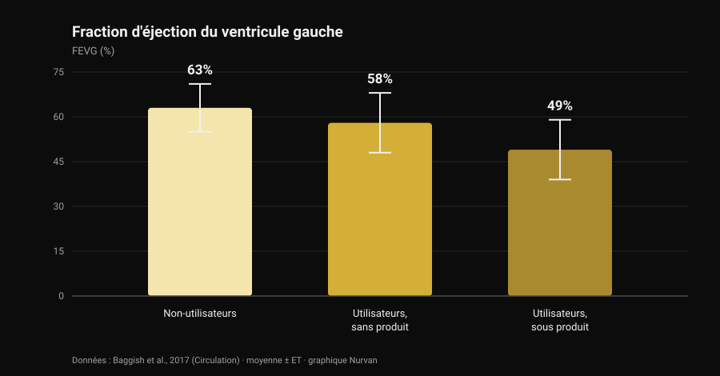
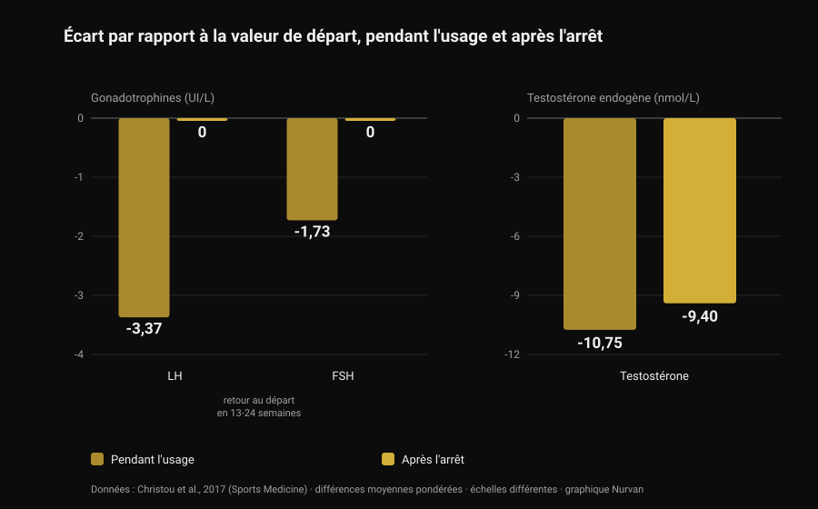

# Stéroïdes anabolisants : effets secondaires et risques

Par [Giammaria Loi](/autore/giammaria-loi) · mis à jour le 28 octobre 2026

Un post passé dans mon fil disait une chose juste et peu populaire : les stéroïdes anabolisants fonctionnent, mais on ne choisit pas seulement les effets qu'on veut. C'est vrai, et la littérature le chiffre bien mieux qu'une diapositive. J'ai lu huit travaux indexés pour comprendre ce que coûte ce paquet complet — et le chiffre qui m'a le plus surpris ne concerne pas le cœur, mais le temps qu'il faut pour revenir à la normale.

## L'essentiel

- **Qu'ils fonctionnent n'est pas en discussion.** Dix semaines de testostérone à doses supraphysiologiques avec entraînement : **+6,1 kg de masse maigre**, **+22 kg au développé couché**, **+38 kg au squat**. Même ceux qui ne s'entraînaient pas prenaient du muscle (Bhasin et al., 1996).
- **Le récepteur aux androgènes n'est pas que dans le muscle.** Dans les registres danois, acné, gynécomastie et dysfonction érectile touchent chacun **plus de 10 %** des usagers (Horwitz et al., 2019).
- **C'est sur le cœur que les données sont les meilleures.** Fraction d'éjection du ventricule gauche de **52 %** chez les usagers contre **63 %** chez les non-usagers ; **49 %** chez ceux qui étaient sous produit au moment de l'examen (Baggish et al., 2017).
- **Le retour en arrière est plus lent qu'on ne le raconte.** Après l'arrêt, LH et FSH reviennent au départ en **13-24 semaines**, mais la testostérone produite par le corps était encore **9,4 nmol/L sous la valeur initiale** à 16 semaines (méta-analyse de 33 études, Christou et al., 2017).
- **Pour une minorité, ça ne revient pas complètement.** Sur 19 anciens usagers non traités, **5 avaient une testostérone sous 200 ng/dL** après 3 à 26 mois d'arrêt ; 7 sur 24 ont fait un épisode dépressif majeur pendant le sevrage (Kanayama et al., 2015).

## « Est-ce que ça marche » n'est pas la bonne question

Cette partie est réglée depuis trente ans. En 1996, quarante-trois hommes ont été répartis au hasard en quatre groupes : placebo ou testostérone, avec ou sans entraînement. Ceux qui recevaient des doses supraphysiologiques de testostérone et s'entraînaient ont gagné **6,1 kg de masse maigre** en dix semaines, avec une surface du triceps en hausse de 501 mm² et du quadriceps de 1 174 mm² ; développé couché +22 kg, squat +38 kg.

Le détail le plus instructif est ailleurs : **ceux qui ne s'entraînaient pas prenaient aussi du muscle**. Dans le groupe testostérone sans exercice, la surface du triceps a augmenté de 424 mm², tandis que dans le groupe placebo sans exercice elle a *diminué* de 81 mm². Le produit agit indépendamment du stimulus, ce qui explique l'ampleur de l'usage : la prévalence estimée sur la vie entière tourne autour de **6,4 % chez les hommes et 1,6 % chez les femmes** (Nieschlag et Vorona, 2015).

Par honnêteté : dans cet essai, ni l'humeur ni le comportement n'ont été modifiés, dans aucun groupe. Mais dix semaines sous surveillance médicale, ce n'est pas dix ans de cycles autogérés — et c'est de cet écart que parle la suite.

## Pourquoi on ne choisit pas seulement les effets voulus

Le récepteur aux androgènes est unique, et ce n'est pas un récepteur du muscle. Il est exprimé dans le myocarde, le foie, la peau, le follicule pileux, la prostate, l'os, le larynx et le cerveau. Quand les androgènes circulants montent très au-dessus de la normale, ils montent pour tous ces tissus en même temps.

Le « rapport anabolisant/androgène » des tableaux qui circulent vient de tests sur rongeurs et ne se traduit pas par une sélectivité propre chez l'humain. La vérification empirique est dans les registres : dans la cohorte danoise de Horwitz, acné, **gynécomastie** (développement du tissu mammaire chez l'homme) et dysfonction érectile touchaient chacune plus de 10 % des usagers. Aucun des trois n'est un effet recherché.

Chez les femmes, certaines lignes ne s'effacent pas : acné et hirsutisme sont fréquents, et **la mue de la voix est irréversible** (Nieschlag et Vorona, 2015). La revue la plus récente l'écrit noir sur blanc : la plupart des effets indésirables sont légers et réversibles, mais certains peuvent causer des dommages permanents ou être potentiellement mortels (Linhares et al., 2022).

La question utile n'est donc pas « quels effets je veux », mais **quels effets j'accepte de ne pas pouvoir choisir**. Sur les androgènes et les cheveux, nous avons traité le mécanisme de la DHT à part, dans [la créatine fait-elle perdre les cheveux](/fr/blog/creatine-chute-cheveux).

## Le cœur : là où les données sont les plus solides

L'étude la plus informative est transversale : 140 pratiquants de 34 à 54 ans — 86 avec au moins deux années cumulées d'usage, 54 non-usagers — évalués par échocardiographie et angioscanner coronaire.

*Graphique Nurvan d'après Baggish et al., 2017 (Circulation). Moyennes telles que rapportées dans le résumé ; les barres d'erreur représentent l'écart-type.*

La fraction d'éjection — la part de sang que le ventricule gauche éjecte à chaque battement — était en moyenne de **52 % chez les usagers contre 63 % chez les non-usagers**. La fonction diastolique, c'est-à-dire la capacité du ventricule à se relâcher et à se remplir, était elle aussi réduite (vitesse de relaxation précoce 9,3 contre 11,1 cm/s). Les auteurs l'appellent par son nom : dysfonction myocardique.

À l'intérieur du groupe des usagers se trouve le chiffre à retenir : ceux qui étaient sous produit au moment de l'examen étaient à **49 %**, ceux qui avaient arrêté à **58 %**. La fonction de pompe récupère donc au moins en partie à l'arrêt.

Les coronaires, non. Le volume médian de plaque était de 3 mL chez les usagers contre 0 mL chez les non-usagers, et il **augmentait avec la durée cumulée d'utilisation** : chaque dizaine d'années d'usage valait 0,60 écart-type de charge athéromateuse en plus. C'est la distinction que les résumés des réseaux ne font presque jamais : la contractilité va et vient, la plaque est un dépôt, et les dépôts ne se vident pas en fin de cycle.

Côté événements cliniques, un registre danois de 1 189 usagers suivis environ onze ans face à 59 450 témoins rapporte un infarctus avec un rapport de risque ajusté de **3,00** et une **cardiomyopathie à 8,90** (Windfeld-Mathiasen et al., 2025). Nous en avons parlé en détail, avec ce qui arrive aux lipides, dans [testostérone et cholestérol](/fr/blog/testosterone-et-cholesterol-hdl-ldl).

## Combien de temps faut-il vraiment pour revenir en arrière

C'est là que la vulgarisation de salle se trompe le plus, et là que les données sont les plus solides : une méta-analyse de 33 études et 3 879 participants, dont 1 766 usagers.

*Graphique Nurvan d'après Christou et al., 2017 (Sports Medicine). Différences moyennes pondérées par rapport au départ, telles que rapportées dans le résumé. LH et FSH en UI/L, testostérone en nmol/L : échelles différentes, placées côte à côte pour en lire la tendance.*

Pendant l'usage, l'axe qui pilote la production naturelle de testostérone s'éteint : **LH −3,37 UI/L**, **FSH −1,73 UI/L**, testostérone produite par le corps **−10,75 nmol/L** par rapport au départ. Prévisible : le cerveau voit des androgènes partout et cesse d'en demander.

Ce qui compte, c'est la suite. Les gonadotrophines — les hormones par lesquelles l'hypophyse donne l'ordre aux testicules — reviennent à leur niveau de départ en **13-24 semaines**. La testostérone, non : à 16 semaines après l'arrêt, elle était encore **9,4 nmol/L sous la valeur initiale**. L'ordre repart avant que l'usine ne reprenne la production.

Chez ceux qui ont arrêté depuis longtemps, les données sont encore plus directes. Dix-neuf anciens usagers de longue durée non traités, comparés à 36 pratiquants n'ayant jamais rien pris, avaient une testostérone inférieure de 131 ng/dL, un volume testiculaire inférieur de 2,3 mL et un désir sexuel plus bas de 2,4 points sur 10 ; cinq étaient **sous 200 ng/dL** après une abstinence de 3 à 26 mois. Et voici la partie qui n'arrive presque jamais dans les diapositives : sur les 24 anciens usagers de l'étude, **7 (29 %) ont fait un épisode dépressif majeur pendant le sevrage**, dont quatre n'en avaient jamais fait à aucun autre moment de leur vie, et deux n'ont retrouvé ni libido ni fonction érectile, même sous traitement substitutif adéquat (Kanayama et al., 2015).

Pour la fertilité, le tableau est cohérent : altérations du nombre, de la forme et de la mobilité des spermatozoïdes, baisse du volume testiculaire et, chez la femme, clitoromégalie, irrégularités menstruelles et hypofertilité (Christou et al., 2017). La suppression de la spermatogenèse est décrite comme réversible, avec une nuance importante : si elle ne récupère pas, un trouble de la fertilité préexistant a pu refaire surface (Nieschlag et Vorona, 2015).

## Mortalité et hospitalisations : ce que disent les registres

Sur le long terme, seules des données de population existent, parce qu'une expérience contrôlée à ces doses ne passerait aucun comité d'éthique.

Dans la cohorte danoise, 545 hommes positifs à un contrôle antidopage en salle ont été comparés à 5 450 témoins appariés : **mortalité trois fois plus élevée** (rapport de risque 3,0 ; IC 95 % 1,3-7,0) et 0,81 contact hospitalier annuel médian contre 0,36. Le résultat a été répliqué dans une seconde cohorte de 644 hommes ayant refusé le test (Horwitz et al., 2019).

Un avertissement, sinon le chiffre devient un slogan : ce sont des études observationnelles, et les usagers diffèrent des témoins aussi par d'autres substances, d'autres habitudes et un rapport au risque différent. Ce « trois fois » n'est pas la contribution isolée de la molécule — c'est en revanche ce qui ressemble le plus à un bilan réel.

## Ce que dit vraiment la recherche

- **« Les stéroïdes anabolisants fonctionnent » — Confirmé.** Essai randomisé : +6,1 kg de masse maigre en dix semaines avec entraînement, et prise de muscle même sans entraînement.
- **« On ne peut pas exposer le muscle de façon sélective : anabolisant et androgène ne se séparent pas » — Confirmé.** Un seul récepteur sur de nombreux tissus, et dans les registres acné, gynécomastie et dysfonction érectile au-dessus de 10 % chacune. Chez la femme, la mue de la voix est irréversible.
- **« Le risque n'est pas binaire : il dépend de la dose, de la durée, de la molécule et de la réponse individuelle » — À préciser.** Dose et durée comptent, c'est documenté. Mais la réponse individuelle est précisément la variable qu'on ne peut pas connaître à l'avance : c'est un risque, pas un réglage.
- **« Plus de pharmacologie, plus de variables à gérer » — À préciser.** « Gérer » suppose que tout ce qui compte est mesurable et corrigeable. Le signal le plus fort des registres est la cardiomyopathie, et le résultat qui augmente avec l'exposition est un dépôt dans les coronaires : ni l'un ni l'autre ne se corrige avec une prise de sang.
- **« Une fois le cycle fini, tu redeviens comme avant » — Démenti.** Testostérone encore 9,4 nmol/L sous le départ à 16 semaines ; cinq anciens usagers sur 19 sous 200 ng/dL après des mois ; deux sur 24 sans récupération de la fonction sexuelle, même sous traitement.
- **« Si tu es jeune, en bonne santé et que tu fais des bilans, tu ne risques rien » — Démenti.** Les cohortes danoises sont justement composées de pratiquants de salle : mortalité triplée, hospitalisations plus que doublées, cardiomyopathie avec un risque presque neuf fois supérieur.
- **« Un usage contrôlé annule le risque » — Invérifiable.** Il n'existe pas d'essai randomisé à ces doses et il n'y en aura pas. Affirmer le contraire revient à prendre l'absence de données pour une preuve de sécurité.

## Comment l'appliquer

1. **Si vous y pensez, changez la question.** Non pas « combien il m'en faut pour grossir », mais « quels effets j'accepte de ne pas pouvoir choisir » : gynécomastie, acné, dysfonction érectile et plaque coronaire ne sont pas des options qu'on désactive.
2. **Si vous en prenez ou en avez pris, dites-le au médecin.** C'est l'information qui change la lecture de n'importe quel bilan, et beaucoup de médecins ne la demandent pas : c'est à vous de l'apporter.
3. **Repérez les symptômes du sevrage.** Baisse du désir, difficultés érectiles et humeur noire après l'arrêt ne sont pas un manque de caractère : dans l'étude de Kanayama, 29 % ont fait un épisode dépressif majeur à ce moment-là. C'est une situation médicale, et elle se traite.
4. **Si un projet d'enfant existe, parlez-en avant.** La spermatogenèse est supprimée pendant l'usage et récupère sur des délais longs et variables : une consultation d'andrologie préalable vaut plus que n'importe quel protocole de forum.
5. **Ne confondez pas traitement prescrit et usage de salle,** et lisez des séries plutôt qu'un bilan isolé. Tension, numération, lipides et composition corporelle parlent sur des années, pas sur une semaine. La comparaison est dans [testostérone et cholestérol](/fr/blog/testosterone-et-cholesterol-hdl-ldl).

### Essayez Nurvan — bilans, mesures et charges sur la même frise

Quand on suit sa santé dans la durée, le problème pratique est que les comptes rendus se perdent entre e-mails, dossiers et PDF. Dans Nurvan, vous importez vos bilans sanguins et voyez l'évolution de chaque valeur sur une frise, avec les charges, le RIR et les mensurations des mêmes mois juste à côté : chez le médecin, vous apportez la série, pas la dernière feuille. **[Essayez Nurvan](https://nurvan.app)**

## Questions fréquentes

**Quels sont les effets secondaires les plus fréquents des stéroïdes anabolisants ?**
Dans les registres de population, les plus fréquents sont l'acné, la gynécomastie et la dysfonction érectile, chacun chez plus de 10 % des usagers. S'y ajoutent l'atrophie testiculaire, la suppression de la production naturelle de testostérone et, côté cardiaque, une baisse de la fonction de pompe et une accumulation de plaque coronaire.

**Combien de temps faut-il pour récupérer après l'arrêt ?**
Dans la méta-analyse de 33 études, les gonadotrophines reviennent au départ en 13-24 semaines, mais la testostérone produite par le corps était encore 9,4 nmol/L sous la valeur initiale à 16 semaines. Chez une partie des anciens usagers, les valeurs restent basses des mois : cinq sur dix-neuf étaient sous 200 ng/dL après 3 à 26 mois d'arrêt.

**Les stéroïdes abîment-ils le cœur de façon définitive ?**
Il faut séparer deux choses. La fonction contractile semble récupérer au moins en partie : chez les usagers, ceux qui avaient arrêté avaient une fraction d'éjection de 58 % contre 49 % pour ceux sous produit. La plaque coronaire, elle, augmente avec les années cumulées d'usage et n'est pas une valeur qui se remet à zéro.

**Existe-t-il un stéroïde anabolisant sûr ?**
Non, et aucun essai randomisé à ces doses ne pourrait le démontrer : les contraintes éthiques interdisent d'exposer des volontaires à des régimes potentiellement toxiques. Les différences entre molécules sont réelles — la voie orale, par exemple, pèse bien plus lourd sur les lipides que la voie injectable — mais ce sont des différences d'ampleur du dommage, pas de présence ou d'absence.

## À lire aussi

- [Testostérone et cholestérol : ce que disent les études](/fr/blog/testosterone-et-cholesterol-hdl-ldl) — les chiffres sur le HDL, le LDL et l'apoB, et l'écart entre traitement et cycle.
- [La créatine fait-elle perdre les cheveux ?](/fr/blog/creatine-chute-cheveux) — le mécanisme de la DHT expliqué en détail, vérifié sur les études.
- [Tier list des compléments pour la force](/fr/blog/classement-complements-force-tier-list) — ce qui a des preuves solides, classé par niveau de preuve, sans pharmacologie.

## Sources

1. Bhasin S, Storer TW, Berman N, Callegari C, Clevenger B, Phillips J, Bunnell TJ, Tricker R, Shirazi A, Casaburi R, 1996. *The effects of supraphysiologic doses of testosterone on muscle size and strength in normal men.* New England Journal of Medicine 335(1):1-7. [PMID 8637535](https://pubmed.ncbi.nlm.nih.gov/8637535/) · [DOI 10.1056/NEJM199607043350101](https://doi.org/10.1056/NEJM199607043350101)
2. Baggish AL, Weiner RB, Kanayama G, Hudson JI, Lu MT, Hoffmann U, Pope HG, 2017. *Cardiovascular Toxicity of Illicit Anabolic-Androgenic Steroid Use.* Circulation 135(21):1991-2002. [PMID 28533317](https://pubmed.ncbi.nlm.nih.gov/28533317/) · [DOI 10.1161/CIRCULATIONAHA.116.026945](https://doi.org/10.1161/CIRCULATIONAHA.116.026945)
3. Christou MA, Christou PA, Markozannes G, Tsatsoulis A, Mastorakos G, Tigas S, 2017. *Effects of Anabolic Androgenic Steroids on the Reproductive System of Athletes and Recreational Users: A Systematic Review and Meta-Analysis.* Sports Medicine 47(9):1869-1883. [PMID 28258581](https://pubmed.ncbi.nlm.nih.gov/28258581/) · [DOI 10.1007/s40279-017-0709-z](https://doi.org/10.1007/s40279-017-0709-z)
4. Kanayama G, Hudson JI, DeLuca J, Isaacs S, Baggish A, Weiner R, Bhasin S, Pope HG, 2015. *Prolonged hypogonadism in males following withdrawal from anabolic-androgenic steroids: an under-recognized problem.* Addiction 110(5):823-31. [PMID 25598171](https://pubmed.ncbi.nlm.nih.gov/25598171/) · [DOI 10.1111/add.12850](https://doi.org/10.1111/add.12850)
5. Horwitz H, Andersen JT, Dalhoff KP, 2019. *Health consequences of androgenic anabolic steroid use.* Journal of Internal Medicine 285(3):333-340. [PMID 30460728](https://pubmed.ncbi.nlm.nih.gov/30460728/) · [DOI 10.1111/joim.12850](https://doi.org/10.1111/joim.12850)
6. Nieschlag E, Vorona E, 2015. *MECHANISMS IN ENDOCRINOLOGY: Medical consequences of doping with anabolic androgenic steroids: effects on reproductive functions.* European Journal of Endocrinology 173(2):R47-58. [PMID 25805894](https://pubmed.ncbi.nlm.nih.gov/25805894/) · [DOI 10.1530/EJE-15-0080](https://doi.org/10.1530/EJE-15-0080)
7. Linhares BL, Miranda EP, Cintra AR, Reges R, Torres LO, 2022. *Use, Misuse and Abuse of Testosterone and Other Androgens.* Sexual Medicine Reviews 10(4):583-595. [PMID 34887237](https://pubmed.ncbi.nlm.nih.gov/34887237/) · [DOI 10.1016/j.sxmr.2021.10.002](https://doi.org/10.1016/j.sxmr.2021.10.002)
8. Windfeld-Mathiasen J, Heerfordt IM, Dalhoff KP, Andersen JT, Andersen MA, Johansson KS, Biering-Sørensen T, Olsen FJ, Horwitz H, 2025. *Cardiovascular Disease in Anabolic Androgenic Steroid Users.* Circulation 151(12):828-834. [PMID 39945117](https://pubmed.ncbi.nlm.nih.gov/39945117/) · [DOI 10.1161/CIRCULATIONAHA.124.071117](https://doi.org/10.1161/CIRCULATIONAHA.124.071117)

Références récupérées via PubMed. Point de départ : la publication de **built4mayhem** ([Project Mayhem](https://www.instagram.com/built4mayhem/)) du 25 septembre 2026, [post original](https://www.instagram.com/p/DduTeKEjcwx/). Seuls l'auteur, la date et la légende ont été lus : aucun texte et aucune image n'ont été reproduits, et les diapositives du carrousel n'ont été ni téléchargées ni consultées. Le sujet a été réécrit de zéro en remontant aux études primaires et en les vérifiant une par une.

---

**Giammaria Loi** est le fondateur de Nurvan. Il s'entraîne avec des poids depuis 2012, travaille comme préparateur et coach certifié FIPE depuis 2013 et participe à des compétitions nationales de powerlifting depuis 2018. Chaque article qu'il signe part des études scientifiques et arrive à ce qui fonctionne vraiment en salle.

> Note : contenu informatif, qui ne remplace pas l'avis d'un médecin. Cet article décrit les risques documentés dans la littérature et **ne contient aucun dosage, aucune molécule et aucun protocole** : il n'encourage en aucune façon l'usage de ces substances. L'usage non médical de stéroïdes anabolisants est interdit dans le sport et illégal dans de nombreux pays. Si vous prenez ou avez pris ces produits, ou si vous envisagez un traitement hormonal, parlez-en à un médecin.
