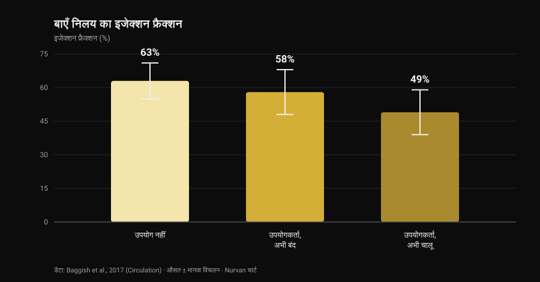
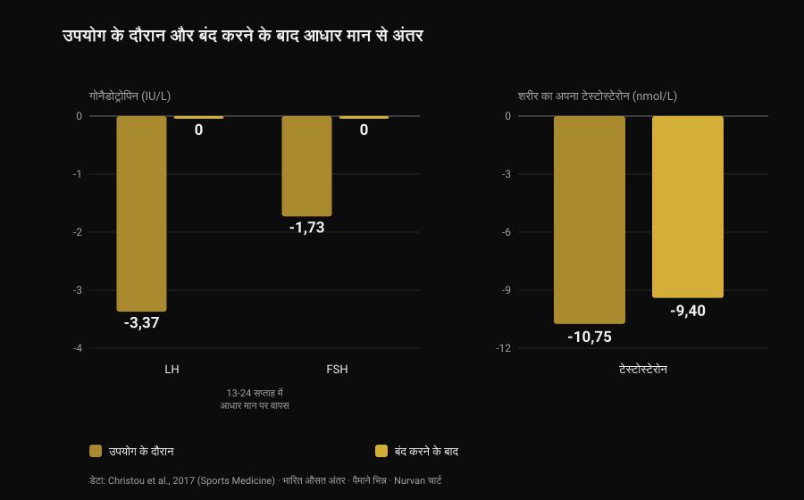

# एनाबॉलिक स्टेरॉयड: साइड इफेक्ट और असली जोखिम

[Giammaria Loi](/autore/giammaria-loi) द्वारा · 28 अक्टूबर 2026 को अपडेट किया गया

मेरी फ़ीड में एक पोस्ट आई जिसमें एक सही और कम लोकप्रिय बात कही गई थी: एनाबॉलिक स्टेरॉयड काम करते हैं, लेकिन आप सिर्फ़ वही असर नहीं चुन सकते जो आपको चाहिए। यह सच है, और रिसर्च इसे किसी भी स्लाइड से कहीं बेहतर आंकड़ों में बताती है। मैंने आठ इंडेक्स्ड पेपर पढ़े ताकि समझ सकूँ कि इस "पूरे पैकेज" की कीमत क्या है — और जिस आंकड़े ने मुझे सबसे ज़्यादा चौंकाया वह दिल का नहीं, बल्कि सामान्य स्थिति में लौटने में लगने वाले समय का है।

## संक्षेप में

- **ये काम करते हैं, इस पर बहस नहीं है।** दस हफ़्ते तक सुप्राफ़िज़ियोलॉजिकल खुराक में टेस्टोस्टेरोन और ट्रेनिंग: **फैट-फ्री मास +6.1 किलो**, **बेंच प्रेस +22 किलो**, **स्क्वाट +38 किलो**। जो लोग ट्रेनिंग नहीं कर रहे थे, उनकी भी मसल बढ़ी (Bhasin et al., 1996)।
- **एंड्रोजन रिसेप्टर सिर्फ़ मसल में नहीं होता।** डेनिश रजिस्ट्री में मुँहासे, गाइनेकोमास्टिया और इरेक्टाइल डिसफंक्शन में से हर एक **10% से ज़्यादा** उपयोगकर्ताओं को होता है (Horwitz et al., 2019)।
- **दिल पर सबसे मज़बूत डेटा है।** बाएँ निलय का इजेक्शन फ्रैक्शन उपयोगकर्ताओं में **52%** बनाम न लेने वालों में **63%**; जाँच के समय चालू साइकल वालों में **49%** (Baggish et al., 2017)।
- **वापसी उतनी तेज़ नहीं जितनी बताई जाती है।** बंद करने के बाद LH और FSH **13-24 हफ़्ते** में आधार मान पर लौट आते हैं, लेकिन शरीर का अपना टेस्टोस्टेरोन 16 हफ़्ते बाद भी आधार से **9.4 nmol/L नीचे** था (33 स्टडी का मेटा-विश्लेषण, Christou et al., 2017)।
- **कुछ लोगों में यह पूरी तरह वापस नहीं आता।** बिना इलाज वाले 19 पूर्व उपयोगकर्ताओं में से **5 का टेस्टोस्टेरोन 3-26 महीने छोड़ने के बाद भी 200 ng/dL से नीचे** था; 24 में से 7 को बंद करने के दौरान बड़ा डिप्रेसिव एपिसोड हुआ (Kanayama et al., 2015)।

## "क्या ये काम करते हैं" दिलचस्प सवाल नहीं है

यह हिस्सा तीस साल पहले बंद हो चुका है। 1996 में तैंतालीस पुरुषों को चार समूहों में बाँटा गया: प्लेसिबो या टेस्टोस्टेरोन, ट्रेनिंग के साथ या बिना। जिन्हें सुप्राफ़िज़ियोलॉजिकल खुराक मिली और जो ट्रेनिंग भी कर रहे थे, उन्होंने दस हफ़्ते में **6.1 किलो फैट-फ्री मास** बढ़ाया; ट्राइसेप्स का क्षेत्रफल 501 मिमी² और क्वाड्रिसेप्स का 1,174 मिमी² बढ़ा; बेंच प्रेस +22 किलो, स्क्वाट +38 किलो।

ज़्यादा सिखाने वाली बात दूसरी है: **जो ट्रेनिंग नहीं कर रहे थे, उनकी भी मसल बढ़ी**। टेस्टोस्टेरोन-बिना-व्यायाम समूह में ट्राइसेप्स का क्षेत्रफल 424 मिमी² बढ़ा, जबकि प्लेसिबो-बिना-व्यायाम समूह में *81 मिमी² घट गया*। दवा उत्तेजना से स्वतंत्र रूप से काम करती है, और इसी से इसका फैलाव समझ आता है: जीवनकाल में उपयोग का अनुमान लगभग **पुरुषों में 6.4% और महिलाओं में 1.6%** है (Nieschlag और Vorona, 2015)।

ईमानदारी के लिए: उस ट्रायल में किसी भी समूह में मूड या व्यवहार नहीं बदला। लेकिन डॉक्टरी निगरानी में दस हफ़्ते, खुद चलाए गए दस साल के साइकल जैसे नहीं होते — और बाकी लेख इसी फ़र्क़ के बारे में है।

## आप सिर्फ़ मनचाहे असर क्यों नहीं चुन सकते

एंड्रोजन रिसेप्टर एक ही है, और वह मसल का रिसेप्टर नहीं है। वह हृदय की मांसपेशी, लिवर, त्वचा, बालों के रोम, प्रोस्टेट, हड्डी, स्वरयंत्र और दिमाग़ में मौजूद है। जब खून में एंड्रोजन सामान्य से बहुत ऊपर जाते हैं, तो वे इन सभी ऊतकों के लिए एक साथ बढ़ते हैं।

इंटरनेट पर घूमती तालिकाओं का "एनाबॉलिक/एंड्रोजेनिक अनुपात" कृन्तकों पर हुए परीक्षणों से आता है और इंसानों में साफ़-सुथरी ऊतक-चयनात्मकता में नहीं बदलता। व्यावहारिक जाँच रजिस्ट्री में है: Horwitz के डेनिश समूह में मुँहासे, **गाइनेकोमास्टिया** (पुरुषों में स्तन ऊतक का बढ़ना) और इरेक्टाइल डिसफंक्शन — तीनों में से हर एक 10% से ज़्यादा उपयोगकर्ताओं को हुआ। इनमें से कोई भी असर कोई चाहता नहीं है।

महिलाओं में कुछ चीज़ें मिटती नहीं: मुँहासे और अनचाहे बाल आम हैं, और **आवाज़ का भारी होना अपरिवर्तनीय है** (Nieschlag और Vorona, 2015)। सबसे नई समीक्षा इसे साफ़ लिखती है: ज़्यादातर अनचाहे असर हल्के और वापस लौटने वाले होते हैं, लेकिन कुछ स्थायी नुकसान कर सकते हैं या जानलेवा हो सकते हैं (Linhares et al., 2022)।

इसलिए काम का सवाल यह नहीं कि "मुझे कौन से असर चाहिए", बल्कि **कौन से असर मैं बिना चुने स्वीकार करने को तैयार हूँ**। एंड्रोजन और बालों पर DHT की प्रक्रिया हमने अलग से समझाई है — [क्या क्रिएटिन से बाल झड़ते हैं](/hi/blog/creatine-and-hair-fall) में।

## दिल: जहाँ डेटा सबसे मज़बूत है

सबसे जानकारी देने वाली स्टडी क्रॉस-सेक्शनल है: 34 से 54 साल के 140 वेटलिफ़्टर — 86 कम से कम दो साल के संचयी उपयोग वाले और 54 न लेने वाले — जिनकी इकोकार्डियोग्राफ़ी और कोरोनरी सीटी एंजियोग्राफ़ी की गई।

*Baggish et al., 2017 (Circulation) के आंकड़ों पर Nurvan का मूल चार्ट। औसत मान शोध-सार में दिए गए हैं; एरर बार मानक विचलन दिखाते हैं।*

इजेक्शन फ्रैक्शन — हर धड़कन में बायाँ निलय जितना खून बाहर भेजता है — उपयोगकर्ताओं में औसतन **52%** था और न लेने वालों में **63%**। डायस्टोलिक फ़ंक्शन, यानी निलय की शिथिल होकर भरने की क्षमता, भी घटी हुई थी (अर्ली रिलैक्सेशन वेलोसिटी 9.3 बनाम 11.1 सेमी/सेकंड)। लेखक इसे उसके नाम से ही पुकारते हैं: मायोकार्डियल डिसफंक्शन।

उपयोगकर्ताओं के भीतर एक आंकड़ा याद रखने लायक है: जाँच के समय दवा ले रहे लोग **49%** पर थे, और बंद कर चुके लोग **58%** पर। यानी पंप करने की क्षमता बंद करने के बाद कम से कम आंशिक रूप से सुधरती है।

कोरोनरी धमनियाँ नहीं सुधरतीं। प्लाक का माध्य आयतन उपयोगकर्ताओं में 3 मिली बनाम न लेने वालों में 0 मिली था, और यह **संचयी उपयोग की अवधि के साथ बढ़ता** गया: हर दस साल के कुल उपयोग पर एथेरोस्क्लेरोटिक भार 0.60 मानक विचलन ज़्यादा। सोशल मीडिया के सारांश यही फ़र्क़ लगभग कभी नहीं बताते: सिकुड़ने की ताकत आती-जाती रहती है, जबकि प्लाक एक जमाव है, और जमाव साइकल खत्म होते ही खाली नहीं होते।

नैदानिक घटनाओं पर, 1,189 उपयोगकर्ताओं को लगभग ग्यारह साल तक देखने वाली एक डेनिश रजिस्ट्री 59,450 नियंत्रणों की तुलना में हार्ट अटैक का समायोजित जोखिम अनुपात **3.00** और **कार्डियोमायोपैथी 8.90** बताती है (Windfeld-Mathiasen et al., 2025)। इस पर और लिपिड पर क्या होता है, इस पर हमने [टेस्टोस्टेरोन और कोलेस्ट्रॉल](/hi/blog/testosterone-aur-cholesterol) में विस्तार से लिखा है।

## वापस लौटने में असल में कितना समय लगता है

जिम की जानकारी यहीं सबसे ज़्यादा गलत होती है, और डेटा यहीं सबसे मज़बूत है: 33 स्टडी और 3,879 प्रतिभागियों (जिनमें 1,766 उपयोगकर्ता) का मेटा-विश्लेषण।

*Christou et al., 2017 (Sports Medicine) के आंकड़ों पर Nurvan का मूल चार्ट। आधार मान से भारित औसत अंतर, जैसा शोध-सार में दिया गया है। LH और FSH IU/L में, टेस्टोस्टेरोन nmol/L में: पैमाने अलग हैं, रुझान पढ़ने के लिए साथ-साथ रखे गए हैं।*

उपयोग के दौरान वह अक्ष बंद हो जाता है जो प्राकृतिक टेस्टोस्टेरोन बनाता है: **LH −3.37 IU/L**, **FSH −1.73 IU/L**, शरीर का अपना टेस्टोस्टेरोन आधार से **−10.75 nmol/L**। यह अपेक्षित था: दिमाग़ चारों ओर एंड्रोजन देखता है और माँगना बंद कर देता है।

असली बात आगे है। गोनैडोट्रोपिन — वे हॉर्मोन जिनसे पिट्यूटरी अंडकोष को आदेश देती है — **13-24 हफ़्ते** में आधार मान पर लौट आते हैं। टेस्टोस्टेरोन नहीं: बंद करने के 16 हफ़्ते बाद भी वह शुरुआती मान से **9.4 nmol/L नीचे** था। आदेश तब निकल जाता है जब फ़ैक्ट्री उत्पादन शुरू भी नहीं कर पाई होती।

जिन्होंने बहुत पहले छोड़ दिया, उनके आंकड़े और भी सीधे हैं। बिना इलाज वाले उन्नीस लंबे समय के पूर्व उपयोगकर्ताओं की तुलना 36 ऐसे वेटलिफ़्टरों से की गई जिन्होंने कभी कुछ नहीं लिया: उनका टेस्टोस्टेरोन 131 ng/dL कम, अंडकोष का आयतन 2.3 मिली कम और यौन इच्छा का स्कोर 10 में से 2.4 अंक कम था; पाँच लोग 3 से 26 महीने छोड़ने के बाद भी **200 ng/dL से नीचे** थे। और यह हिस्सा स्लाइड्स में लगभग कभी नहीं आता: उस स्टडी के 24 पूर्व उपयोगकर्ताओं में से **7 (29%) को बंद करने के दौरान बड़ा डिप्रेसिव एपिसोड हुआ**, जिनमें से चार को जीवन में कभी और नहीं हुआ था, और दो लोगों की यौन इच्छा और इरेक्टाइल फ़ंक्शन पर्याप्त रिप्लेसमेंट थेरेपी के बावजूद वापस नहीं आई (Kanayama et al., 2015)।

फर्टिलिटी पर तस्वीर इसी से मेल खाती है: शुक्राणुओं की संख्या, आकार और गतिशीलता में बदलाव, अंडकोष के आयतन में कमी, और महिलाओं में क्लिटोरोमेगाली, मासिक चक्र की अनियमितता और प्रजनन क्षमता में कमी (Christou et al., 2017)। शुक्राणु बनने का दबना वापस लौटने वाला बताया जाता है, एक ज़रूरी टिप्पणी के साथ: अगर वापसी नहीं होती, तो संभव है कि पहले से मौजूद कोई फर्टिलिटी समस्या सामने आ गई हो (Nieschlag और Vorona, 2015)।

## मृत्यु दर और अस्पताल: रजिस्ट्री क्या कहती है

लंबी अवधि पर सिर्फ़ जनसंख्या-स्तर के आंकड़े हैं, क्योंकि इन खुराकों पर नियंत्रित प्रयोग किसी भी नैतिकता समिति से पास नहीं होगा।

डेनिश समूह में, जिम की डोपिंग जाँच में पॉज़िटिव पाए गए 545 पुरुषों की तुलना 5,450 मिलान किए गए नियंत्रणों से की गई: **मृत्यु दर तीन गुना ज़्यादा** (जोखिम अनुपात 3.0; 95% CI 1.3-7.0) और सालाना अस्पताल संपर्क का माध्य 0.81 बनाम 0.36। यह नतीजा 644 ऐसे पुरुषों के दूसरे समूह में दोहराया गया जिन्होंने जाँच से इनकार किया था (Horwitz et al., 2019)।

एक चेतावनी, वरना आंकड़ा नारा बन जाता है: ये अवलोकन-आधारित स्टडी हैं, और स्टेरॉयड लेने वाले लोग नियंत्रणों से दूसरी चीज़ों, दूसरी आदतों और जोखिम लेने की प्रवृत्ति में भी अलग होते हैं। वह "तीन गुना" सिर्फ़ दवा का अलग योगदान नहीं है — लेकिन असली हिसाब-किताब के सबसे क़रीब यही है जो हमारे पास है।

## रिसर्च असल में क्या कहती है

- **"एनाबॉलिक स्टेरॉयड काम करते हैं" — पुष्ट।** रैंडमाइज़्ड ट्रायल: ट्रेनिंग के साथ दस हफ़्ते में +6.1 किलो फैट-फ्री मास, और बिना ट्रेनिंग के भी मसल ग्रोथ।
- **"सिर्फ़ मसल को चुनकर असर नहीं दिया जा सकता: एनाबॉलिक और एंड्रोजेनिक असर अलग नहीं होते" — पुष्ट।** एक ही रिसेप्टर कई ऊतकों में, और रजिस्ट्री में मुँहासे, गाइनेकोमास्टिया और इरेक्टाइल डिसफंक्शन — हर एक 10% से ऊपर। महिलाओं में आवाज़ का भारी होना अपरिवर्तनीय है।
- **"जोखिम हाँ/नहीं जैसा नहीं है: वह खुराक, अवधि, दवा और व्यक्तिगत प्रतिक्रिया पर निर्भर है" — स्पष्टीकरण ज़रूरी।** खुराक और अवधि मायने रखती हैं, यह दर्ज है। लेकिन व्यक्तिगत प्रतिक्रिया ठीक वही चर है जो पहले से पता नहीं चल सकता: वह जोखिम है, कोई सेटिंग नहीं।
- **"जितनी ज़्यादा दवा, उतने ज़्यादा चर संभालने को" — स्पष्टीकरण ज़रूरी।** "संभालना" यह मान लेता है कि जो मायने रखता है वह मापा और सुधारा जा सकता है। रजिस्ट्री का सबसे मज़बूत संकेत कार्डियोमायोपैथी है, और एक्सपोज़र के साथ बढ़ने वाली चीज़ कोरोनरी धमनी में जमाव है: इनमें से कोई भी खून की जाँच से ठीक नहीं होता।
- **"साइकल खत्म होते ही सब पहले जैसा हो जाता है" — खंडित।** 16 हफ़्ते बाद भी टेस्टोस्टेरोन आधार से 9.4 nmol/L नीचे; 19 में से 5 पूर्व उपयोगकर्ता महीनों बाद भी 200 ng/dL से नीचे; 24 में से 2 की यौन क्षमता थेरेपी के बावजूद वापस नहीं आई।
- **"अगर आप जवान और स्वस्थ हैं और जाँच कराते हैं तो जोखिम नहीं है" — खंडित।** डेनिश समूह ठीक जिम जाने वालों से ही बने हैं: तीन गुना मृत्यु दर, दोगुने से ज़्यादा अस्पताल संपर्क, कार्डियोमायोपैथी का जोखिम लगभग नौ गुना।
- **"नियंत्रित उपयोग जोखिम खत्म कर देता है" — सत्यापन असंभव।** इन खुराकों पर रैंडमाइज़्ड ट्रायल न हैं और न होंगे। इसके उलट दावा करने वाला आंकड़ों की अनुपस्थिति को सुरक्षा का प्रमाण बना रहा है।

## इसे कैसे लागू करें

1. **अगर आप सोच रहे हैं, तो सवाल बदलिए।** "बढ़ने के लिए कितना चाहिए" नहीं, बल्कि "कौन से असर मैं बिना चुने स्वीकार करने को तैयार हूँ": गाइनेकोमास्टिया, मुँहासे, इरेक्टाइल डिसफंक्शन और कोरोनरी प्लाक ऐसे विकल्प नहीं हैं जिन्हें बंद किया जा सके।
2. **अगर आप ले रहे हैं या ले चुके हैं, तो डॉक्टर को बताइए।** यही वह जानकारी है जो किसी भी रिपोर्ट का मतलब बदल देती है, और बहुत से डॉक्टर खुद नहीं पूछते: बताना आपको ही है।
3. **बंद करने के लक्षण पहचानिए।** छोड़ने के बाद इच्छा में कमी, इरेक्शन की दिक्कत और उदास मन चरित्र की कमज़ोरी नहीं है: Kanayama की स्टडी में 29% लोगों को उस दौर में बड़ा डिप्रेसिव एपिसोड हुआ। यह एक चिकित्सीय स्थिति है और इसका इलाज होता है।
4. **अगर बच्चों की योजना है, तो पहले बात कीजिए।** उपयोग के दौरान शुक्राणु बनना दब जाता है और वापसी में लंबा और अलग-अलग समय लगता है: पहले से एंड्रोलॉजी की जाँच किसी भी फ़ोरम प्रोटोकॉल से ज़्यादा काम की है।
5. **डॉक्टर की लिखी थेरेपी और जिम वाले उपयोग को एक मत समझिए,** और एक रिपोर्ट नहीं, पूरी शृंखला देखिए। रक्तचाप, सीबीसी, लिपिड और बॉडी कंपोज़िशन सालों के पैमाने पर कुछ कहते हैं, एक हफ़्ते के नहीं। तुलना [टेस्टोस्टेरोन और कोलेस्ट्रॉल](/hi/blog/testosterone-aur-cholesterol) में है।

### Nurvan आज़माइए — रिपोर्ट, माप और वज़न एक ही टाइमलाइन पर

सालों तक अपनी सेहत पर नज़र रखने में व्यावहारिक दिक्कत यह है कि रिपोर्टें ईमेल, फ़ोल्डर और PDF में बिखर जाती हैं। Nurvan में आप ब्लड रिपोर्ट अपलोड करते हैं और हर वैल्यू का रुझान एक टाइमलाइन पर देखते हैं, और उन्हीं महीनों में साथ में आपके वज़न, RIR और शरीर के माप भी: डॉक्टर के पास आप पूरी शृंखला ले जाते हैं, आख़िरी पन्ना नहीं। **[Nurvan आज़माइए](https://nurvan.app)**

## अक्सर पूछे जाने वाले सवाल

**एनाबॉलिक स्टेरॉयड के सबसे आम साइड इफेक्ट क्या हैं?**
जनसंख्या रजिस्ट्री में सबसे आम हैं मुँहासे, गाइनेकोमास्टिया और इरेक्टाइल डिसफंक्शन — हर एक 10% से ज़्यादा उपयोगकर्ताओं में। इनके साथ अंडकोष का सिकुड़ना, प्राकृतिक टेस्टोस्टेरोन उत्पादन का दबना और दिल की तरफ़ पंपिंग क्षमता में कमी तथा कोरोनरी प्लाक का जमाव जुड़ते हैं।

**छोड़ने के बाद रिकवरी में कितना समय लगता है?**
33 स्टडी के मेटा-विश्लेषण में गोनैडोट्रोपिन 13-24 हफ़्ते में आधार मान पर लौट आते हैं, लेकिन शरीर का अपना टेस्टोस्टेरोन 16 हफ़्ते बाद भी 9.4 nmol/L नीचे था। कुछ पूर्व उपयोगकर्ताओं में मान महीनों तक कम रहते हैं: उन्नीस में से पाँच 3 से 26 महीने बाद भी 200 ng/dL से नीचे थे।

**क्या स्टेरॉयड दिल को स्थायी नुकसान पहुँचाते हैं?**
दो बातें अलग हैं। सिकुड़ने की क्षमता कम से कम आंशिक रूप से लौटती दिखती है: उपयोगकर्ताओं में, बंद कर चुके लोगों का इजेक्शन फ्रैक्शन 58% था और चालू साइकल वालों का 49%। कोरोनरी प्लाक, इसके उलट, संचयी उपयोग के सालों के साथ बढ़ता है और छोड़ने पर शून्य नहीं होता।

**क्या कोई सुरक्षित एनाबॉलिक स्टेरॉयड है?**
नहीं, और इन खुराकों पर कोई रैंडमाइज़्ड ट्रायल यह दिखा भी नहीं सकता: नैतिक सीमाएँ स्वयंसेवकों को संभावित रूप से विषैले नियमों के संपर्क में लाने से रोकती हैं। दवाओं के बीच फ़र्क़ असली है — जैसे मुँह से ली जाने वाली राह लिपिड पर इंजेक्शन से कहीं ज़्यादा भारी पड़ती है — लेकिन यह नुकसान की मात्रा का फ़र्क़ है, होने या न होने का नहीं।

## यह भी पढ़ें

- [टेस्टोस्टेरोन और कोलेस्ट्रॉल: स्टडी क्या कहती हैं](/hi/blog/testosterone-aur-cholesterol) — HDL, LDL और apoB के आंकड़े, और थेरेपी बनाम साइकल का फ़र्क़।
- [क्या क्रिएटिन से बाल झड़ते हैं?](/hi/blog/creatine-and-hair-fall) — DHT की प्रक्रिया विस्तार से, स्टडी से मिलान करके।
- [स्ट्रेंथ सप्लीमेंट टियर लिस्ट](/hi/blog/strength-supplements-tier-list-hindi) — किसके पीछे ठोस प्रमाण हैं, प्रमाण के क्रम में और बिना किसी दवा के।

## स्रोत

1. Bhasin S, Storer TW, Berman N, Callegari C, Clevenger B, Phillips J, Bunnell TJ, Tricker R, Shirazi A, Casaburi R, 1996. *The effects of supraphysiologic doses of testosterone on muscle size and strength in normal men.* New England Journal of Medicine 335(1):1-7. [PMID 8637535](https://pubmed.ncbi.nlm.nih.gov/8637535/) · [DOI 10.1056/NEJM199607043350101](https://doi.org/10.1056/NEJM199607043350101)
2. Baggish AL, Weiner RB, Kanayama G, Hudson JI, Lu MT, Hoffmann U, Pope HG, 2017. *Cardiovascular Toxicity of Illicit Anabolic-Androgenic Steroid Use.* Circulation 135(21):1991-2002. [PMID 28533317](https://pubmed.ncbi.nlm.nih.gov/28533317/) · [DOI 10.1161/CIRCULATIONAHA.116.026945](https://doi.org/10.1161/CIRCULATIONAHA.116.026945)
3. Christou MA, Christou PA, Markozannes G, Tsatsoulis A, Mastorakos G, Tigas S, 2017. *Effects of Anabolic Androgenic Steroids on the Reproductive System of Athletes and Recreational Users: A Systematic Review and Meta-Analysis.* Sports Medicine 47(9):1869-1883. [PMID 28258581](https://pubmed.ncbi.nlm.nih.gov/28258581/) · [DOI 10.1007/s40279-017-0709-z](https://doi.org/10.1007/s40279-017-0709-z)
4. Kanayama G, Hudson JI, DeLuca J, Isaacs S, Baggish A, Weiner R, Bhasin S, Pope HG, 2015. *Prolonged hypogonadism in males following withdrawal from anabolic-androgenic steroids: an under-recognized problem.* Addiction 110(5):823-31. [PMID 25598171](https://pubmed.ncbi.nlm.nih.gov/25598171/) · [DOI 10.1111/add.12850](https://doi.org/10.1111/add.12850)
5. Horwitz H, Andersen JT, Dalhoff KP, 2019. *Health consequences of androgenic anabolic steroid use.* Journal of Internal Medicine 285(3):333-340. [PMID 30460728](https://pubmed.ncbi.nlm.nih.gov/30460728/) · [DOI 10.1111/joim.12850](https://doi.org/10.1111/joim.12850)
6. Nieschlag E, Vorona E, 2015. *MECHANISMS IN ENDOCRINOLOGY: Medical consequences of doping with anabolic androgenic steroids: effects on reproductive functions.* European Journal of Endocrinology 173(2):R47-58. [PMID 25805894](https://pubmed.ncbi.nlm.nih.gov/25805894/) · [DOI 10.1530/EJE-15-0080](https://doi.org/10.1530/EJE-15-0080)
7. Linhares BL, Miranda EP, Cintra AR, Reges R, Torres LO, 2022. *Use, Misuse and Abuse of Testosterone and Other Androgens.* Sexual Medicine Reviews 10(4):583-595. [PMID 34887237](https://pubmed.ncbi.nlm.nih.gov/34887237/) · [DOI 10.1016/j.sxmr.2021.10.002](https://doi.org/10.1016/j.sxmr.2021.10.002)
8. Windfeld-Mathiasen J, Heerfordt IM, Dalhoff KP, Andersen JT, Andersen MA, Johansson KS, Biering-Sørensen T, Olsen FJ, Horwitz H, 2025. *Cardiovascular Disease in Anabolic Androgenic Steroid Users.* Circulation 151(12):828-834. [PMID 39945117](https://pubmed.ncbi.nlm.nih.gov/39945117/) · [DOI 10.1161/CIRCULATIONAHA.124.071117](https://doi.org/10.1161/CIRCULATIONAHA.124.071117)

संदर्भ PubMed से लिए गए हैं। शुरुआती प्रेरणा: **built4mayhem** ([Project Mayhem](https://www.instagram.com/built4mayhem/)) की 25 सितंबर 2026 की पोस्ट, [मूल पोस्ट](https://www.instagram.com/p/DduTeKEjcwx/)। उसमें से सिर्फ़ लेखक, तारीख़ और कैप्शन पढ़े गए: न कोई टेक्स्ट और न कोई तस्वीर दोहराई गई, और कैरोसेल की स्लाइड्स न डाउनलोड की गईं न देखी गईं। विषय मूल अध्ययनों पर लौटकर, एक-एक की जाँच करके, शुरू से लिखा गया है।

---

**Giammaria Loi** Nurvan के संस्थापक हैं। वे 2012 से वेट ट्रेनिंग करते हैं, 2013 से FIPE प्रमाणित पर्सनल ट्रेनर और कोच के रूप में काम करते हैं और 2018 से राष्ट्रीय स्तर पर पावरलिफ्टिंग में भाग लेते हैं। उनके हर लेख की शुरुआत वैज्ञानिक अध्ययनों से होती है और अंत उस पर जो जिम में वाकई काम करता है।

> नोट: यह जानकारी देने वाली सामग्री है, डॉक्टर की राय का विकल्प नहीं। यह लेख साहित्य में दर्ज जोखिमों का वर्णन करता है और **इसमें कोई खुराक, दवा का नाम या प्रोटोकॉल नहीं है**: यह इन पदार्थों के उपयोग को किसी भी तरह प्रोत्साहित नहीं करता। एनाबॉलिक स्टेरॉयड का गैर-चिकित्सीय उपयोग खेल में प्रतिबंधित है और कई देशों में गैरकानूनी। अगर आप ये पदार्थ ले रहे हैं या ले चुके हैं, या हॉर्मोन थेरेपी पर विचार कर रहे हैं, तो डॉक्टर से बात कीजिए।
