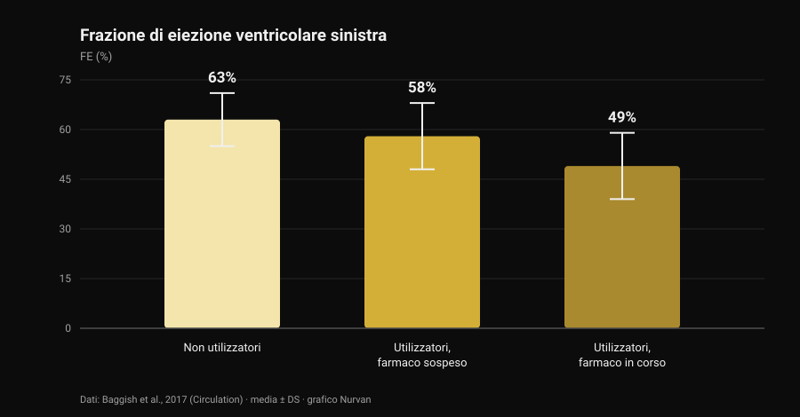
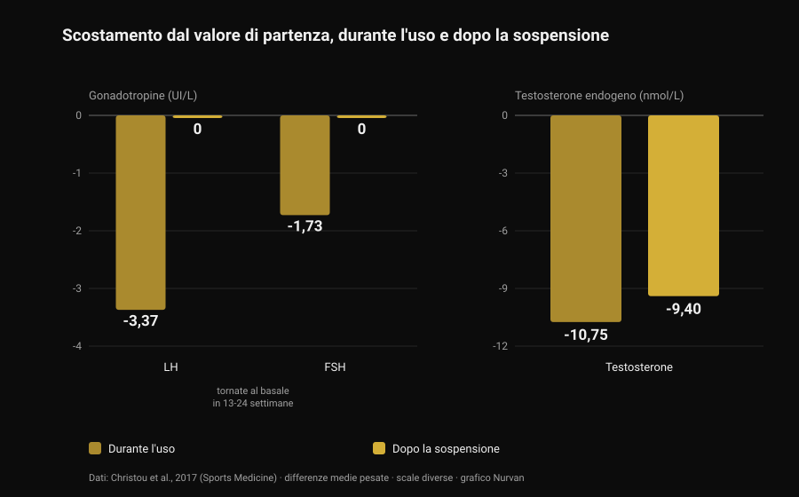

# Steroidi anabolizzanti: effetti collaterali e rischi

Di [Giammaria Loi](/autore/giammaria-loi) · aggiornato il 28 ottobre 2026

Un post passato nella mia bacheca dice una cosa corretta e poco popolare: gli steroidi anabolizzanti funzionano, ma non puoi scegliere solo gli effetti che vuoi. È vero, e la letteratura lo quantifica molto meglio di quanto possa fare una slide. Ho letto otto lavori indicizzati per capire quanto costa quel pacchetto completo — e il numero che mi ha colpito di più non riguarda il cuore, riguarda i tempi di ritorno alla normalità.

## In breve

- **Che funzionino non è in discussione.** Dieci settimane di dosi sovrafisiologiche di testosterone più allenamento: **+6,1 kg di massa magra**, **+22 kg di panca**, **+38 kg di squat**. Anche chi non si allenava cresceva (Bhasin et al., 1996).
- **Il recettore degli androgeni non sta solo nel muscolo.** Nei registri danesi acne, ginecomastia e disfunzione erettile riguardano ciascuna **più del 10%** degli utilizzatori (Horwitz et al., 2019).
- **Il cuore è l'organo con i dati migliori.** Frazione di eiezione **52%** negli utilizzatori contro **63%** nei non utilizzatori, e **49%** in chi aveva il farmaco in corso (Baggish et al., 2017).
- **Tornare indietro è più lento di come lo si racconta.** Dopo lo stop LH e FSH risalgono in **13-24 settimane**, ma il testosterone prodotto dal corpo era ancora **9,4 nmol/L sotto il basale** a 16 settimane (meta-analisi su 33 studi, Christou et al., 2017).
- **Per una minoranza non torna del tutto.** Su 19 ex utilizzatori, **5 avevano testosterone sotto 200 ng/dL** dopo 3-26 mesi di astinenza; 7 su 24 hanno avuto un episodio depressivo maggiore durante la sospensione (Kanayama et al., 2015).

## "Funzionano" non è la domanda interessante

Questa parte è chiusa da trent'anni. Nel 1996 quarantatré uomini sono stati assegnati a caso a quattro gruppi: placebo o testosterone, con o senza allenamento. Chi riceveva dosi sovrafisiologiche di testosterone e si allenava ha guadagnato **6,1 kg di massa magra** in dieci settimane, con l'area del tricipite in aumento di 501 mm² e quella del quadricipite di 1.174 mm²; panca +22 kg, squat +38 kg.

Il dettaglio più istruttivo è un altro: **anche chi non si allenava cresceva**. Nel gruppo testosterone senza esercizio l'area del tricipite è aumentata di 424 mm², mentre nel gruppo placebo senza esercizio è *diminuita* di 81 mm². Il farmaco agisce indipendentemente dallo stimolo, e questo spiega quanto l'uso sia diffuso: la prevalenza a vita stimata è intorno al **6,4% negli uomini e all'1,6% nelle donne** (Nieschlag e Vorona, 2015).

Nello stesso trial, per onestà, umore e comportamento non sono risultati alterati in nessun gruppo. Ma dieci settimane sotto controllo medico non sono dieci anni di cicli autogestiti: è esattamente la differenza di cui parla il resto dell'articolo.

## Perché non puoi scegliere solo gli effetti che vuoi

Il recettore degli androgeni è uno, e non è un recettore del muscolo. È espresso nel miocardio, nel fegato, nella pelle, nel follicolo del capello, nella prostata, nell'osso, nella laringe e nel cervello. Quando il livello di androgeni in circolo sale molto sopra il normale, sale per tutti questi tessuti insieme.

Il rapporto "anabolico/androgeno" delle tabelle che girano online nasce da test sui rodenti e non si traduce in una selettività pulita negli esseri umani. La verifica empirica sta nei registri: nella coorte danese di Horwitz e colleghi, acne, **ginecomastia** (crescita del tessuto mammario nell'uomo) e disfunzione erettile riguardavano ciascuna più del 10% degli utilizzatori. Nessuno dei tre è un effetto che qualcuno cerchi.

Nelle donne alcune voci non si cancellano: acne e irsutismo sono frequenti, e **l'abbassamento della voce è irreversibile** (Nieschlag e Vorona, 2015). La revisione più recente lo scrive chiaramente: la maggior parte degli effetti indesiderati è lieve e reversibile, ma alcuni possono causare danno permanente o essere potenzialmente letali (Linhares et al., 2022).

La domanda utile, quindi, non è "quali effetti voglio", ma **quali effetti sono disposto a non poter scegliere**. Sul rapporto fra androgeni e capelli abbiamo scritto a parte, parlando di [creatina e caduta dei capelli](/blog/creatina-caduta-capelli).

## Il cuore: l'organo con i dati migliori

Lo studio più informativo è trasversale: 140 sollevatori fra i 34 e i 54 anni — 86 con almeno due anni cumulativi di uso, 54 non utilizzatori — valutati con ecocardiografia e angio-TC coronarica.

*Grafico Nurvan sui dati di Baggish et al., 2017 (Circulation). Valori medi riportati nell'abstract; le barre di errore rappresentano la deviazione standard.*

La frazione di eiezione — la quota di sangue che il ventricolo sinistro espelle a ogni battito — era in media **52% negli utilizzatori contro 63% nei non utilizzatori**. Ridotta anche la funzione diastolica, cioè la capacità del ventricolo di rilassarsi e riempirsi (velocità di rilassamento precoce 9,3 contro 11,1 cm/s). Gli autori la chiamano con il suo nome: disfunzione miocardica.

Dentro il gruppo degli utilizzatori c'è il dato da tenere: chi aveva il farmaco in corso stava a **49%**, chi era sospeso a **58%**. La funzione di pompa, quindi, recupera almeno in parte quando si smette.

Le coronarie no. Il volume di placca era mediano 3 mL negli utilizzatori contro 0 mL nei non utilizzatori, e **cresceva con la durata cumulativa dell'uso**: ogni dieci anni valevano 0,60 deviazioni standard in più di carico ateromasico. È la differenza che i riassunti social non fanno quasi mai: la contrattilità va e viene, la placca è un deposito, e i depositi non si scaricano a fine ciclo.

Sul fronte degli eventi clinici, un registro danese di 1.189 utilizzatori seguiti circa undici anni contro 59.450 controlli riporta infarto con rapporto di rischio aggiustato **3,00** e **cardiomiopatia 8,90** (Windfeld-Mathiasen et al., 2025). Ne abbiamo parlato nel dettaglio, insieme a cosa succede ai lipidi, in [testosterone e colesterolo](/blog/testosterone-colesterolo-hdl-ldl).

## Quanto tempo serve davvero per tornare indietro

È la parte in cui la divulgazione da palestra sbaglia di più, ed è anche quella con i dati più solidi: una meta-analisi su 33 studi e 3.879 partecipanti, di cui 1.766 utilizzatori.

*Grafico Nurvan sui dati di Christou et al., 2017 (Sports Medicine). Differenze medie pesate rispetto al valore di partenza, riportate nell'abstract. LH e FSH in UI/L, testosterone in nmol/L: scale diverse, affiancate per leggerne l'andamento.*

Durante l'uso l'asse che governa la produzione naturale di testosterone si spegne: **LH −3,37 UI/L**, **FSH −1,73 UI/L**, testosterone prodotto dal corpo **−10,75 nmol/L** rispetto al basale. Prevedibile: il cervello vede androgeni in abbondanza e smette di chiederne.

Il punto è cosa succede dopo. Le gonadotropine — gli ormoni con cui l'ipofisi dà l'ordine ai testicoli — tornano ai valori di partenza in **13-24 settimane**. Il testosterone no: a 16 settimane dalla sospensione era ancora **9,4 nmol/L sotto il livello di partenza**. L'ordine riparte prima che la fabbrica torni a produrre.

Su chi ha smesso da tempo i dati sono ancora più diretti. Diciannove ex utilizzatori a lungo termine non in terapia, confrontati con 36 sollevatori che non avevano mai usato nulla, avevano testosterone inferiore di **131 ng/dL**, volume testicolare inferiore di 2,3 mL e desiderio sessuale più basso di 2,4 punti su 10; cinque erano **sotto 200 ng/dL** dopo un'astinenza fra 3 e 26 mesi. E c'è la parte che non finisce quasi mai nelle slide: sui 24 ex utilizzatori dello studio, **7 (29%) hanno avuto un episodio depressivo maggiore durante la sospensione**, quattro dei quali mai in nessun altro momento della vita, e due non hanno recuperato libido o funzione erettile nemmeno con una terapia sostitutiva adeguata (Kanayama et al., 2015).

Sulla fertilità il quadro è coerente: alterazioni di numero, forma e motilità degli spermatozoi, riduzione del volume testicolare e, nelle donne, clitoromegalia, irregolarità mestruali e subfertilità (Christou et al., 2017). La soppressione della spermatogenesi è descritta come reversibile, con una nota importante: se non recupera, è possibile che sia riemerso un problema di fertilità preesistente (Nieschlag e Vorona, 2015).

## Mortalità e ricoveri: cosa dicono i registri

Sul lungo periodo esistono solo dati di popolazione, perché un esperimento controllato su questi dosaggi non supererebbe nessun comitato etico.

Nella coorte danese, 545 uomini positivi a un test antidoping in palestra sono stati confrontati con 5.450 controlli appaiati: **mortalità tre volte più alta** (rapporto di rischio 3,0; IC 95% 1,3-7,0) e contatti ospedalieri annui mediani 0,81 contro 0,36. Il risultato è stato replicato in una seconda coorte di 644 uomini che avevano rifiutato il test (Horwitz et al., 2019).

Un avvertimento, altrimenti il numero diventa uno slogan: sono studi osservazionali, e chi usa steroidi differisce dai controlli anche per altre sostanze, altre abitudini e una diversa propensione al rischio. Il "tre volte" non è il contributo isolato della molecola — è però la cosa più vicina a un bilancio reale che abbiamo.

## Cosa dice davvero la ricerca

- **"Gli steroidi anabolizzanti funzionano" — Confermato.** Trial randomizzato: massa magra +6,1 kg in dieci settimane con allenamento, e crescita muscolare anche senza allenarsi.
- **"Non puoi esporre selettivamente il muscolo: anabolico e androgeno non si separano" — Confermato.** Un solo recettore su molti tessuti, e nei registri acne, ginecomastia e disfunzione erettile oltre il 10% ciascuna. Nelle donne l'abbassamento della voce è irreversibile.
- **"Il rischio non è binario: dipende da dose, durata, molecola e risposta individuale" — Da precisare.** Dose e durata contano, ed è documentato. Ma la risposta individuale è proprio la variabile che non si può conoscere prima: è un rischio, non un parametro da impostare.
- **"Più farmacologia, più variabili da gestire" — Da precisare.** "Gestire" presuppone che tutto ciò che conta sia misurabile e correggibile. Il segnale più forte dei registri è la cardiomiopatia, e il reperto che scala con l'esposizione è un deposito nelle coronarie: nessuno dei due si corregge con un prelievo.
- **"Finito il ciclo torni come prima" — Smentito.** Testosterone ancora 9,4 nmol/L sotto il basale a 16 settimane dallo stop; cinque ex utilizzatori su 19 sotto 200 ng/dL dopo mesi; due su 24 senza recupero della funzione sessuale nemmeno in terapia.
- **"Se sei giovane e sano e fai gli esami, non rischi" — Smentito.** Le coorti danesi sono fatte proprio di frequentatori di palestra giovani: mortalità tripla, ricoveri più che doppi, cardiomiopatia con rischio quasi nove volte superiore.
- **"Un uso controllato azzera il rischio" — Non verificabile.** Studi randomizzati su questi dosaggi non esistono e non esisteranno. Chi afferma il contrario sta usando l'assenza di dati come prova di sicurezza.

## Come applicarlo

1. **Se stai valutando l'uso, cambia la domanda.** Non "quanto serve per crescere", ma "quali effetti sono disposto a non poter scegliere": ginecomastia, acne, disfunzione erettile e placca coronarica non sono opzioni che si disattivano.
2. **Se usi o hai usato, dillo al medico.** È l'informazione che cambia la lettura di qualsiasi esame, e molti medici non la chiedono spontaneamente: tocca a te portarla.
3. **Riconosci i sintomi della sospensione.** Calo del desiderio, difficoltà erettile e umore nero dopo lo stop non sono mancanza di carattere: nello studio di Kanayama il 29% ha avuto un episodio depressivo maggiore in quella fase. È una condizione medica, e si tratta.
4. **Se pensi ai figli, parlane prima.** La spermatogenesi si sopprime durante l'uso e recupera in tempi lunghi e variabili: una valutazione andrologica preventiva vale più di qualsiasi protocollo letto su un forum.
5. **Non confondere la terapia prescritta con l'uso da palestra,** e guarda le serie storiche invece del singolo referto. Pressione, emocromo, lipidi e composizione corporea dicono qualcosa su più anni, non su una settimana. Il confronto fra terapia e ciclo è in [testosterone e colesterolo](/blog/testosterone-colesterolo-hdl-ldl).

### Prova Nurvan — esami, misure e carichi sulla stessa linea del tempo

Se segui la tua salute nel tempo, il problema pratico è che i referti stanno sparsi fra email, cartelle e PDF. Su Nurvan carichi gli esami del sangue e vedi l'andamento di ogni voce su una linea del tempo, con accanto negli stessi mesi i carichi, il RIR e le misure corporee: quando vai dal medico porti la serie storica, non l'ultimo foglio. **[Prova Nurvan](https://nurvan.app)**

## Domande frequenti

**Quali sono gli effetti collaterali più comuni degli steroidi anabolizzanti?**
Nei registri di popolazione i più frequenti sono acne, ginecomastia e disfunzione erettile, ciascuno in più del 10% degli utilizzatori. A questi si aggiungono atrofia testicolare, soppressione della produzione naturale di testosterone e, sul piano cardiaco, riduzione della funzione di pompa e accumulo di placca coronarica.

**Quanto tempo serve per riprendersi dopo aver smesso?**
Nella meta-analisi su 33 studi le gonadotropine tornano ai valori di partenza in 13-24 settimane, ma il testosterone prodotto dal corpo era ancora 9,4 nmol/L sotto il basale a 16 settimane dalla sospensione. In una parte degli ex utilizzatori i valori restano bassi per mesi: cinque su diciannove erano sotto 200 ng/dL dopo un'astinenza fra 3 e 26 mesi.

**Gli steroidi danneggiano il cuore in modo permanente?**
Le due cose vanno separate. La funzione contrattile sembra recuperare almeno in parte: nel confronto fra utilizzatori, chi era sospeso aveva una frazione di eiezione del 58% contro il 49% di chi era in corso. La placca coronarica, invece, cresce con gli anni cumulativi di uso e non è un parametro che si azzera smettendo.

**Esiste uno steroide anabolizzante sicuro?**
No, e non esistono studi randomizzati su questi dosaggi che possano dimostrarlo: i vincoli etici impediscono di esporre volontari a regimi potenzialmente tossici. Le differenze fra molecole sono reali — per esempio sui lipidi la via orale pesa molto più di quella iniettabile — ma sono differenze di entità del danno, non di presenza o assenza.

## Leggi anche

- [Testosterone e colesterolo: cosa dicono gli studi](/blog/testosterone-colesterolo-hdl-ldl) — i numeri su HDL, LDL e apoB, con la differenza fra terapia e ciclo.
- [La creatina fa cadere i capelli?](/blog/creatina-caduta-capelli) — il meccanismo del DHT spiegato per esteso, verificato sugli studi.
- [Tier list integratori forza](/blog/classifica-integratori-forza-tier-list) — cosa ha prove solide, in ordine di evidenza, senza farmacologia.

## Fonti

1. Bhasin S, Storer TW, Berman N, Callegari C, Clevenger B, Phillips J, Bunnell TJ, Tricker R, Shirazi A, Casaburi R, 1996. *The effects of supraphysiologic doses of testosterone on muscle size and strength in normal men.* New England Journal of Medicine 335(1):1-7. [PMID 8637535](https://pubmed.ncbi.nlm.nih.gov/8637535/) · [DOI 10.1056/NEJM199607043350101](https://doi.org/10.1056/NEJM199607043350101)
2. Baggish AL, Weiner RB, Kanayama G, Hudson JI, Lu MT, Hoffmann U, Pope HG, 2017. *Cardiovascular Toxicity of Illicit Anabolic-Androgenic Steroid Use.* Circulation 135(21):1991-2002. [PMID 28533317](https://pubmed.ncbi.nlm.nih.gov/28533317/) · [DOI 10.1161/CIRCULATIONAHA.116.026945](https://doi.org/10.1161/CIRCULATIONAHA.116.026945)
3. Christou MA, Christou PA, Markozannes G, Tsatsoulis A, Mastorakos G, Tigas S, 2017. *Effects of Anabolic Androgenic Steroids on the Reproductive System of Athletes and Recreational Users: A Systematic Review and Meta-Analysis.* Sports Medicine 47(9):1869-1883. [PMID 28258581](https://pubmed.ncbi.nlm.nih.gov/28258581/) · [DOI 10.1007/s40279-017-0709-z](https://doi.org/10.1007/s40279-017-0709-z)
4. Kanayama G, Hudson JI, DeLuca J, Isaacs S, Baggish A, Weiner R, Bhasin S, Pope HG, 2015. *Prolonged hypogonadism in males following withdrawal from anabolic-androgenic steroids: an under-recognized problem.* Addiction 110(5):823-31. [PMID 25598171](https://pubmed.ncbi.nlm.nih.gov/25598171/) · [DOI 10.1111/add.12850](https://doi.org/10.1111/add.12850)
5. Horwitz H, Andersen JT, Dalhoff KP, 2019. *Health consequences of androgenic anabolic steroid use.* Journal of Internal Medicine 285(3):333-340. [PMID 30460728](https://pubmed.ncbi.nlm.nih.gov/30460728/) · [DOI 10.1111/joim.12850](https://doi.org/10.1111/joim.12850)
6. Nieschlag E, Vorona E, 2015. *MECHANISMS IN ENDOCRINOLOGY: Medical consequences of doping with anabolic androgenic steroids: effects on reproductive functions.* European Journal of Endocrinology 173(2):R47-58. [PMID 25805894](https://pubmed.ncbi.nlm.nih.gov/25805894/) · [DOI 10.1530/EJE-15-0080](https://doi.org/10.1530/EJE-15-0080)
7. Linhares BL, Miranda EP, Cintra AR, Reges R, Torres LO, 2022. *Use, Misuse and Abuse of Testosterone and Other Androgens.* Sexual Medicine Reviews 10(4):583-595. [PMID 34887237](https://pubmed.ncbi.nlm.nih.gov/34887237/) · [DOI 10.1016/j.sxmr.2021.10.002](https://doi.org/10.1016/j.sxmr.2021.10.002)
8. Windfeld-Mathiasen J, Heerfordt IM, Dalhoff KP, Andersen JT, Andersen MA, Johansson KS, Biering-Sørensen T, Olsen FJ, Horwitz H, 2025. *Cardiovascular Disease in Anabolic Androgenic Steroid Users.* Circulation 151(12):828-834. [PMID 39945117](https://pubmed.ncbi.nlm.nih.gov/39945117/) · [DOI 10.1161/CIRCULATIONAHA.124.071117](https://doi.org/10.1161/CIRCULATIONAHA.124.071117)

Riferimenti bibliografici recuperati tramite PubMed. Spunto iniziale: il post di **built4mayhem** ([Project Mayhem](https://www.instagram.com/built4mayhem/)) del 25 settembre 2026, [post originale](https://www.instagram.com/p/DduTeKEjcwx/). Del post sono stati letti solo autore, data e didascalia: nessun testo e nessuna immagine sono stati riprodotti, e le slide del carosello non sono state scaricate né viste. Il tema è stato riscritto da zero risalendo agli studi primari e verificandoli uno per uno.

---

**Giammaria Loi** è il fondatore di Nurvan. Si allena con i pesi dal 2012, lavora come personal trainer e coach certificato FIPE dal 2013 e gareggia nel powerlifting a livello nazionale dal 2018. Ogni articolo che firma parte dagli studi scientifici e arriva a ciò che funziona davvero in palestra.

> Nota: contenuto informativo, non sostituisce il parere di un medico. Questo articolo descrive i rischi documentati in letteratura e **non contiene indicazioni di dosaggio, molecole o protocolli**: non incoraggia in alcun modo l'uso di queste sostanze. L'uso non medico di steroidi anabolizzanti è vietato nello sport e, in molti Paesi, illegale. Se usi o hai usato queste sostanze, o se stai valutando una terapia ormonale, parlane con un medico.
