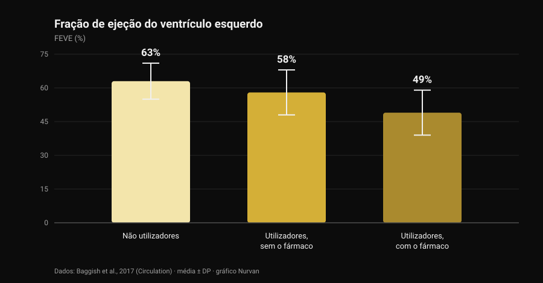
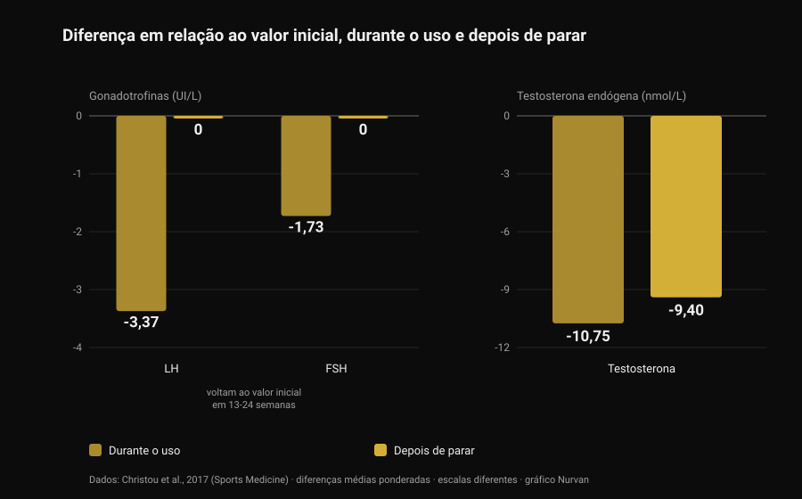

# Esteroides anabolizantes: efeitos colaterais e riscos

Por [Giammaria Loi](/autore/giammaria-loi) · atualizado a 28 de outubro de 2026

Um post que passou no meu feed dizia uma coisa correta e pouco popular: os esteroides anabolizantes funcionam, mas não dá para escolher só os efeitos que se quer. É verdade, e a literatura quantifica isso muito melhor do que qualquer slide. Li oito trabalhos indexados para perceber quanto custa esse pacote completo — e o número que mais me surpreendeu não é o do coração, é o tempo que leva a voltar à normalidade.

## Em resumo

- **Que funcionam não está em discussão.** Dez semanas de testosterona em doses suprafisiológicas com treino: **+6,1 kg de massa magra**, **+22 kg no supino** e **+38 kg no agachamento**. Mesmo quem não treinava ganhava músculo (Bhasin et al., 1996).
- **O recetor de androgénios não está só no músculo.** Nos registos dinamarqueses, acne, ginecomastia e disfunção erétil afetam cada um **mais de 10%** dos utilizadores (Horwitz et al., 2019).
- **É no coração que os dados são melhores.** Fração de ejeção do ventrículo esquerdo de **52%** nos utilizadores contra **63%** nos não utilizadores; **49%** em quem estava a usar no momento do exame (Baggish et al., 2017).
- **Voltar atrás é mais lento do que se conta.** Depois de parar, LH e FSH regressam ao valor inicial em **13-24 semanas**, mas a testosterona produzida pelo corpo continuava **9,4 nmol/L abaixo do início** às 16 semanas (meta-análise de 33 estudos, Christou et al., 2017).
- **Numa minoria não volta por completo.** De 19 ex-utilizadores sem tratamento, **5 tinham testosterona abaixo de 200 ng/dL** após 3 a 26 meses de abstinência; 7 em 24 tiveram um episódio depressivo major durante a suspensão (Kanayama et al., 2015).

## "Funcionam?" não é a pergunta interessante

Essa parte está fechada há trinta anos. Em 1996, quarenta e três homens foram distribuídos ao acaso por quatro grupos: placebo ou testosterona, com ou sem treino. Quem recebeu doses suprafisiológicas de testosterona e treinava ganhou **6,1 kg de massa magra** em dez semanas, com a área do tríceps a subir 501 mm² e a do quadríceps 1.174 mm²; supino +22 kg, agachamento +38 kg.

O detalhe mais instrutivo é outro: **quem não treinava também crescia**. No grupo testosterona sem exercício a área do tríceps aumentou 424 mm², enquanto no grupo placebo sem exercício *diminuiu* 81 mm². O fármaco age independentemente do estímulo, o que explica a dimensão do consumo: a prevalência estimada ao longo da vida ronda os **6,4% nos homens e 1,6% nas mulheres** (Nieschlag e Vorona, 2015).

Por honestidade: nesse ensaio o humor e o comportamento não se alteraram em nenhum grupo. Mas dez semanas sob supervisão médica não são dez anos de ciclos autogeridos — e é dessa diferença que trata o resto do artigo.

## Porque não dá para escolher só os efeitos que se quer

O recetor de androgénios é um só, e não é um recetor do músculo. É expresso no miocárdio, no fígado, na pele, no folículo capilar, na próstata, no osso, na laringe e no cérebro. Quando os androgénios em circulação sobem muito acima do normal, sobem ao mesmo tempo para todos esses tecidos.

A "relação anabólico/androgénico" das tabelas que circulam na internet vem de ensaios em roedores e não se traduz numa seletividade limpa no ser humano. A verificação empírica está nos registos: na coorte dinamarquesa de Horwitz, acne, **ginecomastia** (crescimento do tecido mamário no homem) e disfunção erétil afetavam cada uma mais de 10% dos utilizadores. Nenhum dos três é um efeito que alguém procure.

Nas mulheres há linhas que não se apagam: acne e hirsutismo são frequentes, e **o agravamento da voz é irreversível** (Nieschlag e Vorona, 2015). A revisão mais recente escreve-o sem rodeios: a maioria dos efeitos indesejados é ligeira e reversível, mas alguns podem causar dano permanente ou ser potencialmente fatais (Linhares et al., 2022).

A pergunta útil, portanto, não é "que efeitos quero", mas **que efeitos estou disposto a não poder escolher**. Sobre androgénios e cabelo escrevemos à parte, em [a creatina faz cair o cabelo](/pt/blog/creatina-queda-cabelo).

## O coração: onde os dados são mais sólidos

O estudo mais informativo é transversal: 140 praticantes entre os 34 e os 54 anos — 86 com pelo menos dois anos acumulados de uso e 54 não utilizadores — avaliados com ecocardiografia e angio-TC coronária.

*Gráfico Nurvan com dados de Baggish et al., 2017 (Circulation). Médias tal como reportadas no resumo; as barras de erro representam o desvio-padrão.*

A fração de ejeção — a proporção de sangue que o ventrículo esquerdo expulsa a cada batimento — foi em média de **52% nos utilizadores contra 63% nos não utilizadores**. A função diastólica, isto é, a capacidade do ventrículo de relaxar e encher, também estava reduzida (velocidade de relaxamento precoce 9,3 contra 11,1 cm/s). Os autores chamam-lhe pelo nome: disfunção miocárdica.

Dentro do grupo dos utilizadores está o número que vale a pena guardar: quem estava a usar no momento do exame tinha **49%**, quem tinha parado **58%**. A função de bomba, portanto, recupera pelo menos em parte quando se para.

As coronárias não. O volume mediano de placa era de 3 mL nos utilizadores contra 0 mL nos não utilizadores, e **crescia com a duração acumulada do uso**: cada dez anos de utilização total valiam 0,60 desvios-padrão a mais de carga aterosclerótica. É a distinção que os resumos das redes quase nunca fazem: a contractilidade vai e vem, a placa é um depósito, e os depósitos não se esvaziam no fim do ciclo.

Quanto a eventos clínicos, um registo dinamarquês de 1.189 utilizadores seguidos cerca de onze anos face a 59.450 controlos descreve enfarte com razão de risco ajustada de **3,00** e **miocardiopatia de 8,90** (Windfeld-Mathiasen et al., 2025). Falámos disso em detalhe, juntamente com o que acontece aos lípidos, em [testosterona e colesterol](/pt/blog/testosterona-e-colesterol-hdl-ldl).

## Quanto tempo leva mesmo a voltar atrás

É aqui que a divulgação de ginásio mais erra, e onde os dados são mais sólidos: uma meta-análise de 33 estudos e 3.879 participantes, 1.766 dos quais utilizadores.

*Gráfico Nurvan com dados de Christou et al., 2017 (Sports Medicine). Diferenças médias ponderadas em relação ao início, tal como reportadas no resumo. LH e FSH em UI/L, testosterona em nmol/L: escalas diferentes, lado a lado para se ler a tendência.*

Durante o uso, o eixo que governa a produção natural de testosterona desliga-se: **LH −3,37 UI/L**, **FSH −1,73 UI/L**, testosterona produzida pelo corpo **−10,75 nmol/L** em relação ao início. Era previsível: o cérebro vê androgénios em abundância e deixa de os pedir.

O que importa é o que vem depois. As gonadotrofinas — as hormonas com que a hipófise dá a ordem aos testículos — voltam aos valores iniciais em **13-24 semanas**. A testosterona não: às 16 semanas depois de parar continuava **9,4 nmol/L abaixo do valor de partida**. A ordem volta a sair antes de a fábrica voltar a produzir.

Em quem parou há mais tempo os dados são ainda mais diretos. Dezanove ex-utilizadores de longa duração sem tratamento, comparados com 36 praticantes que nunca tinham usado nada, tinham testosterona 131 ng/dL mais baixa, volume testicular 2,3 mL menor e desejo sexual 2,4 pontos mais baixo numa escala de 10; cinco estavam **abaixo de 200 ng/dL** após uma abstinência entre 3 e 26 meses. E há a parte que quase nunca chega aos slides: dos 24 ex-utilizadores do estudo, **7 (29%) tiveram um episódio depressivo major durante a suspensão**, quatro deles sem qualquer antecedente no resto da vida, e dois não recuperaram libido nem função erétil mesmo com terapêutica de substituição adequada (Kanayama et al., 2015).

Na fertilidade o quadro é coerente: alterações do número, da forma e da mobilidade dos espermatozoides, redução do volume testicular e, nas mulheres, clitoromegalia, irregularidades menstruais e subfertilidade (Christou et al., 2017). A supressão da espermatogénese é descrita como reversível, com uma nota importante: se não recuperar, pode ter vindo ao de cima um problema de fertilidade que já existia (Nieschlag e Vorona, 2015).

## Mortalidade e internamentos: o que dizem os registos

A longo prazo só existem dados populacionais, porque uma experiência controlada com estas doses não passaria nenhuma comissão de ética.

Na coorte dinamarquesa, 545 homens que deram positivo num controlo antidopagem em ginásios foram comparados com 5.450 controlos emparelhados: **mortalidade três vezes maior** (razão de risco 3,0; IC 95% 1,3-7,0) e uma mediana de 0,81 contactos hospitalares por ano contra 0,36. O resultado foi replicado numa segunda coorte de 644 homens que recusaram o teste (Horwitz et al., 2019).

Um aviso, ou o número vira slogan: são estudos observacionais, e quem usa esteroides difere dos controlos também noutras substâncias, noutros hábitos e numa relação diferente com o risco. Esse "três vezes" não é o contributo isolado da molécula — mas é o mais próximo de um balanço real que temos.

## O que a investigação diz mesmo

- **"Os esteroides anabolizantes funcionam" — Confirmado.** Ensaio aleatorizado: +6,1 kg de massa magra em dez semanas com treino, e crescimento muscular mesmo sem treinar.
- **"Não se pode expor o músculo de forma seletiva: o anabólico e o androgénico não se separam" — Confirmado.** Um só recetor em muitos tecidos e, nos registos, acne, ginecomastia e disfunção erétil acima de 10% cada. Nas mulheres, o agravamento da voz é irreversível.
- **"O risco não é binário: depende da dose, da duração, da molécula e da resposta individual" — A precisar.** Dose e duração contam, está documentado. Mas a resposta individual é exatamente a variável que não se pode conhecer antes: é um risco, não um parâmetro que se afine.
- **"Mais farmacologia, mais variáveis para gerir" — A precisar.** "Gerir" pressupõe que tudo o que conta é mensurável e corrigível. O sinal mais forte dos registos é a miocardiopatia, e o achado que cresce com a exposição é um depósito nas coronárias: nenhum se corrige com uma análise.
- **"Acabado o ciclo ficas como antes" — Desmentido.** Testosterona ainda 9,4 nmol/L abaixo do início às 16 semanas; cinco em 19 ex-utilizadores abaixo de 200 ng/dL ao fim de meses; dois em 24 sem recuperar a função sexual nem com terapêutica.
- **"Se és novo e saudável e fazes análises, não corres risco" — Desmentido.** As coortes dinamarquesas são feitas justamente de frequentadores de ginásio: mortalidade tripla, mais do dobro dos internamentos, miocardiopatia com risco quase nove vezes superior.
- **"Um uso controlado anula o risco" — Não verificável.** Não existem ensaios aleatorizados com estas doses nem virão a existir. Quem afirma o contrário está a usar a ausência de dados como prova de segurança.

## Como aplicar

1. **Se estás a ponderar, muda a pergunta.** Não "quanto preciso para crescer", mas "que efeitos estou disposto a não poder escolher": ginecomastia, acne, disfunção erétil e placa coronária não são opções que se desliguem.
2. **Se usas ou usaste, diz ao médico.** É a informação que muda a leitura de qualquer exame, e muitos médicos não a perguntam: cabe-te a ti trazê-la.
3. **Reconhece os sintomas da suspensão.** Perda de desejo, dificuldade erétil e humor em baixo depois de parar não são falta de carácter: no estudo de Kanayama, 29% tiveram um episódio depressivo major nessa fase. É uma situação médica e trata-se.
4. **Se há planos de ter filhos, fala antes.** A espermatogénese é suprimida durante o uso e recupera em prazos longos e variáveis: uma avaliação andrológica prévia vale mais do que qualquer protocolo de fórum.
5. **Não confundas terapêutica prescrita com uso de ginásio** e olha para as séries, não para a análise isolada. Tensão arterial, hemograma, lípidos e composição corporal dizem algo ao longo de anos, não de uma semana. A comparação está em [testosterona e colesterol](/pt/blog/testosterona-e-colesterol-hdl-ldl).

### Experimenta a Nurvan — análises, medidas e cargas na mesma linha do tempo

Quem acompanha a própria saúde ao longo do tempo conhece o problema: os relatórios ficam espalhados por e-mails, pastas e PDF. Na Nurvan carregas as análises de sangue e vês a evolução de cada valor numa linha do tempo, com as cargas, o RIR e as medidas corporais dos mesmos meses ao lado: quando vais ao médico levas a série toda, não a última folha. **[Experimenta a Nurvan](https://nurvan.app)**

## Perguntas frequentes

**Quais são os efeitos colaterais mais comuns dos esteroides anabolizantes?**
Nos registos populacionais os mais frequentes são acne, ginecomastia e disfunção erétil, cada um em mais de 10% dos utilizadores. A estes juntam-se atrofia testicular, supressão da produção natural de testosterona e, no plano cardíaco, redução da função de bomba e acumulação de placa coronária.

**Quanto tempo demora a recuperação depois de parar?**
Na meta-análise de 33 estudos as gonadotrofinas voltam ao valor inicial em 13-24 semanas, mas a testosterona produzida pelo corpo continuava 9,4 nmol/L abaixo do início às 16 semanas. Em parte dos ex-utilizadores os valores ficam baixos durante meses: cinco em dezanove estavam abaixo de 200 ng/dL após 3 a 26 meses sem usar.

**Os esteroides danificam o coração de forma permanente?**
São duas coisas distintas. A função contráctil parece recuperar pelo menos em parte: entre os utilizadores, quem tinha parado apresentava uma fração de ejeção de 58% contra 49% de quem estava a usar. A placa coronária, pelo contrário, cresce com os anos acumulados de uso e não é um valor que volte a zero ao parar.

**Existe algum esteroide anabolizante seguro?**
Não, e nenhum ensaio aleatorizado com estas doses o poderia demonstrar: as restrições éticas impedem expor voluntários a regimes potencialmente tóxicos. As diferenças entre moléculas são reais — a via oral, por exemplo, pesa muito mais nos lípidos do que a injetável — mas são diferenças na dimensão do dano, não na sua presença.

## Lê também

- [Testosterona e colesterol: o que dizem os estudos](/pt/blog/testosterona-e-colesterol-hdl-ldl) — os números de HDL, LDL e apoB e a diferença entre terapêutica e ciclo.
- [Creatina faz cair o cabelo?](/pt/blog/creatina-queda-cabelo) — o mecanismo do DHT explicado a fundo, verificado nos estudos.
- [Tier list de suplementos para força](/pt/blog/ranking-suplementos-forca-tier-list) — o que tem provas sólidas, por ordem de evidência e sem farmacologia.

## Fontes

1. Bhasin S, Storer TW, Berman N, Callegari C, Clevenger B, Phillips J, Bunnell TJ, Tricker R, Shirazi A, Casaburi R, 1996. *The effects of supraphysiologic doses of testosterone on muscle size and strength in normal men.* New England Journal of Medicine 335(1):1-7. [PMID 8637535](https://pubmed.ncbi.nlm.nih.gov/8637535/) · [DOI 10.1056/NEJM199607043350101](https://doi.org/10.1056/NEJM199607043350101)
2. Baggish AL, Weiner RB, Kanayama G, Hudson JI, Lu MT, Hoffmann U, Pope HG, 2017. *Cardiovascular Toxicity of Illicit Anabolic-Androgenic Steroid Use.* Circulation 135(21):1991-2002. [PMID 28533317](https://pubmed.ncbi.nlm.nih.gov/28533317/) · [DOI 10.1161/CIRCULATIONAHA.116.026945](https://doi.org/10.1161/CIRCULATIONAHA.116.026945)
3. Christou MA, Christou PA, Markozannes G, Tsatsoulis A, Mastorakos G, Tigas S, 2017. *Effects of Anabolic Androgenic Steroids on the Reproductive System of Athletes and Recreational Users: A Systematic Review and Meta-Analysis.* Sports Medicine 47(9):1869-1883. [PMID 28258581](https://pubmed.ncbi.nlm.nih.gov/28258581/) · [DOI 10.1007/s40279-017-0709-z](https://doi.org/10.1007/s40279-017-0709-z)
4. Kanayama G, Hudson JI, DeLuca J, Isaacs S, Baggish A, Weiner R, Bhasin S, Pope HG, 2015. *Prolonged hypogonadism in males following withdrawal from anabolic-androgenic steroids: an under-recognized problem.* Addiction 110(5):823-31. [PMID 25598171](https://pubmed.ncbi.nlm.nih.gov/25598171/) · [DOI 10.1111/add.12850](https://doi.org/10.1111/add.12850)
5. Horwitz H, Andersen JT, Dalhoff KP, 2019. *Health consequences of androgenic anabolic steroid use.* Journal of Internal Medicine 285(3):333-340. [PMID 30460728](https://pubmed.ncbi.nlm.nih.gov/30460728/) · [DOI 10.1111/joim.12850](https://doi.org/10.1111/joim.12850)
6. Nieschlag E, Vorona E, 2015. *MECHANISMS IN ENDOCRINOLOGY: Medical consequences of doping with anabolic androgenic steroids: effects on reproductive functions.* European Journal of Endocrinology 173(2):R47-58. [PMID 25805894](https://pubmed.ncbi.nlm.nih.gov/25805894/) · [DOI 10.1530/EJE-15-0080](https://doi.org/10.1530/EJE-15-0080)
7. Linhares BL, Miranda EP, Cintra AR, Reges R, Torres LO, 2022. *Use, Misuse and Abuse of Testosterone and Other Androgens.* Sexual Medicine Reviews 10(4):583-595. [PMID 34887237](https://pubmed.ncbi.nlm.nih.gov/34887237/) · [DOI 10.1016/j.sxmr.2021.10.002](https://doi.org/10.1016/j.sxmr.2021.10.002)
8. Windfeld-Mathiasen J, Heerfordt IM, Dalhoff KP, Andersen JT, Andersen MA, Johansson KS, Biering-Sørensen T, Olsen FJ, Horwitz H, 2025. *Cardiovascular Disease in Anabolic Androgenic Steroid Users.* Circulation 151(12):828-834. [PMID 39945117](https://pubmed.ncbi.nlm.nih.gov/39945117/) · [DOI 10.1161/CIRCULATIONAHA.124.071117](https://doi.org/10.1161/CIRCULATIONAHA.124.071117)

Referências obtidas através da PubMed. Ponto de partida: a publicação de **built4mayhem** ([Project Mayhem](https://www.instagram.com/built4mayhem/)) de 25 de setembro de 2026, [post original](https://www.instagram.com/p/DduTeKEjcwx/). Foram lidos apenas autor, data e legenda: nenhum texto e nenhuma imagem foram reproduzidos, e os slides do carrossel não foram descarregados nem vistos. O tema foi reescrito de raiz, recorrendo aos estudos primários e verificando-os um a um.

---

**Giammaria Loi** é o fundador da Nurvan. Treina com pesos desde 2012, trabalha como personal trainer e coach certificado pela FIPE desde 2013 e compete em powerlifting a nível nacional desde 2018. Cada artigo que assina parte dos estudos científicos e chega ao que funciona mesmo no ginásio.

> Nota: conteúdo informativo, não substitui a opinião de um médico. Este artigo descreve os riscos documentados na literatura e **não contém doses, moléculas nem protocolos**: não incentiva de forma alguma o uso destas substâncias. O uso não médico de esteroides anabolizantes é proibido no desporto e ilegal em muitos países. Se usas ou usaste estas substâncias, ou estás a ponderar uma terapêutica hormonal, fala com um médico.
