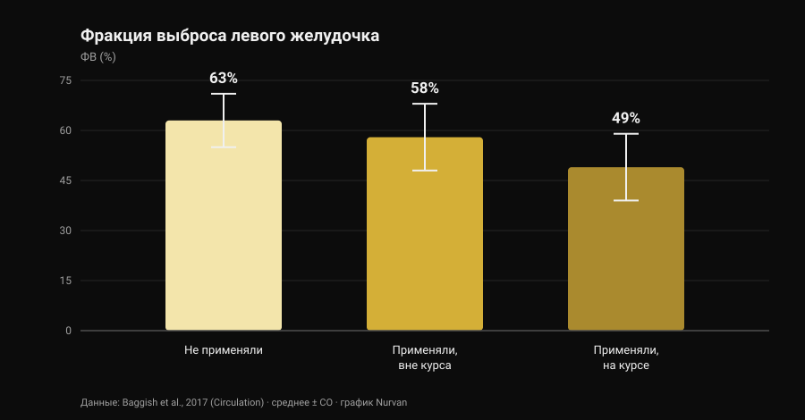
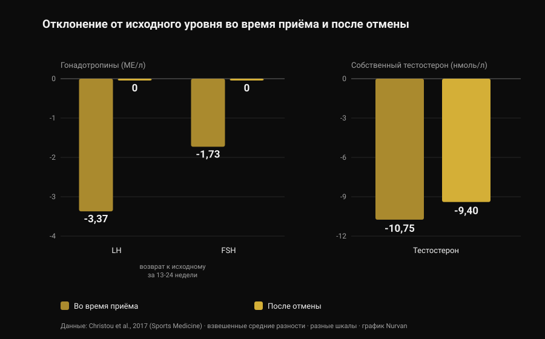

# Анаболические стероиды: побочные эффекты и риски

Автор: [Giammaria Loi](/autore/giammaria-loi) · обновлено 28 октября 2026 года

В моей ленте попался пост с верной и непопулярной мыслью: анаболические стероиды работают, но выбрать только те эффекты, которые хочется, нельзя. Это правда, и научная литература оценивает это гораздо точнее, чем любая карточка в карусели. Я прочитал восемь индексированных работ, чтобы понять, сколько стоит такой «полный пакет», — и больше всего меня удивила не цифра про сердце, а то, сколько времени требуется, чтобы вернуться к норме.

## Коротко

- **То, что они работают, не обсуждается.** Десять недель тестостерона в сверхфизиологических дозах плюс тренировки: **+6,1 кг сухой массы**, **+22 кг в жиме лёжа**, **+38 кг в приседе**. Мышцы росли даже у тех, кто не тренировался (Bhasin et al., 1996).
- **Андрогеновый рецептор есть не только в мышцах.** По датским регистрам, акне, гинекомастия и эректильная дисфункция встречаются каждая более чем у **10%** потребителей (Horwitz et al., 2019).
- **По сердцу данные самые надёжные.** Фракция выброса левого желудочка **52%** у потребителей против **63%** у не применявших; **49%** у тех, кто на момент обследования был «на курсе» (Baggish et al., 2017).
- **Возврат назад идёт медленнее, чем принято рассказывать.** После отмены ЛГ и ФСГ возвращаются к исходному уровню за **13-24 недели**, но собственный тестостерон через 16 недель был всё ещё **на 9,4 нмоль/л ниже исходного** (метаанализ 33 исследований, Christou et al., 2017).
- **У части людей он не возвращается полностью.** Из 19 бывших потребителей без лечения у **5 тестостерон был ниже 200 нг/дл** спустя 3-26 месяцев воздержания; у 7 из 24 во время отмены развился большой депрессивный эпизод (Kanayama et al., 2015).

## «Работают ли они» — не самый интересный вопрос

Эта часть закрыта тридцать лет назад. В 1996 году сорок три мужчины были случайно распределены на четыре группы: плацебо или тестостерон, с тренировками или без. Те, кто получал сверхфизиологические дозы тестостерона и тренировался, набрали **6,1 кг сухой массы** за десять недель; площадь поперечного сечения трицепса выросла на 501 мм², квадрицепса — на 1174 мм²; жим лёжа +22 кг, присед +38 кг.

Самая поучительная деталь другая: **росли и те, кто не тренировался**. В группе «тестостерон без тренировок» площадь трицепса увеличилась на 424 мм², а в группе «плацебо без тренировок» *уменьшилась* на 81 мм². Препарат действует независимо от стимула, и это объясняет масштаб явления: оценочная распространённость в течение жизни — около **6,4% у мужчин и 1,6% у женщин** (Nieschlag и Vorona, 2015).

Ради честности: в том исследовании настроение и поведение не изменились ни в одной из групп. Но десять недель под медицинским наблюдением — это не десять лет самостоятельных курсов, и именно об этой разнице весь дальнейший текст.

## Почему нельзя выбрать только нужные эффекты

Андрогеновый рецептор один, и это не рецептор мышцы. Он представлен в миокарде, печени, коже, волосяном фолликуле, простате, кости, гортани и головном мозге. Когда уровень андрогенов в крови поднимается намного выше нормы, он поднимается сразу для всех этих тканей.

«Анаболико-андрогенное соотношение» из таблиц, которые ходят по интернету, выведено на грызунах и не превращается у человека в чистую тканевую избирательность. Эмпирическая проверка — в регистрах: в датской когорте Horwitz акне, **гинекомастия** (рост грудной железы у мужчин) и эректильная дисфункция встречались каждая более чем у 10% потребителей. Ни один из трёх эффектов никто не ищет.

У женщин некоторые пункты не стираются: акне и гирсутизм встречаются часто, а **огрубение голоса необратимо** (Nieschlag и Vorona, 2015). Самый свежий обзор формулирует прямо: большинство нежелательных эффектов лёгкие и обратимые, но некоторые способны вызвать стойкое повреждение или угрожать жизни (Linhares et al., 2022).

Поэтому полезный вопрос не «какие эффекты я хочу», а **какие эффекты я готов не иметь возможности выбирать**. Про андрогены и волосы мы разбирали механизм ДГТ отдельно — в материале [вызывает ли креатин выпадение волос](/ru/blog/kreatin-vypadenie-volos).

## Сердце: здесь данные самые сильные

Самое информативное исследование — поперечное: 140 спортсменов силовых видов в возрасте от 34 до 54 лет (86 с суммарным стажем приёма не менее двух лет и 54 не применявших), обследованных с помощью эхокардиографии и КТ-ангиографии коронарных артерий.

*График Nurvan по данным Baggish et al., 2017 (Circulation). Средние значения приведены в резюме статьи; усы показывают стандартное отклонение.*

Фракция выброса — доля крови, которую левый желудочек выбрасывает за одно сокращение, — составила в среднем **52% у потребителей против 63% у не применявших**. Диастолическая функция, то есть способность желудочка расслабляться и наполняться, тоже была снижена (скорость раннего расслабления 9,3 против 11,1 см/с). Авторы называют это своим именем: дисфункция миокарда.

Внутри группы потребителей есть цифра, которую стоит запомнить: у тех, кто на момент обследования был на курсе, фракция выброса составляла **49%**, у отменивших — **58%**. То есть насосная функция хотя бы частично восстанавливается после прекращения.

Коронарные артерии — нет. Медианный объём бляшек составил 3 мл у потребителей против 0 мл у не применявших, и он **рос вместе с суммарной длительностью приёма**: каждые десять лет совокупного стажа соответствовали увеличению атеросклеротической нагрузки на 0,60 стандартного отклонения. Именно это различие почти никогда не делают короткие пересказы в соцсетях: сократимость приходит и уходит, а бляшка — это отложение, и отложения не рассасываются к концу курса.

По клиническим событиям: датский регистр из 1189 потребителей, прослеженных около одиннадцати лет, против 59 450 контролей даёт инфаркт миокарда со скорректированным отношением рисков **3,00** и **кардиомиопатию 8,90** (Windfeld-Mathiasen et al., 2025). Подробно об этом, вместе с тем, что происходит с липидами, мы писали в материале [тестостерон и холестерин](/ru/blog/testosteron-kholesterin-lipidy).

## Сколько на самом деле занимает возвращение

Здесь спортзальная «просвещённость» ошибается чаще всего, и здесь же данные самые надёжные: метаанализ 33 исследований и 3879 участников, из них 1766 потребителей.

*График Nurvan по данным Christou et al., 2017 (Sports Medicine). Взвешенные средние разности относительно исходного уровня приведены в резюме статьи. ЛГ и ФСГ в МЕ/л, тестостерон в нмоль/л: шкалы разные, панели поставлены рядом, чтобы читался характер изменений.*

Во время приёма ось, управляющая собственной выработкой тестостерона, выключается: **ЛГ −3,37 МЕ/л**, **ФСГ −1,73 МЕ/л**, собственный тестостерон **−10,75 нмоль/л** относительно исходного. Это предсказуемо: мозг видит избыток андрогенов и перестаёт их запрашивать.

Важно то, что происходит потом. Гонадотропины — гормоны, которыми гипофиз отдаёт команду яичкам, — возвращаются к исходным значениям за **13-24 недели**. Тестостерон — нет: через 16 недель после отмены он был всё ещё **на 9,4 нмоль/л ниже исходного уровня**. Команда уходит раньше, чем завод возобновляет производство.

У тех, кто бросил давно, данные ещё прямее. Девятнадцать бывших длительных потребителей без лечения по сравнению с 36 спортсменами, никогда ничего не принимавшими, имели тестостерон на 131 нг/дл ниже, объём яичек на 2,3 мл меньше и половое влечение на 2,4 балла ниже по десятибалльной шкале; пятеро были **ниже 200 нг/дл** после воздержания длительностью от 3 до 26 месяцев. И вот часть, которая почти никогда не попадает в карусели: из 24 бывших потребителей в этом исследовании у **7 (29%) во время отмены развился большой депрессивный эпизод**, причём у четверых такого не было ни в какой другой период жизни, а двое не вернули ни либидо, ни эректильную функцию даже на адекватной заместительной терапии (Kanayama et al., 2015).

С фертильностью картина согласуется: изменения количества, формы и подвижности сперматозоидов, уменьшение объёма яичек, а у женщин — клиторомегалия, нарушения цикла и снижение фертильности (Christou et al., 2017). Подавление сперматогенеза описывают как обратимое, с важной оговоркой: если он не восстанавливается, возможно, проявилось нарушение фертильности, существовавшее и раньше (Nieschlag и Vorona, 2015).

## Смертность и госпитализации: что показывают регистры

На длинной дистанции есть только популяционные данные, потому что контролируемый эксперимент с такими дозами не пропустил бы ни один этический комитет.

В датской когорте 545 мужчин с положительным допинг-тестом в фитнес-клубах сравнили с 5450 подобранными контролями: **смертность втрое выше** (отношение рисков 3,0; 95% ДИ 1,3-7,0) и медиана 0,81 обращения в больницу в год против 0,36. Результат воспроизвели во второй когорте из 644 мужчин, отказавшихся от теста (Horwitz et al., 2019).

Одно предупреждение, иначе цифра превращается в лозунг: это наблюдательные исследования, и те, кто принимает стероиды, отличаются от контролей ещё и другими веществами, другими привычками и другим отношением к риску. «Втрое» — не изолированный вклад препарата, но это самое близкое к реальному балансу, что у нас есть.

## Что на самом деле говорит наука

- **«Анаболические стероиды работают» — Подтверждено.** Рандомизированное исследование: +6,1 кг сухой массы за десять недель с тренировками и рост мышц даже без них.
- **«Нельзя воздействовать только на мышцу: анаболическое и андрогенное не разделяются» — Подтверждено.** Один рецептор во множестве тканей, а в регистрах акне, гинекомастия и эректильная дисфункция — каждая выше 10%. У женщин огрубение голоса необратимо.
- **«Риск не бинарный: он зависит от дозы, длительности, препарата и индивидуальной реакции» — Требует уточнения.** Доза и длительность действительно важны, это задокументировано. Но индивидуальная реакция — как раз та переменная, которую нельзя узнать заранее: это риск, а не настройка.
- **«Больше фармакологии — больше переменных, которыми нужно управлять» — Требует уточнения.** «Управлять» предполагает, что всё значимое измеримо и поправимо. Самый сильный сигнал регистров — кардиомиопатия, а показатель, растущий вместе с экспозицией, — отложение в коронарных артериях: ни то, ни другое не исправляется анализом крови.
- **«После курса всё вернётся как было» — Опровергнуто.** Тестостерон через 16 недель всё ещё на 9,4 нмоль/л ниже исходного; пятеро из 19 бывших потребителей ниже 200 нг/дл спустя месяцы; двое из 24 без восстановления половой функции даже на терапии.
- **«Если ты молод, здоров и сдаёшь анализы, ничем не рискуешь» — Опровергнуто.** Датские когорты как раз и состоят из посетителей фитнес-клубов: тройная смертность, более чем вдвое больше госпитализаций, риск кардиомиопатии почти в девять раз выше.
- **«Контролируемый приём убирает риск» — Непроверяемо.** Рандомизированных исследований с такими дозами нет и не будет. Кто утверждает обратное, выдаёт отсутствие данных за доказательство безопасности.

## Как это применить

1. **Если вы только рассматриваете приём, смените вопрос.** Не «сколько нужно, чтобы вырасти», а «какие эффекты я готов не иметь возможности выбирать»: гинекомастию, акне, эректильную дисфункцию и коронарную бляшку нельзя отключить.
2. **Если принимаете или принимали — скажите врачу.** Это та информация, которая меняет трактовку любого анализа, а многие врачи сами не спрашивают: сообщить придётся вам.
3. **Знайте симптомы отмены.** Падение влечения, проблемы с эрекцией и подавленное настроение после отмены — не слабость характера: в исследовании Kanayama у 29% в этот период был большой депрессивный эпизод. Это медицинское состояние, и оно лечится.
4. **Если планируете детей, обсудите это заранее.** Сперматогенез подавляется во время приёма и восстанавливается долго и по-разному: предварительная консультация андролога стоит больше любого протокола с форума.
5. **Не путайте назначенную терапию с приёмом «для зала»** и смотрите на динамику, а не на один анализ. Давление, общий анализ крови, липиды и состав тела говорят о чём-то на горизонте лет, а не недели. Сравнение — в материале [тестостерон и холестерин](/ru/blog/testosteron-kholesterin-lipidy).

### Попробуйте Nurvan — анализы, замеры и нагрузки на одной шкале времени

Когда следишь за своим здоровьем годами, практическая проблема в том, что результаты расползаются по почте, папкам и PDF. В Nurvan вы загружаете анализы крови и видите динамику каждого показателя на шкале времени, а рядом в тех же месяцах — рабочие веса, RIR и замеры тела: к врачу вы приносите всю серию, а не последний лист. **[Попробовать Nurvan](https://nurvan.app)**

## Частые вопросы

**Какие побочные эффекты анаболических стероидов встречаются чаще всего?**
В популяционных регистрах это акне, гинекомастия и эректильная дисфункция — каждая более чем у 10% потребителей. К ним добавляются атрофия яичек, подавление собственной выработки тестостерона, а со стороны сердца — снижение насосной функции и накопление коронарных бляшек.

**Сколько времени занимает восстановление после отмены?**
В метаанализе 33 исследований гонадотропины возвращаются к исходным значениям за 13-24 недели, но собственный тестостерон через 16 недель был всё ещё на 9,4 нмоль/л ниже исходного. У части бывших потребителей значения остаются низкими месяцами: пятеро из девятнадцати были ниже 200 нг/дл спустя 3-26 месяцев воздержания.

**Повреждают ли стероиды сердце необратимо?**
Это две разные вещи. Сократительная функция, по-видимому, хотя бы частично восстанавливается: среди потребителей у отменивших фракция выброса составляла 58% против 49% у находившихся на курсе. А коронарная бляшка растёт вместе с суммарным стажем приёма, и это не показатель, который обнуляется после отмены.

**Существует ли безопасный анаболический стероид?**
Нет, и ни одно рандомизированное исследование с такими дозами этого не покажет: этические ограничения не позволяют подвергать добровольцев потенциально токсичным схемам. Различия между препаратами реальны — например, пероральный путь бьёт по липидам намного сильнее инъекционного, — но это различия в масштабе вреда, а не в его наличии.

## Читайте также

- [Тестостерон и холестерин: что говорят исследования](/ru/blog/testosteron-kholesterin-lipidy) — цифры по ЛПВП, ЛПНП и апоB и разница между терапией и курсом.
- [Креатин вызывает выпадение волос?](/ru/blog/kreatin-vypadenie-volos) — механизм ДГТ подробно и с проверкой по исследованиям.
- [Тир-лист добавок для силы](/ru/blog/reyting-sportivnykh-dobavok-dlya-sily) — у чего действительно есть доказательства, по порядку и без фармакологии.

## Источники

1. Bhasin S, Storer TW, Berman N, Callegari C, Clevenger B, Phillips J, Bunnell TJ, Tricker R, Shirazi A, Casaburi R, 1996. *The effects of supraphysiologic doses of testosterone on muscle size and strength in normal men.* New England Journal of Medicine 335(1):1-7. [PMID 8637535](https://pubmed.ncbi.nlm.nih.gov/8637535/) · [DOI 10.1056/NEJM199607043350101](https://doi.org/10.1056/NEJM199607043350101)
2. Baggish AL, Weiner RB, Kanayama G, Hudson JI, Lu MT, Hoffmann U, Pope HG, 2017. *Cardiovascular Toxicity of Illicit Anabolic-Androgenic Steroid Use.* Circulation 135(21):1991-2002. [PMID 28533317](https://pubmed.ncbi.nlm.nih.gov/28533317/) · [DOI 10.1161/CIRCULATIONAHA.116.026945](https://doi.org/10.1161/CIRCULATIONAHA.116.026945)
3. Christou MA, Christou PA, Markozannes G, Tsatsoulis A, Mastorakos G, Tigas S, 2017. *Effects of Anabolic Androgenic Steroids on the Reproductive System of Athletes and Recreational Users: A Systematic Review and Meta-Analysis.* Sports Medicine 47(9):1869-1883. [PMID 28258581](https://pubmed.ncbi.nlm.nih.gov/28258581/) · [DOI 10.1007/s40279-017-0709-z](https://doi.org/10.1007/s40279-017-0709-z)
4. Kanayama G, Hudson JI, DeLuca J, Isaacs S, Baggish A, Weiner R, Bhasin S, Pope HG, 2015. *Prolonged hypogonadism in males following withdrawal from anabolic-androgenic steroids: an under-recognized problem.* Addiction 110(5):823-31. [PMID 25598171](https://pubmed.ncbi.nlm.nih.gov/25598171/) · [DOI 10.1111/add.12850](https://doi.org/10.1111/add.12850)
5. Horwitz H, Andersen JT, Dalhoff KP, 2019. *Health consequences of androgenic anabolic steroid use.* Journal of Internal Medicine 285(3):333-340. [PMID 30460728](https://pubmed.ncbi.nlm.nih.gov/30460728/) · [DOI 10.1111/joim.12850](https://doi.org/10.1111/joim.12850)
6. Nieschlag E, Vorona E, 2015. *MECHANISMS IN ENDOCRINOLOGY: Medical consequences of doping with anabolic androgenic steroids: effects on reproductive functions.* European Journal of Endocrinology 173(2):R47-58. [PMID 25805894](https://pubmed.ncbi.nlm.nih.gov/25805894/) · [DOI 10.1530/EJE-15-0080](https://doi.org/10.1530/EJE-15-0080)
7. Linhares BL, Miranda EP, Cintra AR, Reges R, Torres LO, 2022. *Use, Misuse and Abuse of Testosterone and Other Androgens.* Sexual Medicine Reviews 10(4):583-595. [PMID 34887237](https://pubmed.ncbi.nlm.nih.gov/34887237/) · [DOI 10.1016/j.sxmr.2021.10.002](https://doi.org/10.1016/j.sxmr.2021.10.002)
8. Windfeld-Mathiasen J, Heerfordt IM, Dalhoff KP, Andersen JT, Andersen MA, Johansson KS, Biering-Sørensen T, Olsen FJ, Horwitz H, 2025. *Cardiovascular Disease in Anabolic Androgenic Steroid Users.* Circulation 151(12):828-834. [PMID 39945117](https://pubmed.ncbi.nlm.nih.gov/39945117/) · [DOI 10.1161/CIRCULATIONAHA.124.071117](https://doi.org/10.1161/CIRCULATIONAHA.124.071117)

Библиография получена через PubMed. Отправная точка: пост **built4mayhem** ([Project Mayhem](https://www.instagram.com/built4mayhem/)) от 25 сентября 2026 года, [оригинальная публикация](https://www.instagram.com/p/DduTeKEjcwx/). Были прочитаны только автор, дата и подпись: ни текст, ни изображения не воспроизводились, слайды карусели не скачивались и не просматривались. Тема написана с нуля — с возвращением к первичным исследованиям и проверкой каждого из них.

---

**Giammaria Loi** — основатель Nurvan. Занимается с отягощениями с 2012 года, работает персональным тренером и коучем с сертификацией FIPE с 2013 года и выступает в пауэрлифтинге на национальном уровне с 2018 года. Каждая его статья начинается с научных исследований и заканчивается тем, что действительно работает в зале.

> Примечание: информационный материал, не заменяющий консультацию врача. Статья описывает риски, задокументированные в литературе, и **не содержит дозировок, названий препаратов и схем приёма**: она никоим образом не поощряет употребление этих веществ. Немедицинское применение анаболических стероидов запрещено в спорте и во многих странах незаконно. Если вы принимаете или принимали эти вещества либо рассматриваете гормональную терапию, обсудите это с врачом.
