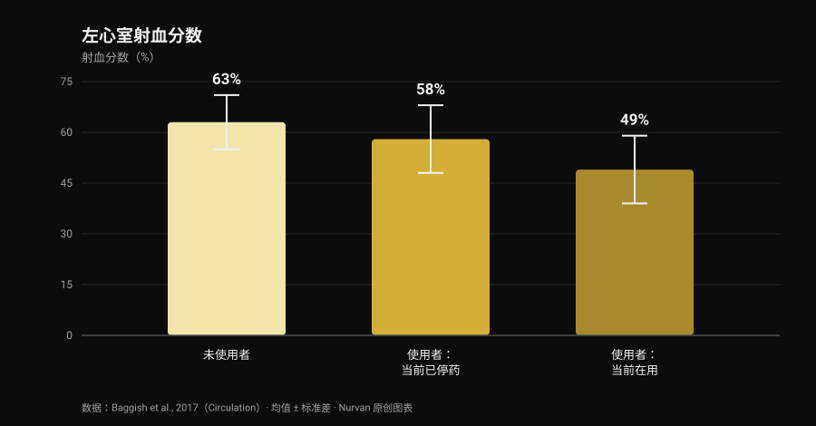
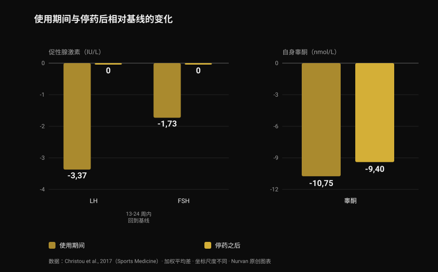

# 合成类固醇：副作用与真实风险

作者 [Giammaria Loi](/autore/giammaria-loi) · 更新于 2026 年 10 月 28 日

我刷到的一条帖子说了一句正确但不讨喜的话：合成类固醇确实有效，但你没法只挑自己想要的那部分效果。这是对的，而且文献能把它量化得比任何一张图卡都清楚。我读了八篇被收录的论文，想弄明白这个"打包方案"到底要付出多少代价——最让我意外的数字不是关于心脏的，而是关于恢复正常需要多久。

## 一分钟看完

- **有效这件事没有争议。** 十周超生理剂量睾酮加训练：**去脂体重 +6.1 公斤**、**卧推 +22 公斤**、**深蹲 +38 公斤**。连不训练的人也长了肌肉（Bhasin et al., 1996）。
- **雄激素受体不只长在肌肉里。** 丹麦登记数据中，痤疮、男性乳腺发育和勃起功能障碍各自影响**超过 10%** 的使用者（Horwitz et al., 2019）。
- **心脏是数据最扎实的器官。** 左心室射血分数在使用者中为 **52%**，未使用者为 **63%**；检查时正在用药的人只有 **49%**（Baggish et al., 2017）。
- **回到原点比传言中慢得多。** 停药后 LH 和 FSH 在 **13-24 周**回到基线，但身体自己分泌的睾酮在停药 16 周时仍比基线**低 9.4 nmol/L**（33 项研究的荟萃分析，Christou et al., 2017）。
- **少数人回不到原来的状态。** 19 名未接受治疗的既往使用者中，有 **5 人在停用 3-26 个月后睾酮低于 200 ng/dL**；24 人中有 7 人在停药期出现重性抑郁发作（Kanayama et al., 2015）。

## "有没有用"不是有意思的问题

这部分三十年前就结束了。1996 年，43 名男性被随机分到四组：安慰剂或睾酮，训练或不训练。使用超生理剂量睾酮并训练的人，十周内增加了 **6.1 公斤去脂体重**，肱三头肌横截面积增加 501 平方毫米，股四头肌增加 1174 平方毫米；卧推 +22 公斤，深蹲 +38 公斤。

更有启发的细节在另一边：**不训练的人同样在长**。睾酮不训练组的肱三头肌面积增加了 424 平方毫米，而安慰剂不训练组反而*减少*了 81 平方毫米。药物的作用独立于训练刺激，这也解释了它为何如此普遍：终生使用率估计在**男性约 6.4%、女性约 1.6%**（Nieschlag 和 Vorona, 2015）。

公平地说，在那项试验里，各组的情绪和行为都没有改变。但十周的医学监护不等于十年的自行用药周期——这篇文章剩下的内容，讲的正是这个差距。

## 为什么你没法只挑想要的效果

雄激素受体只有一种，而且它不是"肌肉的受体"。它表达在心肌、肝脏、皮肤、毛囊、前列腺、骨骼、喉部和大脑里。当循环中的雄激素远高于正常水平时，它对所有这些组织是同时升高的。

网上流传的表格里那个"合成代谢/雄激素比值"来自啮齿动物实验，在人体上并不会变成干净的组织选择性。实证检验在登记数据里：在 Horwitz 的丹麦队列中，痤疮、**男性乳腺发育**（男性乳腺组织增生）和勃起功能障碍各自影响超过 10% 的使用者。这三样没有一样是有人想要的。

在女性身上，有些条目是擦不掉的：痤疮和多毛很常见，而**嗓音变粗不可逆**（Nieschlag 和 Vorona, 2015）。最新的综述写得很直白：大多数不良反应轻微且可逆，但有一些可能造成永久损害，甚至危及生命（Linhares et al., 2022）。

所以有用的问题不是"我想要哪些效果"，而是**我愿意接受哪些自己无法选择的效果**。关于雄激素和头发，我们在[肌酸会导致脱发吗](/zh/blog/creatine-hair-loss-zh)里单独讲过 DHT 的机制。

## 心脏：证据最强的部分

最有信息量的是一项横断面研究：140 名 34 至 54 岁的力量训练者——86 人累计使用至少两年，54 人从未使用——接受了超声心动图和冠状动脉 CT 血管造影。

*Nurvan 原创图表，数据来自 Baggish et al., 2017（Circulation）。均值取自论文摘要；误差线表示标准差。*

射血分数——左心室每次搏动泵出的血液比例——在使用者中平均为 **52%**，未使用者为 **63%**。舒张功能，也就是心室放松和充盈的能力，同样下降（早期松弛速度 9.3 对 11.1 厘米/秒）。作者直接称之为：心肌功能障碍。

在使用者内部还有一个值得记住的数字：检查时正在用药的人是 **49%**，已经停药的人是 **58%**。也就是说，泵血功能在停药后至少能部分恢复。

冠状动脉不行。斑块体积中位数在使用者中为 3 毫升，未使用者为 0 毫升，而且它**随累计使用年限增长**：每累计使用十年，动脉粥样硬化负荷就多 0.60 个标准差。这正是社交平台的摘要几乎从不区分的地方：收缩力会来会走，斑块是沉积物，而沉积物不会在一个周期结束时清空。

在临床事件方面，一项丹麦登记研究随访了 1189 名使用者约十一年，对照 59450 人，报告心肌梗死的校正风险比为 **3.00**，**心肌病为 8.90**（Windfeld-Mathiasen et al., 2025）。我们在[睾酮与胆固醇](/zh/blog/gaotong-danguchun-hdl-ldl)里详细写过这个队列，以及血脂会发生什么。

## 真正需要多久才能恢复

这是健身房说法错得最多的地方，也是证据最扎实的地方：一项纳入 33 项研究、3879 名参与者（其中 1766 名使用者）的荟萃分析。

*Nurvan 原创图表，数据来自 Christou et al., 2017（Sports Medicine）。相对基线的加权平均差取自论文摘要。LH 和 FSH 单位为 IU/L，睾酮为 nmol/L：坐标尺度不同，并排放置是为了看趋势。*

使用期间，支配天然睾酮分泌的轴会关闭：**LH −3.37 IU/L**、**FSH −1.73 IU/L**，自身睾酮相对基线 **−10.75 nmol/L**。这在意料之中：大脑看到雄激素过剩，就不再下订单。

关键在于之后。促性腺激素——垂体用来向睾丸下指令的激素——在 **13-24 周**回到基线。睾酮没有：停药 16 周时它仍比起点**低 9.4 nmol/L**。指令比工厂复工来得早。

对于早已停用的人，数据更直接。19 名未接受治疗的长期既往使用者，与 36 名从未用过任何药物的训练者相比，睾酮低 131 ng/dL，睾丸体积小 2.3 毫升，性欲评分在 10 分制上低 2.4 分；其中 5 人在停用 3 至 26 个月后仍**低于 200 ng/dL**。还有几乎从不出现在图卡里的部分：该研究的 24 名既往使用者中，**7 人（29%）在停药期出现重性抑郁发作**，其中 4 人一生中从未在其他时候发作过；2 人即便接受了足量替代治疗，性欲和勃起功能也没有恢复（Kanayama et al., 2015）。

生育方面的图景是一致的：精子数量、形态和活力改变，睾丸体积缩小；女性则出现阴蒂肥大、月经紊乱和生育力下降（Christou et al., 2017）。精子生成的抑制被描述为可逆，但有一个重要提示：如果没有恢复，可能是原本就存在的生育问题浮出水面（Nieschlag 和 Vorona, 2015）。

## 死亡率与住院：登记数据怎么说

长期证据只有人群数据，因为用这种剂量做对照实验，没有任何伦理委员会会通过。

在丹麦队列中，545 名在健身房反兴奋剂检测中呈阳性的男性与 5450 名匹配对照相比：**死亡率高出两倍**（风险比 3.0；95% CI 1.3-7.0），每年住院接触次数中位数为 0.81 对 0.36。该结果在另一支由 644 名拒绝检测的男性组成的队列中得到重复（Horwitz et al., 2019）。

需要提醒一句，否则这个数字就会变成口号：这些是观察性研究，使用类固醇的人与对照在其他物质、其他习惯以及对风险的态度上也有差别。那个"三倍"不是药物的孤立贡献——但它是我们能拿到的、最接近真实收支表的东西。

## 研究到底怎么说

- **"合成类固醇有效" — 确认。** 随机试验：配合训练十周增加 6.1 公斤去脂体重，不训练也能长肌肉。
- **"无法只让肌肉暴露其中：合成代谢作用和雄激素作用分不开" — 确认。** 一种受体分布在多种组织，登记数据中痤疮、男性乳腺发育和勃起功能障碍各自超过 10%。女性的嗓音变粗不可逆。
- **"风险不是非黑即白：取决于剂量、时长、药物和个体反应" — 需要补充。** 剂量和时长确实有影响，这有记录。但个体反应恰恰是事先无法知道的变量：那是风险，不是可调的参数。
- **"用药越多，要管理的变量越多" — 需要补充。** "管理"的前提是重要的东西都可测、可纠正。登记数据中最强的信号是心肌病，而随暴露增长的发现是冠状动脉里的沉积：这两样都不是抽一管血能修正的。
- **"周期结束就会恢复原样" — 不成立。** 停药 16 周时睾酮仍比基线低 9.4 nmol/L；19 名既往使用者中有 5 人在数月后仍低于 200 ng/dL；24 人中有 2 人即便接受治疗也没恢复性功能。
- **"年轻健康、按时体检就没风险" — 不成立。** 丹麦队列恰恰由健身房人群组成：死亡率三倍，住院次数两倍多，心肌病风险接近九倍。
- **"受控使用可以消除风险" — 无法验证。** 这种剂量下的随机对照试验不存在，也不会存在。声称相反的人，是把缺乏数据当成了安全证明。

## 怎么用这些信息

1. **如果你在考虑使用，先换个问题。** 不是"要用多少才能长"，而是"哪些我无法选择的效果我愿意接受"：男性乳腺发育、痤疮、勃起功能障碍和冠状动脉斑块都不是可以关掉的选项。
2. **如果在用或用过，告诉医生。** 这条信息会改变任何一份化验单的解读，而很多医生不会主动问：得由你说出来。
3. **认识停药期的症状。** 停药后性欲下降、勃起困难和情绪低落不是意志力问题：在 Kanayama 的研究中，29% 的人在这个阶段出现重性抑郁发作。这是可以治疗的医学状况。
4. **如果有生育打算，先谈这件事。** 使用期间精子生成受到抑制，恢复时间长且因人而异：事先做一次男科评估，比任何论坛方案都有价值。
5. **不要把处方治疗和健身房用药混为一谈**，并且看趋势而不是单次化验。血压、血常规、血脂和身体成分要放在几年的尺度上看，而不是一周。两者的对比见[睾酮与胆固醇](/zh/blog/gaotong-danguchun-hdl-ldl)。

### 试试 Nurvan —— 化验、围度和训练负荷在同一条时间线上

长期跟踪自己的健康，现实的麻烦是报告散落在邮件、文件夹和 PDF 里。在 Nurvan 里你可以上传血液化验，在时间线上看到每一项指标的走势，同一时间段旁边就是训练负荷、RIR 和身体围度：去看医生时，你带去的是整条曲线，而不是最后一张单子。**[试试 Nurvan](https://nurvan.app)**

## 常见问题

**合成类固醇最常见的副作用有哪些？**
在人群登记数据中，最常见的是痤疮、男性乳腺发育和勃起功能障碍，各自出现在超过 10% 的使用者身上。此外还有睾丸萎缩、天然睾酮分泌被抑制，心脏方面则是泵血功能下降和冠状动脉斑块积聚。

**停药后要多久才能恢复？**
在 33 项研究的荟萃分析中，促性腺激素在 13-24 周回到基线，但自身睾酮在停药 16 周时仍比基线低 9.4 nmol/L。部分既往使用者的数值会低上好几个月：19 人中有 5 人在停用 3 至 26 个月后仍低于 200 ng/dL。

**类固醇会永久损伤心脏吗？**
要分两件事看。收缩功能似乎至少能部分恢复：在使用者中，已停药者的射血分数为 58%，正在用药者为 49%。而冠状动脉斑块会随累计使用年限增长，不是停药就能归零的指标。

**有安全的合成类固醇吗？**
没有，而且这种剂量下不可能有随机试验来证明：伦理限制不允许让志愿者暴露于潜在毒性方案。不同药物之间的差别是真实的——比如口服途径对血脂的冲击远大于注射——但那是损害程度的差别，不是有无的差别。

## 延伸阅读

- [睾酮与胆固醇：研究到底怎么说](/zh/blog/gaotong-danguchun-hdl-ldl) —— HDL、LDL 和 apoB 的数字，以及治疗与用药周期的区别。
- [肌酸会导致脱发吗？](/zh/blog/creatine-hair-loss-zh) —— DHT 机制的完整解释，并逐条对照研究。
- [力量补剂等级榜](/zh/blog/liliang-buji-dengji-bang) —— 哪些真有扎实证据，按证据强度排序，完全不涉及药物。

## 参考文献

1. Bhasin S, Storer TW, Berman N, Callegari C, Clevenger B, Phillips J, Bunnell TJ, Tricker R, Shirazi A, Casaburi R, 1996. *The effects of supraphysiologic doses of testosterone on muscle size and strength in normal men.* New England Journal of Medicine 335(1):1-7. [PMID 8637535](https://pubmed.ncbi.nlm.nih.gov/8637535/) · [DOI 10.1056/NEJM199607043350101](https://doi.org/10.1056/NEJM199607043350101)
2. Baggish AL, Weiner RB, Kanayama G, Hudson JI, Lu MT, Hoffmann U, Pope HG, 2017. *Cardiovascular Toxicity of Illicit Anabolic-Androgenic Steroid Use.* Circulation 135(21):1991-2002. [PMID 28533317](https://pubmed.ncbi.nlm.nih.gov/28533317/) · [DOI 10.1161/CIRCULATIONAHA.116.026945](https://doi.org/10.1161/CIRCULATIONAHA.116.026945)
3. Christou MA, Christou PA, Markozannes G, Tsatsoulis A, Mastorakos G, Tigas S, 2017. *Effects of Anabolic Androgenic Steroids on the Reproductive System of Athletes and Recreational Users: A Systematic Review and Meta-Analysis.* Sports Medicine 47(9):1869-1883. [PMID 28258581](https://pubmed.ncbi.nlm.nih.gov/28258581/) · [DOI 10.1007/s40279-017-0709-z](https://doi.org/10.1007/s40279-017-0709-z)
4. Kanayama G, Hudson JI, DeLuca J, Isaacs S, Baggish A, Weiner R, Bhasin S, Pope HG, 2015. *Prolonged hypogonadism in males following withdrawal from anabolic-androgenic steroids: an under-recognized problem.* Addiction 110(5):823-31. [PMID 25598171](https://pubmed.ncbi.nlm.nih.gov/25598171/) · [DOI 10.1111/add.12850](https://doi.org/10.1111/add.12850)
5. Horwitz H, Andersen JT, Dalhoff KP, 2019. *Health consequences of androgenic anabolic steroid use.* Journal of Internal Medicine 285(3):333-340. [PMID 30460728](https://pubmed.ncbi.nlm.nih.gov/30460728/) · [DOI 10.1111/joim.12850](https://doi.org/10.1111/joim.12850)
6. Nieschlag E, Vorona E, 2015. *MECHANISMS IN ENDOCRINOLOGY: Medical consequences of doping with anabolic androgenic steroids: effects on reproductive functions.* European Journal of Endocrinology 173(2):R47-58. [PMID 25805894](https://pubmed.ncbi.nlm.nih.gov/25805894/) · [DOI 10.1530/EJE-15-0080](https://doi.org/10.1530/EJE-15-0080)
7. Linhares BL, Miranda EP, Cintra AR, Reges R, Torres LO, 2022. *Use, Misuse and Abuse of Testosterone and Other Androgens.* Sexual Medicine Reviews 10(4):583-595. [PMID 34887237](https://pubmed.ncbi.nlm.nih.gov/34887237/) · [DOI 10.1016/j.sxmr.2021.10.002](https://doi.org/10.1016/j.sxmr.2021.10.002)
8. Windfeld-Mathiasen J, Heerfordt IM, Dalhoff KP, Andersen JT, Andersen MA, Johansson KS, Biering-Sørensen T, Olsen FJ, Horwitz H, 2025. *Cardiovascular Disease in Anabolic Androgenic Steroid Users.* Circulation 151(12):828-834. [PMID 39945117](https://pubmed.ncbi.nlm.nih.gov/39945117/) · [DOI 10.1161/CIRCULATIONAHA.124.071117](https://doi.org/10.1161/CIRCULATIONAHA.124.071117)

文献通过 PubMed 检索获得。起点是 **built4mayhem**（[Project Mayhem](https://www.instagram.com/built4mayhem/)）2026 年 9 月 25 日的帖子，[原帖](https://www.instagram.com/p/DduTeKEjcwx/)。我们只读取了作者、日期和文字说明：没有复制任何文字或图片，轮播图片既未下载也未查看。主题是回到原始研究、逐篇核对后从零重写的。

---

**Giammaria Loi** 是 Nurvan 的创始人。他从 2012 年开始进行力量训练，2013 年起担任 FIPE 认证私人教练与教练，2018 年起参加国家级力量举比赛。他署名的每一篇文章都从科学研究出发，落到健身房里真正有效的做法。

> 说明：本文为科普内容，不能替代医生的意见。文章描述的是文献中已记录的风险，**不包含任何剂量、药物名称或使用方案**，也绝不鼓励使用这些物质。非医疗用途的合成类固醇在体育运动中被禁止，在许多国家属于违法行为。如果你正在使用或曾经使用这些物质，或正在考虑激素治疗，请与医生讨论。
