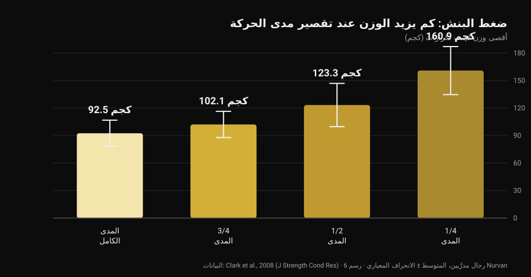
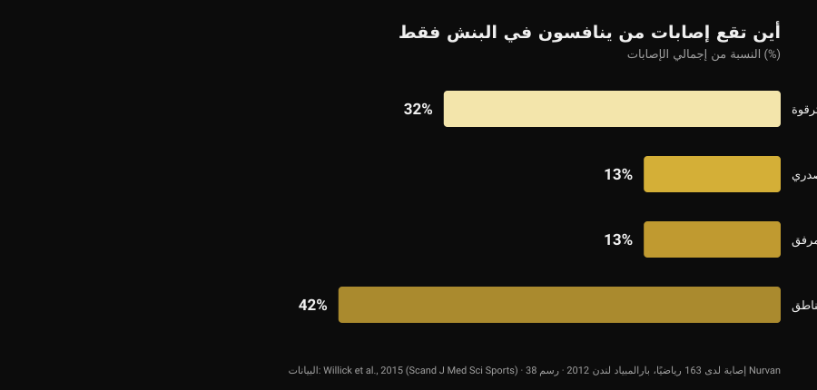

# قبضة البولدوغ في ضغط البنش: ماذا تقول الأبحاث

بقلم [Giammaria Loi](/autore/giammaria-loi) · حُدِّث في 29 أكتوبر 2026

مرّ على صفحتي منشور تقني يشرح قبضة البولدوغ في ضغط البنش: تدوير الساعد إلى الداخل، والبار موضوع قطريًا على راحة اليد، مع وعد بضغط أقل على المرفق وثبات أكبر. الوصف أمين، وجزء من المجتمع يستخدم هذه القبضة منذ سنوات. ثم ذهبت أبحث كم مرة قِيست هذه القبضة في الأدبيات العلمية. صفر. هذا ليس سببًا لرفضها، بل سبب لعرضها كما هي، ولاستخدام البيانات الموجودة فعلًا: تلك المتعلقة بمدى الحركة، وتلك المتعلقة بمكان الإصابات الحقيقي لدى من يمارس البنش.

## باختصار

- **لم تقِسها أي دراسة مفهرسة.** البحث عن "bulldog grip" في PubMed يعطي **صفر نتائج** (تم التحقق في 29 أكتوبر 2026): لا تخطيط كهربية عضل، ولا مقارنة أوزان، ولا بيانات عن الألم أو الإصابات.
- **قاعدة الاتحاد الدولي لا تقول ما يُردَّد.** اللائحة الفنية السارية منذ 1 مارس 2026 تشترط أن "تقبض اليدان والإبهامان والأصابع على البار قبضًا كاملًا، مع التفاف الإبهام حوله"، وتمنع القبضة المعكوسة. وكلمة "بولدوغ" لا ترد فيها إطلاقًا.
- **تقصير مدى الحركة يزيد الكيلوغرامات لا التكيّفات.** أقصى وزن لست تكرارات يرتفع من **92٫5 كجم** بالمدى الكامل إلى **160٫9 كجم** عند ربع المدى (Clark et al., 2008). لكن خلال عشرة أسابيع من التدريب تفوّق المدى الكامل على كل المجموعات الجزئية في جميع النسخ المختبَرة (Martínez-Cava et al., 2022).
- **المرفق ليس المشكلة الرئيسية في البنش.** في الرياضة التي تتكوّن من البنش وحده، يمثّل الكتف والترقوة **32%** من الإصابات والمرفق **13%** (Willick et al., 2015).
- **لكن وزن المرفق يزداد بعد الأربعين.** لدى 245 رافعًا، يرتفع معدل إصابات المرفق واليد/الرسغ ارتفاعًا ذا دلالة بعد سن الأربعين (Siewe et al., 2011).

## ما هي قبضة البولدوغ ببساطة

في القبضة التي يستعملها الجميع تقريبًا، يستقر البار في منتصف الراحة تقريبًا ويبقى الساعد محايدًا. في قبضة البولدوغ تدير الساعد إلى الداخل — وهو ما يسمّى تشريحيًا **الدوران الداخلي**، أي الحركة التي تقرّب الإبهام من الجسم — فيستقر البار قطريًا على الراحة، قرب قاعدة الإبهام بدل وسط اليد.

ينتج عن ذلك ثلاثة نتائج هندسية، لا تجريبية:

1. يبقى الرسغ أكثر استقامة فوق الساعد، مع بسط قسري أقل؛
2. يستند البار أقرب إلى جهة الخنصر، فيلامس الصدر أعلى قليلًا؛
3. يميل المرفق إلى الانفتاح أكثر قليلًا، لأن دوران الساعد يجرّه.

النقاط الثلاث معقولة ويمكن التحقق منها بمسطرة. لكن أيًّا منها ليس نتيجة مخبرية.

## ما لا تملكه الأبحاث — ولماذا يهم

بحثت في PubMed يوم 29 أكتوبر 2026: "bulldog grip" لا يعطي ورقة واحدة. أما عن البنش فهناك أدبيات لا بأس بها حول **عرض القبضة** — راجعناها في [قبضة ضغط الصدر: واسعة أم متوسطة أم ضيقة](/ar/blog/qabdat-dafe-alsadr-wasia-dayiqa) — لكن **دوران الرسغ** لم يقِسه أحد قط: لا نشاط قابضات الساعد، ولا الأوزان المرفوعة، ولا الألم المُبلَّغ عنه في المرفق.

وعليه فإن القول إن "قبضة البولدوغ تقلّل تنشيط قابضات الرسغ ومن ثَمّ تريح المرفق" فرضية ميكانيكية معقولة لم يختبرها أحد. ومن يستخدمها ويشعر بتحسّن ليس مخطئًا بشأن تجربته: هو ينقل معطى شخصيًا صحيحًا بالنسبة إليه. ما لا يصحّ هو تحويل ذلك إلى توصية عامة وتسميته علمًا.

## لائحة الاتحاد الدولي: ماذا كُتب فيها حقًا

هنا يقع أكثر سوء الفهم شيوعًا، ويستحق النص أن يُقرأ بدل الملخصات. اللائحة الفنية للاتحاد الدولي السارية منذ **1 مارس 2026** تضع شرطين على القبضة في البنش:

- يجب أن تقبض اليدان والإبهامان والأصابع على البار **قبضًا كاملًا**، مع التفاف الإبهام حوله؛
- **القبضة المعكوسة ممنوعة**، والمسافة بين السبابتين لا يجوز أن تتجاوز 81 سم.

المقارنة الكاشفة هي مع القرفصاء، حيث تكتب اللائحة نفسها صراحةً أنه "لا يُشترط أن يلتف الإبهامان حول البار". في البنش لا وجود لهذا الاستثناء: الإبهام الملتف إلزامي.

ماذا نستنتج؟ أن اللائحة **لا تسمّي قبضة البولدوغ إطلاقًا**، وأن بولدوغ تُؤدَّى بإبهام ملتف ويد كاملة على البار لا تخالف أيًّا من هذين السطرين. ما يُشعل الضوء الأحمر شيء آخر: القبضة بلا إبهام (ما يسمّى *suicide grip*)، والقبضة المعكوسة، والسبابتان خارج علامتَي 81 سم — وهذا يخصّ مباشرةً من يبالغ في الدوران: يد تستند على البار بأطراف الأصابع فقط بدل أن تقبضه قبضًا كاملًا.

إن كنت تنافس فالخلاصة العملية بسيطة: اعرض قبضتك على الحكم أثناء الإحماء، لا في منتصف المحاولة الأولى. الاتحادات الوطنية تطبّق النص نفسه، لكن يوم المنافسة لا يهم سوى مدى اعتبار الحكم بعينه أن قبضتك "كاملة".

## مدى أقصر، كيلوغرامات أكثر: الرقم الذي ينظّم النقاش كله

جزء من ملف البولدوغ يمكن تثبيته على أرقام صلبة، وهو مدى الحركة. إذا لامس البار الصدر أعلى مع بقاء عرض القبضة نفسه، فإن المسار **يزداد**؛ وإذا غيّرت العرض أيضًا فقد يقصر. في الحالتين أنت تحرّك متغيّرًا ثقيل الوزن.

كم يزن؟ قاست ذلك دراسة من 2008: ستة رجال مدرَّبين اختبروا أقصى وزن لست تكرارات في البنش عبر أربعة مديات مختلفة.

*رسم Nurvan بناءً على بيانات Clark et al., 2008 (J Strength Cond Res). المتوسطات والانحرافات المعيارية كما نُشرت؛ ستة أشخاص مدرَّبين، التنفيذ على جهاز سميث.*

من المدى الكامل إلى ربع المدى يكاد الوزن يتضاعف. النمط نفسه يظهر في عيّنة أكبر بكثير: لدى 42 رجلًا مدرَّبًا ارتفع الحد الأقصى تدريجيًا بالانتقال من المدى الكامل إلى الثلثين ثم إلى الثلث (Martínez-Cava et al., 2019).

المشكلة فيما يحدث مع الوقت. في تجربة عشوائية، اتّبع 50 رجلًا عشرة أسابيع من برنامج متطابق لا يختلف إلا في المدى المُدرَّب: **حققت مجموعة المدى الكامل أفضل النتائج في النسخ الثلاث المختبَرة من البنش**، وتحسّنت المجموعات الجزئية أقل كلما قصر المدى (Martínez-Cava et al., 2022). وفي رفع الأثقال البارالمبي، حيث البنش هو المنافسة كلها، يسمح العمل بالمدى الجزئي بأوزان أعلى مع فقدان وظيفي أقل في نهاية الحصة، لكن تنشيط العضلة الصدرية الكبرى — بجزأيها الترقوي والقصّي — أعلى بالمدى الكامل (Mendonça et al., 2021).

ترجمةً لمن يفكّر في البولدوغ: إن جرّبتها وارتفعت الكيلوغرامات فجأة، فانظر أين يلامس البار قبل أن تحتفل. إن لامس أدنى لأنك وسّعت القبضة، فجزء من المكسب هندسة. والعكس صحيح أيضًا، وقد أشار المنشور الأصلي إلى ذلك بدقة: مع العرض نفسه، نقطة تلامس أعلى تطيل المسار وتجعل الحركة **أصعب**، لا أسهل.

## المرفق: أين يُصاب فعلًا من يمارس البنش

أبرز حجة لصالح البولدوغ هي راحة المرفق. يستحق هذا المرفق أن يوضع في نسبته الصحيحة.

*رسم Nurvan بناءً على بيانات Willick et al., 2015 (Scand J Med Sci Sports). 38 إصابة سُجِّلت لدى 163 رياضيًا خلال أيام المنافسة السبعة في بارالمبياد لندن 2012.*

رفع الأثقال البارالمبي هو عمليًا رياضة بنش فقط: إنه أنظف عيّنة لدينا لمعرفة أين ينكسر من يدفع. لدى 163 رياضيًا سُجِّلت 38 إصابة، **61% منها إجهاد مزمن**. أكثر المناطق تضررًا هي الكتف مع الترقوة (32%)؛ يليهما القفص الصدري والمرفق بالتساوي عند 13%.

الصورة في بقية رياضات القوة هي نفسها: مراجعة Keogh وWinwood المنهجية تضع الكتف وأسفل الظهر والركبة والمرفق والرسغ/اليد كأكثر المناطق تكرارًا، بمعدل نحو **إصابة واحدة لكل 1000 ساعة** تدريب في رفع الأثقال. ومن بين 245 رافعًا ألمانيًا، أبلغ **43٫3%** عن انزعاج أثناء التدريب الاعتيادي دون إيقافه، وارتفع معدل إصابات المرفق واليد/الرسغ ارتفاعًا ذا دلالة بعد سن الأربعين (Siewe et al., 2011).

خلاصتان عمليتان. الأولى: إن كان المرفق يؤلمك، فالقبضة رافعة صغيرة بجانب الوزن والحجم والتكرار الأسبوعي والتدرّج — وهناك يجب أن ينظر المرء أولًا. والثانية أدقّ: الدوران الداخلي المبالغ فيه يغلق وضعية الكتف، ومراجعة من 2024 تضع تحديدًا **وضعية المفصل الهشّة أثناء الرفعة** ضمن عوامل خطر إصابة الكتف في رياضات الأثقال (Daher et al., 2024). مبادلة انزعاج في المرفق بمشكلة في الكتف صفقة خاسرة: الكتف هو المفصل الأكثر تعرّضًا للإصابة.

## ماذا تقول الأبحاث فعلًا

- **"قبضة البولدوغ تقلّل تنشيط قابضات الرسغ وتريح المرفق" — غير قابل للتحقق.** صفر دراسات مفهرسة، ولا تخطيط كهربية عضل. إنها فرضية ميكانيكية لا نتيجة.
- **"تمنح نقطة تلامس أعلى وانفتاح مرفق أكثر طبيعية" — يحتاج توضيحًا.** الهندسة تصمد: دوران الساعد يزيح البار نحو جهة الخنصر. أما مقدار تغيّر زاوية المرفق فعليًا فلم يقِسه أحد.
- **"مع العرض نفسه، نقطة أعلى تزيد المدى فتصبح الحركة أصعب" — مؤكد.** ينسجم مع العلاقة بين المدى والوزن: مسار أطول، كيلوغرامات أقل.
- **"تقليل المدى ميزة" — يحتاج توضيحًا.** يرفع الوزن بوضوح (من 92٫5 إلى 160٫9 كجم بين المدى الكامل والربع)، لكن خلال عشرة أسابيع من التدريب يعطي المدى الكامل تكيّفات أكبر في كل نسخة.
- **"الاتحاد الدولي يمنعها لأنه يشترط الإبهام الملتف" — مُفنَّد بهذه الصيغة.** لائحة 2026 لا تسمّي البولدوغ: تمنع القبضة المعكوسة وتشترط أن تقبض اليدان والإبهامان والأصابع البار قبضًا كاملًا. وبولدوغ بإبهام ملتف تستوفي الشرطين.
- **"تساعد المبتدئين الذين يضمّون المرفقين أكثر من اللازم" — غير قابل للتحقق.** لا بيانات عن المبتدئين والتقنية والقبضة. كما أن الكتف، لا المرفق، هو الأكثر تعرّضًا للإصابة في الدفع.

## كيف تطبّق ذلك

1. **إن لم يكن هناك ألم والأرقام تتقدّم، فلا تغيّر لمجرد الموضة.** القبضة التي تستعملها منذ سنوات هي أيضًا القبضة التي بُنيت عليها تقنيتك: تغييرها يكلّفك جزءًا من تلك التلقائية لأسابيع.
2. **إن جرّبتها فأبقِ الإبهام ملتفًا واليد كاملة على البار.** هذه هي النسخة التي تبقى داخل اللائحة، وهي أيضًا النسخة التي لا يمكن للبار أن يفلت فيها.
3. **قِس نقطة التلامس قبل وبعد.** علّم أين يلامس البار صدرك بالقبضة القديمة ثم بالجديدة: هذه الطريقة الوحيدة لتعرف هل غيّرت القبضة أم غيّرت المدى.
4. **امنحها ثلاثة إلى أربعة أسابيع ومعيارًا رقميًا.** الوزن نفسه، وعدد المجموعات نفسه، ونقطة التلامس نفسها: إن لم يتحرك الوزن عند نفس RIR (التكرارات المتبقية في الاحتياط)، فالقبضة لا تقدّم لك شيئًا.
5. **إن آلمك المرفق فانظر أولًا في البرنامج.** قفزات الوزن، وكثرة المجموعات قرب الفشل، وغياب أسبوع التخفيف تفسّر أكثر بكثير من دوران الرسغ. منطق المجموعات والراحة والتدرّج موجود في [كم تكرار لبناء العضلات](/ar/blog/kam-takrar-lilkutla-aladalia).
6. **ألم يستمر أسابيع أو يوقظك ليلًا ليس مسألة قبضة.** ذلك شأن مختصّ صحي، لا شأن منشور.
7. **إن كنت تنافس فاسأل الحكم مسبقًا.** ثلاثون ثانية في منطقة الإحماء تساوي أكثر من أي تعليق تقرأه على الإنترنت.

### جرّب Nurvan — إن غيّرت قبضتك، دع الأرقام تقول إن كانت تنفع

تغيير التقنية يُحكم عليه عبر أسابيع لا عبر حصة واحدة: تحتاج أن ترى الوزن والتكرارات وRIR للحركة نفسها جنبًا إلى جنب، مع ملاحظة عمّا غيّرته ومتى. في Nurvan تسجّل كل مجموعة بنش مع RIR الخاص بها، وتضيف ملاحظة عن النسخة المستخدمة، فتحصل على منحنى الأوزان شهرًا بعد شهر — وهكذا يصبح لسؤال "هل زادتني البولدوغ كيلوغرامات؟" جواب لا انطباع. كما تُقترح مجموعات الإحماء تلقائيًا انطلاقًا من وزن اليوم، وهو بالضبط ما تحتاجه بينما لا تزال القبضة الجديدة غير مألوفة.

## أسئلة شائعة

**ما هي قبضة البولدوغ في ضغط البنش؟**
هي قبضة تدير فيها الساعد إلى الداخل وتضع البار قطريًا على الراحة قرب قاعدة الإبهام بدل وسط اليد. يبقى الرسغ أكثر استقامة مع الساعد ويلامس البار الصدر أعلى قليلًا. وهي ليست قبضة بلا إبهام: إذا أُدّيت بشكل صحيح يبقى الإبهام ملتفًا حول البار.

**هل قبضة البولدوغ قانونية في منافسات الاتحاد الدولي؟**
اللائحة الفنية السارية منذ 1 مارس 2026 لا تسمّيها. تشترط أن تقبض اليدان والإبهامان والأصابع على البار قبضًا كاملًا مع التفاف الإبهام، وتمنع القبضة المعكوسة: وبولدوغ بإبهام ملتف ويد كاملة على البار تستوفي الشرطين. أما الخارج عن اللائحة فهو القبضة بلا إبهام، والمعكوسة، واليد المستندة بأطراف الأصابع فقط. وعند الشك، اعرضها على الحكم قبل المنافسة.

**هل تجعلك قبضة البولدوغ ترفع أكثر؟**
لا توجد دراسة قاست ذلك. إن ارتفع الوزن في اختباراتك فالسبب الأرجح ليس القبضة نفسها بل مدى الحركة: مع تساوي كل شيء آخر، تقصير المسار يرفع الوزن القابل للرفع كثيرًا، في حين أن نقطة تلامس أعلى بالعرض نفسه تطيل المسار وتجعل الحركة أصعب.

**هل قبضة البولدوغ مضرّة بالكتفين؟**
لا توجد بيانات مباشرة. المعروف أن الكتف هو المنطقة الأكثر تضررًا لدى من ينافسون في البنش (32% من الإصابات)، وأن وضعية المفصل الهشّة أثناء الرفعة من عوامل الخطر الموثّقة. لذلك يُستحسن إدخال الدوران الداخلي الشديد تدريجيًا، وإيقافه إذا ظهر انزعاج في الكتف.

## اقرأ أيضًا

- [قبضة ضغط الصدر: واسعة أم متوسطة أم ضيقة؟](/ar/blog/qabdat-dafe-alsadr-wasia-dayiqa) — ما الذي يتغيّر فعلًا للصدر والعضلة ثلاثية الرؤوس مع تغيّر العرض، بالأرقام.
- [دفع الدمبل أم التفتيح: أيهما يكبّر الصدر أكثر؟](/ar/blog/dafa-aldumbil-am-alfard-lilsadr) — الدفع مقابل العزل للعضلة الصدرية.
- [كم تكرار لبناء العضلات؟ خرافة الـ 8-12](/ar/blog/kam-takrar-lilkutla-aladalia) — المجموعات والراحة والتدرّج، الروافع الأثقل وزنًا من القبضة.

## المصادر

- Clark RA, Bryant AL, Humphries B, 2008. *An examination of strength and concentric work ratios during variable range of motion training.* Journal of Strength and Conditioning Research 22(5):1716-9. [PMID 18714211](https://pubmed.ncbi.nlm.nih.gov/18714211/) · [DOI 10.1519/JSC.0b013e318173c529](https://doi.org/10.1519/JSC.0b013e318173c529)
- Martínez-Cava A, Morán-Navarro R, Hernández-Belmonte A, Courel-Ibáñez J, Conesa-Ros E, González-Badillo JJ, Pallarés JG, 2019. *Range of Motion and Sticking Region Effects on the Bench Press Load-Velocity Relationship.* Journal of Sports Science & Medicine 18(4):645-652. [PMID 31827348](https://pubmed.ncbi.nlm.nih.gov/31827348/)
- Martínez-Cava A, Hernández-Belmonte A, Courel-Ibáñez J, Morán-Navarro R, González-Badillo JJ, Pallarés JG, 2022. *Bench Press at Full Range of Motion Produces Greater Neuromuscular Adaptations Than Partial Executions After Prolonged Resistance Training.* Journal of Strength and Conditioning Research 36(1):10-15. [PMID 31567719](https://pubmed.ncbi.nlm.nih.gov/31567719/) · [DOI 10.1519/JSC.0000000000003391](https://doi.org/10.1519/JSC.0000000000003391)
- Mendonça TP, Aidar FJ, Matos DG, Souza RF, Marçal AC, Almeida-Neto PF, Cabral BG, Garrido ND, Neiva HP, Marinho DA, Marques MC, Reis VM, 2021. *Force production and muscle activation during partial vs. full range of motion in Paralympic Powerlifting.* PLoS One 16(10):e0257810. [PMID 34644331](https://pubmed.ncbi.nlm.nih.gov/34644331/) · [DOI 10.1371/journal.pone.0257810](https://doi.org/10.1371/journal.pone.0257810)
- Willick SE, Cushman DM, Blauwet CA, Emery C, Webborn N, Derman W, Schwellnus M, Stomphorst J, Van de Vliet P, 2015. *The epidemiology of injuries in powerlifting at the London 2012 Paralympic Games: An analysis of 1411 athlete-days.* Scandinavian Journal of Medicine & Science in Sports 26(10):1233-8. [PMID 26453890](https://pubmed.ncbi.nlm.nih.gov/26453890/) · [DOI 10.1111/sms.12554](https://doi.org/10.1111/sms.12554)
- Siewe J, Rudat J, Röllinghoff M, Schlegel UJ, Eysel P, Michael JW-P, 2011. *Injuries and overuse syndromes in powerlifting.* International Journal of Sports Medicine 32(9):703-11. [PMID 21590644](https://pubmed.ncbi.nlm.nih.gov/21590644/) · [DOI 10.1055/s-0031-1277207](https://doi.org/10.1055/s-0031-1277207)
- Keogh JWL, Winwood PW, 2017. *The Epidemiology of Injuries Across the Weight-Training Sports.* Sports Medicine 47(3):479-501. [PMID 27328853](https://pubmed.ncbi.nlm.nih.gov/27328853/) · [DOI 10.1007/s40279-016-0575-0](https://doi.org/10.1007/s40279-016-0575-0)
- Daher M, Jabre S, Casey JC, Fares MY, Boufadel P, Lopez R, Lawand J, Mansour J, Abboud JA, 2024. *Shouldering the load: A scoping review of incidence, types, and risk factors of shoulder injuries in weight-lifting athletes.* Shoulder & Elbow 17(3):254-263. [PMID 39552690](https://pubmed.ncbi.nlm.nih.gov/39552690/) · [DOI 10.1177/17585732241258743](https://doi.org/10.1177/17585732241258743)
- International Powerlifting Federation, 2026. *IPF Technical Rules Book*، سارية منذ 1 مارس 2026، القسم 4.2 (Bench Press — Rules of Performance). [ملف PDF الرسمي](https://www.irishpowerliftingfederation.com/wp-content/uploads/2026/03/2026-IPF-Technical-Rulebook-effective-01-March-2026-v3.pdf)

المراجع مستخرجة عبر PubMed. نقطة الانطلاق: منشور **Alfred Jong** ([alfred.reformance](https://www.instagram.com/alfred.reformance/)، Reformance Training) بتاريخ 25 سبتمبر 2026، [المنشور الأصلي](https://www.instagram.com/p/DdtpBWPm9f4/). قُرئ من المنشور الكاتب والتاريخ والتعليق فقط: لم يُنسخ أي نص ولا أي صورة. أُعيدت كتابة الموضوع من الصفر انطلاقًا من المصادر الأولية واللائحة الرسمية.

---

**Giammaria Loi** هو مؤسس Nurvan. يتدرّب بالأثقال منذ 2012، ويعمل مدربًا شخصيًا ومدرّبًا معتمدًا من FIPE منذ 2013، وينافس في رفع الأثقال على المستوى الوطني منذ 2018. كل مقال يوقّعه ينطلق من الدراسات العلمية وينتهي عند ما ينفع فعلًا في الصالة.

> ملاحظة: محتوى تثقيفي لا يغني عن رأي الطبيب أو المختص. إن كان لديك ألم مستمر في المرفق أو الرسغ أو الكتف، أو انزعاج يزداد رغم خفض الحِمل، فراجع طبيبًا أو أخصائي علاج طبيعي بدل البحث عن الحل في تفصيل تقني.
