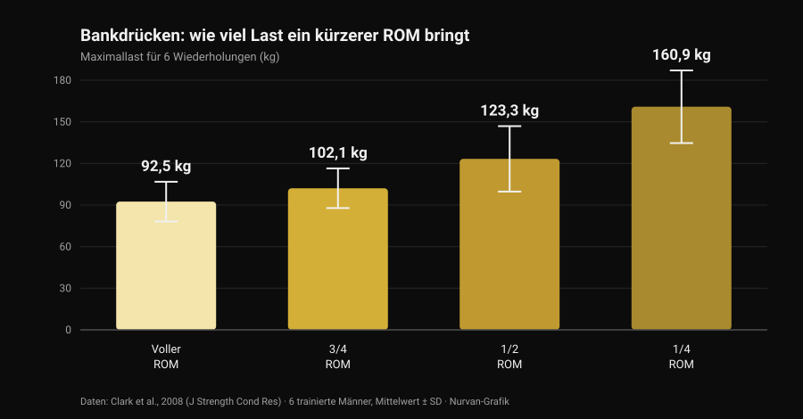
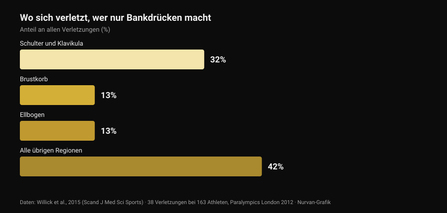

# Bulldog-Griff beim Bankdrücken: was die Studien sagen

Von [Giammaria Loi](/autore/giammaria-loi) · aktualisiert am 29. Oktober 2026

Ein technischer Post in meinem Feed erklärt den Bulldog-Griff beim Bankdrücken: Unterarm nach innen gedreht, Hantel diagonal auf der Handfläche, Versprechen von weniger Spannung im Ellbogen und mehr Stabilität. Die Beschreibung ist ehrlich, und ein Teil der Szene nutzt den Griff seit Jahren. Dann habe ich nachgesehen, wie oft dieser Griff in der Literatur gemessen wurde. Null Mal. Das ist kein Grund, ihn abzulehnen — es ist ein Grund, ihn so darzustellen, wie er ist, und die Daten zu nutzen, die es tatsächlich gibt: die zum Bewegungsumfang und die dazu, wo sich Bankdrücker wirklich verletzen.

## Kurz gefasst

- **Keine indexierte Studie hat ihn je gemessen.** Die PubMed-Suche nach "bulldog grip" liefert **null Treffer** (geprüft am 29. Oktober 2026): keine Elektromyografie, kein Lastvergleich, keine Daten zu Schmerz oder Verletzungen.
- **Die IPF-Regel sagt nicht, was nachgeplappert wird.** Das seit dem 1. März 2026 gültige technische Regelwerk verlangt, dass "Hände, Daumen und Finger die Hantel vollständig umfassen, mit um die Stange gelegtem Daumen", und verbietet den Kammgriff. Das Wort "Bulldog" kommt nirgends vor.
- **Weniger Bewegungsumfang bringt Kilos, keine Anpassungen.** Das 6er-Maximum steigt von **92,5 kg** bei vollem ROM auf **160,9 kg** bei einem Viertel-ROM (Clark et al., 2008). Über zehn Trainingswochen schlug der volle ROM jedoch alle Teilbereiche bei jeder getesteten Variante (Martínez-Cava et al., 2022).
- **Der Ellbogen ist nicht das Hauptproblem des Bankdrückens.** In der Sportart, die nur aus Bankdrücken besteht, entfallen **32 %** der Verletzungen auf Schulter und Schlüsselbein, **13 %** auf den Ellbogen (Willick et al., 2015).
- **Nach 40 wiegt der Ellbogen allerdings schwerer.** Bei 245 Kraftdreikämpfern steigt die Verletzungsrate an Ellbogen und Hand/Handgelenk jenseits der 40 signifikant (Siewe et al., 2011).

## Was der Bulldog-Griff eigentlich ist

Beim Griff, den fast alle verwenden, liegt die Hantel ungefähr in der Mitte der Handfläche und der Unterarm bleibt neutral. Beim Bulldog-Griff drehst du den Unterarm nach innen — in der Anatomie **Innenrotation**, also die Bewegung, die den Daumen zum Körper führt — und die Hantel liegt am Ende diagonal auf der Handfläche, nahe am Daumenballen statt in der Handmitte.

Daraus folgen drei Konsequenzen. Sie sind geometrisch, nicht experimentell:

1. das Handgelenk bleibt besser über dem Unterarm "gestapelt", mit weniger erzwungener Extension;
2. die Hantel liegt näher an der Kleinfingerseite, berührt die Brust also etwas höher;
3. der Ellbogen öffnet sich etwas weiter, weil die Unterarmdrehung ihn mitzieht.

Alle drei Punkte sind plausibel und mit einem Lineal überprüfbar. Keiner ist ein Laborergebnis.

## Was die Forschung nicht hat — und warum das zählt

Ich habe PubMed am 29. Oktober 2026 abgefragt: "bulldog grip" liefert nicht eine einzige Arbeit. Zum Bankdrücken gibt es dagegen eine ordentliche Literatur zur **Griffbreite** — wir haben sie in [Bankdrücken Griffbreite: weit, mittel oder eng](/de/blog/bankdruecken-griffbreite-weit-eng) durchgesehen — aber die **Handgelenksrotation** hat nie jemand gemessen: weder die Aktivität der Unterarmbeuger noch die bewegten Lasten noch berichtete Ellbogenschmerzen.

Die Aussage "der Bulldog-Griff senkt die Aktivierung der Handgelenksbeuger und entlastet damit den Ellbogen" ist also eine vernünftige mechanische Hypothese, die niemand geprüft hat. Wer ihn nutzt und sich besser fühlt, irrt sich nicht über die eigene Erfahrung: Das ist ein persönlicher Befund, der für ihn gilt. Nicht zulässig ist, daraus eine allgemeine Empfehlung zu machen und sie Wissenschaft zu nennen.

## Das IPF-Regelwerk: was wirklich darin steht

Hier sitzt das verbreitetste Missverständnis, und der Originaltext lohnt mehr als die Zusammenfassungen. Das seit dem **1. März 2026** gültige technische IPF-Regelwerk stellt zwei Bedingungen an den Griff beim Bankdrücken:

- Hände, Daumen und Finger müssen die Hantel **vollständig umfassen**, Daumen um die Stange gelegt;
- **der Kammgriff ist verboten**, und der Abstand zwischen den Zeigefingern darf 81 cm nicht überschreiten.

Aufschlussreich ist der Vergleich mit der Kniebeuge, wo dasselbe Regelwerk ausdrücklich schreibt, dass "die Daumen die Hantel nicht umschließen müssen". Beim Bankdrücken fehlt diese Ausnahme: Der umgelegte Daumen ist Pflicht.

Was folgt daraus? Dass das Regelwerk den **Bulldog-Griff nirgends benennt** und ein Bulldog mit umgelegtem Daumen und voller Hand an der Stange keine dieser beiden Zeilen verletzt. Rote Lampen gibt es für etwas anderes: den daumenlosen Griff (den sogenannten *Suicide Grip*), den Kammgriff, Zeigefinger außerhalb der 81-cm-Markierungen — und, für alle, die die Rotation ins Extrem treiben, eine Hand, die nur mit den Fingerkuppen aufliegt, statt die Stange vollständig zu umfassen.

Wer antritt, zieht daraus eine einfache Konsequenz: Zeig deinen Griff im Aufwärmen dem Kampfrichter, nicht mitten im ersten Versuch. Nationale Verbände wenden denselben Text an, aber am Wettkampftag zählt allein, wie "vollständig" der jeweilige Richter deinen Griff bewertet.

## Weniger ROM, mehr Kilos: die Zahl, die die ganze Debatte ordnet

Ein Teil der Bulldog-Diskussion lässt sich dagegen an harten Zahlen festmachen: der Bewegungsumfang. Berührt die Hantel bei gleicher Griffbreite höher die Brust, **wächst** der Weg; änderst du auch die Breite, kann er kürzer werden. In beiden Fällen bewegst du eine Variable mit großem Gewicht.

Wie groß, zeigt eine Arbeit von 2008: Sechs trainierte Männer testeten ihr 6-Wiederholungs-Maximum im Bankdrücken bei vier verschiedenen Bewegungsumfängen.

*Nurvan-Grafik nach Clark et al., 2008 (J Strength Cond Res). Mittelwerte und Standardabweichungen wie publiziert; sechs trainierte Probanden, Ausführung an der Multipresse.*

Vom vollen zum Viertel-ROM verdoppelt sich die Last fast. Dasselbe Muster zeigt eine deutlich größere Stichprobe: Bei 42 trainierten Männern stieg das Maximum stufenweise, je kürzer der Weg wurde — von voll über zwei Drittel bis ein Drittel (Martínez-Cava et al., 2019).

Das Problem ist, was über die Zeit passiert. In einer randomisierten Studie absolvierten 50 Männer zehn Wochen desselben Programms und unterschieden sich nur im trainierten Bewegungsumfang: **Die Volle-ROM-Gruppe erzielte bei allen drei getesteten Bankdrück-Varianten die besten Ergebnisse**, und die Teilgruppen verbesserten sich umso weniger, je kürzer der Weg war (Martínez-Cava et al., 2022). Im paralympischen Kraftdreikampf, wo Bankdrücken die ganze Disziplin ist, erlaubt Teil-ROM-Training höhere Lasten bei geringerem Funktionsverlust am Satzende, doch die Aktivierung des großen Brustmuskels — klavikulärer und sternaler Anteil — ist bei vollem ROM höher (Mendonça et al., 2021).

Übersetzt für alle, die den Bulldog erwägen: Wenn die Kilos plötzlich steigen, prüfe erst, wo die Hantel aufsetzt, bevor du feierst. Setzt sie tiefer auf, weil du breiter gegriffen hast, ist ein Teil des Zuwachses Geometrie. Umgekehrt gilt es auch, und der Ursprungspost sagt das korrekt: Bei gleicher Breite verlängert ein höherer Aufsetzpunkt den Weg und macht die Übung **härter**, nicht leichter.

## Der Ellbogen: wo sich Bankdrücker wirklich verletzen

Das Hauptargument für den Bulldog-Griff ist Entlastung des Ellbogens. Diesen Ellbogen lohnt es, ins Verhältnis zu setzen.

*Nurvan-Grafik nach Willick et al., 2015 (Scand J Med Sci Sports). 38 Verletzungen bei 163 Athleten über die sieben Wettkampftage der Paralympics 2012 in London.*

Paralympischer Kraftdreikampf ist faktisch ein reiner Bankdrück-Sport: die sauberste Stichprobe, die wir dazu haben, wo Drücken Menschen kaputtmacht. Bei 163 Athleten wurden 38 Verletzungen erfasst, **61 % davon chronische Überlastung**. Am häufigsten betroffen sind Schulter und Schlüsselbein (32 %); Brustkorb und Ellbogen folgen gleichauf mit 13 %.

In den übrigen Kraftsportarten sieht es genauso aus: Die systematische Übersicht von Keogh und Winwood nennt Schulter, unteren Rücken, Knie, Ellbogen und Handgelenk/Hand als häufigste Regionen, bei etwa **einer Verletzung pro 1.000 Trainingsstunden** im Kraftdreikampf. Von 245 deutschen Kraftdreikämpfern berichteten **43,3 %** über Beschwerden im normalen Training, ohne es zu unterbrechen, und die Verletzungsrate an Ellbogen sowie Hand/Handgelenk stieg nach dem 40. Lebensjahr signifikant (Siewe et al., 2011).

Zwei praktische Schlüsse. Erstens: Wenn der Ellbogen schmerzt, ist der Griff ein kleiner Hebel neben Last, Volumen, Frequenz und Progression — dort gehört der erste Blick hin. Zweitens, heikler: Extreme Innenrotation schließt die Schulterposition, und eine Übersichtsarbeit von 2024 nennt genau die **verletzliche Gelenkposition während der Übung** unter den Risikofaktoren für Schulterverletzungen im Kraftsport (Daher et al., 2024). Ein Ellbogenzwicken gegen ein Schulterproblem zu tauschen, ist ein schlechtes Geschäft: Die Schulter verletzt sich am häufigsten.

## Was die Forschung wirklich sagt

- **"Der Bulldog-Griff senkt die Aktivierung der Handgelenksbeuger und schont den Ellbogen" — Nicht überprüfbar.** Null indexierte Studien, keine Elektromyografie. Eine mechanische Hypothese, kein Befund.
- **"Er bringt einen höheren Aufsetzpunkt und ein natürlicheres Ellbogenflare" — Zu präzisieren.** Die Geometrie trägt: Die Unterarmdrehung verschiebt die Hantel zur Kleinfingerseite. Wie stark sich der Ellbogenwinkel tatsächlich ändert, hat niemand gemessen.
- **"Bei gleicher Breite erhöht ein höherer Aufsetzpunkt den Weg, also wird es schwerer" — Bestätigt.** Passend zum Verhältnis von Bewegungsumfang und Last: mehr Weg, weniger Kilos.
- **"Weniger Bewegungsumfang ist ein Vorteil" — Zu präzisieren.** Die Last steigt deutlich (von 92,5 auf 160,9 kg zwischen vollem und Viertel-ROM), doch über zehn Trainingswochen erzeugt der volle ROM bei jeder Variante größere Anpassungen.
- **"Die IPF verbietet ihn, weil der Daumen umgelegt sein muss" — Widerlegt in dieser Form.** Das Regelwerk 2026 benennt den Bulldog nicht: Es verbietet den Kammgriff und verlangt, dass Hände, Daumen und Finger die Hantel vollständig umfassen. Ein Bulldog mit umgelegtem Daumen erfüllt beides.
- **"Er hilft Anfängern, die die Ellbogen zu eng führen" — Nicht überprüfbar.** Keine Daten zu Anfängern, Technik und Griff. Und beim Drücken verletzt sich die Schulter, nicht der Ellbogen, am häufigsten.

## So setzt du es um

1. **Wenn nichts wehtut und die Zahlen steigen, wechsle nicht aus Mode.** Der Griff, den du seit Jahren nutzt, ist auch der Griff, auf dem deine Technik aufgebaut ist: Ein Wechsel kostet dich für einige Wochen einen Teil dieser Automatik.
2. **Wenn du es probierst, lass den Daumen umgelegt und die ganze Hand an der Stange.** Das ist die Version, die im Regelwerk bleibt, und zugleich die, in der dir die Hantel nicht entwischen kann.
3. **Miss den Aufsetzpunkt vorher und nachher.** Markiere, wo die Hantel mit altem und mit neuem Griff an der Brust landet: nur so weißt du, ob du den Griff oder den Bewegungsumfang geändert hast.
4. **Gib ihm drei bis vier Wochen und ein Zahlenkriterium.** Gleiche Last, gleiche Satzzahl, gleicher Aufsetzpunkt: Bewegt sich die Last bei gleichem RIR (Wiederholungen in Reserve) nicht, bringt dir der Griff nichts.
5. **Schmerzt der Ellbogen, sieh zuerst in den Plan.** Lastsprünge, zu viele Sätze nahe am Muskelversagen und keine Entlastungswoche erklären weit mehr als die Handgelenksdrehung. Die Logik von Sätzen, Pause und Progression steht in [wie viele Wiederholungen für Muskelaufbau](/de/blog/wie-viele-wiederholungen-muskelaufbau).
6. **Schmerz, der seit Wochen anhält oder nachts weckt, ist keine Griff-Frage.** Das gehört zu einer medizinischen Fachkraft, nicht in einen Post.
7. **Wenn du antrittst, frag vorher den Kampfrichter.** Dreißig Sekunden im Aufwärmraum schlagen jede Bildunterschrift aus dem Netz.

### Nurvan testen — wenn du den Griff änderst, sollen die Zahlen entscheiden

Eine Technikänderung beurteilt man über Wochen, nicht über eine Einheit: Du brauchst Last, Wiederholungen und RIR derselben Übung nebeneinander, mit einer Notiz, was du wann geändert hast. In Nurvan erfasst du jeden Bankdrück-Satz mit RIR, hinterlegst eine Notiz zur verwendeten Variante und bekommst die Lastkurve Monat für Monat — so hat die Frage "hat mir der Bulldog-Griff Kilos gebracht?" eine Antwort statt eines Gefühls. Zusätzlich werden die Aufwärmsätze automatisch aus der Tageslast abgeleitet, genau das, was man braucht, solange ein neuer Griff noch ungewohnt ist.

## Häufige Fragen

**Was ist der Bulldog-Griff beim Bankdrücken?**
Ein Griff, bei dem du den Unterarm nach innen drehst und die Hantel diagonal auf der Handfläche liegt, nahe am Daumenballen statt in der Handmitte. Das Handgelenk bleibt stärker in Linie mit dem Unterarm, und die Hantel berührt die Brust etwas höher. Es ist kein daumenloser Griff: korrekt ausgeführt bleibt der Daumen um die Stange gelegt.

**Ist der Bulldog-Griff im IPF-Wettkampf erlaubt?**
Das seit dem 1. März 2026 gültige technische IPF-Regelwerk benennt ihn nicht. Es verlangt, dass Hände, Daumen und Finger die Hantel vollständig umfassen, Daumen umgelegt, und verbietet den Kammgriff: Ein Bulldog mit umgelegtem Daumen und voller Hand an der Stange erfüllt beide Bedingungen. Regelwidrig sind der daumenlose Griff, der Kammgriff und eine nur mit den Fingerkuppen aufliegende Hand. Im Zweifel zeigst du ihn vor dem Wettkampf dem Kampfrichter.

**Hebt man mit dem Bulldog-Griff mehr?**
Gemessen hat das keine Studie. Steigt die Last in deinen Tests, liegt die wahrscheinlichste Ursache nicht am Griff selbst, sondern am Bewegungsumfang: Bei sonst gleichen Bedingungen erhöht ein kürzerer Weg die bewegbare Last deutlich, während ein höherer Aufsetzpunkt bei gleicher Breite den Weg verlängert und die Übung härter macht.

**Schadet der Bulldog-Griff den Schultern?**
Direkte Daten fehlen. Bekannt ist, dass die Schulter im Wettkampf-Bankdrücken die am häufigsten betroffene Region ist (32 % der Verletzungen) und dass die verletzliche Gelenkposition während der Übung zu den dokumentierten Risikofaktoren gehört. Eine sehr ausgeprägte Innenrotation führt man deshalb schrittweise ein — und lässt sie weg, sobald die Schulter zwickt.

## Lies auch

- [Bankdrücken Griffbreite: weit, mittel oder eng?](/de/blog/bankdruecken-griffbreite-weit-eng) — was sich für Brust und Trizeps mit der Breite wirklich ändert, mit Zahlen.
- [Kurzhantel-Bankdrücken oder Fliegende: was wächst mehr?](/de/blog/kurzhantel-bankdruecken-oder-fliegende-brust) — Drücken gegen Isolation für die Brust.
- [Wie viele Wiederholungen für Muskelaufbau? Der 8-12-Mythos](/de/blog/wie-viele-wiederholungen-muskelaufbau) — Sätze, Pause und Progression, die Hebel, die mehr wiegen als der Griff.

## Quellen

- Clark RA, Bryant AL, Humphries B, 2008. *An examination of strength and concentric work ratios during variable range of motion training.* Journal of Strength and Conditioning Research 22(5):1716-9. [PMID 18714211](https://pubmed.ncbi.nlm.nih.gov/18714211/) · [DOI 10.1519/JSC.0b013e318173c529](https://doi.org/10.1519/JSC.0b013e318173c529)
- Martínez-Cava A, Morán-Navarro R, Hernández-Belmonte A, Courel-Ibáñez J, Conesa-Ros E, González-Badillo JJ, Pallarés JG, 2019. *Range of Motion and Sticking Region Effects on the Bench Press Load-Velocity Relationship.* Journal of Sports Science & Medicine 18(4):645-652. [PMID 31827348](https://pubmed.ncbi.nlm.nih.gov/31827348/)
- Martínez-Cava A, Hernández-Belmonte A, Courel-Ibáñez J, Morán-Navarro R, González-Badillo JJ, Pallarés JG, 2022. *Bench Press at Full Range of Motion Produces Greater Neuromuscular Adaptations Than Partial Executions After Prolonged Resistance Training.* Journal of Strength and Conditioning Research 36(1):10-15. [PMID 31567719](https://pubmed.ncbi.nlm.nih.gov/31567719/) · [DOI 10.1519/JSC.0000000000003391](https://doi.org/10.1519/JSC.0000000000003391)
- Mendonça TP, Aidar FJ, Matos DG, Souza RF, Marçal AC, Almeida-Neto PF, Cabral BG, Garrido ND, Neiva HP, Marinho DA, Marques MC, Reis VM, 2021. *Force production and muscle activation during partial vs. full range of motion in Paralympic Powerlifting.* PLoS One 16(10):e0257810. [PMID 34644331](https://pubmed.ncbi.nlm.nih.gov/34644331/) · [DOI 10.1371/journal.pone.0257810](https://doi.org/10.1371/journal.pone.0257810)
- Willick SE, Cushman DM, Blauwet CA, Emery C, Webborn N, Derman W, Schwellnus M, Stomphorst J, Van de Vliet P, 2015. *The epidemiology of injuries in powerlifting at the London 2012 Paralympic Games: An analysis of 1411 athlete-days.* Scandinavian Journal of Medicine & Science in Sports 26(10):1233-8. [PMID 26453890](https://pubmed.ncbi.nlm.nih.gov/26453890/) · [DOI 10.1111/sms.12554](https://doi.org/10.1111/sms.12554)
- Siewe J, Rudat J, Röllinghoff M, Schlegel UJ, Eysel P, Michael JW-P, 2011. *Injuries and overuse syndromes in powerlifting.* International Journal of Sports Medicine 32(9):703-11. [PMID 21590644](https://pubmed.ncbi.nlm.nih.gov/21590644/) · [DOI 10.1055/s-0031-1277207](https://doi.org/10.1055/s-0031-1277207)
- Keogh JWL, Winwood PW, 2017. *The Epidemiology of Injuries Across the Weight-Training Sports.* Sports Medicine 47(3):479-501. [PMID 27328853](https://pubmed.ncbi.nlm.nih.gov/27328853/) · [DOI 10.1007/s40279-016-0575-0](https://doi.org/10.1007/s40279-016-0575-0)
- Daher M, Jabre S, Casey JC, Fares MY, Boufadel P, Lopez R, Lawand J, Mansour J, Abboud JA, 2024. *Shouldering the load: A scoping review of incidence, types, and risk factors of shoulder injuries in weight-lifting athletes.* Shoulder & Elbow 17(3):254-263. [PMID 39552690](https://pubmed.ncbi.nlm.nih.gov/39552690/) · [DOI 10.1177/17585732241258743](https://doi.org/10.1177/17585732241258743)
- International Powerlifting Federation, 2026. *IPF Technical Rules Book*, gültig ab 1. März 2026, Abschnitt 4.2 (Bench Press — Rules of Performance). [Offizielles PDF](https://www.irishpowerliftingfederation.com/wp-content/uploads/2026/03/2026-IPF-Technical-Rulebook-effective-01-March-2026-v3.pdf)

Literatur über PubMed recherchiert. Ausgangspunkt: der Post von **Alfred Jong** ([alfred.reformance](https://www.instagram.com/alfred.reformance/), Reformance Training) vom 25. September 2026, [Originalpost](https://www.instagram.com/p/DdtpBWPm9f4/). Gelesen wurden nur Autor, Datum und Bildunterschrift: Kein Text und keine Bilder wurden reproduziert. Das Thema wurde von Grund auf neu geschrieben, ausgehend von den Primärquellen und dem offiziellen Regelwerk.

---

**Giammaria Loi** ist der Gründer von Nurvan. Er trainiert seit 2012 mit Gewichten, arbeitet seit 2013 als FIPE-zertifizierter Personal Trainer und Coach und startet seit 2018 im Kraftdreikampf auf nationaler Ebene. Jeder Artikel, den er zeichnet, beginnt bei den Studien und endet bei dem, was im Gym wirklich funktioniert.

> Hinweis: informativer Inhalt, der ärztlichen oder fachlichen Rat nicht ersetzt. Bei anhaltenden Schmerzen in Ellbogen, Handgelenk oder Schulter oder bei Beschwerden, die sich trotz reduzierter Last verschlimmern, wende dich an eine Ärztin oder eine Physiotherapeutin, statt die Lösung in einem technischen Detail zu suchen.
