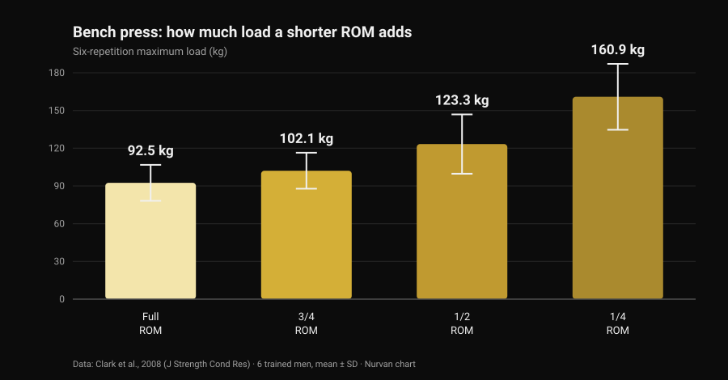
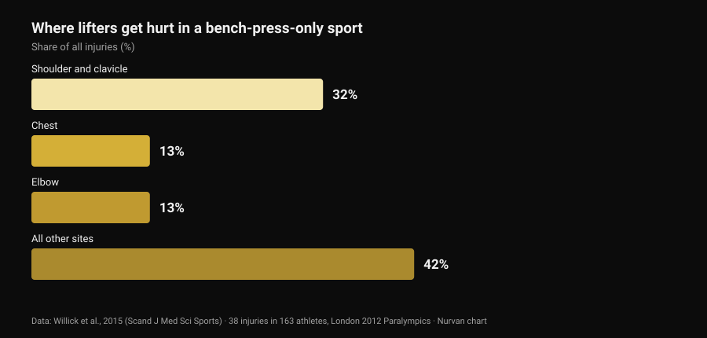

# Bulldog grip bench press: what the research says

By [Giammaria Loi](/autore/giammaria-loi) · updated 29 October 2026

A technical post came across my feed explaining the bulldog grip: rotate the forearm inward, let the bar sit diagonally across the palm, and you get a quieter elbow and a more stable setup. It is an honest description, and plenty of lifters have used it for years. Then I went looking for how many times that grip has actually been measured in the literature. Zero times. That is not a reason to dismiss it — it is a reason to describe it for what it is, and to use the data we do have: the numbers on range of motion, and the numbers on where bench pressers actually get hurt.

## The short version

- **No indexed study has ever measured it.** A PubMed search for "bulldog grip" returns **zero results** (checked 29 October 2026): no electromyography, no load comparison, no data on pain or injury.
- **The IPF rule does not say what people repeat.** The technical rulebook in force since 1 March 2026 requires that "hands, thumbs and fingers must completely grip the bar... with a thumb around grip" and forbids the reverse grip. The word "bulldog" appears nowhere.
- **Cutting range of motion adds kilos, not adaptation.** Six-rep max load goes from **92.5 kg** at full ROM to **160.9 kg** at a quarter ROM (Clark et al., 2008). Yet over ten weeks of training, full ROM beat every partial group on every variation tested (Martínez-Cava et al., 2022).
- **The elbow is not the bench press's main problem.** In the sport that is only bench press, shoulder and clavicle account for **32%** of injuries and the elbow for **13%** (Willick et al., 2015).
- **The elbow does matter more after 40.** Across 245 powerlifters, elbow and hand/wrist injury rates rose significantly past age 40 (Siewe et al., 2011).

## What the bulldog grip actually is

In the grip almost everyone uses, the bar sits roughly in the middle of the palm and the forearm stays neutral. In the bulldog grip you rotate the forearm inward — **internal rotation**, the movement that turns the thumb towards your body — and the bar ends up resting diagonally across the palm, close to the base of the thumb rather than in the centre of the hand.

Three consequences follow. They are geometric, not experimental:

1. the wrist stays more "stacked" over the forearm, with less forced extension;
2. the bar rests closer to the little-finger side of the hand, so it touches the chest slightly higher;
3. the elbow tends to flare a little more, because the rotating forearm drags it outwards.

All three are plausible and checkable with a ruler. None of them is a laboratory result.

## What the research does not have — and why that matters

I searched PubMed on 29 October 2026: "bulldog grip" returns not a single paper. For the bench press there is a decent body of work on grip **width** — we went through it in [bench press grip width: wide, medium or close](/en/blog/bench-press-grip-width-wide-close) — but nobody has ever measured **wrist rotation**: not forearm flexor activity, not the loads lifted, not reported elbow pain.

So the claim that "the bulldog grip reduces wrist flexor activation and therefore eases elbow pain" is a reasonable mechanical hypothesis nobody has tested. A lifter who uses it and feels better is not wrong about their own experience — they are reporting a personal result that holds for them. What you cannot do is turn that into a general recommendation and call it science.

## The IPF rule: what it actually says

This is where the most common misunderstanding sits, and the text is worth reading instead of the summaries. The IPF technical rulebook in force since **1 March 2026** puts two constraints on the bench press grip:

- hands, thumbs and fingers must **completely grip** the bar, with the thumb wrapped around it;
- **the reverse grip is forbidden**, and the distance between the forefingers may not exceed 81 cm.

The revealing comparison is the squat, where the same rulebook explicitly states that "the thumbs are not required to wrap around the bar". The bench press has no such exemption: a wrapped thumb is mandatory.

What follows from that? The rulebook **never names the bulldog grip**, and a bulldog performed with the thumb wrapped and the whole hand on the bar breaks neither line. What does get you red lights is different: a thumbless grip (the so-called suicide grip), a reverse grip, forefingers outside the 81 cm marks — and, for anyone pushing the rotation to an extreme, a hand that rests on the bar with the fingertips instead of gripping it completely.

If you compete, the practical move is simple: show your grip to the referee during warm-ups, not halfway through your first attempt. National federations apply the same text, but on meet day the only thing that counts is how "complete" the individual judge considers your grip to be.

## Less range of motion, more kilos: the number that frames the whole debate

One part of the bulldog argument can be anchored to solid numbers, and that is range of motion. If the bar touches the chest higher at the same grip width, the travel **increases**; if you also change the width, the travel can shrink. Either way you are moving a variable that weighs a lot.

A 2008 study put a figure on it: six trained men tested their six-rep max in the bench press at four different ranges.

*Nurvan chart on data from Clark et al., 2008 (J Strength Cond Res). Means and standard deviations as reported; six trained men, Smith machine execution.*

From full ROM to a quarter ROM the load nearly doubles. The same pattern shows up in a much larger sample: across 42 trained men, one-rep max rose progressively as the range went from full to two-thirds to one-third (Martínez-Cava et al., 2019).

The problem is what happens over time. In a randomised trial, 50 men ran ten weeks of an identical programme differing only in the range trained: **the full-ROM group produced the best results on all three bench press variations tested**, and the partial groups improved less the shorter the range got (Martínez-Cava et al., 2022). In Paralympic powerlifting, where the bench press is the whole sport, partial-ROM training allows heavier loads with less loss of function by the end of a session — but pectoralis major activation, both clavicular and sternal portions, is higher at full ROM (Mendonça et al., 2021).

Translated for anyone trying the bulldog: if your numbers suddenly jump, check where the bar touches before you celebrate. If it touches lower because you widened the grip, part of that gain is geometry. The reverse holds too, and the original post flags it correctly: at the same width, a higher touch point lengthens the travel and makes the lift **harder**, not easier.

## The elbow: where bench pressers actually get hurt

The main argument for the bulldog grip is elbow relief. It is worth putting that elbow in proportion.

*Nurvan chart on data from Willick et al., 2015 (Scand J Med Sci Sports). 38 injuries recorded among 163 athletes over the seven competition days of the London 2012 Paralympic Games.*

Paralympic powerlifting is, in practice, a bench-press-only sport: it is the cleanest sample we have for where pressing breaks people. Among 163 athletes, 38 injuries were recorded, **61% of them chronic overuse**. The most affected site is the shoulder and clavicle (32%); chest and elbow follow, tied at 13%.

The picture across the other strength sports is the same: Keogh and Winwood's systematic review lists shoulder, lower back, knee, elbow and wrist/hand as the most common sites, at roughly **one injury per 1,000 hours** of powerlifting training. Among 245 German powerlifters, **43.3%** reported discomfort during routine training without stopping, and elbow and hand/wrist injury rates rose significantly past age 40 (Siewe et al., 2011).

Two practical conclusions. First: if your elbow hurts, grip is a small lever next to load, volume, frequency and progression — look there first. Second, and more delicate: extreme internal rotation closes down the shoulder position, and a 2024 review names **vulnerable positioning of the joint during the lift** among the risk factors for shoulder injury in weight-lifting athletes (Daher et al., 2024). Trading an elbow niggle for a shoulder problem is a bad deal: the shoulder is the joint that gets injured most.

## What the research actually says

- **"The bulldog grip reduces wrist flexor activation and spares the elbow" — Unverifiable.** Zero indexed studies, no electromyography. It is a mechanical hypothesis, not a finding.
- **"It gives a higher touch point and a more natural elbow flare" — Needs nuance.** The geometry holds: rotating the forearm shifts the bar towards the little-finger side. How much the elbow angle actually changes has never been measured.
- **"At the same width, a higher touch point increases the range, so it is harder" — Confirmed.** Consistent with the range-load relationship: more travel, fewer kilos on the bar.
- **"Cutting range of motion is an advantage" — Needs nuance.** It raises load sharply (from 92.5 to 160.9 kg between full and quarter ROM), but across ten weeks of training full ROM produces greater adaptations on every variation.
- **"The IPF bans it because the rules require a thumb-around grip" — Debunked as stated.** The 2026 rulebook never names the bulldog: it bans the reverse grip and requires hands, thumbs and fingers to completely grip the bar. A bulldog with a wrapped thumb satisfies both.
- **"It helps beginners who over-tuck their elbows" — Unverifiable.** No data on novices, technique and grip. And the shoulder, not the elbow, is the site that gets hurt most in pressing.

## How to apply it

1. **If nothing hurts and the numbers are moving, do not change on trend.** The grip you have used for years is also the grip your technique was built on; changing it costs you part of that automation for several weeks.
2. **If you try it, keep the thumb wrapped and the whole hand on the bar.** That is the version that stays inside the competition rules, and also the one where the bar cannot escape.
3. **Measure the touch point before and after.** Mark where the bar lands on your chest with the old grip and the new one: that is the only way to know whether you changed the grip or changed the range.
4. **Give it three to four weeks and a numeric criterion.** Same load, same number of sets, same touch point: if at equal RIR (reps in reserve, how many you had left in the tank) the load does not budge, the grip is giving you nothing.
5. **If the elbow hurts, look at the programme first.** Big load jumps, too many sets near failure and no deload explain far more than wrist rotation. The logic of sets, rest and progression is in [how many reps build muscle](/en/blog/how-many-reps-build-muscle).
6. **Pain that has lasted weeks, or that wakes you at night, is not a grip question.** That belongs with a clinician, not with a caption.
7. **If you compete, ask the referee first.** Thirty seconds in the warm-up room beats anything you read online.

### Try Nurvan — if you change your grip, let the numbers tell you whether it worked

A technique change is judged over weeks, not one session: you need load, reps and RIR for the same lift side by side, with a note on what you changed and when. In Nurvan you log every bench press set with its RIR, add a note on the variation you used, and get the load curve month by month — so "did the bulldog grip add kilos?" has an answer instead of an impression. Warm-up sets are also proposed automatically from the day's working load, which is exactly what you want while a new grip still feels unfamiliar.

## Frequently asked questions

**What is the bulldog grip in the bench press?**
It is a grip where you rotate the forearm inward and let the bar sit diagonally across the palm, near the base of the thumb rather than in the centre of the hand. The wrist stays more in line with the forearm and the bar touches the chest slightly higher. It is not a thumbless grip: done properly, the thumb stays wrapped around the bar.

**Is the bulldog grip legal in IPF competition?**
The IPF technical rulebook in force since 1 March 2026 does not name it. It requires hands, thumbs and fingers to completely grip the bar with the thumb wrapped, and it forbids the reverse grip — so a bulldog done with a wrapped thumb and the full hand on the bar meets both conditions. What is out of rule is a thumbless grip, a reverse grip, and a hand resting on the bar with the fingertips only. If in doubt, show it to the referee before you compete.

**Does the bulldog grip let you lift more?**
No study has measured it. If your load goes up in testing, the likeliest cause is not the grip itself but the range of motion: all else equal, shortening the travel raises the liftable load a great deal, while a higher touch point at the same width lengthens it and makes the lift harder.

**Is the bulldog grip bad for your shoulders?**
There is no direct evidence. What we do know is that the shoulder is the most affected site in competitive bench pressing (32% of injuries), and that vulnerable joint positioning during the lift is among the documented risk factors. So heavy internal rotation is worth introducing gradually, and dropping if shoulder discomfort appears.

## Related reading

- [Bench press grip width: wide, medium or close?](/en/blog/bench-press-grip-width-wide-close) — what actually changes for chest and triceps as the width changes, with the numbers.
- [Dumbbell press vs fly: which builds more chest?](/en/blog/dumbbell-bench-press-vs-fly-chest-growth) — pressing against isolation for the pecs.
- [How many reps build muscle? The 8-12 myth](/en/blog/how-many-reps-build-muscle) — sets, rest and progression, the levers that matter more than grip.

## Sources

- Clark RA, Bryant AL, Humphries B, 2008. *An examination of strength and concentric work ratios during variable range of motion training.* Journal of Strength and Conditioning Research 22(5):1716-9. [PMID 18714211](https://pubmed.ncbi.nlm.nih.gov/18714211/) · [DOI 10.1519/JSC.0b013e318173c529](https://doi.org/10.1519/JSC.0b013e318173c529)
- Martínez-Cava A, Morán-Navarro R, Hernández-Belmonte A, Courel-Ibáñez J, Conesa-Ros E, González-Badillo JJ, Pallarés JG, 2019. *Range of Motion and Sticking Region Effects on the Bench Press Load-Velocity Relationship.* Journal of Sports Science & Medicine 18(4):645-652. [PMID 31827348](https://pubmed.ncbi.nlm.nih.gov/31827348/)
- Martínez-Cava A, Hernández-Belmonte A, Courel-Ibáñez J, Morán-Navarro R, González-Badillo JJ, Pallarés JG, 2022. *Bench Press at Full Range of Motion Produces Greater Neuromuscular Adaptations Than Partial Executions After Prolonged Resistance Training.* Journal of Strength and Conditioning Research 36(1):10-15. [PMID 31567719](https://pubmed.ncbi.nlm.nih.gov/31567719/) · [DOI 10.1519/JSC.0000000000003391](https://doi.org/10.1519/JSC.0000000000003391)
- Mendonça TP, Aidar FJ, Matos DG, Souza RF, Marçal AC, Almeida-Neto PF, Cabral BG, Garrido ND, Neiva HP, Marinho DA, Marques MC, Reis VM, 2021. *Force production and muscle activation during partial vs. full range of motion in Paralympic Powerlifting.* PLoS One 16(10):e0257810. [PMID 34644331](https://pubmed.ncbi.nlm.nih.gov/34644331/) · [DOI 10.1371/journal.pone.0257810](https://doi.org/10.1371/journal.pone.0257810)
- Willick SE, Cushman DM, Blauwet CA, Emery C, Webborn N, Derman W, Schwellnus M, Stomphorst J, Van de Vliet P, 2015. *The epidemiology of injuries in powerlifting at the London 2012 Paralympic Games: An analysis of 1411 athlete-days.* Scandinavian Journal of Medicine & Science in Sports 26(10):1233-8. [PMID 26453890](https://pubmed.ncbi.nlm.nih.gov/26453890/) · [DOI 10.1111/sms.12554](https://doi.org/10.1111/sms.12554)
- Siewe J, Rudat J, Röllinghoff M, Schlegel UJ, Eysel P, Michael JW-P, 2011. *Injuries and overuse syndromes in powerlifting.* International Journal of Sports Medicine 32(9):703-11. [PMID 21590644](https://pubmed.ncbi.nlm.nih.gov/21590644/) · [DOI 10.1055/s-0031-1277207](https://doi.org/10.1055/s-0031-1277207)
- Keogh JWL, Winwood PW, 2017. *The Epidemiology of Injuries Across the Weight-Training Sports.* Sports Medicine 47(3):479-501. [PMID 27328853](https://pubmed.ncbi.nlm.nih.gov/27328853/) · [DOI 10.1007/s40279-016-0575-0](https://doi.org/10.1007/s40279-016-0575-0)
- Daher M, Jabre S, Casey JC, Fares MY, Boufadel P, Lopez R, Lawand J, Mansour J, Abboud JA, 2024. *Shouldering the load: A scoping review of incidence, types, and risk factors of shoulder injuries in weight-lifting athletes.* Shoulder & Elbow 17(3):254-263. [PMID 39552690](https://pubmed.ncbi.nlm.nih.gov/39552690/) · [DOI 10.1177/17585732241258743](https://doi.org/10.1177/17585732241258743)
- International Powerlifting Federation, 2026. *IPF Technical Rules Book*, in force from 1 March 2026, section 4.2 (Bench Press — Rules of Performance). [Official PDF](https://www.irishpowerliftingfederation.com/wp-content/uploads/2026/03/2026-IPF-Technical-Rulebook-effective-01-March-2026-v3.pdf)

References retrieved through PubMed. Starting point: the post by **Alfred Jong** ([alfred.reformance](https://www.instagram.com/alfred.reformance/), Reformance Training) of 25 September 2026, [original post](https://www.instagram.com/p/DdtpBWPm9f4/). Only the author, date and caption were read: no text and no images were reproduced. The topic was rewritten from scratch from the primary sources and the official rulebook.

---

**Giammaria Loi** is the founder of Nurvan. He has been lifting since 2012, has worked as a FIPE-certified personal trainer and coach since 2013, and has competed in powerlifting at national level since 2018. Every article he writes starts from the research and ends with what actually works in the gym.

> Note: this is educational content and does not replace medical advice. If you have persistent elbow, wrist or shoulder pain, or discomfort that worsens despite reducing load, see a doctor or physiotherapist rather than hunting for the answer in a technical detail.
