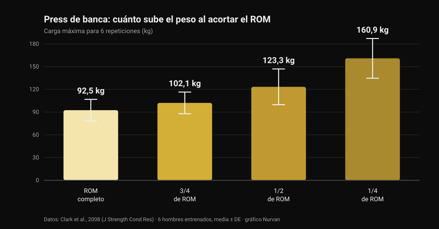
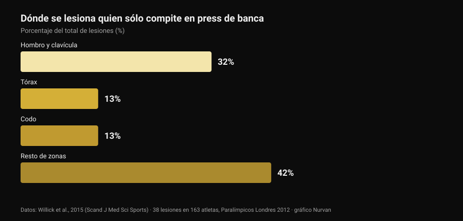

# Agarre bulldog en press de banca: qué dicen los estudios

Por [Giammaria Loi](/autore/giammaria-loi) · actualizado el 29 de octubre de 2026

Un post técnico que pasó por mi feed explica el agarre bulldog en press de banca: muñeca rotada hacia dentro, barra en diagonal sobre la palma, promesa de menos tensión en el codo y más estabilidad. Es una descripción honesta, y parte de la comunidad lleva años usándolo. Luego fui a buscar cuántas veces se ha medido ese agarre en la literatura científica. Cero. No es motivo para descartarlo: es motivo para contarlo tal como es y usar los datos que sí existen, los del rango de movimiento y los de dónde se lesiona de verdad quien hace press de banca.

## En resumen

- **Ningún estudio indexado lo ha medido.** Buscar "bulldog grip" en PubMed devuelve **cero resultados** (comprobado el 29 de octubre de 2026): ni electromiografía, ni comparación de cargas, ni datos de dolor o lesiones.
- **La regla de la IPF no dice lo que se repite.** El reglamento técnico vigente desde el 1 de marzo de 2026 exige que "manos, pulgares y dedos agarren completamente la barra, con el pulgar rodeándola" y prohíbe el agarre invertido. La palabra "bulldog" no aparece.
- **Acortar el recorrido sube los kilos, no las adaptaciones.** El máximo para 6 repeticiones pasa de **92,5 kg** con recorrido completo a **160,9 kg** con un cuarto de recorrido (Clark et al., 2008). Pero en diez semanas de entrenamiento el recorrido completo ganó a todos los parciales en todas las variantes (Martínez-Cava et al., 2022).
- **El codo no es el problema principal del press de banca.** En el deporte que es solo press, el hombro y la clavícula suponen el **32%** de las lesiones y el codo el **13%** (Willick et al., 2015).
- **El codo sí pesa más a partir de los 40.** En 245 powerlifters, la tasa de lesión en codo y mano/muñeca aumenta de forma significativa después de los 40 años (Siewe et al., 2011).

## Qué es el agarre bulldog, en palabras simples

En el agarre que usa casi todo el mundo, la barra se apoya más o menos en el centro de la palma y el antebrazo queda neutro. En el agarre bulldog rotas el antebrazo hacia dentro —lo que en anatomía se llama **rotación interna**, el movimiento que lleva el pulgar hacia el cuerpo— y la barra acaba apoyada en diagonal sobre la palma, cerca de la base del pulgar en lugar del centro de la mano.

De ahí salen tres consecuencias geométricas, no experimentales:

1. la muñeca queda más alineada sobre el antebrazo, con menos extensión forzada;
2. la barra se apoya más cerca del lado del meñique, así que toca el pecho un poco más arriba;
3. el codo tiende a abrirse algo más, porque la rotación del antebrazo lo arrastra.

Son consecuencias plausibles y comprobables con una regla. Ninguna es un resultado de laboratorio.

## Lo que la investigación no tiene, y por qué importa

Consulté PubMed el 29 de octubre de 2026: "bulldog grip" no devuelve ni un solo trabajo. Sobre el press de banca sí existe literatura sobre la **anchura** del agarre —la repasamos en [agarre en press de banca: ancho, medio o cerrado](/es/blog/agarre-press-banca-ancho-cerrado)—, pero nadie ha medido nunca la **rotación de la muñeca**: ni la actividad de los flexores del antebrazo, ni las cargas levantadas, ni el dolor referido en el codo.

Así que la afirmación "el agarre bulldog reduce la activación de los flexores de la muñeca y por eso alivia el codo" es una hipótesis mecánica razonable que nadie ha puesto a prueba. Quien lo usa y está mejor no se equivoca sobre su propia experiencia: reporta un dato personal, válido para él. Lo que no se puede hacer es convertirlo en una recomendación general y llamarlo ciencia.

## El reglamento de la IPF: qué dice realmente

Aquí está el malentendido más extendido, y vale la pena leer el texto en vez de los resúmenes. El reglamento técnico de la IPF vigente desde el **1 de marzo de 2026** fija dos condiciones sobre el agarre en press de banca:

- manos, pulgares y dedos deben **agarrar completamente** la barra, con el pulgar rodeándola;
- **el agarre invertido está prohibido**, y la distancia entre los índices no puede superar los 81 cm.

La comparación reveladora es con la sentadilla, donde el mismo reglamento escribe explícitamente que "no se requiere que los pulgares rodeen la barra". En press de banca esa excepción no existe: el pulgar cerrado es obligatorio.

¿Qué se deduce? Que el reglamento **no nombra el agarre bulldog**, y que un bulldog con el pulgar cerrado y la mano completa sobre la barra no infringe ninguna de esas dos líneas. Lo que sí hace saltar la luz roja es otra cosa: el agarre sin pulgar (el llamado *suicide grip*), el agarre invertido, los índices fuera de las marcas de 81 cm y —esto afecta de lleno a quien lleva la rotación al extremo— una mano apoyada en la barra solo con las yemas en lugar de agarrarla por completo.

Si compites, la conclusión práctica es simple: enseña tu agarre al árbitro en el calentamiento, no a mitad del primer intento. Las federaciones nacionales aplican el mismo texto, pero el día de la competición lo único que cuenta es hasta qué punto el juez considera "completo" tu agarre.

## Menos recorrido, más kilos: el dato que ordena todo el debate

Hay una parte del asunto bulldog que sí se puede anclar a números sólidos: el rango de movimiento. Si la barra toca el pecho más arriba con la misma anchura de agarre, el recorrido **aumenta**; si además cambias la anchura, el recorrido puede acortarse. En ambos casos estás moviendo una variable que pesa mucho.

Cuánto pesa lo mide un trabajo de 2008: seis hombres entrenados probaron su máximo para 6 repeticiones en press de banca con cuatro amplitudes distintas.

*Gráfico Nurvan con datos de Clark et al., 2008 (J Strength Cond Res). Medias y desviaciones estándar publicadas; seis sujetos entrenados, ejecución en multipower.*

Del recorrido completo a un cuarto de recorrido la carga casi se duplica. El mismo patrón aparece en una muestra mucho mayor: en 42 hombres entrenados el máximo crecía progresivamente al pasar de recorrido completo a dos tercios y a un tercio (Martínez-Cava et al., 2019).

El problema es qué ocurre con el tiempo. En un ensayo aleatorizado, 50 hombres siguieron diez semanas de un programa idéntico cambiando solo la amplitud entrenada: **el grupo de recorrido completo obtuvo los mejores resultados en las tres variantes de press evaluadas**, y los grupos parciales mejoraban menos cuanto más corto era el recorrido (Martínez-Cava et al., 2022). En powerlifting paralímpico, donde el press de banca es toda la competición, el trabajo en recorrido parcial permite cargas más altas con menos pérdida de función al final de la sesión, pero la activación del pectoral mayor —porciones clavicular y esternal— es mayor con recorrido completo (Mendonça et al., 2021).

Traducido para quien esté valorando el bulldog: si lo pruebas y de pronto suben los kilos, antes de celebrarlo mira dónde toca la barra. Si toca más abajo porque has abierto el agarre, parte de esa ganancia es geometría. Y vale también al revés, como señala correctamente el post original: con la misma anchura, un punto de contacto más alto alarga el recorrido y hace el ejercicio **más duro**, no más fácil.

## El codo: dónde se lesiona de verdad quien hace press

El argumento estrella a favor del bulldog es el alivio del codo. Conviene poner ese codo en proporción.

*Gráfico Nurvan con datos de Willick et al., 2015 (Scand J Med Sci Sports). 38 lesiones registradas en 163 atletas durante los siete días de competición de los Juegos Paralímpicos de Londres 2012.*

El powerlifting paralímpico es, de hecho, un deporte de solo press de banca: es la muestra más limpia que tenemos para saber dónde se rompe quien empuja. En 163 atletas se registraron 38 lesiones, el **61% por sobrecarga crónica**. La zona más afectada es el hombro con la clavícula (32%); tórax y codo le siguen empatados al 13%.

El panorama en el resto de deportes de fuerza es el mismo: la revisión sistemática de Keogh y Winwood señala hombro, zona lumbar, rodilla, codo y muñeca/mano como las zonas más frecuentes, con cerca de **una lesión cada 1.000 horas** de entrenamiento en powerlifting. Entre 245 powerlifters alemanes, el **43,3%** refería molestias durante el entrenamiento rutinario sin interrumpirlo, y la tasa de lesión en codo y mano/muñeca crecía de forma significativa después de los 40 años (Siewe et al., 2011).

Dos conclusiones prácticas. La primera: si el codo duele, el agarre es una palanca pequeña al lado de carga, volumen, frecuencia y progresión, y es ahí donde hay que mirar primero. La segunda, más delicada: la rotación interna llevada al extremo cierra la posición del hombro, y una revisión de 2024 señala precisamente el **posicionamiento vulnerable de la articulación durante el levantamiento** entre los factores de riesgo de lesión de hombro en deportes con pesas (Daher et al., 2024). Cambiar una molestia de codo por un problema de hombro es mal negocio: el hombro es la articulación que más se lesiona.

## Qué dice realmente la investigación

- **"El agarre bulldog reduce la activación de los flexores de la muñeca y alivia el codo" — No verificable.** Cero estudios indexados, ninguna electromiografía. Es una hipótesis mecánica, no un resultado.
- **"Da un punto de contacto más alto y una apertura de codo más natural" — Con matices.** La geometría se sostiene: al rotar el antebrazo la barra se desplaza hacia el lado del meñique. Cuánto cambia realmente el ángulo del codo no lo ha medido nadie.
- **"Con la misma anchura, un punto más alto aumenta el recorrido y cuesta más" — Confirmado.** Es coherente con la relación entre amplitud y carga: más recorrido, menos kilos en la barra.
- **"Reducir el recorrido es una ventaja" — Con matices.** Sube la carga de forma clara (de 92,5 a 160,9 kg entre recorrido completo y un cuarto), pero en diez semanas de entrenamiento el recorrido completo produce más adaptaciones en todas las variantes.
- **"La IPF lo prohíbe porque exige pulgar cerrado" — Desmentido tal como se formula.** El reglamento de 2026 no nombra el bulldog: prohíbe el agarre invertido y exige que manos, pulgares y dedos agarren completamente la barra. Un bulldog con el pulgar cerrado cumple ambas.
- **"Ayuda a los principiantes que cierran demasiado los codos" — No verificable.** No hay datos sobre principiantes, técnica y agarre. Y el hombro, no el codo, es la zona que más se lesiona empujando.

## Cómo aplicarlo

1. **Si no te duele nada y los números suben, no cambies por moda.** El agarre que usas desde hace años es también el agarre sobre el que construiste la técnica: cambiarlo te cuesta parte de ese automatismo durante varias semanas.
2. **Si lo pruebas, mantén el pulgar cerrado y la mano completa sobre la barra.** Es la versión que se queda dentro del reglamento y también aquella en la que la barra no se te puede escapar.
3. **Mide el punto de contacto antes y después.** Marca dónde toca la barra en tu pecho con el agarre viejo y con el nuevo: es la única forma de saber si has cambiado el agarre o has cambiado el recorrido.
4. **Dale tres o cuatro semanas y un criterio numérico.** Misma carga, mismas series, mismo punto de contacto: si con el mismo RIR (las repeticiones que te quedan en reserva) la carga no se mueve, el agarre no te está dando nada.
5. **Si duele el codo, mira primero la programación.** Saltos de carga, demasiadas series cerca del fallo y ninguna semana de descarga explican mucho más que la rotación de la muñeca. La lógica de series, descanso y progresión está en [cuántas repeticiones para masa muscular](/es/blog/cuantas-repeticiones-masa-muscular).
6. **Un dolor que dura semanas, o que te despierta de noche, no es cuestión de agarre.** Eso es asunto de un profesional sanitario, no de un post.
7. **Si compites, pregunta antes al árbitro.** Treinta segundos en el calentamiento valen más que cualquier pie de foto leído en internet.

### Prueba Nurvan — si cambias el agarre, deja que los números te digan si funciona

Un cambio técnico se juzga en semanas, no en una sesión: hace falta ver carga, repeticiones y RIR del mismo ejercicio uno al lado del otro, con anotado qué cambiaste y cuándo. En Nurvan registras cada serie de press de banca con su RIR, añades una nota sobre la variante usada y obtienes la curva de cargas mes a mes: así la pregunta "¿el bulldog me ha hecho levantar más?" tiene respuesta y no impresión. Además las series de calentamiento se proponen automáticamente a partir de la carga del día, justo lo que quieres mientras un agarre nuevo aún te resulta extraño.

## Preguntas frecuentes

**¿Qué es el agarre bulldog en press de banca?**
Es un agarre en el que rotas el antebrazo hacia dentro y apoyas la barra en diagonal sobre la palma, cerca de la base del pulgar en lugar del centro de la mano. La muñeca queda más alineada con el antebrazo y la barra toca el pecho algo más arriba. No es un agarre sin pulgar: bien hecho, el pulgar sigue rodeando la barra.

**¿El agarre bulldog es legal en competición IPF?**
El reglamento técnico de la IPF vigente desde el 1 de marzo de 2026 no lo nombra. Exige que manos, pulgares y dedos agarren completamente la barra con el pulgar cerrado y prohíbe el agarre invertido: un bulldog con el pulgar cerrado y la mano completa sobre la barra cumple ambas condiciones. Quedan fuera de reglamento el agarre sin pulgar, el invertido y una mano apoyada solo con las yemas. Ante la duda, enséñaselo al árbitro antes de competir.

**¿Con el agarre bulldog se levanta más?**
No hay ningún estudio que lo haya medido. Si en tus pruebas la carga sube, la causa más probable no es el agarre en sí sino el rango de movimiento: con todo lo demás igual, acortar el recorrido aumenta mucho los kilos levantables, mientras que un punto de contacto más alto con la misma anchura lo alarga y hace el ejercicio más duro.

**¿El agarre bulldog daña los hombros?**
No hay datos directos. Lo que sí se sabe es que el hombro es la zona más afectada en quien compite en press de banca (32% de las lesiones) y que entre los factores de riesgo documentados está el posicionamiento vulnerable de la articulación durante el levantamiento. Una rotación interna muy marcada conviene introducirla de forma gradual y suspenderla si aparece molestia en el hombro.

## Lee también

- [Agarre en press de banca: ¿ancho, medio o cerrado?](/es/blog/agarre-press-banca-ancho-cerrado) — qué cambia de verdad para pecho y tríceps al variar la anchura, con los números.
- [Press con mancuernas o aperturas: ¿qué hace crecer más?](/es/blog/press-con-mancuernas-o-aperturas-pecho) — empuje contra aislamiento para el pectoral.
- [Cuántas repeticiones para masa muscular: el mito del 8-12](/es/blog/cuantas-repeticiones-masa-muscular) — series, descanso y progresión, las palancas que pesan más que el agarre.

## Fuentes

- Clark RA, Bryant AL, Humphries B, 2008. *An examination of strength and concentric work ratios during variable range of motion training.* Journal of Strength and Conditioning Research 22(5):1716-9. [PMID 18714211](https://pubmed.ncbi.nlm.nih.gov/18714211/) · [DOI 10.1519/JSC.0b013e318173c529](https://doi.org/10.1519/JSC.0b013e318173c529)
- Martínez-Cava A, Morán-Navarro R, Hernández-Belmonte A, Courel-Ibáñez J, Conesa-Ros E, González-Badillo JJ, Pallarés JG, 2019. *Range of Motion and Sticking Region Effects on the Bench Press Load-Velocity Relationship.* Journal of Sports Science & Medicine 18(4):645-652. [PMID 31827348](https://pubmed.ncbi.nlm.nih.gov/31827348/)
- Martínez-Cava A, Hernández-Belmonte A, Courel-Ibáñez J, Morán-Navarro R, González-Badillo JJ, Pallarés JG, 2022. *Bench Press at Full Range of Motion Produces Greater Neuromuscular Adaptations Than Partial Executions After Prolonged Resistance Training.* Journal of Strength and Conditioning Research 36(1):10-15. [PMID 31567719](https://pubmed.ncbi.nlm.nih.gov/31567719/) · [DOI 10.1519/JSC.0000000000003391](https://doi.org/10.1519/JSC.0000000000003391)
- Mendonça TP, Aidar FJ, Matos DG, Souza RF, Marçal AC, Almeida-Neto PF, Cabral BG, Garrido ND, Neiva HP, Marinho DA, Marques MC, Reis VM, 2021. *Force production and muscle activation during partial vs. full range of motion in Paralympic Powerlifting.* PLoS One 16(10):e0257810. [PMID 34644331](https://pubmed.ncbi.nlm.nih.gov/34644331/) · [DOI 10.1371/journal.pone.0257810](https://doi.org/10.1371/journal.pone.0257810)
- Willick SE, Cushman DM, Blauwet CA, Emery C, Webborn N, Derman W, Schwellnus M, Stomphorst J, Van de Vliet P, 2015. *The epidemiology of injuries in powerlifting at the London 2012 Paralympic Games: An analysis of 1411 athlete-days.* Scandinavian Journal of Medicine & Science in Sports 26(10):1233-8. [PMID 26453890](https://pubmed.ncbi.nlm.nih.gov/26453890/) · [DOI 10.1111/sms.12554](https://doi.org/10.1111/sms.12554)
- Siewe J, Rudat J, Röllinghoff M, Schlegel UJ, Eysel P, Michael JW-P, 2011. *Injuries and overuse syndromes in powerlifting.* International Journal of Sports Medicine 32(9):703-11. [PMID 21590644](https://pubmed.ncbi.nlm.nih.gov/21590644/) · [DOI 10.1055/s-0031-1277207](https://doi.org/10.1055/s-0031-1277207)
- Keogh JWL, Winwood PW, 2017. *The Epidemiology of Injuries Across the Weight-Training Sports.* Sports Medicine 47(3):479-501. [PMID 27328853](https://pubmed.ncbi.nlm.nih.gov/27328853/) · [DOI 10.1007/s40279-016-0575-0](https://doi.org/10.1007/s40279-016-0575-0)
- Daher M, Jabre S, Casey JC, Fares MY, Boufadel P, Lopez R, Lawand J, Mansour J, Abboud JA, 2024. *Shouldering the load: A scoping review of incidence, types, and risk factors of shoulder injuries in weight-lifting athletes.* Shoulder & Elbow 17(3):254-263. [PMID 39552690](https://pubmed.ncbi.nlm.nih.gov/39552690/) · [DOI 10.1177/17585732241258743](https://doi.org/10.1177/17585732241258743)
- International Powerlifting Federation, 2026. *IPF Technical Rules Book*, vigente desde el 1 de marzo de 2026, sección 4.2 (Bench Press — Rules of Performance). [PDF oficial](https://www.irishpowerliftingfederation.com/wp-content/uploads/2026/03/2026-IPF-Technical-Rulebook-effective-01-March-2026-v3.pdf)

Referencias recuperadas a través de PubMed. Punto de partida: el post de **Alfred Jong** ([alfred.reformance](https://www.instagram.com/alfred.reformance/), Reformance Training) del 25 de septiembre de 2026, [post original](https://www.instagram.com/p/DdtpBWPm9f4/). Del post se leyeron autor, fecha y descripción: no se ha reproducido ningún texto ni ninguna imagen. El tema se reescribió desde cero a partir de las fuentes primarias y del reglamento oficial.

---

**Giammaria Loi** es el fundador de Nurvan. Entrena con pesas desde 2012, trabaja como entrenador personal y coach certificado por la FIPE desde 2013 y compite en powerlifting a nivel nacional desde 2018. Cada artículo que firma parte de los estudios científicos y llega a lo que funciona de verdad en el gimnasio.

> Nota: contenido informativo, no sustituye la opinión de un médico o de un profesional. Si tienes dolor persistente en codo, muñeca u hombro, o una molestia que empeora pese a reducir la carga, acude a un médico o fisioterapeuta en vez de buscar la solución en un detalle técnico.
