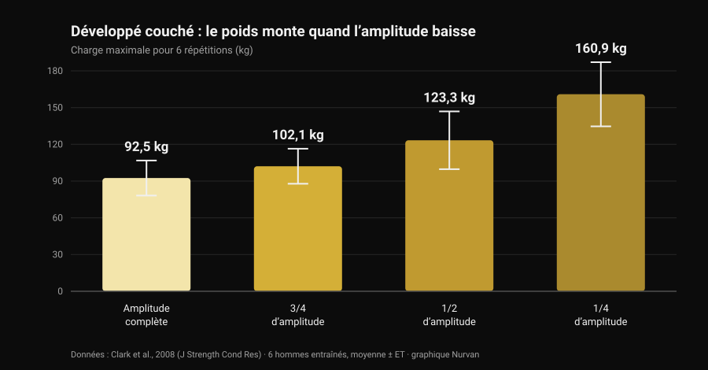
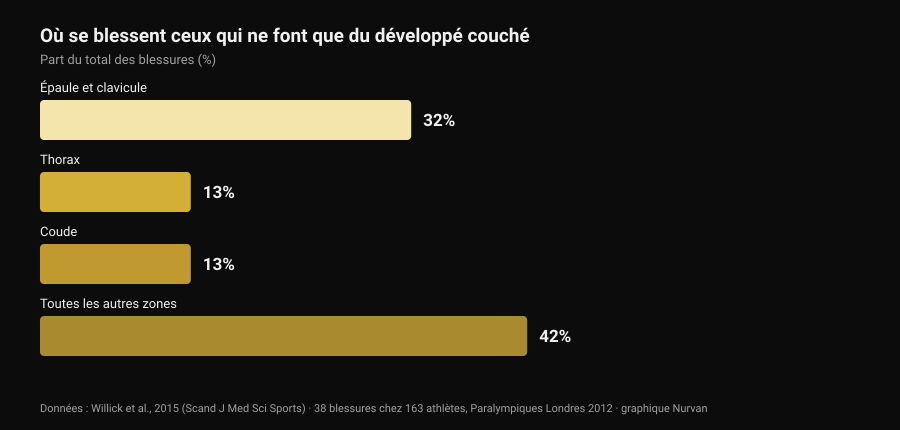

# Prise bulldog au développé couché : ce que dit la science

Par [Giammaria Loi](/autore/giammaria-loi) · mis à jour le 29 octobre 2026

Un post technique passé dans mon fil explique la prise bulldog au développé couché : avant-bras tourné vers l'intérieur, barre posée en diagonale sur la paume, promesse de moins de tension au coude et de plus de stabilité. La description est honnête, et une partie de la communauté l'utilise depuis des années. Puis je suis allé chercher combien de fois cette prise avait été mesurée dans la littérature. Zéro. Ce n'est pas une raison de l'écarter : c'est une raison de la raconter pour ce qu'elle est, et d'utiliser les données qui, elles, existent — celles sur l'amplitude de mouvement et celles sur l'endroit où se blessent réellement les pratiquants du développé couché.

## L’essentiel

- **Aucune étude indexée ne l'a mesurée.** La recherche "bulldog grip" sur PubMed renvoie **zéro résultat** (vérifié le 29 octobre 2026) : pas d'électromyographie, pas de comparaison de charges, aucune donnée sur la douleur ou les blessures.
- **La règle IPF ne dit pas ce qu'on répète.** Le règlement technique en vigueur depuis le 1er mars 2026 exige que "les mains, les pouces et les doigts saisissent complètement la barre, le pouce enroulé autour" et interdit la prise inversée. Le mot "bulldog" n'y figure nulle part.
- **Raccourcir l'amplitude augmente les kilos, pas les adaptations.** Le maximum sur 6 répétitions passe de **92,5 kg** en amplitude complète à **160,9 kg** sur un quart d'amplitude (Clark et al., 2008). Pourtant, sur dix semaines d'entraînement, l'amplitude complète a battu tous les groupes partiels sur chaque variante testée (Martínez-Cava et al., 2022).
- **Le coude n'est pas le problème principal du développé couché.** Dans le sport qui n'est que du développé couché, l'épaule et la clavicule représentent **32 %** des blessures, le coude **13 %** (Willick et al., 2015).
- **Le coude pèse toutefois davantage après 40 ans.** Sur 245 powerlifters, le taux de blessure au coude et à la main/poignet augmente significativement au-delà de 40 ans (Siewe et al., 2011).

## Ce qu'est la prise bulldog, simplement

Dans la prise que presque tout le monde utilise, la barre repose à peu près au milieu de la paume et l'avant-bras reste neutre. Dans la prise bulldog, vous tournez l'avant-bras vers l'intérieur — ce que l'anatomie appelle **rotation interne**, le mouvement qui ramène le pouce vers le corps — et la barre se retrouve posée en diagonale sur la paume, près de la base du pouce plutôt qu'au centre de la main.

Trois conséquences en découlent. Elles sont géométriques, pas expérimentales :

1. le poignet reste mieux aligné sur l'avant-bras, avec moins d'extension forcée ;
2. la barre repose plus près du côté auriculaire, donc elle touche la poitrine un peu plus haut ;
3. le coude s'ouvre un peu plus, parce que la rotation de l'avant-bras l'entraîne.

Ces trois points sont plausibles et vérifiables avec une règle. Aucun n'est un résultat de laboratoire.

## Ce que la recherche n'a pas — et pourquoi cela compte

J'ai interrogé PubMed le 29 octobre 2026 : "bulldog grip" ne renvoie pas un seul travail. Sur le développé couché il existe en revanche une littérature correcte sur la **largeur** de prise — nous l'avons passée en revue dans [prise au développé couché : large, moyenne ou serrée](/fr/blog/prise-developpe-couche-large-serree) — mais personne n'a jamais mesuré la **rotation du poignet** : ni l'activité des fléchisseurs de l'avant-bras, ni les charges soulevées, ni la douleur rapportée au coude.

L'affirmation "la prise bulldog réduit l'activation des fléchisseurs du poignet et soulage donc le coude" est donc une hypothèse mécanique raisonnable que personne n'a testée. Celui qui l'utilise et se sent mieux ne se trompe pas sur son expérience : il rapporte une donnée personnelle, valable pour lui. Ce qu'on ne peut pas faire, c'est la transformer en recommandation générale et l'appeler science.

## Le règlement IPF : ce qui y est vraiment écrit

C'est ici que se loge le malentendu le plus répandu, et le texte mérite d'être lu plutôt que les résumés. Le règlement technique IPF en vigueur depuis le **1er mars 2026** pose deux contraintes sur la prise au développé couché :

- les mains, les pouces et les doigts doivent **saisir complètement** la barre, pouce enroulé autour ;
- **la prise inversée est interdite**, et la distance entre les index ne peut pas dépasser 81 cm.

La comparaison éclairante est le squat, où le même règlement écrit explicitement qu'"il n'est pas exigé que les pouces entourent la barre". Au développé couché, cette exception n'existe pas : le pouce enroulé est obligatoire.

Qu'en déduire ? Que le règlement **ne nomme jamais la prise bulldog**, et qu'une bulldog exécutée pouce enroulé et main pleine sur la barre n'enfreint aucune de ces deux lignes. Ce qui déclenche les voyants rouges est autre chose : la prise sans pouce (la fameuse *suicide grip*), la prise inversée, les index hors des repères de 81 cm — et, pour qui pousse la rotation à l'extrême, une main posée sur la barre du bout des doigts au lieu de la saisir complètement.

Si vous êtes en compétition, la conclusion pratique est simple : montrez votre prise à l'arbitre à l'échauffement, pas au milieu du premier essai. Les fédérations nationales appliquent le même texte, mais le jour J la seule chose qui compte est le degré de "complétude" que le juge accorde à votre prise.

## Moins d'amplitude, plus de kilos : le chiffre qui structure le débat

Une partie du dossier bulldog peut en revanche s'appuyer sur des chiffres solides : l'amplitude de mouvement. Si la barre touche la poitrine plus haut à largeur de prise identique, la course **augmente** ; si vous changez aussi la largeur, elle peut raccourcir. Dans les deux cas vous déplacez une variable qui pèse lourd.

Un travail de 2008 en donne la mesure : six hommes entraînés ont testé leur maximum sur 6 répétitions au développé couché sur quatre amplitudes différentes.

*Graphique Nurvan d'après Clark et al., 2008 (J Strength Cond Res). Moyennes et écarts-types publiés ; six sujets entraînés, exécution à la machine guidée.*

De l'amplitude complète au quart d'amplitude, la charge double presque. Le même schéma apparaît sur un échantillon bien plus large : chez 42 hommes entraînés, le maximum augmentait progressivement en passant de l'amplitude complète aux deux tiers puis au tiers (Martínez-Cava et al., 2019).

Le problème est ce qui se passe dans la durée. Dans un essai randomisé, 50 hommes ont suivi dix semaines d'un programme identique ne différant que par l'amplitude travaillée : **le groupe amplitude complète a obtenu les meilleurs résultats sur les trois variantes de développé testées**, et les groupes partiels progressaient d'autant moins que l'amplitude était courte (Martínez-Cava et al., 2022). En powerlifting paralympique, où le développé couché est toute la compétition, le travail en amplitude partielle autorise des charges plus élevées avec moins de perte de fonction en fin de séance, mais l'activation du grand pectoral — portions claviculaire et sternale — est supérieure en amplitude complète (Mendonça et al., 2021).

Traduit pour qui envisage la bulldog : si vos kilos montent d'un coup, regardez où la barre touche avant de fêter ça. Si elle touche plus bas parce que vous avez élargi la prise, une partie du gain est de la géométrie. L'inverse vaut aussi, et le post d'origine le signale correctement : à largeur égale, un point de contact plus haut allonge la course et rend le mouvement **plus dur**, pas plus facile.

## Le coude : où se blessent vraiment les pratiquants du développé couché

L'argument phare en faveur de la bulldog est le soulagement du coude. Il vaut la peine de remettre ce coude en proportion.

*Graphique Nurvan d'après Willick et al., 2015 (Scand J Med Sci Sports). 38 blessures relevées chez 163 athlètes sur les sept jours de compétition des Jeux paralympiques de Londres 2012.*

Le powerlifting paralympique est de fait un sport de développé couché uniquement : c'est l'échantillon le plus propre dont nous disposons pour savoir où craquent ceux qui poussent. Chez 163 athlètes, 38 blessures ont été enregistrées, dont **61 % de surcharge chronique**. La zone la plus touchée est l'épaule avec la clavicule (32 %) ; le thorax et le coude suivent à égalité, à 13 %.

Le tableau est le même dans les autres sports de force : la revue systématique de Keogh et Winwood désigne l'épaule, le bas du dos, le genou, le coude et le poignet/la main comme zones les plus fréquentes, avec environ **une blessure pour 1 000 heures** d'entraînement en powerlifting. Chez 245 powerlifters allemands, **43,3 %** signalaient des gênes pendant l'entraînement courant sans l'interrompre, et le taux de blessure au coude et à la main/poignet augmentait significativement après 40 ans (Siewe et al., 2011).

Deux conclusions pratiques. La première : si le coude fait mal, la prise est un petit levier à côté de la charge, du volume, de la fréquence et de la progression — c'est là qu'il faut regarder d'abord. La seconde, plus délicate : une rotation interne poussée à l'extrême ferme la position de l'épaule, et une revue de 2024 cite précisément le **positionnement vulnérable de l'articulation pendant le mouvement** parmi les facteurs de risque de blessure d'épaule chez les pratiquants de sports de force (Daher et al., 2024). Échanger une gêne au coude contre un problème d'épaule est une mauvaise affaire : l'épaule est l'articulation qui se blesse le plus.

## Ce que dit vraiment la recherche

- **"La prise bulldog réduit l'activation des fléchisseurs du poignet et épargne le coude" — Non vérifiable.** Zéro étude indexée, aucune électromyographie. C'est une hypothèse mécanique, pas un résultat.
- **"Elle donne un point de contact plus haut et une ouverture de coude plus naturelle" — À nuancer.** La géométrie tient : en tournant l'avant-bras, la barre se déplace vers le côté auriculaire. De combien l'angle du coude change réellement, personne ne l'a mesuré.
- **"À largeur égale, un point plus haut augmente l'amplitude, donc c'est plus dur" — Confirmé.** Cohérent avec la relation amplitude-charge : plus de course, moins de kilos sur la barre.
- **"Réduire l'amplitude est un avantage" — À nuancer.** Cela augmente nettement la charge (de 92,5 à 160,9 kg entre amplitude complète et quart d'amplitude), mais sur dix semaines l'amplitude complète produit plus d'adaptations sur chaque variante.
- **"L'IPF l'interdit parce que le pouce enroulé est obligatoire" — Démenti tel que formulé.** Le règlement 2026 ne nomme pas la bulldog : il interdit la prise inversée et exige que mains, pouces et doigts saisissent complètement la barre. Une bulldog pouce enroulé respecte les deux.
- **"Elle aide les débutants qui serrent trop les coudes" — Non vérifiable.** Aucune donnée sur débutants, technique et prise. Et c'est l'épaule, pas le coude, qui se blesse le plus au développé.

## Comment l'appliquer

1. **Si rien ne fait mal et que les chiffres montent, ne changez pas par effet de mode.** La prise que vous utilisez depuis des années est aussi celle sur laquelle votre technique s'est construite : la changer coûte une partie de cet automatisme pendant plusieurs semaines.
2. **Si vous l'essayez, gardez le pouce enroulé et la main pleine sur la barre.** C'est la version qui reste dans le règlement, et aussi celle où la barre ne peut pas s'échapper.
3. **Mesurez le point de contact avant et après.** Marquez l'endroit où la barre touche la poitrine avec l'ancienne prise puis avec la nouvelle : c'est le seul moyen de savoir si vous avez changé la prise ou l'amplitude.
4. **Donnez-lui trois à quatre semaines et un critère chiffré.** Même charge, mêmes séries, même point de contact : si à RIR égal (les répétitions qu'il vous reste en réserve) la charge ne bouge pas, la prise ne vous apporte rien.
5. **Si le coude fait mal, regardez d'abord la programmation.** Sauts de charge, trop de séries près de l'échec et aucune semaine de décharge expliquent bien plus que la rotation du poignet. La logique des séries, du repos et de la progression est dans [combien de répétitions pour la masse](/fr/blog/combien-de-repetitions-masse-musculaire).
6. **Une douleur qui dure des semaines, ou qui vous réveille la nuit, n'est pas une question de prise.** C'est l'affaire d'un professionnel de santé, pas d'un post.
7. **Si vous êtes en compétition, demandez d'abord à l'arbitre.** Trente secondes à l'échauffement valent mieux que n'importe quelle légende lue en ligne.

### Essayer Nurvan — si vous changez de prise, laissez les chiffres dire si ça marche

Un changement technique se juge sur des semaines, pas sur une séance : il faut voir charge, répétitions et RIR du même mouvement côte à côte, avec une note sur ce que vous avez changé et quand. Dans Nurvan, vous enregistrez chaque série de développé couché avec son RIR, ajoutez une note sur la variante utilisée et récupérez la courbe des charges mois après mois — ainsi la question "la bulldog m'a-t-elle fait monter ?" obtient une réponse et non une impression. Les séries d'échauffement sont aussi proposées automatiquement à partir de la charge du jour, exactement ce qu'il faut quand une nouvelle prise reste inhabituelle.

## Questions fréquentes

**Qu'est-ce que la prise bulldog au développé couché ?**
C'est une prise où l'on tourne l'avant-bras vers l'intérieur et où la barre repose en diagonale sur la paume, près de la base du pouce plutôt qu'au centre de la main. Le poignet reste mieux aligné sur l'avant-bras et la barre touche la poitrine un peu plus haut. Ce n'est pas une prise sans pouce : bien exécutée, le pouce reste enroulé autour de la barre.

**La prise bulldog est-elle autorisée en compétition IPF ?**
Le règlement technique IPF en vigueur depuis le 1er mars 2026 ne la nomme pas. Il exige que mains, pouces et doigts saisissent complètement la barre, pouce enroulé, et interdit la prise inversée : une bulldog pouce enroulé et main pleine sur la barre remplit les deux conditions. Sont hors règlement la prise sans pouce, la prise inversée et une main posée du bout des doigts. En cas de doute, montrez-la à l'arbitre avant de concourir.

**La prise bulldog fait-elle soulever plus lourd ?**
Aucune étude ne l'a mesuré. Si la charge monte lors de vos tests, la cause la plus probable n'est pas la prise elle-même mais l'amplitude : toutes choses égales par ailleurs, raccourcir la course augmente beaucoup les kilos soulevables, tandis qu'un point de contact plus haut à largeur identique l'allonge et rend le mouvement plus dur.

**La prise bulldog est-elle mauvaise pour les épaules ?**
Il n'existe pas de donnée directe. Ce que l'on sait, c'est que l'épaule est la zone la plus touchée chez ceux qui concourent au développé couché (32 % des blessures) et que le positionnement vulnérable de l'articulation pendant le mouvement figure parmi les facteurs de risque documentés. Une rotation interne très marquée mérite donc d'être introduite progressivement, et abandonnée si une gêne apparaît à l'épaule.

## À lire aussi

- [Prise au développé couché : large, moyenne ou serrée ?](/fr/blog/prise-developpe-couche-large-serree) — ce qui change vraiment pour les pectoraux et les triceps selon la largeur, chiffres à l'appui.
- [Développé haltères ou écartés : qui fait le plus grossir ?](/fr/blog/developpe-halteres-ou-ecartes-pectoraux) — poussée contre isolation pour le pectoral.
- [Combien de répétitions pour la masse : le mythe du 8-12](/fr/blog/combien-de-repetitions-masse-musculaire) — séries, repos et progression, les leviers qui pèsent plus que la prise.

## Sources

- Clark RA, Bryant AL, Humphries B, 2008. *An examination of strength and concentric work ratios during variable range of motion training.* Journal of Strength and Conditioning Research 22(5):1716-9. [PMID 18714211](https://pubmed.ncbi.nlm.nih.gov/18714211/) · [DOI 10.1519/JSC.0b013e318173c529](https://doi.org/10.1519/JSC.0b013e318173c529)
- Martínez-Cava A, Morán-Navarro R, Hernández-Belmonte A, Courel-Ibáñez J, Conesa-Ros E, González-Badillo JJ, Pallarés JG, 2019. *Range of Motion and Sticking Region Effects on the Bench Press Load-Velocity Relationship.* Journal of Sports Science & Medicine 18(4):645-652. [PMID 31827348](https://pubmed.ncbi.nlm.nih.gov/31827348/)
- Martínez-Cava A, Hernández-Belmonte A, Courel-Ibáñez J, Morán-Navarro R, González-Badillo JJ, Pallarés JG, 2022. *Bench Press at Full Range of Motion Produces Greater Neuromuscular Adaptations Than Partial Executions After Prolonged Resistance Training.* Journal of Strength and Conditioning Research 36(1):10-15. [PMID 31567719](https://pubmed.ncbi.nlm.nih.gov/31567719/) · [DOI 10.1519/JSC.0000000000003391](https://doi.org/10.1519/JSC.0000000000003391)
- Mendonça TP, Aidar FJ, Matos DG, Souza RF, Marçal AC, Almeida-Neto PF, Cabral BG, Garrido ND, Neiva HP, Marinho DA, Marques MC, Reis VM, 2021. *Force production and muscle activation during partial vs. full range of motion in Paralympic Powerlifting.* PLoS One 16(10):e0257810. [PMID 34644331](https://pubmed.ncbi.nlm.nih.gov/34644331/) · [DOI 10.1371/journal.pone.0257810](https://doi.org/10.1371/journal.pone.0257810)
- Willick SE, Cushman DM, Blauwet CA, Emery C, Webborn N, Derman W, Schwellnus M, Stomphorst J, Van de Vliet P, 2015. *The epidemiology of injuries in powerlifting at the London 2012 Paralympic Games: An analysis of 1411 athlete-days.* Scandinavian Journal of Medicine & Science in Sports 26(10):1233-8. [PMID 26453890](https://pubmed.ncbi.nlm.nih.gov/26453890/) · [DOI 10.1111/sms.12554](https://doi.org/10.1111/sms.12554)
- Siewe J, Rudat J, Röllinghoff M, Schlegel UJ, Eysel P, Michael JW-P, 2011. *Injuries and overuse syndromes in powerlifting.* International Journal of Sports Medicine 32(9):703-11. [PMID 21590644](https://pubmed.ncbi.nlm.nih.gov/21590644/) · [DOI 10.1055/s-0031-1277207](https://doi.org/10.1055/s-0031-1277207)
- Keogh JWL, Winwood PW, 2017. *The Epidemiology of Injuries Across the Weight-Training Sports.* Sports Medicine 47(3):479-501. [PMID 27328853](https://pubmed.ncbi.nlm.nih.gov/27328853/) · [DOI 10.1007/s40279-016-0575-0](https://doi.org/10.1007/s40279-016-0575-0)
- Daher M, Jabre S, Casey JC, Fares MY, Boufadel P, Lopez R, Lawand J, Mansour J, Abboud JA, 2024. *Shouldering the load: A scoping review of incidence, types, and risk factors of shoulder injuries in weight-lifting athletes.* Shoulder & Elbow 17(3):254-263. [PMID 39552690](https://pubmed.ncbi.nlm.nih.gov/39552690/) · [DOI 10.1177/17585732241258743](https://doi.org/10.1177/17585732241258743)
- International Powerlifting Federation, 2026. *IPF Technical Rules Book*, en vigueur depuis le 1er mars 2026, section 4.2 (Bench Press — Rules of Performance). [PDF officiel](https://www.irishpowerliftingfederation.com/wp-content/uploads/2026/03/2026-IPF-Technical-Rulebook-effective-01-March-2026-v3.pdf)

Références récupérées via PubMed. Point de départ : le post d'**Alfred Jong** ([alfred.reformance](https://www.instagram.com/alfred.reformance/), Reformance Training) du 25 septembre 2026, [post original](https://www.instagram.com/p/DdtpBWPm9f4/). Du post n'ont été lus que l'auteur, la date et la légende : aucun texte et aucune image n'ont été reproduits. Le sujet a été réécrit de zéro à partir des sources primaires et du règlement officiel.

---

**Giammaria Loi** est le fondateur de Nurvan. Il s'entraîne avec des charges depuis 2012, exerce comme préparateur personnel et coach certifié FIPE depuis 2013 et compète en powerlifting au niveau national depuis 2018. Chaque article qu'il signe part des études scientifiques et arrive à ce qui fonctionne vraiment en salle.

> Note : contenu informatif, qui ne remplace pas l'avis d'un médecin ou d'un professionnel. En cas de douleur persistante au coude, au poignet ou à l'épaule, ou de gêne qui s'aggrave malgré une baisse de charge, consultez un médecin ou un kinésithérapeute plutôt que de chercher la solution dans un détail technique.
