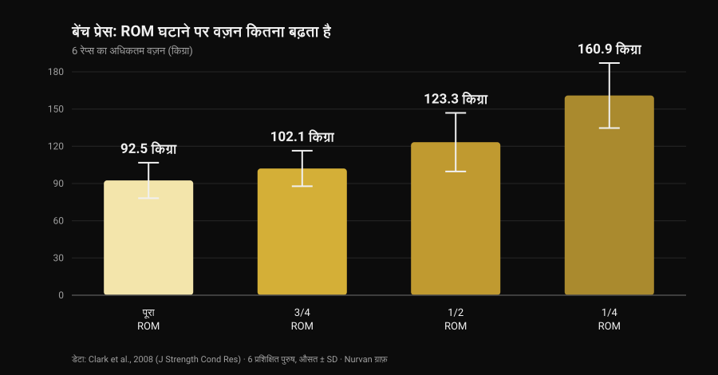
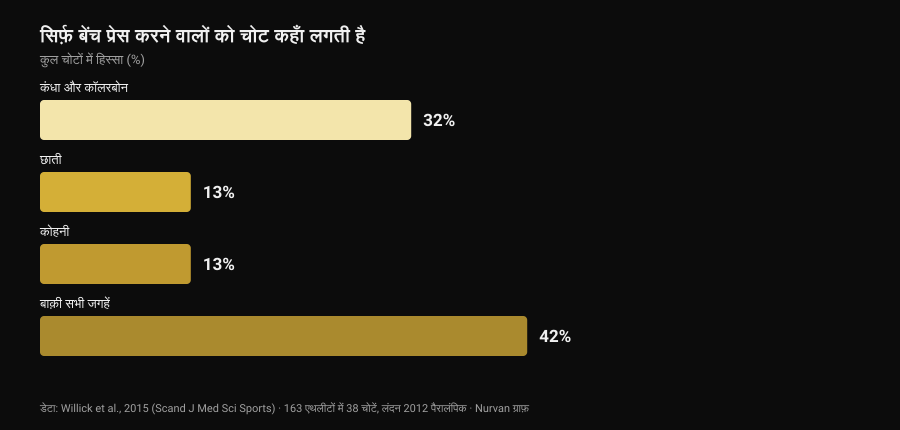

# बेंच प्रेस में बुलडॉग ग्रिप: रिसर्च क्या कहती है

[Giammaria Loi](/autore/giammaria-loi) द्वारा · 29 अक्टूबर 2026 को अपडेट किया गया

फ़ीड में एक टेक्निकल पोस्ट आया जो बेंच प्रेस की बुलडॉग ग्रिप समझा रहा था: फ़ोरआर्म अंदर की तरफ़ घुमाओ, बार हथेली पर तिरछा रखो, और कोहनी पर कम खिंचाव और ज़्यादा स्थिरता मिलेगी। विवरण ईमानदार है, और कम्युनिटी का एक हिस्सा इसे सालों से इस्तेमाल कर रहा है। फिर मैंने देखा कि इस ग्रिप को साहित्य में कितनी बार नापा गया है। शून्य बार। यह इसे खारिज करने की वजह नहीं है — यह इसे जैसा है वैसा बताने की वजह है, और उन आँकड़ों का इस्तेमाल करने की वजह है जो सचमुच मौजूद हैं: मूवमेंट की रेंज वाले, और यह वाले कि बेंच प्रेस करने वालों को असल में चोट कहाँ लगती है।

## संक्षेप में

- **किसी इंडेक्स्ड स्टडी ने इसे नापा नहीं है।** PubMed पर "bulldog grip" खोजने से **शून्य परिणाम** मिलते हैं (29 अक्टूबर 2026 को जाँचा गया): न इलेक्ट्रोमायोग्राफ़ी, न वज़न की तुलना, न दर्द या चोट का डेटा।
- **IPF का नियम वह नहीं कहता जो दोहराया जाता है।** 1 मार्च 2026 से लागू तकनीकी नियमावली कहती है कि "हाथ, अंगूठे और उँगलियाँ बार को पूरी तरह पकड़ें, अंगूठा बार के चारों ओर लिपटा हो", और रिवर्स ग्रिप को मना करती है। "बुलडॉग" शब्द कहीं नहीं आता।
- **रेंज घटाने से किलो बढ़ते हैं, अडैप्टेशन नहीं।** 6 रेप्स का अधिकतम वज़न पूरे ROM पर **92.5 किग्रा** से बढ़कर एक-चौथाई ROM पर **160.9 किग्रा** हो जाता है (Clark et al., 2008)। लेकिन दस हफ़्ते की ट्रेनिंग में पूरे ROM ने हर टेस्ट की गई वैरिएशन में सभी पार्शियल ग्रुप्स को हराया (Martínez-Cava et al., 2022)।
- **कोहनी बेंच प्रेस की मुख्य समस्या नहीं है।** जिस खेल में सिर्फ़ बेंच प्रेस होता है, वहाँ कंधा और कॉलरबोन कुल चोटों का **32%** हैं और कोहनी **13%** (Willick et al., 2015)।
- **हाँ, 40 के बाद कोहनी का वज़न बढ़ जाता है।** 245 पावरलिफ़्टर्स में कोहनी और हाथ/कलाई की चोट दर 40 साल के बाद सार्थक रूप से बढ़ती है (Siewe et al., 2011)।

## बुलडॉग ग्रिप आख़िर है क्या

जिस ग्रिप को लगभग सब इस्तेमाल करते हैं, उसमें बार हथेली के बीचोंबीच टिकता है और फ़ोरआर्म न्यूट्रल रहता है। बुलडॉग ग्रिप में आप फ़ोरआर्म को अंदर की तरफ़ घुमाते हैं — एनाटॉमी में इसे **इंटरनल रोटेशन** कहते हैं, यानी वह हरकत जो अंगूठे को शरीर की ओर ले जाती है — और बार हथेली पर तिरछा, अंगूठे की जड़ के पास टिक जाता है, न कि हाथ के बीच में।

इससे तीन नतीजे निकलते हैं। ये ज्यामितीय हैं, प्रायोगिक नहीं:

1. कलाई फ़ोरआर्म के ऊपर ज़्यादा सीध में रहती है, ज़बरदस्ती का एक्सटेंशन कम होता है;
2. बार छोटी उँगली की तरफ़ ज़्यादा टिकता है, इसलिए छाती को थोड़ा ऊपर छूता है;
3. कोहनी थोड़ा ज़्यादा खुलती है, क्योंकि फ़ोरआर्म का घूमना उसे बाहर खींचता है।

तीनों बातें तर्कसंगत हैं और एक स्केल से जाँची जा सकती हैं। लेकिन इनमें से कोई भी लैब का नतीजा नहीं है।

## रिसर्च के पास क्या नहीं है — और यह क्यों मायने रखता है

मैंने 29 अक्टूबर 2026 को PubMed खंगाला: "bulldog grip" पर एक भी पेपर नहीं मिलता। बेंच प्रेस पर ग्रिप की **चौड़ाई** को लेकर ठीक-ठाक साहित्य है — हमने उसे [बेंच प्रेस ग्रिप: चौड़ी, मीडियम या क्लोज़](/hi/blog/bench-press-grip-width-hindi) में देखा था — लेकिन **कलाई के रोटेशन** को किसी ने कभी नापा नहीं: न फ़ोरआर्म फ़्लेक्सर्स की सक्रियता, न उठाए गए वज़न, न कोहनी का दर्द।

इसलिए यह कहना कि "बुलडॉग ग्रिप कलाई के फ़्लेक्सर्स की सक्रियता घटाती है और इसलिए कोहनी को आराम देती है" एक तर्कसंगत यांत्रिक परिकल्पना है जिसे किसी ने परखा नहीं। जो इसे इस्तेमाल करता है और बेहतर महसूस करता है, वह अपने अनुभव के बारे में ग़लत नहीं है: वह एक निजी नतीजा बता रहा है जो उसके लिए सही है। जो नहीं किया जा सकता, वह है उसे सामान्य सिफ़ारिश बनाकर विज्ञान कह देना।

## IPF की नियमावली: उसमें असल में लिखा क्या है

सबसे आम ग़लतफ़हमी यहीं बैठी है, और सारांश के बजाय मूल पाठ पढ़ना बेहतर है। **1 मार्च 2026** से लागू IPF तकनीकी नियमावली बेंच प्रेस की ग्रिप पर दो शर्तें रखती है:

- हाथ, अंगूठे और उँगलियाँ बार को **पूरी तरह पकड़ें**, अंगूठा बार के चारों ओर लिपटा हो;
- **रिवर्स ग्रिप मना है**, और तर्जनियों के बीच की दूरी 81 सेमी से ज़्यादा नहीं हो सकती।

सबसे साफ़ तुलना स्क्वाट से है, जहाँ वही नियमावली साफ़ लिखती है कि "अंगूठों का बार के चारों ओर लिपटना ज़रूरी नहीं है"। बेंच प्रेस में यह छूट नहीं है: लिपटा अंगूठा अनिवार्य है।

इससे क्या निकला? कि नियमावली **बुलडॉग ग्रिप का नाम कहीं नहीं लेती**, और लिपटे अंगूठे तथा पूरे हाथ से की गई बुलडॉग इन दोनों में से किसी पंक्ति का उल्लंघन नहीं करती। लाल बत्ती किसी और चीज़ पर जलती है: बिना अंगूठे की ग्रिप (तथाकथित *suicide grip*), रिवर्स ग्रिप, 81 सेमी के निशानों से बाहर तर्जनियाँ — और, जो रोटेशन को चरम तक ले जाते हैं उनके लिए सीधे तौर पर, वह हाथ जो बार को पूरी तरह पकड़ने के बजाय सिर्फ़ उँगलियों के पोरों पर टिका हो।

अगर आप कॉम्पिटिशन करते हैं तो व्यावहारिक निष्कर्ष सीधा है: अपनी ग्रिप वॉर्म-अप में रेफ़री को दिखाइए, पहले अटेम्प्ट के बीच में नहीं। राष्ट्रीय फ़ेडरेशन वही पाठ लागू करते हैं, पर मुक़ाबले के दिन सिर्फ़ यह मायने रखता है कि वह रेफ़री आपकी पकड़ को कितना "पूरा" मानता है।

## कम रेंज, ज़्यादा किलो: वह आँकड़ा जो पूरी बहस को जगह देता है

बुलडॉग वाली बहस का एक हिस्सा ठोस आँकड़ों पर टिकाया जा सकता है, और वह है मूवमेंट की रेंज। अगर ग्रिप की चौड़ाई वही रहे और बार छाती को ऊपर छुए, तो रास्ता **बढ़ता** है; अगर चौड़ाई भी बदलें तो रास्ता छोटा हो सकता है। दोनों हालात में आप एक भारी-भरकम वैरिएबल हिला रहे हैं।

कितना भारी, यह 2008 की एक स्टडी बताती है: छह प्रशिक्षित पुरुषों ने चार अलग-अलग रेंज पर बेंच प्रेस का 6-रेप अधिकतम वज़न टेस्ट किया।

*Nurvan ग्राफ़, डेटा Clark et al., 2008 (J Strength Cond Res) से। प्रकाशित औसत और मानक विचलन; छह प्रशिक्षित प्रतिभागी, स्मिथ मशीन पर निष्पादन।*

पूरे ROM से एक-चौथाई ROM तक वज़न लगभग दोगुना हो जाता है। यही पैटर्न कहीं बड़े सैंपल में दिखता है: 42 प्रशिक्षित पुरुषों में अधिकतम वज़न क्रमशः बढ़ा जब रेंज पूरे से दो-तिहाई और फिर एक-तिहाई हुई (Martínez-Cava et al., 2019)।

दिक़्क़त यह है कि समय के साथ क्या होता है। एक रैंडमाइज़्ड ट्रायल में 50 पुरुषों ने दस हफ़्ते एक जैसा प्रोग्राम किया, फ़र्क़ सिर्फ़ ट्रेन की गई रेंज का था: **पूरे ROM वाले ग्रुप ने तीनों टेस्ट की गई बेंच प्रेस वैरिएशन्स में सबसे अच्छे नतीजे दिए**, और पार्शियल ग्रुप्स की बढ़त उतनी ही कम होती गई जितनी रेंज छोटी थी (Martínez-Cava et al., 2022)। पैरालंपिक पावरलिफ्टिंग में, जहाँ बेंच प्रेस ही पूरा खेल है, पार्शियल रेंज से ज़्यादा वज़न उठता है और सेशन के अंत में फ़ंक्शन कम गिरता है, मगर पेक्टोरलिस मेजर — क्लैविक्युलर और स्टर्नल दोनों हिस्सों — की सक्रियता पूरे ROM पर ज़्यादा रहती है (Mendonça et al., 2021)।

बुलडॉग पर विचार करने वालों के लिए अनुवाद: अगर आज़माते ही किलो बढ़ जाएँ, जश्न से पहले देखिए बार कहाँ छू रहा है। अगर नीचे छू रहा है क्योंकि आपने ग्रिप चौड़ी कर दी, तो उस बढ़त का एक हिस्सा ज्यामिति है। उलटा भी सही है, और मूल पोस्ट यह ठीक बताता है: वही चौड़ाई रखते हुए ऊँचा टच पॉइंट रास्ता लंबा करता है और लिफ़्ट को **कठिन** बनाता है, आसान नहीं।

## कोहनी: बेंच प्रेस करने वालों को असल में चोट कहाँ लगती है

बुलडॉग के पक्ष में सबसे बड़ा तर्क कोहनी को राहत है। उस कोहनी को अनुपात में रखकर देखना ज़रूरी है।

*Nurvan ग्राफ़, डेटा Willick et al., 2015 (Scand J Med Sci Sports) से। लंदन 2012 पैरालंपिक के सात प्रतियोगिता दिनों में 163 एथलीटों के बीच दर्ज 38 चोटें।*

पैरालंपिक पावरलिफ्टिंग व्यावहारिक रूप से सिर्फ़ बेंच प्रेस का खेल है: यह सबसे साफ़ सैंपल है जिससे पता चले कि प्रेस करने वाले कहाँ टूटते हैं। 163 एथलीटों में 38 चोटें दर्ज हुईं, जिनमें **61% क्रॉनिक ओवरयूज़** थीं। सबसे प्रभावित जगह कंधा और कॉलरबोन है (32%); छाती और कोहनी 13% पर बराबरी से पीछे हैं।

बाक़ी स्ट्रेंथ खेलों में तस्वीर यही है: Keogh और Winwood की सिस्टेमैटिक समीक्षा कंधा, निचली पीठ, घुटना, कोहनी और कलाई/हाथ को सबसे आम जगहें बताती है, और पावरलिफ्टिंग में लगभग **हर 1,000 घंटे ट्रेनिंग पर एक चोट**। 245 जर्मन पावरलिफ़्टर्स में **43.3%** ने रोज़मर्रा की ट्रेनिंग के दौरान तकलीफ़ बताई पर ट्रेनिंग नहीं रोकी, और कोहनी तथा हाथ/कलाई की चोट दर 40 साल के बाद सार्थक रूप से बढ़ी (Siewe et al., 2011)।

दो व्यावहारिक निष्कर्ष। पहला: अगर कोहनी दुखती है तो ग्रिप, वज़न-वॉल्यूम-फ़्रीक्वेंसी-प्रोग्रेशन के मुक़ाबले एक छोटा लीवर है — पहले वहीं देखिए। दूसरा, ज़्यादा नाज़ुक: चरम इंटरनल रोटेशन कंधे की पोज़िशन को बंद कर देता है, और 2024 की एक समीक्षा **लिफ़्ट के दौरान जोड़ की असुरक्षित पोज़िशन** को ही वेट-लिफ़्टिंग खेलों में कंधे की चोट के जोखिम कारकों में गिनाती है (Daher et al., 2024)। कोहनी की हल्की तकलीफ़ को कंधे की समस्या से बदलना घाटे का सौदा है: कंधा ही सबसे ज़्यादा चोट खाने वाला जोड़ है।

## रिसर्च असल में क्या कहती है

- **"बुलडॉग ग्रिप कलाई के फ़्लेक्सर्स की सक्रियता घटाती है और कोहनी बचाती है" — असत्यापित।** शून्य इंडेक्स्ड स्टडी, कोई इलेक्ट्रोमायोग्राफ़ी नहीं। यह एक यांत्रिक परिकल्पना है, नतीजा नहीं।
- **"यह ऊँचा टच पॉइंट और ज़्यादा स्वाभाविक एल्बो फ़्लेयर देती है" — स्पष्टीकरण ज़रूरी।** ज्यामिति टिकती है: फ़ोरआर्म घुमाने से बार छोटी उँगली की तरफ़ खिसकता है। कोहनी का कोण असल में कितना बदलता है, यह किसी ने नापा नहीं।
- **"वही चौड़ाई रखते हुए ऊँचा टच पॉइंट रेंज बढ़ाता है, इसलिए कठिन होता है" — पुष्ट।** यह रेंज और वज़न के रिश्ते से मेल खाता है: लंबा रास्ता, बार पर कम किलो।
- **"रेंज घटाना फ़ायदेमंद है" — स्पष्टीकरण ज़रूरी।** वज़न साफ़ बढ़ता है (पूरे और एक-चौथाई ROM के बीच 92.5 से 160.9 किग्रा), पर दस हफ़्ते की ट्रेनिंग में पूरा ROM हर वैरिएशन में ज़्यादा अडैप्टेशन देता है।
- **"IPF इसे बैन करता है क्योंकि अंगूठा लपेटना ज़रूरी है" — इस रूप में खंडित।** 2026 की नियमावली बुलडॉग का नाम ही नहीं लेती: वह रिवर्स ग्रिप मना करती है और माँगती है कि हाथ, अंगूठे और उँगलियाँ बार को पूरी तरह पकड़ें। लिपटे अंगूठे वाली बुलडॉग दोनों शर्तें पूरी करती है।
- **"यह उन शुरुआती लोगों की मदद करती है जो कोहनी बहुत ज़्यादा दबाते हैं" — असत्यापित।** शुरुआती, तकनीक और ग्रिप पर कोई डेटा नहीं। और प्रेस करते वक़्त सबसे ज़्यादा चोट कंधे को लगती है, कोहनी को नहीं।

## इसे कैसे लागू करें

1. **अगर दर्द नहीं है और आँकड़े बढ़ रहे हैं, तो ट्रेंड देखकर मत बदलिए।** जिस ग्रिप को आप सालों से इस्तेमाल कर रहे हैं, आपकी तकनीक उसी पर बनी है: बदलने पर कुछ हफ़्तों तक उस स्वचालन का एक हिस्सा चला जाएगा।
2. **आज़माएँ तो अंगूठा लिपटा और पूरा हाथ बार पर रखिए।** यही वह रूप है जो नियमों के भीतर रहता है, और यही वह है जिसमें बार फिसल नहीं सकता।
3. **टच पॉइंट पहले और बाद में नापिए।** पुरानी और नई ग्रिप से बार छाती पर जहाँ गिरता है, वहाँ निशान लगाइए: यही जानने का एकमात्र तरीक़ा है कि आपने ग्रिप बदली है या रेंज।
4. **तीन-चार हफ़्ते और एक संख्यात्मक कसौटी दीजिए।** वही वज़न, वही सेट, वही टच पॉइंट: अगर समान RIR (रिज़र्व में बचे रेप्स) पर वज़न नहीं हिलता, तो ग्रिप आपको कुछ नहीं दे रही।
5. **कोहनी दुखे तो पहले प्रोग्राम देखिए।** वज़न की बड़ी छलाँगें, फ़ेलियर के पास बहुत सारे सेट और एक भी डीलोड हफ़्ता न होना, कलाई के रोटेशन से कहीं ज़्यादा समझाते हैं। सेट, आराम और प्रोग्रेशन का तर्क [मसल्स के लिए कितने रेप्स](/hi/blog/kitne-reps-muscle-ke-liye) में है।
6. **हफ़्तों से बना दर्द, या रात में जगा देने वाला दर्द, ग्रिप का मामला नहीं है।** वह स्वास्थ्य पेशेवर का विषय है, किसी पोस्ट का नहीं।
7. **कॉम्पिटिशन करते हैं तो पहले रेफ़री से पूछिए।** वॉर्म-अप के तीस सेकंड, ऑनलाइन पढ़े किसी भी कैप्शन से बेहतर हैं।

### Nurvan आज़माएँ — ग्रिप बदलें तो आँकड़ों को बताने दें कि काम हुआ या नहीं

तकनीक का बदलाव हफ़्तों में आँका जाता है, एक सेशन में नहीं: आपको एक ही लिफ़्ट का वज़न, रेप्स और RIR साथ-साथ देखने होते हैं, इस नोट के साथ कि आपने क्या और कब बदला। Nurvan में आप हर बेंच प्रेस सेट को उसके RIR सहित दर्ज करते हैं, इस्तेमाल की गई वैरिएशन पर एक नोट जोड़ते हैं, और महीने-दर-महीने वज़न का कर्व पाते हैं — तब "क्या बुलडॉग से मेरा वज़न बढ़ा?" का जवाब आँकड़ा होता है, एहसास नहीं। साथ ही वॉर्म-अप सेट उस दिन के वर्किंग वज़न से अपने आप सुझाए जाते हैं, जो नई ग्रिप के अनजाना लगने के दिनों में ठीक वही है जो चाहिए।

## अक्सर पूछे जाने वाले सवाल

**बेंच प्रेस में बुलडॉग ग्रिप क्या है?**
यह वह ग्रिप है जिसमें आप फ़ोरआर्म को अंदर घुमाते हैं और बार हथेली पर तिरछा, अंगूठे की जड़ के पास टिकता है, न कि हाथ के बीच में। कलाई फ़ोरआर्म के साथ ज़्यादा सीध में रहती है और बार छाती को थोड़ा ऊपर छूता है। यह बिना अंगूठे की ग्रिप नहीं है: सही ढंग से की जाए तो अंगूठा बार के चारों ओर लिपटा रहता है।

**क्या बुलडॉग ग्रिप IPF प्रतियोगिता में वैध है?**
1 मार्च 2026 से लागू IPF तकनीकी नियमावली इसका नाम नहीं लेती। वह माँगती है कि हाथ, अंगूठे और उँगलियाँ बार को पूरी तरह पकड़ें और अंगूठा लिपटा हो, और रिवर्स ग्रिप मना करती है: लिपटे अंगूठे और पूरे हाथ वाली बुलडॉग दोनों शर्तें पूरी करती है। नियम से बाहर हैं बिना अंगूठे की ग्रिप, रिवर्स ग्रिप, और सिर्फ़ उँगलियों के पोरों पर टिका हाथ। शक हो तो प्रतियोगिता से पहले रेफ़री को दिखा दीजिए।

**क्या बुलडॉग ग्रिप से ज़्यादा वज़न उठता है?**
ऐसी कोई स्टडी नहीं जिसने यह नापा हो। अगर आपके टेस्ट में वज़न बढ़ता है तो सबसे संभावित वजह ग्रिप नहीं बल्कि मूवमेंट की रेंज है: बाक़ी सब बराबर रहते हुए रास्ता छोटा करने से उठाया जा सकने वाला वज़न काफ़ी बढ़ता है, जबकि वही चौड़ाई रखते हुए ऊँचा टच पॉइंट रास्ता लंबा करता है और लिफ़्ट कठिन बनाता है।

**क्या बुलडॉग ग्रिप कंधों के लिए ख़राब है?**
सीधा डेटा नहीं है। जो पता है वह यह कि बेंच प्रेस में प्रतिस्पर्धा करने वालों में कंधा सबसे ज़्यादा प्रभावित जगह है (32% चोटें), और लिफ़्ट के दौरान जोड़ की असुरक्षित पोज़िशन दर्ज जोखिम कारकों में है। इसलिए तेज़ इंटरनल रोटेशन को धीरे-धीरे अपनाइए, और कंधे में तकलीफ़ दिखे तो छोड़ दीजिए।

## यह भी पढ़ें

- [बेंच प्रेस ग्रिप: चौड़ी, मीडियम या क्लोज़?](/hi/blog/bench-press-grip-width-hindi) — चौड़ाई बदलने पर चेस्ट और ट्राइसेप्स के लिए असल में क्या बदलता है, आँकड़ों के साथ।
- [डम्बल प्रेस या फ्लाई: चेस्ट किससे ज़्यादा बढ़ती है?](/hi/blog/dumbbell-bench-press-ya-fly-chest-growth) — चेस्ट के लिए प्रेस बनाम आइसोलेशन।
- [मसल्स के लिए कितने रेप्स? 8-12 का मिथक](/hi/blog/kitne-reps-muscle-ke-liye) — सेट, आराम और प्रोग्रेशन, वे लीवर जो ग्रिप से ज़्यादा भारी हैं।

## स्रोत

- Clark RA, Bryant AL, Humphries B, 2008. *An examination of strength and concentric work ratios during variable range of motion training.* Journal of Strength and Conditioning Research 22(5):1716-9. [PMID 18714211](https://pubmed.ncbi.nlm.nih.gov/18714211/) · [DOI 10.1519/JSC.0b013e318173c529](https://doi.org/10.1519/JSC.0b013e318173c529)
- Martínez-Cava A, Morán-Navarro R, Hernández-Belmonte A, Courel-Ibáñez J, Conesa-Ros E, González-Badillo JJ, Pallarés JG, 2019. *Range of Motion and Sticking Region Effects on the Bench Press Load-Velocity Relationship.* Journal of Sports Science & Medicine 18(4):645-652. [PMID 31827348](https://pubmed.ncbi.nlm.nih.gov/31827348/)
- Martínez-Cava A, Hernández-Belmonte A, Courel-Ibáñez J, Morán-Navarro R, González-Badillo JJ, Pallarés JG, 2022. *Bench Press at Full Range of Motion Produces Greater Neuromuscular Adaptations Than Partial Executions After Prolonged Resistance Training.* Journal of Strength and Conditioning Research 36(1):10-15. [PMID 31567719](https://pubmed.ncbi.nlm.nih.gov/31567719/) · [DOI 10.1519/JSC.0000000000003391](https://doi.org/10.1519/JSC.0000000000003391)
- Mendonça TP, Aidar FJ, Matos DG, Souza RF, Marçal AC, Almeida-Neto PF, Cabral BG, Garrido ND, Neiva HP, Marinho DA, Marques MC, Reis VM, 2021. *Force production and muscle activation during partial vs. full range of motion in Paralympic Powerlifting.* PLoS One 16(10):e0257810. [PMID 34644331](https://pubmed.ncbi.nlm.nih.gov/34644331/) · [DOI 10.1371/journal.pone.0257810](https://doi.org/10.1371/journal.pone.0257810)
- Willick SE, Cushman DM, Blauwet CA, Emery C, Webborn N, Derman W, Schwellnus M, Stomphorst J, Van de Vliet P, 2015. *The epidemiology of injuries in powerlifting at the London 2012 Paralympic Games: An analysis of 1411 athlete-days.* Scandinavian Journal of Medicine & Science in Sports 26(10):1233-8. [PMID 26453890](https://pubmed.ncbi.nlm.nih.gov/26453890/) · [DOI 10.1111/sms.12554](https://doi.org/10.1111/sms.12554)
- Siewe J, Rudat J, Röllinghoff M, Schlegel UJ, Eysel P, Michael JW-P, 2011. *Injuries and overuse syndromes in powerlifting.* International Journal of Sports Medicine 32(9):703-11. [PMID 21590644](https://pubmed.ncbi.nlm.nih.gov/21590644/) · [DOI 10.1055/s-0031-1277207](https://doi.org/10.1055/s-0031-1277207)
- Keogh JWL, Winwood PW, 2017. *The Epidemiology of Injuries Across the Weight-Training Sports.* Sports Medicine 47(3):479-501. [PMID 27328853](https://pubmed.ncbi.nlm.nih.gov/27328853/) · [DOI 10.1007/s40279-016-0575-0](https://doi.org/10.1007/s40279-016-0575-0)
- Daher M, Jabre S, Casey JC, Fares MY, Boufadel P, Lopez R, Lawand J, Mansour J, Abboud JA, 2024. *Shouldering the load: A scoping review of incidence, types, and risk factors of shoulder injuries in weight-lifting athletes.* Shoulder & Elbow 17(3):254-263. [PMID 39552690](https://pubmed.ncbi.nlm.nih.gov/39552690/) · [DOI 10.1177/17585732241258743](https://doi.org/10.1177/17585732241258743)
- International Powerlifting Federation, 2026. *IPF Technical Rules Book*, 1 मार्च 2026 से लागू, खंड 4.2 (Bench Press — Rules of Performance)। [आधिकारिक PDF](https://www.irishpowerliftingfederation.com/wp-content/uploads/2026/03/2026-IPF-Technical-Rulebook-effective-01-March-2026-v3.pdf)

संदर्भ PubMed के ज़रिए लिए गए। शुरुआती बिंदु: **Alfred Jong** ([alfred.reformance](https://www.instagram.com/alfred.reformance/), Reformance Training) की 25 सितंबर 2026 की पोस्ट, [मूल पोस्ट](https://www.instagram.com/p/DdtpBWPm9f4/)। पोस्ट से सिर्फ़ लेखक, तारीख़ और कैप्शन पढ़े गए: कोई टेक्स्ट और कोई तस्वीर दोहराई नहीं गई। विषय प्राथमिक स्रोतों और आधिकारिक नियमावली से शुरू कर नए सिरे से लिखा गया।

---

**Giammaria Loi** Nurvan के संस्थापक हैं। वे 2012 से वेट ट्रेनिंग करते हैं, 2013 से FIPE-प्रमाणित पर्सनल ट्रेनर और कोच के रूप में काम करते हैं, और 2018 से राष्ट्रीय स्तर पर पावरलिफ्टिंग में प्रतिस्पर्धा करते हैं। उनके नाम से छपा हर लेख वैज्ञानिक अध्ययनों से शुरू होकर वहाँ पहुँचता है जो जिम में सचमुच काम करता है।

> नोट: यह जानकारीपरक सामग्री है, डॉक्टर या पेशेवर की राय का विकल्प नहीं। अगर कोहनी, कलाई या कंधे में लगातार दर्द है, या वज़न घटाने के बावजूद तकलीफ़ बढ़ रही है, तो किसी तकनीकी बारीक़ी में हल ढूँढ़ने के बजाय डॉक्टर या फ़िज़ियोथेरेपिस्ट से मिलिए।
