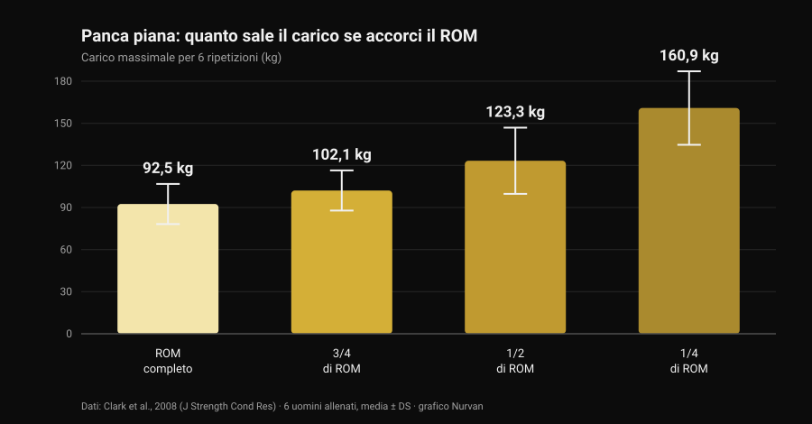
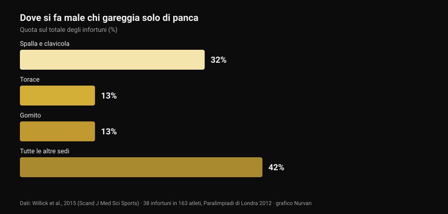

# Bulldog grip in panca: cosa dicono gli studi

Di [Giammaria Loi](/autore/giammaria-loi) · aggiornato il 29 ottobre 2026

Un post tecnico passato nella mia bacheca spiega la presa bulldog in panca: polso ruotato verso l'interno, bilanciere di traverso sul palmo, promessa di meno tensione sul gomito e più stabilità. È una descrizione onesta, e parte della community la usa da anni. Poi sono andato a cercare quante volte quella presa è stata misurata in letteratura. Zero. Non è un motivo per scartarla — è un motivo per raccontarla come quello che è, e per usare i dati che invece esistono: quelli sul range di movimento e quelli su dove si fa male davvero chi fa panca.

## In breve

- **Nessuno studio indicizzato l'ha mai misurata.** La ricerca su PubMed per "bulldog grip" restituisce **zero risultati** (verificato il 29 ottobre 2026): nessuna elettromiografia, nessun confronto di carichi, nessun dato su dolore o infortuni.
- **La regola IPF non dice quello che si sente ripetere.** Il regolamento tecnico in vigore dal 1° marzo 2026 chiede che "mani, pollici e dita impugnino completamente il bilanciere con una presa a pollice chiuso" e vieta la presa inversa. La parola "bulldog" non compare da nessuna parte.
- **Accorciare il ROM alza i chili, non gli adattamenti.** Il massimale per 6 ripetizioni passa da **92,5 kg** a ROM completo a **160,9 kg** a un quarto di ROM (Clark et al., 2008). Ma in dieci settimane di allenamento il ROM completo ha battuto tutti i parziali su ogni variante testata (Martínez-Cava et al., 2022).
- **Il gomito non è il problema principale della panca.** Nello sport che è solo panca, spalla e clavicola valgono il **32%** degli infortuni, il gomito il **13%** (Willick et al., 2015).
- **Il gomito però conta di più dopo i 40 anni.** Su 245 powerlifter, il tasso di infortunio a gomito e mano/polso aumenta in modo statisticamente significativo oltre i 40 anni (Siewe et al., 2011).

## Cos'è la presa bulldog, in parole semplici

Nella presa che quasi tutti usano in panca, il bilanciere sta più o meno a metà palmo e l'avambraccio resta neutro. Nella presa bulldog ruoti l'avambraccio verso l'interno — quella che in anatomia si chiama **rotazione interna**, cioè il movimento che porta il pollice verso il corpo — e il bilanciere finisce appoggiato in diagonale sul palmo, vicino alla radice del pollice invece che al centro della mano.

Da lì discendono tre conseguenze geometriche, non sperimentali:

1. il polso resta più "impilato" sull'avambraccio, con meno estensione forzata;
2. il bilanciere poggia su un punto della mano più vicino al lato del mignolo, quindi tocca il petto leggermente più in alto;
3. il gomito tende ad aprirsi un po' di più, perché la rotazione dell'avambraccio lo trascina.

Sono conseguenze plausibili, verificabili con un righello. Nessuna di loro è un risultato di laboratorio.

## Quello che la ricerca non ha — e perché la cosa conta

Ho interrogato PubMed il 29 ottobre 2026: "bulldog grip" non restituisce nemmeno un lavoro. Sulla panca piana esiste invece una letteratura discreta sulla **larghezza** della presa — l'abbiamo passata in rassegna in [presa in panca piana: larga, media o stretta](/blog/presa-panca-piana-larga-stretta) — ma nessuno ha mai misurato la **rotazione del polso**: né l'attività dei flessori dell'avambraccio, né i carichi sollevati, né il dolore riferito al gomito.

Quindi l'affermazione "la presa bulldog riduce l'attivazione dei flessori del polso e allevia il dolore al gomito" è un'ipotesi meccanica ragionevole che nessuno ha mai testato. Chi la usa e sta meglio non si sbaglia sulla propria esperienza: riporta un dato personale, che vale per lui. Quello che non si può fare è trasformarlo in una raccomandazione generale e chiamarla scienza.

## La regola IPF: cosa c'è scritto davvero

Qui circola l'equivoco più diffuso, e vale la pena leggere il testo invece dei riassunti. Il regolamento tecnico IPF in vigore dal **1° marzo 2026** elenca, fra le regole di esecuzione della panca, due vincoli sulla presa:

- mani, pollici e dita devono **impugnare completamente** il bilanciere, con il pollice chiuso intorno alla barra;
- **la presa inversa è vietata**, e la distanza fra gli indici non può superare gli 81 cm.

Il confronto illuminante è con lo squat, dove lo stesso regolamento scrive esplicitamente che "non è richiesto che i pollici avvolgano il bilanciere". In panca quell'eccezione non c'è: il pollice chiuso è obbligatorio.

Cosa se ne ricava? Che il regolamento **non nomina la presa bulldog**, e che una bulldog eseguita con il pollice chiuso e la mano piena sul bilanciere non viola nessuna di quelle due righe. Quello che fa scattare la luce rossa è altro: la presa senza pollice (la cosiddetta *suicide grip*), la presa inversa, gli indici oltre i riferimenti degli 81 cm e — questo riguarda da vicino chi spinge la rotazione all'estremo — una mano che sta sulla barra solo con i polpastrelli invece che impugnarla completamente.

Se gareggi, la conclusione pratica è semplice: mostra la tua presa all'arbitro in riscaldamento, non a metà della prima alzata. Le federazioni nazionali applicano lo stesso testo, ma il giorno della gara l'unica cosa che conta è quanto "completa" il singolo giudice considera la tua impugnatura.

## Meno ROM, più chili: il dato che serve per leggere la presa

C'è un punto del discorso bulldog che si può invece ancorare a numeri solidi, ed è il range di movimento. Se il bilanciere tocca il petto più in alto a parità di larghezza della presa, l'escursione **aumenta**; se invece cambi anche la larghezza, l'escursione può accorciarsi. In entrambi i casi stai spostando una variabile che pesa parecchio.

Quanto pesa lo misura un lavoro del 2008: sei uomini allenati hanno testato il massimale per 6 ripetizioni in panca a quattro ampiezze diverse.

*Grafico Nurvan sui dati di Clark et al., 2008 (J Strength Cond Res). Medie e deviazioni standard riportate nell'articolo; sei soggetti allenati, esecuzione al multipower.*

Dal ROM completo a un quarto di ROM il carico quasi raddoppia. Lo stesso andamento è confermato su un campione molto più grande: in 42 uomini allenati il massimale cresceva progressivamente passando da ROM completo a due terzi a un terzo (Martínez-Cava et al., 2019).

Il problema è cosa succede nel tempo. In uno studio randomizzato, 50 uomini hanno seguito dieci settimane di programma identico cambiando solo l'ampiezza allenata: **il gruppo a ROM completo ha ottenuto i risultati migliori su tutte e tre le varianti di panca testate**, e i gruppi parziali miglioravano sempre meno man mano che il ROM si accorciava (Martínez-Cava et al., 2022). Nel powerlifting paralimpico, dove la panca è l'unica gara, l'allenamento a ROM parziale permette carichi più alti con meno perdita di funzione a fine seduta, ma l'attivazione del grande pettorale — porzione clavicolare e sternale — è maggiore a ROM completo (Mendonça et al., 2021).

Tradotto per chi sta valutando la bulldog: se la provi e all'improvviso i chili salgono, prima di festeggiare controlla dove tocca il bilanciere. Se tocca più in basso perché hai allargato la presa, parte di quel guadagno è geometria. E vale anche il contrario, che il post originale segnala correttamente: a parità di larghezza, un punto di contatto più alto allunga l'escursione e rende l'alzata **più dura**, non più facile.

## Il gomito: dove si fa male davvero chi fa panca

L'argomento più usato a favore della bulldog è il sollievo al gomito. Vale la pena mettere quel gomito in proporzione.

*Grafico Nurvan sui dati di Willick et al., 2015 (Scand J Med Sci Sports). 38 infortuni rilevati in 163 atleti nei sette giorni di gara delle Paralimpiadi di Londra 2012.*

Il powerlifting paralimpico è, di fatto, uno sport di sola panca: è il campione più pulito che abbiamo per capire dove si rompe chi spinge. Su 163 atleti sono stati registrati 38 infortuni, il **61% da sovraccarico cronico**. La sede più colpita è la spalla con la clavicola (32%); il torace e il gomito seguono a pari merito al 13%.

Il quadro negli altri sport di forza è lo stesso: la revisione sistematica di Keogh e Winwood indica spalla, zona lombare, ginocchio, gomito e polso/mano come sedi più frequenti, con circa **un infortunio ogni 1.000 ore** di allenamento nel powerlifting. Nello studio su 245 powerlifter tedeschi il **43,3%** riferiva fastidi durante l'allenamento di routine senza interromperlo, e il tasso di infortunio a gomito e a mano/polso cresceva in modo significativo dopo i 40 anni (Siewe et al., 2011).

Due conclusioni pratiche. La prima: se il gomito fa male, la presa è una leva piccola accanto a carico, volume, frequenza e progressione — ed è lì che va guardato per primo. La seconda, più delicata: la rotazione interna spinta all'estremo chiude la posizione della spalla, e una revisione del 2024 indica proprio il **posizionamento vulnerabile dell'articolazione durante l'alzata** fra i fattori di rischio per la spalla negli sport con i pesi (Daher et al., 2024). Spostare un fastidio dal gomito alla spalla non è un affare: la spalla è l'articolazione che si infortuna di più.

## Cosa dice davvero la ricerca

- **"La presa bulldog riduce l'attivazione dei flessori del polso e allevia il gomito" — Non verificabile.** Zero studi indicizzati, nessuna elettromiografia. È un'ipotesi meccanica, non un risultato.
- **"Dà un punto di contatto più alto e un'apertura del gomito più naturale" — Da precisare.** La geometria regge: ruotando l'avambraccio il bilanciere si sposta verso il lato del mignolo. Quanto cambi davvero l'angolo del gomito non l'ha misurato nessuno.
- **"A parità di larghezza il punto più alto aumenta il ROM, quindi si fatica di più" — Confermato.** È coerente con la relazione fra ampiezza e carico: più escursione, meno chili sulla barra.
- **"Ridurre il ROM è un vantaggio" — Da precisare.** Alza il carico in modo netto (da 92,5 a 160,9 kg fra ROM completo e un quarto), ma in dieci settimane di allenamento il ROM completo produce adattamenti maggiori su ogni variante.
- **"È vietata dall'IPF perché serve il pollice chiuso" — Smentito nella forma.** Il regolamento 2026 non nomina la bulldog: vieta la presa inversa e chiede che mani, pollici e dita impugnino completamente il bilanciere. Una bulldog col pollice chiuso rispetta entrambe le righe.
- **"Aiuta i principianti che chiudono troppo i gomiti" — Non verificabile.** Nessun dato su principianti, tecnica e presa. In più la spalla, non il gomito, è la sede che si infortuna di più in panca.

## Come applicarlo

1. **Se non hai dolore e i numeri salgono, non cambiare per moda.** La presa che usi da anni è anche la presa su cui hai costruito la tecnica: cambiarla azzera parte di quell'automatismo per qualche settimana.
2. **Se la provi, tieni il pollice chiuso e la mano piena sul bilanciere.** È la versione che resta dentro il regolamento di gara ed è anche quella in cui la barra non può scappare.
3. **Misura il punto di contatto prima e dopo.** Segna sul petto dove tocca la barra con la vecchia presa e con la nuova: è l'unico modo per sapere se hai cambiato la presa o hai cambiato il ROM.
4. **Dalle 3-4 settimane e un criterio numerico.** Stesso carico, stesso numero di serie, stesso punto di contatto: se a parità di RIR (le ripetizioni che ti restano nel serbatoio) il carico non si muove, la presa non ti sta dando niente.
5. **Se il gomito fa male, guarda prima il programma.** Salti di carico, troppe serie vicino al cedimento e nessuna settimana di scarico spiegano molto più della rotazione del polso. La logica di serie, recupero e progressione è in [quante ripetizioni per la massa](/blog/ripetizioni-serie-recupero-ipertrofia).
6. **Dolore che dura da settimane, o che ti sveglia la notte, non è una questione di presa.** Quello è un tema da professionista sanitario, non da post.
7. **Se gareggi, chiedi prima all'arbitro.** Trenta secondi in riscaldamento valgono più di qualsiasi didascalia letta online.

### Prova Nurvan — se cambi la presa, lascia che siano i numeri a dirti se funziona

Un cambio di tecnica si giudica su settimane, non su una seduta: serve vedere carico, ripetizioni e RIR della stessa alzata uno accanto all'altro, con annotato cosa hai cambiato e quando. Su Nurvan registri ogni serie di panca con il RIR, aggiungi una nota sulla variante usata e ti ritrovi la curva dei carichi mese per mese — così la domanda "la bulldog mi ha fatto alzare di più?" ha una risposta e non un'impressione. In più le serie di riscaldamento vengono proposte in automatico sul carico del giorno, utile proprio quando stai riprendendo confidenza con una presa nuova.

## Domande frequenti

**Cos'è la presa bulldog in panca piana?**
È una presa in cui ruoti l'avambraccio verso l'interno e appoggi il bilanciere in diagonale sul palmo, vicino alla radice del pollice, invece che al centro della mano. Il polso resta più allineato all'avambraccio e il bilanciere tocca il petto un po' più in alto. Non è una presa senza pollice: nella versione corretta il pollice resta chiuso intorno alla barra.

**La presa bulldog è legale in gara IPF?**
Il regolamento tecnico IPF in vigore dal 1° marzo 2026 non la nomina. Chiede che mani, pollici e dita impugnino completamente il bilanciere con il pollice chiuso e vieta la presa inversa: una bulldog eseguita con il pollice chiuso e la mano piena sulla barra rispetta entrambe le condizioni. Sono fuori regola la presa senza pollice, quella inversa e una mano appoggiata solo con i polpastrelli. Se hai dubbi, falla vedere all'arbitro prima di gareggiare.

**La presa bulldog fa alzare di più?**
Non esiste uno studio che lo abbia misurato. Se nei tuoi test il carico sale, la causa più probabile non è la presa in sé ma il range di movimento: a parità di tutto il resto, accorciare l'escursione aumenta molto i chili sollevabili, mentre un punto di contatto più alto con la stessa larghezza la allunga e rende l'alzata più dura.

**La presa bulldog fa male alle spalle?**
Non ci sono dati diretti. Quello che si sa è che la spalla è la sede più colpita in chi gareggia di panca (32% degli infortuni) e che fra i fattori di rischio documentati c'è il posizionamento vulnerabile dell'articolazione durante l'alzata. Una rotazione interna molto marcata va quindi provata con gradualità, e sospesa se compare fastidio alla spalla.

## Leggi anche

- [Presa in panca piana: larga, media o stretta?](/blog/presa-panca-piana-larga-stretta) — cosa cambia davvero per petto e tricipiti al variare della larghezza, numeri alla mano.
- [Panca o croci: cosa fa crescere di più il petto?](/blog/panca-o-croci-pettorali) — il confronto fra spinta e isolamento sul pettorale.
- [Quante ripetizioni per la massa: il mito dell'8-12](/blog/ripetizioni-serie-recupero-ipertrofia) — serie, recupero e progressione, cioè le leve che contano più della presa.

## Fonti

- Clark RA, Bryant AL, Humphries B, 2008. *An examination of strength and concentric work ratios during variable range of motion training.* Journal of Strength and Conditioning Research 22(5):1716-9. [PMID 18714211](https://pubmed.ncbi.nlm.nih.gov/18714211/) · [DOI 10.1519/JSC.0b013e318173c529](https://doi.org/10.1519/JSC.0b013e318173c529)
- Martínez-Cava A, Morán-Navarro R, Hernández-Belmonte A, Courel-Ibáñez J, Conesa-Ros E, González-Badillo JJ, Pallarés JG, 2019. *Range of Motion and Sticking Region Effects on the Bench Press Load-Velocity Relationship.* Journal of Sports Science & Medicine 18(4):645-652. [PMID 31827348](https://pubmed.ncbi.nlm.nih.gov/31827348/)
- Martínez-Cava A, Hernández-Belmonte A, Courel-Ibáñez J, Morán-Navarro R, González-Badillo JJ, Pallarés JG, 2022. *Bench Press at Full Range of Motion Produces Greater Neuromuscular Adaptations Than Partial Executions After Prolonged Resistance Training.* Journal of Strength and Conditioning Research 36(1):10-15. [PMID 31567719](https://pubmed.ncbi.nlm.nih.gov/31567719/) · [DOI 10.1519/JSC.0000000000003391](https://doi.org/10.1519/JSC.0000000000003391)
- Mendonça TP, Aidar FJ, Matos DG, Souza RF, Marçal AC, Almeida-Neto PF, Cabral BG, Garrido ND, Neiva HP, Marinho DA, Marques MC, Reis VM, 2021. *Force production and muscle activation during partial vs. full range of motion in Paralympic Powerlifting.* PLoS One 16(10):e0257810. [PMID 34644331](https://pubmed.ncbi.nlm.nih.gov/34644331/) · [DOI 10.1371/journal.pone.0257810](https://doi.org/10.1371/journal.pone.0257810)
- Willick SE, Cushman DM, Blauwet CA, Emery C, Webborn N, Derman W, Schwellnus M, Stomphorst J, Van de Vliet P, 2015. *The epidemiology of injuries in powerlifting at the London 2012 Paralympic Games: An analysis of 1411 athlete-days.* Scandinavian Journal of Medicine & Science in Sports 26(10):1233-8. [PMID 26453890](https://pubmed.ncbi.nlm.nih.gov/26453890/) · [DOI 10.1111/sms.12554](https://doi.org/10.1111/sms.12554)
- Siewe J, Rudat J, Röllinghoff M, Schlegel UJ, Eysel P, Michael JW-P, 2011. *Injuries and overuse syndromes in powerlifting.* International Journal of Sports Medicine 32(9):703-11. [PMID 21590644](https://pubmed.ncbi.nlm.nih.gov/21590644/) · [DOI 10.1055/s-0031-1277207](https://doi.org/10.1055/s-0031-1277207)
- Keogh JWL, Winwood PW, 2017. *The Epidemiology of Injuries Across the Weight-Training Sports.* Sports Medicine 47(3):479-501. [PMID 27328853](https://pubmed.ncbi.nlm.nih.gov/27328853/) · [DOI 10.1007/s40279-016-0575-0](https://doi.org/10.1007/s40279-016-0575-0)
- Daher M, Jabre S, Casey JC, Fares MY, Boufadel P, Lopez R, Lawand J, Mansour J, Abboud JA, 2024. *Shouldering the load: A scoping review of incidence, types, and risk factors of shoulder injuries in weight-lifting athletes.* Shoulder & Elbow 17(3):254-263. [PMID 39552690](https://pubmed.ncbi.nlm.nih.gov/39552690/) · [DOI 10.1177/17585732241258743](https://doi.org/10.1177/17585732241258743)
- International Powerlifting Federation, 2026. *IPF Technical Rules Book*, in vigore dal 1° marzo 2026, sezione 4.2 (Bench Press — Rules of Performance). [Testo ufficiale in PDF](https://www.irishpowerliftingfederation.com/wp-content/uploads/2026/03/2026-IPF-Technical-Rulebook-effective-01-March-2026-v3.pdf)

Riferimenti bibliografici recuperati tramite PubMed. Spunto iniziale: il post di **Alfred Jong** ([alfred.reformance](https://www.instagram.com/alfred.reformance/), Reformance Training) del 25 settembre 2026, [post originale](https://www.instagram.com/p/DdtpBWPm9f4/). Del post sono stati letti autore, data e didascalia: nessun testo e nessuna immagine sono stati riprodotti. Il tema è stato riscritto da zero risalendo alle fonti primarie e al regolamento ufficiale.

---

**Giammaria Loi** è il fondatore di Nurvan. Si allena con i pesi dal 2012, lavora come personal trainer e coach certificato FIPE dal 2013 e gareggia nel powerlifting a livello nazionale dal 2018. Ogni articolo che firma parte dagli studi scientifici e arriva a ciò che funziona davvero in palestra.

> Nota: contenuto informativo, non sostituisce il parere di un medico o di un professionista. Se hai dolore persistente a gomito, polso o spalla, o se un fastidio peggiora nonostante la riduzione del carico, rivolgiti a un medico o a un fisioterapista invece di cercare la soluzione in un dettaglio tecnico.
