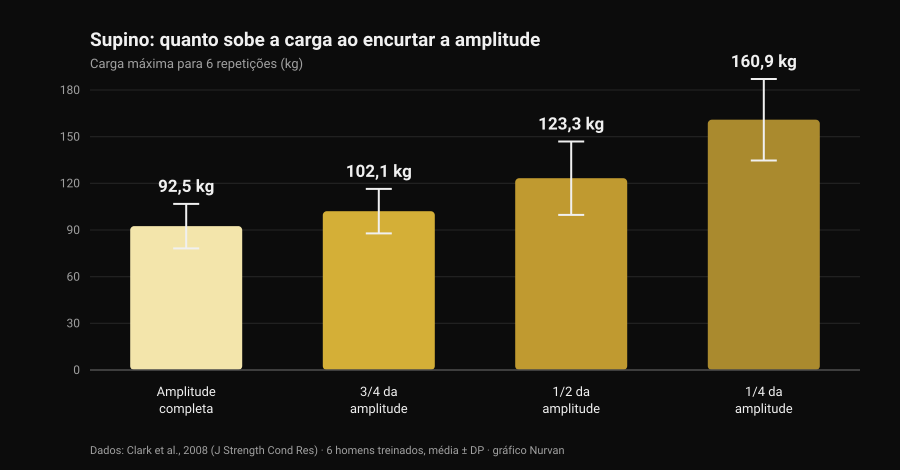
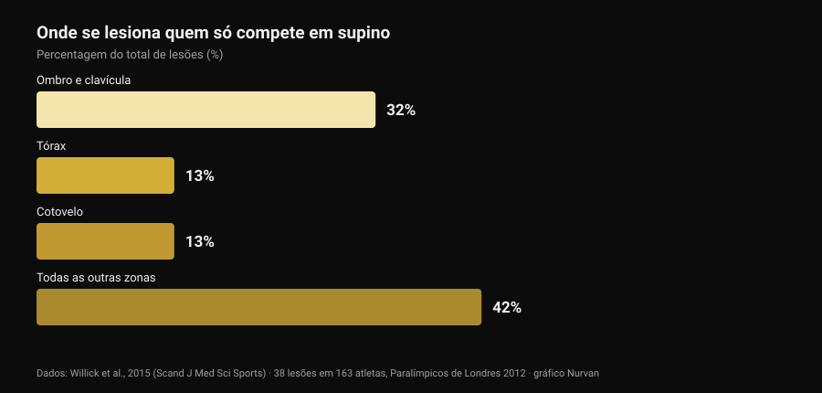

# Pegada bulldog no supino: o que dizem os estudos

Por [Giammaria Loi](/autore/giammaria-loi) · atualizado a 29 de outubro de 2026

Um post técnico que passou no meu feed explica a pegada bulldog no supino: antebraço rodado para dentro, barra apoiada na diagonal sobre a palma, promessa de menos tensão no cotovelo e mais estabilidade. É uma descrição honesta, e parte da comunidade usa-a há anos. Depois fui ver quantas vezes essa pegada foi medida na literatura. Zero. Não é motivo para a descartar: é motivo para a contar tal como é e para usar os dados que de facto existem — os da amplitude de movimento e os de onde se lesiona realmente quem faz supino.

## Em resumo

- **Nenhum estudo indexado a mediu.** A pesquisa "bulldog grip" na PubMed devolve **zero resultados** (verificado a 29 de outubro de 2026): sem eletromiografia, sem comparação de cargas, sem dados de dor ou lesão.
- **A regra da IPF não diz o que se repete.** O regulamento técnico em vigor desde 1 de março de 2026 exige que "mãos, polegares e dedos agarrem completamente a barra, com o polegar à volta" e proíbe a pegada invertida. A palavra "bulldog" não aparece.
- **Encurtar a amplitude aumenta os quilos, não as adaptações.** O máximo para 6 repetições passa de **92,5 kg** em amplitude completa para **160,9 kg** num quarto de amplitude (Clark et al., 2008). Mas em dez semanas de treino a amplitude completa venceu todos os parciais em todas as variantes testadas (Martínez-Cava et al., 2022).
- **O cotovelo não é o problema principal do supino.** No desporto que é só supino, ombro e clavícula valem **32%** das lesões e o cotovelo **13%** (Willick et al., 2015).
- **O cotovelo pesa mais depois dos 40.** Em 245 powerlifters, a taxa de lesão no cotovelo e na mão/punho aumenta de forma significativa depois dos 40 anos (Siewe et al., 2011).

## O que é a pegada bulldog, em palavras simples

Na pegada que quase toda a gente usa, a barra fica mais ou menos a meio da palma e o antebraço permanece neutro. Na pegada bulldog rodas o antebraço para dentro — o que em anatomia se chama **rotação interna**, o movimento que leva o polegar na direção do corpo — e a barra acaba apoiada na diagonal sobre a palma, perto da base do polegar em vez do centro da mão.

Daí decorrem três consequências geométricas, não experimentais:

1. o punho fica mais alinhado sobre o antebraço, com menos extensão forçada;
2. a barra apoia-se mais perto do lado do mindinho, por isso toca o peito um pouco mais acima;
3. o cotovelo tende a abrir um pouco mais, porque a rotação do antebraço o arrasta.

São consequências plausíveis e verificáveis com uma régua. Nenhuma delas é um resultado de laboratório.

## O que a investigação não tem — e porque isso importa

Consultei a PubMed a 29 de outubro de 2026: "bulldog grip" não devolve um único trabalho. Sobre o supino existe, em contrapartida, literatura razoável sobre a **largura** da pegada — revimo-la em [pegada no supino: larga, média ou fechada](/pt/blog/pegada-supino-larga-fechada) — mas ninguém mediu nunca a **rotação do punho**: nem a atividade dos flexores do antebraço, nem as cargas levantadas, nem a dor referida no cotovelo.

Por isso a afirmação "a pegada bulldog reduz a ativação dos flexores do punho e alivia o cotovelo" é uma hipótese mecânica razoável que ninguém testou. Quem a usa e se sente melhor não está enganado sobre a sua experiência: está a reportar um dado pessoal, válido para si. O que não se pode fazer é transformá-lo numa recomendação geral e chamar-lhe ciência.

## O regulamento da IPF: o que lá está mesmo escrito

É aqui que vive o equívoco mais comum, e vale a pena ler o texto em vez dos resumos. O regulamento técnico da IPF em vigor desde **1 de março de 2026** impõe duas condições à pegada no supino:

- mãos, polegares e dedos devem **agarrar completamente** a barra, com o polegar à volta dela;
- **a pegada invertida é proibida**, e a distância entre os indicadores não pode exceder 81 cm.

A comparação reveladora é com o agachamento, onde o mesmo regulamento escreve explicitamente que "não é exigido que os polegares envolvam a barra". No supino essa exceção não existe: o polegar fechado é obrigatório.

O que se conclui? Que o regulamento **não nomeia a pegada bulldog**, e que uma bulldog feita com o polegar fechado e a mão inteira na barra não viola nenhuma das duas linhas. O que acende a luz vermelha é outra coisa: a pegada sem polegar (a chamada *suicide grip*), a pegada invertida, os indicadores fora das marcas dos 81 cm e — isto toca em cheio em quem leva a rotação ao extremo — uma mão apoiada na barra só com as pontas dos dedos em vez de a agarrar por completo.

Se competes, a conclusão prática é simples: mostra a tua pegada ao árbitro no aquecimento, não a meio da primeira tentativa. As federações nacionais aplicam o mesmo texto, mas no dia da prova o que conta é quão "completa" o juiz considera a tua pegada.

## Menos amplitude, mais quilos: o número que organiza o debate

Há uma parte da discussão bulldog que se pode ancorar em números sólidos: a amplitude de movimento. Se a barra toca o peito mais acima com a mesma largura de pegada, o percurso **aumenta**; se também mudares a largura, pode encurtar. Nos dois casos estás a mexer numa variável que pesa muito.

Quanto pesa mede-o um trabalho de 2008: seis homens treinados testaram o máximo para 6 repetições no supino em quatro amplitudes diferentes.

*Gráfico Nurvan com dados de Clark et al., 2008 (J Strength Cond Res). Médias e desvios-padrão publicados; seis sujeitos treinados, execução em multipower.*

Da amplitude completa a um quarto de amplitude a carga quase duplica. O mesmo padrão aparece numa amostra muito maior: em 42 homens treinados o máximo crescia progressivamente ao passar de amplitude completa para dois terços e para um terço (Martínez-Cava et al., 2019).

O problema é o que acontece ao longo do tempo. Num ensaio aleatorizado, 50 homens cumpriram dez semanas de um programa idêntico mudando apenas a amplitude treinada: **o grupo de amplitude completa obteve os melhores resultados nas três variantes de supino testadas**, e os grupos parciais melhoravam menos quanto mais curto era o percurso (Martínez-Cava et al., 2022). No powerlifting paralímpico, onde o supino é toda a competição, o trabalho em amplitude parcial permite cargas mais altas com menos perda de função no fim da sessão, mas a ativação do grande peitoral — porções clavicular e esternal — é maior em amplitude completa (Mendonça et al., 2021).

Traduzido para quem está a considerar a bulldog: se a experimentares e os quilos subirem de repente, antes de festejar vê onde toca a barra. Se toca mais abaixo porque abriste a pegada, parte desse ganho é geometria. E o contrário também vale, como o post original assinala corretamente: com a mesma largura, um ponto de contacto mais alto alonga o percurso e torna o exercício **mais duro**, não mais fácil.

## O cotovelo: onde se lesiona realmente quem faz supino

O argumento principal a favor da bulldog é o alívio do cotovelo. Vale a pena pôr esse cotovelo em proporção.

*Gráfico Nurvan com dados de Willick et al., 2015 (Scand J Med Sci Sports). 38 lesões registadas em 163 atletas nos sete dias de competição dos Jogos Paralímpicos de Londres 2012.*

O powerlifting paralímpico é, na prática, um desporto só de supino: é a amostra mais limpa que temos para saber onde parte quem empurra. Em 163 atletas registaram-se 38 lesões, **61% por sobrecarga crónica**. A zona mais afetada é o ombro com a clavícula (32%); tórax e cotovelo seguem empatados nos 13%.

O quadro nos outros desportos de força é o mesmo: a revisão sistemática de Keogh e Winwood aponta ombro, zona lombar, joelho, cotovelo e punho/mão como as zonas mais frequentes, com cerca de **uma lesão por cada 1.000 horas** de treino no powerlifting. Entre 245 powerlifters alemães, **43,3%** referiam incómodos durante o treino de rotina sem o interromper, e a taxa de lesão no cotovelo e na mão/punho crescia de forma significativa depois dos 40 anos (Siewe et al., 2011).

Duas conclusões práticas. A primeira: se o cotovelo dói, a pegada é uma alavanca pequena ao lado de carga, volume, frequência e progressão — é aí que se olha primeiro. A segunda, mais delicada: a rotação interna levada ao extremo fecha a posição do ombro, e uma revisão de 2024 aponta precisamente o **posicionamento vulnerável da articulação durante o levantamento** entre os fatores de risco de lesão de ombro nos desportos com pesos (Daher et al., 2024). Trocar um incómodo no cotovelo por um problema de ombro é mau negócio: o ombro é a articulação que mais se lesiona.

## O que a investigação diz mesmo

- **"A pegada bulldog reduz a ativação dos flexores do punho e poupa o cotovelo" — Não verificável.** Zero estudos indexados, nenhuma eletromiografia. É uma hipótese mecânica, não um resultado.
- **"Dá um ponto de contacto mais alto e uma abertura de cotovelo mais natural" — A precisar.** A geometria sustenta-se: ao rodar o antebraço a barra desloca-se para o lado do mindinho. Quanto muda de facto o ângulo do cotovelo, ninguém mediu.
- **"Com a mesma largura, um ponto mais alto aumenta a amplitude, logo custa mais" — Confirmado.** É coerente com a relação entre amplitude e carga: mais percurso, menos quilos na barra.
- **"Reduzir a amplitude é uma vantagem" — A precisar.** Aumenta claramente a carga (de 92,5 para 160,9 kg entre amplitude completa e um quarto), mas em dez semanas de treino a amplitude completa produz mais adaptações em todas as variantes.
- **"A IPF proíbe-a porque exige polegar fechado" — Desmentido na forma.** O regulamento de 2026 não nomeia a bulldog: proíbe a pegada invertida e exige que mãos, polegares e dedos agarrem completamente a barra. Uma bulldog com o polegar fechado cumpre ambas.
- **"Ajuda os principiantes que fecham demasiado os cotovelos" — Não verificável.** Não há dados sobre principiantes, técnica e pegada. E é o ombro, não o cotovelo, a zona que mais se lesiona a empurrar.

## Como aplicar

1. **Se nada dói e os números sobem, não mudes por moda.** A pegada que usas há anos é também a pegada sobre a qual construíste a técnica: mudá-la custa-te parte desse automatismo durante algumas semanas.
2. **Se a experimentares, mantém o polegar fechado e a mão inteira na barra.** É a versão que fica dentro do regulamento e também aquela em que a barra não te pode escapar.
3. **Mede o ponto de contacto antes e depois.** Marca onde a barra toca no peito com a pegada antiga e com a nova: é a única forma de saber se mudaste a pegada ou a amplitude.
4. **Dá-lhe três a quatro semanas e um critério numérico.** Mesma carga, mesmas séries, mesmo ponto de contacto: se com o mesmo RIR (as repetições que te sobram em reserva) a carga não se mexe, a pegada não te está a dar nada.
5. **Se o cotovelo dói, olha primeiro para o programa.** Saltos de carga, demasiadas séries perto da falha e nenhuma semana de descarga explicam muito mais do que a rotação do punho. A lógica de séries, descanso e progressão está em [quantas repetições para massa muscular](/pt/blog/quantas-repeticoes-massa-muscular).
6. **Dor que dura semanas, ou que te acorda de noite, não é questão de pegada.** Isso é assunto para um profissional de saúde, não para um post.
7. **Se competes, pergunta antes ao árbitro.** Trinta segundos no aquecimento valem mais do que qualquer legenda lida online.

### Experimenta a Nurvan — se mudas a pegada, deixa os números dizerem se resulta

Uma mudança técnica julga-se em semanas, não numa sessão: é preciso ver carga, repetições e RIR do mesmo exercício lado a lado, com nota do que mudaste e quando. Na Nurvan registas cada série de supino com o RIR, acrescentas uma nota sobre a variante usada e obténs a curva das cargas mês a mês — assim a pergunta "a bulldog fez-me levantar mais?" tem resposta e não impressão. E as séries de aquecimento são propostas automaticamente a partir da carga do dia, exatamente o que convém enquanto uma pegada nova ainda não é familiar.

## Perguntas frequentes

**O que é a pegada bulldog no supino?**
É uma pegada em que rodas o antebraço para dentro e apoias a barra na diagonal sobre a palma, perto da base do polegar em vez do centro da mão. O punho fica mais alinhado com o antebraço e a barra toca o peito um pouco mais acima. Não é uma pegada sem polegar: bem executada, o polegar continua fechado à volta da barra.

**A pegada bulldog é legal em competição IPF?**
O regulamento técnico da IPF em vigor desde 1 de março de 2026 não a nomeia. Exige que mãos, polegares e dedos agarrem completamente a barra com o polegar fechado e proíbe a pegada invertida: uma bulldog com o polegar fechado e a mão inteira na barra cumpre as duas condições. Ficam fora do regulamento a pegada sem polegar, a invertida e uma mão apoiada só com as pontas dos dedos. Em caso de dúvida, mostra-a ao árbitro antes de competir.

**Com a pegada bulldog levanta-se mais?**
Não existe nenhum estudo que o tenha medido. Se nos teus testes a carga sobe, a causa mais provável não é a pegada em si mas a amplitude de movimento: com tudo o resto igual, encurtar o percurso aumenta muito os quilos levantáveis, enquanto um ponto de contacto mais alto com a mesma largura o alonga e torna o exercício mais duro.

**A pegada bulldog faz mal aos ombros?**
Não há dados diretos. O que se sabe é que o ombro é a zona mais afetada em quem compete no supino (32% das lesões) e que entre os fatores de risco documentados está o posicionamento vulnerável da articulação durante o levantamento. Por isso uma rotação interna muito marcada deve ser introduzida gradualmente e suspensa se surgir incómodo no ombro.

## Lê também

- [Pegada no supino: larga, média ou fechada?](/pt/blog/pegada-supino-larga-fechada) — o que muda mesmo para peito e tríceps ao variar a largura, com os números.
- [Supino com halteres ou crucifixo: o que cresce mais?](/pt/blog/supino-com-halteres-ou-crucifixo-peitoral) — empurrar contra isolar para o peitoral.
- [Quantas repetições para massa muscular? O mito do 8-12](/pt/blog/quantas-repeticoes-massa-muscular) — séries, descanso e progressão, as alavancas que pesam mais do que a pegada.

## Fontes

- Clark RA, Bryant AL, Humphries B, 2008. *An examination of strength and concentric work ratios during variable range of motion training.* Journal of Strength and Conditioning Research 22(5):1716-9. [PMID 18714211](https://pubmed.ncbi.nlm.nih.gov/18714211/) · [DOI 10.1519/JSC.0b013e318173c529](https://doi.org/10.1519/JSC.0b013e318173c529)
- Martínez-Cava A, Morán-Navarro R, Hernández-Belmonte A, Courel-Ibáñez J, Conesa-Ros E, González-Badillo JJ, Pallarés JG, 2019. *Range of Motion and Sticking Region Effects on the Bench Press Load-Velocity Relationship.* Journal of Sports Science & Medicine 18(4):645-652. [PMID 31827348](https://pubmed.ncbi.nlm.nih.gov/31827348/)
- Martínez-Cava A, Hernández-Belmonte A, Courel-Ibáñez J, Morán-Navarro R, González-Badillo JJ, Pallarés JG, 2022. *Bench Press at Full Range of Motion Produces Greater Neuromuscular Adaptations Than Partial Executions After Prolonged Resistance Training.* Journal of Strength and Conditioning Research 36(1):10-15. [PMID 31567719](https://pubmed.ncbi.nlm.nih.gov/31567719/) · [DOI 10.1519/JSC.0000000000003391](https://doi.org/10.1519/JSC.0000000000003391)
- Mendonça TP, Aidar FJ, Matos DG, Souza RF, Marçal AC, Almeida-Neto PF, Cabral BG, Garrido ND, Neiva HP, Marinho DA, Marques MC, Reis VM, 2021. *Force production and muscle activation during partial vs. full range of motion in Paralympic Powerlifting.* PLoS One 16(10):e0257810. [PMID 34644331](https://pubmed.ncbi.nlm.nih.gov/34644331/) · [DOI 10.1371/journal.pone.0257810](https://doi.org/10.1371/journal.pone.0257810)
- Willick SE, Cushman DM, Blauwet CA, Emery C, Webborn N, Derman W, Schwellnus M, Stomphorst J, Van de Vliet P, 2015. *The epidemiology of injuries in powerlifting at the London 2012 Paralympic Games: An analysis of 1411 athlete-days.* Scandinavian Journal of Medicine & Science in Sports 26(10):1233-8. [PMID 26453890](https://pubmed.ncbi.nlm.nih.gov/26453890/) · [DOI 10.1111/sms.12554](https://doi.org/10.1111/sms.12554)
- Siewe J, Rudat J, Röllinghoff M, Schlegel UJ, Eysel P, Michael JW-P, 2011. *Injuries and overuse syndromes in powerlifting.* International Journal of Sports Medicine 32(9):703-11. [PMID 21590644](https://pubmed.ncbi.nlm.nih.gov/21590644/) · [DOI 10.1055/s-0031-1277207](https://doi.org/10.1055/s-0031-1277207)
- Keogh JWL, Winwood PW, 2017. *The Epidemiology of Injuries Across the Weight-Training Sports.* Sports Medicine 47(3):479-501. [PMID 27328853](https://pubmed.ncbi.nlm.nih.gov/27328853/) · [DOI 10.1007/s40279-016-0575-0](https://doi.org/10.1007/s40279-016-0575-0)
- Daher M, Jabre S, Casey JC, Fares MY, Boufadel P, Lopez R, Lawand J, Mansour J, Abboud JA, 2024. *Shouldering the load: A scoping review of incidence, types, and risk factors of shoulder injuries in weight-lifting athletes.* Shoulder & Elbow 17(3):254-263. [PMID 39552690](https://pubmed.ncbi.nlm.nih.gov/39552690/) · [DOI 10.1177/17585732241258743](https://doi.org/10.1177/17585732241258743)
- International Powerlifting Federation, 2026. *IPF Technical Rules Book*, em vigor desde 1 de março de 2026, secção 4.2 (Bench Press — Rules of Performance). [PDF oficial](https://www.irishpowerliftingfederation.com/wp-content/uploads/2026/03/2026-IPF-Technical-Rulebook-effective-01-March-2026-v3.pdf)

Referências obtidas através da PubMed. Ponto de partida: o post de **Alfred Jong** ([alfred.reformance](https://www.instagram.com/alfred.reformance/), Reformance Training) de 25 de setembro de 2026, [post original](https://www.instagram.com/p/DdtpBWPm9f4/). Do post foram lidos apenas autor, data e legenda: nenhum texto e nenhuma imagem foram reproduzidos. O tema foi reescrito de raiz a partir das fontes primárias e do regulamento oficial.

---

**Giammaria Loi** é o fundador da Nurvan. Treina com pesos desde 2012, trabalha como personal trainer e coach certificado pela FIPE desde 2013 e compete em powerlifting a nível nacional desde 2018. Cada artigo que assina parte dos estudos científicos e chega ao que funciona mesmo no ginásio.

> Nota: conteúdo informativo, não substitui a opinião de um médico ou de um profissional. Se tens dor persistente no cotovelo, punho ou ombro, ou um incómodo que piora apesar de reduzires a carga, procura um médico ou fisioterapeuta em vez de procurar a solução num detalhe técnico.
