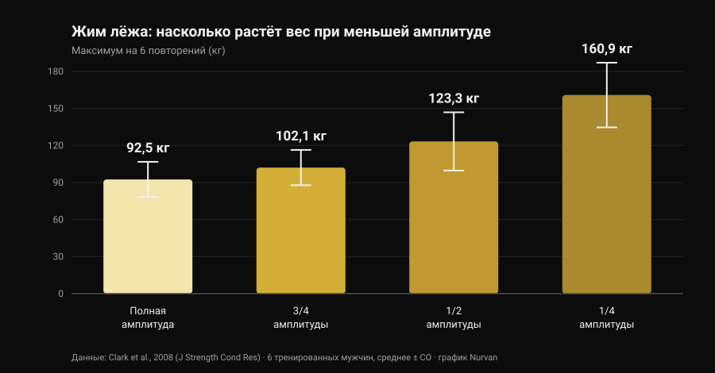
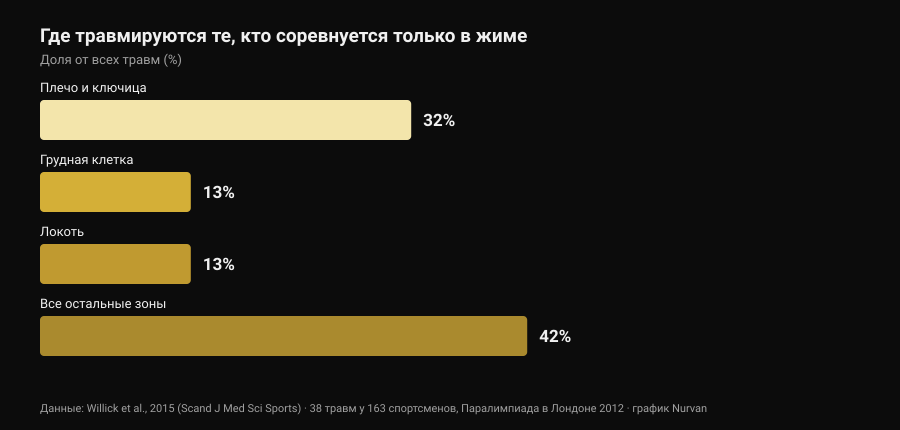

# Хват «бульдог» в жиме лёжа: что говорят исследования

Автор: [Giammaria Loi](/autore/giammaria-loi) · обновлено 29 октября 2026 года

В ленте попался технический пост про хват «бульдог» в жиме лёжа: предплечье развёрнуто внутрь, гриф лежит по диагонали на ладони, обещание меньшей нагрузки на локоть и большей устойчивости. Описание честное, и часть сообщества пользуется этим хватом годами. Потом я пошёл смотреть, сколько раз этот хват измеряли в научной литературе. Ноль. Это не повод его отбрасывать — это повод рассказать о нём как есть и использовать данные, которые действительно существуют: об амплитуде движения и о том, где на самом деле травмируются те, кто жмёт.

## Коротко

- **Ни одно индексированное исследование его не измеряло.** Поиск «bulldog grip» в PubMed даёт **ноль результатов** (проверено 29 октября 2026 года): ни электромиографии, ни сравнения весов, ни данных о боли и травмах.
- **Правило IPF говорит не то, что повторяют.** Технический регламент, действующий с 1 марта 2026 года, требует, чтобы «кисти, большие пальцы и пальцы полностью обхватывали гриф, с большим пальцем вокруг штанги», и запрещает обратный хват. Слова «бульдог» в нём нет.
- **Короче амплитуда — больше килограммов, но не адаптаций.** Максимум на 6 повторений растёт с **92,5 кг** при полной амплитуде до **160,9 кг** при четверти амплитуды (Clark et al., 2008). Но за десять недель тренировок полная амплитуда обошла все частичные варианты во всех проверенных вариациях (Martínez-Cava et al., 2022).
- **Локоть — не главная проблема жима.** В виде спорта, который состоит из одного жима, на плечо и ключицу приходится **32%** травм, на локоть — **13%** (Willick et al., 2015).
- **После 40 лет локоть весит больше.** У 245 пауэрлифтеров частота травм локтя и кисти/запястья значимо растёт после 40 лет (Siewe et al., 2011).

## Что такое хват «бульдог», простыми словами

В хвате, которым пользуются почти все, гриф лежит примерно посередине ладони, а предплечье остаётся нейтральным. В хвате «бульдог» вы разворачиваете предплечье внутрь — анатомически это **внутренняя ротация**, движение, уводящее большой палец к телу, — и гриф оказывается уложенным по диагонали на ладони, ближе к основанию большого пальца, а не к центру кисти.

Отсюда следуют три последствия. Они геометрические, а не экспериментальные:

1. запястье лучше «складывается» над предплечьем, меньше вынужденного разгибания;
2. гриф опирается ближе к стороне мизинца, поэтому касается груди чуть выше;
3. локоть разводится немного шире, потому что ротация предплечья тянет его наружу.

Все три пункта правдоподобны и проверяются линейкой. Ни один из них не является результатом лабораторного измерения.

## Чего у науки нет — и почему это важно

Я искал в PubMed 29 октября 2026 года: «bulldog grip» не даёт ни одной работы. По жиму лёжа есть приличная литература о **ширине** хвата — мы разбирали её в материале [ширина хвата в жиме лёжа: широкий или узкий](/ru/blog/khvat-zhim-lezha-shirokiy-uzkiy), — но **ротацию запястья** не измерял никто: ни активность сгибателей предплечья, ни поднятые веса, ни боль в локте.

Значит, утверждение «хват бульдог снижает активацию сгибателей запястья и потому разгружает локоть» — это разумная механическая гипотеза, которую никто не проверял. Тот, кто им пользуется и чувствует себя лучше, не ошибается в своём опыте: он сообщает личный факт, верный для него. Нельзя лишь превращать этот факт в общую рекомендацию и называть это наукой.

## Регламент IPF: что там написано на самом деле

Именно здесь живёт самое распространённое заблуждение, и текст стоит прочитать вместо пересказов. Технический регламент IPF, действующий с **1 марта 2026 года**, вводит два условия для хвата в жиме лёжа:

- кисти, большие пальцы и пальцы должны **полностью обхватывать** гриф, большой палец обёрнут вокруг штанги;
- **обратный хват запрещён**, а расстояние между указательными пальцами не может превышать 81 см.

Показательно сравнение с приседанием, где тот же регламент прямо пишет, что «большие пальцы обхватывать гриф не обязаны». В жиме такого исключения нет: обёрнутый большой палец обязателен.

Что из этого следует? Что регламент **нигде не называет хват «бульдог»**, и «бульдог» с обёрнутым большим пальцем и полной кистью на грифе не нарушает ни одной из этих строк. Красный свет загорается за другое: за хват без большого пальца (так называемый *suicide grip*), за обратный хват, за указательные пальцы вне отметок 81 см — и, что прямо касается тех, кто доводит ротацию до крайности, за кисть, которая лежит на грифе только кончиками пальцев, а не обхватывает его полностью.

Если вы выступаете, практический вывод прост: покажите свой хват судье на разминке, а не в середине первого подхода. Национальные федерации применяют тот же текст, но в день соревнований важно только то, насколько «полным» сочтёт ваш обхват конкретный судья.

## Меньше амплитуды, больше килограммов: цифра, которая всё расставляет

Одну часть разговора про «бульдог» можно привязать к твёрдым числам — это амплитуда движения. Если при той же ширине хвата гриф касается груди выше, путь **увеличивается**; если вы меняете ещё и ширину, путь может укоротиться. В обоих случаях вы двигаете переменную, которая весит очень много.

Насколько много, показала работа 2008 года: шесть тренированных мужчин проверили свой максимум на 6 повторений в жиме лёжа на четырёх разных амплитудах.

*График Nurvan по данным Clark et al., 2008 (J Strength Cond Res). Средние значения и стандартные отклонения как опубликованы; шесть тренированных испытуемых, выполнение в машине Смита.*

От полной амплитуды до четверти вес почти удваивается. Та же закономерность видна на гораздо большей выборке: у 42 тренированных мужчин максимум последовательно рос при переходе от полной амплитуды к двум третям и к одной трети (Martínez-Cava et al., 2019).

Проблема в том, что происходит со временем. В рандомизированном исследовании 50 мужчин прошли десять недель одинаковой программы, различавшейся только тренируемой амплитудой: **группа полной амплитуды показала лучшие результаты во всех трёх проверенных вариациях жима**, а частичные группы прибавляли тем меньше, чем короче была амплитуда (Martínez-Cava et al., 2022). В паралимпийском пауэрлифтинге, где жим — весь вид спорта, работа в частичной амплитуде позволяет брать более тяжёлые веса с меньшей потерей функции к концу сессии, но активация большой грудной мышцы — ключичной и грудинной частей — выше при полной амплитуде (Mendonça et al., 2021).

Перевод для тех, кто присматривается к «бульдогу»: если килограммы внезапно поехали вверх, прежде чем радоваться, посмотрите, где касается гриф. Если он касается ниже, потому что вы расширили хват, часть прибавки — это геометрия. Верно и обратное, и исходный пост отмечает это правильно: при той же ширине более высокая точка касания удлиняет путь и делает движение **тяжелее**, а не легче.

## Локоть: где на самом деле травмируются те, кто жмёт

Главный аргумент в пользу «бульдога» — облегчение для локтя. Стоит поставить этот локоть в пропорцию.

*График Nurvan по данным Willick et al., 2015 (Scand J Med Sci Sports). 38 травм у 163 спортсменов за семь соревновательных дней Паралимпиады в Лондоне 2012 года.*

Паралимпийский пауэрлифтинг — фактически вид спорта из одного жима лёжа: это самая чистая выборка, какая у нас есть, чтобы понять, где ломается тот, кто жмёт. У 163 спортсменов зафиксировано 38 травм, **61% из них — хроническая перегрузка**. Самая поражаемая зона — плечо с ключицей (32%); грудная клетка и локоть идут следом, поровну по 13%.

В остальных силовых видах картина та же: систематический обзор Keogh и Winwood называет плечо, поясницу, колено, локоть и запястье/кисть самыми частыми зонами, примерно **одна травма на 1000 часов** тренировок в пауэрлифтинге. Среди 245 немецких пауэрлифтеров **43,3%** сообщали о дискомфорте во время обычных тренировок, не прерывая их, а частота травм локтя и кисти/запястья значимо росла после 40 лет (Siewe et al., 2011).

Два практических вывода. Первый: если болит локоть, хват — маленький рычаг рядом с весом, объёмом, частотой и прогрессией, и смотреть надо сначала туда. Второй, более тонкий: крайняя внутренняя ротация закрывает положение плеча, а обзор 2024 года называет именно **уязвимое положение сустава во время подъёма** среди факторов риска травмы плеча в силовых видах (Daher et al., 2024). Менять дискомфорт в локте на проблему с плечом — плохая сделка: плечо травмируется чаще всего.

## Что на самом деле говорят исследования

- **«Хват бульдог снижает активацию сгибателей запястья и щадит локоть» — Не проверяемо.** Ноль индексированных исследований, никакой электромиографии. Это механическая гипотеза, а не результат.
- **«Он даёт более высокую точку касания и более естественный развод локтей» — Требует уточнения.** Геометрия держится: ротация предплечья смещает гриф к стороне мизинца. Насколько реально меняется угол локтя, никто не измерял.
- **«При той же ширине более высокая точка касания увеличивает амплитуду, значит тяжелее» — Подтверждено.** Согласуется со связью амплитуды и веса: длиннее путь — меньше килограммов.
- **«Сокращать амплитуду выгодно» — Требует уточнения.** Вес растёт заметно (с 92,5 до 160,9 кг между полной и четвертью амплитуды), но за десять недель тренировок полная амплитуда даёт больше адаптаций во всех вариациях.
- **«IPF запрещает его, потому что требует обхвата большим пальцем» — Опровергнуто в такой формулировке.** Регламент 2026 года не называет «бульдог»: он запрещает обратный хват и требует, чтобы кисти, большие пальцы и пальцы полностью обхватывали гриф. «Бульдог» с обёрнутым большим пальцем удовлетворяет обоим условиям.
- **«Он помогает новичкам, которые слишком прижимают локти» — Не проверяемо.** Нет данных о новичках, технике и хвате. К тому же в жиме чаще травмируется плечо, а не локоть.

## Как это применить

1. **Если ничего не болит и цифры растут, не меняйте хват из-за моды.** Хват, которым вы пользуетесь годами, — это ещё и хват, на котором построена ваша техника: смена отнимет часть этого автоматизма на несколько недель.
2. **Если пробуете, держите большой палец обёрнутым и всю кисть на грифе.** Это версия, которая остаётся внутри регламента, и та, в которой штанга не сможет уйти.
3. **Измерьте точку касания до и после.** Отметьте, где гриф ложится на грудь со старым хватом и с новым: только так вы поймёте, изменили вы хват или амплитуду.
4. **Дайте ему три-четыре недели и числовой критерий.** Тот же вес, то же число подходов, та же точка касания: если при том же RIR (повторения в запасе) вес не двигается, хват вам ничего не даёт.
5. **Если болит локоть, сначала смотрите на программу.** Скачки веса, слишком много подходов около отказа и ни одной разгрузочной недели объясняют гораздо больше, чем ротация запястья. Логика подходов, отдыха и прогрессии — в материале [сколько повторений нужно для роста мышц](/ru/blog/skolko-povtoreniy-dlya-massy).
6. **Боль, которая длится неделями или будит ночью, — не вопрос хвата.** Это тема для медицинского специалиста, а не для поста.
7. **Если выступаете, спросите судью заранее.** Тридцать секунд на разминке стоят больше любой подписи под постом.

### Попробовать Nurvan — если меняете хват, пусть решают цифры

Техническое изменение оценивают неделями, а не одной тренировкой: нужно видеть вес, повторения и RIR одного и того же движения рядом, с пометкой, что и когда вы поменяли. В Nurvan вы записываете каждый подход в жиме вместе с RIR, добавляете заметку об использованной вариации и получаете кривую весов по месяцам — так вопрос «добавил ли мне бульдог килограммы?» получает ответ, а не ощущение. Разминочные подходы при этом предлагаются автоматически от рабочего веса дня — именно то, что нужно, пока новый хват ещё непривычен.

## Частые вопросы

**Что такое хват «бульдог» в жиме лёжа?**
Это хват, при котором вы разворачиваете предплечье внутрь и кладёте гриф по диагонали на ладонь, ближе к основанию большого пальца, а не к центру кисти. Запястье остаётся ровнее относительно предплечья, а гриф касается груди чуть выше. Это не хват без большого пальца: при правильном исполнении большой палец остаётся обёрнутым вокруг штанги.

**Разрешён ли хват «бульдог» на соревнованиях IPF?**
Технический регламент IPF, действующий с 1 марта 2026 года, его не называет. Он требует, чтобы кисти, большие пальцы и пальцы полностью обхватывали гриф с обёрнутым большим пальцем, и запрещает обратный хват: «бульдог» с обёрнутым большим пальцем и полной кистью на грифе отвечает обоим условиям. Вне правил остаются хват без большого пальца, обратный хват и кисть, лежащая на грифе только кончиками пальцев. Если сомневаетесь, покажите хват судье до выхода на помост.

**С хватом «бульдог» жмут больше?**
Ни одно исследование этого не измеряло. Если в ваших тестах вес вырос, самая вероятная причина — не сам хват, а амплитуда движения: при прочих равных укорочение пути сильно повышает поднимаемый вес, тогда как более высокая точка касания при той же ширине удлиняет путь и делает движение тяжелее.

**Вреден ли хват «бульдог» для плеч?**
Прямых данных нет. Известно лишь, что плечо — самая поражаемая зона у тех, кто соревнуется в жиме (32% травм), и что среди задокументированных факторов риска есть уязвимое положение сустава во время подъёма. Поэтому выраженную внутреннюю ротацию стоит вводить постепенно и убирать, если появляется дискомфорт в плече.

## Читайте также

- [Ширина хвата в жиме лёжа: широкий или узкий?](/ru/blog/khvat-zhim-lezha-shirokiy-uzkiy) — что реально меняется для груди и трицепса при изменении ширины, с цифрами.
- [Жим гантелями или разведения: что растит грудь?](/ru/blog/zhim-gantelyami-ili-razvedeniya-grud) — жим против изоляции для грудных.
- [Сколько повторений нужно для роста мышц: миф 8-12](/ru/blog/skolko-povtoreniy-dlya-massy) — подходы, отдых и прогрессия, рычаги весомее хвата.

## Источники

- Clark RA, Bryant AL, Humphries B, 2008. *An examination of strength and concentric work ratios during variable range of motion training.* Journal of Strength and Conditioning Research 22(5):1716-9. [PMID 18714211](https://pubmed.ncbi.nlm.nih.gov/18714211/) · [DOI 10.1519/JSC.0b013e318173c529](https://doi.org/10.1519/JSC.0b013e318173c529)
- Martínez-Cava A, Morán-Navarro R, Hernández-Belmonte A, Courel-Ibáñez J, Conesa-Ros E, González-Badillo JJ, Pallarés JG, 2019. *Range of Motion and Sticking Region Effects on the Bench Press Load-Velocity Relationship.* Journal of Sports Science & Medicine 18(4):645-652. [PMID 31827348](https://pubmed.ncbi.nlm.nih.gov/31827348/)
- Martínez-Cava A, Hernández-Belmonte A, Courel-Ibáñez J, Morán-Navarro R, González-Badillo JJ, Pallarés JG, 2022. *Bench Press at Full Range of Motion Produces Greater Neuromuscular Adaptations Than Partial Executions After Prolonged Resistance Training.* Journal of Strength and Conditioning Research 36(1):10-15. [PMID 31567719](https://pubmed.ncbi.nlm.nih.gov/31567719/) · [DOI 10.1519/JSC.0000000000003391](https://doi.org/10.1519/JSC.0000000000003391)
- Mendonça TP, Aidar FJ, Matos DG, Souza RF, Marçal AC, Almeida-Neto PF, Cabral BG, Garrido ND, Neiva HP, Marinho DA, Marques MC, Reis VM, 2021. *Force production and muscle activation during partial vs. full range of motion in Paralympic Powerlifting.* PLoS One 16(10):e0257810. [PMID 34644331](https://pubmed.ncbi.nlm.nih.gov/34644331/) · [DOI 10.1371/journal.pone.0257810](https://doi.org/10.1371/journal.pone.0257810)
- Willick SE, Cushman DM, Blauwet CA, Emery C, Webborn N, Derman W, Schwellnus M, Stomphorst J, Van de Vliet P, 2015. *The epidemiology of injuries in powerlifting at the London 2012 Paralympic Games: An analysis of 1411 athlete-days.* Scandinavian Journal of Medicine & Science in Sports 26(10):1233-8. [PMID 26453890](https://pubmed.ncbi.nlm.nih.gov/26453890/) · [DOI 10.1111/sms.12554](https://doi.org/10.1111/sms.12554)
- Siewe J, Rudat J, Röllinghoff M, Schlegel UJ, Eysel P, Michael JW-P, 2011. *Injuries and overuse syndromes in powerlifting.* International Journal of Sports Medicine 32(9):703-11. [PMID 21590644](https://pubmed.ncbi.nlm.nih.gov/21590644/) · [DOI 10.1055/s-0031-1277207](https://doi.org/10.1055/s-0031-1277207)
- Keogh JWL, Winwood PW, 2017. *The Epidemiology of Injuries Across the Weight-Training Sports.* Sports Medicine 47(3):479-501. [PMID 27328853](https://pubmed.ncbi.nlm.nih.gov/27328853/) · [DOI 10.1007/s40279-016-0575-0](https://doi.org/10.1007/s40279-016-0575-0)
- Daher M, Jabre S, Casey JC, Fares MY, Boufadel P, Lopez R, Lawand J, Mansour J, Abboud JA, 2024. *Shouldering the load: A scoping review of incidence, types, and risk factors of shoulder injuries in weight-lifting athletes.* Shoulder & Elbow 17(3):254-263. [PMID 39552690](https://pubmed.ncbi.nlm.nih.gov/39552690/) · [DOI 10.1177/17585732241258743](https://doi.org/10.1177/17585732241258743)
- International Powerlifting Federation, 2026. *IPF Technical Rules Book*, действует с 1 марта 2026 года, раздел 4.2 (Bench Press — Rules of Performance). [Официальный PDF](https://www.irishpowerliftingfederation.com/wp-content/uploads/2026/03/2026-IPF-Technical-Rulebook-effective-01-March-2026-v3.pdf)

Литература найдена через PubMed. Отправная точка: пост **Alfred Jong** ([alfred.reformance](https://www.instagram.com/alfred.reformance/), Reformance Training) от 25 сентября 2026 года, [оригинальный пост](https://www.instagram.com/p/DdtpBWPm9f4/). Из поста прочитаны только автор, дата и подпись: ни текст, ни изображения не воспроизводились. Тема написана с нуля по первичным источникам и официальному регламенту.

---

**Giammaria Loi** — основатель Nurvan. Тренируется с отягощениями с 2012 года, работает персональным тренером и коучем с сертификацией FIPE с 2013 года и выступает в пауэрлифтинге на национальном уровне с 2018 года. Каждая статья за его подписью начинается с исследований и заканчивается тем, что действительно работает в зале.

> Примечание: информационный материал, не заменяет консультацию врача или специалиста. При стойкой боли в локте, запястье или плече, а также если дискомфорт усиливается несмотря на снижение нагрузки, обратитесь к врачу или физиотерапевту вместо поиска решения в техническом нюансе.
