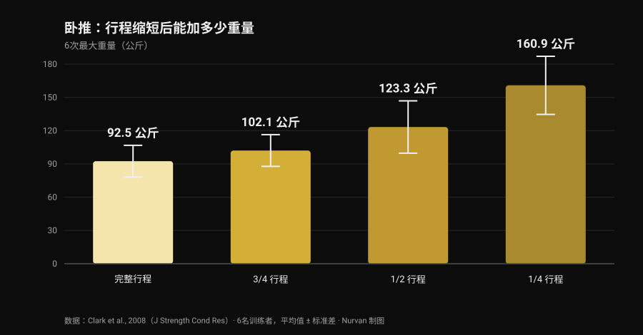
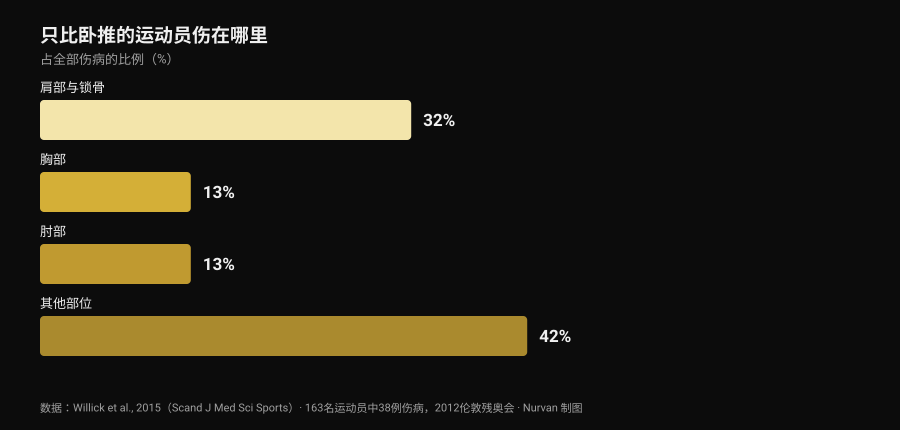

# 卧推 bulldog 握法：研究到底怎么说

作者 [Giammaria Loi](/autore/giammaria-loi) · 更新于 2026 年 10 月 29 日

信息流里刷到一条讲 bulldog 握法的技术帖：前臂内旋，杠铃斜压在掌心，承诺肘部压力更小、支撑更稳。描述本身是诚实的，圈子里也有人用了好多年。接着我去查，这个握法在文献里被测量过多少次。零次。这不是否定它的理由，而是把它如实讲清楚的理由，并且去用真正存在的数据：关于动作幅度的数据，以及关于做卧推的人到底伤在哪里的数据。

## 要点速览

- **没有任何收录研究测过它。** 在 PubMed 搜索「bulldog grip」返回 **零条结果**（2026 年 10 月 29 日核实）：没有肌电图，没有重量对比，也没有疼痛或伤病数据。
- **IPF 的条文不是大家传的那个意思。** 2026 年 3 月 1 日起生效的技术规则要求"双手、拇指和手指必须完整握住杠铃，拇指环绕杠身"，并禁止反握。规则里根本没有"bulldog"这个词。
- **缩短行程增加的是公斤数，不是适应。** 6 次最大重量从完整行程的 **92.5 公斤** 升到四分之一行程的 **160.9 公斤**（Clark et al., 2008）。但在十周训练中，完整行程在所有受测变式上都赢过各个部分行程组（Martínez-Cava et al., 2022）。
- **肘部不是卧推的主要问题。** 在只比卧推的运动项目里，肩与锁骨占伤病的 **32%**，肘部占 **13%**（Willick et al., 2015）。
- **不过 40 岁以后肘部的分量会上升。** 在 245 名力量举运动员中，肘部与手/腕的受伤率在 40 岁后显著升高（Siewe et al., 2011）。

## bulldog 握法到底是什么

在几乎所有人用的握法里，杠铃大致压在掌心中部，前臂保持中立。bulldog 握法则是把前臂向内旋转——解剖学上叫 **内旋**，也就是让拇指转向身体的那个动作——杠铃最后斜压在掌上，靠近拇指根部而不是手掌正中。

由此得出三条推论，它们是几何推论，不是实验结果：

1. 手腕更"叠"在前臂上方，被迫背伸的幅度更小；
2. 杠铃压在更靠近小指侧的位置，所以触胸点略高；
3. 肘部会稍微打开一些，因为前臂的旋转带着它往外走。

三条都合理，拿把尺子就能验证。但没有一条是实验室里测出来的。

## 研究缺了什么——以及为什么这件事重要

我在 2026 年 10 月 29 日查了 PubMed：「bulldog grip」一篇都没有。关于卧推，倒是有一批像样的 **握距** 研究——我们在[卧推握距：宽、中还是窄](/zh/blog/wotui-woju-kuanzhai)里梳理过——但 **手腕旋转** 从来没人测过：既没测前臂屈肌的活动，也没测举起的重量，更没测肘部疼痛。

所以"bulldog 握法降低腕屈肌激活、因此缓解肘部疼痛"这句话，是一个合理但从未被检验的力学假设。用了之后感觉更好的人，并没有说错自己的体验：他报告的是一个对他有效的个人结果。不能做的，是把它变成普遍建议，然后称之为科学。

## IPF 规则：条文里究竟写了什么

最常见的误解就卡在这里，与其看转述不如看原文。2026 年 3 月 1 日起生效的 IPF 技术规则对卧推握法给了两条限制：

- 双手、拇指和手指必须 **完整握住** 杠铃，拇指环绕杠身；
- **禁止反握**，两食指之间的距离不得超过 81 厘米。

真正有启发的是和深蹲条文的对比：同一本规则在深蹲部分明确写着"不要求拇指环绕杠铃"。卧推没有这条豁免，拇指环绕是强制的。

由此可以得出什么？规则 **从未提到 bulldog 握法**，而一个拇指环绕、整只手完整握杠的 bulldog 并没有违反上述任何一条。真正会被亮红灯的是别的东西：无拇指握法（所谓的 *suicide grip*）、反握、食指超出 81 厘米标记——以及，这一条直接关系到把旋转做到极端的人：手只用指尖搭在杠上，而不是完整握住它。

如果你要参赛，实用结论很简单：在热身时把你的握法给裁判看，而不是等第一次试举做到一半。各国协会适用同一份条文，但比赛当天唯一算数的，是那位裁判认为你的握法是否"完整"。

## 行程更短、重量更大：理解这件事的关键数字

bulldog 这个话题里，有一部分是可以用硬数据锚定的，那就是动作幅度。如果握距不变而杠铃触胸点更高，行程会 **变长**；如果你同时改了握距，行程则可能变短。两种情况下你动的都是一个分量很重的变量。

到底有多重，2008 年的一项研究给出了数字：六名训练者在四种不同幅度下测试了卧推 6 次最大重量。

*Nurvan 制图，数据来自 Clark et al., 2008（J Strength Cond Res）。原文发表的平均值与标准差；六名训练者，史密斯架上完成。*

从完整行程到四分之一行程，重量几乎翻倍。更大的样本也呈现同样的趋势：在 42 名训练者中，最大重量随着幅度从完整降到三分之二再到三分之一而逐级上升（Martínez-Cava et al., 2019）。

问题在于时间拉长之后会发生什么。一项随机对照试验里，50 名男性执行了十周完全相同的计划，唯一区别是训练的幅度：**完整行程组在三种受测卧推变式上都拿到最好结果**，而部分行程组的进步幅度随着行程缩短而递减（Martínez-Cava et al., 2022）。在残奥力量举这个只比卧推的项目中，部分行程训练确实能用更大的重量、课末功能下降更少，但胸大肌——锁骨部与胸骨部——的激活在完整行程下更高（Mendonça et al., 2021）。

翻译给正在考虑 bulldog 的人：如果你一试重量就涨，先别庆祝，去看杠铃触在哪里。如果触得更低是因为你把握距放宽了，那部分增益属于几何学。反过来也成立，原帖这一点说得没错：握距不变而触胸点更高，行程会变长，动作会 **更难**，而不是更轻松。

## 肘部：做卧推的人真正伤在哪里

支持 bulldog 最常见的理由是缓解肘部。那就把这个肘部放回比例里看。

*Nurvan 制图，数据来自 Willick et al., 2015（Scand J Med Sci Sports）。2012 年伦敦残奥会七个比赛日内，163 名运动员中记录到 38 例伤病。*

残奥力量举实质上就是只比卧推的项目：它是我们能拿到的、关于"推举把人推坏在哪里"最干净的样本。163 名运动员中记录到 38 例伤病，其中 **61% 是慢性劳损**。最受累的部位是肩与锁骨（32%）；胸部与肘部并列其后，各占 13%。

其他力量项目的图景一样：Keogh 与 Winwood 的系统综述列出肩、下背、膝、肘和腕/手为最常见部位，力量举大约 **每 1000 小时训练一例伤病**。在 245 名德国力量举运动员中，**43.3%** 报告日常训练中存在不适但没有中断训练，而肘部与手/腕的受伤率在 40 岁之后显著升高（Siewe et al., 2011）。

两条实用结论。第一：肘部疼的时候，握法只是重量、容量、频率和进阶旁边的一根小杠杆，先去看那几项。第二条更微妙：把内旋做到极端会让肩关节处于更闭锁的位置，而 2024 年的一篇综述正是把 **动作过程中关节处于易损位置** 列为举重类项目肩部损伤的风险因素之一（Daher et al., 2024）。用肘部的小不适换来肩部的问题并不划算：肩才是最容易受伤的关节。

## 研究到底怎么说

- **「bulldog 握法降低腕屈肌激活、保护肘部」 — 无法验证。** 零篇收录研究，没有任何肌电图。这是力学假设，不是结论。
- **「它带来更高的触胸点和更自然的肘部外展」 — 需要澄清。** 几何上说得通：前臂旋转会把杠铃推向小指侧。但肘部角度实际改变多少，没人测过。
- **「握距不变时，触点更高会增加行程、因此更难」 — 证实。** 与幅度和重量的关系一致：行程越长，杠上的公斤数越少。
- **「缩短行程是一种优势」 — 需要澄清。** 它确实大幅提高重量（完整行程 92.5 公斤对四分之一行程 160.9 公斤），但在十周训练中完整行程在每个变式上都带来更大的适应。
- **「IPF 禁止它，因为规则要求拇指环绕」 — 以这种说法而言已被推翻。** 2026 年规则从未提到 bulldog：它禁止反握，并要求双手、拇指和手指完整握住杠铃。拇指环绕的 bulldog 同时满足这两条。
- **「它能帮助那些肘部收得太紧的新手」 — 无法验证。** 没有关于新手、技术与握法的数据。而且推举中最容易受伤的是肩，不是肘。

## 怎么落地

1. **如果不疼、数字也在涨，别为了跟风去改。** 你用了多年的握法，也是你技术建立起来的那个握法；换掉它，接下来几周会损失一部分自动化。
2. **如果要试，保持拇指环绕、整只手握满杠铃。** 这是留在竞赛规则内的版本，也是杠铃不会脱手的版本。
3. **前后测量触胸点。** 用旧握法和新握法分别标记杠铃落在胸口的位置：这是判断你改的是握法还是行程的唯一办法。
4. **给它三到四周，外加一个数字标准。** 同样的重量、同样的组数、同样的触点：如果在相同 RIR（储备次数，也就是你还剩几次）下重量没动，那这个握法没给你带来任何东西。
5. **肘部疼就先看计划。** 重量跳得太快、太多组接近力竭、没有减载周，这些比手腕旋转解释力强得多。组数、间歇和进阶的逻辑在[增肌每组做多少次](/zh/blog/duoshao-cishu-zengji)。
6. **持续数周、或者夜里把你疼醒的疼痛，不是握法问题。** 那属于医疗专业人员，不属于一条帖子。
7. **如果参赛，先问裁判。** 热身区的三十秒，胜过网上任何一段图注。

### 试用 Nurvan — 改了握法，让数字来告诉你有没有用

技术改动要用几周来评判，而不是一节课：你需要把同一个动作的重量、次数和 RIR 并排看到，并标注你在什么时候改了什么。在 Nurvan 里，你给每一组卧推记录 RIR，加上一条关于所用变式的备注，然后拿到逐月的重量曲线——这样"bulldog 到底有没有让我举得更多"就有答案，而不是印象。热身组还会按当天的工作重量自动给出，这正是一个新握法还不顺手时最需要的。

## 常见问题

**卧推的 bulldog 握法是什么？**
这是一种把前臂向内旋转、让杠铃斜压在掌上靠近拇指根部而非手掌正中的握法。手腕与前臂更对齐，杠铃触胸的位置略高。它不是无拇指握法：做对的时候，拇指仍然环绕着杠身。

**bulldog 握法在 IPF 比赛中合规吗？**
2026 年 3 月 1 日起生效的 IPF 技术规则没有提到它。规则要求双手、拇指和手指完整握住杠铃且拇指环绕，并禁止反握：拇指环绕、整只手握满杠铃的 bulldog 同时满足这两条。真正违规的是无拇指握法、反握，以及只用指尖搭在杠上的手。有疑问就在上场前给裁判看一下。

**bulldog 握法能举得更重吗？**
没有研究测过。如果你的测试里重量上去了，最可能的原因不是握法本身，而是动作幅度：其他条件相同时，缩短行程会显著提高可举起的重量，而握距不变、触点更高则会拉长行程，让动作更难。

**bulldog 握法伤肩吗？**
没有直接证据。已知的是，肩是卧推比赛者最常受累的部位（占伤病 32%），而动作过程中关节处于易损位置是有记录的风险因素之一。所以明显的内旋值得逐步引入，一旦肩部出现不适就停下。

## 延伸阅读

- [卧推握距：宽、中还是窄？](/zh/blog/wotui-woju-kuanzhai) —— 握距变化对胸肌和肱三头肌到底改变了什么，有数字。
- [哑铃卧推还是飞鸟：哪个让胸肌长得更多？](/zh/blog/yaling-wotui-haishi-feiniao-xiongji) —— 推举与孤立动作对胸肌的对比。
- [增肌每组做多少次？8-12 次的迷思](/zh/blog/duoshao-cishu-zengji) —— 组数、间歇和进阶，比握法分量重得多的杠杆。

## 参考文献

- Clark RA, Bryant AL, Humphries B, 2008. *An examination of strength and concentric work ratios during variable range of motion training.* Journal of Strength and Conditioning Research 22(5):1716-9. [PMID 18714211](https://pubmed.ncbi.nlm.nih.gov/18714211/) · [DOI 10.1519/JSC.0b013e318173c529](https://doi.org/10.1519/JSC.0b013e318173c529)
- Martínez-Cava A, Morán-Navarro R, Hernández-Belmonte A, Courel-Ibáñez J, Conesa-Ros E, González-Badillo JJ, Pallarés JG, 2019. *Range of Motion and Sticking Region Effects on the Bench Press Load-Velocity Relationship.* Journal of Sports Science & Medicine 18(4):645-652. [PMID 31827348](https://pubmed.ncbi.nlm.nih.gov/31827348/)
- Martínez-Cava A, Hernández-Belmonte A, Courel-Ibáñez J, Morán-Navarro R, González-Badillo JJ, Pallarés JG, 2022. *Bench Press at Full Range of Motion Produces Greater Neuromuscular Adaptations Than Partial Executions After Prolonged Resistance Training.* Journal of Strength and Conditioning Research 36(1):10-15. [PMID 31567719](https://pubmed.ncbi.nlm.nih.gov/31567719/) · [DOI 10.1519/JSC.0000000000003391](https://doi.org/10.1519/JSC.0000000000003391)
- Mendonça TP, Aidar FJ, Matos DG, Souza RF, Marçal AC, Almeida-Neto PF, Cabral BG, Garrido ND, Neiva HP, Marinho DA, Marques MC, Reis VM, 2021. *Force production and muscle activation during partial vs. full range of motion in Paralympic Powerlifting.* PLoS One 16(10):e0257810. [PMID 34644331](https://pubmed.ncbi.nlm.nih.gov/34644331/) · [DOI 10.1371/journal.pone.0257810](https://doi.org/10.1371/journal.pone.0257810)
- Willick SE, Cushman DM, Blauwet CA, Emery C, Webborn N, Derman W, Schwellnus M, Stomphorst J, Van de Vliet P, 2015. *The epidemiology of injuries in powerlifting at the London 2012 Paralympic Games: An analysis of 1411 athlete-days.* Scandinavian Journal of Medicine & Science in Sports 26(10):1233-8. [PMID 26453890](https://pubmed.ncbi.nlm.nih.gov/26453890/) · [DOI 10.1111/sms.12554](https://doi.org/10.1111/sms.12554)
- Siewe J, Rudat J, Röllinghoff M, Schlegel UJ, Eysel P, Michael JW-P, 2011. *Injuries and overuse syndromes in powerlifting.* International Journal of Sports Medicine 32(9):703-11. [PMID 21590644](https://pubmed.ncbi.nlm.nih.gov/21590644/) · [DOI 10.1055/s-0031-1277207](https://doi.org/10.1055/s-0031-1277207)
- Keogh JWL, Winwood PW, 2017. *The Epidemiology of Injuries Across the Weight-Training Sports.* Sports Medicine 47(3):479-501. [PMID 27328853](https://pubmed.ncbi.nlm.nih.gov/27328853/) · [DOI 10.1007/s40279-016-0575-0](https://doi.org/10.1007/s40279-016-0575-0)
- Daher M, Jabre S, Casey JC, Fares MY, Boufadel P, Lopez R, Lawand J, Mansour J, Abboud JA, 2024. *Shouldering the load: A scoping review of incidence, types, and risk factors of shoulder injuries in weight-lifting athletes.* Shoulder & Elbow 17(3):254-263. [PMID 39552690](https://pubmed.ncbi.nlm.nih.gov/39552690/) · [DOI 10.1177/17585732241258743](https://doi.org/10.1177/17585732241258743)
- International Powerlifting Federation, 2026. *IPF Technical Rules Book*，自 2026 年 3 月 1 日生效，第 4.2 节（Bench Press — Rules of Performance）。[官方 PDF](https://www.irishpowerliftingfederation.com/wp-content/uploads/2026/03/2026-IPF-Technical-Rulebook-effective-01-March-2026-v3.pdf)

文献通过 PubMed 检索。起点是 **Alfred Jong**（[alfred.reformance](https://www.instagram.com/alfred.reformance/)，Reformance Training）2026 年 9 月 25 日的帖子，[原帖](https://www.instagram.com/p/DdtpBWPm9f4/)。我们只读取了作者、日期和文案：没有复制任何文字或图片。本文完全基于一手文献和官方规则重新撰写。

---

**Giammaria Loi** 是 Nurvan 的创始人。他自 2012 年开始力量训练，自 2013 年起担任 FIPE 认证的私人教练与教练，自 2018 年起在国家级力量举比赛中参赛。他署名的每篇文章都从科学研究出发，落到健身房里真正有效的做法。

> 注意：本文为信息性内容，不能替代医生或专业人士的意见。如果肘部、手腕或肩部持续疼痛，或者在减量之后不适仍然加重，请就医或咨询物理治疗师，而不是在某个技术细节里寻找答案。
