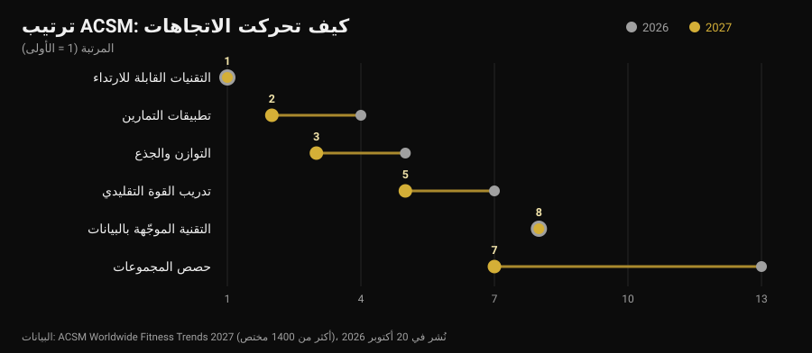
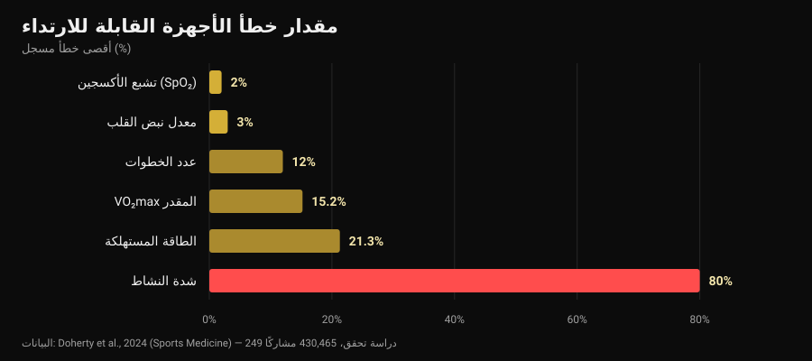

# اتجاهات اللياقة 2027: ما الذي ينجح فعلاً

بقلم [Giammaria Loi](/autore/giammaria-loi) · حُدِّث في 30 أكتوبر 2026

في 20 أكتوبر نشرت الكلية الأميركية للطب الرياضي تصنيفها لاتجاهات اللياقة لعام 2027، وخلال أسبوع صار على كل مواقع القطاع. للمرة العاشرة تتصدّر الأجهزة القابلة للارتداء؛ وتطبيقات التمارين تصعد من المركز الرابع إلى الثاني. ولا واحد من المقالات التي قرأتها طرح السؤال التالي: هل تنجح هذه الاتجاهات أصلاً؟ ذهبت أبحث عن الأرقام، والنتيجة أن الأدوات المتصدّرة للقائمة تؤدّي أمراً ببراعة وأمراً آخر بشكل سيّئ جداً — ومنها تحديداً الرقم الذي ينظر إليه الجميع أولاً.

## باختصار

- **التصنيف لا يقيس الفاعلية.** إنه استطلاع لأكثر من 1400 مختص في القطاع عمّا سيكون له أكبر وزن في 2027، في نسخته الحادية والعشرين. يقول إلى أين يتجه السوق، لا ما الذي يعطي نتائج.
- **أجهزة التتبّع تجعل الناس يتحركون أكثر، وهذا متين.** مراجعة لـ39 مراجعة منهجية (163,992 مشاركاً) تقدّر زيادة نحو **1800 خطوة يومياً**، و40 دقيقة مشي إضافية، ونحو **1 كغ** أقل في الوزن (Ferguson et al., 2022).
- **السعرات على الشاشة هي الرقم الأقل موثوقية.** الخطأ في الطاقة المستهلكة يتراوح بين **‎-21.3%‎** و**‎+14.8%‎**، وفي شدة النشاط يبلغ متوسط الخطأ **80%** (Doherty et al., 2024).
- **أما معدل ضربات القلب فجيّد.** متوسط الانحياز **‎±3%‎**. وVO₂max المقدَّر ليس كذلك: مبالغ فيه بنسبة **15.2%** في الراحة.
- **«مبني على البيانات» لا يعني «أفضل».** التدريب وفق تغيّر معدل ضربات القلب يحسّن المؤشرات المرتبطة بالعصب الحائر (SMD 0.50) لكنه لا يحسّن الأداء بدلالة إحصائية (Manresa-Rocamora et al., 2021).

## قائمة 2027 في ثلاثة أسطر

ترسل ACSM كل عام استبياناً إلى مختصي اللياقة حول العالم وتسأل أي الاتجاهات سيكون لها أكبر وزن في الاثني عشر شهراً التالية. نسخة 2027، بإشراف Cayla R. McAvoy وفريق عمل الاتجاهات، جمعت أكثر من 1400 إجابة. في الصدارة:

1. التقنيات القابلة للارتداء (المركز الأول للمرة العاشرة)؛
2. تطبيقات التمارين (من الرابع)؛
3. التوازن والمرونة والجذع (من الخامس)؛
4. برامج كبار السن (ضمن الخمسة الأوائل منذ خمس سنوات)؛
5. تدريب القوة التقليدي (صعود مركزين)؛
6. التمرين لإدارة الوزن؛
7. حصص المجموعات (من الثالث عشر)؛
8. التقنية الموجَّهة بالبيانات (ثابتة في الثامن)؛
9. التمرين للصحة النفسية (ضمن العشرة الأوائل منذ أربع سنوات)؛
10. البرامج التي يقودها المؤثرون والسفراء (عادت بعد خروجها من العشرين الأوائل).

أكبر قفزة من نصيب حصص المجموعات، ستة مراكز في سنة. لكن اللافت في مكان آخر: من بين البنود العشرة، **ثلاثة تقنية** واثنان تدريب كلاسيكي بحت. هذا التعايش يستحق نظرة قريبة، لأن البحث العلمي حول النصفين يقول أشياء مختلفة جداً.

ملاحظة غائبة عن معظم التغطيات: استطلاع آراء بين مختصين **ليس دليلاً على الفاعلية**. إنه مقياس حرارة للسوق. وإذا كان الجميع سيبيعون البيانات في 2027، فالسؤال الصحيح هو: ما مدى دقة هذه البيانات؟

## ما تقيسه الساعة جيداً وما تقدّره تقديراً

هنا يوجد مصدر شبه مثالي: مراجعة «حيّة» نُشرت في *Sports Medicine* جمعت 24 مراجعة منهجية و249 دراسة تحقق و430,465 مشاركاً، وقارنت الأجهزة الاستهلاكية بالمعايير المرجعية المخبرية (Doherty et al., 2024).

قراءةً من اليسار إلى اليمين، يرسم المخطط تراتبية واضحة.

**موثوق.** معدل ضربات القلب بانحياز متوسط قدره **3%**: أكثر من كافٍ لضبط شدة جري أو تمرين دائري. وفي كشف اضطرابات النظم تُظهر الأجهزة حساسية 100% ونوعية 95% — رقم لافت، لكنه يبقى إشارة تُعرض على الطبيب، لا تشخيصاً.

**تقريبي لكنه مفيد.** تُحتسب الخطوات عادة بأقل من الواقع، بمتوسط خطأ نسبي مطلق بين **‎-9%‎ و12%**. بالترجمة: إذا أظهرت الساعة 8000 خطوة، فخطواتك الحقيقية بين نحو 7000 و8800. ممتاز لتتبّع اتجاه أسبوعي؛ غير صالح لاستخلاص نتيجة من يوم واحد.

**لا يصلح لاتخاذ قرار.** الطاقة المستهلكة بخطأ بين **‎-21.3%‎ و‎+14.8%‎**. في حصة تقدّرها الشاشة بـ600 سعرة، قد تكون القيمة الحقيقية بين 470 و690. وأسوأ منها شدة النشاط، بمتوسط خطأ من **29% إلى 80%** بحسب صعوبة ما تفعله. أما VO₂max المقدَّر فمبالغ فيه بنسبة **15.24%** في الراحة و**9.83%** أثناء الجهد: إن أعطتك ساعتك 52، فالرقم المعقول قريب من 47.

والنوم؟ تميل الأجهزة إلى **المبالغة في زمن النوم الكلي**، بخطأ يتجاوز 10% عادة: عملياً تحتسب فترات كنت فيها ساكناً فقط على أنها نوم. هذا يكفي لتلاحظ أنك نمت متأخراً عن المعتاد — وهو بالضبط جوهر السؤال عن [متى تتوقف عن شرب القهوة](/ar/blog/alkafayin-walnawm-mata-tatawaqaf-an-alqahwa) — لكن «درجة النوم» ليست قياساً سريرياً.

ورقم أخير يضع كل شيء في نصابه: من بين كل الأجهزة المطروحة في السوق، نحو **11%** فقط خضعت للتحقق في مؤشر واحد على الأقل، ودراسات التحقق المنجزة حتى الآن تمثل **3.5%** مما يلزم. وحين تكتب شركة «دقة سريرية» على العلبة، ففي تسع حالات من عشر لا توجد دراسة منشورة تثبت ذلك لهذا الطراز.

## المفارقة: الأرقام خاطئة والنتيجة تحدث رغم ذلك

هنا يأتي الجزء الذي لا يكاد أحد يرويه. الأجهزة نفسها التي تخطئ في تقدير السعرات هي من بين الأدوات الأوسع دليلاً على تحريك الناس.

المراجعة المظلّية لـFerguson وزملائه جمعت 39 مراجعة منهجية وتحليلاً بعدياً، بـ163,992 مشاركاً من كل الأعمار، في فئات سليمة وسريرية. النتيجة: أثر صغير إلى متوسط على النشاط البدني (SMD 0.3-0.6)، وتركيب الجسم 0.7-2.0، واللياقة 0.3. بوحدات ملموسة: نحو **1800 خطوة إضافية يومياً**، و**40 دقيقة مشي إضافية يومياً**، ونحو **1 كغ** أقل في الوزن. أما الآثار على الضغط والكوليسترول والسكر التراكمي وجودة الحياة والألم فصغيرة وغالباً غير دالة. ويخلص المؤلفون إلى أن الأدلة تكفي للتوصية باستخدامها.

ليس في ذلك تناقض: الجهاز يعمل بوصفه **تذكيراً ومرآة**، لا أداة قياس. يذكّرك بوجودك، ويريك اتجاهاً، ويمنحك هدفاً. وكون تقدير السعرات يخطئ بـ20% لا يغيّر شيئاً في هذه الآلية — إلا إذا بنيت نظامك الغذائي على ذلك الرقم، وعندها تصير المشكلة حقيقية.

عند كبار السن، وهو الاتجاه الرابع في القائمة، تتسق الأرقام: في 45 دراسة و7144 مشاركاً ترفع أجهزة التتبّع عدد الخطوات (SMD 0.59) والنشاط المتوسط إلى العالي أسبوعياً (SMD 0.54) وتقلّل زمن الجلوس (Wu et al., 2023). لكن الدراسة نفسها تضيف التفصيل الحاسم: الأجهزة **مقترنةً بمكوّنات تقليدية** — أهداف متفق عليها، تسجيل ذاتي، مكالمات متابعة — تحقق أكثر من الأجهزة وحدها.

والتطبيقات تحكي القصة ذاتها. في 12 تجربة عشوائية على تطبيقات للنشاط البدني وإدارة الوزن، كانت الآثار على الوزن ومؤشر كتلة الجسم ونسبة الدهون صغيرة إلى متوسطة، وأكثرها فاعلية تلك التي تتضمّن **تذكيرات وتسجيلاً ذاتياً ومدرّباً بشرياً** (Yen et al., 2022). وهي الخلاصة نفسها التي وصلنا إليها عند الحديث عن [هل ينجح التدريب عن بُعد](/ar/blog/hal-yanjah-altadrib-an-bud): التقنية تضاعف علاقة، ولا تحلّ محلها.

## «الموجَّه بالبيانات»: هل يفي تغيّر النبض بوعده؟

الاتجاه الثامن، الثابت منذ عام، هو التقنية التي تقرأ النوم وتغيّر معدل ضربات القلب (HRV) لتخبرك كيف تتدرّب اليوم. وعد مغرٍ: الساعة تعرف متى يمكنك الضغط.

التحليلات البعدية أبرد حماسة. في المراجعة المنهجية لـManresa-Rocamora وزملائه، يتفوّق التدريب الموجَّه بـHRV على برنامج محدد سلفاً في **المؤشرات المرتبطة بالعصب الحائر** (SMD 0.50؛ فاصل ثقة 95%: 0.09-0.91)، لكن ليس في نبض الراحة؛ والفروق في السعة الهوائية القصوى (SMD 0.20؛ 95%: ‎-0.07‎-0.47) وفي أداء التحمل (SMD 0.20؛ 95%: ‎-0.09‎-0.48) صغيرة و**غير دالة**. وتحليل بعدي ثانٍ، مقتصر على رياضيي التحمل، يجد أثراً صغيراً لكنه إيجابي على VO₂max (ES 0.402)، أوضح لدى الهواة ولدى النساء (Granero-Gallegos et al., 2020).

القراءة الأمينة: يبدو أن HRV يقلّل احتمال الاستجابات السلبية للتدريب — حصص أقل تُؤدّى بشكل سيّئ في التوقيت الخطأ — أكثر مما يرفع سقف النتائج. إن استخدمته لتقرر متى تحذف مجموعة، فله معنى. وإن استخدمته لتعرف هل «يُسمح» لك اليوم بالقرفصاء، فأنت تفوّض قراراً تحسنه بنفسك إلى قراءة مدتها خمس عشرة ثانية.

## الاتجاه الذي تقلّل 2027 من شأنه

في المركز السادس يأتي التمرين لإدارة الوزن، وتلاحظ ACSM أنه مع انتشار أدوية إنقاص الوزن ينتقل الاهتمام إلى الحفاظ على العضلات. وهنا رقم يستحق التدوين، لأنه يخص كل من يفقد وزنه بسرعة: تحليل بعدي مع انحدار بعدي لتدريب المقاومة في عجز سعري يُظهر أن مكاسب الكتلة الخالية من الدهون **تتأثر سلباً** (ES ‎-0.57‎؛ p = 0.02) بينما تبقى مكاسب القوة متقاربة (ES ‎-0.31‎؛ p = 0.28)، وأن تجاوز عجز قدره نحو **500 سعرة يومياً** يوقف نمو الكتلة الخالية من الدهون تماماً (Murphy وKoehler, 2021).

أي أن من يسعى لخسارة سريعة يحافظ على قوته لكنه لا يبني عضلاً، وأن تدريب المقاومة في تلك المرحلة وظيفته **الدفاع** عمّا هو موجود. وكيفية ضبط ذلك عملياً تناولناها في [إعادة تركيب الجسم](/ar/blog/iadat-tarkib-aljisd-khasarat-aldohun-binaa-alazalat). وإذا كنت تتناول أدوية لإنقاص الوزن، فنقاش الغذاء والتدريب يكون مع الطبيب الذي وصفها: ما نقدّمه هنا بيانات، لا بروتوكولات شخصية.

## ما يقوله البحث فعلاً

**مؤكَّد — «الأجهزة القابلة للارتداء تزيد الحركة».** نحو 1800 خطوة و40 دقيقة مشي إضافية يومياً، وفائدة تدوم مع الوقت، على 163,992 مشاركاً.

**مؤكَّد — «نبض المعصم صالح للاستخدام».** متوسط انحياز 3%، يكفي لضبط الشدة.

**مُفنَّد — «السعرات على الساعة بيانات».** خطأ من ‎-21.3%‎ إلى ‎+14.8%‎، ويصل إلى 80% في شدة النشاط.

**مُفنَّد — «VO₂max على الساعة قياس».** مبالغ فيه بـ15.24% في الراحة و9.83% أثناء الجهد.

**يحتاج تدقيقاً — «درجة النوم تخبرك كيف نمت».** المدة الكلية مبالغ فيها، بأكثر من 10% عادة: مفيدة للاتجاهات، لا كقياس.

**يحتاج تدقيقاً — «التدريب وفق HRV يعطي نتائج أفضل».** يحسّن المؤشرات المرتبطة بالعصب الحائر، لكن أثره على VO₂max والأداء صغير وغير دال.

**مُفنَّد — «مع تطبيق جيد لا حاجة إلى مدرّب».** أكثر التطبيقات والأجهزة فاعلية هي التي فيها تذكيرات وأهداف وتواصل بشري.

**مُفنَّد — «تصنيف ACSM يقول ما الذي ينجح».** إنه استطلاع آراء بين مختصين: يقيس توقعات السوق.

## كيف تطبّق ذلك

1. **استخدم الساعة للاتجاهات لا للقيم المطلقة.** الخطوات والنبض ودقائق النشاط مقارنةً بمتوسطك على أربعة أسابيع أثمن بكثير من الرقم نفسه مقروءاً مرة واحدة.
2. **لا تبنِ نظامك الغذائي على سعرات الشاشة.** مع احتمال خطأ 20% في الاتجاهين، اجعل المرجع وزن الجسم والقياسات عبر الزمن، لا الاستهلاك المقدَّر.
3. **قرار واحد لكل مؤشر.** المؤشر الذي لا يغيّر شيئاً ضجيج: إذا لم تدفعك درجة التعافي يوماً إلى حذف أو إضافة شيء، فكفّ عن النظر إليها.
4. **للقوة قِس الحِمل لا السعرات.** المجموعات والتكرارات والوزن وRIR (التكرارات المتبقية في المخزون) هي المعايير التي يُبنى عليها التقدم، ولا ساعة تسجّلها عنك.
5. **إن استخدمت HRV فاستخدمه للحذف.** له معنى ككابح في الأيام السيئة، لا كإذن في الأيام الجيدة.
6. **أضف الجانب البشري.** البيانات التي تصل إلى شخص — مدرّب أو صديق أو مجموعة — تعمل أفضل من البيانات التي تبقى في التطبيق. هذا هو الفارق الظاهر في التحليلات البعدية.
7. **تشكّك في «الدقة السريرية» المكتوبة على العلبة.** 11% فقط من الأجهزة موثّقة في مؤشر واحد على الأقل: اسأل عن أي مؤشر، وفي أي دراسة.

### جرّب Nurvan — البيانات التي لا تسجّلها ساعتك

الساعة الذكية تعرف كم مشيت. لا تعرف أنك أنهيت أمس تمرين الضغط على المقعد على بُعد 4 تكرارات من الفشل واليوم على بُعد 2، وهي المعلومة الوحيدة التي يُفهم منها إن كنت تتقدّم. في Nurvan تسجّل الحِمل والتكرارات وRIR لكل مجموعة، وتستورد برنامجك الحالي من PDF أو Excel أو صورة، وترى منحنى الأحمال شهراً بشهر إلى جانب القياسات والوزن؛ ومجموعات الإحماء تُقترح تلقائياً انطلاقاً من حِمل اليوم. وإن كان يتابعك مدرّب، فهو يرى الشاشات نفسها التي تراها: الجانب البشري الذي يصنع الفارق في التحليلات البعدية.

## أسئلة شائعة

**ما اتجاهات اللياقة لعام 2027؟**
بحسب استطلاع ACSM المنشور في 20 أكتوبر 2026، بالترتيب: التقنيات القابلة للارتداء، تطبيقات التمارين، التوازن والجذع، برامج كبار السن، تدريب القوة التقليدي، التمرين لإدارة الوزن، حصص المجموعات، التقنية الموجَّهة بالبيانات، التمرين للصحة النفسية، البرامج التي يقودها المؤثرون. وهو استطلاع لأكثر من 1400 مختص حول توقعات العام، لا تصنيف فاعلية.

**ما مدى دقة السعرات في الساعة الذكية؟**
ضعيفة. مراجعة 249 دراسة تحقق تذكر خطأً في الطاقة المستهلكة بين ‎-21.3%‎ و‎+14.8%‎، ومتوسط خطأ من 29% إلى 80% في تقدير الشدة. أما معدل ضربات القلب فبمتوسط انحياز 3%: وهو المؤشر الأكثر موثوقية في هذه الأجهزة.

**هل يستحق سوار النشاط الشراء؟**
إذا كانت مشكلتك أن تتحرك أكثر، فالأدلة في صالحه: وسطياً نحو 1800 خطوة و40 دقيقة مشي إضافية يومياً، ونحو 1 كغ أقل في الوزن، والفائدة تدوم. وإذا كانت مشكلتك معرفة كم سعرة أحرقت أو كم يبلغ VO₂max لديك، فليس هو الأداة المناسبة.

**هل أتدرّب وفق HRV؟**
تُظهر التحليلات البعدية تحسّناً في مؤشرات تغيّر معدل ضربات القلب لكن بآثار صغيرة وغير دالة على السعة الهوائية والأداء. كأداة لتجنّب حصص في توقيت خاطئ قد يكون له معنى؛ أما كحَكَم على كل تمرين فلا.

## اقرأ أيضاً

- [هل ينجح التدريب عن بُعد؟ ما تقوله الدراسات](/ar/blog/hal-yanjah-altadrib-an-bud) — ما الذي يتغيّر فعلاً حين يكون على الطرف الآخر من البيانات إنسان.
- [إعادة تركيب الجسم: دهون أقل وعضلات أكثر](/ar/blog/iadat-tarkib-aljisd-khasarat-aldohun-binaa-alazalat) — كيف تضبط عجزاً لا يكلّفك كتلة خالية من الدهون.
- [الكافيين والنوم: متى تتوقف عن شرب القهوة](/ar/blog/alkafayin-walnawm-mata-tatawaqaf-an-alqahwa) — النصف الآخر من التعافي، بالأرقام.

## المصادر

1. Ferguson T, Olds T, Curtis R, Blake H, Crozier AJ, Dankiw K, Dumuid D, Kasai D, O'Connor E, Virgara R, Maher C, 2022. *Effectiveness of wearable activity trackers to increase physical activity and improve health: a systematic review of systematic reviews and meta-analyses.* The Lancet Digital Health 4(8):e615-e626. [PMID 35868813](https://pubmed.ncbi.nlm.nih.gov/35868813/) · [DOI 10.1016/S2589-7500(22)00111-X](https://doi.org/10.1016/S2589-7500(22)00111-X)
2. Doherty C, Baldwin M, Keogh A, Caulfield B, Argent R, 2024. *Keeping Pace with Wearables: A Living Umbrella Review of Systematic Reviews Evaluating the Accuracy of Consumer Wearable Technologies in Health Measurement.* Sports Medicine 54(11):2907-2926. [PMID 39080098](https://pubmed.ncbi.nlm.nih.gov/39080098/) · [DOI 10.1007/s40279-024-02077-2](https://doi.org/10.1007/s40279-024-02077-2)
3. Wu S, Li G, Du L, Chen S, Zhang X, He Q, 2023. *The effectiveness of wearable activity trackers for increasing physical activity and reducing sedentary time in older adults: A systematic review and meta-analysis.* Digital Health 9:20552076231176705. [PMID 37252261](https://pubmed.ncbi.nlm.nih.gov/37252261/) · [DOI 10.1177/20552076231176705](https://doi.org/10.1177/20552076231176705)
4. Yen HY, Jin G, Chiu HL, 2022. *Smartphone app-based interventions targeting physical activity for weight management: A meta-analysis of randomized controlled trials.* International Journal of Nursing Studies 137:104384. [PMID 36379104](https://pubmed.ncbi.nlm.nih.gov/36379104/) · [DOI 10.1016/j.ijnurstu.2022.104384](https://doi.org/10.1016/j.ijnurstu.2022.104384)
5. Manresa-Rocamora A, Sarabia JM, Javaloyes A, Flatt AA, Moya-Ramón M, 2021. *Heart Rate Variability-Guided Training for Enhancing Cardiac-Vagal Modulation, Aerobic Fitness, and Endurance Performance: A Methodological Systematic Review with Meta-Analysis.* International Journal of Environmental Research and Public Health 18(19):10299. [PMID 34639599](https://pubmed.ncbi.nlm.nih.gov/34639599/) · [DOI 10.3390/ijerph181910299](https://doi.org/10.3390/ijerph181910299)
6. Granero-Gallegos A, González-Quílez A, Plews D, Carrasco-Poyatos M, 2020. *HRV-Based Training for Improving VO2max in Endurance Athletes. A Systematic Review with Meta-Analysis.* International Journal of Environmental Research and Public Health 17(21):7999. [PMID 33143175](https://pubmed.ncbi.nlm.nih.gov/33143175/) · [DOI 10.3390/ijerph17217999](https://doi.org/10.3390/ijerph17217999)
7. Murphy C, Koehler K, 2021. *Energy deficiency impairs resistance training gains in lean mass but not strength: A meta-analysis and meta-regression.* Scandinavian Journal of Medicine & Science in Sports 32(1):125-137. [PMID 34623696](https://pubmed.ncbi.nlm.nih.gov/34623696/) · [DOI 10.1111/sms.14075](https://doi.org/10.1111/sms.14075)
8. McAvoy CR et al., 2026. *2027 ACSM Worldwide Fitness Trends: Future Directions of the Health and Fitness Industry.* ACSM's Health & Fitness Journal 30(6)، نوفمبر/ديسمبر 2026. [DOI 10.1249/fit.0000000000001208](https://doi.org/10.1249/fit.0000000000001208) · [بيان ACSM](https://acsm.org/2027-fitness-trends/)

جُمعت المراجع عبر PubMed. نقطة الانطلاق: لا منشور على وسائل التواصل، بل إشارة الاتجاه في 20-26 أكتوبر 2026، أي نشر استطلاع ACSM Worldwide Fitness Trends 2027 ونقله في Medical Xpress وAthletech News وYahoo Lifestyle، إلى جانب ارتفاع البحث عن الأجهزة القابلة للارتداء في أكتوبر 2026. كُتب الموضوع من الصفر اعتماداً على المصادر الأولية.

---

**Giammaria Loi** هو مؤسس Nurvan. يتدرّب بالأثقال منذ 2012، ويعمل مدرّباً شخصياً ومدرّباً معتمداً من FIPE منذ 2013، ويشارك في منافسات رفع الأثقال القوة على المستوى الوطني منذ 2018. كل مقال يوقّعه ينطلق من الدراسات العلمية وينتهي عند ما ينجح فعلاً في الصالة.

> ملاحظة: محتوى تثقيفي لا يغني عن رأي طبيب أو مختص. البيانات الواردة هنا عن النوم وتشبع الأكسجين واضطرابات النظم تخص دقة قياس الأجهزة لا استخدامها التشخيصي: القيمة غير المعتادة تُعرض على طبيب، ولا تُفسَّر بتطبيق. وإذا كنت تتناول أدوية لإنقاص الوزن، فتحدّث مع من وصفها لك قبل تغيير الغذاء أو التدريب.
