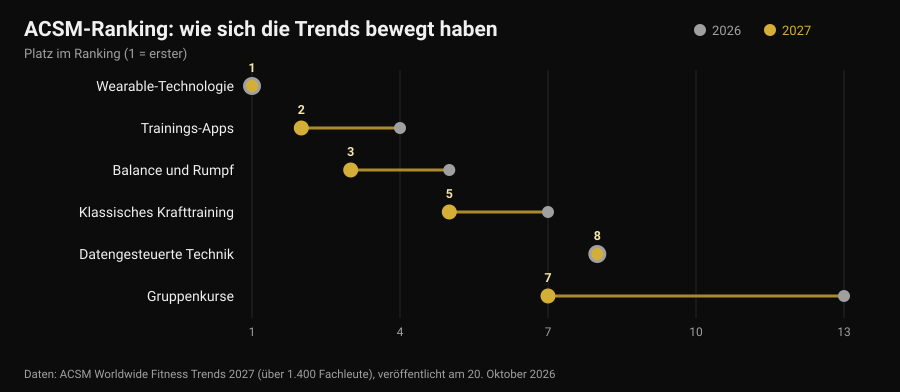
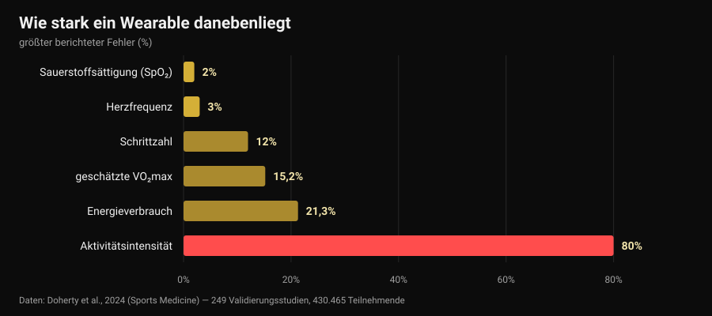

# Fitness-Trends 2027: was wirklich funktioniert

Von [Giammaria Loi](/autore/giammaria-loi) · aktualisiert am 30. Oktober 2026

Am 20. Oktober hat das American College of Sports Medicine sein Ranking der Fitness-Trends für 2027 veröffentlicht, und binnen einer Woche stand es auf allen Branchenseiten. Zum zehnten Mal führen Wearables; Trainings-Apps klettern von Platz vier auf zwei. Keiner der Texte, die ich gelesen habe, stellte die nächstliegende Frage: Funktionieren diese Trends überhaupt? Ich habe die Zahlen gesucht — und es zeigt sich, dass die Geräte an der Spitze des Rankings eine Sache sehr gut und eine andere sehr schlecht machen. Darunter ausgerechnet die Zahl, auf die fast alle zuerst schauen.

## Kurz gefasst

- **Das Ranking misst keine Wirksamkeit.** Es ist eine Umfrage unter mehr als 1.400 Fachleuten der Branche darüber, was 2027 am meisten zählen wird, inzwischen im 21. Jahr. Sie zeigt, wohin der Markt läuft, nicht was Ergebnisse bringt.
- **Tracker bringen Menschen in Bewegung, und das ist solide.** Eine Übersicht über 39 systematische Reviews (163.992 Teilnehmende) schätzt rund **1.800 zusätzliche Schritte pro Tag**, 40 Minuten mehr Gehen und etwa **1 kg** weniger Gewicht (Ferguson et al., 2022).
- **Die Kalorien auf dem Display sind der unzuverlässigste Wert.** Der Fehler beim Energieverbrauch reicht von **-21,3 %** bis **+14,8 %**, bei der Belastungsintensität erreicht der mittlere Fehler **80 %** (Doherty et al., 2024).
- **Die Herzfrequenz dagegen ist gut.** Mittlerer Bias **±3 %**. Die geschätzte VO₂max nicht: in Ruhe um **15,2 %** überschätzt.
- **„Datengesteuert" heißt nicht „besser".** Training nach Herzfrequenzvariabilität verbessert die vagalen Kennwerte (SMD 0,50), aber nicht signifikant die Leistung (Manresa-Rocamora et al., 2021).

## Das Ranking 2027 in drei Zeilen

Jedes Jahr schickt das ACSM einen Fragebogen an Fitnessfachleute weltweit und fragt, welche Trends in den kommenden zwölf Monaten am stärksten wiegen. Die Ausgabe 2027, verantwortet von Cayla R. McAvoy und der Trends-Arbeitsgruppe, versammelt über 1.400 Antworten. An der Spitze:

1. Wearable-Technologie (zum zehnten Mal Platz eins);
2. Trainings-Apps (von Platz vier);
3. Balance, Beweglichkeit und Rumpf (von Platz fünf);
4. Programme für ältere Erwachsene (seit fünf Jahren in den Top fünf);
5. klassisches Krafttraining (zwei Plätze nach oben);
6. Bewegung zum Gewichtsmanagement;
7. Gruppenkurse (von Platz dreizehn);
8. datengesteuerte Trainingstechnik (unverändert Platz acht);
9. Bewegung für die psychische Gesundheit (seit vier Jahren in den Top zehn);
10. Programme von Influencern und Markenbotschaftern (zurück, nachdem sie aus den Top zwanzig gefallen waren).

Den größten Sprung machen die Gruppenkurse, sechs Plätze in einem Jahr. Interessanter ist aber etwas anderes: Von den zehn Einträgen sind **drei Technologie** und zwei schlicht klassisches Training. Dieses Nebeneinander lohnt einen genauen Blick, denn die Forschung zu beiden Hälften sagt sehr Unterschiedliches.

Eine Einordnung, die in fast allen Meldungen fehlt: Eine Meinungsumfrage unter Fachleuten **ist kein Wirksamkeitsnachweis**. Sie ist ein Markt-Thermometer. Wenn 2027 alle Daten verkaufen, lautet die Frage, wie genau diese Daten eigentlich sind.

## Was die Uhr gut misst — und was sie schätzt

Hier gibt es eine fast perfekte Quelle: ein „lebendes" Umbrella-Review in *Sports Medicine*, das 24 systematische Reviews, 249 Validierungsstudien und 430.465 Teilnehmende zusammenfasst und Consumer-Geräte gegen Laborreferenzen stellt (Doherty et al., 2024).

Von links nach rechts gelesen, zeigt die Grafik eine klare Rangordnung.

**Zuverlässig.** Die Herzfrequenz hat einen mittleren Bias von **3 %**: Für die Intensitätssteuerung eines Laufs oder Zirkels reicht das locker. Bei der Erkennung von Herzrhythmusstörungen zeigen die Geräte 100 % Sensitivität und 95 % Spezifität — ein bemerkenswerter Wert, der dennoch ein Signal für den Arztbesuch bleibt, keine Diagnose.

**Ungenau, aber brauchbar.** Schritte werden meist unterschätzt, mit einem mittleren absoluten prozentualen Fehler von **-9 % bis 12 %**. Übersetzt: Zeigt die Uhr 8.000 Schritte, liegen deine echten irgendwo zwischen rund 7.000 und 8.800. Für einen Wochentrend völlig in Ordnung; für Schlüsse aus einem einzelnen Tag nicht.

**Nicht zum Entscheiden.** Der Energieverbrauch hat einen Fehler zwischen **-21,3 % und +14,8 %**. Bei einer Einheit, die das Display mit 600 kcal angibt, kann der wahre Wert zwischen 470 und 690 liegen. Noch schlechter die Aktivitätsintensität, mit einem mittleren Fehler von **29 % bis 80 %**, je nachdem wie hart die Belastung ist. Die geschätzte VO₂max wird in Ruhe um **15,24 %** und unter Belastung um **9,83 %** überschätzt: Zeigt deine Uhr 52, liegt der plausible Wert eher bei 47.

Und der Schlaf? Geräte neigen dazu, die **Gesamtschlafzeit zu überschätzen**, mit einem Fehler typischerweise über 10 %: Praktisch zählen sie ruhiges Liegen als Schlaf. Um zu sehen, ob du später ins Bett gegangen bist als sonst, taugt das — genau darum geht es bei der Frage, [wann der letzte Kaffee](/de/blog/koffein-schlaf-wann-letzter-kaffee) sein sollte —, aber ein „Schlafscore" ist keine klinische Messung.

Eine letzte Zahl rückt alles zurecht: Von allen Geräten auf dem Markt sind nur rund **11 %** für mindestens eine Messgröße validiert, und die bislang durchgeführten Validierungsstudien machen **3,5 %** der nötigen aus. Wenn ein Hersteller „klinische Genauigkeit" auf die Packung schreibt, gibt es in neun von zehn Fällen keine veröffentlichte Arbeit, die das für dieses Modell belegt.

## Das Paradox: falsche Zahlen, und es wirkt trotzdem

Jetzt der Teil, den fast niemand erzählt. Dieselben Geräte, die Kalorien schlecht schätzen, gehören zu den Werkzeugen mit der breitesten Evidenz dafür, Menschen in Bewegung zu bringen.

Das Umbrella-Review von Ferguson und Kolleginnen und Kollegen bündelt 39 systematische Reviews und Metaanalysen mit 163.992 Teilnehmenden aller Altersgruppen, in gesunden und klinischen Populationen. Ergebnis: kleine bis moderate Effekte auf körperliche Aktivität (SMD 0,3-0,6), Körperzusammensetzung 0,7-2,0, Fitness 0,3. In konkreten Einheiten: etwa **1.800 Schritte mehr pro Tag**, **40 Minuten mehr Gehen pro Tag**, rund **1 kg** weniger Gewicht. Effekte auf Blutdruck, Cholesterin, HbA1c, Lebensqualität und Schmerz sind klein und oft nicht signifikant. Die Autorinnen und Autoren schließen, die Evidenz reiche für eine Empfehlung.

Das ist kein Widerspruch: Das Gerät wirkt als **Erinnerung und Spiegel**, nicht als Messinstrument. Es erinnert dich daran, dass es dich gibt, zeigt dir einen Trend, gibt dir ein Ziel. Dass die Kalorienschätzung um 20 % danebenliegt, ändert an diesem Mechanismus nichts — es sei denn, du baust deine Ernährung auf dieser Zahl auf, und dann wird es sehr wohl ein Problem.

Bei älteren Erwachsenen, dem vierten Trend des Rankings, passen die Zahlen zusammen: Über 45 Studien und 7.144 Teilnehmende erhöhen Tracker die Schrittzahl (SMD 0,59) und die wöchentliche moderate bis intensive Aktivität (SMD 0,54) und senken die Sitzzeit (Wu et al., 2023). Dieselbe Arbeit ergänzt aber das Entscheidende: Tracker **in Kombination mit klassischen Bausteinen** — vereinbarte Ziele, Selbstbeobachtung, Nachfass-Anrufe — erreichen mehr als Tracker allein.

Bei Apps dasselbe Bild. In 12 randomisierten Studien zu Apps für Bewegung und Gewichtsmanagement waren die Effekte auf Gewicht, BMI und Körperfettanteil klein bis moderat, und am wirksamsten waren jene mit **Erinnerungen, Selbstbeobachtung und einem menschlichen Coach** (Yen et al., 2022). Es ist dieselbe Schlussfolgerung wie beim Thema [Online-Coaching und was Studien zeigen](/de/blog/funktioniert-online-coaching): Technik vervielfacht eine Beziehung, sie ersetzt sie nicht.

## „Datengesteuert": hält die HRV ihr Versprechen?

Der achte Trend, seit einem Jahr unverändert, ist Technik, die Schlaf und Herzfrequenzvariabilität (HRV) liest, um dir zu sagen, wie du heute trainieren sollst. Verlockendes Versprechen: Die Uhr weiß, wann du Gas geben kannst.

Die Metaanalysen sind nüchterner. Im methodischen Review von Manresa-Rocamora und Kollegen schlägt HRV-gesteuertes Training ein festes Programm bei den **vagalen HRV-Kennwerten** (SMD 0,50; 95 %-KI 0,09-0,91), nicht aber bei der Ruheherzfrequenz; die Unterschiede bei maximaler aerober Kapazität (SMD 0,20; 95 %-KI -0,07-0,47) und Ausdauerleistung (SMD 0,20; 95 %-KI -0,09-0,48) sind klein und **nicht signifikant**. Eine zweite Metaanalyse, nur mit Ausdauerathletinnen und -athleten, findet einen kleinen, aber positiven Effekt auf die VO₂max (ES 0,402), stärker bei Amateuren und bei Frauen (Granero-Gallegos et al., 2020).

Die ehrliche Lesart: Die HRV senkt eher die Wahrscheinlichkeit schlechter Trainingsantworten — weniger Einheiten, die zum falschen Zeitpunkt schlecht laufen — als dass sie die Obergrenze der Ergebnisse hebt. Wenn sie dir hilft zu entscheiden, wann du einen Satz streichst, ergibt sie Sinn. Wenn du sie fragst, ob du heute Kniebeugen „darfst", überlässt du einem Fünfzehn-Sekunden-Wert eine Entscheidung, die du selbst besser triffst.

## Der Trend, den 2027 unterschätzt

Auf Platz sechs steht Bewegung zum Gewichtsmanagement, und das ACSM merkt an, dass mit der Verbreitung von Abnehmmedikamenten der Fokus auf den Muskelerhalt wandert. Eine Zahl gehört hier schriftlich festgehalten, denn sie betrifft alle, die schnell abnehmen: Eine Metaanalyse mit Metaregression zu Krafttraining im Kaloriendefizit zeigt, dass Zuwächse an fettfreier Masse **beeinträchtigt** sind (ES -0,57; p = 0,02), während Kraftzuwächse vergleichbar bleiben (ES -0,31; p = 0,28) — und dass jenseits eines Defizits von rund **500 kcal pro Tag** die fettfreie Masse gar nicht mehr wächst (Murphy und Koehler, 2021).

Das heißt: Wer schnell abnehmen will, behält seine Kraft, baut aber keinen Muskel auf, und Krafttraining dient in dieser Phase dazu, das Vorhandene zu **verteidigen**. Wie man das konkret aufsetzt, haben wir beim Thema [Körperrekomposition](/de/blog/koerperrekomposition-fett-verlieren-muskeln-aufbauen) beschrieben. Wer Medikamente zur Gewichtsreduktion nimmt, bespricht Ernährung und Training mit der Ärztin oder dem Arzt, die sie verordnet haben: Hier geht es um Daten, nicht um persönliche Protokolle.

## Was die Forschung wirklich sagt

**Bestätigt — „Wearables bringen mehr Bewegung".** Rund 1.800 Schritte und 40 Minuten mehr Gehen pro Tag, über die Zeit erhalten, bei 163.992 Teilnehmenden.

**Bestätigt — „Herzfrequenz am Handgelenk ist brauchbar".** Mittlerer Bias von 3 %, genug zur Intensitätssteuerung.

**Widerlegt — „die Kalorien auf der Uhr sind ein Messwert".** Fehler von -21,3 % bis +14,8 %, und bis zu 80 % bei der Aktivitätsintensität.

**Widerlegt — „die VO₂max der Uhr ist eine Messung".** In Ruhe um 15,24 %, unter Belastung um 9,83 % überschätzt.

**Zu präzisieren — „der Schlafscore sagt, wie du geschlafen hast".** Die Gesamtdauer wird überschätzt, typischerweise um mehr als 10 %: nützlich für Trends, nicht als Messung.

**Zu präzisieren — „HRV-gesteuertes Training bringt bessere Ergebnisse".** Es verbessert die vagalen Kennwerte, der Effekt auf VO₂max und Leistung ist aber klein und nicht signifikant.

**Widerlegt — „mit einer guten App braucht man keinen Coach".** Die wirksamsten Apps und Tracker sind die mit Erinnerungen, Zielen und menschlichem Kontakt.

**Widerlegt — „das ACSM-Ranking sagt, was funktioniert".** Es ist eine Meinungsumfrage unter Fachleuten: Sie misst Markterwartungen.

## So setzt du es um

1. **Nutze die Uhr für Trends, nicht für Absolutwerte.** Schritte, Herzfrequenz und aktive Minuten im Vergleich zu deinem Vier-Wochen-Schnitt sind viel mehr wert als dieselbe Zahl einmal abgelesen.
2. **Bau deine Ernährung nicht auf den Display-Kalorien auf.** Bei einem möglichen Fehler von 20 % in beide Richtungen sind Körpergewicht und Maße über die Zeit die Referenz, nicht der geschätzte Verbrauch.
3. **Eine Entscheidung pro Kennzahl.** Ein Wert, der nichts verändert, ist Rauschen: Wenn der Recovery-Score dich nie etwas streichen oder hinzufügen lässt, schau nicht mehr hin.
4. **Für Kraft zählt die Last, nicht die Kalorien.** Sätze, Wiederholungen, Gewicht und RIR (Wiederholungen in Reserve) sind die Größen, auf denen Progression aufbaut — keine Uhr erfasst sie für dich.
5. **Wenn du HRV nutzt, nutze sie zum Streichen.** Als Bremse an schlechten Tagen sinnvoll, nicht als Freigabe an guten.
6. **Hol den Menschen dazu.** Daten, die eine Person erreichen — Coach, Trainingspartner, Gruppe —, wirken besser als Daten, die in der App bleiben. Genau diesen Unterschied zeigen die Metaanalysen.
7. **Misstraue der „klinischen Genauigkeit" auf der Packung.** Nur 11 % der Geräte sind für mindestens eine Messgröße validiert: Frag nach, für welche und in welcher Studie.

### Nurvan testen — die Daten, die deine Uhr nicht erfasst

Die Smartwatch weiß, wie weit du gelaufen bist. Sie weiß nicht, dass du gestern das Bankdrücken 4 Wiederholungen vor dem Muskelversagen beendet hast und heute 2 — die einzige Information, aus der sich ablesen lässt, ob du vorankommst. In Nurvan erfasst du Last, Wiederholungen und RIR jedes Satzes, importierst deinen bestehenden Plan aus PDF, Excel oder Foto und siehst die Lastkurve Monat für Monat neben Maßen und Gewicht; Aufwärmsätze werden automatisch aus dem Arbeitsgewicht des Tages vorgeschlagen. Und wenn dich ein Coach betreut, sieht er dieselben Ansichten wie du: genau der menschliche Teil, der in den Metaanalysen den Unterschied macht.

## Häufige Fragen

**Was sind die Fitness-Trends 2027?**
Laut der am 20. Oktober 2026 veröffentlichten ACSM-Umfrage in dieser Reihenfolge: Wearable-Technologie, Trainings-Apps, Balance und Rumpf, Programme für ältere Erwachsene, klassisches Krafttraining, Bewegung zum Gewichtsmanagement, Gruppenkurse, datengesteuerte Trainingstechnik, Bewegung für die psychische Gesundheit, Influencer-Programme. Es handelt sich um eine Umfrage unter mehr als 1.400 Fachleuten zu Erwartungen für das Jahr, nicht um ein Wirksamkeitsranking.

**Wie genau sind die Kalorien einer Smartwatch?**
Wenig genau. Das Review über 249 Validierungsstudien berichtet beim Energieverbrauch einen Fehler zwischen -21,3 % und +14,8 % und einen mittleren Fehler von 29 % bis 80 % bei der Intensitätsschätzung. Die Herzfrequenz hat dagegen einen mittleren Bias von 3 %: Das ist die Größe, bei der solche Geräte am zuverlässigsten sind.

**Lohnt sich ein Fitnesstracker?**
Wenn dein Problem ist, dich mehr zu bewegen, spricht die Evidenz dafür: im Mittel rund 1.800 Schritte und 40 Minuten mehr Gehen pro Tag, dazu etwa 1 kg weniger Gewicht, und der Nutzen bleibt über die Zeit. Wenn dein Problem ist, zu wissen, wie viele Kalorien du verbrannt hast oder wie hoch deine VO₂max ist, ist das Gerät das falsche Werkzeug.

**Soll ich nach HRV trainieren?**
Metaanalysen zeigen bessere Kennwerte der Herzfrequenzvariabilität, aber kleine und nicht signifikante Effekte auf aerobe Kapazität und Leistung. Als Mittel, um Einheiten zum falschen Zeitpunkt zu vermeiden, kann es sinnvoll sein; als Schiedsrichter über jedes Training nicht.

## Weiterlesen

- [Funktioniert Online-Coaching? Was Studien zeigen](/de/blog/funktioniert-online-coaching) — was sich wirklich ändert, wenn auf der anderen Seite der Daten ein Mensch sitzt.
- [Körperrekomposition: Fett runter, Muskeln rauf](/de/blog/koerperrekomposition-fett-verlieren-muskeln-aufbauen) — wie man ein Defizit setzt, das keine fettfreie Masse kostet.
- [Koffein und Schlaf: wann der letzte Kaffee](/de/blog/koffein-schlaf-wann-letzter-kaffee) — die andere Hälfte der Regeneration, mit Zahlen.

## Quellen

1. Ferguson T, Olds T, Curtis R, Blake H, Crozier AJ, Dankiw K, Dumuid D, Kasai D, O'Connor E, Virgara R, Maher C, 2022. *Effectiveness of wearable activity trackers to increase physical activity and improve health: a systematic review of systematic reviews and meta-analyses.* The Lancet Digital Health 4(8):e615-e626. [PMID 35868813](https://pubmed.ncbi.nlm.nih.gov/35868813/) · [DOI 10.1016/S2589-7500(22)00111-X](https://doi.org/10.1016/S2589-7500(22)00111-X)
2. Doherty C, Baldwin M, Keogh A, Caulfield B, Argent R, 2024. *Keeping Pace with Wearables: A Living Umbrella Review of Systematic Reviews Evaluating the Accuracy of Consumer Wearable Technologies in Health Measurement.* Sports Medicine 54(11):2907-2926. [PMID 39080098](https://pubmed.ncbi.nlm.nih.gov/39080098/) · [DOI 10.1007/s40279-024-02077-2](https://doi.org/10.1007/s40279-024-02077-2)
3. Wu S, Li G, Du L, Chen S, Zhang X, He Q, 2023. *The effectiveness of wearable activity trackers for increasing physical activity and reducing sedentary time in older adults: A systematic review and meta-analysis.* Digital Health 9:20552076231176705. [PMID 37252261](https://pubmed.ncbi.nlm.nih.gov/37252261/) · [DOI 10.1177/20552076231176705](https://doi.org/10.1177/20552076231176705)
4. Yen HY, Jin G, Chiu HL, 2022. *Smartphone app-based interventions targeting physical activity for weight management: A meta-analysis of randomized controlled trials.* International Journal of Nursing Studies 137:104384. [PMID 36379104](https://pubmed.ncbi.nlm.nih.gov/36379104/) · [DOI 10.1016/j.ijnurstu.2022.104384](https://doi.org/10.1016/j.ijnurstu.2022.104384)
5. Manresa-Rocamora A, Sarabia JM, Javaloyes A, Flatt AA, Moya-Ramón M, 2021. *Heart Rate Variability-Guided Training for Enhancing Cardiac-Vagal Modulation, Aerobic Fitness, and Endurance Performance: A Methodological Systematic Review with Meta-Analysis.* International Journal of Environmental Research and Public Health 18(19):10299. [PMID 34639599](https://pubmed.ncbi.nlm.nih.gov/34639599/) · [DOI 10.3390/ijerph181910299](https://doi.org/10.3390/ijerph181910299)
6. Granero-Gallegos A, González-Quílez A, Plews D, Carrasco-Poyatos M, 2020. *HRV-Based Training for Improving VO2max in Endurance Athletes. A Systematic Review with Meta-Analysis.* International Journal of Environmental Research and Public Health 17(21):7999. [PMID 33143175](https://pubmed.ncbi.nlm.nih.gov/33143175/) · [DOI 10.3390/ijerph17217999](https://doi.org/10.3390/ijerph17217999)
7. Murphy C, Koehler K, 2021. *Energy deficiency impairs resistance training gains in lean mass but not strength: A meta-analysis and meta-regression.* Scandinavian Journal of Medicine & Science in Sports 32(1):125-137. [PMID 34623696](https://pubmed.ncbi.nlm.nih.gov/34623696/) · [DOI 10.1111/sms.14075](https://doi.org/10.1111/sms.14075)
8. McAvoy CR et al., 2026. *2027 ACSM Worldwide Fitness Trends: Future Directions of the Health and Fitness Industry.* ACSM's Health & Fitness Journal 30(6), November/Dezember 2026. [DOI 10.1249/fit.0000000000001208](https://doi.org/10.1249/fit.0000000000001208) · [ACSM-Mitteilung](https://acsm.org/2027-fitness-trends/)

Literaturangaben über PubMed recherchiert. Ausgangspunkt: kein Social-Media-Beitrag, sondern das Trendsignal vom 20.-26. Oktober 2026, also die Veröffentlichung der ACSM-Umfrage Worldwide Fitness Trends 2027 und ihre Aufnahme bei Medical Xpress, Athletech News und Yahoo Lifestyle, zusammen mit der im Oktober 2026 gestiegenen Suchnachfrage nach Wearables. Das Thema wurde von Grund auf aus den Primärquellen geschrieben.

---

**Giammaria Loi** ist der Gründer von Nurvan. Er trainiert seit 2012 mit Gewichten, arbeitet seit 2013 als FIPE-zertifizierter Personal Trainer und Coach und tritt seit 2018 im Powerlifting auf nationaler Ebene an. Jeder Artikel, den er zeichnet, beginnt bei den Studien und endet bei dem, was im Gym wirklich funktioniert.

> Hinweis: informativer Inhalt, der ärztlichen oder fachlichen Rat nicht ersetzt. Die hier genannten Daten zu Schlaf, Sauerstoffsättigung und Rhythmusstörungen betreffen die Messgenauigkeit der Geräte, nicht ihre diagnostische Nutzung: Ein auffälliger Wert gehört zur Ärztin oder zum Arzt, nicht in eine App. Wer Medikamente zur Gewichtsreduktion nimmt, spricht vor Änderungen an Ernährung oder Training mit der verordnenden Person.
