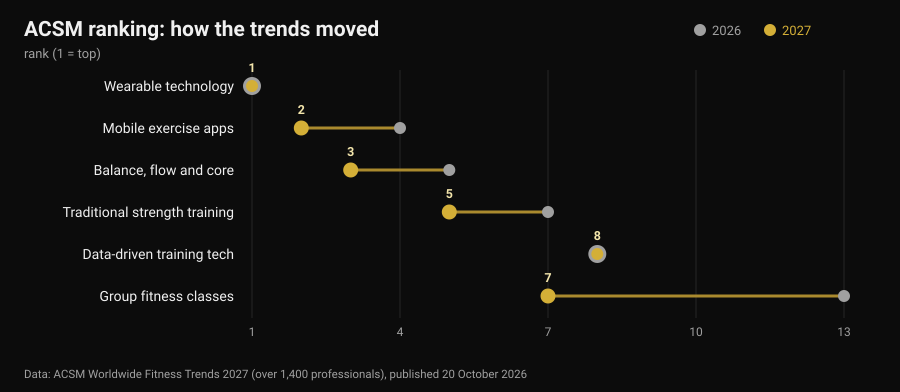
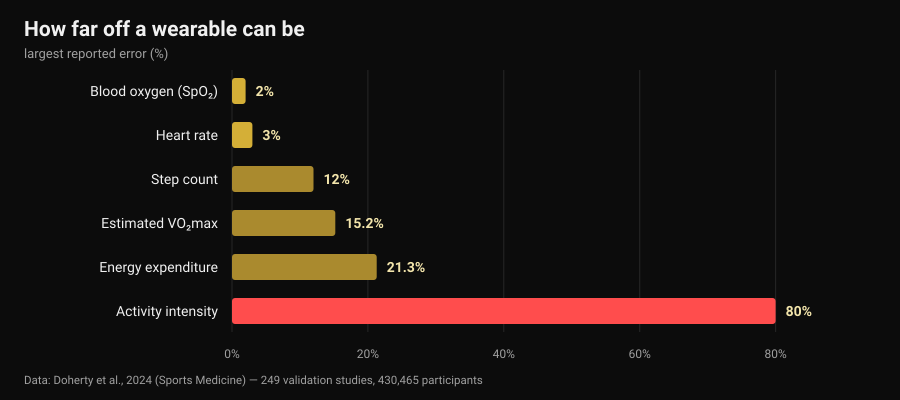

# Fitness trends 2027: what actually works

By [Giammaria Loi](/autore/giammaria-loi) · updated 30 October 2026

On 20 October the American College of Sports Medicine published its ranking of fitness trends for 2027, and within a week it was on every industry site. Wearables take the top spot for the tenth time; exercise apps climb from fourth to second. Not one of the write-ups I read asked the obvious follow-up question: do those trends work? I went looking for the numbers, and it turns out the tools at the top of the list do one thing very well and another thing very badly — including the number most people check first.

## Key points

- **The ranking does not measure effectiveness.** It is a survey of more than 1,400 industry professionals about what will matter most in 2027, now in its 21st year. It shows where the market is heading, not what produces results.
- **Trackers do get people moving, and that part is solid.** A review of 39 systematic reviews (163,992 participants) estimates roughly **1,800 extra steps a day**, 40 extra minutes of walking and about **1 kg** of weight loss (Ferguson et al., 2022).
- **The calorie count on your wrist is the least trustworthy number there.** Error on energy expenditure runs from **-21.3%** to **+14.8%**, and mean error on activity intensity reaches **80%** (Doherty et al., 2024).
- **Heart rate, on the other hand, is good.** Mean bias **±3%**. Estimated VO₂max is not: overestimated by **15.2%** at rest.
- **"Data-driven" does not mean "better".** Training guided by heart rate variability improves vagal indices (SMD 0.50) but does not significantly improve performance (Manresa-Rocamora et al., 2021).

## The 2027 list in three lines

Every year the ACSM surveys fitness professionals worldwide and asks which trends will carry the most weight over the next twelve months. The 2027 edition, led by Cayla R. McAvoy and the association's trends workgroup, collected over 1,400 responses. At the top:

1. wearable technology (first place for the tenth time);
2. mobile exercise apps (up from fourth);
3. balance, flow and core strength (up from fifth);
4. fitness programmes for older adults (top five for five years running);
5. traditional strength training (up two places);
6. exercise for weight management;
7. group fitness classes (up from thirteenth);
8. data-driven training technology (holding at eighth);
9. exercise for mental health (top ten for four years running);
10. influencer and ambassador-led programmes (back after dropping out of the top twenty).

The biggest jump belongs to group classes, six places in a year. The more interesting detail is elsewhere: of the ten entries, **three are technology** and two are plain old training. That coexistence is worth a closer look, because the research on the two halves says very different things.

One caveat missing from almost every write-up: an opinion survey of professionals **is not evidence of effectiveness**. It is a market thermometer. If everyone will be selling data in 2027, the question worth asking is how accurate that data actually is.

## What your watch measures well, and what it guesses

Here there is an almost perfect source: a "living" umbrella review in *Sports Medicine* that pooled 24 systematic reviews, 249 validation studies and 430,465 participants, comparing consumer devices against laboratory reference standards (Doherty et al., 2024).

Read left to right, the chart describes a clear hierarchy.

**Reliable.** Heart rate carries a mean bias of **3%**: more than enough to set the intensity of a run or a circuit. For arrhythmia detection the devices show 100% sensitivity and 95% specificity — impressive, but still a prompt to see a doctor rather than a diagnosis.

**Rough but usable.** Steps are usually undercounted, with mean absolute percentage error between **-9% and 12%**. In practice: if the watch says 8,000 steps, your real total sits somewhere between about 7,000 and 8,800. Fine for following a weekly trend; not fine for drawing conclusions from a single day.

**Not for decisions.** Energy expenditure carries an error between **-21.3% and +14.8%**. On a session the dial puts at 600 kcal, the true figure could be anywhere from 470 to 690. Activity intensity is worse still, with mean absolute error from **29% to 80%** depending on how hard you are working. Estimated VO₂max is overestimated by **15.24%** at rest and **9.83%** during exercise: if your watch says 52, the plausible number is nearer 47.

And sleep? Devices tend to **overestimate total sleep time**, with error typically above 10%: in practice they score time lying still as sleep. That is fine for noticing that you went to bed later than usual — which is the whole point when you are working out [when to stop drinking coffee](/en/blog/caffeine-sleep-when-to-stop-coffee) — but a "sleep score" is not a clinical measurement.

One last figure puts it all in perspective: of all the devices on the market, only about **11%** have been validated for even one metric, and the validation studies done so far amount to **3.5%** of those needed. When a brand prints "clinical accuracy" on the box, nine times out of ten there is no published study showing it for that model.

## The paradox: the numbers are off and it works anyway

Here is the part almost nobody covers. The same devices that misjudge calories are among the tools with the broadest evidence base for getting people to move.

Ferguson and colleagues' umbrella review pooled 39 systematic reviews and meta-analyses covering 163,992 participants of all ages, in healthy and clinical populations. The result: small-to-moderate effects on physical activity (SMD 0.3-0.6), body composition 0.7-2.0, fitness 0.3. In real units: roughly **1,800 extra steps a day**, **40 extra minutes of walking a day**, about **1 kg** less body weight. Effects on blood pressure, cholesterol, HbA1c, quality of life and pain were small and often non-significant. The authors conclude the evidence is sufficient to recommend their use.

That is not a contradiction: the device works as a **reminder and a mirror**, not as a measuring instrument. It reminds you that you exist, shows you a trend, gives you a target. A calorie estimate that is 20% off changes none of that — unless you build your diet on that number, and then it very much becomes a problem.

In older adults, the fourth trend on the list, the numbers line up: across 45 studies and 7,144 participants, trackers increase daily steps (SMD 0.59) and weekly moderate-to-vigorous activity (SMD 0.54) and reduce sedentary time (Wu et al., 2023). But the same paper adds the detail that matters: trackers **combined with traditional components** — agreed goals, self-monitoring, follow-up calls — achieve more than trackers alone.

Apps tell the same story. Across 12 randomised trials of apps for physical activity and weight management, effects on weight, BMI and body fat percentage were small to moderate, and the most effective ones had **reminders, self-monitoring and a human coach** among their features (Yen et al., 2022). It is the same conclusion we reached writing about [whether online coaching works](/en/blog/does-online-coaching-work): technology multiplies a relationship, it does not replace one.

## "Data-driven": does HRV deliver?

The eighth trend, unmoved for a year, is technology that reads sleep and heart rate variability (HRV) to tell you how to train today. Seductive promise: the watch knows when you can push.

The meta-analyses are cooler. In Manresa-Rocamora and colleagues' methodological review, HRV-guided training beat a predefined programme on **vagal HRV indices** (SMD 0.50; 95% CI 0.09-0.91) but not on resting heart rate, and the differences in maximal aerobic capacity (SMD 0.20; 95% CI -0.07-0.47) and endurance performance (SMD 0.20; 95% CI -0.09-0.48) were small and **non-significant**. A second meta-analysis, restricted to endurance athletes, found a small but positive effect on VO₂max (ES 0.402), larger in amateurs and in women (Granero-Gallegos et al., 2020).

The honest reading: HRV seems to reduce the odds of a negative response to training — fewer sessions done badly at the wrong moment — rather than raise the ceiling on results. Using it to decide when to drop a set makes sense. Using it to find out whether you are "allowed" to squat today hands a fifteen-second reading a decision you make better yourself.

## The trend 2027 is underselling

Sixth on the list is exercise for weight management, and the ACSM notes that as weight-loss drugs spread, attention is shifting to holding on to muscle. One figure belongs on the record here, because it applies to anyone losing weight quickly: a meta-analysis with meta-regression of resistance training in an energy deficit shows lean mass gains are **impaired** (ES -0.57; p = 0.02) while strength gains are comparable (ES -0.31; p = 0.28), and that beyond a deficit of roughly **500 kcal a day** lean mass stops growing altogether (Murphy and Koehler, 2021).

Meaning: whoever is losing weight fast keeps their strength but does not build muscle, and resistance training in that phase is there to **defend** what is already present. How to set that up in practice is covered in [body recomposition](/en/blog/body-recomposition-lose-fat-gain-muscle). If you are taking weight-loss medication, diet and training decisions belong with the doctor who prescribed it: what follows here is data, not a personal protocol.

## What the research actually says

**Confirmed — "wearables make you move more".** Roughly 1,800 extra steps and 40 extra minutes of walking a day, sustained over time, across 163,992 participants.

**Confirmed — "wrist heart rate is usable".** Mean bias of 3%, enough to set intensity.

**Busted — "the calories on your watch are data".** Error from -21.3% to +14.8%, and up to 80% on activity intensity.

**Busted — "watch VO₂max is a measurement".** Overestimated by 15.24% at rest and 9.83% during exercise.

**Needs nuance — "the sleep score tells you how you slept".** Total duration is overestimated, typically by more than 10%: useful for trends, not as a measurement.

**Needs nuance — "HRV-guided training gets better results".** It improves vagal indices, but effects on VO₂max and performance are small and non-significant.

**Busted — "with a good app you don't need a coach".** The most effective apps and trackers are the ones with reminders, goals and human contact.

**Busted — "the ACSM list says what works".** It is an opinion survey of professionals: it measures market expectations.

## How to apply it

1. **Use the watch for trends, not absolute values.** Steps, heart rate and active minutes compared against your own four-week average are worth far more than the same number read once.
2. **Don't build your diet on dial calories.** With a potential 20% error in either direction, anchor to body weight and measurements over time, not estimated expenditure.
3. **One decision per metric.** A number that changes nothing is noise: if your recovery score never makes you add or drop anything, stop looking at it.
4. **For strength, track load, not calories.** Sets, reps, load and RIR (reps in reserve) are what progression is built on, and no watch logs them for you.
5. **If you use HRV, use it to subtract.** It works as a brake on bad days, not as permission on good ones.
6. **Add the human part.** Data that reaches a person — a coach, a friend, a group — works better than data that stays in the app. That is the gap you see in the meta-analyses.
7. **Be sceptical of "clinical accuracy" on the box.** Only 11% of devices are validated for even one metric: ask which one, and in which study.

### Try Nurvan — the numbers your watch never records

Your smartwatch knows how far you walked. It does not know that yesterday you finished bench press 4 reps shy of failure and today 2, which is the only information that tells you whether you are progressing. In Nurvan you log load, reps and RIR for every set, import the programme you already have from PDF, Excel or a photo, and get your load curve month by month alongside measurements and body weight; warm-up sets are proposed automatically from the day's working load. And if a coach is following you, they see the same screens you do — the human part that makes the difference in the meta-analyses.

## FAQ

**What are the fitness trends for 2027?**
According to the ACSM survey published on 20 October 2026, in order: wearable technology, mobile exercise apps, balance and core, programmes for older adults, traditional strength training, exercise for weight management, group fitness classes, data-driven training technology, exercise for mental health, influencer-led programmes. It is a survey of more than 1,400 professionals about expectations for the year, not a ranking of effectiveness.

**How accurate are smartwatch calorie counts?**
Not very. A review of 249 validation studies reports error on energy expenditure between -21.3% and +14.8%, and mean error from 29% to 80% on estimated activity intensity. Heart rate, by contrast, carries a mean bias of 3%: it is the metric those devices handle best.

**Is a fitness tracker worth buying?**
If your problem is moving more, the evidence is in favour: on average around 1,800 extra steps and 40 extra minutes of walking a day, with about 1 kg less body weight, and the benefit holds over time. If your problem is knowing how many calories you burned or what your VO₂max is, the device is the wrong tool.

**Should I train according to HRV?**
Meta-analyses show improvements in heart rate variability indices but small, non-significant effects on aerobic capacity and performance. As a way to avoid sessions done at the wrong moment it can make sense; as the referee of every workout, no.

## Read next

- [Does online coaching work? What the studies say](/en/blog/does-online-coaching-work) — what actually changes when there is a person on the other side of the data.
- [Body recomposition: lose fat and gain muscle at once](/en/blog/body-recomposition-lose-fat-gain-muscle) — how to set a deficit that doesn't cost you lean mass.
- [Caffeine and sleep: when to stop drinking coffee](/en/blog/caffeine-sleep-when-to-stop-coffee) — the other half of recovery, with the numbers.

## References

1. Ferguson T, Olds T, Curtis R, Blake H, Crozier AJ, Dankiw K, Dumuid D, Kasai D, O'Connor E, Virgara R, Maher C, 2022. *Effectiveness of wearable activity trackers to increase physical activity and improve health: a systematic review of systematic reviews and meta-analyses.* The Lancet Digital Health 4(8):e615-e626. [PMID 35868813](https://pubmed.ncbi.nlm.nih.gov/35868813/) · [DOI 10.1016/S2589-7500(22)00111-X](https://doi.org/10.1016/S2589-7500(22)00111-X)
2. Doherty C, Baldwin M, Keogh A, Caulfield B, Argent R, 2024. *Keeping Pace with Wearables: A Living Umbrella Review of Systematic Reviews Evaluating the Accuracy of Consumer Wearable Technologies in Health Measurement.* Sports Medicine 54(11):2907-2926. [PMID 39080098](https://pubmed.ncbi.nlm.nih.gov/39080098/) · [DOI 10.1007/s40279-024-02077-2](https://doi.org/10.1007/s40279-024-02077-2)
3. Wu S, Li G, Du L, Chen S, Zhang X, He Q, 2023. *The effectiveness of wearable activity trackers for increasing physical activity and reducing sedentary time in older adults: A systematic review and meta-analysis.* Digital Health 9:20552076231176705. [PMID 37252261](https://pubmed.ncbi.nlm.nih.gov/37252261/) · [DOI 10.1177/20552076231176705](https://doi.org/10.1177/20552076231176705)
4. Yen HY, Jin G, Chiu HL, 2022. *Smartphone app-based interventions targeting physical activity for weight management: A meta-analysis of randomized controlled trials.* International Journal of Nursing Studies 137:104384. [PMID 36379104](https://pubmed.ncbi.nlm.nih.gov/36379104/) · [DOI 10.1016/j.ijnurstu.2022.104384](https://doi.org/10.1016/j.ijnurstu.2022.104384)
5. Manresa-Rocamora A, Sarabia JM, Javaloyes A, Flatt AA, Moya-Ramón M, 2021. *Heart Rate Variability-Guided Training for Enhancing Cardiac-Vagal Modulation, Aerobic Fitness, and Endurance Performance: A Methodological Systematic Review with Meta-Analysis.* International Journal of Environmental Research and Public Health 18(19):10299. [PMID 34639599](https://pubmed.ncbi.nlm.nih.gov/34639599/) · [DOI 10.3390/ijerph181910299](https://doi.org/10.3390/ijerph181910299)
6. Granero-Gallegos A, González-Quílez A, Plews D, Carrasco-Poyatos M, 2020. *HRV-Based Training for Improving VO2max in Endurance Athletes. A Systematic Review with Meta-Analysis.* International Journal of Environmental Research and Public Health 17(21):7999. [PMID 33143175](https://pubmed.ncbi.nlm.nih.gov/33143175/) · [DOI 10.3390/ijerph17217999](https://doi.org/10.3390/ijerph17217999)
7. Murphy C, Koehler K, 2021. *Energy deficiency impairs resistance training gains in lean mass but not strength: A meta-analysis and meta-regression.* Scandinavian Journal of Medicine & Science in Sports 32(1):125-137. [PMID 34623696](https://pubmed.ncbi.nlm.nih.gov/34623696/) · [DOI 10.1111/sms.14075](https://doi.org/10.1111/sms.14075)
8. McAvoy CR et al., 2026. *2027 ACSM Worldwide Fitness Trends: Future Directions of the Health and Fitness Industry.* ACSM's Health & Fitness Journal 30(6), November/December 2026. [DOI 10.1249/fit.0000000000001208](https://doi.org/10.1249/fit.0000000000001208) · [ACSM release](https://acsm.org/2027-fitness-trends/)

References retrieved through PubMed. Starting point: no social post, but the trend signal of 20-26 October 2026 — the publication of the ACSM Worldwide Fitness Trends 2027 survey and its pick-up by Medical Xpress, Athletech News and Yahoo Lifestyle, alongside rising search interest in wearables through October 2026. The topic was written from scratch from the primary sources.

---

**Giammaria Loi** is the founder of Nurvan. He has been lifting since 2012, has worked as a FIPE-certified personal trainer and coach since 2013, and has competed in powerlifting at national level since 2018. Every article he writes starts from the research and ends with what actually works in the gym.

> Note: this is educational content and does not replace medical advice. The figures on sleep, blood oxygen and arrhythmia here describe measurement accuracy, not diagnostic use: an unusual reading belongs with a doctor, not with an app. If you are taking weight-loss medication, talk to whoever prescribed it before changing your diet or training.
