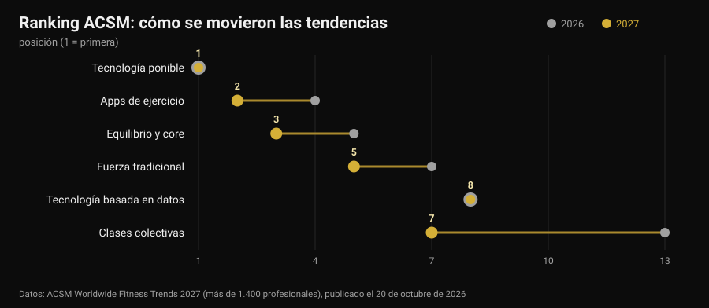
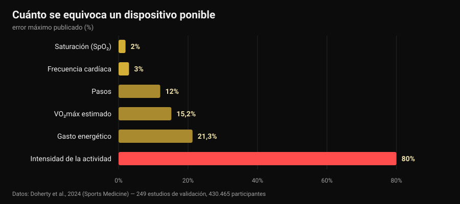

# Tendencias fitness 2027: qué funciona de verdad

Por [Giammaria Loi](/autore/giammaria-loi) · actualizado el 30 de octubre de 2026

El 20 de octubre el American College of Sports Medicine publicó su clasificación de tendencias fitness para 2027 y en una semana estaba en todos los medios del sector. Por décima vez mandan los dispositivos ponibles; las apps de ejercicio suben del cuarto al segundo puesto. Ninguno de los artículos que leí hizo la pregunta siguiente: ¿esas tendencias funcionan? Fui a buscar los números, y resulta que las herramientas que encabezan la lista hacen una cosa muy bien y otra muy mal, incluido el dato que casi todo el mundo mira primero.

## En resumen

- **La clasificación no mide la eficacia.** Es una encuesta a más de 1.400 profesionales del sector sobre qué pesará más en 2027, ya en su 21ª edición. Dice hacia dónde va el mercado, no qué da resultados.
- **Las pulseras hacen moverse más, y eso es sólido.** Una revisión de 39 revisiones sistemáticas (163.992 participantes) estima unos **1.800 pasos más al día**, 40 minutos más de caminata y alrededor de **1 kg** menos de peso (Ferguson et al., 2022).
- **Las calorías de la pantalla son el dato menos fiable.** El error en el gasto energético va del **-21,3%** al **+14,8%**, y en la intensidad de la actividad el error medio llega al **80%** (Doherty et al., 2024).
- **La frecuencia cardíaca, en cambio, es buena.** Sesgo medio **±3%**. El VO₂máx estimado no: sobreestimado un **15,2%** en reposo.
- **"Guiado por datos" no significa "mejor".** Entrenar siguiendo la variabilidad cardíaca mejora los índices vagales (DME 0,50) pero no mejora de forma significativa el rendimiento (Manresa-Rocamora et al., 2021).

## La lista 2027 en tres líneas

Cada año el ACSM envía un cuestionario a profesionales del fitness de todo el mundo y pregunta qué tendencias tendrán más peso en los doce meses siguientes. La edición 2027, firmada por Cayla R. McAvoy y el grupo de trabajo de tendencias, reúne más de 1.400 respuestas. En cabeza:

1. tecnología ponible (primer puesto por décima vez);
2. apps de ejercicio (desde el cuarto);
3. equilibrio, movilidad y core (desde el quinto);
4. programas para adultos mayores (entre los cinco primeros desde hace cinco años);
5. entrenamiento de fuerza tradicional (sube dos puestos);
6. ejercicio para el control del peso;
7. clases colectivas (desde el decimotercero);
8. tecnología guiada por datos (sigue octava);
9. ejercicio para la salud mental (entre los diez primeros desde hace cuatro años);
10. programas liderados por influencers y embajadores (de vuelta tras salir del top veinte).

El mayor salto es el de las clases colectivas, seis puestos en un año. Pero lo interesante está en otro sitio: de las diez entradas, **tres son tecnología** y dos son entrenamiento de toda la vida. Esa convivencia merece una mirada atenta, porque la investigación sobre las dos mitades dice cosas muy distintas.

Un matiz que falta en casi todas las coberturas: una encuesta de opinión entre profesionales **no es una prueba de eficacia**. Es un termómetro del mercado. Si en 2027 todos van a vender datos, la pregunta que toca hacerse es cuán precisos son esos datos.

## Lo que el reloj mide bien y lo que estima

Aquí existe una fuente casi perfecta: una revisión "viva" publicada en *Sports Medicine* que reunió 24 revisiones sistemáticas, 249 estudios de validación y 430.465 participantes, comparando los dispositivos de consumo con los patrones de referencia de laboratorio (Doherty et al., 2024).

Leído de izquierda a derecha, el gráfico cuenta una jerarquía clara.

**Fiable.** La frecuencia cardíaca tiene un sesgo medio del **3%**: de sobra para regular la intensidad de una carrera o un circuito. En la detección de arritmias los dispositivos muestran sensibilidad del 100% y especificidad del 95%, un dato notable que sigue siendo un aviso para ir al médico, no un diagnóstico.

**Aproximado pero útil.** Los pasos suelen subestimarse, con un error porcentual medio absoluto del **-9% al 12%**. Traducido: si el reloj marca 8.000 pasos, los tuyos están entre unos 7.000 y 8.800. Para seguir una tendencia semanal va perfecto; para sacar conclusiones de un solo día, no.

**Para no decidir nada.** El gasto energético tiene un error de entre **-21,3% y +14,8%**. En una sesión que la pantalla estima en 600 kcal, el valor real puede estar entre 470 y 690. Peor aún la intensidad de la actividad, con un error medio del **29% al 80%** según lo exigente que sea lo que estás haciendo. El VO₂máx estimado se sobreestima un **15,24%** en reposo y un **9,83%** en esfuerzo: si tu reloj marca 52, el número plausible ronda 47.

¿Y el sueño? Los dispositivos tienden a **sobreestimar el tiempo total de sueño**, con un error normalmente superior al 10%: en la práctica cuentan como sueño ratos en los que simplemente estabas quieto. Sirve para ver si te has acostado más tarde de lo normal, que es justo de lo que hablamos al decidir [a qué hora dejar el café](/es/blog/cafeina-sueno-cuando-dejar-el-cafe), pero una "puntuación del sueño" no es una medida clínica.

Un último dato lo pone todo en perspectiva: de todos los dispositivos a la venta, solo en torno al **11%** está validado para al menos un parámetro, y los estudios de validación hechos hasta ahora son el **3,5%** de los que harían falta. Cuando una marca escribe "precisión clínica" en la caja, nueve de cada diez veces no existe un trabajo publicado que lo demuestre para ese modelo.

## La paradoja: fallan los números y funcionan igual

Aquí llega la parte que casi nadie cuenta. Los mismos dispositivos que estiman mal las calorías están entre las herramientas con más evidencia para hacer que la gente se mueva.

La revisión paraguas de Ferguson y colaboradores reunió 39 revisiones sistemáticas y metaanálisis, con 163.992 participantes de todas las edades, en población sana y clínica. Resultado: efecto de pequeño a moderado en actividad física (DME 0,3-0,6), composición corporal 0,7-2,0, condición física 0,3. En unidades concretas: unos **1.800 pasos más al día**, **40 minutos más de caminata al día** y cerca de **1 kg** menos de peso. Los efectos sobre tensión, colesterol, hemoglobina glicada, calidad de vida y dolor son pequeños y a menudo no significativos. Los autores concluyen que la evidencia basta para recomendar su uso.

No es una contradicción: el dispositivo funciona como **recordatorio y espejo**, no como instrumento de medida. Te recuerda que existes, te enseña una tendencia, te da un objetivo. Que la estimación de calorías falle un 20% no cambia nada de ese mecanismo, salvo que construyas la dieta sobre ese número; entonces sí, se convierte en un problema.

En adultos mayores, la cuarta tendencia de la lista, los números encajan: en 45 estudios y 7.144 participantes las pulseras aumentan los pasos (DME 0,59) y la actividad moderada-vigorosa semanal (DME 0,54), y reducen el tiempo sedentario (Wu et al., 2023). Pero el mismo trabajo añade el detalle decisivo: las pulseras **unidas a componentes tradicionales** —objetivos pactados, automonitorización, llamadas de seguimiento— consiguen más que las pulseras solas.

Lo mismo con las apps. En 12 ensayos aleatorizados sobre apps de actividad física y control del peso, los efectos en peso, IMC y porcentaje de grasa eran de pequeños a moderados, y las más eficaces eran las que incluían **recordatorios, automonitorización y un entrenador humano** (Yen et al., 2022). Es la misma conclusión a la que llegábamos hablando de [si el coaching online funciona](/es/blog/funciona-el-coaching-online): la tecnología multiplica una relación, no la sustituye.

## "Guiado por datos": ¿la HRV cumple?

La octava tendencia, quieta desde hace un año, es la tecnología que lee sueño y variabilidad de la frecuencia cardíaca (HRV) para decirte cómo entrenar hoy. Promesa seductora: el reloj sabe cuándo puedes apretar.

Los metaanálisis son más tibios. En la revisión metodológica de Manresa-Rocamora y colaboradores, entrenar guiado por HRV supera a un programa prefijado en los **índices vagales** de HRV (DME 0,50; IC 95% 0,09-0,91), pero no en la frecuencia cardíaca en reposo, y las diferencias en capacidad aeróbica máxima (DME 0,20; IC 95% -0,07-0,47) y rendimiento de resistencia (DME 0,20; IC 95% -0,09-0,48) son pequeñas y **no significativas**. Un segundo metaanálisis, solo en atletas de resistencia, encuentra un efecto pequeño pero positivo en el VO₂máx (TE 0,402), mayor en amateurs y en mujeres (Granero-Gallegos et al., 2020).

La lectura honesta es esta: la HRV parece reducir la probabilidad de respuestas negativas al entrenamiento —menos sesiones hechas mal en el momento equivocado— más que subir el techo de los resultados. Si te sirve para decidir cuándo quitar una serie, tiene sentido. Si la usas para saber si hoy "puedes" hacer sentadilla, estás delegando en un dato de quince segundos una decisión que sabes tomar mejor tú.

## La tendencia que 2027 infravalora

En el sexto puesto está el ejercicio para el control del peso, y el ACSM señala que con los fármacos para adelgazar cada vez más extendidos la atención se desplaza a mantener el músculo. Aquí hay un dato que conviene dejar por escrito, porque afecta a cualquiera que pierda peso rápido: un metaanálisis con metarregresión sobre entrenamiento de fuerza en déficit calórico muestra que las ganancias de masa magra están **comprometidas** (TE -0,57; p = 0,02) mientras las de fuerza se mantienen comparables (TE -0,31; p = 0,28), y que por encima de un déficit de unas **500 kcal al día** la masa magra deja de crecer (Murphy y Koehler, 2021).

Significa que quien busca perder peso deprisa conserva la fuerza pero no construye músculo, y que el entrenamiento de fuerza en esa fase sirve para **defender** lo que ya hay. Cómo se organiza en concreto lo vimos al hablar de [recomposición corporal](/es/blog/recomposicion-corporal-perder-grasa-ganar-musculo). Si estás tomando fármacos para el peso, la dieta y el entrenamiento se discuten con el médico que te los ha recetado: aquí hablamos de datos, no de protocolos personales.

## Qué dice realmente la investigación

**Confirmado — "los dispositivos ponibles hacen moverse más".** Unos 1.800 pasos y 40 minutos más de caminata al día, beneficio mantenido en el tiempo, en 163.992 participantes.

**Confirmado — "la frecuencia cardíaca de muñeca sirve".** Sesgo medio del 3%, suficiente para regular la intensidad.

**Desmentido — "las calorías del reloj son un dato".** Error del -21,3% al +14,8%, y hasta el 80% en la intensidad de la actividad.

**Desmentido — "el VO₂máx del reloj es una medida".** Sobreestimado un 15,24% en reposo y un 9,83% en esfuerzo.

**Hay que matizar — "la puntuación del sueño dice cómo has dormido".** La duración total se sobreestima, normalmente más de un 10%: útil para tendencias, no como medida.

**Hay que matizar — "entrenar guiado por HRV da mejores resultados".** Mejora los índices vagales, pero el efecto en VO₂máx y rendimiento es pequeño y no significativo.

**Desmentido — "con una buena app no hace falta entrenador".** Las apps y pulseras más eficaces son las que tienen recordatorios, objetivos y contacto humano.

**Desmentido — "la lista ACSM dice qué funciona".** Es una encuesta de opinión entre profesionales: mide expectativas de mercado.

## Cómo aplicarlo

1. **Usa el reloj para tendencias, no para valores absolutos.** Pasos, frecuencia cardíaca y minutos activos comparados con tu media de cuatro semanas valen mucho más que el mismo número leído una vez.
2. **No construyas la dieta sobre las calorías de la pantalla.** Con un error potencial del 20% en ambos sentidos, usa como referencia el peso corporal y las medidas en el tiempo, no el gasto estimado.
3. **Una decisión por dato.** Un dato que no cambia nada es ruido: si la puntuación de recuperación nunca te hace quitar ni añadir nada, deja de mirarla.
4. **Para la fuerza mide la carga, no las calorías.** Series, repeticiones, carga y RIR (repeticiones en reserva) son los parámetros sobre los que se construye la progresión: ningún reloj los registra por ti.
5. **Si usas la HRV, úsala para quitar.** Funciona como freno en los días malos, no como permiso en los buenos.
6. **Añade la parte humana.** El dato que llega a una persona —un entrenador, un amigo, un grupo— funciona mejor que el dato que se queda en la app. Es la diferencia que se ve en los metaanálisis.
7. **Desconfía del "precisión clínica" de la caja.** Solo el 11% de los dispositivos está validado para al menos un parámetro: pregunta para cuál y en qué estudio.

### Prueba Nurvan — los datos que tu reloj no registra

El smartwatch sabe cuánto caminas. No sabe que ayer cerraste el press banca a 4 repeticiones del fallo y hoy a 2, que es la única información con la que se entiende si estás progresando. En Nurvan registras carga, repeticiones y RIR de cada serie, importas la rutina que ya tienes desde PDF, Excel o una foto, y tienes la curva de cargas mes a mes junto a medidas y peso; las series de calentamiento se proponen automáticamente sobre la carga del día. Y si te sigue un entrenador, ve las mismas pantallas que tú: la parte humana que marca la diferencia en los metaanálisis.

## Preguntas frecuentes

**¿Cuáles son las tendencias fitness de 2027?**
Según la encuesta ACSM publicada el 20 de octubre de 2026, por orden: tecnología ponible, apps de ejercicio, equilibrio y core, programas para adultos mayores, fuerza tradicional, ejercicio para el control del peso, clases colectivas, tecnología guiada por datos, ejercicio para la salud mental y programas liderados por influencers. Es una encuesta a más de 1.400 profesionales sobre expectativas del año, no una clasificación de eficacia.

**¿Qué precisión tienen las calorías del smartwatch?**
Poca. La revisión de 249 estudios de validación reporta un error en el gasto energético de entre -21,3% y +14,8%, y un error medio del 29% al 80% en la estimación de la intensidad. La frecuencia cardíaca, en cambio, tiene un sesgo medio del 3%: es el parámetro en el que esos dispositivos son más fiables.

**¿Merece la pena comprar una pulsera de actividad?**
Si tu problema es moverte más, la evidencia está a favor: de media unos 1.800 pasos y 40 minutos más de caminata al día, con cerca de 1 kg menos de peso, y el beneficio se mantiene. Si tu problema es saber cuántas calorías has quemado o cuánto vale tu VO₂máx, el dispositivo no es la herramienta adecuada.

**¿Debo entrenar según la HRV?**
Los metaanálisis muestran mejoras en los índices de variabilidad cardíaca pero efectos pequeños y no significativos en capacidad aeróbica y rendimiento. Como herramienta para evitar sesiones hechas en mal momento puede tener sentido; como árbitro de cada entrenamiento, no.

## Lee también

- [¿Funciona el coaching online? Esto dicen los estudios](/es/blog/funciona-el-coaching-online) — qué cambia de verdad cuando hay una persona al otro lado de los datos.
- [Recomposición corporal: perder grasa y ganar músculo](/es/blog/recomposicion-corporal-perder-grasa-ganar-musculo) — cómo plantear un déficit que no te cueste masa magra.
- [Cafeína y sueño: a qué hora dejar el café](/es/blog/cafeina-sueno-cuando-dejar-el-cafe) — la otra mitad de la recuperación, con los números de los estudios.

## Fuentes

1. Ferguson T, Olds T, Curtis R, Blake H, Crozier AJ, Dankiw K, Dumuid D, Kasai D, O'Connor E, Virgara R, Maher C, 2022. *Effectiveness of wearable activity trackers to increase physical activity and improve health: a systematic review of systematic reviews and meta-analyses.* The Lancet Digital Health 4(8):e615-e626. [PMID 35868813](https://pubmed.ncbi.nlm.nih.gov/35868813/) · [DOI 10.1016/S2589-7500(22)00111-X](https://doi.org/10.1016/S2589-7500(22)00111-X)
2. Doherty C, Baldwin M, Keogh A, Caulfield B, Argent R, 2024. *Keeping Pace with Wearables: A Living Umbrella Review of Systematic Reviews Evaluating the Accuracy of Consumer Wearable Technologies in Health Measurement.* Sports Medicine 54(11):2907-2926. [PMID 39080098](https://pubmed.ncbi.nlm.nih.gov/39080098/) · [DOI 10.1007/s40279-024-02077-2](https://doi.org/10.1007/s40279-024-02077-2)
3. Wu S, Li G, Du L, Chen S, Zhang X, He Q, 2023. *The effectiveness of wearable activity trackers for increasing physical activity and reducing sedentary time in older adults: A systematic review and meta-analysis.* Digital Health 9:20552076231176705. [PMID 37252261](https://pubmed.ncbi.nlm.nih.gov/37252261/) · [DOI 10.1177/20552076231176705](https://doi.org/10.1177/20552076231176705)
4. Yen HY, Jin G, Chiu HL, 2022. *Smartphone app-based interventions targeting physical activity for weight management: A meta-analysis of randomized controlled trials.* International Journal of Nursing Studies 137:104384. [PMID 36379104](https://pubmed.ncbi.nlm.nih.gov/36379104/) · [DOI 10.1016/j.ijnurstu.2022.104384](https://doi.org/10.1016/j.ijnurstu.2022.104384)
5. Manresa-Rocamora A, Sarabia JM, Javaloyes A, Flatt AA, Moya-Ramón M, 2021. *Heart Rate Variability-Guided Training for Enhancing Cardiac-Vagal Modulation, Aerobic Fitness, and Endurance Performance: A Methodological Systematic Review with Meta-Analysis.* International Journal of Environmental Research and Public Health 18(19):10299. [PMID 34639599](https://pubmed.ncbi.nlm.nih.gov/34639599/) · [DOI 10.3390/ijerph181910299](https://doi.org/10.3390/ijerph181910299)
6. Granero-Gallegos A, González-Quílez A, Plews D, Carrasco-Poyatos M, 2020. *HRV-Based Training for Improving VO2max in Endurance Athletes. A Systematic Review with Meta-Analysis.* International Journal of Environmental Research and Public Health 17(21):7999. [PMID 33143175](https://pubmed.ncbi.nlm.nih.gov/33143175/) · [DOI 10.3390/ijerph17217999](https://doi.org/10.3390/ijerph17217999)
7. Murphy C, Koehler K, 2021. *Energy deficiency impairs resistance training gains in lean mass but not strength: A meta-analysis and meta-regression.* Scandinavian Journal of Medicine & Science in Sports 32(1):125-137. [PMID 34623696](https://pubmed.ncbi.nlm.nih.gov/34623696/) · [DOI 10.1111/sms.14075](https://doi.org/10.1111/sms.14075)
8. McAvoy CR et al., 2026. *2027 ACSM Worldwide Fitness Trends: Future Directions of the Health and Fitness Industry.* ACSM's Health & Fitness Journal 30(6), noviembre/diciembre de 2026. [DOI 10.1249/fit.0000000000001208](https://doi.org/10.1249/fit.0000000000001208) · [nota de prensa ACSM](https://acsm.org/2027-fitness-trends/)

Referencias bibliográficas recuperadas a través de PubMed. Punto de partida: ninguna publicación en redes, sino la señal de tendencia del 20-26 de octubre de 2026, es decir la publicación de la encuesta ACSM Worldwide Fitness Trends 2027 y su repercusión en Medical Xpress, Athletech News y Yahoo Lifestyle, junto al aumento de las búsquedas sobre dispositivos ponibles en octubre de 2026. El tema se ha escrito desde cero a partir de las fuentes primarias.

---

**Giammaria Loi** es el fundador de Nurvan. Entrena con pesas desde 2012, trabaja como entrenador personal y coach certificado FIPE desde 2013 y compite en powerlifting a nivel nacional desde 2018. Cada artículo que firma parte de los estudios científicos y llega a lo que funciona de verdad en el gimnasio.

> Nota: contenido informativo, no sustituye la opinión de un médico o un profesional. Los datos sobre sueño, saturación y arritmias que aparecen aquí se refieren a la precisión de medida de los dispositivos, no a su uso diagnóstico: un valor anómalo se lleva a un médico, no se interpreta con una app. Si estás tomando fármacos para el peso, habla con quien te los ha recetado antes de cambiar dieta o entrenamiento.
