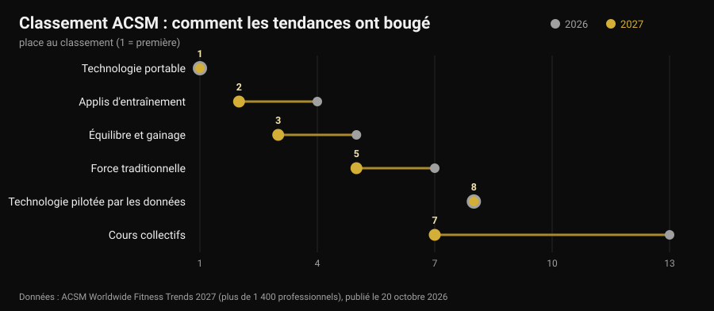
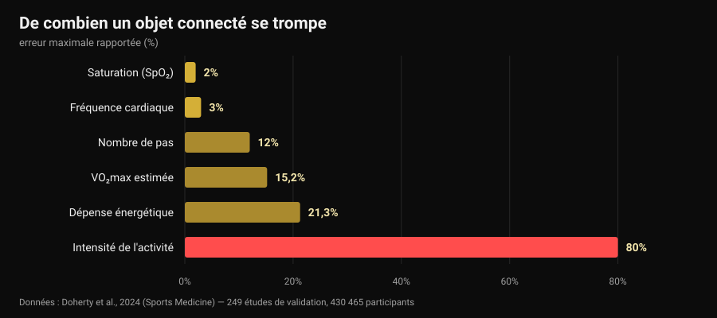

# Tendances fitness 2027 : ce qui marche vraiment

Par [Giammaria Loi](/autore/giammaria-loi) · mis à jour le 30 octobre 2026

Le 20 octobre, l'American College of Sports Medicine a publié son classement des tendances fitness pour 2027, et en une semaine il était sur tous les sites du secteur. Pour la dixième fois, les objets connectés occupent la première place ; les applis d'entraînement passent de la quatrième à la deuxième. Aucun des articles que j'ai lus n'a posé la question suivante : ces tendances fonctionnent-elles ? Je suis allé chercher les chiffres, et il s'avère que les outils en tête du classement font une chose très bien et une autre très mal — y compris le chiffre que presque tout le monde regarde en premier.

## L'essentiel

- **Le classement ne mesure pas l'efficacité.** C'est une enquête auprès de plus de 1 400 professionnels du secteur sur ce qui pèsera le plus en 2027, pour sa 21e édition. Il dit où va le marché, pas ce qui produit des résultats.
- **Les bracelets font bouger davantage, et c'est solide.** Une revue de 39 revues systématiques (163 992 participants) estime environ **1 800 pas de plus par jour**, 40 minutes de marche en plus et à peu près **1 kg** de poids en moins (Ferguson et al., 2022).
- **Les calories affichées au poignet sont la donnée la moins fiable.** L'erreur sur la dépense énergétique va de **-21,3 %** à **+14,8 %**, et sur l'intensité de l'activité l'erreur moyenne atteint **80 %** (Doherty et al., 2024).
- **La fréquence cardiaque, en revanche, est bonne.** Biais moyen de **±3 %**. La VO₂max estimée, non : surestimée de **15,2 %** au repos.
- **« Piloté par les données » ne veut pas dire « meilleur ».** S'entraîner en suivant la variabilité de la fréquence cardiaque améliore les indices vagaux (DMS 0,50) mais n'améliore pas significativement la performance (Manresa-Rocamora et al., 2021).

## Le classement 2027 en trois lignes

Chaque année, l'ACSM envoie un questionnaire à des professionnels du fitness du monde entier et demande quelles tendances pèseront le plus dans les douze mois à venir. L'édition 2027, signée par Cayla R. McAvoy et le groupe de travail sur les tendances, réunit plus de 1 400 réponses. En tête :

1. technologie portable (première place pour la dixième fois) ;
2. applis d'entraînement (depuis la quatrième) ;
3. équilibre, mobilité et gainage (depuis la cinquième) ;
4. programmes pour les seniors (dans le top cinq depuis cinq ans) ;
5. musculation traditionnelle (en hausse de deux places) ;
6. exercice pour la gestion du poids ;
7. cours collectifs (depuis la treizième) ;
8. technologie pilotée par les données (toujours huitième) ;
9. exercice pour la santé mentale (dans le top dix depuis quatre ans) ;
10. programmes portés par des influenceurs et ambassadeurs (de retour après être sortis du top vingt).

Le plus grand bond revient aux cours collectifs, six places en un an. Mais l'essentiel est ailleurs : sur les dix entrées, **trois relèvent de la technologie** et deux de l'entraînement classique. Cette cohabitation mérite un examen attentif, car la recherche sur les deux moitiés dit des choses très différentes.

Une précision absente de presque toutes les reprises : un sondage d'opinion auprès de professionnels **n'est pas une preuve d'efficacité**. C'est un thermomètre du marché. Si tout le monde vend des données en 2027, la question à se poser est de savoir à quel point ces données sont précises.

## Ce que la montre mesure bien, et ce qu'elle estime

Il existe ici une source quasi parfaite : une revue « vivante » publiée dans *Sports Medicine*, qui a rassemblé 24 revues systématiques, 249 études de validation et 430 465 participants, en comparant les appareils grand public aux instruments de référence en laboratoire (Doherty et al., 2024).

Lu de gauche à droite, le graphique raconte une hiérarchie nette.

**Fiable.** La fréquence cardiaque affiche un biais moyen de **3 %** : largement suffisant pour régler l'intensité d'une course ou d'un circuit. Pour la détection des arythmies, les appareils montrent une sensibilité de 100 % et une spécificité de 95 % — un chiffre remarquable, qui reste un signal à porter au médecin, pas un diagnostic.

**Approximatif mais utile.** Les pas sont généralement sous-estimés, avec une erreur absolue moyenne en pourcentage allant de **-9 % à 12 %**. Traduction : si la montre affiche 8 000 pas, les vôtres se situent entre environ 7 000 et 8 800. Parfait pour suivre une tendance hebdomadaire ; pas pour conclure quoi que ce soit sur une seule journée.

**À ne pas utiliser pour décider.** La dépense énergétique comporte une erreur comprise entre **-21,3 % et +14,8 %**. Sur une séance que le cadran estime à 600 kcal, la valeur réelle peut se situer entre 470 et 690. Pire encore pour l'intensité de l'activité, avec une erreur moyenne de **29 % à 80 %** selon l'intensité réelle de l'effort. La VO₂max estimée est surestimée de **15,24 %** au repos et de **9,83 %** à l'effort : si votre montre indique 52, le chiffre plausible tourne autour de 47.

Et le sommeil ? Les appareils ont tendance à **surestimer le temps de sommeil total**, avec une erreur généralement supérieure à 10 % : en pratique, ils comptent comme sommeil des moments où vous étiez simplement immobile. C'est utile pour voir si vous vous êtes couché plus tard que d'habitude — ce qui est tout l'enjeu quand on décide [à quelle heure arrêter le café](/fr/blog/cafeine-sommeil-quand-arreter-le-cafe) — mais un « score de sommeil » n'est pas une mesure clinique.

Un dernier chiffre remet tout en perspective : sur l'ensemble des appareils commercialisés, environ **11 %** seulement ont été validés pour au moins un paramètre, et les études de validation réalisées représentent **3,5 %** de celles qui seraient nécessaires. Quand une marque écrit « précision clinique » sur la boîte, neuf fois sur dix aucun travail publié ne le démontre pour ce modèle.

## Le paradoxe : les chiffres sont faux et ça marche quand même

Vient ici la partie que presque personne ne raconte. Les mêmes appareils qui estiment mal les calories comptent parmi les outils les mieux documentés pour faire bouger les gens.

La revue parapluie de Ferguson et ses collègues a rassemblé 39 revues systématiques et méta-analyses, soit 163 992 participants de tous âges, en population saine et clinique. Résultat : effet petit à modéré sur l'activité physique (DMS 0,3-0,6), composition corporelle 0,7-2,0, condition physique 0,3. En unités concrètes : environ **1 800 pas de plus par jour**, **40 minutes de marche en plus par jour**, environ **1 kg** de poids en moins. Les effets sur la tension, le cholestérol, l'hémoglobine glyquée, la qualité de vie et la douleur sont petits et souvent non significatifs. Les auteurs concluent que les preuves suffisent pour en recommander l'usage.

Ce n'est pas une contradiction : l'appareil fonctionne comme **rappel et miroir**, pas comme instrument de mesure. Il vous rappelle que vous existez, vous montre une tendance, vous donne un objectif. Que l'estimation des calories soit fausse de 20 % ne change rien à ce mécanisme — sauf si vous construisez votre alimentation sur ce chiffre, et là, oui, cela devient un problème.

Chez les seniors, quatrième tendance du classement, les chiffres concordent : sur 45 études et 7 144 participants, les bracelets augmentent le nombre de pas (DMS 0,59) et l'activité modérée à vigoureuse hebdomadaire (DMS 0,54), et réduisent le temps sédentaire (Wu et al., 2023). Mais le même travail ajoute le détail qui compte : les bracelets **associés à des composantes traditionnelles** — objectifs convenus, auto-suivi, appels de relance — obtiennent davantage que les bracelets seuls.

Même histoire pour les applis. Dans 12 essais randomisés portant sur des applis d'activité physique et de gestion du poids, les effets sur le poids, l'IMC et le pourcentage de masse grasse étaient petits à modérés, et les plus efficaces étaient celles qui proposaient **rappels, auto-suivi et un coach humain** (Yen et al., 2022). C'est la conclusion à laquelle nous arrivions en parlant du [coaching en ligne et de ce que disent les études](/fr/blog/le-coaching-en-ligne-fonctionne) : la technologie multiplie une relation, elle ne la remplace pas.

## « Piloté par les données » : la VFC tient-elle sa promesse ?

La huitième tendance, immobile depuis un an, c'est la technologie qui lit le sommeil et la variabilité de la fréquence cardiaque (VFC) pour vous dire comment vous entraîner aujourd'hui. Promesse séduisante : la montre sait quand vous pouvez pousser.

Les méta-analyses sont plus tièdes. Dans la revue méthodologique de Manresa-Rocamora et ses collègues, l'entraînement guidé par la VFC devance un programme préétabli sur les **indices vagaux** de VFC (DMS 0,50 ; IC 95 % 0,09-0,91), mais pas sur la fréquence cardiaque de repos, et les différences de capacité aérobie maximale (DMS 0,20 ; IC 95 % -0,07-0,47) et de performance d'endurance (DMS 0,20 ; IC 95 % -0,09-0,48) sont petites et **non significatives**. Une seconde méta-analyse, limitée aux athlètes d'endurance, trouve un effet petit mais positif sur la VO₂max (TE 0,402), plus marqué chez les amateurs et chez les femmes (Granero-Gallegos et al., 2020).

Lecture honnête : la VFC semble réduire la probabilité de réponses négatives à l'entraînement — moins de séances mal faites au mauvais moment — plutôt que relever le plafond des résultats. Si elle vous sert à décider quand retirer une série, elle a du sens. Si vous l'utilisez pour savoir si vous « avez le droit » de faire du squat aujourd'hui, vous déléguez à une mesure de quinze secondes une décision que vous prenez mieux vous-même.

## La tendance que 2027 sous-estime

En sixième position vient l'exercice pour la gestion du poids, et l'ACSM note qu'avec la diffusion des médicaments amaigrissants l'attention se déplace vers le maintien du muscle. Un chiffre mérite d'être écrit noir sur blanc, car il concerne quiconque perd du poids rapidement : une méta-analyse avec méta-régression sur la musculation en déficit calorique montre que les gains de masse maigre sont **compromis** (TE -0,57 ; p = 0,02) alors que ceux de force restent comparables (TE -0,31 ; p = 0,28), et qu'au-delà d'un déficit d'environ **500 kcal par jour** la masse maigre cesse d'augmenter (Murphy et Koehler, 2021).

Autrement dit : qui vise une perte de poids rapide conserve sa force mais ne construit pas de muscle, et l'entraînement contre résistance sert alors à **défendre** ce qui existe déjà. Comment le mettre en place concrètement, nous l'avons vu en parlant de [recomposition corporelle](/fr/blog/recomposition-corporelle-perdre-gras-gagner-muscle). Si vous prenez des médicaments pour le poids, l'alimentation et l'entraînement se discutent avec le médecin qui vous les a prescrits : ici, nous parlons de données, pas de protocoles personnels.

## Ce que dit vraiment la recherche

**Confirmé — « les objets connectés font bouger davantage ».** Environ 1 800 pas et 40 minutes de marche en plus par jour, bénéfice maintenu dans le temps, sur 163 992 participants.

**Confirmé — « la fréquence cardiaque au poignet est utilisable ».** Biais moyen de 3 %, suffisant pour régler l'intensité.

**Démenti — « les calories de la montre sont une donnée ».** Erreur de -21,3 % à +14,8 %, et jusqu'à 80 % sur l'intensité de l'activité.

**Démenti — « la VO₂max de la montre est une mesure ».** Surestimée de 15,24 % au repos et de 9,83 % à l'effort.

**À nuancer — « le score de sommeil dit comment vous avez dormi ».** La durée totale est surestimée, en général de plus de 10 % : utile pour les tendances, pas comme mesure.

**À nuancer — « s'entraîner guidé par la VFC donne de meilleurs résultats ».** Cela améliore les indices vagaux, mais l'effet sur la VO₂max et la performance est petit et non significatif.

**Démenti — « avec une bonne appli, le coach ne sert à rien ».** Les applis et bracelets les plus efficaces sont ceux avec rappels, objectifs et contact humain.

**Démenti — « le classement ACSM dit ce qui marche ».** C'est un sondage d'opinion auprès de professionnels : il mesure des attentes de marché.

## Comment l'appliquer

1. **Utilisez la montre pour les tendances, pas pour les valeurs absolues.** Pas, fréquence cardiaque et minutes actives comparés à votre moyenne sur quatre semaines valent bien plus que le même chiffre lu une fois.
2. **Ne construisez pas votre alimentation sur les calories du cadran.** Avec une erreur potentielle de 20 % dans les deux sens, prenez comme repère le poids corporel et les mensurations dans le temps, pas la dépense estimée.
3. **Une décision par donnée.** Une donnée qui ne change rien est du bruit : si le score de récupération ne vous fait jamais retirer ni ajouter quoi que ce soit, arrêtez de le regarder.
4. **Pour la force, mesurez la charge, pas les calories.** Séries, répétitions, charge et RIR (répétitions en réserve) sont les paramètres sur lesquels se construit la progression : aucune montre ne les enregistre pour vous.
5. **Si vous utilisez la VFC, utilisez-la pour retirer.** Elle a du sens comme frein les mauvais jours, pas comme autorisation les bons.
6. **Ajoutez la part humaine.** La donnée qui atteint une personne — un coach, un ami, un groupe — fonctionne mieux que celle qui reste dans l'appli. C'est l'écart que l'on voit dans les méta-analyses.
7. **Méfiez-vous du « précision clinique » sur la boîte.** Seuls 11 % des appareils sont validés pour au moins un paramètre : demandez lequel, et dans quelle étude.

### Essayez Nurvan — les données que votre montre n'enregistre pas

La montre connectée sait combien vous marchez. Elle ne sait pas qu'hier vous avez terminé le développé couché à 4 répétitions de l'échec et aujourd'hui à 2, la seule information qui dit si vous progressez. Sur Nurvan, vous enregistrez charge, répétitions et RIR de chaque série, vous importez le programme que vous avez déjà depuis un PDF, un Excel ou une photo, et vous retrouvez la courbe des charges mois par mois à côté des mensurations et du poids ; les séries d'échauffement sont proposées automatiquement à partir de la charge du jour. Et si un coach vous suit, il voit les mêmes écrans que vous : c'est la part humaine qui fait la différence dans les méta-analyses.

## Questions fréquentes

**Quelles sont les tendances fitness de 2027 ?**
Selon l'enquête ACSM publiée le 20 octobre 2026, dans l'ordre : technologie portable, applis d'entraînement, équilibre et gainage, programmes pour seniors, musculation traditionnelle, exercice pour la gestion du poids, cours collectifs, technologie pilotée par les données, exercice pour la santé mentale, programmes portés par des influenceurs. C'est un sondage auprès de plus de 1 400 professionnels sur les attentes de l'année, pas un classement d'efficacité.

**Quelle est la précision des calories affichées par une montre connectée ?**
Faible. La revue de 249 études de validation rapporte une erreur sur la dépense énergétique comprise entre -21,3 % et +14,8 %, et une erreur moyenne de 29 % à 80 % sur l'estimation de l'intensité. La fréquence cardiaque, elle, présente un biais moyen de 3 % : c'est le paramètre sur lequel ces appareils sont les plus fiables.

**Un bracelet d'activité vaut-il le coup ?**
Si votre problème est de bouger davantage, les preuves sont favorables : en moyenne environ 1 800 pas et 40 minutes de marche en plus par jour, avec près d'1 kg de poids en moins, et le bénéfice se maintient. Si votre problème est de savoir combien de calories vous avez brûlées ou quelle est votre VO₂max, l'appareil n'est pas le bon outil.

**Faut-il s'entraîner en fonction de la VFC ?**
Les méta-analyses montrent une amélioration des indices de variabilité cardiaque mais des effets petits et non significatifs sur la capacité aérobie et la performance. Comme outil pour éviter des séances placées au mauvais moment, cela peut avoir du sens ; comme arbitre de chaque entraînement, non.

## À lire aussi

- [Le coaching en ligne fonctionne-t-il ? Les études](/fr/blog/le-coaching-en-ligne-fonctionne) — ce qui change vraiment quand il y a une personne de l'autre côté des données.
- [Recomposition corporelle : perdre du gras, gagner du muscle](/fr/blog/recomposition-corporelle-perdre-gras-gagner-muscle) — comment poser un déficit qui ne vous coûte pas de masse maigre.
- [Caféine et sommeil : à quelle heure arrêter le café](/fr/blog/cafeine-sommeil-quand-arreter-le-cafe) — l'autre moitié de la récupération, chiffres à l'appui.

## Sources

1. Ferguson T, Olds T, Curtis R, Blake H, Crozier AJ, Dankiw K, Dumuid D, Kasai D, O'Connor E, Virgara R, Maher C, 2022. *Effectiveness of wearable activity trackers to increase physical activity and improve health: a systematic review of systematic reviews and meta-analyses.* The Lancet Digital Health 4(8):e615-e626. [PMID 35868813](https://pubmed.ncbi.nlm.nih.gov/35868813/) · [DOI 10.1016/S2589-7500(22)00111-X](https://doi.org/10.1016/S2589-7500(22)00111-X)
2. Doherty C, Baldwin M, Keogh A, Caulfield B, Argent R, 2024. *Keeping Pace with Wearables: A Living Umbrella Review of Systematic Reviews Evaluating the Accuracy of Consumer Wearable Technologies in Health Measurement.* Sports Medicine 54(11):2907-2926. [PMID 39080098](https://pubmed.ncbi.nlm.nih.gov/39080098/) · [DOI 10.1007/s40279-024-02077-2](https://doi.org/10.1007/s40279-024-02077-2)
3. Wu S, Li G, Du L, Chen S, Zhang X, He Q, 2023. *The effectiveness of wearable activity trackers for increasing physical activity and reducing sedentary time in older adults: A systematic review and meta-analysis.* Digital Health 9:20552076231176705. [PMID 37252261](https://pubmed.ncbi.nlm.nih.gov/37252261/) · [DOI 10.1177/20552076231176705](https://doi.org/10.1177/20552076231176705)
4. Yen HY, Jin G, Chiu HL, 2022. *Smartphone app-based interventions targeting physical activity for weight management: A meta-analysis of randomized controlled trials.* International Journal of Nursing Studies 137:104384. [PMID 36379104](https://pubmed.ncbi.nlm.nih.gov/36379104/) · [DOI 10.1016/j.ijnurstu.2022.104384](https://doi.org/10.1016/j.ijnurstu.2022.104384)
5. Manresa-Rocamora A, Sarabia JM, Javaloyes A, Flatt AA, Moya-Ramón M, 2021. *Heart Rate Variability-Guided Training for Enhancing Cardiac-Vagal Modulation, Aerobic Fitness, and Endurance Performance: A Methodological Systematic Review with Meta-Analysis.* International Journal of Environmental Research and Public Health 18(19):10299. [PMID 34639599](https://pubmed.ncbi.nlm.nih.gov/34639599/) · [DOI 10.3390/ijerph181910299](https://doi.org/10.3390/ijerph181910299)
6. Granero-Gallegos A, González-Quílez A, Plews D, Carrasco-Poyatos M, 2020. *HRV-Based Training for Improving VO2max in Endurance Athletes. A Systematic Review with Meta-Analysis.* International Journal of Environmental Research and Public Health 17(21):7999. [PMID 33143175](https://pubmed.ncbi.nlm.nih.gov/33143175/) · [DOI 10.3390/ijerph17217999](https://doi.org/10.3390/ijerph17217999)
7. Murphy C, Koehler K, 2021. *Energy deficiency impairs resistance training gains in lean mass but not strength: A meta-analysis and meta-regression.* Scandinavian Journal of Medicine & Science in Sports 32(1):125-137. [PMID 34623696](https://pubmed.ncbi.nlm.nih.gov/34623696/) · [DOI 10.1111/sms.14075](https://doi.org/10.1111/sms.14075)
8. McAvoy CR et al., 2026. *2027 ACSM Worldwide Fitness Trends: Future Directions of the Health and Fitness Industry.* ACSM's Health & Fitness Journal 30(6), novembre/décembre 2026. [DOI 10.1249/fit.0000000000001208](https://doi.org/10.1249/fit.0000000000001208) · [communiqué ACSM](https://acsm.org/2027-fitness-trends/)

Références bibliographiques récupérées via PubMed. Point de départ : aucune publication sur les réseaux, mais le signal de tendance du 20-26 octobre 2026, c'est-à-dire la publication de l'enquête ACSM Worldwide Fitness Trends 2027 et sa reprise par Medical Xpress, Athletech News et Yahoo Lifestyle, ainsi que la hausse des recherches sur les objets connectés en octobre 2026. Le sujet a été écrit de zéro à partir des sources primaires.

---

**Giammaria Loi** est le fondateur de Nurvan. Il s'entraîne avec des charges depuis 2012, travaille comme coach personnel certifié FIPE depuis 2013 et participe à des compétitions de powerlifting au niveau national depuis 2018. Chaque article qu'il signe part des études scientifiques et aboutit à ce qui fonctionne vraiment en salle.

> Note : contenu informatif, qui ne remplace pas l'avis d'un médecin ou d'un professionnel. Les données sur le sommeil, la saturation et les arythmies rapportées ici concernent la précision de mesure des appareils, pas leur usage diagnostique : une valeur anormale se porte chez un médecin, elle ne s'interprète pas avec une appli. Si vous prenez des médicaments pour le poids, parlez-en à qui vous les a prescrits avant de modifier votre alimentation ou votre entraînement.
