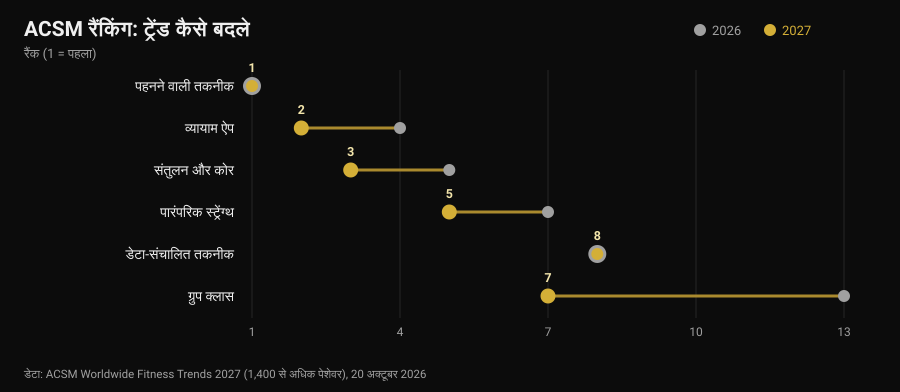
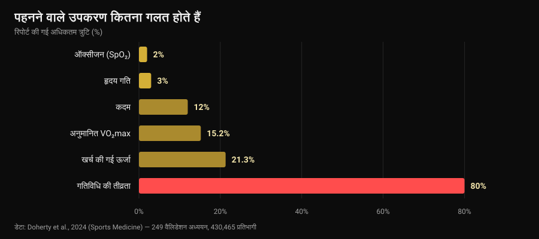

# फिटनेस ट्रेंड 2027: असल में क्या काम करता है

लेखक: [Giammaria Loi](/autore/giammaria-loi) · 30 अक्टूबर 2026 को अपडेट किया गया

20 अक्टूबर को American College of Sports Medicine ने 2027 के फिटनेस ट्रेंड की सूची जारी की, और एक हफ़्ते में वह हर इंडस्ट्री साइट पर पहुँच गई। दसवीं बार पहले नंबर पर वियरेबल डिवाइस हैं; एक्सरसाइज़ ऐप चौथे से दूसरे नंबर पर चढ़े हैं। मैंने जितनी भी रिपोर्ट पढ़ीं, किसी ने अगला सवाल नहीं पूछा: ये ट्रेंड काम भी करते हैं क्या? मैं आँकड़े ढूँढ़ने निकला, और नतीजा यह निकला कि सूची में सबसे ऊपर बैठे उपकरण एक काम बहुत अच्छा करते हैं और दूसरा बहुत ख़राब — और वही दूसरा वह आँकड़ा है जिसे लगभग हर कोई सबसे पहले देखता है।

## संक्षेप में

- **यह सूची असर नहीं नापती।** यह 1,400 से ज़्यादा इंडस्ट्री पेशेवरों से पूछा गया सर्वे है कि 2027 में किसका वज़न सबसे ज़्यादा होगा, और यह इसका 21वाँ साल है। यह बताती है बाज़ार किधर जा रहा है, यह नहीं कि नतीजे किससे मिलते हैं।
- **ट्रैकर वाक़ई चलना बढ़ाते हैं, और यह बात ठोस है।** 39 सिस्टेमैटिक रिव्यू (1,63,992 प्रतिभागी) के विश्लेषण का अनुमान है रोज़ाना लगभग **1,800 क़दम ज़्यादा**, 40 मिनट ज़्यादा पैदल चलना और क़रीब **1 किलो** कम वज़न (Ferguson et al., 2022)।
- **स्क्रीन पर दिख रही कैलोरी सबसे कम भरोसेमंद आँकड़ा है।** ऊर्जा ख़र्च में ग़लती **-21.3%** से **+14.8%** तक जाती है, और गतिविधि की तीव्रता में औसत ग़लती **80%** तक पहुँचती है (Doherty et al., 2024)।
- **हृदय गति, इसके उलट, अच्छी है।** औसत विचलन **±3%**। अनुमानित VO₂max नहीं: आराम की हालत में **15.2%** ज़्यादा बताया जाता है।
- **"डेटा-आधारित" का मतलब "बेहतर" नहीं।** हृदय गति परिवर्तनशीलता के हिसाब से ट्रेनिंग वेगस से जुड़े सूचकांक सुधारती है (SMD 0.50) पर प्रदर्शन में सार्थक सुधार नहीं लाती (Manresa-Rocamora et al., 2021)।

## 2027 की सूची, तीन लाइनों में

ACSM हर साल दुनिया भर के फिटनेस पेशेवरों को प्रश्नावली भेजकर पूछता है कि अगले बारह महीनों में किन ट्रेंड का वज़न सबसे ज़्यादा होगा। 2027 का संस्करण, जिसकी अगुवाई Cayla R. McAvoy और ट्रेंड वर्कग्रुप ने की, 1,400 से ज़्यादा जवाबों पर टिका है। सबसे ऊपर:

1. वियरेबल तकनीक (दसवीं बार पहला स्थान);
2. एक्सरसाइज़ ऐप (चौथे से);
3. संतुलन, गतिशीलता और कोर (पाँचवें से);
4. बड़ी उम्र के लोगों के कार्यक्रम (लगातार पाँच साल से टॉप फ़ाइव में);
5. पारंपरिक स्ट्रेंथ ट्रेनिंग (दो स्थान ऊपर);
6. वज़न प्रबंधन के लिए व्यायाम;
7. ग्रुप क्लास (तेरहवें से);
8. डेटा-संचालित ट्रेनिंग तकनीक (आठवें पर स्थिर);
9. मानसिक स्वास्थ्य के लिए व्यायाम (लगातार चार साल से टॉप टेन में);
10. इन्फ़्लुएंसर और ब्रांड एम्बेसडर के कार्यक्रम (टॉप ट्वेंटी से बाहर होने के बाद वापसी)।

सबसे बड़ी छलाँग ग्रुप क्लास की है, एक साल में छह स्थान। पर दिलचस्प बात कहीं और है: दस में से **तीन तकनीक हैं** और दो सीधी-सादी पारंपरिक ट्रेनिंग। यही सह-अस्तित्व ग़ौर से देखने लायक़ है, क्योंकि इन दोनों हिस्सों पर रिसर्च बहुत अलग बातें कहती है।

एक बात जो लगभग हर रिपोर्ट से ग़ायब है: पेशेवरों की राय का सर्वे **असर का प्रमाण नहीं होता**। वह बाज़ार का थर्मामीटर है। अगर 2027 में सब डेटा बेचेंगे, तो सही सवाल यह है कि वह डेटा कितना सटीक है।

## घड़ी क्या ठीक नापती है, और क्या अंदाज़ा लगाती है

यहाँ एक लगभग आदर्श स्रोत मौजूद है: *Sports Medicine* में छपी एक "जीवित" अम्ब्रेला रिव्यू, जिसने 24 सिस्टेमैटिक रिव्यू, 249 वैलिडेशन अध्ययन और 4,30,465 प्रतिभागियों को जोड़कर उपभोक्ता उपकरणों की तुलना प्रयोगशाला के मानक उपकरणों से की (Doherty et al., 2024)।

बाएँ से दाएँ पढ़ने पर ग्राफ़ एक साफ़ क्रम बताता है।

**भरोसेमंद।** हृदय गति में औसत विचलन **3%** है: दौड़ या सर्किट की तीव्रता तय करने के लिए यह पर्याप्त से ज़्यादा है। अनियमित धड़कन की पहचान में उपकरण 100% संवेदनशीलता और 95% विशिष्टता दिखाते हैं — आँकड़ा प्रभावशाली है, पर वह अब भी डॉक्टर के पास जाने का संकेत है, निदान नहीं।

**मोटा-मोटी, पर काम का।** क़दम आमतौर पर कम गिने जाते हैं, औसत निरपेक्ष प्रतिशत त्रुटि **-9% से 12%** के बीच। मतलब: घड़ी 8,000 क़दम दिखा रही है तो असली आँकड़ा क़रीब 7,000 और 8,800 के बीच है। साप्ताहिक रुझान देखने के लिए बिल्कुल ठीक; किसी एक दिन पर नतीजा निकालने के लिए नहीं।

**फ़ैसले के लिए नहीं।** ऊर्जा ख़र्च में त्रुटि **-21.3% से +14.8%** तक है। जिस सेशन को स्क्रीन 600 किलो कैलोरी बताती है, उसका असली मान 470 से 690 के बीच कहीं भी हो सकता है। गतिविधि की तीव्रता और भी ख़राब है: काम कितना कठिन है उसके हिसाब से औसत त्रुटि **29% से 80%** तक। अनुमानित VO₂max आराम में **15.24%** और मेहनत के दौरान **9.83%** ज़्यादा बताया जाता है: घड़ी 52 दिखा रही है तो संभावित आँकड़ा 47 के आसपास है।

और नींद? उपकरण **कुल नींद का समय बढ़ा-चढ़ाकर** बताते हैं, त्रुटि आम तौर पर 10% से ऊपर: व्यवहार में वे उस समय को भी नींद गिन लेते हैं जब आप बस चुपचाप लेटे थे। यह देखने के लिए कि आप रोज़ से देर में सोए या नहीं, यह काफ़ी है — और [आख़िरी कॉफ़ी कब तक पी लें](/hi/blog/caffeine-neend-kab-coffee-band-karein) वाले सवाल में मुद्दा यही है — लेकिन "स्लीप स्कोर" कोई क्लिनिकल माप नहीं है।

आख़िरी आँकड़ा सब कुछ सही जगह रख देता है: बाज़ार में मौजूद सभी उपकरणों में से सिर्फ़ क़रीब **11%** कम से कम एक माप के लिए वैलिडेट हुए हैं, और अब तक हुए वैलिडेशन अध्ययन ज़रूरत के मुक़ाबले **3.5%** हैं। जब कोई ब्रांड डिब्बे पर "क्लिनिकल सटीकता" लिखता है, तो दस में नौ बार उस मॉडल के लिए ऐसा कोई प्रकाशित अध्ययन मौजूद ही नहीं होता।

## विरोधाभास: आँकड़े ग़लत, फिर भी असर

अब वह हिस्सा जो लगभग कोई नहीं बताता। जो उपकरण कैलोरी का अंदाज़ा ग़लत लगाते हैं, वही लोगों को हिलाने-डुलाने के मामले में सबसे ज़्यादा प्रमाण वाले उपकरणों में हैं।

Ferguson और साथियों की अम्ब्रेला रिव्यू ने 39 सिस्टेमैटिक रिव्यू और मेटा-विश्लेषण जोड़े, जिनमें हर उम्र के 1,63,992 प्रतिभागी थे, स्वस्थ और क्लिनिकल दोनों आबादी से। नतीजा: शारीरिक गतिविधि पर छोटा से मध्यम असर (SMD 0.3-0.6), शरीर संरचना 0.7-2.0, फ़िटनेस 0.3। ठोस इकाइयों में: रोज़ाना लगभग **1,800 क़दम ज़्यादा**, **40 मिनट ज़्यादा पैदल चलना**, क़रीब **1 किलो** कम वज़न। रक्तचाप, कोलेस्ट्रॉल, HbA1c, जीवन की गुणवत्ता और दर्द पर असर छोटे और अक्सर सार्थक नहीं थे। लेखकों का निष्कर्ष है कि इस्तेमाल की सिफ़ारिश करने के लिए प्रमाण पर्याप्त हैं।

यह विरोधाभास नहीं है: उपकरण **याद दिलाने वाले और आईने** की तरह काम करता है, नापने के यंत्र की तरह नहीं। वह आपको याद दिलाता है कि आप हैं, एक रुझान दिखाता है, एक लक्ष्य देता है। कैलोरी का अनुमान 20% ग़लत होना इस तंत्र में कुछ नहीं बदलता — बशर्ते आप अपनी डाइट उसी आँकड़े पर न खड़ी कर दें; तब यह सचमुच समस्या बन जाता है।

बड़ी उम्र के लोगों में, जो सूची का चौथा ट्रेंड है, आँकड़े मेल खाते हैं: 45 अध्ययनों और 7,144 प्रतिभागियों में ट्रैकर क़दम बढ़ाते हैं (SMD 0.59), साप्ताहिक मध्यम-से-तेज़ गतिविधि बढ़ाते हैं (SMD 0.54) और बैठे रहने का समय घटाते हैं (Wu et al., 2023)। पर वही अध्ययन निर्णायक बात जोड़ता है: ट्रैकर **पारंपरिक तरीक़ों के साथ** — तय किए गए लक्ष्य, ख़ुद की निगरानी, फ़ॉलो-अप कॉल — अकेले ट्रैकर से ज़्यादा हासिल करते हैं।

ऐप के साथ भी यही कहानी है। शारीरिक गतिविधि और वज़न प्रबंधन के ऐप पर 12 रैंडमाइज़्ड अध्ययनों में वज़न, BMI और शरीर में वसा के प्रतिशत पर असर छोटे से मध्यम थे, और सबसे असरदार वे थे जिनमें **रिमाइंडर, ख़ुद की निगरानी और एक इंसानी कोच** शामिल थे (Yen et al., 2022)। यह वही निष्कर्ष है जिस पर हम [ऑनलाइन कोचिंग काम करती है या नहीं](/hi/blog/online-coaching-kaam-karta-hai) लिखते समय पहुँचे थे: तकनीक एक रिश्ते को कई गुना करती है, उसकी जगह नहीं लेती।

## "डेटा-आधारित": क्या HRV वादा निभाती है?

आठवाँ ट्रेंड, जो साल भर से अपनी जगह पर है, वह तकनीक है जो नींद और हृदय गति परिवर्तनशीलता (HRV) पढ़कर बताती है कि आज कैसे ट्रेनिंग करें। वादा लुभावना है: घड़ी जानती है कब आप ज़ोर लगा सकते हैं।

मेटा-विश्लेषण कहीं ज़्यादा ठंडे हैं। Manresa-Rocamora और साथियों की पद्धतिगत समीक्षा में HRV-आधारित ट्रेनिंग पहले से तय कार्यक्रम को **वेगस से जुड़े HRV सूचकांकों** पर हराती है (SMD 0.50; 95% CI 0.09-0.91), पर आराम की हृदय गति पर नहीं; और अधिकतम एरोबिक क्षमता (SMD 0.20; 95% CI -0.07-0.47) तथा सहनशक्ति प्रदर्शन (SMD 0.20; 95% CI -0.09-0.48) में अंतर छोटे और **सार्थक नहीं** हैं। दूसरा मेटा-विश्लेषण, सिर्फ़ सहनशक्ति एथलीटों पर, VO₂max पर छोटा पर सकारात्मक असर पाता है (ES 0.402), जो शौक़िया खिलाड़ियों और महिलाओं में ज़्यादा दिखता है (Granero-Gallegos et al., 2020)।

ईमानदार पाठ यह है: HRV नतीजों की ऊपरी सीमा उठाने से ज़्यादा यह करती दिखती है कि ट्रेनिंग के प्रति नकारात्मक प्रतिक्रिया की संभावना घटा दे — ग़लत वक़्त पर ख़राब की गई कम सेशन। अगर यह तय करने में काम आती है कि कब एक सेट कम कर दें, तो इसका मतलब है। अगर आप इससे पूछते हैं कि आज स्क्वाट "कर सकते हैं या नहीं", तो आप पंद्रह सेकंड की एक रीडिंग को वह फ़ैसला सौंप रहे हैं जो आप ख़ुद बेहतर लेते हैं।

## वह ट्रेंड जिसे 2027 कम आँक रहा है

छठे स्थान पर वज़न प्रबंधन के लिए व्यायाम है, और ACSM नोट करता है कि वज़न घटाने की दवाओं के फैलने के साथ ध्यान मांसपेशी बचाने पर जा रहा है। यहाँ एक आँकड़ा लिख देना ज़रूरी है, क्योंकि यह हर उस व्यक्ति से जुड़ा है जो तेज़ी से वज़न घटा रहा है: कैलोरी घाटे में स्ट्रेंथ ट्रेनिंग पर हुए मेटा-विश्लेषण और मेटा-रिग्रेशन से पता चलता है कि दुबली मांसपेशी द्रव्यमान में बढ़त **बाधित** होती है (ES -0.57; p = 0.02) जबकि ताक़त की बढ़त तुलनीय रहती है (ES -0.31; p = 0.28), और लगभग **500 किलो कैलोरी प्रतिदिन** से ज़्यादा घाटे पर दुबला द्रव्यमान बढ़ना बंद कर देता है (Murphy और Koehler, 2021)।

यानी तेज़ी से वज़न घटाने वाला अपनी ताक़त बचा लेता है पर मांसपेशी नहीं बनाता, और उस दौर में रेज़िस्टेंस ट्रेनिंग का काम जो मौजूद है उसकी **हिफ़ाज़त** करना है। इसे व्यवहार में कैसे सेट करें, यह हमने [बॉडी रीकंपोज़िशन](/hi/blog/body-recomposition-charbi-ghataye-muscle-badhaye) में देखा था। अगर आप वज़न घटाने की दवाएँ ले रहे हैं, तो डाइट और ट्रेनिंग पर चर्चा उसी डॉक्टर से करें जिसने वे लिखी हैं: यहाँ बात आँकड़ों की है, निजी प्रोटोकॉल की नहीं।

## रिसर्च असल में क्या कहती है

**पुष्ट — "वियरेबल से चलना बढ़ता है"।** रोज़ाना क़रीब 1,800 क़दम और 40 मिनट ज़्यादा पैदल चलना, फ़ायदा समय के साथ बना रहता है, 1,63,992 प्रतिभागियों पर।

**पुष्ट — "कलाई की हृदय गति इस्तेमाल लायक़ है"।** औसत विचलन 3%, तीव्रता तय करने के लिए पर्याप्त।

**खंडित — "घड़ी की कैलोरी एक आँकड़ा है"।** त्रुटि -21.3% से +14.8%, और गतिविधि की तीव्रता पर 80% तक।

**खंडित — "घड़ी का VO₂max एक माप है"।** आराम में 15.24% और मेहनत में 9.83% ज़्यादा बताया जाता है।

**स्पष्टीकरण चाहिए — "स्लीप स्कोर बताता है आप कैसे सोए"।** कुल अवधि बढ़ा-चढ़ाकर बताई जाती है, आम तौर पर 10% से ज़्यादा: रुझान के लिए उपयोगी, माप के रूप में नहीं।

**स्पष्टीकरण चाहिए — "HRV के हिसाब से ट्रेनिंग बेहतर नतीजे देती है"।** वेगस सूचकांक सुधरते हैं, पर VO₂max और प्रदर्शन पर असर छोटा और सार्थक नहीं।

**खंडित — "अच्छा ऐप हो तो कोच की ज़रूरत नहीं"।** सबसे असरदार ऐप और ट्रैकर वही हैं जिनमें रिमाइंडर, लक्ष्य और इंसानी संपर्क हो।

**खंडित — "ACSM की सूची बताती है क्या काम करता है"।** यह पेशेवरों की राय का सर्वे है: यह बाज़ार की उम्मीदें नापता है।

## इसे कैसे लागू करें

1. **घड़ी को रुझान के लिए इस्तेमाल करें, निरपेक्ष आँकड़ों के लिए नहीं।** क़दम, हृदय गति और सक्रिय मिनट अपनी ही चार हफ़्ते की औसत से तुलना करने पर उसी आँकड़े को एक बार देखने से कहीं ज़्यादा काम के हैं।
2. **स्क्रीन की कैलोरी पर डाइट मत खड़ी करें।** दोनों दिशाओं में 20% तक संभावित त्रुटि के साथ, आधार शरीर का वज़न और समय के साथ ली गई माप होनी चाहिए, अनुमानित ख़र्च नहीं।
3. **हर आँकड़े के बदले एक फ़ैसला।** जो आँकड़ा कुछ नहीं बदलता वह शोर है: अगर रिकवरी स्कोर ने आपसे कभी कुछ घटवाया या बढ़वाया नहीं, तो उसे देखना बंद कर दें।
4. **ताक़त के लिए भार नापें, कैलोरी नहीं।** सेट, रेप, वज़न और RIR (रिज़र्व में बची रेप) वे पैमाने हैं जिन पर प्रगति टिकती है: कोई घड़ी इन्हें आपके लिए दर्ज नहीं करती।
5. **HRV इस्तेमाल करें तो घटाने के लिए करें।** यह ख़राब दिनों में ब्रेक की तरह सही है, अच्छे दिनों में परमिट की तरह नहीं।
6. **इंसानी हिस्सा जोड़ें।** जो डेटा किसी इंसान तक पहुँचता है — कोच, दोस्त, ग्रुप — वह ऐप में पड़े रह जाने वाले डेटा से बेहतर काम करता है। मेटा-विश्लेषणों में यही फ़र्क़ दिखता है।
7. **डिब्बे पर लिखी "क्लिनिकल सटीकता" पर शक करें।** सिर्फ़ 11% उपकरण कम से कम एक माप के लिए वैलिडेट हैं: पूछिए किस माप के लिए, और किस अध्ययन में।

### Nurvan आज़माएँ — वे आँकड़े जो आपकी घड़ी दर्ज नहीं करती

स्मार्टवॉच जानती है आप कितना चले। उसे यह नहीं पता कि कल आपने बेंच प्रेस फ़ेल्योर से 4 रेप पहले रोकी थी और आज 2 रेप पहले — और यही इकलौती जानकारी है जिससे पता चलता है कि आप आगे बढ़ रहे हैं या नहीं। Nurvan में आप हर सेट का भार, रेप और RIR दर्ज करते हैं, अपना मौजूदा प्रोग्राम PDF, Excel या फ़ोटो से इम्पोर्ट करते हैं, और महीने-दर-महीने भार का कर्व माप तथा वज़न के साथ देखते हैं; वॉर्म-अप सेट उस दिन के वर्किंग वज़न से अपने आप सुझाए जाते हैं। और अगर कोई कोच आपको देख रहा है, तो वह वही स्क्रीन देखता है जो आप देखते हैं — वही इंसानी हिस्सा जो मेटा-विश्लेषणों में फ़र्क़ डालता है।

## अक्सर पूछे जाने वाले सवाल

**2027 के फिटनेस ट्रेंड कौन से हैं?**
20 अक्टूबर 2026 को प्रकाशित ACSM सर्वे के अनुसार, क्रम में: वियरेबल तकनीक, एक्सरसाइज़ ऐप, संतुलन और कोर, बड़ी उम्र के लोगों के कार्यक्रम, पारंपरिक स्ट्रेंथ ट्रेनिंग, वज़न प्रबंधन के लिए व्यायाम, ग्रुप क्लास, डेटा-संचालित ट्रेनिंग तकनीक, मानसिक स्वास्थ्य के लिए व्यायाम, इन्फ़्लुएंसर-संचालित कार्यक्रम। यह 1,400 से ज़्यादा पेशेवरों से साल की उम्मीदों पर किया गया सर्वे है, असर की रैंकिंग नहीं।

**स्मार्टवॉच की कैलोरी कितनी सटीक होती है?**
बहुत नहीं। 249 वैलिडेशन अध्ययनों की समीक्षा ऊर्जा ख़र्च में -21.3% से +14.8% तक की त्रुटि बताती है, और तीव्रता के अनुमान में 29% से 80% तक औसत त्रुटि। इसके उलट हृदय गति में औसत विचलन 3% है: यही वह माप है जिसमें ये उपकरण सबसे भरोसेमंद हैं।

**क्या फिटनेस बैंड ख़रीदना सही है?**
अगर आपकी समस्या ज़्यादा चलना-फिरना है, तो प्रमाण पक्ष में हैं: औसतन रोज़ाना क़रीब 1,800 क़दम और 40 मिनट ज़्यादा पैदल चलना, क़रीब 1 किलो कम वज़न, और फ़ायदा समय के साथ टिकता है। अगर आपकी समस्या यह जानना है कि कितनी कैलोरी जलीं या आपका VO₂max कितना है, तो यह सही औज़ार नहीं है।

**क्या मुझे HRV के हिसाब से ट्रेनिंग करनी चाहिए?**
मेटा-विश्लेषण हृदय गति परिवर्तनशीलता के सूचकांकों में सुधार दिखाते हैं, पर एरोबिक क्षमता और प्रदर्शन पर असर छोटे और सार्थक नहीं। ग़लत वक़्त पर सेशन करने से बचने के औज़ार के तौर पर इसका मतलब हो सकता है; हर ट्रेनिंग के फ़ैसले के जज के तौर पर नहीं।

## यह भी पढ़ें

- [ऑनलाइन कोचिंग काम करती है? रिसर्च क्या कहती है](/hi/blog/online-coaching-kaam-karta-hai) — डेटा के दूसरी तरफ़ इंसान हो तो असल में क्या बदलता है।
- [बॉडी रीकंपोज़िशन: चर्बी घटाएँ, मसल बढ़ाएँ](/hi/blog/body-recomposition-charbi-ghataye-muscle-badhaye) — ऐसा घाटा कैसे बनाएँ जो दुबली मांसपेशी न छीने।
- [कैफीन और नींद: आख़िरी कॉफ़ी कब तक पी लें](/hi/blog/caffeine-neend-kab-coffee-band-karein) — रिकवरी का दूसरा आधा हिस्सा, आँकड़ों के साथ।

## स्रोत

1. Ferguson T, Olds T, Curtis R, Blake H, Crozier AJ, Dankiw K, Dumuid D, Kasai D, O'Connor E, Virgara R, Maher C, 2022. *Effectiveness of wearable activity trackers to increase physical activity and improve health: a systematic review of systematic reviews and meta-analyses.* The Lancet Digital Health 4(8):e615-e626. [PMID 35868813](https://pubmed.ncbi.nlm.nih.gov/35868813/) · [DOI 10.1016/S2589-7500(22)00111-X](https://doi.org/10.1016/S2589-7500(22)00111-X)
2. Doherty C, Baldwin M, Keogh A, Caulfield B, Argent R, 2024. *Keeping Pace with Wearables: A Living Umbrella Review of Systematic Reviews Evaluating the Accuracy of Consumer Wearable Technologies in Health Measurement.* Sports Medicine 54(11):2907-2926. [PMID 39080098](https://pubmed.ncbi.nlm.nih.gov/39080098/) · [DOI 10.1007/s40279-024-02077-2](https://doi.org/10.1007/s40279-024-02077-2)
3. Wu S, Li G, Du L, Chen S, Zhang X, He Q, 2023. *The effectiveness of wearable activity trackers for increasing physical activity and reducing sedentary time in older adults: A systematic review and meta-analysis.* Digital Health 9:20552076231176705. [PMID 37252261](https://pubmed.ncbi.nlm.nih.gov/37252261/) · [DOI 10.1177/20552076231176705](https://doi.org/10.1177/20552076231176705)
4. Yen HY, Jin G, Chiu HL, 2022. *Smartphone app-based interventions targeting physical activity for weight management: A meta-analysis of randomized controlled trials.* International Journal of Nursing Studies 137:104384. [PMID 36379104](https://pubmed.ncbi.nlm.nih.gov/36379104/) · [DOI 10.1016/j.ijnurstu.2022.104384](https://doi.org/10.1016/j.ijnurstu.2022.104384)
5. Manresa-Rocamora A, Sarabia JM, Javaloyes A, Flatt AA, Moya-Ramón M, 2021. *Heart Rate Variability-Guided Training for Enhancing Cardiac-Vagal Modulation, Aerobic Fitness, and Endurance Performance: A Methodological Systematic Review with Meta-Analysis.* International Journal of Environmental Research and Public Health 18(19):10299. [PMID 34639599](https://pubmed.ncbi.nlm.nih.gov/34639599/) · [DOI 10.3390/ijerph181910299](https://doi.org/10.3390/ijerph181910299)
6. Granero-Gallegos A, González-Quílez A, Plews D, Carrasco-Poyatos M, 2020. *HRV-Based Training for Improving VO2max in Endurance Athletes. A Systematic Review with Meta-Analysis.* International Journal of Environmental Research and Public Health 17(21):7999. [PMID 33143175](https://pubmed.ncbi.nlm.nih.gov/33143175/) · [DOI 10.3390/ijerph17217999](https://doi.org/10.3390/ijerph17217999)
7. Murphy C, Koehler K, 2021. *Energy deficiency impairs resistance training gains in lean mass but not strength: A meta-analysis and meta-regression.* Scandinavian Journal of Medicine & Science in Sports 32(1):125-137. [PMID 34623696](https://pubmed.ncbi.nlm.nih.gov/34623696/) · [DOI 10.1111/sms.14075](https://doi.org/10.1111/sms.14075)
8. McAvoy CR et al., 2026. *2027 ACSM Worldwide Fitness Trends: Future Directions of the Health and Fitness Industry.* ACSM's Health & Fitness Journal 30(6), नवंबर/दिसंबर 2026. [DOI 10.1249/fit.0000000000001208](https://doi.org/10.1249/fit.0000000000001208) · [ACSM विज्ञप्ति](https://acsm.org/2027-fitness-trends/)

संदर्भ PubMed के ज़रिए निकाले गए। शुरुआती बिंदु: कोई सोशल पोस्ट नहीं, बल्कि 20-26 अक्टूबर 2026 का ट्रेंड संकेत — ACSM Worldwide Fitness Trends 2027 सर्वे का प्रकाशन और Medical Xpress, Athletech News तथा Yahoo Lifestyle में उसकी चर्चा, साथ ही अक्टूबर 2026 में वियरेबल उपकरणों की सर्च माँग में बढ़ोतरी। विषय प्राथमिक स्रोतों से शून्य से लिखा गया है।

---

**Giammaria Loi** Nurvan के संस्थापक हैं। वे 2012 से वेट ट्रेनिंग करते हैं, 2013 से FIPE प्रमाणित पर्सनल ट्रेनर और कोच के रूप में काम करते हैं और 2018 से राष्ट्रीय स्तर पर पावरलिफ्टिंग में प्रतिस्पर्धा करते हैं। उनके हस्ताक्षर वाला हर लेख वैज्ञानिक अध्ययनों से शुरू होता है और जिम में असल में काम करने वाली बात पर ख़त्म होता है।

> नोट: यह जानकारीपरक सामग्री है, डॉक्टर या पेशेवर की राय का विकल्प नहीं। यहाँ दी गई नींद, ऑक्सीजन संतृप्ति और अनियमित धड़कन से जुड़ी बातें उपकरणों की माप सटीकता के बारे में हैं, उनके नैदानिक उपयोग के बारे में नहीं: असामान्य मान डॉक्टर के पास ले जाया जाता है, ऐप से नहीं पढ़ा जाता। अगर आप वज़न घटाने की दवाएँ ले रहे हैं, तो डाइट या ट्रेनिंग बदलने से पहले उन्हें लिखने वाले डॉक्टर से बात करें।
