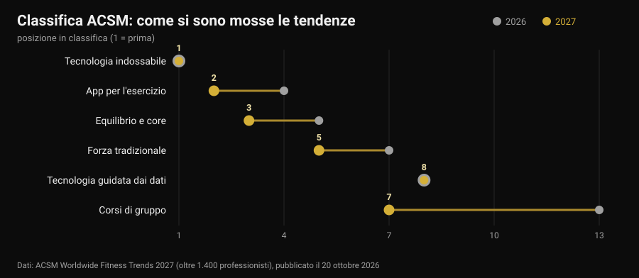
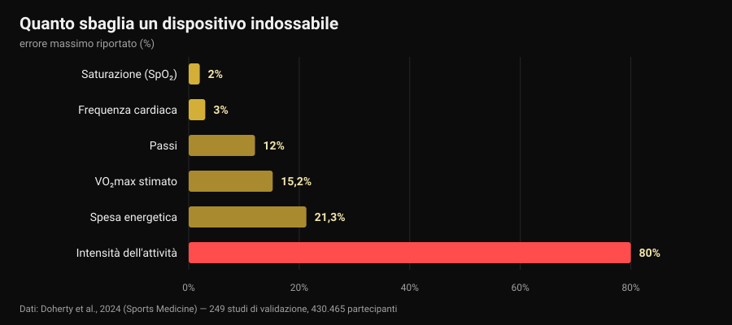

# Tendenze fitness 2027: cosa funziona davvero

Di [Giammaria Loi](/autore/giammaria-loi) · aggiornato il 30 ottobre 2026

Il 20 ottobre l'American College of Sports Medicine ha pubblicato la sua classifica delle tendenze fitness per il 2027, e in una settimana è finita su tutti i siti di settore. Per la decima volta in cima ci sono i dispositivi indossabili; le app per l'esercizio salgono dal quarto al secondo posto. Nessuno degli articoli che ho letto ha fatto la domanda successiva: quelle tendenze funzionano? Sono andato a cercare i numeri, e il risultato è che gli strumenti in testa alla classifica fanno benissimo una cosa e molto male un'altra — compreso il dato che quasi tutti guardano per primo.

## In breve

- **La classifica non misura l'efficacia.** È un sondaggio fra oltre 1.400 professionisti del settore su cosa peserà di più nel 2027, giunto alla 21ª edizione. Dice dove va il mercato, non cosa produce risultati.
- **I tracker fanno muovere di più, e questo è solido.** La revisione di 39 revisioni sistematiche (163.992 partecipanti) stima circa **1.800 passi in più al giorno**, 40 minuti in più di camminata e circa **1 kg** di peso in meno (Ferguson et al., 2022).
- **Le calorie bruciate sul quadrante sono il numero meno affidabile.** L'errore sulla spesa energetica va da **-21,3%** a **+14,8%**, e sull'intensità dell'attività l'errore medio arriva al **80%** (Doherty et al., 2024).
- **La frequenza cardiaca, invece, è buona.** Bias medio **±3%**. Il VO2max stimato no: sovrastimato del **15,2%** a riposo.
- **"Guidato dai dati" non vuol dire "migliore".** Allenarsi seguendo la variabilità cardiaca migliora gli indici vagali (SMD 0,50) ma non migliora in modo significativo la performance (Manresa-Rocamora et al., 2021).

## La classifica 2027 in tre righe

L'ACSM manda ogni anno un questionario a professionisti del fitness di tutto il mondo e chiede quali tendenze avranno più peso nei dodici mesi successivi. L'edizione 2027, firmata da Cayla R. McAvoy e dal gruppo di lavoro sulle tendenze, raccoglie oltre 1.400 risposte. In cima:

1. tecnologia indossabile (primo posto per la decima volta);
2. app per l'esercizio (dal quarto);
3. equilibrio, mobilità e core (dal quinto);
4. programmi per adulti più grandi (nei primi cinque da cinque anni);
5. allenamento di forza tradizionale (su di due posizioni);
6. esercizio per la gestione del peso;
7. corsi di gruppo (dal tredicesimo);
8. tecnologia guidata dai dati (ferma all'ottavo);
9. esercizio per la salute mentale (nei primi dieci da quattro anni);
10. programmi guidati da influencer e ambassador (rientrati dopo essere usciti dai primi venti).

Il salto più grande è quello dei corsi di gruppo, sei posizioni in un anno. La cosa interessante, però, è un'altra: delle dieci voci, **tre sono tecnologia** e due sono allenamento classico. È questa convivenza che vale la pena guardare da vicino, perché la ricerca sulle due metà dice cose molto diverse.

Una precisazione che manca in quasi tutte le riprese della notizia: un sondaggio di opinione fra professionisti **non è una prova di efficacia**. È un termometro del mercato. Se nel 2027 tutti venderanno dati, la domanda da farsi è quanto quei dati siano precisi.

## Quello che l'orologio misura bene, e quello che stima

Qui esiste una fonte quasi perfetta: una revisione "vivente" pubblicata su *Sports Medicine* che ha messo insieme 24 revisioni sistematiche, 249 studi di validazione e 430.465 partecipanti, confrontando i dispositivi di consumo con gli strumenti di riferimento di laboratorio (Doherty et al., 2024).

Letto da sinistra a destra, il grafico racconta una gerarchia netta.

**Affidabile.** La frequenza cardiaca ha un bias medio del **3%**: per regolare l'intensità di una corsa o di un circuito è più che sufficiente. Nel riconoscimento delle aritmie i dispositivi mostrano sensibilità del 100% e specificità del 95% — un dato notevole, che resta però un segnale da portare al medico, non una diagnosi.

**Approssimativo ma utile.** I passi vengono di solito sottostimati, con un errore percentuale medio assoluto che va da **-9% a 12%**. Tradotto: se l'orologio segna 8.000 passi, i tuoi passi stanno in una fascia fra circa 7.000 e 8.800. Per seguire una tendenza settimanale va benissimo; per trarne conclusioni su una singola giornata no.

**Da non usare per decidere.** La spesa energetica ha un errore compreso fra **-21,3% e +14,8%**. Su una seduta che il quadrante stima a 600 kcal, il valore vero può stare fra 470 e 690. Peggio ancora l'intensità dell'attività, dove l'errore medio va dal **29% all'80%** a seconda di quanto è intensa la cosa che stai facendo. Il VO2max stimato è sovrastimato del **15,24%** a riposo e del **9,83%** sotto sforzo: se il tuo orologio ti dà 52, il numero plausibile è intorno a 47.

E il sonno? I dispositivi tendono a **sovrastimare il tempo totale di sonno**, con un errore tipicamente superiore al 10%: in pratica contano come sonno dei periodi in cui stavi semplicemente fermo. Va bene per vedere se vai a letto più tardi del solito — che è poi il punto quando si parla di [caffeina e orario dell'ultimo caffè](/blog/caffeina-sonno-quando-smettere-caffe) — ma un "punteggio del sonno" non è una misura clinica.

C'è un ultimo dato che mette tutto in prospettiva: di tutti i dispositivi in commercio, solo l'**11% circa** è stato validato per almeno un parametro, e gli studi di validazione fatti finora sono il **3,5%** di quelli che servirebbero. Quando un'azienda scrive "accuratezza clinica" sulla scatola, nove volte su dieci non esiste un lavoro pubblicato che lo dimostri per quel modello.

## Il paradosso: sbagliano i numeri e funzionano comunque

Qui arriva la parte che quasi nessuno racconta. Gli stessi dispositivi che stimano male le calorie sono tra gli strumenti con la base di prove più ampia per far muovere le persone.

L'umbrella review di Ferguson e colleghi ha raccolto 39 revisioni sistematiche e meta-analisi, per 163.992 partecipanti di tutte le età, in popolazioni sane e cliniche. Risultato: attività fisica con effetto da piccolo a moderato (SMD 0,3-0,6), composizione corporea 0,7-2,0, fitness 0,3. In unità concrete: circa **1.800 passi in più al giorno**, **40 minuti in più di camminata al giorno**, circa **1 kg** di peso in meno. Gli effetti su pressione, colesterolo, emoglobina glicata, qualità della vita e dolore sono invece piccoli e spesso non significativi. Gli autori concludono che le prove sono sufficienti per raccomandarne l'uso.

Non è una contraddizione: il dispositivo funziona come **promemoria e specchio**, non come strumento di misura. Ti ricorda che esisti, ti fa vedere una tendenza, ti dà un obiettivo. Che la stima delle calorie sia sballata del 20% non cambia nulla di quel meccanismo — a meno che tu non costruisca la dieta su quel numero, e allora sì, diventa un problema.

Negli adulti più grandi, la quarta tendenza della classifica, i numeri sono coerenti: su 45 studi e 7.144 partecipanti i tracker aumentano i passi (SMD 0,59) e l'attività moderata-vigorosa settimanale (SMD 0,54), e riducono il tempo sedentario (Wu et al., 2023). Ma lo stesso lavoro aggiunge il dettaglio che conta: i tracker **uniti a componenti tradizionali** — obiettivi concordati, automonitoraggio, telefonate di follow-up — ottengono più dei tracker da soli.

La stessa cosa emerge dalle app. In 12 studi randomizzati su app per l'attività fisica e la gestione del peso, gli effetti su peso, BMI e percentuale di grasso erano da piccoli a moderati, e le più efficaci erano quelle con **promemoria, automonitoraggio e un coach umano** fra le funzioni (Yen et al., 2022). È la stessa conclusione a cui arrivavamo parlando di [coaching online e cosa dicono gli studi](/blog/coaching-online-funziona-studi): la tecnologia moltiplica una relazione, non la sostituisce.

## "Guidato dai dati": l'HRV mantiene la promessa?

L'ottava tendenza, ferma da un anno, è la tecnologia che legge sonno e variabilità della frequenza cardiaca (HRV) per dirti come allenarti oggi. Promessa seducente: l'orologio sa quando puoi spingere.

Le meta-analisi sono più tiepide. Nella revisione metodologica di Manresa-Rocamora e colleghi, allenarsi guidati dall'HRV batte un programma prefissato sugli **indici vagali** di HRV (SMD 0,50; IC 95% 0,09-0,91), ma non sulla frequenza cardiaca a riposo, e le differenze su capacità aerobica massima (SMD 0,20; IC 95% -0,07-0,47) e performance di resistenza (SMD 0,20; IC 95% -0,09-0,48) sono piccole e **non significative**. Una seconda meta-analisi, solo su atleti di resistenza, trova un effetto piccolo ma positivo sul VO2max (ES 0,402), più marcato negli amatori e nelle donne (Granero-Gallegos et al., 2020).

La lettura onesta è questa: l'HRV sembra ridurre la probabilità di risposte negative all'allenamento — meno sedute fatte male nel momento sbagliato — più che alzare il tetto dei risultati. Se ti serve per decidere quando togliere una serie, ha senso. Se lo usi per sapere se oggi "puoi" fare lo squat, stai delegando a un dato di quindici secondi una decisione che sai prendere meglio tu.

## La tendenza che il 2027 sottovaluta

Al sesto posto c'è l'esercizio per la gestione del peso, e l'ACSM nota che con i farmaci per il peso sempre più diffusi l'attenzione si sposta sul mantenere il muscolo. Qui un dato va messo nero su bianco, perché riguarda chiunque perda peso rapidamente: una meta-analisi con meta-regressione su studi di allenamento in deficit calorico mostra che i guadagni di massa magra sono **compromessi** (ES -0,57; p = 0,02) mentre quelli di forza restano paragonabili (ES -0,31; p = 0,28), e che oltre un deficit di circa **500 kcal al giorno** la massa magra smette di crescere (Murphy e Koehler, 2021).

Significa che chi punta a perdere peso in fretta tiene la forza ma non costruisce muscolo, e che l'allenamento contro resistenza in quella fase serve a **difendere** quello che c'è. Come si imposta nel concreto l'abbiamo visto parlando di [ricomposizione corporea](/blog/ricomposizione-corporea-perdere-grasso-guadagnare-muscolo). Se stai assumendo farmaci per il peso, la gestione della dieta e dell'allenamento va discussa con il medico che te li ha prescritti: qui parliamo di dati, non di protocolli personali.

## Cosa dice davvero la ricerca

**Confermato — "i dispositivi indossabili fanno muovere di più".** Circa 1.800 passi e 40 minuti di camminata in più al giorno, beneficio mantenuto nel tempo, su 163.992 partecipanti.

**Confermato — "la frequenza cardiaca al polso si può usare".** Bias medio del 3%, sufficiente per regolare l'intensità.

**Smentito — "le calorie bruciate sull'orologio sono un dato".** Errore da -21,3% a +14,8%, e fino all'80% sull'intensità dell'attività.

**Smentito — "il VO2max dell'orologio è una misura".** Sovrastima del 15,24% a riposo e del 9,83% sotto sforzo.

**Da precisare — "il punteggio del sonno dice come hai dormito".** La durata totale è sovrastimata, con errore tipicamente oltre il 10%: utile per le tendenze, non come misura.

**Da precisare — "allenarsi guidati dall'HRV dà risultati migliori".** Migliora gli indici vagali, ma su VO2max e performance l'effetto è piccolo e non significativo.

**Smentito — "con una buona app il coach non serve".** Le app e i tracker più efficaci sono quelli con promemoria, obiettivi e contatto umano.

**Smentito — "la classifica ACSM dice cosa funziona".** È un sondaggio di opinione fra professionisti: misura attese di mercato.

## Come applicarlo

1. **Usa l'orologio per le tendenze, non per i valori assoluti.** Passi, frequenza cardiaca e minuti attivi confrontati con la tua media di quattro settimane valgono molto più dello stesso numero letto una volta.
2. **Non costruire la dieta sulle calorie del quadrante.** Con un errore potenziale del 20% in entrambi i sensi, usa come riferimento il peso corporeo e le misure nel tempo, non la spesa energetica stimata.
3. **Prendi una decisione per dato.** Un dato che non cambia niente è rumore: se il punteggio di recupero non ti fa togliere o aggiungere nulla, smetti di guardarlo.
4. **Per la forza misura il carico, non le calorie.** Serie, ripetizioni, carico e RIR (le ripetizioni che ti restano nel serbatoio) sono i parametri su cui si costruisce la progressione: nessun orologio li registra per te.
5. **Se usi l'HRV, usalo per togliere.** Ha senso come freno nelle giornate brutte, non come permesso nelle giornate buone.
6. **Aggiungi la parte umana.** Il dato che trova una persona — un coach, un amico, un gruppo — funziona meglio del dato che resta nell'app. È la differenza che si vede nelle meta-analisi.
7. **Diffida di "accuratezza clinica" sulla scatola.** Solo l'11% dei dispositivi è validato per almeno un parametro: chiedi su quale, e in quale studio.

### Prova Nurvan — i dati che il tuo orologio non registra

Lo smartwatch sa quanto cammini. Non sa che ieri hai chiuso la panca a 4 ripetizioni dal cedimento e oggi a 2, cioè l'unica informazione da cui si capisce se stai progredendo. Su Nurvan registri carico, ripetizioni e RIR di ogni serie, importi la scheda che hai già da PDF, Excel o foto, e ti ritrovi la curva dei carichi mese per mese accanto a misure e peso; le serie di riscaldamento vengono proposte in automatico sul carico del giorno. E se ti segue un coach, vede le stesse schermate che vedi tu: è la parte umana che nelle meta-analisi fa la differenza.

## Domande frequenti

**Quali sono le tendenze fitness del 2027?**
Secondo il sondaggio ACSM pubblicato il 20 ottobre 2026, nell'ordine: tecnologia indossabile, app per l'esercizio, equilibrio e core, programmi per adulti più grandi, forza tradizionale, esercizio per la gestione del peso, corsi di gruppo, tecnologia guidata dai dati, esercizio per la salute mentale, programmi guidati da influencer. È un sondaggio fra oltre 1.400 professionisti sulle attese per l'anno, non una classifica di efficacia.

**Quanto sono precise le calorie bruciate dallo smartwatch?**
Poco. La revisione di 249 studi di validazione riporta un errore sulla spesa energetica compreso fra -21,3% e +14,8%, e un errore medio dal 29% all'80% sulla stima dell'intensità dell'attività. La frequenza cardiaca, invece, ha un bias medio del 3%: è il parametro su cui quei dispositivi sono più affidabili.

**Vale la pena comprare un fitness tracker?**
Se il tuo problema è muoverti di più, le prove sono a favore: in media circa 1.800 passi e 40 minuti di camminata in più al giorno, con circa 1 kg di peso in meno, e il beneficio si mantiene nel tempo. Se il tuo problema è sapere quante calorie hai bruciato o quanto vale il tuo VO2max, il dispositivo non è lo strumento giusto.

**Devo allenarmi in base all'HRV?**
Le meta-analisi mostrano un miglioramento degli indici di variabilità cardiaca ma effetti piccoli e non significativi su capacità aerobica e performance. Come strumento per ridurre le sedute fatte nel momento sbagliato può avere senso; come arbitro di ogni allenamento no.

## Leggi anche

- [Coaching online funziona? Cosa dicono gli studi](/blog/coaching-online-funziona-studi) — cosa cambia davvero quando c'è una persona dall'altra parte dei dati.
- [Ricomposizione corporea: grasso giù e muscolo su](/blog/ricomposizione-corporea-perdere-grasso-guadagnare-muscolo) — come si imposta un deficit che non ti costa massa magra.
- [Caffeina e sonno: a che ora smettere col caffè](/blog/caffeina-sonno-quando-smettere-caffe) — l'altra metà del recupero, con i numeri degli studi.

## Fonti

1. Ferguson T, Olds T, Curtis R, Blake H, Crozier AJ, Dankiw K, Dumuid D, Kasai D, O'Connor E, Virgara R, Maher C, 2022. *Effectiveness of wearable activity trackers to increase physical activity and improve health: a systematic review of systematic reviews and meta-analyses.* The Lancet Digital Health 4(8):e615-e626. [PMID 35868813](https://pubmed.ncbi.nlm.nih.gov/35868813/) · [DOI 10.1016/S2589-7500(22)00111-X](https://doi.org/10.1016/S2589-7500(22)00111-X)
2. Doherty C, Baldwin M, Keogh A, Caulfield B, Argent R, 2024. *Keeping Pace with Wearables: A Living Umbrella Review of Systematic Reviews Evaluating the Accuracy of Consumer Wearable Technologies in Health Measurement.* Sports Medicine 54(11):2907-2926. [PMID 39080098](https://pubmed.ncbi.nlm.nih.gov/39080098/) · [DOI 10.1007/s40279-024-02077-2](https://doi.org/10.1007/s40279-024-02077-2)
3. Wu S, Li G, Du L, Chen S, Zhang X, He Q, 2023. *The effectiveness of wearable activity trackers for increasing physical activity and reducing sedentary time in older adults: A systematic review and meta-analysis.* Digital Health 9:20552076231176705. [PMID 37252261](https://pubmed.ncbi.nlm.nih.gov/37252261/) · [DOI 10.1177/20552076231176705](https://doi.org/10.1177/20552076231176705)
4. Yen HY, Jin G, Chiu HL, 2022. *Smartphone app-based interventions targeting physical activity for weight management: A meta-analysis of randomized controlled trials.* International Journal of Nursing Studies 137:104384. [PMID 36379104](https://pubmed.ncbi.nlm.nih.gov/36379104/) · [DOI 10.1016/j.ijnurstu.2022.104384](https://doi.org/10.1016/j.ijnurstu.2022.104384)
5. Manresa-Rocamora A, Sarabia JM, Javaloyes A, Flatt AA, Moya-Ramón M, 2021. *Heart Rate Variability-Guided Training for Enhancing Cardiac-Vagal Modulation, Aerobic Fitness, and Endurance Performance: A Methodological Systematic Review with Meta-Analysis.* International Journal of Environmental Research and Public Health 18(19):10299. [PMID 34639599](https://pubmed.ncbi.nlm.nih.gov/34639599/) · [DOI 10.3390/ijerph181910299](https://doi.org/10.3390/ijerph181910299)
6. Granero-Gallegos A, González-Quílez A, Plews D, Carrasco-Poyatos M, 2020. *HRV-Based Training for Improving VO2max in Endurance Athletes. A Systematic Review with Meta-Analysis.* International Journal of Environmental Research and Public Health 17(21):7999. [PMID 33143175](https://pubmed.ncbi.nlm.nih.gov/33143175/) · [DOI 10.3390/ijerph17217999](https://doi.org/10.3390/ijerph17217999)
7. Murphy C, Koehler K, 2021. *Energy deficiency impairs resistance training gains in lean mass but not strength: A meta-analysis and meta-regression.* Scandinavian Journal of Medicine & Science in Sports 32(1):125-137. [PMID 34623696](https://pubmed.ncbi.nlm.nih.gov/34623696/) · [DOI 10.1111/sms.14075](https://doi.org/10.1111/sms.14075)
8. McAvoy CR et al., 2026. *2027 ACSM Worldwide Fitness Trends: Future Directions of the Health and Fitness Industry.* ACSM's Health & Fitness Journal 30(6), novembre/dicembre 2026. [DOI 10.1249/fit.0000000000001208](https://doi.org/10.1249/fit.0000000000001208) · [comunicato ACSM](https://acsm.org/2027-fitness-trends/)

Riferimenti bibliografici recuperati tramite PubMed. Spunto iniziale: nessun post social, ma il segnale di tendenza del 20-26 ottobre 2026, cioè la pubblicazione del sondaggio ACSM Worldwide Fitness Trends 2027 e la sua ripresa su Medical Xpress, Athletech News e Yahoo Lifestyle, insieme alla crescita delle ricerche sui dispositivi indossabili rilevata a ottobre 2026. Il tema è stato riscritto da zero risalendo alle fonti primarie.

---

**Giammaria Loi** è il fondatore di Nurvan. Si allena con i pesi dal 2012, lavora come personal trainer e coach certificato FIPE dal 2013 e gareggia nel powerlifting a livello nazionale dal 2018. Ogni articolo che firma parte dagli studi scientifici e arriva a ciò che funziona davvero in palestra.

> Nota: contenuto informativo, non sostituisce il parere di un medico o di un professionista. I dati su sonno, saturazione e aritmie riportati qui riguardano l'accuratezza di misura dei dispositivi, non il loro uso diagnostico: un valore anomalo va portato a un medico, non interpretato con un'app. Se stai assumendo farmaci per il peso, parla con chi te li ha prescritti prima di modificare dieta o allenamento.
