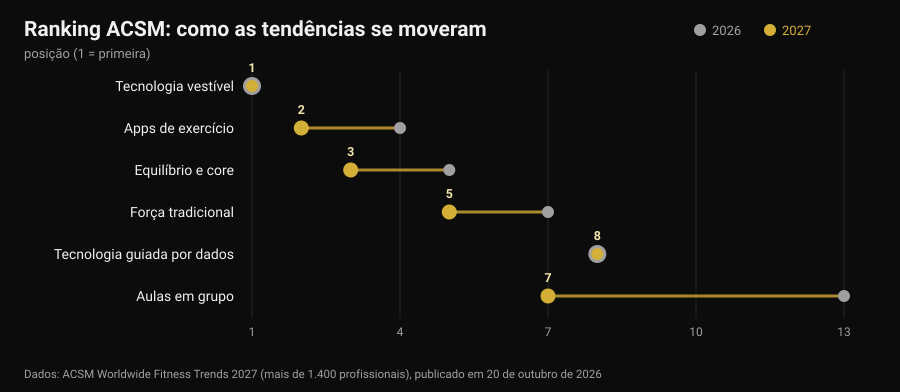
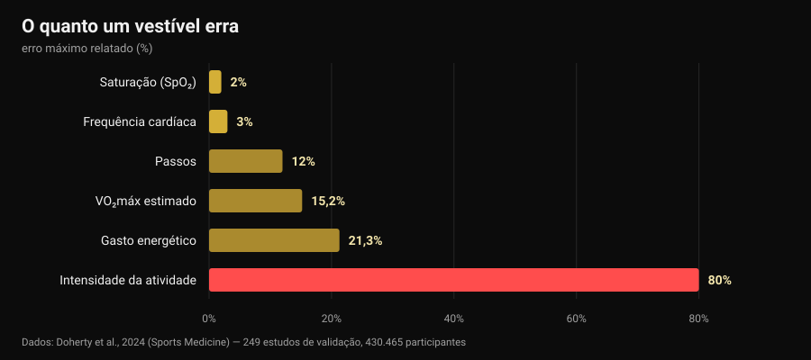

# Tendências fitness 2027: o que funciona mesmo

Por [Giammaria Loi](/autore/giammaria-loi) · atualizado a 30 de outubro de 2026

A 20 de outubro o American College of Sports Medicine publicou a sua lista de tendências fitness para 2027 e numa semana estava em todos os sites do setor. Pela décima vez os dispositivos vestíveis lideram; as apps de exercício sobem do quarto para o segundo lugar. Nenhum dos artigos que li fez a pergunta seguinte: essas tendências funcionam? Fui procurar os números, e acontece que as ferramentas no topo da lista fazem uma coisa muito bem e outra muito mal — incluindo o dado que quase toda a gente olha primeiro.

## Em resumo

- **A lista não mede eficácia.** É um inquérito a mais de 1.400 profissionais do setor sobre o que vai pesar mais em 2027, já na 21.ª edição. Diz para onde vai o mercado, não o que produz resultados.
- **Os rastreadores fazem mexer mais, e isso é sólido.** Uma revisão de 39 revisões sistemáticas (163.992 participantes) estima cerca de **1.800 passos a mais por dia**, 40 minutos a mais de caminhada e cerca de **1 kg** de peso a menos (Ferguson et al., 2022).
- **As calorias do ecrã são o dado menos fiável.** O erro no gasto energético vai de **-21,3%** a **+14,8%**, e na intensidade da atividade o erro médio chega aos **80%** (Doherty et al., 2024).
- **A frequência cardíaca, por outro lado, é boa.** Viés médio **±3%**. O VO₂máx estimado não: sobrestimado em **15,2%** em repouso.
- **"Guiado por dados" não quer dizer "melhor".** Treinar seguindo a variabilidade cardíaca melhora os índices vagais (DMP 0,50) mas não melhora significativamente o desempenho (Manresa-Rocamora et al., 2021).

## A lista 2027 em três linhas

Todos os anos o ACSM envia um questionário a profissionais de fitness de todo o mundo e pergunta que tendências terão mais peso nos doze meses seguintes. A edição 2027, assinada por Cayla R. McAvoy e pelo grupo de trabalho de tendências, reúne mais de 1.400 respostas. No topo:

1. tecnologia vestível (primeiro lugar pela décima vez);
2. apps de exercício (do quarto);
3. equilíbrio, mobilidade e core (do quinto);
4. programas para adultos mais velhos (no top cinco há cinco anos);
5. treino de força tradicional (sobe dois lugares);
6. exercício para gestão do peso;
7. aulas de grupo (do décimo terceiro);
8. tecnologia guiada por dados (mantém o oitavo);
9. exercício para a saúde mental (no top dez há quatro anos);
10. programas liderados por influenciadores e embaixadores (de volta depois de sair do top vinte).

O maior salto é o das aulas de grupo, seis lugares num ano. Mas o mais interessante está noutro sítio: das dez entradas, **três são tecnologia** e duas são treino clássico. É essa convivência que vale a pena olhar de perto, porque a investigação sobre as duas metades diz coisas muito diferentes.

Uma ressalva que falta em quase todas as notícias: um inquérito de opinião entre profissionais **não é prova de eficácia**. É um termómetro do mercado. Se em 2027 toda a gente vai vender dados, a pergunta a fazer é quão precisos são esses dados.

## O que o relógio mede bem e o que estima

Aqui existe uma fonte quase perfeita: uma revisão "viva" publicada na *Sports Medicine* que juntou 24 revisões sistemáticas, 249 estudos de validação e 430.465 participantes, comparando os dispositivos de consumo com os padrões de referência de laboratório (Doherty et al., 2024).

Lido da esquerda para a direita, o gráfico conta uma hierarquia nítida.

**Fiável.** A frequência cardíaca tem um viés médio de **3%**: mais do que suficiente para regular a intensidade de uma corrida ou de um circuito. Na deteção de arritmias os dispositivos mostram sensibilidade de 100% e especificidade de 95% — um dado notável, que continua a ser um sinal para levar ao médico, não um diagnóstico.

**Aproximado mas útil.** Os passos são normalmente subestimados, com erro percentual médio absoluto entre **-9% e 12%**. Traduzindo: se o relógio marca 8.000 passos, os teus estão entre cerca de 7.000 e 8.800. Para seguir uma tendência semanal serve bem; para tirar conclusões de um único dia, não.

**Não serve para decidir.** O gasto energético tem um erro entre **-21,3% e +14,8%**. Numa sessão que o ecrã estima em 600 kcal, o valor real pode estar entre 470 e 690. Pior ainda a intensidade da atividade, com erro médio de **29% a 80%** conforme a exigência do que estás a fazer. O VO₂máx estimado é sobrestimado em **15,24%** em repouso e **9,83%** em esforço: se o relógio marca 52, o número plausível anda pelos 47.

E o sono? Os dispositivos tendem a **sobrestimar o tempo total de sono**, com erro tipicamente acima de 10%: na prática contam como sono períodos em que apenas estavas parado. Serve para ver se te deitaste mais tarde do que o habitual — que é precisamente o ponto quando se decide [a que horas parar de tomar café](/pt/blog/cafeina-sono-quando-parar-de-tomar-cafe) — mas uma "pontuação do sono" não é uma medida clínica.

Um último dado põe tudo em perspetiva: de todos os dispositivos à venda, só cerca de **11%** foram validados para pelo menos um parâmetro, e os estudos de validação feitos até agora são **3,5%** dos necessários. Quando uma marca escreve "precisão clínica" na caixa, nove em cada dez vezes não existe trabalho publicado que o demonstre para aquele modelo.

## O paradoxo: erram os números e funcionam na mesma

Chega aqui a parte que quase ninguém conta. Os mesmos dispositivos que estimam mal as calorias estão entre as ferramentas com mais evidência para pôr as pessoas em movimento.

A revisão guarda-chuva de Ferguson e colegas reuniu 39 revisões sistemáticas e meta-análises, com 163.992 participantes de todas as idades, em populações saudáveis e clínicas. Resultado: efeito pequeno a moderado na atividade física (DMP 0,3-0,6), composição corporal 0,7-2,0, aptidão 0,3. Em unidades concretas: cerca de **1.800 passos a mais por dia**, **40 minutos a mais de caminhada por dia**, cerca de **1 kg** de peso a menos. Os efeitos na tensão arterial, colesterol, hemoglobina glicada, qualidade de vida e dor são pequenos e muitas vezes não significativos. Os autores concluem que a evidência basta para recomendar o uso.

Não é uma contradição: o dispositivo funciona como **lembrete e espelho**, não como instrumento de medida. Lembra-te de que existes, mostra-te uma tendência, dá-te um objetivo. Que a estimativa de calorias falhe 20% não muda nada nesse mecanismo — a não ser que construas a dieta sobre esse número, e aí sim torna-se um problema.

Nos adultos mais velhos, a quarta tendência da lista, os números batem certo: em 45 estudos e 7.144 participantes os rastreadores aumentam os passos (DMP 0,59) e a atividade moderada a vigorosa semanal (DMP 0,54) e reduzem o tempo sedentário (Wu et al., 2023). Mas o mesmo trabalho acrescenta o detalhe decisivo: os rastreadores **combinados com componentes tradicionais** — objetivos acordados, automonitorização, chamadas de seguimento — conseguem mais do que os rastreadores sozinhos.

Com as apps é a mesma história. Em 12 ensaios aleatorizados sobre apps de atividade física e gestão do peso, os efeitos em peso, IMC e percentagem de gordura eram pequenos a moderados, e as mais eficazes eram as que tinham **lembretes, automonitorização e um treinador humano** (Yen et al., 2022). É a mesma conclusão a que chegámos ao falar de [se o coaching online funciona](/pt/blog/o-coaching-online-funciona): a tecnologia multiplica uma relação, não a substitui.

## "Guiado por dados": a VFC cumpre?

A oitava tendência, parada há um ano, é a tecnologia que lê sono e variabilidade da frequência cardíaca (VFC) para te dizer como treinar hoje. Promessa sedutora: o relógio sabe quando podes carregar.

As meta-análises são mais mornas. Na revisão metodológica de Manresa-Rocamora e colegas, treinar guiado pela VFC supera um programa predefinido nos **índices vagais** de VFC (DMP 0,50; IC 95% 0,09-0,91), mas não na frequência cardíaca de repouso, e as diferenças na capacidade aeróbia máxima (DMP 0,20; IC 95% -0,07-0,47) e no desempenho de resistência (DMP 0,20; IC 95% -0,09-0,48) são pequenas e **não significativas**. Uma segunda meta-análise, só com atletas de resistência, encontra um efeito pequeno mas positivo no VO₂máx (TE 0,402), mais marcado em amadores e em mulheres (Granero-Gallegos et al., 2020).

A leitura honesta é esta: a VFC parece reduzir a probabilidade de respostas negativas ao treino — menos sessões mal feitas no momento errado — mais do que levantar o teto dos resultados. Se te serve para decidir quando tirar uma série, faz sentido. Se a usas para saber se hoje "podes" agachar, estás a delegar a um dado de quinze segundos uma decisão que tu tomas melhor.

## A tendência que 2027 subestima

No sexto lugar está o exercício para gestão do peso, e o ACSM nota que com os fármacos para emagrecer cada vez mais difundidos a atenção passa a ser manter o músculo. Aqui há um dado que convém deixar escrito, porque diz respeito a qualquer pessoa que perca peso depressa: uma meta-análise com meta-regressão sobre treino de força em défice calórico mostra que os ganhos de massa magra ficam **comprometidos** (TE -0,57; p = 0,02) enquanto os de força se mantêm comparáveis (TE -0,31; p = 0,28), e que acima de um défice de cerca de **500 kcal por dia** a massa magra deixa de crescer (Murphy e Koehler, 2021).

Significa que quem perde peso depressa mantém a força mas não constrói músculo, e que o treino contra resistência nessa fase serve para **defender** o que já existe. Como se organiza na prática vimos ao falar de [recomposição corporal](/pt/blog/recomposicao-corporal-perder-gordura-ganhar-musculo). Se estás a tomar fármacos para o peso, a dieta e o treino discutem-se com o médico que os prescreveu: aqui falamos de dados, não de protocolos pessoais.

## O que a investigação diz mesmo

**Confirmado — "os vestíveis fazem mexer mais".** Cerca de 1.800 passos e 40 minutos a mais de caminhada por dia, benefício mantido ao longo do tempo, em 163.992 participantes.

**Confirmado — "a frequência cardíaca no pulso dá para usar".** Viés médio de 3%, suficiente para regular a intensidade.

**Desmentido — "as calorias do relógio são um dado".** Erro de -21,3% a +14,8%, e até 80% na intensidade da atividade.

**Desmentido — "o VO₂máx do relógio é uma medida".** Sobrestimado em 15,24% em repouso e 9,83% em esforço.

**A precisar — "a pontuação do sono diz como dormiste".** A duração total é sobrestimada, normalmente acima de 10%: útil para tendências, não como medida.

**A precisar — "treinar guiado pela VFC dá melhores resultados".** Melhora os índices vagais, mas o efeito no VO₂máx e no desempenho é pequeno e não significativo.

**Desmentido — "com uma boa app não é preciso treinador".** As apps e rastreadores mais eficazes são os que têm lembretes, objetivos e contacto humano.

**Desmentido — "a lista ACSM diz o que funciona".** É um inquérito de opinião entre profissionais: mede expectativas de mercado.

## Como aplicar

1. **Usa o relógio para tendências, não para valores absolutos.** Passos, frequência cardíaca e minutos ativos comparados com a tua média de quatro semanas valem muito mais do que o mesmo número lido uma vez.
2. **Não construas a dieta sobre as calorias do ecrã.** Com um erro potencial de 20% nos dois sentidos, usa como referência o peso corporal e as medidas ao longo do tempo, não o gasto estimado.
3. **Uma decisão por dado.** Um dado que não muda nada é ruído: se a pontuação de recuperação nunca te faz tirar nem acrescentar nada, deixa de olhar para ela.
4. **Para a força mede a carga, não as calorias.** Séries, repetições, carga e RIR (repetições em reserva) são os parâmetros em que se constrói a progressão: nenhum relógio os regista por ti.
5. **Se usas a VFC, usa-a para tirar.** Faz sentido como travão nos dias maus, não como autorização nos dias bons.
6. **Acrescenta a parte humana.** O dado que chega a uma pessoa — um treinador, um amigo, um grupo — funciona melhor do que o dado que fica na app. É a diferença que se vê nas meta-análises.
7. **Desconfia do "precisão clínica" da caixa.** Só 11% dos dispositivos estão validados para pelo menos um parâmetro: pergunta para qual, e em que estudo.

### Experimenta a Nurvan — os dados que o teu relógio não regista

O smartwatch sabe quanto caminhaste. Não sabe que ontem fechaste o supino a 4 repetições da falha e hoje a 2, que é a única informação que mostra se estás a progredir. Na Nurvan registas carga, repetições e RIR de cada série, importas o plano que já tens a partir de PDF, Excel ou foto, e tens a curva de cargas mês a mês ao lado de medidas e peso; as séries de aquecimento são propostas automaticamente a partir da carga do dia. E se tens um treinador a acompanhar, ele vê os mesmos ecrãs que tu: a parte humana que faz a diferença nas meta-análises.

## Perguntas frequentes

**Quais são as tendências fitness de 2027?**
Segundo o inquérito ACSM publicado a 20 de outubro de 2026, por ordem: tecnologia vestível, apps de exercício, equilíbrio e core, programas para adultos mais velhos, força tradicional, exercício para gestão do peso, aulas de grupo, tecnologia guiada por dados, exercício para a saúde mental e programas liderados por influenciadores. É um inquérito a mais de 1.400 profissionais sobre expectativas para o ano, não uma lista de eficácia.

**Qual é a precisão das calorias do smartwatch?**
Baixa. A revisão de 249 estudos de validação reporta erro no gasto energético entre -21,3% e +14,8%, e erro médio de 29% a 80% na estimativa da intensidade. A frequência cardíaca, pelo contrário, tem viés médio de 3%: é o parâmetro em que esses dispositivos são mais fiáveis.

**Vale a pena comprar uma pulseira de atividade?**
Se o teu problema é mexer-te mais, a evidência está a favor: em média cerca de 1.800 passos e 40 minutos a mais de caminhada por dia, com cerca de 1 kg de peso a menos, e o benefício mantém-se. Se o teu problema é saber quantas calorias gastaste ou quanto vale o teu VO₂máx, o dispositivo não é a ferramenta certa.

**Devo treinar de acordo com a VFC?**
As meta-análises mostram melhoria dos índices de variabilidade cardíaca mas efeitos pequenos e não significativos na capacidade aeróbia e no desempenho. Como ferramenta para evitar sessões feitas na altura errada pode fazer sentido; como árbitro de cada treino, não.

## Lê também

- [O coaching online funciona? O que dizem os estudos](/pt/blog/o-coaching-online-funciona) — o que muda mesmo quando há uma pessoa do outro lado dos dados.
- [Recomposição corporal: perder gordura e ganhar músculo](/pt/blog/recomposicao-corporal-perder-gordura-ganhar-musculo) — como montar um défice que não te custa massa magra.
- [Cafeína e sono: a que horas parar de tomar café](/pt/blog/cafeina-sono-quando-parar-de-tomar-cafe) — a outra metade da recuperação, com números.

## Fontes

1. Ferguson T, Olds T, Curtis R, Blake H, Crozier AJ, Dankiw K, Dumuid D, Kasai D, O'Connor E, Virgara R, Maher C, 2022. *Effectiveness of wearable activity trackers to increase physical activity and improve health: a systematic review of systematic reviews and meta-analyses.* The Lancet Digital Health 4(8):e615-e626. [PMID 35868813](https://pubmed.ncbi.nlm.nih.gov/35868813/) · [DOI 10.1016/S2589-7500(22)00111-X](https://doi.org/10.1016/S2589-7500(22)00111-X)
2. Doherty C, Baldwin M, Keogh A, Caulfield B, Argent R, 2024. *Keeping Pace with Wearables: A Living Umbrella Review of Systematic Reviews Evaluating the Accuracy of Consumer Wearable Technologies in Health Measurement.* Sports Medicine 54(11):2907-2926. [PMID 39080098](https://pubmed.ncbi.nlm.nih.gov/39080098/) · [DOI 10.1007/s40279-024-02077-2](https://doi.org/10.1007/s40279-024-02077-2)
3. Wu S, Li G, Du L, Chen S, Zhang X, He Q, 2023. *The effectiveness of wearable activity trackers for increasing physical activity and reducing sedentary time in older adults: A systematic review and meta-analysis.* Digital Health 9:20552076231176705. [PMID 37252261](https://pubmed.ncbi.nlm.nih.gov/37252261/) · [DOI 10.1177/20552076231176705](https://doi.org/10.1177/20552076231176705)
4. Yen HY, Jin G, Chiu HL, 2022. *Smartphone app-based interventions targeting physical activity for weight management: A meta-analysis of randomized controlled trials.* International Journal of Nursing Studies 137:104384. [PMID 36379104](https://pubmed.ncbi.nlm.nih.gov/36379104/) · [DOI 10.1016/j.ijnurstu.2022.104384](https://doi.org/10.1016/j.ijnurstu.2022.104384)
5. Manresa-Rocamora A, Sarabia JM, Javaloyes A, Flatt AA, Moya-Ramón M, 2021. *Heart Rate Variability-Guided Training for Enhancing Cardiac-Vagal Modulation, Aerobic Fitness, and Endurance Performance: A Methodological Systematic Review with Meta-Analysis.* International Journal of Environmental Research and Public Health 18(19):10299. [PMID 34639599](https://pubmed.ncbi.nlm.nih.gov/34639599/) · [DOI 10.3390/ijerph181910299](https://doi.org/10.3390/ijerph181910299)
6. Granero-Gallegos A, González-Quílez A, Plews D, Carrasco-Poyatos M, 2020. *HRV-Based Training for Improving VO2max in Endurance Athletes. A Systematic Review with Meta-Analysis.* International Journal of Environmental Research and Public Health 17(21):7999. [PMID 33143175](https://pubmed.ncbi.nlm.nih.gov/33143175/) · [DOI 10.3390/ijerph17217999](https://doi.org/10.3390/ijerph17217999)
7. Murphy C, Koehler K, 2021. *Energy deficiency impairs resistance training gains in lean mass but not strength: A meta-analysis and meta-regression.* Scandinavian Journal of Medicine & Science in Sports 32(1):125-137. [PMID 34623696](https://pubmed.ncbi.nlm.nih.gov/34623696/) · [DOI 10.1111/sms.14075](https://doi.org/10.1111/sms.14075)
8. McAvoy CR et al., 2026. *2027 ACSM Worldwide Fitness Trends: Future Directions of the Health and Fitness Industry.* ACSM's Health & Fitness Journal 30(6), novembro/dezembro de 2026. [DOI 10.1249/fit.0000000000001208](https://doi.org/10.1249/fit.0000000000001208) · [comunicado ACSM](https://acsm.org/2027-fitness-trends/)

Referências bibliográficas obtidas através da PubMed. Ponto de partida: nenhuma publicação nas redes, mas o sinal de tendência de 20-26 de outubro de 2026, ou seja a publicação do inquérito ACSM Worldwide Fitness Trends 2027 e a sua repercussão na Medical Xpress, Athletech News e Yahoo Lifestyle, a par do aumento das pesquisas sobre dispositivos vestíveis em outubro de 2026. O tema foi escrito de raiz a partir das fontes primárias.

---

**Giammaria Loi** é o fundador da Nurvan. Treina com pesos desde 2012, trabalha como personal trainer e coach certificado FIPE desde 2013 e compete em powerlifting a nível nacional desde 2018. Cada artigo que assina parte dos estudos científicos e chega ao que funciona mesmo no ginásio.

> Nota: conteúdo informativo, não substitui a opinião de um médico ou de um profissional. Os dados sobre sono, saturação e arritmias aqui referidos dizem respeito à precisão de medida dos dispositivos, não ao seu uso diagnóstico: um valor anómalo leva-se a um médico, não se interpreta com uma app. Se estás a tomar fármacos para o peso, fala com quem os prescreveu antes de alterar dieta ou treino.
