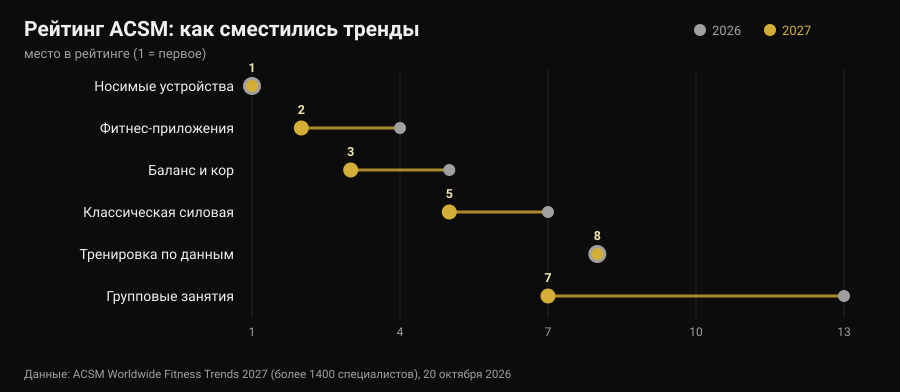
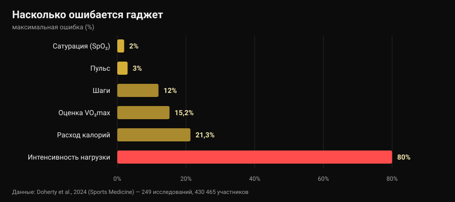

# Фитнес-тренды 2027: что работает на самом деле

Автор: [Giammaria Loi](/autore/giammaria-loi) · обновлено 30 октября 2026 года

20 октября American College of Sports Medicine опубликовал рейтинг фитнес-трендов на 2027 год, и за неделю он разошёлся по всем отраслевым сайтам. В десятый раз на первом месте носимые устройства; приложения для тренировок поднимаются с четвёртого места на второе. Ни один из прочитанных мной материалов не задал следующий вопрос: а эти тренды работают? Я пошёл искать цифры — и оказалось, что инструменты на вершине рейтинга одно делают прекрасно, а другое очень плохо. В том числе то число, на которое почти все смотрят первым.

## Коротко

- **Рейтинг не измеряет эффективность.** Это опрос более 1400 специалистов отрасли о том, что будет значить больше всего в 2027 году, уже 21-й по счёту. Он показывает, куда идёт рынок, а не что даёт результат.
- **Трекеры действительно заставляют двигаться больше, и это надёжно.** Обзор 39 систематических обзоров (163 992 участника) оценивает прибавку примерно в **1800 шагов в день**, 40 минут ходьбы и около **1 кг** веса (Ferguson et al., 2022).
- **Калории на экране — самое ненадёжное число.** Ошибка в расходе энергии составляет от **-21,3%** до **+14,8%**, а в интенсивности нагрузки средняя ошибка доходит до **80%** (Doherty et al., 2024).
- **А вот пульс хорош.** Средняя систематическая ошибка **±3%**. Расчётный VO₂max — нет: завышен на **15,2%** в покое.
- **«На основе данных» не значит «лучше».** Тренировки по вариабельности сердечного ритма улучшают вагусные показатели (SMD 0,50), но не улучшают результат значимо (Manresa-Rocamora et al., 2021).

## Рейтинг 2027 в трёх строках

Каждый год ACSM рассылает анкету фитнес-специалистам по всему миру и спрашивает, какие тренды будут весомее всего в ближайшие двенадцать месяцев. Выпуск 2027 года, подготовленный Cayla R. McAvoy и рабочей группой по трендам, собрал более 1400 ответов. Во главе списка:

1. носимые технологии (первое место в десятый раз);
2. приложения для тренировок (с четвёртого);
3. баланс, подвижность и кор (с пятого);
4. программы для людей старшего возраста (в первой пятёрке пятый год подряд);
5. классический силовой тренинг (поднялся на две позиции);
6. упражнения для контроля веса;
7. групповые занятия (с тринадцатого);
8. технологии на основе данных (остаются на восьмом);
9. упражнения для психического здоровья (в первой десятке четвёртый год);
10. программы с инфлюенсерами и амбассадорами (вернулись после выпадения из первой двадцатки).

Самый большой скачок — у групповых занятий, шесть позиций за год. Но интереснее другое: из десяти пунктов **три — это технологии**, а два — обычный классический тренинг. Именно это соседство стоит рассмотреть внимательно, потому что исследования про две половины говорят очень разное.

Уточнение, которого нет почти ни в одной перепечатке: опрос мнений специалистов **не является доказательством эффективности**. Это термометр рынка. Если в 2027 году все будут продавать данные, уместный вопрос — насколько эти данные точны.

## Что часы измеряют хорошо, а что оценивают приблизительно

Здесь есть почти идеальный источник: «живой» зонтичный обзор в журнале *Sports Medicine*, который свёл вместе 24 систематических обзора, 249 валидационных исследований и 430 465 участников, сравнивая потребительские устройства с лабораторными эталонами (Doherty et al., 2024).

Слева направо график описывает чёткую иерархию.

**Надёжно.** У пульса средняя ошибка **3%**: более чем достаточно, чтобы регулировать интенсивность бега или круговой тренировки. В выявлении аритмий устройства показывают чувствительность 100% и специфичность 95% — цифра впечатляющая, но это по-прежнему повод пойти к врачу, а не диагноз.

**Приблизительно, но полезно.** Шаги обычно занижаются, средняя абсолютная процентная ошибка от **-9% до 12%**. В переводе: если часы показывают 8000 шагов, ваши реальные — примерно между 7000 и 8800. Для недельного тренда отлично; для выводов по одному дню — нет.

**Не для решений.** У расхода энергии ошибка от **-21,3% до +14,8%**. На тренировке, которую экран оценивает в 600 ккал, истинное значение может лежать между 470 и 690. Ещё хуже с интенсивностью нагрузки: средняя ошибка от **29% до 80%** в зависимости от того, насколько тяжёлая работа. Расчётный VO₂max завышен на **15,24%** в покое и на **9,83%** при нагрузке: если часы показывают 52, правдоподобное число ближе к 47.

А сон? Устройства склонны **завышать общее время сна**, ошибка обычно больше 10%: на практике они считают сном периоды, когда вы просто лежали неподвижно. Для того чтобы заметить, что вы легли позже обычного, этого хватает — а это и есть суть вопроса о том, [когда пить последний кофе](/ru/blog/kofein-i-son-kogda-perestat-pit-kofe), — но «оценка сна» не является клиническим измерением.

Последняя цифра расставляет всё по местам: из всех устройств на рынке лишь около **11%** прошли валидацию хотя бы по одному показателю, а выполненные валидационные исследования составляют **3,5%** от необходимых. Когда производитель пишет на коробке «клиническая точность», в девяти случаях из десяти для этой модели нет опубликованной работы, которая это подтверждает.

## Парадокс: цифры неточные, а эффект всё равно есть

Вот часть, о которой почти никто не рассказывает. Те же устройства, что плохо считают калории, входят в число инструментов с самой широкой доказательной базой по тому, чтобы люди двигались больше.

Зонтичный обзор Ferguson с коллегами объединил 39 систематических обзоров и метаанализов, 163 992 участника всех возрастов, здоровые и клинические группы. Результат: малый или умеренный эффект на физическую активность (SMD 0,3-0,6), состав тела 0,7-2,0, физическую подготовленность 0,3. В конкретных единицах: примерно **1800 шагов в день больше**, **40 минут ходьбы в день больше**, около **1 кг** меньше веса. Эффекты на давление, холестерин, гликированный гемоглобин, качество жизни и боль малы и часто незначимы. Авторы заключают, что доказательств достаточно, чтобы рекомендовать использование.

Это не противоречие: устройство работает как **напоминание и зеркало**, а не как измерительный прибор. Оно напоминает о вас самих, показывает тенденцию, даёт цель. То, что оценка калорий промахивается на 20%, не меняет в этом механизме ничего — если только вы не строите на этом числе питание, и тогда это действительно проблема.

У людей старшего возраста, четвёртый тренд рейтинга, цифры согласуются: в 45 исследованиях и у 7144 участников трекеры увеличивают число шагов (SMD 0,59) и недельную активность средней и высокой интенсивности (SMD 0,54) и сокращают время сидения (Wu et al., 2023). Но та же работа добавляет решающую деталь: трекеры **вместе с традиционными компонентами** — согласованными целями, самоконтролем, контрольными звонками — дают больше, чем трекеры сами по себе.

С приложениями то же самое. В 12 рандомизированных исследованиях приложений для физической активности и контроля веса эффекты на вес, ИМТ и процент жира были малыми или умеренными, а самыми действенными оказались те, где есть **напоминания, самоконтроль и живой тренер** (Yen et al., 2022). Это тот же вывод, к которому мы пришли, разбирая, [работает ли онлайн-коучинг](/ru/blog/rabotaet-li-onlayn-kouching): технология умножает отношения, а не заменяет их.

## «На основе данных»: выполняет ли ВСР обещание?

Восьмой тренд, не сдвинувшийся за год, — технологии, читающие сон и вариабельность сердечного ритма (ВСР), чтобы подсказать, как тренироваться сегодня. Обещание соблазнительное: часы знают, когда можно жать.

Метаанализы прохладнее. В методологическом обзоре Manresa-Rocamora с коллегами тренировки по ВСР превосходят заранее заданную программу по **вагусным показателям** ВСР (SMD 0,50; 95% ДИ 0,09-0,91), но не по пульсу покоя, а различия в максимальной аэробной способности (SMD 0,20; 95% ДИ -0,07-0,47) и в выносливости (SMD 0,20; 95% ДИ -0,09-0,48) малы и **незначимы**. Второй метаанализ, только по спортсменам на выносливость, находит малый, но положительный эффект на VO₂max (ES 0,402), выраженнее у любителей и у женщин (Granero-Gallegos et al., 2020).

Честное прочтение такое: ВСР скорее снижает вероятность отрицательного ответа на нагрузку — меньше сессий, проведённых плохо и не вовремя, — чем поднимает потолок результатов. Если она помогает решить, когда убрать подход, в этом есть смысл. Если вы спрашиваете у неё, «можно» ли сегодня приседать, вы отдаёте пятнадцатисекундному показателю решение, которое сами принимаете лучше.

## Тренд, который 2027 недооценивает

На шестом месте — упражнения для контроля веса, и ACSM отмечает, что по мере распространения препаратов для снижения веса внимание смещается к сохранению мышц. Здесь одну цифру стоит зафиксировать, потому что она касается каждого, кто худеет быстро: метаанализ с метарегрессией по силовым тренировкам в дефиците калорий показывает, что прирост сухой массы **нарушается** (ES -0,57; p = 0,02), тогда как прирост силы остаётся сопоставимым (ES -0,31; p = 0,28), и что при дефиците больше примерно **500 ккал в день** сухая масса перестаёт расти вовсе (Murphy и Koehler, 2021).

Это значит, что тот, кто худеет быстро, сохраняет силу, но не строит мышцы, и силовая тренировка в этой фазе нужна, чтобы **защитить** имеющееся. Как это устроить на практике, мы разбирали в материале о [рекомпозиции тела](/ru/blog/rekompozitsiya-tela-szhech-zhir-nabrat-myshtsy). Если вы принимаете препараты для снижения веса, питание и тренировки обсуждаются с врачом, который их назначил: здесь речь о данных, а не о персональных протоколах.

## Что на самом деле говорят исследования

**Подтверждено — «носимые устройства заставляют двигаться больше».** Около 1800 шагов и 40 минут ходьбы в день дополнительно, эффект сохраняется во времени, на 163 992 участниках.

**Подтверждено — «пульс с запястья можно использовать».** Средняя ошибка 3%, этого достаточно для регулировки интенсивности.

**Опровергнуто — «калории на часах — это данные».** Ошибка от -21,3% до +14,8% и до 80% по интенсивности нагрузки.

**Опровергнуто — «VO₂max на часах — это измерение».** Завышен на 15,24% в покое и на 9,83% при нагрузке.

**Требует уточнения — «оценка сна говорит, как вы спали».** Общая длительность завышается, обычно более чем на 10%: полезно для тенденций, но не как измерение.

**Требует уточнения — «тренировки по ВСР дают лучший результат».** Они улучшают вагусные показатели, но эффект на VO₂max и результат мал и незначим.

**Опровергнуто — «с хорошим приложением тренер не нужен».** Самые действенные приложения и трекеры — те, где есть напоминания, цели и живое общение.

**Опровергнуто — «рейтинг ACSM говорит, что работает».** Это опрос мнений специалистов: он измеряет рыночные ожидания.

## Как это применить

1. **Используйте часы для тенденций, а не для абсолютных значений.** Шаги, пульс и активные минуты в сравнении с вашим же средним за четыре недели стоят гораздо больше, чем то же число, посмотренное один раз.
2. **Не стройте питание на калориях с экрана.** При возможной ошибке в 20% в обе стороны опорой служат вес тела и замеры во времени, а не расчётный расход.
3. **Одно решение на показатель.** Показатель, который ничего не меняет, — это шум: если оценка восстановления никогда не заставляет вас что-то убрать или добавить, перестаньте на неё смотреть.
4. **Для силы измеряйте нагрузку, а не калории.** Подходы, повторения, вес и RIR (повторения в запасе) — вот параметры, на которых строится прогресс: ни одни часы их за вас не запишут.
5. **Если используете ВСР, используйте её, чтобы убавлять.** Она имеет смысл как тормоз в плохие дни, а не как разрешение в хорошие.
6. **Добавьте человеческую часть.** Данные, которые доходят до человека — тренера, друга, группы, — работают лучше, чем данные, оставшиеся в приложении. Именно эту разницу видно в метаанализах.
7. **Не верьте надписи «клиническая точность» на коробке.** Лишь 11% устройств валидированы хотя бы по одному показателю: спросите, по какому и в каком исследовании.

### Попробуйте Nurvan — данные, которые часы не записывают

Смарт-часы знают, сколько вы прошли. Они не знают, что вчера вы закончили жим лёжа за 4 повторения до отказа, а сегодня за 2 — а это единственная информация, по которой понятно, прогрессируете ли вы. В Nurvan вы записываете вес, повторения и RIR каждого подхода, импортируете уже имеющуюся программу из PDF, Excel или фотографии и видите кривую нагрузок по месяцам рядом с замерами и весом; разминочные подходы предлагаются автоматически от рабочего веса дня. А если вас ведёт тренер, он видит те же экраны, что и вы, — ту самую человеческую часть, которая делает разницу в метаанализах.

## Частые вопросы

**Какие фитнес-тренды в 2027 году?**
По опросу ACSM, опубликованному 20 октября 2026 года, по порядку: носимые технологии, приложения для тренировок, баланс и кор, программы для людей старшего возраста, классический силовой тренинг, упражнения для контроля веса, групповые занятия, технологии на основе данных, упражнения для психического здоровья, программы с инфлюенсерами. Это опрос более 1400 специалистов об ожиданиях на год, а не рейтинг эффективности.

**Насколько точны калории на смарт-часах?**
Невысоко. Обзор 249 валидационных исследований сообщает об ошибке в расходе энергии от -21,3% до +14,8% и средней ошибке от 29% до 80% в оценке интенсивности. У пульса, напротив, средняя ошибка 3%: это показатель, с которым такие устройства справляются лучше всего.

**Стоит ли покупать фитнес-браслет?**
Если ваша задача — двигаться больше, доказательства за: в среднем около 1800 шагов и 40 минут ходьбы в день дополнительно, примерно на 1 кг меньше веса, и польза сохраняется во времени. Если ваша задача — узнать, сколько калорий вы потратили или каков ваш VO₂max, это не тот инструмент.

**Нужно ли тренироваться по ВСР?**
Метаанализы показывают улучшение показателей вариабельности сердечного ритма, но малые и незначимые эффекты на аэробные способности и результат. Как способ не проводить тренировку в неподходящий момент — может иметь смысл; как арбитр каждой тренировки — нет.

## Читайте также

- [Работает ли онлайн-коучинг? Что говорят исследования](/ru/blog/rabotaet-li-onlayn-kouching) — что действительно меняется, когда по ту сторону данных есть человек.
- [Рекомпозиция тела: жир вниз, мышцы вверх](/ru/blog/rekompozitsiya-tela-szhech-zhir-nabrat-myshtsy) — как выставить дефицит, который не стоит вам сухой массы.
- [Кофеин и сон: когда пить последний кофе](/ru/blog/kofein-i-son-kogda-perestat-pit-kofe) — вторая половина восстановления, с цифрами исследований.

## Источники

1. Ferguson T, Olds T, Curtis R, Blake H, Crozier AJ, Dankiw K, Dumuid D, Kasai D, O'Connor E, Virgara R, Maher C, 2022. *Effectiveness of wearable activity trackers to increase physical activity and improve health: a systematic review of systematic reviews and meta-analyses.* The Lancet Digital Health 4(8):e615-e626. [PMID 35868813](https://pubmed.ncbi.nlm.nih.gov/35868813/) · [DOI 10.1016/S2589-7500(22)00111-X](https://doi.org/10.1016/S2589-7500(22)00111-X)
2. Doherty C, Baldwin M, Keogh A, Caulfield B, Argent R, 2024. *Keeping Pace with Wearables: A Living Umbrella Review of Systematic Reviews Evaluating the Accuracy of Consumer Wearable Technologies in Health Measurement.* Sports Medicine 54(11):2907-2926. [PMID 39080098](https://pubmed.ncbi.nlm.nih.gov/39080098/) · [DOI 10.1007/s40279-024-02077-2](https://doi.org/10.1007/s40279-024-02077-2)
3. Wu S, Li G, Du L, Chen S, Zhang X, He Q, 2023. *The effectiveness of wearable activity trackers for increasing physical activity and reducing sedentary time in older adults: A systematic review and meta-analysis.* Digital Health 9:20552076231176705. [PMID 37252261](https://pubmed.ncbi.nlm.nih.gov/37252261/) · [DOI 10.1177/20552076231176705](https://doi.org/10.1177/20552076231176705)
4. Yen HY, Jin G, Chiu HL, 2022. *Smartphone app-based interventions targeting physical activity for weight management: A meta-analysis of randomized controlled trials.* International Journal of Nursing Studies 137:104384. [PMID 36379104](https://pubmed.ncbi.nlm.nih.gov/36379104/) · [DOI 10.1016/j.ijnurstu.2022.104384](https://doi.org/10.1016/j.ijnurstu.2022.104384)
5. Manresa-Rocamora A, Sarabia JM, Javaloyes A, Flatt AA, Moya-Ramón M, 2021. *Heart Rate Variability-Guided Training for Enhancing Cardiac-Vagal Modulation, Aerobic Fitness, and Endurance Performance: A Methodological Systematic Review with Meta-Analysis.* International Journal of Environmental Research and Public Health 18(19):10299. [PMID 34639599](https://pubmed.ncbi.nlm.nih.gov/34639599/) · [DOI 10.3390/ijerph181910299](https://doi.org/10.3390/ijerph181910299)
6. Granero-Gallegos A, González-Quílez A, Plews D, Carrasco-Poyatos M, 2020. *HRV-Based Training for Improving VO2max in Endurance Athletes. A Systematic Review with Meta-Analysis.* International Journal of Environmental Research and Public Health 17(21):7999. [PMID 33143175](https://pubmed.ncbi.nlm.nih.gov/33143175/) · [DOI 10.3390/ijerph17217999](https://doi.org/10.3390/ijerph17217999)
7. Murphy C, Koehler K, 2021. *Energy deficiency impairs resistance training gains in lean mass but not strength: A meta-analysis and meta-regression.* Scandinavian Journal of Medicine & Science in Sports 32(1):125-137. [PMID 34623696](https://pubmed.ncbi.nlm.nih.gov/34623696/) · [DOI 10.1111/sms.14075](https://doi.org/10.1111/sms.14075)
8. McAvoy CR et al., 2026. *2027 ACSM Worldwide Fitness Trends: Future Directions of the Health and Fitness Industry.* ACSM's Health & Fitness Journal 30(6), ноябрь/декабрь 2026. [DOI 10.1249/fit.0000000000001208](https://doi.org/10.1249/fit.0000000000001208) · [сообщение ACSM](https://acsm.org/2027-fitness-trends/)

Библиографические ссылки найдены через PubMed. Отправная точка: не пост в соцсетях, а трендовый сигнал 20-26 октября 2026 года — публикация опроса ACSM Worldwide Fitness Trends 2027 и его подхват Medical Xpress, Athletech News и Yahoo Lifestyle, вместе с ростом поискового интереса к носимым устройствам в октябре 2026 года. Тема написана с нуля по первичным источникам.

---

**Giammaria Loi** — основатель Nurvan. Он тренируется с отягощениями с 2012 года, работает персональным тренером и коучем с сертификацией FIPE с 2013 года и выступает в пауэрлифтинге на национальном уровне с 2018 года. Каждая статья за его подписью начинается с научных исследований и заканчивается тем, что действительно работает в зале.

> Примечание: материал носит информационный характер и не заменяет консультацию врача или специалиста. Приведённые здесь данные о сне, сатурации и аритмиях касаются точности измерений устройств, а не их диагностического применения: с необычным показателем идут к врачу, а не разбирают его в приложении. Если вы принимаете препараты для снижения веса, обсудите изменения в питании и тренировках с назначившим их врачом.
