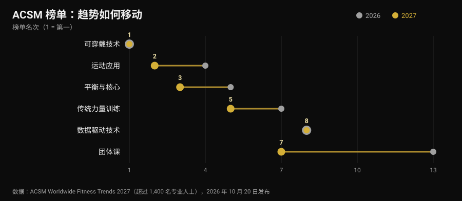
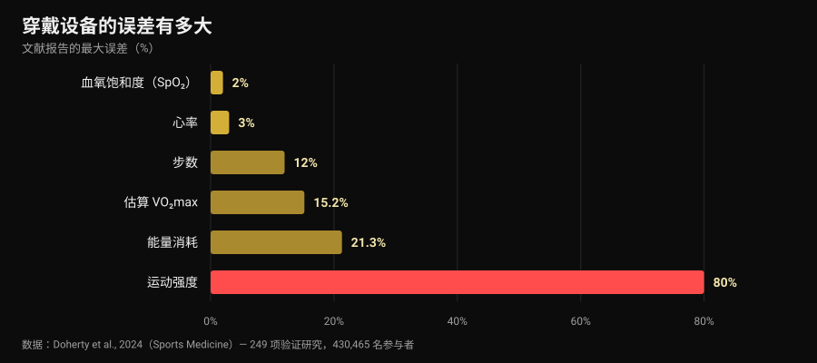

# 2027健身趋势：哪些真的有效

作者：[Giammaria Loi](/autore/giammaria-loi) · 更新于 2026 年 10 月 30 日

10 月 20 日，美国运动医学会发布了 2027 年健身趋势榜单，一周之内就铺满了所有行业网站。可穿戴设备第十次登顶；运动 App 从第四升到第二。我读过的报道没有一篇问出下一个问题：这些趋势真的有效吗？我去找了数字，结果是：榜单最上面的那些工具，有一件事做得极好，另一件事做得极差——偏偏后者正是几乎所有人第一眼要看的那个数。

## 要点速览

- **榜单衡量的不是有效性。** 这是对 1400 多名行业从业者的问卷调查，问的是 2027 年什么最有分量，已经做到第 21 届。它说明市场往哪儿走，不说明什么能带来结果。
- **手环确实让人动得更多，这一点很扎实。** 一项汇总 39 篇系统综述（163,992 名参与者）的研究估计，每天多走约 **1,800 步**、多走路 40 分钟，体重约少 **1 公斤**（Ferguson et al., 2022）。
- **表盘上的卡路里是最不可靠的数字。** 能量消耗的误差从 **-21.3%** 到 **+14.8%**，运动强度的平均误差高达 **80%**（Doherty et al., 2024）。
- **心率反而不错。** 平均偏差 **±3%**。估算的 VO₂max 则不行：静息状态下高估 **15.2%**。
- **「数据驱动」不等于「更好」。** 按心率变异性安排训练能改善迷走相关指标（SMD 0.50），但并未显著提升运动表现（Manresa-Rocamora et al., 2021）。

## 三行看懂 2027 榜单

ACSM 每年向全球健身从业者发放问卷，询问未来十二个月哪些趋势最有分量。2027 年这一版由 Cayla R. McAvoy 与趋势工作组负责，收集了 1400 多份回答。榜首部分：

1. 可穿戴技术（第十次位居第一）；
2. 运动 App（由第四升至第二）；
3. 平衡、流动性与核心（由第五升至第三）；
4. 面向年长人群的项目（连续五年位居前五）；
5. 传统力量训练（上升两位）；
6. 用于体重管理的运动；
7. 团体课（由第十三升至第七）；
8. 数据驱动的训练技术（稳居第八）；
9. 用于心理健康的运动（连续四年进入前十）；
10. 由网红与品牌大使主导的项目（跌出前二十后重返前十）。

跳得最高的是团体课，一年上升六位。但更值得注意的是另一点：十项之中，**三项属于技术**，两项是最传统的训练。这种并存值得细看，因为关于这两半的研究说的是非常不同的事。

几乎所有转载都缺了一句话：从业者的意见调查**不是有效性的证据**。它是市场的温度计。如果 2027 年人人都在卖数据，该问的问题是：这些数据到底有多准。

## 手表测得准的，和它在猜的

这里有一个近乎完美的来源：发表在 *Sports Medicine* 的一篇「活体」伞式综述，汇总了 24 篇系统综述、249 项验证研究和 430,465 名参与者，把消费级设备与实验室金标准做对比（Doherty et al., 2024）。

从左往右读，这张图呈现的层级非常清楚。

**可靠。** 心率的平均偏差为 **3%**：用来调节一次跑步或循环训练的强度绰绰有余。在心律不齐的识别上，设备的灵敏度为 100%、特异度为 95%——数字很漂亮，但它依然只是去看医生的信号，不是诊断。

**粗糙但够用。** 步数通常被低估，平均绝对百分比误差在 **-9% 到 12%** 之间。换算一下：手表显示 8,000 步，你真实的步数大约在 7,000 到 8,800 之间。跟踪一周的趋势完全够用；拿单独一天下结论就不行。

**别拿来做决定。** 能量消耗的误差在 **-21.3% 到 +14.8%** 之间。表盘估算为 600 千卡的一次训练，真实值可能在 470 到 690 之间。运动强度更糟，平均误差视强度从 **29% 到 80%** 不等。估算的 VO₂max 在静息时高估 **15.24%**、运动时高估 **9.83%**：如果手表给你 52，合理的数字大约是 47。

睡眠呢？设备往往**高估总睡眠时间**，误差通常超过 10%：实际上它把你只是静静躺着的时间也算成了睡眠。用来看自己是不是比平时睡得更晚，这没问题——讨论[最后一杯咖啡该几点喝](/zh/blog/kafeiyin-shuimian-jidian-jie-kafei)时正是这个用途——但「睡眠评分」不是临床测量。

最后一个数字把一切放回原位：市面上所有设备中，只有约 **11%** 至少在一个指标上做过验证，而已完成的验证研究仅占所需数量的 **3.5%**。当某个品牌在包装上写「临床级精度」时，十次有九次并不存在针对该型号的已发表研究。

## 悖论：数字不准，却照样有用

接下来是几乎没人讲的部分。那些把卡路里算错的设备，恰恰属于「让人动起来」这件事上证据最充分的工具。

Ferguson 等人的伞式综述汇总了 39 篇系统综述与荟萃分析，涵盖 163,992 名各年龄段参与者，包括健康人群与临床人群。结果：身体活动为小到中等效应（SMD 0.3-0.6），身体成分 0.7-2.0，体适能 0.3。换成具体单位：每天多走约 **1,800 步**、多走路 **40 分钟**，体重约少 **1 公斤**。对血压、胆固醇、糖化血红蛋白、生活质量和疼痛的影响则很小，且常常不显著。作者的结论是：证据足以推荐使用。

这并不矛盾：设备起作用的身份是**提醒与镜子**，不是测量仪器。它提醒你还在，让你看见趋势，给你一个目标。卡路里估算偏差 20% 并不改变这个机制——除非你把饮食建立在那个数字上，那它就真成了问题。

在年长人群这一项（榜单第四）上，数字是吻合的：45 项研究、7,144 名参与者中，手环提高了步数（SMD 0.59）和每周中高强度活动（SMD 0.54），并减少久坐时间（Wu et al., 2023）。但同一篇研究补上了关键细节：手环**与传统做法结合**——共同商定的目标、自我记录、随访电话——效果好过单独使用手环。

App 也是同样的故事。在 12 项关于身体活动与体重管理 App 的随机对照试验中，对体重、BMI 和体脂率的影响为小到中等，而最有效的那些都带有**提醒、自我记录和真人教练**（Yen et al., 2022）。这和我们讨论[线上教练是否有用](/zh/blog/xianshang-jiaolian-youxiao-ma)时得到的结论一致：技术放大一段关系，而不是取代它。

## 「数据驱动」：HRV 兑现承诺了吗

第八项趋势一年未动，是读取睡眠和心率变异性（HRV）来告诉你今天该怎么练的技术。承诺很诱人：手表知道你什么时候能发力。

荟萃分析要冷静得多。在 Manresa-Rocamora 等人的方法学综述里，HRV 指导的训练在 **HRV 的迷走相关指标**上胜过预设方案（SMD 0.50；95% CI 0.09-0.91），但在静息心率上没有优势；最大有氧能力（SMD 0.20；95% CI -0.07-0.47）和耐力表现（SMD 0.20；95% CI -0.09-0.48）的差异都很小且**不显著**。第二篇只纳入耐力运动员的荟萃分析，发现对 VO₂max 有小而正向的效应（ES 0.402），在业余者和女性中更明显（Granero-Gallegos et al., 2020）。

诚实的解读是：HRV 更像是降低了训练产生负面反应的概率——少几次在错误时机练坏的课——而不是抬高成绩的天花板。如果你用它决定什么时候少做一组，有意义。如果你用它来问今天「能不能」深蹲，那是把一个十五秒的读数当成了你自己本可以做得更好的判断。

## 2027 被低估的那项趋势

第六位是用于体重管理的运动，ACSM 指出，随着减重药物越来越普及，关注点正转向保住肌肉。有一个数字值得白纸黑字写下来，因为它关系到每一个快速减重的人：一项针对热量赤字下力量训练的荟萃分析加荟萃回归显示，瘦体重的增长会**受损**（ES -0.57；p = 0.02），而力量的增长仍然相当（ES -0.31；p = 0.28）；当赤字超过每天约 **500 千卡**时，瘦体重就不再增长（Murphy 与 Koehler, 2021）。

也就是说，想快速减重的人能保住力量，但不会长肌肉；这个阶段的抗阻训练的任务是**守住**已有的东西。具体怎么安排，我们在[身体重组](/zh/blog/shenti-chengfen-chongzu-jianzhi-zengji)一文里讲过。如果你正在服用减重药物，饮食和训练的调整要和开药的医生讨论：这里谈的是数据，不是个人方案。

## 研究到底怎么说

**已证实——「可穿戴设备让人动得更多」。** 每天多约 1,800 步、多 40 分钟走路，效果可长期维持，样本 163,992 人。

**已证实——「腕部心率可用」。** 平均偏差 3%，足以用来调节强度。

**被推翻——「手表上的卡路里是数据」。** 误差从 -21.3% 到 +14.8%，运动强度误差最高 80%。

**被推翻——「手表的 VO₂max 是测量值」。** 静息时高估 15.24%，运动时高估 9.83%。

**需要补充——「睡眠评分说明你睡得怎么样」。** 总时长被高估，通常超过 10%：看趋势可以，当测量不行。

**需要补充——「按 HRV 训练结果更好」。** 它改善迷走相关指标，但对 VO₂max 和表现的效应很小且不显著。

**被推翻——「有好 App 就不需要教练」。** 最有效的 App 和手环，都是带提醒、目标和真人接触的那些。

**被推翻——「ACSM 榜单说明什么有效」。** 它是从业者的意见调查：衡量的是市场预期。

## 怎么用

1. **用手表看趋势，别看绝对值。** 步数、心率、活跃分钟数拿来和自己四周的平均值比，远比只看一次那个数字有价值。
2. **别把饮食建立在表盘卡路里上。** 两个方向都可能有 20% 的误差，参照体重和一段时间内的围度，不要参照估算的消耗。
3. **一个指标对应一个决定。** 不会改变任何事的指标就是噪音：如果恢复评分从来没让你加减过任何内容，就别再看它。
4. **练力量要记负荷，不是卡路里。** 组数、次数、重量和 RIR（储备次数）才是进步赖以建立的参数，而这些没有任何手表会替你记。
5. **用 HRV，就用它来做减法。** 它适合在状态差的日子当刹车，不适合在状态好的日子当许可。
6. **把人加进来。** 能传到某个人手里的数据——教练、朋友、训练群——比留在 App 里的数据更有效。荟萃分析里的差距正在这里。
7. **对包装上的「临床级精度」保持怀疑。** 只有 11% 的设备至少验证过一个指标：问清楚是哪一个，在哪项研究里。

### 试试 Nurvan——手表不会记录的那些数据

智能手表知道你走了多远。它不知道你昨天卧推收在离力竭 4 次、今天收在 2 次——而这恰恰是唯一能说明你是否在进步的信息。在 Nurvan 里，你记录每一组的重量、次数和 RIR，把已有的训练计划从 PDF、Excel 或照片导入，逐月的负荷曲线会和围度、体重并排呈现；热身组会根据当天的工作重量自动给出。如果有教练在带你，他看到的是和你一样的界面——正是荟萃分析里拉开差距的那部分「人」。

## 常见问题

**2027 年的健身趋势有哪些？**
根据 2026 年 10 月 20 日发布的 ACSM 调查，依次为：可穿戴技术、运动 App、平衡与核心、面向年长人群的项目、传统力量训练、用于体重管理的运动、团体课、数据驱动的训练技术、用于心理健康的运动、网红主导的项目。这是对 1400 多名从业者就该年度预期所做的调查，不是有效性排名。

**智能手表的卡路里有多准？**
不太准。汇总 249 项验证研究的综述报告，能量消耗误差在 -21.3% 到 +14.8% 之间，强度估算的平均误差为 29% 到 80%。相比之下心率的平均偏差为 3%：这是这类设备表现最好的指标。

**运动手环值得买吗？**
如果你的问题是动得太少，证据是支持的：平均每天多约 1,800 步、多 40 分钟走路，体重约少 1 公斤，而且效果能维持。如果你的问题是想知道自己消耗了多少卡路里、VO₂max 是多少，那它不是合适的工具。

**要不要按 HRV 来训练？**
荟萃分析显示心率变异性指标有所改善，但对有氧能力和运动表现的效应很小且不显著。作为避免在错误时机训练的工具，它可能有意义；作为每次训练的裁判，则不必。

## 延伸阅读

- [线上教练真的有用吗？研究怎么说](/zh/blog/xianshang-jiaolian-youxiao-ma) —— 数据的另一端有个人时，到底改变了什么。
- [身体重组：能同时减脂增肌吗](/zh/blog/shenti-chengfen-chongzu-jianzhi-zengji) —— 怎样设定一个不会让你损失瘦体重的赤字。
- [咖啡因与睡眠：最后一杯咖啡该几点喝](/zh/blog/kafeiyin-shuimian-jidian-jie-kafei) —— 恢复的另一半，用数字说话。

## 参考文献

1. Ferguson T, Olds T, Curtis R, Blake H, Crozier AJ, Dankiw K, Dumuid D, Kasai D, O'Connor E, Virgara R, Maher C, 2022. *Effectiveness of wearable activity trackers to increase physical activity and improve health: a systematic review of systematic reviews and meta-analyses.* The Lancet Digital Health 4(8):e615-e626. [PMID 35868813](https://pubmed.ncbi.nlm.nih.gov/35868813/) · [DOI 10.1016/S2589-7500(22)00111-X](https://doi.org/10.1016/S2589-7500(22)00111-X)
2. Doherty C, Baldwin M, Keogh A, Caulfield B, Argent R, 2024. *Keeping Pace with Wearables: A Living Umbrella Review of Systematic Reviews Evaluating the Accuracy of Consumer Wearable Technologies in Health Measurement.* Sports Medicine 54(11):2907-2926. [PMID 39080098](https://pubmed.ncbi.nlm.nih.gov/39080098/) · [DOI 10.1007/s40279-024-02077-2](https://doi.org/10.1007/s40279-024-02077-2)
3. Wu S, Li G, Du L, Chen S, Zhang X, He Q, 2023. *The effectiveness of wearable activity trackers for increasing physical activity and reducing sedentary time in older adults: A systematic review and meta-analysis.* Digital Health 9:20552076231176705. [PMID 37252261](https://pubmed.ncbi.nlm.nih.gov/37252261/) · [DOI 10.1177/20552076231176705](https://doi.org/10.1177/20552076231176705)
4. Yen HY, Jin G, Chiu HL, 2022. *Smartphone app-based interventions targeting physical activity for weight management: A meta-analysis of randomized controlled trials.* International Journal of Nursing Studies 137:104384. [PMID 36379104](https://pubmed.ncbi.nlm.nih.gov/36379104/) · [DOI 10.1016/j.ijnurstu.2022.104384](https://doi.org/10.1016/j.ijnurstu.2022.104384)
5. Manresa-Rocamora A, Sarabia JM, Javaloyes A, Flatt AA, Moya-Ramón M, 2021. *Heart Rate Variability-Guided Training for Enhancing Cardiac-Vagal Modulation, Aerobic Fitness, and Endurance Performance: A Methodological Systematic Review with Meta-Analysis.* International Journal of Environmental Research and Public Health 18(19):10299. [PMID 34639599](https://pubmed.ncbi.nlm.nih.gov/34639599/) · [DOI 10.3390/ijerph181910299](https://doi.org/10.3390/ijerph181910299)
6. Granero-Gallegos A, González-Quílez A, Plews D, Carrasco-Poyatos M, 2020. *HRV-Based Training for Improving VO2max in Endurance Athletes. A Systematic Review with Meta-Analysis.* International Journal of Environmental Research and Public Health 17(21):7999. [PMID 33143175](https://pubmed.ncbi.nlm.nih.gov/33143175/) · [DOI 10.3390/ijerph17217999](https://doi.org/10.3390/ijerph17217999)
7. Murphy C, Koehler K, 2021. *Energy deficiency impairs resistance training gains in lean mass but not strength: A meta-analysis and meta-regression.* Scandinavian Journal of Medicine & Science in Sports 32(1):125-137. [PMID 34623696](https://pubmed.ncbi.nlm.nih.gov/34623696/) · [DOI 10.1111/sms.14075](https://doi.org/10.1111/sms.14075)
8. McAvoy CR et al., 2026. *2027 ACSM Worldwide Fitness Trends: Future Directions of the Health and Fitness Industry.* ACSM's Health & Fitness Journal 30(6), 2026 年 11/12 月号. [DOI 10.1249/fit.0000000000001208](https://doi.org/10.1249/fit.0000000000001208) · [ACSM 新闻稿](https://acsm.org/2027-fitness-trends/)

文献通过 PubMed 检索。起点不是任何社交媒体帖子，而是 2026 年 10 月 20-26 日的趋势信号：ACSM Worldwide Fitness Trends 2027 调查的发布，及其在 Medical Xpress、Athletech News 和 Yahoo Lifestyle 的转载，加上 2026 年 10 月可穿戴设备搜索量的上升。本文全部内容依据一手来源从零写成。

---

**Giammaria Loi** 是 Nurvan 的创始人。他自 2012 年开始进行力量训练，自 2013 年起担任 FIPE 认证私人教练，并自 2018 年起在国家级powerlifting赛事中参赛。他署名的每一篇文章都始于科学研究，终于健身房里真正有效的做法。

> 注：本文为科普内容，不能替代医生或专业人士的意见。文中关于睡眠、血氧和心律不齐的数据说的是设备的测量精度，不是诊断用途：异常数值应当交给医生，而不是用 App 解读。如果你正在服用减重药物，调整饮食或训练前请先与开药的医生沟通。
