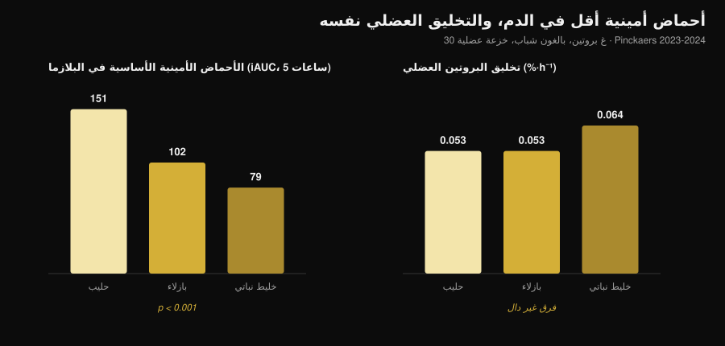
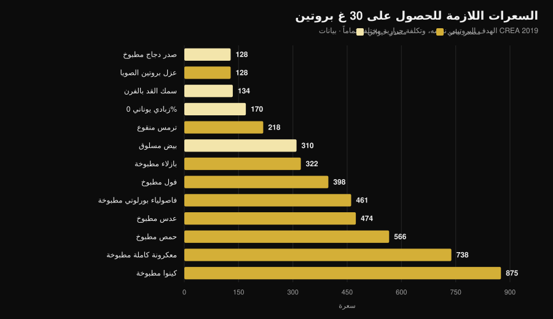

# بروتين نباتي أم حيواني لبناء العضلات؟

بقلم [Giammaria Loi](/autore/giammaria-loi) · تحديث 31 أكتوبر 2026

«البروتين النباتي ناقص، لا يبني عضلات.» من أكثر العبارات تكراراً في الصالات، والآلية خلفها تبدو منطقية: ليوسين أقل، تخليق بروتيني أقل. ثم ذهب أحدهم ليقيسها فعلاً، بخزعات عضلية، والنتيجة ليست المتوقعة. لكن هناك رقماً ثانياً لا يكاد أحد يذكره، وعنده يصبح الاختيار عملياً.

## باختصار

- **خمس دراسات بخزعة عضلية، خمس نتائج متعادلة.** ثلاثون غراماً من بروتين البازلاء أو القمح أو الذرة أو البطاطا أو خليط نباتي تعطي التخليق العضلي نفسه الذي تعطيه 30 غ من بروتين الحليب (فريق ماستريخت، 2021-2024).
- **آلية «نحتاج ليوسيناً أكثر» لا تصمد أمام القياس.** مع الخليط النباتي تنخفض الأحماض الأمينية الأساسية في الدم إلى النصف تقريباً (iAUC 79 مقابل 151)، والتخليق متطابق.
- **وعلى المدى الطويل الأمر نفسه.** أربع دراسات من 10 إلى 16 أسبوعاً على نباتيين صرفين ونساء نباتيات وخلائط نباتية لا تجد فرقاً في الكتلة أو سماكة العضلة أو القوة.
- **أكبر تحليل بعدي يرى أفضلية صغيرة للحيواني** (SMD −0.20 في الكتلة)، لكنها تأتي من مصادر نباتية غير الصويا ومن الأنظمة النباتية الكاملة، لا من مقارنة الصويا بالحليب.
- **الكلفة الحقيقية سعرات حرارية.** للحصول على 30 غ بروتين تحتاج 99 غ من صدر الدجاج المطبوخ و128 سعرة، أو 435 غ من العدس المطبوخ و474 سعرة (جداول CREA). أي نحو أربعة أضعاف.

## من أين يأتي الشك

البروتين ليس كتلة واحدة، بل سلسلة من الأحماض الأمينية، تسعة منها لا يستطيع الجسم تصنيعها (الأساسية). واحد منها، **الليوسين**، يعمل كمفتاح: فوق تركيز معيّن في الدم يشغّل الآلية التي تبني البروتين العضلي.

المصادر النباتية تحتوي في المتوسط على ليوسين وأحماض أمينية أساسية أقل لكل غرام مقارنة باللحم والبيض والسمك ومنتجات الألبان، وبعضها يُهضم بدرجة أقل قليلاً. ومن هنا الاستنتاج المنطقي: ليوسين أقل ← تخليق أقل ← عضلات أقل.

الاستدلال سليم. المشكلة أن الاستدلال السليم ليس نتيجة: لا بد من قياسه.

## التجربة التي تقيس فعلاً

بين 2021 و2024 نشر فريق Luc van Loon في جامعة ماستريخت **خمس تجارب عشوائية مزدوجة التعمية** بالتصميم نفسه: بالغون شباب، تسريب فينيل ألانين موسوم، خزعات عضلية متكررة على مدى 5 ساعات، 30 غ بروتين نباتي مقابل 30 غ بروتين حليب.

| البروتين النباتي المختبَر | التخليق، نباتي | حليب | النتيجة |
|---|---|---|---|
| قمح (Pinckaers 2021) | 0.056 %·h⁻¹ | 0.053 %·h⁻¹ | p = 0.56 |
| بطاطا (Pinckaers 2022) | 0.053 %·h⁻¹ | 0.050 %·h⁻¹ | p = 0.54 |
| خليط قمح+ذرة+بازلاء (Pinckaers 2023) | 0.064 %·h⁻¹ | 0.053 %·h⁻¹ | p = 0.08 |
| بازلاء (Pinckaers 2024) | 0.053 %·h⁻¹ | 0.053 %·h⁻¹ | p = 0.96 |
| ذرة (Pinckaers 2024) | 0.053 %·h⁻¹ | 0.053 %·h⁻¹ | p = 0.90 |

خمسة مصادر نباتية مختلفة، وخمس نتائج متعادلة. وفي دراسة البطاطا جرى القياس أيضاً **بعد حصة تدريب بالأثقال**: 0.069 مقابل 0.064 %·h⁻¹ لصالح البطاطا، p = 0.52. حتى في الحالة التي تهم من يتدرب، لا فرق.

يعرض الرسم المعطى الذي يفكك الآلية. الأحماض الأمينية الأساسية التي تصل إلى الدم خلال 5 ساعات بعد الوجبة (iAUC) هي **151 mmol·300 min·L⁻¹** مع الحليب، و**102** مع البازلاء، و**79** مع الخليط النباتي: فارق هائل وقوي إحصائياً (p < 0.001 في المقارنتين). أما التخليق العضلي فلا يتغير.

بعبارة أخرى: عند 30 غراماً من البروتين تكون العتبة قد تجاوزها الجميع. «ذروة الليوسين» تهم عندما تكون الجرعة صغيرة؛ أما في حصة واقعية فلا تعود هي الفيصل.

## وماذا عن الأشهر؟

التخليق المقيس خلال 5 ساعات مؤشر لا نتيجة. العضلة تُرى عبر أشهر. هنا تتوفر أربع دراسات، وينبغي قراءتها معاً.

**نباتيون صرفون مقابل آكلي كل شيء، 12 أسبوعاً** (Hevia-Larraín 2021، *Sports Medicine*). تسعة عشر نباتياً معتاداً و19 من آكلي كل شيء، رُفع البروتين إلى 1.6 غ لكل كغ يومياً بالصويا من جهة ومصل اللبن من جهة أخرى، حصتان أسبوعياً تحت إشراف. الكتلة الخالية من الدهون في الساق +1.2 كغ في المجموعتين؛ مساحة مقطع العضلة المستقيمة الفخذية +1.0 مقابل +0.9 سم²؛ 1RM في ضغط الأرجل +97 مقابل +117 كغ. لا فرق ذا دلالة في أي متغيّر.

**نظام نباتي عالي البروتين، 10 أسابيع** (Monteyne 2023، *Journal of Nutrition*). برنامج بحجم مرتفع، 5 حصص أسبوعياً، نحو 2 غ/كغ. الكتلة الخالية +2.6 كغ لدى آكلي كل شيء و+3.1 كغ في المجموعة النباتية؛ حجم عضلة الفخذ +8.3% في المجموعتين؛ مساحة مقطع الألياف +33% مقابل +32%.

**خليط نباتي مقابل مصل اللبن، 12 أسبوعاً** (Santini 2025، *JISSN*). أربعة وأربعون شاباً غير مدرَّب، 45 غ يومياً من المكمل موزعة على ثلاث وجبات. الكتلة الخالية الكلية +2.4 مقابل +2.5 كغ، مقطع العضلة الواسعة الوحشية +0.9 مقابل +1.3 سم²، 1RM في ضغط الأرجل +64 مقابل +63 كغ. لا فروق ذات دلالة بين المجموعتين.

**نساء نباتيات صارمات، 16 أسبوعاً** (Martini 2026، *Scandinavian Journal of Medicine & Science in Sports*). خمس وعشرون نباتية و20 غير نباتية، حصتان أسبوعياً، **بلا مكملات**. سماكة الفخذ من 81.2 إلى 85.6 ملم مقابل 80.8 إلى 87.3 ملم؛ القوة القصوى المركّبة من 106.9 إلى 132.6 كغ مقابل 107.9 إلى 133.1 كغ. لا فرق بين المجموعتين، رغم أن النباتيات تناولن **بروتيناً أقل**: 1.0 مقابل 1.3 غ/كغ (p = 0.002).

هذه النتيجة الأخيرة هي الأكثر إثارة والأكثر هشاشة في آن: الدراسة **غير عشوائية** (لا أحد يصبح نباتياً بالقرعة) وعلى نساء غير مدرَّبات، فهي لا تسمح بالقول إن 1 غ/كغ تكفي لمن يتدرب بجد.

## لماذا تقول التحليلات البعدية شيئاً مختلفاً قليلاً

تجد أوسع مراجعة منهجية (Reid-McCann 2025، *Nutrition Reviews*، 43 تجربة عشوائية، 30 في التحليل البعدي) أن البروتين النباتي، مقارنةً بالحيواني، **يترك كتلة عضلية أقل**: SMD −0.20 (فاصل ثقة 95% −0.37 / −0.03؛ p = 0.02)، والأثر متركز تحت سن 60 وغائب فوقها.

لكن التحليل نفسه، مفصَّلاً، يحدد بدقة أين يقع الفرق:

- **الصويا مقابل بروتين الحليب: لا فرق** (SMD −0.02؛ CI −0.20 / 0.16؛ p = 0.80)، في 17 تجربة؛
- **الحيواني مقابل نباتيات غير الصويا** (أرز، شيا، شوفان، بطاطا): −0.58 (CI −1.06 / −0.09)، في 5 تجارب؛
- **الحيواني مقابل أنظمة نباتية كاملة**: −0.51 (CI −0.91 / −0.11)، في 7 تجارب؛
- **القوة العضلية: لا فرق** (14 تجربة). **الأداء البدني: لا فرق** (5 تجارب).

ويصل التحليل الأسبق (Lim 2021، *Nutrients*، 16 تجربة) إلى المكان نفسه: لا أثر للمصدر على الكتلة الخالية المطلقة ولا على القوة، أفضلية صغيرة للحيواني في **نسبة** الكتلة الخالية، وتحت سن 50 زيادة 0.41 كغ (CI 0.08-0.74).

القراءة الأمينة: الفرق موجود، لكنه صغير، ويخص الكتلة لا القوة، ويختفي عند مقارنة بروتينين معزولين جيدي النوعية. ويعود للظهور على مستوى **الأنظمة الغذائية** النباتية الكاملة — أي حين لا تكون المشكلة في النوعية بل في الكمية التي يمكن تناولها فعلاً.

## المشكلة الحقيقية: فاتورة السعرات

أخذت جداول تركيب الأغذية الصادرة عن CREA وحسبت كم من الطعام، وبكم سعرة، يلزم للوصول إلى 30 غ بروتين — وهي الحصة المستخدمة في كل الدراسات أعلاه.

| الطعام (كما يُؤكل) | الغرامات اللازمة لـ 30 غ بروتين | سعرة | ألياف |
|---|---|---|---|
| صدر دجاج مطبوخ | 99 غ | 128 | 0 غ |
| عزل بروتين الصويا | 35 غ | 128 | 0 غ |
| سمك القد بالفرن | 171 غ | 134 | 0 غ |
| زبادي يوناني 0% | 333 غ | 170 | 0 غ |
| ترمس منقوع | 183 غ | 218 | 5 غ |
| بيض مسلوق (نحو 5 بيضات) | 242 غ | 310 | 0 غ |
| بازلاء خضراء مطبوخة | 309 غ | 322 | 20 غ |
| فول مقشور مطبوخ | 273 غ | 398 | 8 غ |
| فاصولياء بورلوتي مطبوخة | 435 غ | 461 | 30 غ |
| عدس مطبوخ | 435 غ | 474 | 36 غ |
| حمص مطبوخ | 429 غ | 566 | 25 غ |
| معكرونة كاملة مطبوخة | 405 غ | 738 | 14 غ |
| كينوا مطبوخة | 625 غ | 875 | 23 غ |

وجبة بـ 30 غ بروتين تكلف **128 سعرة** مع الدجاج و**474 سعرة** مع العدس. ثلاث وجبات يومياً تعني فارقاً يتجاوز **1000 سعرة**: في مرحلة التنشيف هذا مستحيل عملياً، وحتى في الثبات يملأ الطبق بكربوهيدرات ربما أردت إنفاقها في مكان آخر.

ثم هناك الحجم: 435 غ من العدس المطبوخ طبقان ممتلئان، ومعهما **36 غ ألياف**، أي أكثر من ضعف التوصية اليومية في جلسة واحدة. ليست مشكلة صحية، بل مشكلة معدة وتنظيم.

استثناءان يستحقان الانتباه، وهما تحديداً ما يغلق الدائرة مع الدراسات. **عزل بروتين الصويا** يكلف 128 سعرة لكل 30 غ بروتين، تماماً كصدر الدجاج: وهو البروتين النباتي الذي لا يخسر أبداً أمام الحليب في التحليلات البعدية. و**الترمس** عند 218 سعرة: أفضل غذاء نباتي كامل في الجدول.

إذا كنت تضبط البروتين في عجز حراري، فالمنطق هو نفسه الذي عرضناه في [كمية البروتين أثناء التنشيف](/ar/blog/protein-intake-cutting): الغرام لا يتغير، ما يتغير هو ما يأتي معه.

## ماذا يقول البحث فعلاً

**مفنَّد — «البروتين النباتي لا ينشّط التخليق العضلي مثل الحيواني».** خمس دراسات بخزعة، خمس نتائج متعادلة: قمح p = 0.56، بطاطا p = 0.54، بازلاء p = 0.96، ذرة p = 0.90، خليط p = 0.08 (لصالح النباتي).

**مفنَّد — «بدون ليوسين كافٍ لا تُبنى العضلات».** مع الخليط النباتي تنخفض الأحماض الأمينية الأساسية في الدم بنسبة 48% (79 مقابل 151 iAUC، p < 0.001) والتخليق متطابق.

**مفنَّد — «النباتي لا يستطيع أن ينمو عضلياً».** أربع دراسات من 10 إلى 16 أسبوعاً بلا فرق في الكتلة أو السماكة أو المقطع أو القوة.

**يحتاج توضيحاً — «المصدر لا يهم إطلاقاً».** أكبر تحليل بعدي يجد SMD −0.20 في الكتلة ضد النباتي، تحت سن 60. صغير، لكنه ليس صفراً.

**يحتاج توضيحاً — «يكفي أن تأكل بروتيناً نباتياً أكثر».** على الورق نعم؛ في الطبق يأتي هذا البروتين مع 3 إلى 4 أضعاف السعرات وألياف أكثر بكثير.

**مؤكَّد — «الصويا تصمد في المقارنة مع الحليب».** عبر 17 تجربة عشوائية، SMD −0.02 (CI −0.20 / 0.16): لا يمكن تمييزه عن الصفر.

**مفنَّد — «الصويا تخفض التستوستيرون لدى الرجال».** تحليل بعدي لـ 41 دراسة سريرية، قياس التستوستيرون الكلي لدى 1753 رجلاً: لا أثر على التستوستيرون الكلي والحر ولا على الإستراديول والإسترون وSHBG، مهما كانت الجرعة والمدة (Reed 2021).

**غير قابل للتحقق — «يجب الجمع بين الحبوب والبقوليات في كل وجبة».** في دراسات ماستريخت تعادل مصدر نباتي واحد مع الحليب دون أي جمع، لكن لم تقارن أي دراسة مباشرة «الجمع في كل وجبة» مع «الجمع على مدار اليوم» من حيث تضخم العضلات.

## كيف تطبّق ذلك

1. **انظر إلى المجموع اليومي لا إلى المصدر.** كل الدراسات التي انتهت بالتعادل عملت عند 1.6-2 غ لكل كغ من وزن الجسم يومياً.
2. **ارفع الجرعة في الوجبة مع المصادر النباتية.** الدراسات تستخدم 30 غ بروتين فعلي للحصة، لا 15-20 غ.
3. **ابنِ على الصويا والترمس.** هما المصدران النباتيان الأقل كلفة بالسعرات لكل غرام بروتين.
4. **احسب السعرات التي تأتي معها.** إذا كلفتك وجبة بروتين نباتي 400 سعرة بدل 130، فاخصمها من مكان آخر.
5. **ارفع الألياف تدريجياً.** الانتقال من 15 إلى 35 غ يومياً خلال أسبوع له ثمن: تدرّج ووزّع البقوليات.
6. **إذا بقي المجموع منخفضاً، استعمل مكملاً.** عزل صويا أو خليط صويا-بازلاء: في الدراسات ساوى 45 غ يومياً مصل اللبن.
7. **راقب B12 والحديد لا البروتين.** في نظام خالٍ من الأطعمة الحيوانية، هذه هي العناصر التي تُتابع مع الطبيب.

### جرّب Nurvan — بروتين محسوب على قاعدة بيانات CREA

خلاصة هذا المقال أن غرامات البروتين وحدها لا تكفي: المهم السعرات والحجم اللذان يأتيان معها. في Nurvan يعمل قسم التغذية على جداول CREA الرسمية، فعندما تسجّل 200 غ من العدس المطبوخ ترى البروتين والسعرات والألياف الحقيقية لذلك الطعام، لا متوسطاً من الإنترنت. تحدد هدف البروتين بـ غ/كغ فيخبرك التطبيق أين أنت وكم يكلفك الوصول؛ وإلى جانبه الأوزان وRIR والقياسات، لترى إن كان هذا البروتين يتحول فعلاً إلى عضلة. [جرّب Nurvan](https://nurvan.app).

## أسئلة شائعة

**هل يبني البروتين النباتي العضلات مثل الحيواني؟**
نعم، عند التساوي في الكمية. خمس تجارب عشوائية بخزعة عضلية تُظهر التخليق نفسه مع 30 غ من بروتين القمح أو البطاطا أو البازلاء أو الذرة أو خليط نباتي مقارنةً بـ 30 غ من بروتين الحليب، وأربع تجارب من 10 إلى 16 أسبوعاً لا تجد فرقاً في الكتلة ولا القوة.

**كم بروتيناً يومياً في نظام نباتي؟**
التجارب التي أعطت نتائج مطابقة لآكلي كل شيء استخدمت 1.6-2 غ لكل كغ من وزن الجسم يومياً. تجربة على نساء نباتيات قليلات التدريب لم تجد فرقاً حتى عند 1.0 غ/كغ، لكن بحصتين أسبوعياً فقط.

**هل يلزم الجمع بين الحبوب والبقوليات في الوجبة نفسها؟**
لا يبدو ضرورياً للتخليق العضلي: في دراسات ماستريخت تعادل مصدر نباتي واحد عند 30 غ مع الحليب. يبقى تنويع المصادر على مدار اليوم فكرة جيدة.

**هل يخفض بروتين الصويا التستوستيرون؟**
لا. جمع أحدث تحليل بعدي 41 دراسة سريرية، مع قياس التستوستيرون الكلي لدى 1753 رجلاً، ولم يجد أي أثر على التستوستيرون أو الإستراديول أو الإسترون أو SHBG.

## اقرأ أيضاً

- [كم بروتيناً يلزم أثناء التنشيف](/ar/blog/protein-intake-cutting) — حصة البروتين حين تكون السعرات قليلة.
- [ماذا تأكل عند الإصابة](/ar/blog/madha-takul-eind-alisaba) — البروتين والسعرات في أسابيع التوقف.
- [إعادة تركيب الجسم: خسارة الدهون وبناء العضلات](/ar/blog/iadat-tarkib-aljisd-khasarat-aldohun-binaa-alazalat) — كيف يتكامل البروتين مع العجز الحراري.

## المصادر

1. Pinckaers PJM, Kouw IWK, Hendriks FK, et al., 2021. *No differences in muscle protein synthesis rates following ingestion of wheat protein, milk protein, and their protein blend in healthy, young males.* British Journal of Nutrition 126(12):1832-1842. PMID [33597056](https://pubmed.ncbi.nlm.nih.gov/33597056/) · DOI [10.1017/S0007114521000635](https://doi.org/10.1017/S0007114521000635)
2. Pinckaers PJM, Hendriks FK, Hermans WJH, et al., 2022. *Potato Protein Ingestion Increases Muscle Protein Synthesis Rates at Rest and during Recovery from Exercise in Humans.* Medicine & Science in Sports & Exercise 54(9):1572-1581. PMID [35438672](https://pubmed.ncbi.nlm.nih.gov/35438672/) · DOI [10.1249/MSS.0000000000002937](https://doi.org/10.1249/MSS.0000000000002937)
3. Pinckaers PJM, Kouw IWK, Gorissen SHM, et al., 2023. *The Muscle Protein Synthetic Response to the Ingestion of a Plant-Derived Protein Blend Does Not Differ from an Equivalent Amount of Milk Protein in Healthy Young Males.* The Journal of Nutrition 152(12):2734-2743. PMID [36170964](https://pubmed.ncbi.nlm.nih.gov/36170964/) · DOI [10.1093/jn/nxac222](https://doi.org/10.1093/jn/nxac222)
4. Pinckaers PJM, Smeets JSJ, Kouw IWK, et al., 2024. *Post-prandial muscle protein synthesis rates following the ingestion of pea-derived protein do not differ from ingesting an equivalent amount of milk-derived protein in healthy, young males.* European Journal of Nutrition 63(3):893-904. PMID [38228945](https://pubmed.ncbi.nlm.nih.gov/38228945/) · DOI [10.1007/s00394-023-03295-6](https://doi.org/10.1007/s00394-023-03295-6)
5. Pinckaers PJM, Weijzen MEG, Houben LHP, et al., 2024. *The muscle protein synthetic response following corn protein ingestion does not differ from milk protein in healthy, young adults.* Amino Acids 56(1):8. PMID [38315260](https://pubmed.ncbi.nlm.nih.gov/38315260/) · DOI [10.1007/s00726-023-03377-z](https://doi.org/10.1007/s00726-023-03377-z)
6. Hevia-Larraín V, Gualano B, Longobardi I, et al., 2021. *High-Protein Plant-Based Diet Versus a Protein-Matched Omnivorous Diet to Support Resistance Training Adaptations: A Comparison Between Habitual Vegans and Omnivores.* Sports Medicine 51(6):1317-1330. PMID [33599941](https://pubmed.ncbi.nlm.nih.gov/33599941/) · DOI [10.1007/s40279-021-01434-9](https://doi.org/10.1007/s40279-021-01434-9)
7. Monteyne AJ, Coelho MOC, Murton AJ, et al., 2023. *Vegan and Omnivorous High Protein Diets Support Comparable Daily Myofibrillar Protein Synthesis Rates and Skeletal Muscle Hypertrophy in Young Adults.* The Journal of Nutrition 153(6):1680-1695. PMID [36822394](https://pubmed.ncbi.nlm.nih.gov/36822394/) · DOI [10.1016/j.tjnut.2023.02.023](https://doi.org/10.1016/j.tjnut.2023.02.023)
8. Santini MH, Erwig Leitão A, Mazzolani BC, et al., 2025. *Similar effects between animal-based and plant-based protein blend as complementary dietary protein on muscle adaptations to resistance training: findings from a randomized clinical trial.* Journal of the International Society of Sports Nutrition 22(1):2568047. PMID [41059835](https://pubmed.ncbi.nlm.nih.gov/41059835/) · DOI [10.1080/15502783.2025.2568047](https://doi.org/10.1080/15502783.2025.2568047)
9. Martini GL, Schemes MB, Strey B, et al., 2026. *No Differences in Muscular Adaptations to Long-Term Resistance Training Between Young Strict Vegetarian and Non-Vegetarian Women.* Scandinavian Journal of Medicine & Science in Sports 36(2):e70224. PMID [41684167](https://pubmed.ncbi.nlm.nih.gov/41684167/) · DOI [10.1111/sms.70224](https://doi.org/10.1111/sms.70224)
10. Reid-McCann RJ, Brennan SF, Ward NA, et al., 2025. *Effect of Plant Versus Animal Protein on Muscle Mass, Strength, Physical Performance, and Sarcopenia: A Systematic Review and Meta-analysis of Randomized Controlled Trials.* Nutrition Reviews 83(7):e1581-e1603. PMID [39813010](https://pubmed.ncbi.nlm.nih.gov/39813010/) · DOI [10.1093/nutrit/nuae200](https://doi.org/10.1093/nutrit/nuae200)
11. Lim MT, Pan BJ, Toh DWK, et al., 2021. *Animal Protein versus Plant Protein in Supporting Lean Mass and Muscle Strength: A Systematic Review and Meta-Analysis of Randomized Controlled Trials.* Nutrients 13(2):661. PMID [33670701](https://pubmed.ncbi.nlm.nih.gov/33670701/) · DOI [10.3390/nu13020661](https://doi.org/10.3390/nu13020661)
12. Reed KE, Camargo J, Hamilton-Reeves J, et al., 2021. *Neither soy nor isoflavone intake affects male reproductive hormones: An expanded and updated meta-analysis of clinical studies.* Reproductive Toxicology 100:60-67. PMID [33383165](https://pubmed.ncbi.nlm.nih.gov/33383165/) · DOI [10.1016/j.reprotox.2020.12.019](https://doi.org/10.1016/j.reprotox.2020.12.019)

بيانات تركيب الأغذية: CREA — مركز البحوث في الأغذية والتغذية (إيطاليا)، *جداول تركيب الأغذية*، تحديث 2019 ([alimentinutrizione.it](https://www.alimentinutrizione.it/tabelle-nutrizionali/ricerca-per-ordine-alfabetico)). وقد استُخرجت المصادر العلمية عبر PubMed.

إشارة الاتجاه وراء المقال: في أكتوبر 2026 صدرت خلال أيام قليلة دراستان حظيتا بتغطية واسعة حول المقارنة بين النباتي والحيواني (Martini 2026 وSantini 2025)، بينما يستمر نمو البحث عن إعادة تركيب الجسم والبروتين النباتي (Exploding Topics، بيانات حتى 17 أكتوبر 2026).

---

**Giammaria Loi** مؤسس Nurvan. يتدرب بالأثقال منذ 2012، ويعمل مدرباً شخصياً ومعتمداً من FIPE منذ 2013، ويشارك في منافسات رفع القوة على المستوى الوطني منذ 2018. كل مقال يوقّعه ينطلق من الدراسات العلمية ويصل إلى ما ينفع فعلاً في الصالة.

> ملاحظة: محتوى معلوماتي لا يغني عن رأي الطبيب أو المختص. إذا كنت تتبع نظاماً خالياً من الأطعمة الحيوانية، ناقش مع طبيبك متابعة فيتامين B12 والحديد وفيتامين D.
